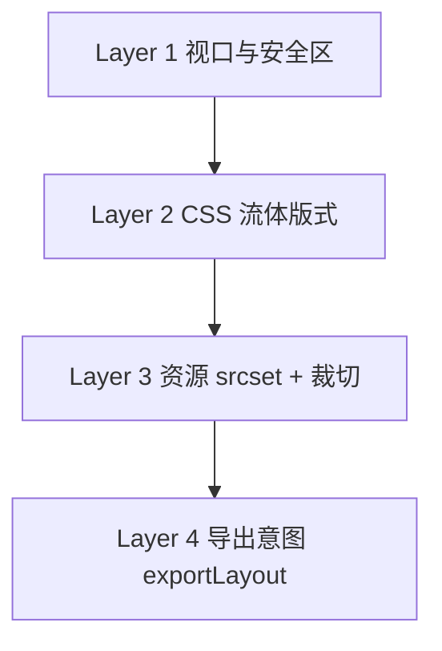

# Visual Journal · 终端自适应说明

> 配套：`templates/visual-journal/golden.css`、`manifest.json`  
> 已拍板决策见下文 §1。

---

## 1. 已拍板的产品决策

| 项 | 决定 | 理由 |
|----|------|------|
| Web/手机断点 | **768px（48rem）** | 覆盖 iPad 竖屏；手机全屏微信内嵌更稳 |
| 手机视觉 | **深色底 + 标题叠图（overlay）** | 突出照片；更像故事/Reels |
| 自适应策略 | **CSS 流体 + 多分辨率资源 + 可选导出裁切** | 见 §2–§4 |

---

## 2. 问题本质：设备千差万别，不能靠固定像素

| 误区 | 正确做法 |
|------|----------|
| 按 iPhone 14 设计 390×844 | 用 **比例盒 + 相对单位 + 上限** |
| 一张图一种尺寸 | **srcset / 多档 WebP** |
| 一种裁切走天下 | **auto 响应式** 或 **mobile/web 两档裁切** |
| 高度写死 800px | **`aspect-ratio` + `max-height: min(dvh, vw×比例)`** |

**结论**：模板 HTML 负责 **布局自适应**；ingest 负责 **像素自适应**；导出配置负责 **意图（偏竖/偏横）**。

---

## 3. 四层自适应架构（推荐实现顺序）



### Layer 1 · 视口与安全区（CSS，MVP 必做）

- `viewport`：`width=device-width, initial-scale=1, viewport-fit=cover`
- `env(safe-area-inset-*)`：刘海、Home 条（已用于封面与顶栏）
- 高度单位：**`dvh` / `svh`** 优先于 `vh`（地址栏伸缩）
- 禁止横向溢出：`overflow-x: hidden` on `body`（渲染器可加）

### Layer 2 · 流体版式（CSS，MVP 必做）

| 技术 | 用途 |
|------|------|
| `aspect-ratio: 9/16` 或 `16/9` | 任意宽度下保持构图 |
| `max-height: min(92dvh, 100vw×16/9)` | 矮宽屏不会无限拉高 |
| `width: min(1400px, 100vw)` | 4K 显示器不拉成一条 |
| `clamp()` 字号 | 320px–430px 手机字不会过小/过大 |
| `@media (min-width: 48rem)` | 手机 / Web 形态切换 |
| `html[data-layout]` | 导出时锁定竖版或横版 |

**已实现于** `golden.css` v0.2.1。

### Layer 3 · 图片资源（ingest，MVP 强烈建议）

每张图至少生成：

| 文件 | 宽度 | 用途 |
|------|------|------|
| `asset-001-w800.webp` | 800 | 小屏、省流量 |
| `asset-001-w1600.webp` | 1600 | 默认 |
| `asset-001-w2400.webp` | 2400 | 高分屏可选 |

HTML：

```html

```

**裁切（可选两档）**：

| 后缀 | 比例 | 场景 |
|------|------|------|
| `-m.webp` | 9:16 center crop | `exportLayout: mobile` |
| `-w.webp` | 16:9 center crop | `exportLayout: web` |

用 `<picture>` 按 `data-layout` 或 media 切换（渲染器输出）。

### Layer 4 · 导出意图（trip.json，v0.2）

```json
{
  "exportLayout": "auto",
  "meta": { "focalPoint": { "asset-001": { "x": 0.5, "y": 0.4 } } }
}
```

| 值 | 行为 |
|----|------|
| `auto` | 仅 CSS；随用户设备变 9:16 / 16:9 |
| `mobile` | `data-layout=mobile` + 优先 `-m` 裁切 |
| `web` | `data-layout=web` + 优先 `-w` 裁切 |

朋友圈发链接 → 建议 `mobile`；桌面收藏 → `auto` 或 `web`。

---

## 4. 各终端场景对照

| 场景 | 宽度约 | 模板行为 |
|------|--------|----------|
| iPhone SE | 320 | 9:16 满宽；字 `clamp`；横滑 92vw |
| iPhone 15 Pro | 393 | 同上 |
| 安卓大屏 | 412–430 | 同上；`max-height` 防止过高 |
| iPad 竖屏 | 768 | **切 Web 形态**（48rem）；若需保持 9:16 可改 `data-layout=mobile` |
| iPad 横屏 / 笔记本 | 1024+ | 16:9 出血；版心/出血随视口 `clamp` |
| 1080p / 2K 显示器 | 1920–2560 | 版心最高 **1320px**，出血最高 **1920px**；`sizes` 引导 srcset 选 1600/2400 |
| 4K | 3840+ | 同上封顶，两侧留白；不无限拉宽 |

**微信内置浏览器**：与系统 WebView 一致；重点测 `dvh`、`<audio>`、`overflow-x`。

---

## 5. 形态与自适应的关系

- **9:16 / 16:9** 是 **构图意图**，不是设备物理像素。  
- **同一 HTML** 在 393px 宽手机上显示 9:16 盒；在 1920px 显示器上显示 16:9 盒。  
- 若要求「发朋友圈一定是竖构图」，导出时设 `exportLayout: mobile`，不依赖用户设备。

---

## 6. 验收清单（真机）

- [ ] iPhone 竖屏：封面不顶刘海；底部字不被 Home 条挡  
- [ ] 安卓窄屏 360px：无横向滚动条  
- [ ] iPad 768px：确认是否接受 Web 形态（或强制 mobile）  
- [ ] 1920 / 2560 宽：大图居中，两侧不过空也不过宽  
- [ ] 微信打开：首屏 2s 内见封面；语音可播  
- [ ] 慢网：srcset 是否落到 800w（待 ingest 实现）

---

## 7. 版本

| 日期 | 说明 |
|------|------|
| 2026-05-19 | 初稿；断点 768px；golden.css v0.2.1 |
