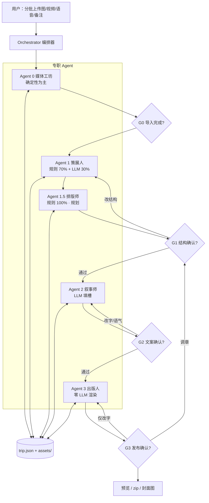
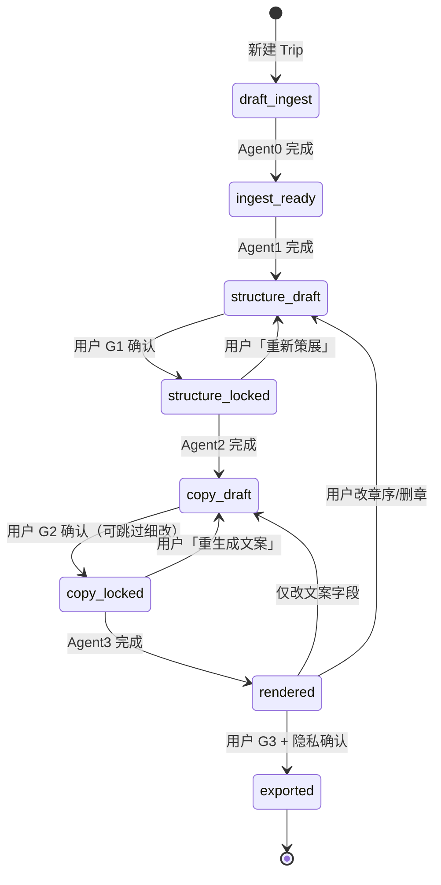

# 游记智能体 · Agent 架构（按人类写作步骤拆分）

| 属性 | 内容 |
|------|------|
| **产品代号** | Travelogue |
| **文档版本** | v0.1 |
| **状态** | 已拍板（实现待落地） |
| **核心契约** | `trip.json` 单一真相源；Agent **只改 JSON**，禁止直出 HTML |
| **模板** | `visual-journal` v0.2.1（见 `TEMPLATE-visual-journal.md`） |
| **关联文档** | `PRD-MVP.md`、`PRD-LAYOUT.md`、`TEMPLATE-visual-journal.md`、`ADAPTIVE-LAYOUT.md` |
| **更新日期** | 2026-05-19 |

---

## 1. 设计哲学

### 1.1 一句话

> **用「人类写一篇高质量视觉游记」的认知步骤，拆成 3 个专职 Agent（可选第 4 个媒体工坊）；由编排器串联、在关键闸口让人确认；最后拼装成可预览的单页 HTML，供改字、补语音、调序。**

### 1.2 与人类写作步骤的映射

| 人类在做什么 | 对应 Agent | 产出物（写入 `trip.json`） |
|--------------|------------|---------------------------|
| 把相机/手机里的素材倒进电脑，转格式、听一遍语音 | **Agent 0 · 媒体工坊**（可选） | `assets[]` 元数据、展示用图/视频、ASR 草稿 |
| 翻相册：删糊片、按天/地点分堆、选封面和每章代表作 | **Agent 1 · 策展人 Curator** | `chapters[]` 骨架、`patternId`、章内选图顺序 |
| 拼图：横竖怎么摆、三联还是双列、全景宽条 | **Agent 1.5 · 排版师 Layout**（规划） | `chapters[].items[]`、`rowLayout`、`layout.slot` |
| 起标题、写一两句感受、给每张图配短图说 | **Agent 2 · 叙事师 Storyteller** | `meta.*`、章/卡片的 title·caption·lead |
| 检查渲染、导出给朋友看 | **Agent 3 · 出版人 Publisher** | `index.html`、资源完整性、预览图/zip |

**编排器 Orchestrator** 不是「第四个作家」，而是 **项目经理**：排队、断点续跑、决定重跑哪一阶段、写运行日志。

### 1.3 三条铁律

1. **先结构后文案**：用户确认章节与选图（G1）之后，叙事师才动笔。  
2. **各 Agent 不越权**：策展不改长文；**排版不改文案、不写 HTML**；叙事不改章序与块结构；出版不重写故事（除非用户解锁结构）。  
3. **可复现**：同一 `trip.json` + 同一模板版本 → 渲染结果一致。

---

## 2. 系统总览



### 2.1 MVP 最小集（可省略 Agent 0）

| 配置 | 说明 |
|------|------|
| **3 Agent** | Agent 0 能力并入编排器内的 `ingest` 脚本；1 → 2 → 3 |
| **4 Agent** | 独立 Agent 0，便于单独测试 EXIF、转码、ASR；推荐 **P0 后期 / P1** |

---

## 3. Orchestrator（编排器）

### 3.1 职责

| 做 | 不做 |
|----|------|
| 维护 Trip **状态机** | 写游记正文 |
| 接收分批上传事件，触发增量 ingest | 替用户做 G1/G2/G3 决定 |
| 按状态调用 Agent 0–3 | 三个 Agent 互相「开会聊天」 |
| 记录 `runs/{runId}.json` 日志（阶段、耗时、模型版本） | 直接改 HTML |

### 3.2 Trip 状态机

状态持久化在 `trip.json` 的 `pipeline.status`（建议 v0.2 扩展字段）。



| 状态 | 含义 | 允许运行的 Agent |
|------|------|------------------|
| `draft_ingest` | 等待或正在导入 | 0 |
| `ingest_ready` | 素材就绪，未分章 | 1 |
| `structure_draft` | 已有章提案，待用户认 | 1（增量）、UI 编辑 |
| `structure_locked` | 结构已锁定 | 2 |
| `copy_draft` | 文案已生成，待用户认 | 2（单字段重生成）、UI 编辑 |
| `copy_locked` | 文案锁定 | 3 |
| `rendered` | 已有 HTML 预览 | 3（轻量重渲染）、UI 编辑 |
| `exported` | 已导出 zip | 3（再导出） |

### 3.3 重跑策略（产品承诺）

| 用户操作 | 重跑范围 |
|----------|----------|
| 改 title/caption/hook | 仅 Agent 3（或跳过，若仅 JSON 未变可缓存） |
| 换语气、重生文案 | Agent 2 → Agent 3 |
| 调章序、删图、换封面 | Agent 1 → 1.5（或 UI 直改 JSON）→ 若已锁定文案则提示重跑 Agent 2 |
| 仅改 `exportLayout` / 重新排版 | Agent 1.5 → 3 |
| 新一批上传（结构已锁定） | Agent 0 增量 → 提示是否合并进某章 → 可选 Agent 1 增量 |
| 补语音 | Agent 0 ASR → Agent 2 单卡 caption → Agent 3 |

---

## 4. Agent 0 · 媒体工坊（Media Lab）— 可选第四 Agent

### 4.1 人类步骤类比

> 「先把素材倒进文件夹，能打开的转成统一格式，语音听一遍转成文字草稿。」

### 4.2 职责边界

| 负责 | 不负责 |
|------|--------|
| 扫描 `source/`；拷贝原文件；解析 EXIF/GPS | 分章、选封面、写标题 |
| 生成 WebP 多档、`srcset`、可选 9:16/16:9 裁切 | 决定 pattern、叙事语气 |
| 视频：ffmpeg 截 3–8s 循环、poster | 嵌入 HTML |
| 语音：ASR → `asset.voice.transcript`（草稿） | 把 ASR 全文当唯一 caption（交给 Agent 2 精简） |
| GPS → 城市级 `place`；剥离精确坐标用于展示 | 公开展示街道级坐标 |
| 去重（perceptual hash / burst 启发式） | 删除用户已锁定 `locked: true` 的 asset |

### 4.3 实现方式

- **默认：零 LLM**（确定性 Python/Node 脚本 + ffmpeg + 可选地理 API）。  
- 仅在「无 EXIF 且文件名无语义」时，可选用 LLM 猜 `tags[]`（非 MVP）。

### 4.4 读写 `trip.json`

**写入：**

```json
{
  "pipeline": { "status": "ingest_ready", "lastBatchId": "batch-003" },
  "assets": [
    {
      "id": "asset-001",
      "type": "image",
      "sourceFile": "source/IMG_001.heic",
      "displayFile": "assets/asset-001-w1600.webp",
      "srcset": [{ "file": "assets/asset-001-w800.webp", "width": 800 }],
      "takenAt": "2025-04-02T15:30:00+09:00",
      "place": { "city": "京都", "country": "JP" },
      "ingestBatchId": "batch-001",
      "dedupeGroupId": "burst-12"
    }
  ]
}
```

**不写入：** `chapters`、`meta.title`、`meta.hook`、任何 HTML。

### 4.5 闸口 G0

| 项 | 说明 |
|----|------|
| 是否必须 | 可选自动通过；损坏文件列表展示即可 |
| 用户看什么 | 导入数量、失败列表、去重合并建议 |
| 用户动作 | 剔除废片、确认继续 → 进入 Agent 1 |

---

## 5. Agent 1 · 策展人（Curator）

### 5.1 人类步骤类比

> 「翻第二遍相册：这天京都、那天奈良；这张当封面；这章只要三张代表作，连拍留一张。」

### 5.2 职责边界

| 负责 | 不负责 |
|------|--------|
| 按 `takenAt`、城市聚类 → **3–5 章提案** | 写 hook、长导语、文学化段落 |
| 每章绑定 `patternId`（open/gallery/moment/close） | 输出 HTML |
| 章内选图与排序（目标态：`assetIds[]` 列表） | 写 `items[]` 块结构（→ Agent 1.5）、改 displayFile |
| 封面候选 3 张 → `coverAssetId` 提案 | 虚构未出现的地点/人物 |
| 视频卡位置（遵守 manifest：封面无视频等） | 把 ASR 全文写入 caption |

### 5.3 实现方式

| 能力 | 方式 |
|------|------|
| 分章、去重、配额 | **规则引擎**（主） |
| 章标题候选、模糊边界合并建议 | **LLM**（辅，可关） |
| 校验 | 对照 `templates/visual-journal/manifest.json` |

### 5.4 读写 `trip.json`

**写入：**

```json
{
  "pipeline": { "status": "structure_draft" },
  "coverAssetId": "asset-001",
  "coverCandidates": ["asset-001", "asset-014", "asset-022"],
  "chapters": [
    {
      "id": "ch-01",
      "patternId": "open",
      "title": "",
      "lead": "",
      "items": [
        {
          "type": "media-card",
          "assetId": "asset-001",
          "layout": { "fill": true, "bleed": true, "overlay": true }
        }
      ],
      "curation": {
        "anchorAssetId": "asset-001",
        "daySpan": ["2025-04-02"],
        "places": ["京都"]
      }
    }
  ]
}
```

**可写空字符串的文案字段**：`chapter.title`、`lead` 留空，由 Agent 2 填。  
**禁止写入：** `meta.hook`、卡片 `caption` 的最终用户定稿（可写 `proposedCaption` 草稿供 Agent 2 参考，MVP 可省略）。

### 5.5 闸口 G1（必确认）

| 项 | 说明 |
|----|------|
| 用户看什么 | 分章列表、每章缩略图条、pattern、封面三选一、**每章可选 tags 校对** |
| 用户动作 | 删图、跨章拖图、改章序、换 pattern；**每章填写 0–3 条 `memoryAnchors`**（用户原话）；锁定结构 |
| 确认后 | `pipeline.status = structure_locked`；**禁止** Agent 1 自动覆盖，除非用户点「重新策展」 |
| 手改后 | `travelogue validate` → `lock structure` → `run --from narrate`（不重跑 ingest，省 Token） |

详见 [adr/001-delivery-and-media.md](./adr/001-delivery-and-media.md)（交付形态、tags、状态机、封面）。

### 5.6 分批上传（增量策展）

| 事件 | 行为 |
|------|------|
| 新 `ingestBatchId` 到达且 `structure_locked` | 默认 **追加** 到「未分配」池，UI 提示「建议并入第 2 章」 |
| 用户点「重新策展」 | 状态回 `structure_draft`，Agent 1 全量重跑（保留 `edited: true` 的 meta 字段需产品决策：默认保留用户文案） |

---

## 5.7 Agent 1.5 · 排版师（Layout Composer）— 规划中

> **产品 PRD**：[PRD-LAYOUT.md](./PRD-LAYOUT.md)  
> **算法细则**：[LAYOUT-PLANNER.md](./LAYOUT-PLANNER.md)  
> **当前实现**：`travelogue/curation/layout_planner.py`（`demo from-album` 内嵌，尚未独立 CLI）

### 5.7.1 人类步骤类比

> 「素材都选好了，这一章三张横的并一排，全景单独一条，竖图别挤成两列细条。」

### 5.7.2 职责边界

| 负责 | 不负责 |
|------|--------|
| `classify_aspect` / `orientationSummary` | 分章、选封面（Agent 1） |
| 按 `exportLayout`（mobile/web）生成 `items[]` | title、caption、hook（Agent 2） |
| `media-row` 的 `rowLayout`、`media-card` 的 `layout.slot` | 输出 HTML（Agent 3） |
| 建议 `patternId=gallery`（横滑章） | 修改 `source/` 原图 |
| **默认零 LLM** | 自由 DOM |

### 5.7.3 流水线位置

```text
Agent 0 ingest  →  Agent 1 curate（章 + 选图）  →  Agent 1.5 layout  →  G1  →  Agent 2  →  Agent 3
```

| 用户操作 | 重跑 |
|----------|------|
| 仅改 `exportLayout` | Agent 1.5 → 3 |
| 章内只调图序 | Agent 1.5 → 3 |
| 改章列表 / 删图 | Agent 1 → 1.5 →（2?）→ 3 |

### 5.7.4 读写 `trip.json`

**写入：** `curation.orientationSummary`、`chapters[].items[]`、`pipeline.layoutStatus`（建议字段，见 PRD-LAYOUT §10）

**只读：** `assets[]`、`exportLayout`、`coverAssetId`、章级 `assetIds` 提案（若 Agent 1 提供）

**不写入：** `meta.*` 文案字段、HTML、zip。

---

## 6. Agent 2 · 叙事师（Storyteller）

### 6.1 人类步骤类比

> 「给相册起个名字，每张图配一句话，把语音里那句原话嵌进去。」

### 6.2 职责边界

| 负责 | 不负责 |
|------|--------|
| `meta.title/subtitle/hook`、`epilogue` | 调整 `chapters[].items` 顺序 |
| `chapter.title`、`chapter.lead` | 更换 `patternId`、换封面 |
| `media-card` 的 `title`、`caption` | 生成 HTML |
| 从 `voice.transcript` **精简** caption（遵守 manifest 字数） | 虚构事实 |
| 语气：`relaxed` / `documentary` | 改动 asset 文件 |

### 6.3 实现方式

- **LLM 填槽**；输入为结构化 **brief**（非原始二进制）。  
- 输出必须经过 **JSON Schema + manifest limits** 校验；失败最多自动修 2 次（见 `PRD-MVP.md` §9.2）。  
- 用户已设 `edited: true` 的字段：**跳过** 除非用户点「重生成该字段」。

### 6.4 Brief 示例（传给 LLM）

```json
{
  "trip": {
    "dateStart": "2025-04-02",
    "dateEnd": "2025-04-06",
    "places": ["京都"],
    "tone": "relaxed"
  },
  "chapter": {
    "id": "ch-02",
    "patternId": "moment",
    "places": ["祇园"],
    "assetSummaries": [
      { "id": "a10", "tags": ["night", "rain", "alley"], "hasVoice": true }
    ]
  },
  "userNotes": "别拍了走一段",
  "voiceExcerpt": "雨太大了我们先回酒店",
  "limits": { "chapterTitleMaxChars": 12, "captionMaxChars": 60 }
}
```

### 6.5 读写 `trip.json`

**写入：**

```json
{
  "pipeline": { "status": "copy_draft" },
  "meta": {
    "title": "雨后京都",
    "subtitle": "五天，两个人",
    "hook": "鸭川边那阵吹干雨衣的风。",
    "tone": "relaxed"
  },
  "chapters": [
    {
      "id": "ch-02",
      "title": "祇园夜雨",
      "lead": "",
      "items": [
        {
          "type": "media-card",
          "assetId": "a10",
          "title": "石板路",
          "caption": "雨太大了，先回酒店。",
          "edited": false
        }
      ]
    }
  ],
  "epilogue": "回去路上鞋还是湿的。"
}
```

**voice 相关：**

```json
{
  "voice": {
    "audioFile": "assets/a10-voice.m4a",
    "transcript": "雨太大了我们先回酒店拿伞……",
    "transcriptCollapsed": true
  }
}
```

### 6.6 闸口 G2

| 项 | 说明 |
|----|------|
| 是否必停 | **建议停**；赶时间可「采用并继续」 |
| 用户动作 | 改字、录语音、单字段「重生成」、换语气 |
| 确认后 | `copy_locked` → 触发 Agent 3 |

---

## 7. Agent 3 · 出版人（Publisher）

### 7.1 人类步骤类比

> 「排版、检查有没有裂图、导出 PDF/HTML 发给朋友审一遍。」

### 7.2 职责边界

| 负责 | 不负责 |
|------|--------|
| `trip.json` + `visual-journal` → `index.html`、`journal.css` | 改章结构、重写 hook |
| 补全：`alt`、缺 poster、缺 `srcset` 回退 | 调用 LLM 写新段落 |
| `exportLayout` → `<html data-layout>` | 修改用户 `edited: true` 文案 |
| 生成 `preview.jpg`（9:16）、`trip-{id}.zip` | |
| `share` 模式：折叠转写、剥离 EXIF 元数据 | |
| 对照 manifest **Validate**（可作为 Publisher 子步骤，不单独 Agent） | |

### 7.3 实现方式

- **零 LLM**；Handlebars/EJS + 静态 CSS（与 `golden.html` 对齐）。  
- Validate 失败 → **报错回 Orchestrator**，不静默改 JSON。

### 7.4 输出目录

```
trips/{tripId}/
  trip.json
  assets/
  index.html
  journal.css
  preview.jpg          # 可选
  trip-{tripId}.zip    # 导出时
```

### 7.5 闸口 G3（发布确认）

| 项 | 说明 |
|----|------|
| 用户看什么 | 浏览器预览、隐私勾选、exportLayout |
| 用户动作 | 调序（若动结构 → 回 G1）、改字（→ 轻量 Agent 3）、确认导出 |
| 隐私 | `privacy.stripExifOnExport` + `confirmedAt` 写入后才 `exported` |

---

## 8. 人类在环（HITL）汇总

| 闸口 | 时机 | 确认什么 | 不通过 |
|------|------|----------|--------|
| **G0** | Agent 0 后 | 导入清单、去重 | 剔除文件后重跑 0 |
| **G1** | Agent 1 后 | **章结构、选图、封面、pattern** | 编辑或重跑 1 |
| **G2** | Agent 2 后 | 标题、hook、图说、语气 | 改字或重跑 2 |
| **G3** | Agent 3 后 | 版式预览、隐私、导出意图 | 改字/调序/再渲染 |

**MVP 可简化**：G0 自动；G2 合并进 G3 预览页侧边栏改字（但逻辑上仍属「文案确认」）。

---

## 9. 分批上传协议

### 9.1 字段

| 字段 | 位置 | 说明 |
|------|------|------|
| `ingestBatchId` | 每个 `asset` | 如 `batch-20250402-1430` |
| `pipeline.lastBatchId` | trip 根 | 最近一批 |
| `pipeline.pendingAssets` | 可选 | 未归入章节的 asset id 列表 |

### 9.2 流程

```
用户选择新文件夹 / 拖拽新文件
  → Orchestrator 分配 batchId
  → Agent 0 仅处理新文件（增量）
  → 若 structure_locked：写入 pendingAssets + UI 通知
  → 若 structure_draft：Agent 1 增量合并提案
```

### 9.3 冲突规则

| 场景 | 规则 |
|------|------|
| 重复文件（hash） | 跳过，提示已存在 |
| 新图导致章数 > 5 | 提示合并章或让用户删图 |
| 已 exported 又上传 | 状态回 `rendered`，不自动改已分享 zip |

---

## 10. Agent 间契约（禁止越权）

| 字段 / 动作 | Agent 0 | Agent 1 | Agent 2 | Agent 3 | 用户 UI |
|-------------|---------|---------|---------|---------|---------|
| `assets[]` 文件与元数据 | W | R | R | R | R/W |
| `chapters[]` 结构 | — | W | R | R | R/W（G1 后受锁） |
| `patternId` | — | W | — | R | R/W |
| `meta.*` 文案 | — | — | W | R | R/W |
| 卡片 title/caption | — | — | W | R | R/W |
| `coverAssetId` | — | W | R | R | R/W |
| `index.html` | — | — | — | W | — |
| `edited: true` 字段 | — | — | 尊重 | 尊重 | W |

图例：W=可写，R=只读，—=不可碰。

---

## 11. 技术形态（实现参考）

### 11.1 Agent 实现选项

| Agent | 推荐实现 | 模型 |
|-------|----------|------|
| 0 媒体工坊 | Python CLI 模块 `ingest` | 无 / 可选小模型打标签 |
| 1 策展人 | `curate` 规则 + 可选 `curate_llm` | 小模型即可 |
| 2 叙事师 | `narrative` + schema 校验 | 用户配置的主模型 |
| 3 出版人 | `render` + `validate` | 无 |
| Orchestrator | `travelogue run --trip-id` | 无 |

### 11.2 与 Cursor Skill 的关系

- 每个 Agent 可对应一个 **Skill**（开发者自用最快），但运行时仍写同一 `trip.json`。  
- Skill 不得绕过状态机直接调用 Agent 2（防止未确认结构就写完全文）。

### 11.3 目录约定

```
travelogue/
  orchestrator/       # 状态机、调度
  agents/
    media_lab/        # Agent 0
    curator/          # Agent 1
    storyteller/      # Agent 2
    publisher/        # Agent 3
  schemas/
    trip.schema.json  # 待冻结
  templates/visual-journal/
  trips/{tripId}/
```

---

## 12. 反模式（避免）

| 反模式 | 后果 |
|--------|------|
| 三个 Agent 群聊协商 | 慢、贵、不可复现 |
| Agent 2 在 G1 之前写完全文 | 改结构即废纸，用户挫败 |
| Agent 3 用 LLM 「再润色一遍」 | 与模板冲突、难校验 |
| 无 `trip.json`、各 Agent 各存一份 | 同步地狱 |
| 每批上传全量重跑且覆盖 `edited` | 用户信任崩塌 |
| Agent 1 输出 HTML | 布局漂移 |

---

## 13. 里程碑对齐（建议）

| 阶段 | 交付 | Agent |
|------|------|-------|
| M1 | EXIF + `trip.json` + 目录 | 0（脚本） |
| M2 | 分章提案 + G1 CLI/UI | 1 |
| M3 | 填槽文案 + G2 | 2 |
| M4 | golden 模板渲染 + 预览 | 3 |
| M5 | 分批上传 + 增量 | 0 + Orchestrator |
| M6 | zip + preview.jpg + 隐私 G3 | 3 |

---

## 14. `trip.json` 建议扩展（pipeline 块）

```json
{
  "version": "0.2",
  "templateId": "visual-journal",
  "pipeline": {
    "status": "structure_draft",
    "lastBatchId": "batch-001",
    "pendingAssets": [],
    "locks": {
      "structure": false,
      "copy": false
    },
    "runs": [
      {
        "runId": "run-20250519-1",
        "agent": "curator",
        "startedAt": "2026-05-19T10:00:00Z",
        "finishedAt": "2026-05-19T10:00:12Z",
        "model": null
      }
    ]
  }
}
```

冻结 Schema 时写入 `schemas/trip.schema.json`，与 `TEMPLATE-visual-journal.md` §10 合并。

---

## 15. 文档修订记录

| 版本 | 日期 | 说明 |
|------|------|------|
| v0.1 | 2026-05-19 | 初版：3+1 Agent、状态机、闸口、分批协议、字段契约 |

---

**下一步建议**：冻结 `schemas/trip.schema.json`（含 `pipeline`）；实现 Orchestrator 状态机单测；Agent 0 ingest 与 Agent 3 渲染优先打通闭环，再接入 Agent 1/2。
