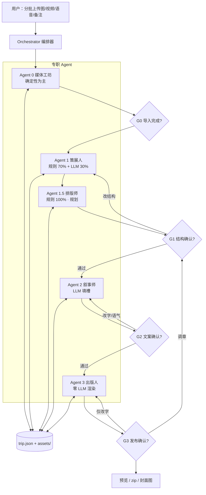
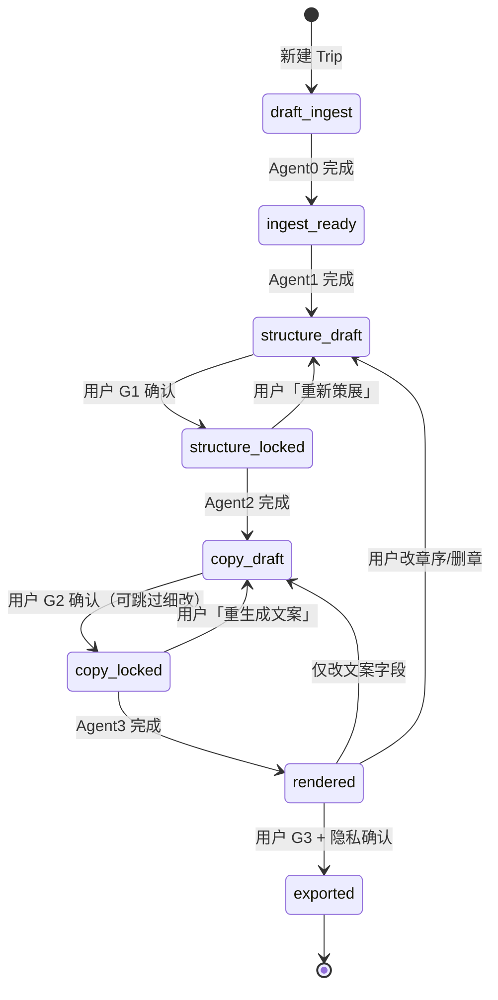
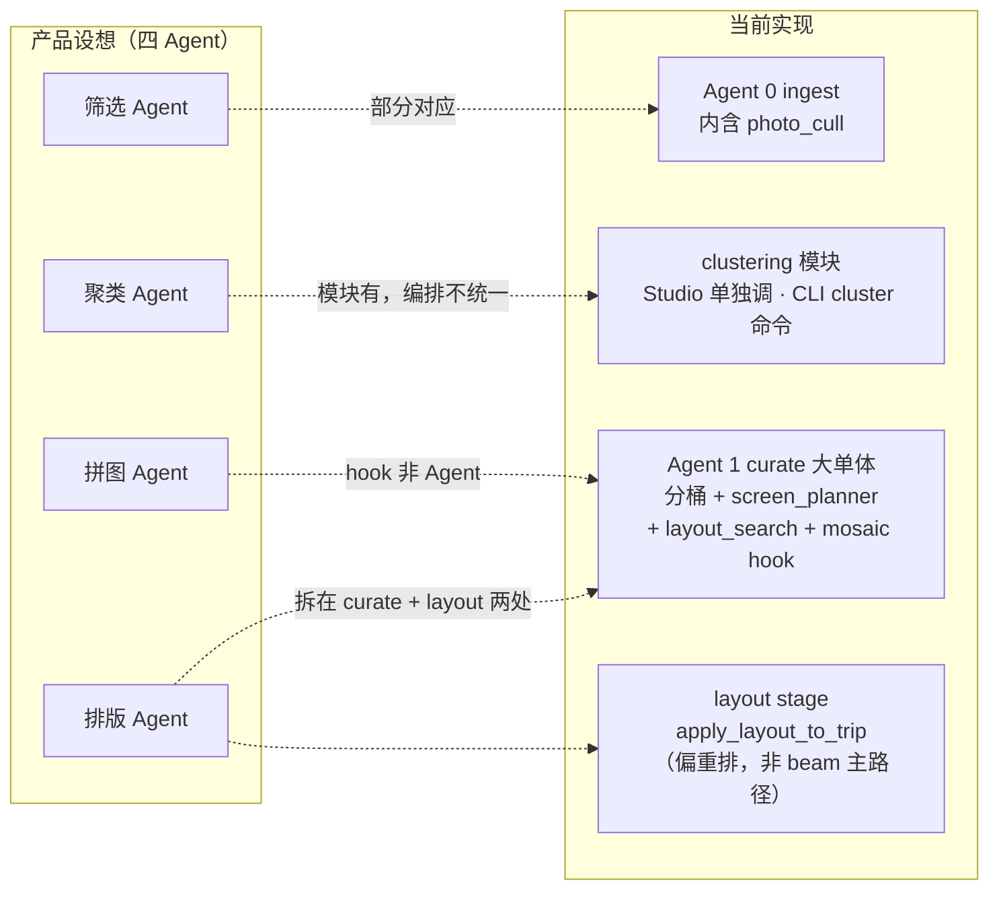
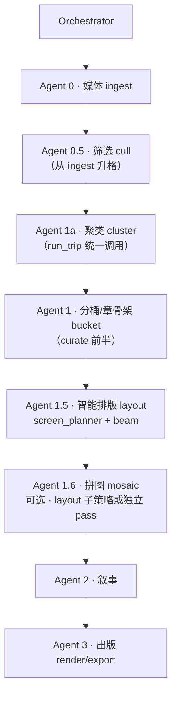
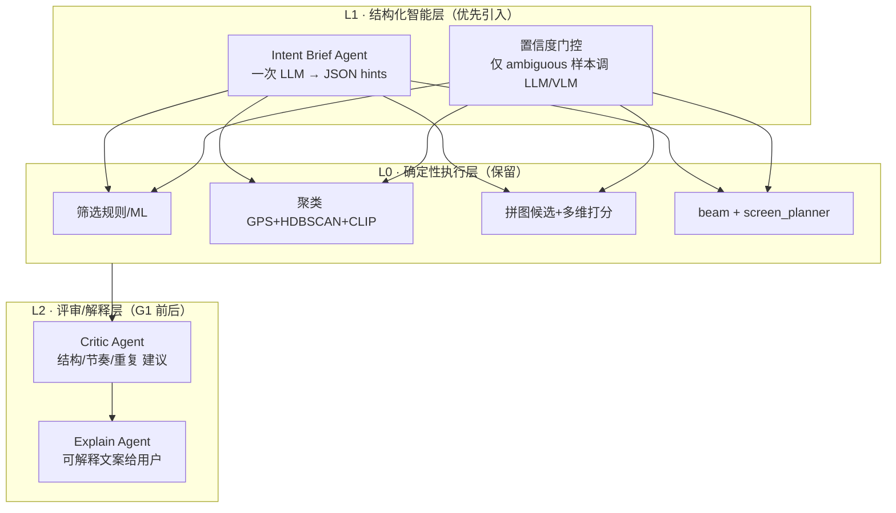

# 游记智能体 · Agent 架构（按人类写作步骤拆分）

| 属性 | 内容 |
|------|------|
| **产品代号** | Travelogue |
| **文档版本** | v0.3 |
| **状态** | 已拍板；**Orchestrator + Agent 0–3 已落地**；策展四子系统 **模块边界清晰、编排层尚未对等升格**（见 §15）；**LLM 增强路径**见 §17 |
| **核心契约** | `trip.json` 单一真相源；Agent **只改 JSON**，禁止直出 HTML |
| **模板** | `visual-journal` v0.2.1（见 `TEMPLATE-visual-journal.md`） |
| **关联文档** | `PRD-MVP.md`、`PRD-LAYOUT.md`、`TEMPLATE-visual-journal.md`、`ADAPTIVE-LAYOUT.md`、`ARCHITECTURE-OVERVIEW.md`、`DESIGN-PHASE15-mosaic-system.md` |
| **更新日期** | 2026-06-04 |

---

## 1. 设计哲学

### 1.1 一句话

> **用「人类写一篇高质量视觉游记」的认知步骤，拆成 3 个专职 Agent（可选第 4 个媒体工坊）；由编排器串联、在关键闸口让人确认；最后拼装成可预览的单页 HTML，供改字、补语音、调序。**

### 1.2 与人类写作步骤的映射

| 人类在做什么 | 对应 Agent | 产出物（写入 `trip.json`） |
|--------------|------------|---------------------------|
| 把相机/手机里的素材倒进电脑，转格式、听一遍语音 | **Agent 0 · 媒体工坊**（可选） | `assets[]` 元数据、展示用图/视频、ASR 草稿 |
| 翻相册：删糊片、去重复、质量闸口 | **筛选子系统**（目标 Agent 0.5 · Cull；当前合并在 ingest） | `curation.cullSummary`、`assets[].layoutEligible` |
| 按 GPS/场景/时间分堆、打簇 | **聚类子系统**（目标 Agent 1a · Cluster；Studio 已单独调） | `curation.clustering` |
| 翻相册：按天/地点分章、选封面和每章代表作 | **Agent 1 · 策展人 Curator** | `chapters[]` 骨架、`patternId`、分桶与章结构 |
| 拼图：五联窗、横竖组合、MCS 候选 | **拼图子系统**（目标 Agent 1.6 · Mosaic；当前为排版 hook） | `curation.mosaicDecisionLog` 等 |
| 横竖怎么摆、组屏、beam 选优 | **Agent 1.5 · 排版师 Layout**（规划 + 实现中） | `chapters[].items[]`、`screens[]`、`layoutStatus` |
| 起标题、写一两句感受、给每张图配短图说 | **Agent 2 · 叙事师 Storyteller** | `meta.*`、章/卡片的 title·caption·lead |
| 检查渲染、导出给朋友看 | **Agent 3 · 出版人 Publisher** | `index.html`、资源完整性、预览图/zip |

**编排器 Orchestrator** 不是「第四个作家」，而是 **项目经理**：排队、断点续跑、决定重跑哪一阶段、写运行日志。

### 1.3 三条铁律

1. **先结构后文案**：用户确认章节与选图（G1）之后，叙事师才动笔。  
2. **各 Agent 不越权**：策展不改长文；**排版不改文案、不写 HTML**；叙事不改章序与块结构；出版不重写故事（除非用户解锁结构）。  
3. **可复现**：同一 `trip.json` + 同一模板版本 → 渲染结果一致。

---

## 2. 系统总览



### 2.1 MVP 最小集（可省略 Agent 0）

| 配置 | 说明 |
|------|------|
| **3 Agent** | Agent 0 能力并入编排器内的 `ingest` 脚本；1 → 2 → 3 |
| **4 Agent** | 独立 Agent 0，便于单独测试 EXIF、转码、ASR；推荐 **P0 后期 / P1** |

**策展四子系统**（筛选 / 聚类 / 拼图 / 智能排版）与 Agent 0–3 的关系、实现对照与升格路径见 **§15**。

---

## 3. Orchestrator（编排器）

### 3.1 职责

| 做 | 不做 |
|----|------|
| 维护 Trip **状态机** | 写游记正文 |
| 接收分批上传事件，触发增量 ingest | 替用户做 G1/G2/G3 决定 |
| 按状态调用 Agent 0–3 | 三个 Agent 互相「开会聊天」 |
| 记录 `runs/{runId}.json` 日志（阶段、耗时、模型版本） | 直接改 HTML |

### 3.2 Trip 状态机

状态持久化在 `trip.json` 的 `pipeline.status`（建议 v0.2 扩展字段）。



| 状态 | 含义 | 允许运行的 Agent |
|------|------|------------------|
| `draft_ingest` | 等待或正在导入 | 0 |
| `ingest_ready` | 素材就绪，未分章 | 1 |
| `structure_draft` | 已有章提案，待用户认 | 1（增量）、UI 编辑 |
| `structure_locked` | 结构已锁定 | 2 |
| `copy_draft` | 文案已生成，待用户认 | 2（单字段重生成）、UI 编辑 |
| `copy_locked` | 文案锁定 | 3 |
| `rendered` | 已有 HTML 预览 | 3（轻量重渲染）、UI 编辑 |
| `exported` | 已导出 zip | 3（再导出） |

### 3.3 重跑策略（产品承诺）

| 用户操作 | 重跑范围 |
|----------|----------|
| 改 title/caption/hook | 仅 Agent 3（或跳过，若仅 JSON 未变可缓存） |
| 换语气、重生文案 | Agent 2 → Agent 3 |
| 调章序、删图、换封面 | Agent 1 → 1.5（或 UI 直改 JSON）→ 若已锁定文案则提示重跑 Agent 2 |
| 仅改 `exportLayout` / 重新排版 | Agent 1.5 → 3 |
| 新一批上传（结构已锁定） | Agent 0 增量 → 提示是否合并进某章 → 可选 Agent 1 增量 |
| 补语音 | Agent 0 ASR → Agent 2 单卡 caption → Agent 3 |

---

## 4. Agent 0 · 媒体工坊（Media Lab）— 可选第四 Agent

### 4.1 人类步骤类比

> 「先把素材倒进文件夹，能打开的转成统一格式，语音听一遍转成文字草稿。」

### 4.2 职责边界

| 负责 | 不负责 |
|------|--------|
| 扫描 `source/`；拷贝原文件；解析 EXIF/GPS | 分章、选封面、写标题 |
| 生成 WebP 多档、`srcset`、可选 9:16/16:9 裁切 | 决定 pattern、叙事语气 |
| 视频：ffmpeg 截 3–8s 循环、poster | 嵌入 HTML |
| 语音：ASR → `asset.voice.transcript`（草稿） | 把 ASR 全文当唯一 caption（交给 Agent 2 精简） |
| GPS → 城市级 `place`；剥离精确坐标用于展示 | 公开展示街道级坐标 |
| 去重（perceptual hash / burst 启发式） | 删除用户已锁定 `locked: true` 的 asset |

### 4.3 实现方式

- **默认：零 LLM**（确定性 Python/Node 脚本 + ffmpeg + 可选地理 API）。  
- 仅在「无 EXIF 且文件名无语义」时，可选用 LLM 猜 `tags[]`（非 MVP）。

### 4.4 读写 `trip.json`

**写入：**

```json
{
  "pipeline": { "status": "ingest_ready", "lastBatchId": "batch-003" },
  "assets": [
    {
      "id": "asset-001",
      "type": "image",
      "sourceFile": "source/IMG_001.heic",
      "displayFile": "assets/asset-001-w1600.webp",
      "srcset": [{ "file": "assets/asset-001-w800.webp", "width": 800 }],
      "takenAt": "2025-04-02T15:30:00+09:00",
      "place": { "city": "京都", "country": "JP" },
      "ingestBatchId": "batch-001",
      "dedupeGroupId": "burst-12"
    }
  ]
}
```

**不写入：** `chapters`、`meta.title`、`meta.hook`、任何 HTML。

### 4.5 闸口 G0

| 项 | 说明 |
|----|------|
| 是否必须 | 可选自动通过；损坏文件列表展示即可 |
| 用户看什么 | 导入数量、失败列表、去重合并建议 |
| 用户动作 | 剔除废片、确认继续 → 进入 Agent 1 |

---

## 5. Agent 1 · 策展人（Curator）

### 5.1 人类步骤类比

> 「翻第二遍相册：这天京都、那天奈良；这张当封面；这章只要三张代表作，连拍留一张。」

### 5.2 职责边界

| 负责 | 不负责 |
|------|--------|
| 按 `takenAt`、城市聚类 → **3–5 章提案** | 写 hook、长导语、文学化段落 |
| 每章绑定 `patternId`（open/gallery/moment/close） | 输出 HTML |
| 章内选图与排序（目标态：`assetIds[]` 列表） | 写 `items[]` 块结构（→ Agent 1.5）、改 displayFile |
| 封面候选 3 张 → `coverAssetId` 提案 | 虚构未出现的地点/人物 |
| 视频卡位置（遵守 manifest：封面无视频等） | 把 ASR 全文写入 caption |

### 5.3 实现方式

| 能力 | 方式 |
|------|------|
| 分章、去重、配额 | **规则引擎**（主） |
| 章标题候选、模糊边界合并建议 | **LLM**（辅，可关） |
| 校验 | 对照 `templates/visual-journal/manifest.json` |

### 5.4 读写 `trip.json`

**写入：**

```json
{
  "pipeline": { "status": "structure_draft" },
  "coverAssetId": "asset-001",
  "coverCandidates": ["asset-001", "asset-014", "asset-022"],
  "chapters": [
    {
      "id": "ch-01",
      "patternId": "open",
      "title": "",
      "lead": "",
      "items": [
        {
          "type": "media-card",
          "assetId": "asset-001",
          "layout": { "fill": true, "bleed": true, "overlay": true }
        }
      ],
      "curation": {
        "anchorAssetId": "asset-001",
        "daySpan": ["2025-04-02"],
        "places": ["京都"]
      }
    }
  ]
}
```

**可写空字符串的文案字段**：`chapter.title`、`lead` 留空，由 Agent 2 填。  
**禁止写入：** `meta.hook`、卡片 `caption` 的最终用户定稿（可写 `proposedCaption` 草稿供 Agent 2 参考，MVP 可省略）。

### 5.5 闸口 G1（必确认）

| 项 | 说明 |
|----|------|
| 用户看什么 | 分章列表、每章缩略图条、pattern、封面三选一、**每章可选 tags 校对** |
| 用户动作 | 删图、跨章拖图、改章序、换 pattern；**每章填写 0–3 条 `memoryAnchors`**（用户原话）；锁定结构 |
| 确认后 | `pipeline.status = structure_locked`；**禁止** Agent 1 自动覆盖，除非用户点「重新策展」 |
| 手改后 | `travelogue validate` → `lock structure` → `run --from narrate`（不重跑 ingest，省 Token） |

详见 [adr/001-delivery-and-media.md](./adr/001-delivery-and-media.md)（交付形态、tags、状态机、封面）。

### 5.6 分批上传（增量策展）

| 事件 | 行为 |
|------|------|
| 新 `ingestBatchId` 到达且 `structure_locked` | 默认 **追加** 到「未分配」池，UI 提示「建议并入第 2 章」 |
| 用户点「重新策展」 | 状态回 `structure_draft`，Agent 1 全量重跑（保留 `edited: true` 的 meta 字段需产品决策：默认保留用户文案） |

---

## 5.7 Agent 1.5 · 排版师（Layout Composer）— 规划中

> **产品 PRD**：[PRD-LAYOUT.md](./PRD-LAYOUT.md)  
> **算法细则**：[LAYOUT-PLANNER.md](./LAYOUT-PLANNER.md)  
> **当前实现**：`travelogue/services/layout.py`（`apply_layout_to_trip` · 独立 `layout` CLI stage）；**智能排版主路径**（`screen_planner` + `layout_search` beam）仍在 `run_curate()` 内（见 §15）

### 5.7.1 人类步骤类比

> 「素材都选好了，这一章三张横的并一排，全景单独一条，竖图别挤成两列细条。」

### 5.7.2 职责边界

| 负责 | 不负责 |
|------|--------|
| `classify_aspect` / `orientationSummary` | 分章、选封面（Agent 1） |
| 按 `exportLayout`（mobile/web）生成 `items[]` | title、caption、hook（Agent 2） |
| `media-row` 的 `rowLayout`、`media-card` 的 `layout.slot` | 输出 HTML（Agent 3） |
| 建议 `patternId=gallery`（横滑章） | 修改 `source/` 原图 |
| **默认零 LLM** | 自由 DOM |

### 5.7.3 流水线位置

```text
Agent 0 ingest  →  Agent 1 curate（章 + 选图）  →  Agent 1.5 layout  →  G1  →  Agent 2  →  Agent 3
```

| 用户操作 | 重跑 |
|----------|------|
| 仅改 `exportLayout` | Agent 1.5 → 3 |
| 章内只调图序 | Agent 1.5 → 3 |
| 改章列表 / 删图 | Agent 1 → 1.5 →（2?）→ 3 |

### 5.7.4 读写 `trip.json`

**写入：** `curation.orientationSummary`、`chapters[].items[]`、`pipeline.layoutStatus`（建议字段，见 PRD-LAYOUT §10）

**只读：** `assets[]`、`exportLayout`、`coverAssetId`、章级 `assetIds` 提案（若 Agent 1 提供）

**不写入：** `meta.*` 文案字段、HTML、zip。

---

## 6. Agent 2 · 叙事师（Storyteller）

### 6.1 人类步骤类比

> 「给相册起个名字，每张图配一句话，把语音里那句原话嵌进去。」

### 6.2 职责边界

| 负责 | 不负责 |
|------|--------|
| `meta.title/subtitle/hook`、`epilogue` | 调整 `chapters[].items` 顺序 |
| `chapter.title`、`chapter.lead` | 更换 `patternId`、换封面 |
| `media-card` 的 `title`、`caption` | 生成 HTML |
| 从 `voice.transcript` **精简** caption（遵守 manifest 字数） | 虚构事实 |
| 语气：`relaxed` / `documentary` | 改动 asset 文件 |

### 6.3 实现方式

- **LLM 填槽**；输入为结构化 **brief**（非原始二进制）。  
- 输出必须经过 **JSON Schema + manifest limits** 校验；失败最多自动修 2 次（见 `PRD-MVP.md` §9.2）。  
- 用户已设 `edited: true` 的字段：**跳过** 除非用户点「重生成该字段」。

### 6.4 Brief 示例（传给 LLM）

```json
{
  "trip": {
    "dateStart": "2025-04-02",
    "dateEnd": "2025-04-06",
    "places": ["京都"],
    "tone": "relaxed"
  },
  "chapter": {
    "id": "ch-02",
    "patternId": "moment",
    "places": ["祇园"],
    "assetSummaries": [
      { "id": "a10", "tags": ["night", "rain", "alley"], "hasVoice": true }
    ]
  },
  "userNotes": "别拍了走一段",
  "voiceExcerpt": "雨太大了我们先回酒店",
  "limits": { "chapterTitleMaxChars": 12, "captionMaxChars": 60 }
}
```

### 6.5 读写 `trip.json`

**写入：**

```json
{
  "pipeline": { "status": "copy_draft" },
  "meta": {
    "title": "雨后京都",
    "subtitle": "五天，两个人",
    "hook": "鸭川边那阵吹干雨衣的风。",
    "tone": "relaxed"
  },
  "chapters": [
    {
      "id": "ch-02",
      "title": "祇园夜雨",
      "lead": "",
      "items": [
        {
          "type": "media-card",
          "assetId": "a10",
          "title": "石板路",
          "caption": "雨太大了，先回酒店。",
          "edited": false
        }
      ]
    }
  ],
  "epilogue": "回去路上鞋还是湿的。"
}
```

**voice 相关：**

```json
{
  "voice": {
    "audioFile": "assets/a10-voice.m4a",
    "transcript": "雨太大了我们先回酒店拿伞……",
    "transcriptCollapsed": true
  }
}
```

### 6.6 闸口 G2

| 项 | 说明 |
|----|------|
| 是否必停 | **建议停**；赶时间可「采用并继续」 |
| 用户动作 | 改字、录语音、单字段「重生成」、换语气 |
| 确认后 | `copy_locked` → 触发 Agent 3 |

---

## 7. Agent 3 · 出版人（Publisher）

### 7.1 人类步骤类比

> 「排版、检查有没有裂图、导出 PDF/HTML 发给朋友审一遍。」

### 7.2 职责边界

| 负责 | 不负责 |
|------|--------|
| `trip.json` + `visual-journal` → `index.html`、`journal.css` | 改章结构、重写 hook |
| 补全：`alt`、缺 poster、缺 `srcset` 回退 | 调用 LLM 写新段落 |
| `exportLayout` → `<html data-layout>` | 修改用户 `edited: true` 文案 |
| 生成 `preview.jpg`（9:16）、`trip-{id}.zip` | |
| `share` 模式：折叠转写、剥离 EXIF 元数据 | |
| 对照 manifest **Validate**（可作为 Publisher 子步骤，不单独 Agent） | |

### 7.3 实现方式

- **零 LLM**；Handlebars/EJS + 静态 CSS（与 `golden.html` 对齐）。  
- Validate 失败 → **报错回 Orchestrator**，不静默改 JSON。

### 7.4 输出目录

```
trips/{tripId}/
  trip.json
  assets/
  index.html
  journal.css
  preview.jpg          # 可选
  trip-{tripId}.zip    # 导出时
```

### 7.5 闸口 G3（发布确认）

| 项 | 说明 |
|----|------|
| 用户看什么 | 浏览器预览、隐私勾选、exportLayout |
| 用户动作 | 调序（若动结构 → 回 G1）、改字（→ 轻量 Agent 3）、确认导出 |
| 隐私 | `privacy.stripExifOnExport` + `confirmedAt` 写入后才 `exported` |

---

## 8. 人类在环（HITL）汇总

| 闸口 | 时机 | 确认什么 | 不通过 |
|------|------|----------|--------|
| **G0** | Agent 0 后 | 导入清单、去重 | 剔除文件后重跑 0 |
| **G1** | Agent 1 后 | **章结构、选图、封面、pattern** | 编辑或重跑 1 |
| **G2** | Agent 2 后 | 标题、hook、图说、语气 | 改字或重跑 2 |
| **G3** | Agent 3 后 | 版式预览、隐私、导出意图 | 改字/调序/再渲染 |

**MVP 可简化**：G0 自动；G2 合并进 G3 预览页侧边栏改字（但逻辑上仍属「文案确认」）。

---

## 9. 分批上传协议

### 9.1 字段

| 字段 | 位置 | 说明 |
|------|------|------|
| `ingestBatchId` | 每个 `asset` | 如 `batch-20250402-1430` |
| `pipeline.lastBatchId` | trip 根 | 最近一批 |
| `pipeline.pendingAssets` | 可选 | 未归入章节的 asset id 列表 |

### 9.2 流程

```
用户选择新文件夹 / 拖拽新文件
  → Orchestrator 分配 batchId
  → Agent 0 仅处理新文件（增量）
  → 若 structure_locked：写入 pendingAssets + UI 通知
  → 若 structure_draft：Agent 1 增量合并提案
```

### 9.3 冲突规则

| 场景 | 规则 |
|------|------|
| 重复文件（hash） | 跳过，提示已存在 |
| 新图导致章数 > 5 | 提示合并章或让用户删图 |
| 已 exported 又上传 | 状态回 `rendered`，不自动改已分享 zip |

---

## 10. Agent 间契约（禁止越权）

| 字段 / 动作 | Agent 0 | Agent 1 | Agent 2 | Agent 3 | 用户 UI |
|-------------|---------|---------|---------|---------|---------|
| `assets[]` 文件与元数据 | W | R | R | R | R/W |
| `chapters[]` 结构 | — | W | R | R | R/W（G1 后受锁） |
| `patternId` | — | W | — | R | R/W |
| `meta.*` 文案 | — | — | W | R | R/W |
| 卡片 title/caption | — | — | W | R | R/W |
| `coverAssetId` | — | W | R | R | R/W |
| `index.html` | — | — | — | W | — |
| `edited: true` 字段 | — | — | 尊重 | 尊重 | W |

图例：W=可写，R=只读，—=不可碰。

---

## 11. 技术形态（实现参考）

### 11.1 Agent 实现选项

| Agent | 推荐实现 | 模型 |
|-------|----------|------|
| 0 媒体工坊 | Python CLI 模块 `ingest` | 无 / 可选小模型打标签 |
| 1 策展人 | `curate` 规则 + 可选 `curate_llm` | 小模型即可 |
| 2 叙事师 | `narrative` + schema 校验 | 用户配置的主模型 |
| 3 出版人 | `render` + `validate` | 无 |
| Orchestrator | `travelogue run --trip-id` | 无 |

### 11.2 与 Cursor Skill 的关系

- 每个 Agent 可对应一个 **Skill**（开发者自用最快），但运行时仍写同一 `trip.json`。  
- Skill 不得绕过状态机直接调用 Agent 2（防止未确认结构就写完全文）。

### 11.3 目录约定（当前实现）

早期设计中的 `agents/` 已落地为功能包；Orchestrator 仍按 Agent 0–3 语义调度：

```
travelogue/
  orchestrator/       # run_trip · pipeline_state · studio_hooks
  media/              # Agent 0 · ingest
  curation/           # Agent 1 + 1.5 主体（curate · layout_search · screen_planner · mosaic/）
  curation/photo_cull.py   # 筛选子系统（当前挂在 ingest）
  curation/clustering.py   # 聚类子系统
  services/           # narrate（Agent 2）· layout · trip · validate
  render/ + export/   # Agent 3
  schemas/trip.schema.json
  templates/visual-journal/
  trips/{tripId}/
```

详见 [ARCHITECTURE-OVERVIEW.md](./ARCHITECTURE-OVERVIEW.md) §13。

---

## 12. 反模式（避免）

| 反模式 | 后果 |
|--------|------|
| 三个 Agent 群聊协商 | 慢、贵、不可复现 |
| Agent 2 在 G1 之前写完全文 | 改结构即废纸，用户挫败 |
| Agent 3 用 LLM 「再润色一遍」 | 与模板冲突、难校验 |
| 无 `trip.json`、各 Agent 各存一份 | 同步地狱 |
| 每批上传全量重跑且覆盖 `edited` | 用户信任崩塌 |
| Agent 1 输出 HTML | 布局漂移 |

---

## 13. 里程碑对齐（建议）

| 阶段 | 交付 | Agent |
|------|------|-------|
| M1 | EXIF + `trip.json` + 目录 | 0（脚本） |
| M2 | 分章提案 + G1 CLI/UI | 1 |
| M3 | 填槽文案 + G2 | 2 |
| M4 | golden 模板渲染 + 预览 | 3 |
| M5 | 分批上传 + 增量 | 0 + Orchestrator |
| M6 | zip + preview.jpg + 隐私 G3 | 3 |

---

## 14. `trip.json` 建议扩展（pipeline 块）

```json
{
  "version": "0.2",
  "templateId": "visual-journal",
  "pipeline": {
    "status": "structure_draft",
    "lastBatchId": "batch-001",
    "pendingAssets": [],
    "locks": {
      "structure": false,
      "copy": false
    },
    "runs": [
      {
        "runId": "run-20250519-1",
        "agent": "curator",
        "startedAt": "2026-05-19T10:00:00Z",
        "finishedAt": "2026-05-19T10:00:12Z",
        "model": null
      }
    ]
  }
}
```

冻结 Schema 时写入 `schemas/trip.schema.json`，与 `TEMPLATE-visual-journal.md` §10 合并。

---

## 15. 策展四子系统与 Agent 升格（实现对照）

> **背景**：智能游记画册生成流程中，除 Agent 0–3 外，还有四个核心子系统——**筛选、聚类、拼图、智能排版**——产品心智上默认 **每个都是 Agent、独立完成自己负责的任务**。本节记录与当前代码的对照、架构契合度、缺口与演进建议（2026-06-04 架构评审）。

### 15.1 结论摘要

| 维度 | 判断 |
|------|------|
| **架构理念** | ✅ **能支撑**。`trip.json` 单一状态源、Agent 只改 JSON、Orchestrator 编排，与「四子系统各 Agent 各司其职」完全同向。 |
| **当前实现** | ⚠️ **部分支撑**。四个能力在代码里都有，但多数是 **库模块 / `run_curate` 内部步骤**，不是 Orchestrator 眼里的四个对等 Agent。 |
| **独立运行** | 筛选、聚类 **接近** 可独立；拼图、智能排版 **仍嵌在 curate / screen_planner 里**。 |

**一句话**：骨架（Orchestrator + `trip.json` + Agent 契约）已经够用；要完全符合四 Agent 模型，主要是 **编排层拆分**，而不是推倒重来。

### 15.2 四子系统 ↔ 代码映射



| 子系统 | 代码落点 | 是否「独立 Agent」 | 写入 `trip.json` 的契约 |
|--------|----------|-------------------|-------------------------|
| **(1) 筛选** | `curation/photo_cull.py`；在 `media/ingest.py` 末尾 `apply_photo_cull` | ❌ 挂在 Agent 0 里 | `curation.cullSummary`、`assets[].layoutEligible` |
| **(2) 聚类** | `curation/clustering.py` · `run_clustering_layer()` / `ClusteringLayer` | ⚠️ 半独立 | `curation.clustering`（GPS 事件、场景簇、`embedStats`） |
| **(3) 拼图** | `curation/mosaic/`；经 `mosaic/hook.py` 插入 `screen_planner_stages` | ❌ 排版子步骤 | `curation.mosaicDecisionLog` 等（默认 `mosaic.enabled: false`） |
| **(4) 智能排版** | `screen_planner` + `layout_search`（beam）+ `services/layout.py` | ⚠️ 概念分裂 | `chapters[]`、`screens[]`、`patternId`、`pipeline.layoutStatus` |

### 15.3 与 Orchestrator 管线对照

标准管线（`orchestrator/run.py`）：

```text
ingest → curate → layout → lock_structure → narrate → lock_copy → render → export
```

| 子系统 | 在编排器中的位置 | 说明 |
|--------|------------------|------|
| 筛选 | **无独立 stage** | 合并在 `ingest`；`run_photo_cull` / `apply_photo_cull` 在 ingest 末尾执行 |
| 聚类 | **无标准 stage** | Studio 导入管线在 ingest 与 curate 之间显式调用 `run_clustering_layer`；CLI 有 `travelogue cluster`；`run_trip` **不会自动跑**聚类 |
| 拼图 + beam 排版 | **无独立 stage** | 均在 `run_curate(apply_layout=True)` 一次调用内完成 |
| layout stage | **有独立 stage** | `apply_layout_to_trip`（Agent 1.5 语义）— **按已有资产重算 items**，不重新跑 beam / mosaic 主路径 |

Studio 导入管线（`web/studio_pipeline.py`）更接近「筛选 → 聚类 → curate」分段，且单独记录 `pipeline.timings.ingestMs` / `clusterMs` / `curateMs`。

### 15.4 已符合 Agent 思想的部分

§1.3 三条铁律在 **数据层** 均已遵守：

1. **只改 JSON** — 筛选标 `layoutEligible`，聚类写 `clustering`，排版写 `chapters`，拼图写 decision log。  
2. **可复现** — 同一 `trip.json` + 模板 → 同一渲染结果。  
3. **经 TripService 持久化** — 各模块在 `trip.json` 上读写，不 Agent 间直接调用。

**模块级边界**（已具备升格为 Agent 的基础）：

| 子系统 | 独立入口 | 独立配置段 | fail-open |
|--------|----------|------------|-----------|
| 筛选 | `run_photo_cull()` / `apply_photo_cull()` | `cull.*` | ✅ L3 fail-open |
| 聚类 | `ClusteringLayer().run()` | `clustering.*` · `vision.*` | ✅ 场景聚类 fallback |
| 拼图 | `mosaic/hook.try_mosaic_window()` 等 | `mosaic.*` | ✅ fallback 记入 log |
| 排版 | `maybe_replan_chapters()` · `screen_planner` · `apply_layout_to_trip()` | `layout.*` · `curate.*` | ✅ SearchBudget 超时门禁 |

### 15.5 当前缺口

#### 15.5.1 编排器只认粗粒度 Agent

- **筛选** 无独立 stage，合并在 ingest。  
- **聚类** 在 `run_trip` 里不自动跑；curate 只 **消费** 已有聚类结果（`build_buckets_from_clustering`）。  
- **拼图 + beam 排版** 均在 `run_curate()` 内，无单独闸门或 `pipeline.status` 段。

#### 15.5.2 Agent 1（curate）仍是「策展 + 排版 + 拼图」大单体

`run_curate()` 内部串行：preflight → 分桶 → 建章 → `maybe_replan_chapters`（beam）→ `screen_planner`（内含 mosaic hook）。  
与 §5 / §5.7 的 **Agent 1 策展** + **Agent 1.5 排版** 划分不一致；**拼图 Agent**、**智能排版 Agent** 在实现里 **不是 Orchestrator 的一级公民**。

#### 15.5.3 拼图与排版强耦合

`curation/mosaic/hook.py` 明确挂进 `screen_planner_stages` 规划循环。拼图窗口与 hero 跳过、burst 切分等同屏决策绑定，**难以在不跑排版的情况下单独「只跑拼图 Agent」**。

#### 15.5.4 「layout stage」≠ 「智能排版」

`services/layout.py` 的 `apply_layout_to_trip` 注释为 Agent 1.5，职责是 **按已有资产顺序重算 items**，不重新跑聚类 / beam / mosaic 主路径。  
真正的 **智能排版**（beam + screens）在 `run_curate` 里；编排上的 `layout` stage 做的是另一件事，易与产品「智能排版 Agent」混淆。

### 15.6 目标 Agent 分层（推荐演进）

不建议将拼图完全从排版里拆成与聚类 **并行** 的 Agent；推荐 **分层 Agent**：



**理由**：

- **筛选** 必须在排版前完成（Phase 9 设计）。  
- **聚类** 输出是 **分桶输入**，天然在 curate 分桶之前。  
- **拼图** 是 **组屏策略**，与 beam / screen 强相关；编排上应 **紧跟排版 Agent**，而非与聚类并列。  
- 与 §5 / §5.7 的 Agent 1 + 1.5 划分一致，仅将 **筛选、聚类** 从 ingest / curate 里 **显式升格**。

#### 15.6.1 可选状态机扩展（目标态）

当前 `pipeline.status` 仍按 Agent 0–3 粗粒度（§3.2）。若四子系统升格，可扩展中间态（**尚未实现**，供 ADR 讨论）：

| 目标 status | 含义 | 允许运行的 Agent |
|-------------|------|------------------|
| `ingest_ready` | 素材就绪 | 0.5 筛选（或 ingest 内嵌） |
| `cull_ready` | 筛选完成 | 1a 聚类 |
| `clustered` | 聚类完成 | 1 分桶/章骨架 |
| `layout_draft` | 排版+拼图完成 | UI 编辑 · G1 前预览 |
| `structure_draft` | （现有）章提案待认 | 同左 |

### 15.7 各子系统 I/O 契约（实现态）

| Agent（目标） | 输入前提 | 主入口 | 输出字段 | 失败策略 |
|---------------|----------|--------|----------|----------|
| **0.5 筛选** | `assets[]` 已 ingest | `apply_photo_cull(trip, …)` | `curation.cullSummary`、`layoutEligible`、`excludedByCullAssetIds` | fail-open，全量 `layoutEligible=true` |
| **1a 聚类** | 筛选后 `layoutEligible` 资产 | `run_clustering_layer(trip, trip_dir, cfg)` | `curation.clustering`、资产上 `sceneClusterId` 等 | 场景聚类 fallback DBSCAN；vision 超时 skip |
| **1 分桶/策展** | 聚类或时间/GPS 分桶可用 | `run_curate(…, apply_layout=False)`（目标拆分） | `chapters[]` 骨架、`coverAssetId`、`curation.segments` | `CurateError` |
| **1.5 智能排版** | 章骨架 + buckets | `maybe_replan_chapters` + `screen_planner`（目标从 curate 抽出） | `chapters[].items[]` / `screens[]`、`curation.layoutMetrics` | SearchBudget 超时 → 降级计划 |
| **1.6 拼图** | 排版循环中的窗口 | `mosaic/hook.try_mosaic_window` | `curation.mosaicDecisionLog` | 低分 fallback 至非 mosaic pattern |
| **1.5 重排**（现有 layout stage） | `structure_draft`+ | `apply_layout_to_trip(trip, …)` | `layoutStatus`、items 重算 | `LayoutError` |

### 15.8 升格成本估算

| 子系统 | 改造成本 | 说明 |
|--------|----------|------|
| 筛选 Agent | **低** | 从 ingest 抽出为 `filter` stage，或 ingest 后自动调并单独记 `pipeline.runs` |
| 聚类 Agent | **低** | 在 `run_trip` 的 curate 前 **统一** 调用 `run_clustering_layer`（与 Studio 对齐） |
| 智能排版 Agent | **中** | 拆分 `run_curate` 为「分桶/建章」与「layout replan + screen_planner」两段 |
| 拼图 Agent | **中高** | **推荐**保持为排版 Agent 内部策略；若独立 Agent 需定义与 `screen_planner` 的接口 |

### 15.9 与 §10 字段契约的扩展

| 字段 / 动作 | 筛选 0.5 | 聚类 1a | 策展 1 | 排版 1.5 | 拼图 1.6 | Agent 2 | Agent 3 |
|-------------|----------|---------|--------|----------|----------|---------|---------|
| `assets[]` 元数据 | R/W（`layoutEligible`） | R/W（簇 id） | R | R | R | R | R |
| `curation.cullSummary` | W | R | R | R | R | — | R |
| `curation.clustering` | — | W | R | R | R | — | R |
| `chapters[]` 结构 | — | — | W | W | W（screens） | R | R |
| `curation.mosaicDecisionLog` | — | — | — | R | W | — | R |
| `meta.*` / caption | — | — | — | — | — | W | R |

图例：W=可写，R=只读，—=不可碰。

### 15.10 直接回答（产品 ↔ 架构）

> 当前架构是否能够支撑「四个子系统默认每个都是 Agent、独立完成自己负责的任务」？

| 问题 | 答案 |
|------|------|
| 支撑「想法」？ | ✅ 是。契约与模块基础已具备。 |
| 支撑「现状即四 Agent」？ | ❌ 否。当前为 **ingest（含筛选）→（聚类仅部分路径）→ curate 大单体 → layout 重排 → 叙事 → 渲染**。 |
| 演进成本？ | 筛选、聚类 **小改编排**；智能排版 **中等（拆 curate）**；拼图 **宜作排版子模块或紧跟排版的 pass**。 |

**下一步建议（编排层）**：

1. `run_trip` 在 curate 前统一调用 `run_clustering_layer`（与 Studio 对齐）。  
2. 将 `apply_photo_cull` 记为独立 `pipeline.runs[].agent = "cull"`（即使仍物理挂在 ingest 内）。  
3. 拆分 `run_curate`：`apply_layout=False` 仅分桶/章骨架；`apply_layout=True` 或独立 `run_layout` 跑 beam + screen + mosaic。  
4. 冻结 §15.7 I/O 表为 ADR，再改 `pipeline.status` 中间态。

---

## 16. 文档修订记录

| 版本 | 日期 | 说明 |
|------|------|------|
| v0.1 | 2026-05-19 | 初版：3+1 Agent、状态机、闸口、分批协议、字段契约 |
| v0.2 | 2026-06-04 | §15 策展四子系统与 Agent 升格（筛选/聚类/拼图/排版实现对照）；§1.2 映射表扩展；§11.3 目录对齐当前实现；§5.7 实现说明更新 |
| v0.3 | 2026-06-04 | §17 策展四子系统 LLM / Agent 增强策略（Intent Brief · 门控调用 · 落地顺序） |

---

**下一步建议**：在 §15.10 编排层建议落地前，优先保证 Studio 与 CLI 聚类调用路径一致；拆分 `run_curate` 前补充 `apply_layout=False` 集成测试。Schema 见 `schemas/trip.schema.json`（含 `pipeline.timings` · `curation.clustering` · `curation.cullSummary`）。LLM 增强优先落地 §17.6 P0 Intent Brief Agent。

---

## 17. 策展四子系统 · LLM / Agent 增强策略

> **背景**：§15 四个核心子系统（筛选、聚类、拼图、智能排版）当前以 **固定算法** 为主（规则 / ML / CLIP / beam search）。本节记录如何借助 **大模型能力与 Agent 模式** 提升效果与效率，且 **不破坏** §1.3 铁律与 §12 反模式（2026-06-04 架构咨询）。

### 17.1 核心原则

> **不要让大模型替代四个子系统的「执行引擎」，而是让它做「理解意图 → 调参 → 消歧 → 解释」；固定算法继续负责可复现、可验收的产出。**

与现有实现对齐：

| 现状 | 说明 |
|------|------|
| Agent 2 | LLM 仅用于叙事填槽（`llm_narrate`） |
| Phase 4 | `intent_hints.py` 规则化消费 `userNotes` / 锚点 |
| Phase 9 | `photo_cull` + 可选 `cull-ml` |
| Phase 3/8 | CLIP / HDBSCAN 聚类 |
| Phase 15 | mosaic 候选 + 多维打分（默认关闭） |

**铁律不变**：Agent 只改 JSON；同一 `trip.json` + 模板 → 可复现；Agent 3 出版 **零 LLM**。

### 17.2 总体策略：三层混合



| 层级 | 作用 | 效率 | 效果 |
|------|------|------|------|
| **L0 固定算法** | 100% 照片走主路径 | 高 | 稳定、可 benchmark |
| **L1 结构化 LLM** | 少量调用、输出 JSON hints/权重 | 中高 | 把「用户意图」注入四系统 |
| **L2 评审 LLM** | 只对章/屏级摘要做判断 | 高 | 提升「杂志感」，不碰像素 |

**反模式**（§12）：让 LLM 直接决定 `chapters[].items[]` 或重写 HTML → 难校验、不可复现、与模板冲突。

### 17.3 四子系统分别如何用 LLM

#### 17.3.1 筛选系统 — ML 为主，LLM 只做边界样本

**现状**：`photo_cull` 规则 + 可选 `cull-ml`（pyiqa）；已有 fail-open。

| 用法 | 做法 | 效率 | 效果 |
|------|------|------|------|
| ✅ **推荐** | 规则/ML 打 `cullScore`；仅 **分数落在灰区**（如 0.35–0.55）的 5–15% 照片调 **小 VLM/LLM** 二分类（keep/drop + reason） | 调用量 ≪ 全量 | 减少误删「情感片、暗光片」 |
| ✅ **推荐** | **Intent Brief** 生成 `cullPolicy`：`keepPortraits`、`dropScreenshots`、`foodPriority` → 映射到现有分支权重 | 1 次/trip | 用户说「这次只要风景」立刻生效 |
| ⚠️ 慎用 | 全量 LLM 评每张图美学 | 250 张 × 1 call = 慢且贵 | 不如扩 `cull-ml` |
| ❌ 不推荐 | LLM 直接删 `assets[]` | 不可复现 | 与 schema 闸门冲突 |

**Agent 形态**：**Cull Executor**（规则）+ **Cull Advisor**（LLM，仅 advisory）。Advisor 输出写入 `curation.cullHints`；Executor 合并后仍走 L2 校验。

#### 17.3.2 聚类系统 — CLIP/算法分堆，LLM 命名与合并建议

**现状**：GPS 事件 + HDBSCAN/CLIP；`run_clustering_layer` 半独立模块。

| 用法 | 做法 | 效率 | 效果 |
|------|------|------|------|
| ✅ **推荐** | LLM **只处理簇/段 metadata**：给 `segment.label`、建议合并相邻段、标记「高潮段」 | 段数通常 3–8，1–2 次 call | 章标题更贴用户语言 |
| ✅ **推荐** | 把 `intent.travelNotes` / `userNotes` 经 **Intent Brief Agent** 解析为 `clusterHints.mergeSegmentIds[]`、`peakSegmentId` | 与 Phase 4 对齐 | 比规则 regex（`intent_hints.py`）更懂自然语言 |
| ✅ **推荐** | 无 GPS 时：CLIP 聚类不变；LLM 根据 **时间+文件名+用户计划** 提议日界 | 1 call | 补 GPS 缺失 |
| ⚠️ 慎用 | LLM 直接输出每张照片的 `clusterId` | 250 条 JSON | 慢、易 hallucinate |
| ❌ 不推荐 | 用 LLM 替代 HDBSCAN | 失去 Phase 6/7 benchmark | 运维不可回滚 |

**效率要点**：embedding 仍本地 CLIP；LLM 输入是 **段级摘要**（每段代表图 tag + 时间跨度 + place），不是原图流。

#### 17.3.3 拼图系统 — 候选仍算法生成，LLM 做 tie-break 或权重

**现状**：Phase 15 `mosaic/` 已有 candidates + scorer + compose；默认 `mosaic.enabled: false`。

| 用法 | 做法 | 效率 | 效果 |
|------|------|------|------|
| ✅ **推荐** | 算法产出 top-3 mosaic 候选；**仅当最高分与次高分差距 < ε** 时，LLM 看 **缩略图网格（低分辨率 5 联）** 选 winner | 极少数窗口 | 解决「分数接近」的美学歧义 |
| ✅ **推荐** | Intent 驱动 **scorer 权重**（非 LLM 每窗）：`intent.layoutPreference = "portrait-heavy"` → 调 `mosaic.scorer.weights` | 0 额外 call | 与 PRD-PHASE15-benchmark 一致 |
| ⚠️ 慎用 | 每个 5 联窗都问 LLM | beam × 窗口数 | 调用爆炸 |
| ❌ 不推荐 | LLM 自由描述拼图坐标 | 无法进 manifest | 破坏 L2 校验 |

**Agent 形态**：Mosaic **Executor**（现有 hook）+ **Mosaic Judge**（可选，仅 tie-break）。Judge 输出 `chosenCandidateId`，**必须来自已有候选集**。

#### 17.3.4 智能排版系统 — beam 搜索不变，LLM 管弧光与解释

**现状**：`layout_search` beam + `screen_planner` + `intent_hints` 规则加权；`apply_layout_to_trip` 为另一路径（§15.5.4）。

| 用法 | 做法 | 效率 | 效果 |
|------|------|------|------|
| ✅ **推荐** | **Arc Planner Agent**（1 call/trip）：读 Intent Brief + 段列表 → 输出 `arcProfile`、`peakChapterIndices`、`patternSequenceHint[]` → 喂给 beam 的 `arc_mode` / `intent_peak_chapters` | 1 call | 五拍叙事弧更贴故事 |
| ✅ **推荐** | **Layout Critic**（G1 前，1 call）：输入每章 **屏摘要**（pattern、张数、横竖比）→ 输出 `suggestions[]` | 1 call | 提升杂志感，用户可选采纳 |
| ✅ **推荐** | 用户改结构后 **增量 replan**：只对有 `edited` 标记的章跑 beam | 省 SearchBudget | Phase 7 已有 budget 体系 |
| ⚠️ 慎用 | LLM 直接输出完整 `screens[]` | 难 schema 校验 | 与 §5.7 冲突 |
| ❌ 不推荐 | 去掉 beam，全 LLM 排版 | 不可 benchmark | 回归无门 |

Phase 15 设计边界（D-MCS-07）：**MCS/beam 可读 arc/intent 加权，但不产出叙事**——LLM 应停在 Editorial Layer 边界之外的 **hint 层**。

### 17.4 最高 ROI：Intent Brief Agent（一次服务四系统）

Phase 4 断裂点 F：**感受大多只进 narrate，curate 只吃到少量规则 hints**。  
最高效做法不是四子系统各接一个 LLM，而是 **导入时一次结构化抽取**：

```json
{
  "intentBrief": {
    "titleHint": "雨后京都",
    "tone": "quiet documentary",
    "peakMoments": ["祇园夜雨", "day3 寺庙"],
    "cullPolicy": {
      "dropScreenshots": true,
      "keepEmotionalBlur": true
    },
    "clusterHints": {
      "preferFewerChapters": true,
      "mergeAdjacentDays": ["day2-day3"]
    },
    "layoutHints": {
      "arc": "five_beat",
      "peakChapterIndex": 2,
      "preferMosaic": false
    },
    "narrativeHints": {
      "hookTheme": "雨与慢走"
    }
  }
}
```

| 优点 | 说明 |
|------|------|
| **效率** | 1 次 LLM（+ 可选 1 次用户 plan 文件）vs 四系统各调一次 |
| **效果** | 四系统共享同一「编辑部简报」，风格一致 |
| **Agent 契约** | 仍只写 JSON；各子系统 **读 hints 调权重**，执行仍 deterministic |
| **可解释** | Studio G1 可展示「因你写了 X，我们加强了第 2 章权重」 |

与 [PRD-PHASE4.md](./PRD-PHASE4.md)「意图与像素分离」一致。建议写入 `trip.intent.intentBrief` 或 `trip.curation.intentBrief`（冻结 schema 时定稿）。

#### 17.4.1 各子系统消费 `intentBrief` 字段（建议）

| 字段 | 消费者 | 作用 |
|------|--------|------|
| `cullPolicy.*` | 筛选 0.5 | 分支权重 / 灰区阈值 |
| `clusterHints.*` | 聚类 1a | 段合并、peak 段标记 |
| `layoutHints.*` | 排版 1.5 · beam | `arc_mode`、`intent_peak_chapters` |
| `layoutHints.preferMosaic` | 拼图 1.6 | mosaic scorer 权重 |
| `narrativeHints.*` | Agent 2 | narrate brief（已有路径） |

### 17.5 「Agent 能力」在本项目中的含义

不要理解成「每个子系统一个自主 ReAct Agent 循环」。在本项目里更合适的是：

| Agent 模式 | 适用 | 不适用 |
|------------|------|--------|
| **Pipeline Agent**（固定步骤 + 工具） | Intent Brief → 四系统调参 | 全图自由对话 |
| **Tool-using Agent**（Orchestrator 调度） | G1 时「重跑聚类 / 重跑排版」 | Agent 互调 |
| **Critic Agent**（只输出建议） | G1 前结构评审 | 自动改 locked 结构 |
| **Multi-agent 群聊** | — | ❌ §12 明确反模式 |

Orchestrator 仍是项目经理；LLM 是 **顾问 + 结构化抽取器**，不是第五个「作家」。

### 17.6 效率工程

1. **置信度门控**：只有 `confidence < τ` 的决策才调 LLM（筛选灰区、mosaic tie、段合并歧义）。  
2. **分层模型**：分类/抽取用 **小模型**（快）；仅 Critic 或 tie-break 用 **大模型 + 低分辨率图**。  
3. **缓存**：`contentSig` + prompt 版本 → 缓存 Intent Brief 与段标签（可复用 Phase 7 embed cache 思路）。  
4. **异步不阻塞**：ingest + 规则 cull + 聚类 **先出首版预览**；Intent/LLM hints **后台 merge**，用户 G1 前刷新。  
5. **预算与降级**：`SearchBudget` 已有 generations/evaluations 分账；LLM 侧设 `maxLlmCallsPerTrip`，超限回纯规则。  
6. **评测双轨**：固定算法路径保留为 **NR 基准**；LLM 增强路径单独 AC（类似 Phase 7 equivalence check）。

建议配置段（待实现）：

| 配置键 | 说明 |
|--------|------|
| `llm.intent_brief.enabled` | 是否启用 Intent Brief Agent |
| `llm.intent_brief.model` | 抽取用小模型 |
| `llm.cull_advisor.enabled` | 灰区 VLM/LLM |
| `llm.cull_advisor.gray_zone` | 如 `[0.35, 0.55]` |
| `llm.layout_critic.enabled` | G1 前 Critic |
| `llm.max_calls_per_trip` | 全 trip LLM 调用上限 |
| `llm.mosaic_judge.tie_epsilon` | mosaic 分数差阈值 |

### 17.7 推荐落地顺序

| 阶段 | 内容 | 改动面 | 预期收益 |
|------|------|--------|----------|
| **P0** | Intent Brief Agent → `intentBrief` JSON → 扩展 `intent_hints` 消费 | 小 | 四系统同时变「更懂用户」 |
| **P1** | 筛选灰区 VLM + `cullPolicy` | 中 | 少误删、用户可控 |
| **P2** | 聚类段 labeling / merge 建议（段级 LLM） | 小 | 章名与分段更自然 |
| **P3** | Arc Planner hints → beam 权重 | 中 | 排版节奏更像杂志 |
| **P4** | Mosaic tie-break + Layout Critic（G1） | 中 | 美学上限 |
| **P5** | 用户反馈闭环（G1 点「这章不对」→ 调权重） | 大 | 长期效率 |

### 17.8 与 §15 升格路径的关系

| §15 目标 Agent | L0 执行 | L1 LLM 增强 |
|----------------|---------|-------------|
| 0.5 筛选 | `photo_cull` / `cull-ml` | Cull Advisor + `cullPolicy` |
| 1a 聚类 | `run_clustering_layer` | 段 label / merge hints |
| 1.5 智能排版 | beam + `screen_planner` | Arc Planner + Layout Critic |
| 1.6 拼图 | `mosaic/hook` | Mosaic Judge（tie-break） |

编排层升格（§15.10）与 LLM 增强 **可并行**：先 P0 Intent Brief 不改 stage 划分；升格后再把 Brief Agent 挂在 ingest 后、curate 前。

### 17.9 字段契约扩展（LLM 产出，待 schema 冻结）

| 字段 | 写入者 | 读者 | 说明 |
|------|--------|------|------|
| `intent.intentBrief` | Intent Brief Agent | 四子系统 + Agent 2 | 结构化简报 |
| `curation.cullHints` | Cull Advisor | `photo_cull` | 仅 advisory，Executor 可忽略 |
| `curation.clusterLabels` | 聚类 LLM 辅助 | UI / 分桶 | 不替代 `clustering` 算法输出 |
| `curation.layoutSuggestions` | Layout Critic | G1 UI | 不自动改 `chapters` |
| `curation.mosaicJudgeLog` | Mosaic Judge | 遥测 / 解释 | 候选 id 必须在算法集内 |

**锁定结构后**（`structure_locked`）：LLM **不得**自动改写 `chapters[]`；Critic 仅输出建议，用户或 UI 确认后再触发 Executor 重跑。

### 17.10 直接回答

> 四个固定算法子系统，如何借助大模型和 Agent 让效果更好、效率更高？

| 维度 | 建议 |
|------|------|
| **效果更好** | LLM 放在 **意图理解、段/章级决策、候选 tie-break、G1 评审**；不要放在 **逐像素、逐张、全量排版** |
| **效率更高** | **一次 Intent Brief** + **门控调用** + **算法主路径不变**；首屏不等待 LLM |
| **Agent 化** | Orchestrator 调度 **Brief / Executor / Critic** 三类角色，而非四个 LLM 并行重写 JSON |
| **架构兼容** | 符合 §15 升格方向——四子系统仍是 Executor，LLM 是跨系统的 **Editorial Intelligence Layer** |

**下一步建议（LLM 线）**：

1. 冻结 `intentBrief` schema 与 §17.4.1 消费表（ADR 或 PRD 附录）。  
2. 实现 P0：导入后单次 LLM 抽取 + `intent_hints` 扩展读取。  
3. 为 LLM 路径增加 `pipeline.runs[].agent = "intent_brief"` 与 `maxLlmCallsPerTrip` 降级。  
4. P1 前完成 NR 双轨评测：纯规则路径仍为默认与 CI 基准。
