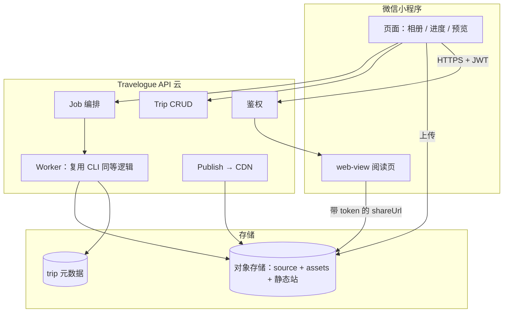

# Travelogue · 微信小程序 API 草稿

| 属性 | 内容 |
|------|------|
| **文档版本** | v0.1-draft |
| **状态** | 设计稿（**未实现**）；供小程序与云端对齐 |
| **关联** | [SHARING.md](./SHARING.md)、[CLI-SPEC.md](./CLI-SPEC.md)、[DATA-MODEL.md](./DATA-MODEL.md)、[schemas/trip.schema.json](../schemas/trip.schema.json) |
| **更新日期** | 2026-05-19 |

---

## 1. 目的与范围

本文定义 **微信小程序 + 云端服务** 与现有 **本地 CLI 管线** 之间的 HTTP 契约草案。

| 在范围内 | 不在 MVP API 范围 |
|----------|-------------------|
| 相册上传 → `trip.json` 流水线（ingest / curate / layout / render） | 小程序内运行 Python |
| 私密阅读：鉴权后打开 **share 态 HTML**（web-view） | 小程序原生重写整套 Visual Journal UI（可选远期） |
| 发布包上传 CDN、短期 token 访问 | 微信群长图生成（路径 A，见 §8） |
| 与 `pipeline.status` / `pipeline.runs[]` 对齐的 Job 模型 | 完整社交/评论/支付 |

**产品原则**（与 [SHARING.md](./SHARING.md) 一致）：

- **路径 A**：用户保存竖版长图，自行发群 → 可不经过本 API。  
- **路径 B**：完整 HTML 游记 → 小程序登录 + token → 本 API 发布的静态页。

---

## 2. 架构总览



| 层 | 职责 |
|----|------|
| **小程序** | `wx.login`、选图、`wx.uploadFile`、轮询 Job、web-view 打开 `shareUrl` |
| **API** | 鉴权、trip 读写、触发阶段任务、校验 schema、签发阅读 token |
| **Worker** | 执行与 CLI 相同的业务函数（ingest_into_trip、run_curate、render_trip 等） |
| **CDN** | `index.html`、`journal.css`、`assets/**`；可选 `preview.jpg` |

---

## 3. 约定

### 3.1 基础

| 项 | 约定 |
|----|------|
| Base URL | `https://api.example.com/v1`（占位） |
| 协议 | HTTPS only |
| 编码 | UTF-8 JSON |
| 时间 | ISO 8601 UTC，`Z` 后缀 |
| Trip 主键 | `tripId`（与 CLI 目录名一致，如 `kyoto-2025-04`） |
| 数据契约 | 响应体中的 `trip` 对象 **必须符合** `trip.schema.json` |

### 3.2 鉴权

| 头 | 说明 |
|----|------|
| `Authorization: Bearer <access_token>` | 小程序 `wx.login` → 服务端 `code2Session` 后下发的 JWT |
| `X-Request-Id` | 可选，链路追踪 |

| 端点 | 鉴权 |
|------|------|
| `POST /auth/wechat/login` | 否（用 `code` 换 token） |
| `GET /trips/{tripId}/share-url` | 是；且校验 trip 归属或受邀 |
| 静态 HTML（CDN） | **不靠 Cookie**；`?token=` 或签名 URL（短期） |

**阅读 token（路径 B）** 建议：

- 有效期：15–60 分钟  
- 载荷：`tripId`、`openid` 或 `shareId`、过期时间  
- CDN 或边缘函数校验 token 后返回 `index.html`，否则 403  

### 3.3 错误体

与 [ERROR-CODES.md](./ERROR-CODES.md) 对齐：

```json
{
  "error": {
    "code": "E_PIPELINE_ORDER",
    "message": "narrate requires structure_locked",
    "details": {}
  }
}
```

| HTTP | 场景 |
|------|------|
| 400 | 参数 / schema 校验失败 |
| 401 | 未登录 |
| 403 | 无 trip 权限 |
| 404 | trip / job 不存在 |
| 409 | `pipeline.status` 不允许该阶段 |
| 422 | manifest 限制（标题过长等） |
| 500 | Worker 内部错误 |

### 3.4 分页与列表

```json
{
  "items": [ ... ],
  "nextCursor": "opaque-string-or-null"
}
```

---

## 4. 资源模型（API 扩展字段）

在现有 `trip.json` 之上，云端 **可增** 以下字段（建议写入 schema `x-cloud` 或独立表，合并进 GET 响应）：

| 字段 | 类型 | 说明 |
|------|------|------|
| `ownerId` | string | 微信 `openid` 或统一用户 id |
| `shareId` | string | 私密分享 slug（可选，用于受邀链接） |
| `publishedAt` | string \| null | 首次成功 publish 时间 |
| `publish` | object | `{ "shareUrl", "cdnPrefix", "zipObjectKey" }` |
| `assets[].displayFile` | string | 允许 `https://cdn.../assets/...` 绝对 URL |

**资源 URL 规则**：

- Worker 完成后，将 `assets/{id}-w800.webp` 等写入 COS，并回写 `displayFile` / `srcset[].file` 为 HTTPS URL。  
- 小程序 **web-view** 与 `<image>` 均要求合法备案域名。

---

## 5. Job 异步模型

CLI 同步执行的阶段，在云端拆为 **Job**（对应 `pipeline.runs[]`）。

### 5.1 Job 类型

| `job.type` | 等价 CLI | 典型前置 status | 成功后 status |
|------------|----------|-----------------|---------------|
| `ingest` | `ingest` | `draft_ingest` | `ingest_ready` |
| `curate` | `curate` | `ingest_ready` | `structure_draft` |
| `layout` | `layout` | `structure_draft` | `structure_draft`（更新 chapters） |
| `lock_structure` | `lock structure` | `structure_draft` | `structure_locked` |
| `narrate` | `narrate` | `structure_locked` | `copy_draft` |
| `lock_copy` | `lock copy` | `copy_draft` | `copy_locked` |
| `render` | `render` | `copy_locked` | `rendered` |
| `export` | `export` | `rendered` | `exported` |
| `publish` | `publish` | `rendered` 或更早 | `exported` + CDN |
| `pipeline` | `run` | 视 `--from` | 视 `--until` |
| `demo` | `demo <album>` | — | `structure_draft`（+`rendered`） |

### 5.2 Job 状态

| `job.status` | 说明 |
|--------------|------|
| `queued` | 已入队 |
| `running` | Worker 执行中 |
| `succeeded` | 完成；`result` 含摘要 |
| `failed` | 失败；`error.code` 见 ERROR-CODES |
| `cancelled` | 用户或系统取消 |

### 5.3 Job 响应示例

```json
{
  "job": {
    "id": "job-20260519-abc123",
    "tripId": "kyoto-2025-04",
    "type": "ingest",
    "status": "succeeded",
    "createdAt": "2026-05-19T10:00:00Z",
    "finishedAt": "2026-05-19T10:00:32Z",
    "result": {
      "added": 12,
      "skipped": 2,
      "pipelineStatus": "ingest_ready"
    },
    "error": null
  }
}
```

小程序轮询：`GET /trips/{tripId}/jobs/{jobId}`，间隔建议 1–2s，超时 5–10min。

---

## 6. HTTP API 端点（草稿）

### 6.1 鉴权

#### `POST /auth/wechat/login`

| 请求体 | 说明 |
|--------|------|
| `code` | `wx.login` 返回的临时 code |
| `nickname`, `avatarUrl` | 可选，需用户授权 |

| 响应 | 说明 |
|------|------|
| `accessToken`, `expiresIn` | JWT |
| `user.id` | 服务端用户 id |

---

### 6.2 Trip

#### `POST /trips`

创建空 trip（≈ `trip new`）。

```json
{
  "tripId": "kyoto-2025-04",
  "title": "雨后京都",
  "place": "京都",
  "exportLayout": "mobile"
}
```

| 响应 201 | `trip` 对象，`pipeline.status = draft_ingest` |

#### `GET /trips`

列表（≈ `trip list`）。Query：`cursor`, `limit`（默认 20）。

#### `GET /trips/{tripId}`

返回完整 `trip.json` + `publish` 元数据。

#### `PATCH /trips/{tripId}`

部分更新 `meta` / `chapters` / `privacy`（人工编辑同步）。  
服务端应跑 `validate`（≈ `validate --level all`），失败 422。

#### `DELETE /trips/{tripId}`

软删或硬删（产品待定）；需 owner。

---

### 6.3 媒体上传

#### `POST /trips/{tripId}/uploads/presign`

批量上传前申请 COS 直传凭证（推荐，减轻 API 带宽）。

```json
{
  "files": [
    { "clientName": "IMG_001.jpg", "contentType": "image/jpeg", "size": 3145728 }
  ]
}
```

响应：`uploadUrl`, `objectKey`, `headers` 等。

#### `POST /trips/{tripId}/uploads/complete`

客户端直传完成后通知服务端，写入 `source/` 映射，可选 **链式触发** `ingest` Job。

```json
{
  "objects": [
    { "objectKey": "trips/kyoto-2025-04/source/IMG_001.jpg", "clientName": "IMG_001.jpg" }
  ],
  "triggerIngest": true,
  "ingestOptions": {
    "maxPhotos": 15,
    "dedupe": true,
    "generateCrops": true
  }
}
```

**小程序侧**：`wx.chooseMedia` → 循环 `wx.uploadFile` 到 `uploadUrl` → `complete`。

---

### 6.4 Jobs（阶段任务）

#### `POST /trips/{tripId}/jobs`

统一创建 Job。

```json
{
  "type": "curate",
  "options": {
    "exportLayout": "mobile",
    "applyLayout": true
  }
}
```

| 响应 202 | `job` 对象，`status: queued` |

**各 type 的 `options`（与 CLI 旗标对齐）**：

| type | options 字段 | CLI 对应 |
|------|----------------|----------|
| `ingest` | `fromObjectKeys[]`, `maxPhotos`, `dedupe`, `generateCrops`, `batchId` | `--from`, `--max-photos`（config）, `--no-dedupe`, `--no-crop` |
| `curate` | `applyLayout`, `exportLayout` | 默认 layout on；`--layout` |
| `layout` | `exportLayout`, `render` | `--layout`, `--render` |
| `lock_structure` | `coverAssetId` | `--cover` |
| `narrate` | `tone`, `field`, `dryRun` | `--tone`, `--field`, `--dry-run` |
| `lock_copy` | — | — |
| `render` | `mode`, `exportLayout` | `--mode draft\|share`, `--layout` |
| `export` | `confirmPrivacy`, `noPreview`, `noLongshot`, `output` | `--confirm-privacy`, `--no-preview`, `--no-longshot` |
| `publish` | `confirmPrivacy`, `noPreview` | 同 `publish` 命令 |
| `pipeline` | `from`, `until`, `skipLocked` | `run --from`, `--until`, `--skip-locked` |
| `demo` | `title`, `place`, `hook`, `maxPhotos`, `dedupe`, `render`, `exportLayout` | `demo` 各选项 |

#### `GET /trips/{tripId}/jobs/{jobId}`

查询 Job 状态。

#### `GET /trips/{tripId}/jobs`

列表，按 `createdAt` 降序。

#### `POST /trips/{tripId}/jobs/{jobId}/cancel`

可选；仅 `queued` 可取消。

---

### 6.5 校验与状态

#### `POST /trips/{tripId}/validate`

≈ `validate`。

```json
{ "level": "all" }
```

响应：`{ "ok": true, "errors": [], "warnings": [] }`

#### `GET /trips/{tripId}/status`

≈ `status`；G1 摘要可放在 `gates.g1` 扩展字段。

```json
{
  "tripId": "kyoto-2025-04",
  "pipeline": { "status": "structure_draft", "locks": { "structure": false, "copy": false } },
  "counts": { "assets": 12, "chapters": 4 },
  "lastRun": { "stage": "curate", "at": "2026-05-19T10:05:00Z" }
}
```

---

### 6.6 发布与阅读（路径 B）

#### `POST /trips/{tripId}/publish`

≈ `publish`：validate → render(share) → preview → 打 zip → 上传 CDN。

```json
{
  "confirmPrivacy": true,
  "noPreview": false,
  "noLongshot": true
}
```

| 响应 | 说明 |
|------|------|
| `publish.cdnPrefix` | 静态资源根 URL |
| `publish.indexUrl` | 无 token 的壳 URL（一般不直接暴露） |
| `publish.zipObjectKey` | 可选，供下载备份 |

**share 包约定**（与 [RENDER-CONTRACT.md](./RENDER-CONTRACT.md) / `golden-share.html`）：

- `export.longShot = false`（默认关闭长图 FAB）  
- `privacy.confirmedAt` 必填  
- 不含 `golden-banner` 预览壳  

#### `GET /trips/{tripId}/share-url`

小程序阅读页用：校验登录用户对 trip 的权限后，返回 **带短期 token** 的 URL。

```json
{
  "shareUrl": "https://cdn.example.com/trips/kyoto-2025-04/index.html?token=eyJ...",
  "expiresAt": "2026-05-19T11:00:00Z"
}
```

web-view：`src="{{shareUrl}}"`（域名需在小程序后台配置业务域名）。

---

### 6.7 媒体维护

#### `POST /trips/{tripId}/media/reexport`

≈ `media reexport`。

```json
{
  "assetIds": ["asset-001", "cover"],
  "generateCrops": true
}
```

---

### 6.8 健康与配置

| 端点 | 说明 |
|------|------|
| `GET /health` | 存活探针 |
| `GET /config/public` | 小程序可读：最大上传体积、webp 档位、是否启用 narrate |

---

## 7. CLI ↔ API 对照表

| CLI 命令 | HTTP（草案） | 同步/异步 | 备注 |
|----------|--------------|-----------|------|
| `trip new <tripId>` | `POST /trips` | 同步 | 仅创建元数据 |
| `trip list` | `GET /trips` | 同步 | |
| `ingest <tripId> --from …` | `POST …/uploads/*` + `POST …/jobs` type=`ingest` | 异步 Job | 相册先上传 COS |
| `curate <tripId>` | `POST …/jobs` type=`curate` | 异步 | |
| `layout <tripId>` | `POST …/jobs` type=`layout` | 异步 | |
| `lock structure <tripId>` | `POST …/jobs` type=`lock_structure` | 同步或异步 | 可同步（轻量） |
| `narrate <tripId>` | `POST …/jobs` type=`narrate` | 异步 | 调 LLM |
| `lock copy <tripId>` | `POST …/jobs` type=`lock_copy` | 同步或异步 | |
| `render <tripId>` | `POST …/jobs` type=`render` | 异步 | 产物写 COS + 本地 index 路径映射 |
| `export <tripId>` | `POST …/jobs` type=`export` | 异步 | 返回 zip 下载 URL |
| `publish <tripId>` | `POST /trips/{id}/publish` | 异步 | 路径 B 主入口 |
| `validate <tripId>` | `POST …/validate` | 同步 | |
| `status <tripId>` | `GET …/status` | 同步 | |
| `run <tripId> --from …` | `POST …/jobs` type=`pipeline` | 异步 | |
| `media reexport <tripId>` | `POST …/media/reexport` | 异步 | |
| `preview <tripId>` | `GET …/status` 或 `publish` 子资源 | 同步 | 返回 `preview.jpg` URL |
| `demo <album>` | `POST /trips` + upload + `jobs` type=`demo` | 异步 | 快捷链路；默认 `config.demo` 等价项 |
| `demo verify` | —（CI 专用） | — | 不进小程序 API |
| `demo golden` | — | — | 开发预览 |

---

## 8. 小程序页面与 API 映射（建议）

| 页面 | 调用的 API | 说明 |
|------|------------|------|
| 首页 / 我的游记 | `GET /trips` | 列表 |
| 新建 | `POST /trips` → 选图 → presign/upload/complete | |
| 处理中 | `GET /jobs/{id}` 轮询 | 展示 ingest/curate 进度 |
| 预览草稿 | `GET /share-url`（draft 预览域）或内嵌 H5 | demo 态可开 longshot |
| 章编辑 | `PATCH /trips/{id}` | 改 caption / 章序 |
| 确认结构 G1 | `POST jobs` `lock_structure` | |
| 发布 | `POST /publish` → `GET /share-url` | `confirmPrivacy: true`，`noLongshot: true` |
| 阅读 | web-view `shareUrl` | 路径 B |
| 保存长图（路径 A） | **可选** `POST /trips/{id}/longshot`（远期） | 或在 draft 预览页用现有 H5 longshot；群分享不强制进小程序 |

---

## 9. 推荐云端工作流

### 9.1 快捷创建（对齐 `demo`）

```text
POST /trips
→ presign + upload（用户选图）
→ POST /jobs { "type": "demo", "options": { "render": true } }
→ 轮询 job → GET /status
→ 小程序 web-view 打开 draft 预览 URL（仅 owner）
```

### 9.2 正式闸口（对齐分步 CLI）

```text
ingest → curate → [用户 PATCH 编辑] → lock_structure
→ narrate → lock_copy → render(draft) → publish(share)
→ GET /share-url → web-view
```

### 9.3 状态机

与 CLI 相同，禁止乱序（`E_PIPELINE_ORDER`）：

```text
draft_ingest → ingest_ready → structure_draft → structure_locked
→ copy_draft → copy_locked → rendered → exported
```

实现应复用 `travelogue.services.pipeline_state` 规则。

---

## 10. 微信侧配置清单（与 API 并行）

| 项 | 说明 |
|----|------|
| 小程序类目 | 工具 / 摄影 / 内容 等（以审核为准） |
| 用户隐私协议 | 相册、可选位置、昵称头像 |
| `request` 合法域名 | API `api.example.com` |
| **uploadFile** 合法域名 | COS 域名 |
| **web-view 业务域名** | CDN 静态页域名 |
| 内容安全 | 上传图/文案接口（按需接 `msgSecCheck`） |

---

## 11. 实现路线（建议）

| 阶段 | 交付 | 依赖 |
|------|------|------|
| **M0** | 本文档 + schema 云字段约定 | 当前 |
| **M1** | `POST /trips`、upload、ingest Job、GET trip | COS、Worker 包装 `ingest_into_trip` |
| **M2** | curate / layout / render Job、draft 预览 URL | |
| **M3** | publish + share-url + web-view 鉴权 | 路径 B |
| **M4** | lock / narrate / export、受邀分享 | 完整 CLI parity |
| **M5** | 长图 API 或 H5 桥接 | 路径 A 可选 |

**代码层准备**（本地仓库，与 API 并行）：

1. `TripService` 抽象：本地 FS ↔ 远程存储可替换。  
2. `export` share 模式默认 `noLongshot` 与 `privacy.confirmedAt` 闸门。  
3. `assets[].displayFile` 支持绝对 HTTPS URL。  
4. Worker 单测：对每个 Job type 用 fixture trip 跑通。

---

## 12. OpenAPI 与版本

- 正式 OpenAPI 3.1 文件：**待** `docs/openapi/miniapp-v1.yaml`（由本文档生成）。  
- URL 版本：`/v1`；`trip.json` 内 `version` 字段独立演进。  
- 破坏性变更：仅增 `/v2`，不在 v1 改语义。

---

## 13. 版本记录

| 版本 | 日期 | 说明 |
|------|------|------|
| v0.1-draft | 2026-05-19 | 初稿：端点、Job 模型、CLI 对照表、双轨分享 |
