# Travelogue · 项目架构总览

| 属性 | 内容 |
|------|------|
| **文档版本** | v1.0 |
| **角色** | 首席架构师视角 · 全栈架构分析 |
| **更新日期** | 2026-06-04 |
| **关联文档** | [TECH-ARCHITECTURE.md](./TECH-ARCHITECTURE.md) · [AGENT-ARCHITECTURE.md](./AGENT-ARCHITECTURE.md) · [DATA-MODEL.md](./DATA-MODEL.md) |

---

## 1. 产品定位与架构使命

**Travelogue** 是一款本地优先的「照片 → 杂志风 HTML 游记」智能体。用户将旅行相册导入后，系统依次完成媒体处理、智能策展、叙事生成与模板渲染，产出可在浏览器预览、可导出微信长图的分享物。

架构使命可以概括为四条：

| 原则 | 含义 | 实现手段 |
|------|------|----------|
| **版式稳定** | 视觉由模板决定，算法不直接拼 HTML | Handlebars 模板 + `manifest.json` 约束 |
| **可恢复** | 任意时刻可断点续跑 | `trip.json` 为单一状态源，文件系统即数据库 |
| **低耦合** | 各处理阶段独立演进 | Agent 分层 + Orchestrator 编排 + TripService 读写 |
| **本地优先** | 无强制云端依赖 | LLM、地理编码、CLIP 均为可选 extras |

---

## 2. 系统上下文（C4 · Level 1）

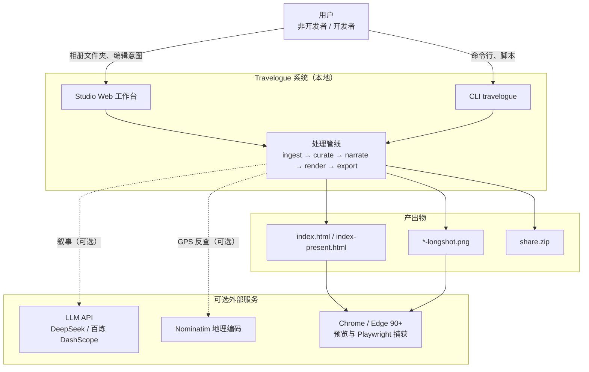

**边界说明**：Travelogue 不是 SaaS；所有核心计算在本地 Python 进程完成。Studio 是内嵌 HTTP 服务器（`ThreadingHTTPServer`），服务于 `templates/studio/` 静态前端。

---

## 3. 容器视图（C4 · Level 2）

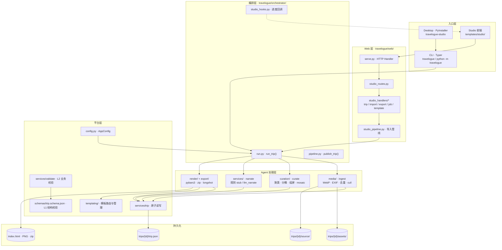

---

## 4. 分层架构

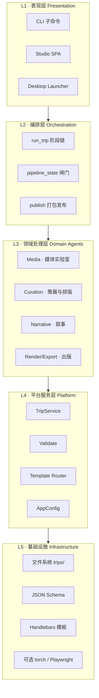

**依赖规则**（自顶向下，禁止反向）：

- 表现层只调用编排层与 Web handler，不直接 import curation 内部模块
- Agent 层通过 `TripService` 读写 `trip.json`，Agent 之间**不互调**
- 配置经 `AppConfig` / `app_config_scope` 注入，支持 CLI 与 Studio  per-request 覆盖

---

## 5. 核心数据流

### 5.1 管线阶段顺序

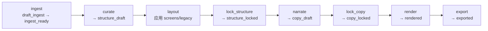

编排入口：`travelogue/orchestrator/run.py` 的 `run_trip(from_stage, until)`。

用户闸门（G1/G2/G3）嵌入状态机：

| 闸门 | 阶段 | 含义 |
|------|------|------|
| **G1** | `lock_structure` | 用户确认章节结构与排版 |
| **G2** | `lock_copy` | 用户确认叙事文案 |
| **G3** | `confirm_privacy` | 导出前隐私确认 |

### 5.2 端到端数据流

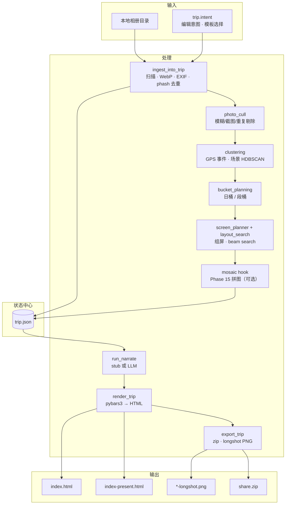

### 5.3 Trip 工作区目录

```
trips/{tripId}/
├── trip.json              # 单一状态源（schema: schemas/trip.schema.json）
├── source/                # 原始照片（可选保留）
├── assets/                # WebP 衍生图 + 元数据引用
├── index.html             # 主阅读页（mobile / web layout）
├── index-longshot.html    # 长图专用 HTML
├── index-present.html     # screens 幻灯模式
└── *-longshot.png         # Playwright 捕获的长图
```

---

## 6. Agent 子系统详解

### 6.1 Agent 0 · Media（`travelogue/media/`）

| 模块 | 职责 |
|------|------|
| `ingest.py` | 扫描相册、生成 WebP、写入 `assets[]`、更新 pipeline 状态 |
| `image_ops.py` | 缩放、WebP 编码、色彩指标 |
| `phash.py` / `sharpness.py` | 感知哈希去重、清晰度评分 |
| `subject_detect.py` | Haar 人脸/主体检测 |
| `geocode.py` | 可选 Nominatim GPS 反查 |
| `reexport.py` | 从 `source/` 重导出像素 |

**输出状态**：`pipeline.status → ingest_ready`

### 6.2 Agent 1 · Curation（`travelogue/curation/`）

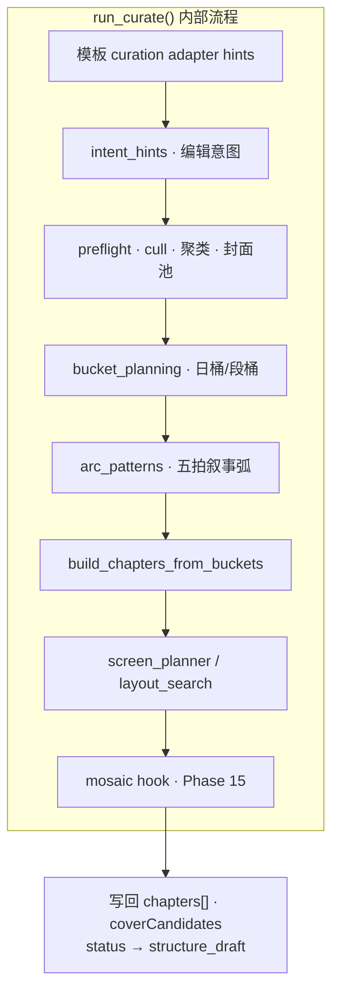

| 子模块 | 职责 |
|--------|------|
| `clustering.py` / `geo_events.py` / `scene_clusters.py` | GPS 事件分段 + 场景聚类（HDBSCAN 默认） |
| `bucket_planning.py` / `time_segments.py` | 按日/段合并照片桶 |
| `screen_planner.py` + `screen_planner_stages.py` | 逐章组屏（hero、burst、food grid、portrait grid8） |
| `layout_search.py` | V2 beam search 候选搜索 |
| `layout_scoring.py` + `search_budget.py` | 打分权重与 generations/evaluations 预算 |
| `photo_cull.py` / `photo_cull_ml.py` | Phase 9 排版前质量闸口 |
| `mosaic/` | Phase 15 拼图候选生成与多维打分 |

**布局引擎**：

| 引擎 ID | 说明 |
|---------|------|
| `legacy` | media-row 卡片流 |
| `screens` | 16:9 舞台组屏（`screen_planner` 驱动） |

### 6.3 Agent 2 · Narrative（`travelogue/services/` + `travelogue/llm/`）

| 路径 | 说明 |
|------|------|
| `narrate.py` | 规则 stub，无 LLM 可运行 |
| `llm_narrate.py` | OpenAI 兼容客户端（DeepSeek / DashScope） |
| `narrative_validate.py` | 叙事输出 L2 校验 |

**前置条件**：`structure_locked`（G1 已通过）

### 6.4 Agent 3 · Publisher（`travelogue/render/` + `travelogue/export/`）

```mermaid
flowchart LR
  TJ["trip.json"]
  RT["resolve_effective_template()"]
  CTX["build_render_context()"]
  HBS["pybars3 compile journal.hbs"]
  COPY["复制 CSS/JS 到 trip 目录"]
  HTML["index.html 等"]
  VAL["validate_trip · L1+L2"]
  EXP["export_trip · zip + longshot"]

  TJ --> RT --> CTX --> HBS --> COPY --> HTML
  HTML --> VAL --> EXP
```

| 模块 | 职责 |
|------|------|
| `render/engine.py` | pybars3 编译 Handlebars → HTML |
| `render/context.py` | trip.json → 模板上下文 |
| `render/preview.py` | preview.jpg 生成 |
| `export/packager.py` | zip 打包、EXIF 剥离 |
| Playwright | 服务端长图/PDF（dev extra） |

---

## 7. Studio 架构

Studio 是 Phase 2 引入的非开发者工作台，与 CLI 共享同一编排内核。

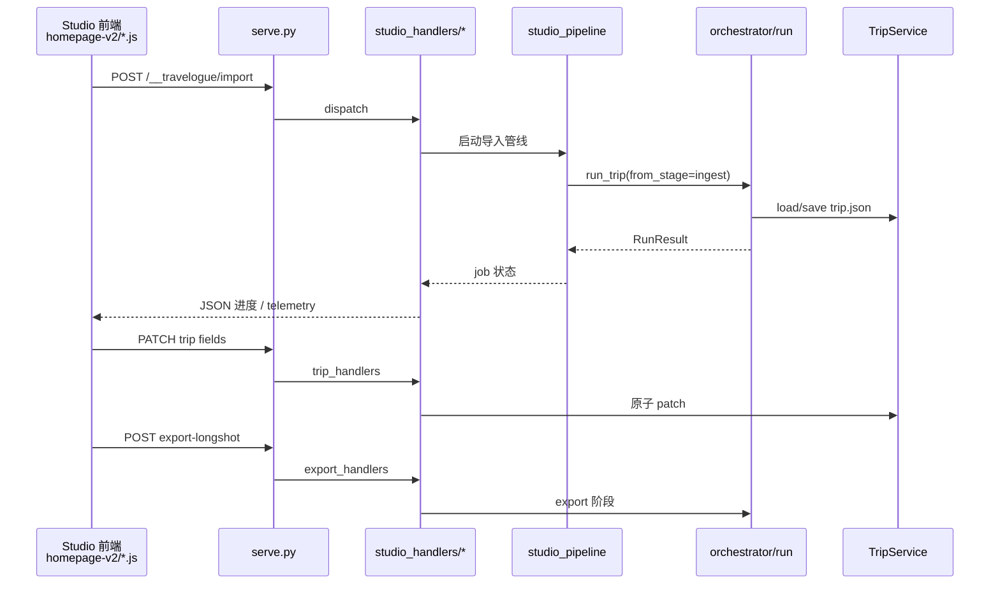

**关键路径**：

| 组件 | 路径 |
|------|------|
| HTTP 入口 | `travelogue/web/serve.py` |
| 路由分发 | `travelogue/web/studio_routes.py` |
| 业务 handler | `travelogue/web/studio_handlers/` |
| 前端 SPA | `templates/studio/studio-home-v2.html` + `homepage-v2/` |
| 阶段定义 | `templates/studio/studio_stages.yaml` |
| 子进程 job | `studio_jobs.py` / `studio_subprocess.py` |

Studio UI 四段式与 CLI 对齐：ingest(1) → curate/layout(2) → narrate(3) → render/export(4)。

---

## 8. 模板与渲染平台

### 8.1 模板注册

| template_id | 路径 | 说明 |
|-------------|------|------|
| `visual-journal` | `templates/visual-journal/` | 主模板 v0.2.1（mobile 9:16 / web 16:9） |
| `event-recap` | `templates/event-recap/` | 活动回顾变体 |
| `editorial-light` | `templates/editorial-light/` | 实验性 |

每个模板包含：`manifest.json`（limits 约束）、`journal.hbs`、CSS/JS partials。

### 8.2 Phase 13 模板平台（`travelogue/templating/`）

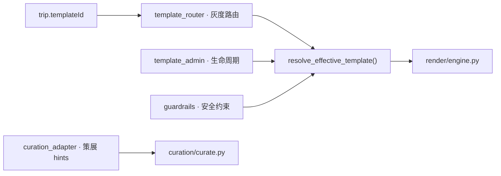

**校验双层**：

| 层 | 工具 | 内容 |
|----|------|------|
| **L1 结构** | `jsonschema` | `schemas/trip.schema.json` |
| **L2 业务** | `services/validate.py` | manifest limits、pattern 序列、封面章规则 |

---

## 9. 配置架构

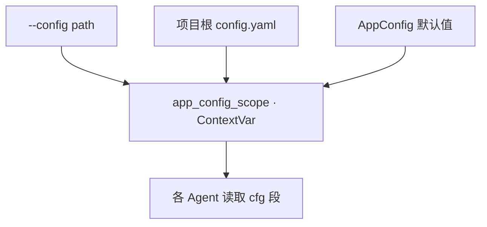

**加载优先级**：显式 `--config` > 项目根 `config.yaml` > 代码默认值

**主要配置段**（`travelogue/config.py` · `AppConfig`）：

| 配置段 | 控制内容 |
|--------|----------|
| `trips_dir` | 工作区根目录 |
| `ingest` | 照片上限、WebP、去重、RAW 拦截 |
| `cull` | 质量闸口（rules / ML） |
| `curate` | 分章策略、叙事弧、food grid |
| `clustering` | GPS/场景聚类、cache、deterministic |
| `layout` | web_layout_engine、beam search scoring |
| `mosaic` | Phase 15 拼图（默认 `enabled: false`） |
| `vision` | CLIP 自动启用、batch、cache |
| `llm` / `narrative` | 叙事 provider、scope |
| `export` / `render` | zip 大小、reading profile |
| `studio` | G1 确认、导入双模式 |
| `template_router` / `template_admin` | 模板路由与管理 |
| `phase6` | 灰度 rollout、AC 阈值 |

环境变量：LLM API Key 通过 `llm.api_key_env`（如 `DEEPSEEK_API_KEY`）读取，不入库。

---

## 10. 依赖与技术栈

### 10.1 Python 包依赖

| 包 | 用途 | 必需 |
|----|------|------|
| `jsonschema` | trip.json 结构校验 | ✅ |
| `pyyaml` | config.yaml | ✅ |
| `pybars3` | Handlebars 渲染 | ✅ |
| `typer` | CLI | ✅ |
| `pillow` | 图像处理 | ✅ |

### 10.2 Optional Extras

| Extra | 包 | 用途 |
|-------|-----|------|
| `dev` | pytest, playwright, piexif | 测试、长图捕获 |
| `desktop` | pyinstaller, comtypes | Windows exe、文件夹对话框 |
| `heif` | pillow-heif | HEIC 支持 |
| `vision` | opencv, sklearn | 视觉特征 |
| `clip` | torch, open-clip | CLIP 语义标签 |
| `cull-ml` | torch, pyiqa | ML 质量评分 |

### 10.3 外部工具与服务

| 集成 | 状态 | 用途 |
|------|------|------|
| LLM API | 可选 | Agent 2 叙事 |
| Nominatim | 可选 | GPS 反查城市 |
| Playwright + Chromium | dev extra | 长图/PDF 导出 |
| ffmpeg | 配置预留 | 视频循环（尚未接入 Python） |

---

## 11. 入口点一览

### 11.1 CLI（Typer）

| 入口 | 命令 |
|------|------|
| 主 CLI | `travelogue` / `python -m travelogue` |
| Desktop | `travelogue-studio` → 默认 `studio` 子命令 |

**管线子命令**：`ingest` · `curate` · `layout` · `lock` · `narrate` · `render` · `export` · `publish` · `run` · `validate` · `status`

**快捷路径**：`demo` · `quick` · `from-album` · `studio` · `serve`

### 11.2 脚本与 CI

| 路径 | 用途 |
|------|------|
| `scripts/start-studio.bat` | 双击启动 Studio |
| `scripts/validate_trip.py` | schema + 业务校验 |
| `scripts/workshop-pipeline.ps1` | 开发者一条龙 |
| `.github/workflows/ci.yml` | pytest + validate_trip + demo verify |

---

## 12. 测试架构

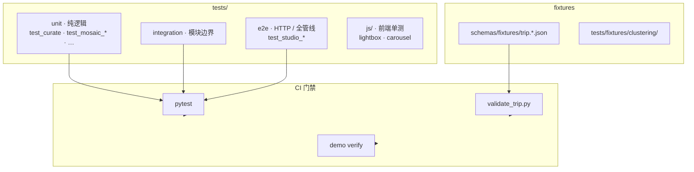

**pytest markers**（`pyproject.toml`）：`unit` · `integration` · `e2e` · `vision` · `playwright_serial`

---

## 13. 仓库物理结构

```
travelogue/                          # 项目根
├── travelogue/                      # Python 主包
│   ├── cli.py                       # Typer 入口
│   ├── config.py                    # AppConfig
│   ├── runtime.py                   # AppContext
│   ├── orchestrator/                # 管线编排
│   ├── media/                       # Agent 0
│   ├── curation/                    # Agent 1（含 mosaic/）
│   ├── services/                    # TripService · narrate · validate
│   ├── render/                      # Agent 3 渲染
│   ├── export/                      # zip · EXIF
│   ├── templating/                  # Phase 13 模板平台
│   ├── templates/                   # Python 侧模板注册
│   ├── web/                         # Studio HTTP
│   ├── llm/                         # LLM 客户端
│   ├── vision/                      # CLIP
│   ├── desktop/                     # PyInstaller
│   └── demo/                        # 快捷 demo 路径
├── templates/
│   ├── visual-journal/              # 主游记模板
│   ├── event-recap/                 # 活动回顾
│   └── studio/                      # Studio 前端
├── schemas/
│   └── trip.schema.json             # 数据契约
├── docs/                            # PRD · ADR · 验收 · 架构
├── scripts/                         # 验收/基准/启动脚本
├── tests/                           # pytest + JS 单测
├── trips/                           # 运行时工作区（gitignore）
├── runs/                            # Studio 运行时状态
├── config.yaml.example
└── pyproject.toml
```

---

## 14. 架构演进与 Phase 映射

| Phase | 架构增量 | 主要模块 |
|-------|----------|----------|
| MVP | 四 Agent 管线 + pybars3 | `media/` · `curation/` · `services/narrate` · `render/` |
| Phase 2 | Studio HTTP + 长图导出 | `web/` · Playwright |
| Phase 3 | 原生 GPS/场景聚类 | `curation/clustering*` |
| Phase 4 | 编辑意图层 | `intent_hints.py` · Studio intent UI |
| Phase 5 | 双路径阅读（长图 A / 卷轴 B） | templates · reading profile |
| Phase 6 | HDBSCAN · 自适应事件分段 · 艺术优化 | `scene_clusters` · `geo_events` |
| Phase 7 | CLIP batch · embed cache · beam 加速 | `vision/` · `search_budget` |
| Phase 9 | 排版前 cull 闸口 | `photo_cull*.py` |
| Phase 10 | Food grid 组屏 | `screen_planner` patterns |
| Phase 13 | 模板路由与管理平台 | `templating/` |
| Phase 15 | Mosaic 拼图子系统 | `curation/mosaic/` |

当前架构在 MVP 四层 Agent 模型上**水平扩展**了 Studio 表现层、模板平台和多个策展子系统，核心不变：**Orchestrator 编排 + trip.json 状态机 + TripService 读写**。

---

## 15. 架构风险与决策记录

| 风险 | 缓解策略 | 相关 ADR |
|------|----------|----------|
| 模板与 JSON  schema 漂移 | L1+L2 双层校验；fixture golden | — |
| CLIP/torch 内存与启动慢 | 进程单例、batch、embed cache、OOM 降级 | Phase 7 |
| Layout beam 超时 | SearchBudget（generations/evaluations 分账） | Phase 7 |
| 聚类算法回归 | HDBSCAN→DBSCAN 一键回滚；deterministic_strict | ADR-007 |
| Studio 与 CLI 行为不一致 | 共享 `run_trip()` + `studio_pipeline` | ADR-004 |
| 长图跨浏览器差异 | 服务端 Playwright 捕获 | ADR-005 |

---

## 16. 延伸阅读

| 文档 | 内容 |
|------|------|
| [TECH-ARCHITECTURE.md](./TECH-ARCHITECTURE.md) | MVP 技术细节 · Phase 6/7 性能架构 |
| [AGENT-ARCHITECTURE.md](./AGENT-ARCHITECTURE.md) | Agent 职责与接口契约 |
| [DATA-MODEL.md](./DATA-MODEL.md) | trip.json 字段语义 |
| [PRD-LAYOUT.md](./PRD-LAYOUT.md) | 排版布局子系统 |
| [DESIGN-PHASE15-mosaic-system.md](./DESIGN-PHASE15-mosaic-system.md) | Mosaic 拼图设计 |
| [docs/README.md](./README.md) | 全文档索引 |

---

## 17. 版本历史

| 版本 | 日期 | 说明 |
|------|------|------|
| v1.0 | 2026-06-04 | 首席架构师视角全栈架构总览（含 Studio · Phase 15 · 模板平台） |
