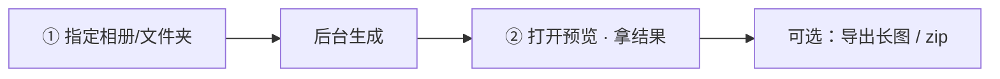
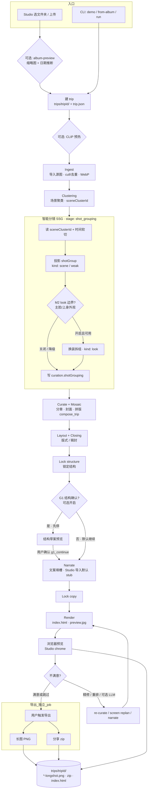
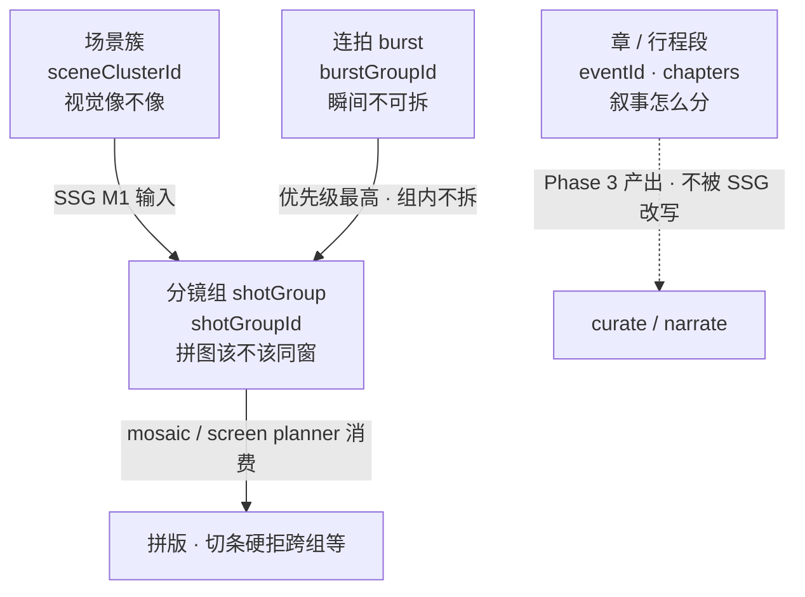
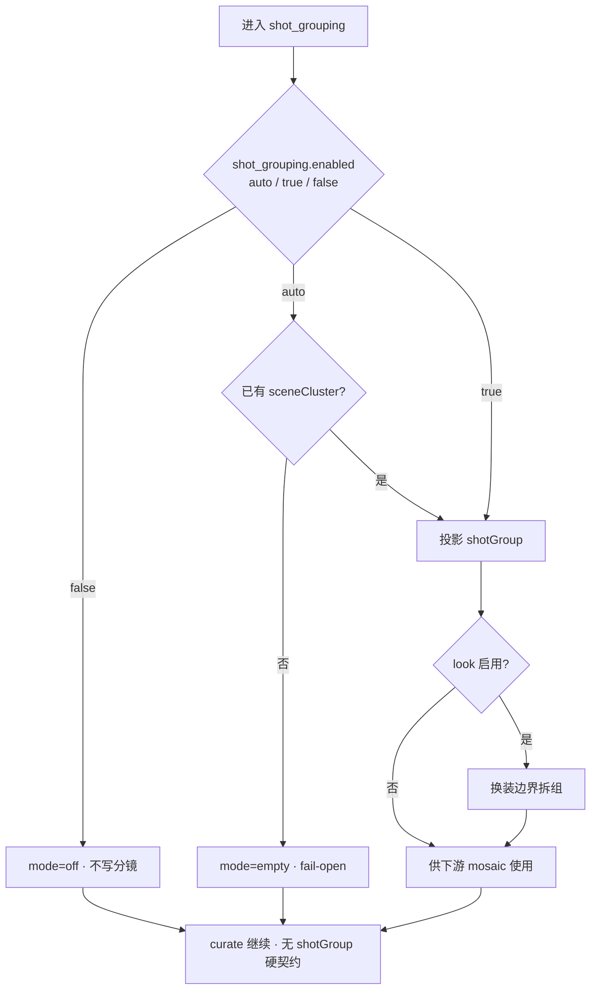
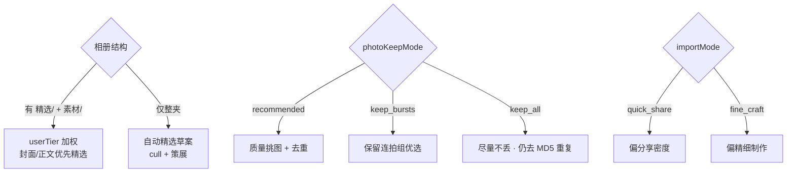

# 游记生成流程图（当前实现）

| 属性 | 内容 |
|------|------|
| **文档版本** | v1.1 |
| **状态** | 与代码对照整理 |
| **整理日期** | 2026-07-23 |
| **权威编排** | `travelogue/orchestrator/run.py` · `travelogue/web/studio_pipeline.py` |
| **关联** | [PRD-SMART-SHOT-GROUPING-V1.md](./PRD-SMART-SHOT-GROUPING-V1.md) · [IMPLEMENTATION-SMART-SHOT-GROUPING-V1.md](./IMPLEMENTATION-SMART-SHOT-GROUPING-V1.md) · [RESEARCH-TRAVEL-PHOTO-AUTO-LAYOUT-V1.md](./RESEARCH-TRAVEL-PHOTO-AUTO-LAYOUT-V1.md) · [INSIGHT-WECHAT-TRAVEL-PHOTO-STORYLINE-2026-07-23.md](./INSIGHT-WECHAT-TRAVEL-PHOTO-STORYLINE-2026-07-23.md) |

> 描述**当前已实现**主链路，非 Future PRD。冲突时以代码为准。  
> v1.1：显式标出 **智能分镜 SSG**（`shot_grouping` stage）及其上下游。

---

## 用户视角（两步）

> 智能分镜对用户**不可见**（无分镜工作台）；效果体现在拼图「不乱、不拆、换装分镜」。

---

## 系统视角（当前游记生成全流程）

---

## 智能分镜在管线中的位置（三层概念）

| 名称 | 字段 | 问的问题 | 主消费者 |
|------|------|----------|----------|
| **章 / 行程段** | `eventId` · `chapters` | 故事怎么分章？ | curate / narrate |
| **场景簇** | `sceneClusterId` | 视觉上像不像？ | **SSG M1 源** |
| **分镜组** | `shotGroupId` · `curation.shotGrouping` | 拼图/切条窗该不该一组？ | mosaic / planner |
| **连拍** | `burstGroupId` | 几秒内同一瞬间？ | 不可拆屏（优先于分镜） |

**一句话**：Clustering 管「章骨架」；**智能分镜管「谁能进同一拼图窗」**；二者不可混称。

---

## 智能分镜开关与降级

| 规则 | 说明 |
|------|------|
| Studio 默认 | `run_shot_grouping` 跟随 `run_clustering`（有聚类则跑 SSG） |
| 无场景簇 | auto 下降级为空，**不阻断**管线 |
| 异常 | fail-open，继续 curate |
| 用户面 | V1 **无**分镜工作台；不暴露 CLIP / sceneCluster 术语 |

---

## 其他关键分支（影响中间过程，不改变两步入口）

---

## 阶段对照（产品进度 ≈ 4 段）

| 用户看到的进度 | 内部实际阶段 |
|----------------|--------------|
| ingest | ingest（含 cull） |
| curate | **clustering → 智能分镜 shot_grouping → curate/mosaic → layout → lock_structure** |
| narrate | narrate → lock_copy |
| render | render → 可预览 |
| （另一步） | longshot / zip 导出 |

Studio 任务进度轮询：`GET /__travelogue/status`（见 `travelogue/web/studio_jobs.py`）。  
产品层进度文案仍归在 curate 段时，**SSG 在 curate 之前已跑完**，供 mosaic 消费。

---

## 入口与关键模块

### 入口

| 入口 | 行为 | 关键文件 |
|------|------|----------|
| **Studio UI** | `python -m travelogue studio` → HTTP → `POST /__travelogue/import` → `import` job | `travelogue/cli/render_cmds.py` · `travelogue/web/serve.py` · `travelogue/web/studio_handlers/import_handlers.py` · `travelogue/web/studio_jobs.py` |
| **Studio 子进程管线** | job worker 调 `run_studio_pipeline` | `travelogue/web/studio_subprocess.py` · `travelogue/web/studio_pipeline.py` |
| **CLI 一键** | `demo` / `from-album` / `quick` | `travelogue/cli/demo.py` · `travelogue/demo/build.py` |
| **CLI 分阶段** | `ingest` → `clustering` → `shot_grouping` → `curate` → …；或 `run` | `travelogue/cli/pipeline.py` · `travelogue/orchestrator/run.py` |

### 各阶段模块

| 阶段 | 路径 |
|------|------|
| 编排 | `travelogue/orchestrator/run.py` · `studio_profile.py` · `studio_hooks.py` |
| 建 trip | `travelogue/services/trip_factory.py` |
| Ingest / 衍生图 | `travelogue/media/ingest.py` · `derivatives.py` |
| Cull / Keep 模式 | `travelogue/curation/photo_cull.py` · `curate_preprocess.py` · `domain/photo_keep_mode.py` |
| 场景聚类 | `travelogue/curation/clustering.py` |
| **智能分镜 SSG** | `travelogue/curation/shot_grouping.py` · `look_split.py` · `config/shot_grouping.py` |
| 策展 + 拼版 | `travelogue/curation/curate.py` · `layout_engine/mosaic/`（含跨 `shotGroup` 硬拒）· `layout_engine/planner/` |
| 叙事 | `travelogue/services/narrate.py` · `web/studio_narrate.py` |
| 渲染 | `travelogue/render/engine.py` · `render/preview.py` |
| 长图 | `travelogue/export/longshot.py` · `web/studio_handlers/export_handlers.py` |
| Zip | `travelogue/export/packager.py` |
| 状态机 | `travelogue/services/pipeline_state.py` · `domain/pipeline_view.py` |

**说明**：

- Mosaic **不是**独立顶层 stage；在 curate 内走 `layout_engine` → `compose_trip`，并**消费** `shotGroupId`。
- `stages_order` 显式含 `"shot_grouping"`（位于 clustering 与 curate 之间）。

---

## Job 模型（Studio）

| Job type | 用途 |
|----------|------|
| `import` | 主生成管线（含 SSG；子进程） |
| `longshot` | Playwright 长图（独立于 import） |
| `narrate` | 可选 LLM 文案 |
| `g1_continue` | G1 确认后 lock → narrate → render |

---

## 产物落盘（`trips/{tripId}/`）

| 产物 | 位置 |
|------|------|
| 权威数据 | `trip.json`（含 `assets[].shotGroupId` · `curation.shotGrouping`） |
| 源图 / 引用 | `source/`（或仅 `sourceRef`） |
| 展示资源 | `assets/` |
| 预览 HTML | `index.html` · `journal.css` |
| 封面卡 | `preview.jpg` |
| 长图 PNG | `{tripId}-longshot.png` 等；元数据 `longshot-current.json` |
| 分享 zip | `{标题}-分享.zip` |

---

## 读图要点

1. **主路径**：选夹 → 自动跑完到 HTML 预览。
2. **智能分镜**：夹在「场景聚类 → 策展/拼版」之间；用户无感，专治混导假切条 / 同景拆条 / 换装须分镜。
3. **长图 / zip** 不在 import job 里自动完成，需再点一次导出（或 CLI）。
4. **精选文件夹、Keep 档、G1、精修** 都是可选分支，不挡默认两步。
5. **精选**（系统 cull/策展）是引擎职责；**精选文件夹**是可选意图输入，不是开工许可证。
6. SSG **不**重写章边界，**不**替代连拍；缺场景簇或失败时 fail-open。
