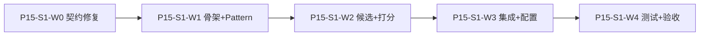

# Travelogue · Phase 15 实施任务清单（S1 · 拼图系统 MCS）

| 属性 | 内容 |
|------|------|
| **PRD** | [PRD-PHASE15-photo-mosaic-evolution.md](./PRD-PHASE15-photo-mosaic-evolution.md) v0.15.1 |
| **设计** | [DESIGN-PHASE15-mosaic-system.md](./DESIGN-PHASE15-mosaic-system.md) v0.3.0 |
| **里程碑** | P15-S1（5 窗 MCS）+ **P15-S2**（3/4/6 统一候选） |
| **状态** | S1–S3 核心 ☑ · P0–P2 收口 · **unified gate PASS**（2026-06-06） |
| **更新** | 2026-06-06 |

> **S1 范围（DESIGN §10.1）**
>
> - **包含**：5 窗多 pattern 候选、乘性衰减打分、段内 beam、决策日志、low-score 回退 legacy、`screens/items` 同步、分层预算与整段耗尽兜底、web 路径。
> - **不含**：默认开启丢图（`allow_drop` 仍 `false`）、8/9 张统一候选、mobile 拼图（S4+）、切脸几何 IoU（几何版）。

---

## 波次总览

| 波次 | 目标 | 出口 | 对应 AC |
|------|------|------|---------|
| **P15-S1-W0** | 契约修复（评审 P0，不依赖 `mosaic/`） | replan 后 items 同步；预算耗尽整段 legacy | —（前置） |
| **P15-S1-W1** | `mosaic/` 骨架 + 5 张 pattern 族 + CSS/渲染链 | 候选可生成且可渲染 | AC-P15-02 |
| **P15-S1-W2** | 候选生成 + 乘性打分 + `compose_segment` | 5 窗走打分选优，非命中即停 | AC-P15-01、04 |
| **P15-S1-W3** | curate 集成 + beam 迁移 + 配置/日志/指标 | 灰度可开关、可观测 | AC-P15-05、07、08 |
| **P15-S1-W4** | 测试 + golden A/B + 验收脚本 | 出现率↑、无渲染回归 | AC-P15-03、06 |
| **P15-S2** | 3/4/6 张统一候选 + `try_mosaic_window` + 开发默认全开 | 3/4/6 走 MCS 打分 | — |

---

## P15-S2 · 3/4/6 统一候选（开发态全开）

| ID | 任务 | 文件 | 状态 |
|----|------|------|------|
| P15-S2a | `MOSAIC_3/4/6` pattern 登记 + `PATTERN_GRID_CLASS` | `mosaic/constants.py`、`registry.py` | ☑ |
| P15-S2b | `generate_window_candidates` 支持 size 3/4/6 | `mosaic/candidates.py`、`builders.py` | ☑ |
| P15-S2c | `pick_best_window` 泛化（原 `pick_best_five_window` 别名） | `mosaic/compose.py` | ☑ |
| P15-S2d | `try_mosaic_window`：6→5→4→3 优先；`run_planning_loop` 接入 | `mosaic/hook.py`、`screen_planner_stages.py` | ☑ |
| P15-S2e | legacy 回退各尺寸 | `mosaic/legacy.py` | ☑ |
| P15-S2f | 默认 `enabled=true`、`enabled_window_sizes=[3,4,5,6]`、`scorer_version=p15-s2` | `config.py`、`config.yaml.example` | ☑ |
| P15-S2g | 指标 `mcsUnifiedExposureRate` | `mosaic/metrics.py` | ☑ |
| P15-S2h | portrait-grid8 / 九宫格让路（defer） | `mosaic/hook.py` `_defer_portrait_grid8` | ☑ |
| P15-S2i | 单测 `tests/test_mosaic_s2.py` | 3/4/6 候选与组屏 | ☑ |
| P15-S2j | legacy planner 测默认关 mosaic（`@pytest.mark.mosaic` 例外） | `tests/test_screen_layout_planner.py` | ☑ |

**S2 验收**：`pytest tests/test_mosaic_s2.py tests/test_golden_mosaic_unified.py tests/test_screen_layout_planner.py -q`；`python scripts/phase15_mosaic_eval.py` 含 `mcsUnifiedExposureRateOn`。

---

## P15-S3 · 自愈（低分二次重排 · 开发态）

| ID | 任务 | 文件 | 状态 |
|----|------|------|------|
| P15-S3a | `MosaicConfig.self_heal_enabled` + `self_heal.enabled` 解析 | `config.py` | ☑ |
| P15-S3b | `selfheal.try_self_heal_pick`：稳定模板降级 → 收紧重排 → 可选丢图 | `mosaic/selfheal.py` | ☑ |
| P15-S3c | `pick_best_window` 低分先自愈再 legacy | `mosaic/compose.py` | ☑ |
| P15-S3d | 日志 `selfHealApplied` / `droppedAssetIds` | `mosaic/log.py` | ☑ |
| P15-S3e | `mosaicDroppedAssetIds` 写入 trip.curation | `hook.py`、`curate.py` | ☑ |
| P15-S3f | 单测 `tests/test_mosaic_self_heal.py` | 收紧/关自愈/不丢图 | ☑ |
| P15-S3g | Golden 3/4/6 `tests/test_golden_mosaic_unified.py` + fixture | `tests/_golden/mosaic-*` | ☑ |

**S3 默认**：`allow_drop=false`（丢图路径已实现但未默认开启）。

---

## P15-S2+ · 8/9 窗 + 多场景回放

| ID | 任务 | 文件 | 状态 |
|----|------|------|------|
| P15-S2k | 8/9 pattern 登记 + builders/legacy/hook | `constants.py`、`registry.py`、`builders.py` | ☑ |
| P15-S2l | `enabled_window_sizes` 含 8/9；MCS 优先于 legacy grid8 defer | `config.py`、`hook.py` | ☑ |
| P15-S2m | golden `mosaic-portrait-8` / `mosaic-landscape-9` | `tests/_golden/` | ☑ |
| P15-S2n | `scripts/phase15_replay_scenarios.py` | 五类合成场景 | ☑ |
| P15-S2o | `test_mosaic_allow_drop.py` | allow_drop 契约 | ☑ |

---

## P15-S1-W0 · 契约修复（P0 · 先合入）

| ID | 任务 | 文件 / 函数 | 状态 |
|----|------|-------------|------|
| P15-0a | `maybe_replan_chapters` 返回后**强制** `compact_chapter_items_for_screens(chapters)` | `travelogue/curation/curate.py`（~725–763 行后） | ☑ |
| P15-0b | 预算耗尽改为 `legacy_segment`：耗尽时该 bucket **整段** legacy 重规划并打 `fallbackReason=BUDGET_EXHAUSTED`，禁止 `break` 后半静默 | `travelogue/curation/layout_search.py` `_replan_day_buckets_beam` | ☑ |
| P15-0c | `SearchBudget` 增加 `max_evaluations_per_segment`（或等价 segment 配额字段） | `travelogue/curation/search_budget.py` | ☑ |
| P15-0d | 新增 `collect_displayed_asset_ids(chapters, cover_hero_ids?) -> list[str]` | `travelogue/curation/chapter_items.py` 或 `mosaic/contracts.py` | ☑ |
| P15-0e | 单测：replan 改写 screens 后 items 与 screens 资产集合一致 | `tests/test_replan_items_sync.py` | ☑ |
| P15-0f | 单测：人为耗尽 budget 时该 bucket 标记 fallback 且屏序来自 legacy | `tests/test_mosaic_budget.py` | ☑ |

**W0 验收**：`pytest tests/test_chapter_items_screens_schema.py tests/test_layout_search.py -v` 通过；不改变默认布局行为（仅修契约）。

---

## P15-S1-W1 · `mosaic/` 骨架 + Pattern 族

### 目录与入口

| ID | 任务 | 文件 / 函数 | 状态 |
|----|------|-------------|------|
| P15-1a | 新建包 `travelogue/curation/mosaic/`，`__init__.py` 导出 `compose_segment`、`compose_trip` | `mosaic/__init__.py` | ☑ |
| P15-1b | 依赖 ADR：`mosaic` 禁止 import `curate`；`curate` 单向调 `mosaic` | `docs/IMPLEMENTATION-PHASE15.md` §迁移 ADR（本文） | ☑ |
| P15-1c | `MosaicPattern` dataclass + `MosaicPatternRegistry`（register / by_slot_count / accepts） | `mosaic/registry.py` | ☑ |
| P15-1d | 登记现有 `screen-mosaic-5-main-portrait-3land` + **至少 4 个**新 5-slot pattern（PRD §5.1） | `mosaic/registry.py` + `screen_planner.py` 常量迁移 | ☑ |
| P15-1e | 每个新 pattern：`patternId` ↔ `grid_class` ↔ CSS **成对**验收清单 | `templates/visual-journal/journal-screens.css` | ☑ |
| P15-1f | `grid_class_for_pattern()` / `PATTERN_GRID_CLASS` 映射新 pattern | `travelogue/render/context.py`、`screen_planner.py` | ☑ |
| P15-1g | `M1` `AssetFeatureAssembler.assemble(asset) -> AssetFeature` | `mosaic/features.py` | ☑ |
| P15-1h | `M2` `HeroSelector.pick_main_for_pattern(window, pattern) -> assetId` | `mosaic/hero.py` | ☑ |
| P15-1i | `M7` 决策日志类型：`MosaicWindowLog` + `format_log_entry` | `mosaic/log.py` | ☑ |

### 新 5 张 pattern 建议占位（实现时按 PRD/CSS 评审定名）

| pattern_id（草案） | 角色槽布局 | 备注 |
|-------------------|------------|------|
| `screen-mosaic-5-main-portrait-3land` | main + 1P + 3L | 已有 |
| `screen-mosaic-5-hero-landscape-4` | main + 4L | 横图主导 |
| `screen-mosaic-5-portrait-column-4land` | 1P 列 + 4L 条 | 竖列变体 |
| `screen-mosaic-5-grid-2x2-plus-hero` | 2×2 + 主位 | 均衡网格 |
| `screen-mosaic-5-stagger-landscape` | 错落横图 | 节奏变体 |
| `screen-mosaic-5-mixed-3land-2port` | 3L + 2P | 混排 |

> 实际 ID 以实现时 CSS 类名为准；**AC-P15-02** 要求 ≥5 个可渲染 5-slot pattern（含原有 1 个）。

---

## P15-S1-W2 · 候选生成 + 打分 + 段内组屏

| ID | 任务 | 文件 / 函数 | 状态 |
|----|------|-------------|------|
| P15-2a | `generate_window_candidates(assets, size=5, registry, top_k=4) -> list[ScreenCandidate]` | `mosaic/candidates.py` | ☑ |
| P15-2b | 硬约束：slot 数、角色可填；软约束：`trip_total`、时间链 → 打分项 | `mosaic/candidates.py` | ☑ |
| P15-2c | `MosaicScorer.score(candidate, state, cfg) -> ScoreResult` 乘性衰减 `total = base × Π(1−p·penalty)` | `mosaic/scorer.py` | ☑ |
| P15-2d | 惩罚 S1：`face_crop` proxy、`main_quality`、`duplicate_density` | `mosaic/scorer.py` | ☑ |
| P15-2e | **不新增** `pattern_repeat_penalty`；节奏仅用 `layout_rhythm` + `diversity`（D-MCS-11） | `mosaic/scorer.py` 委托 `layout_scoring` | ☑ |
| P15-2f | `weights` + `penalties` 一并 `normalized()`，输出 `weightsHash` | `mosaic/scorer.py` | ☑ |
| P15-2g | `compose_segment_s1` 段内组屏 | `mosaic/compose.py` | ☑ |
| P15-2h | `enabled_window_sizes` 外窗口 legacy | `mosaic/legacy.py` | ☑ |
| P15-2i | winner `< min_candidate_score` → legacy + `fallbackReason=low_score` | `mosaic/compose.py` | ☑ |
| P15-2j | segment 合并后 `note_screens_batch` | `mosaic/state.py` | ☑ |
| P15-2k | `mosaic/state.py` 薄迁移 `ScreenLayoutPlannerState` | `mosaic/state.py` | ☑ |
| P15-2l | 替换 `try_mosaic_five`：当 `mosaic.enabled && 5 in enabled_window_sizes` 走 `compose_segment` 单窗逻辑 | `screen_planner_stages.py` + `mosaic/hook.py` | ☑ |
| P15-2m | 5 图章跳过章首 hero（`chapter_has_mosaic_five_candidates`）避免拆散窗口 | `screen_planner_stages.py` `stage_chapter_hero` | ☑ |

---

## P15-S1-W3 · beam 迁移 + curate 集成 + 配置

| ID | 任务 | 文件 / 函数 | 状态 |
|----|------|-------------|------|
| P15-3a | `replan_day_buckets_beam` 迁至 `mosaic/search.py`；`layout_search` 薄包装 | `mosaic/search.py`、`layout_search.py` | ☑ |
| P15-3b | beam 输入保留 `arc_mode` / `intent_peak_chapters`（D-MCS-07） | `mosaic/search.py` | ☑ |
| P15-3c | 新增 `MosaicConfig` dataclass（对齐 DESIGN §9） | `travelogue/config.py` | ☑ |
| P15-3d | `config.yaml.example` 增加 `mosaic:` 块 | `config.yaml.example` | ☑ |
| P15-3e | `curate.py`：`mosaic.enabled` 时 `compose_trip` | `curate.py`、`mosaic/trip.py` | ☑ |
| P15-3f | replan/MCS 后：`compact_chapter_items_for_screens` + 写入 `displayedAssetIds` | `curate.py` | ☑ |
| P15-3g | 持久化 `trip.curation.mosaicDecisionLog` | `curate.py` | ☑ |
| P15-3h | 指标打点：`layout.mosaic5.exposure_rate`、`layout.mosaic_v2.fallback_rate`、`layout.mosaic_v2.low_score_fallback_rate` | `mosaic/metrics.py` + `layout_metrics.py` | ☑ |
| P15-3i | `mosaic/search.py` 薄封装导出 beam | `mosaic/search.py` | ☑ |
| P15-3i | `deterministic_strict`：候选键稳定排序 + beam 候选序 | `mosaic/candidates.py`、`mosaic/search.py` | ☑ |
| P15-3j | 日志分级：`summary` / `window` / `debug` | `mosaic/log.py`、`hook.drain_mosaic_logs` | ☑ |

### `MosaicConfig` 字段清单（实现对照）

```yaml
mosaic:
  enabled: false                    # 灰度总开关
  scorer_version: "p15-s1"
  deterministic_strict: true
  min_candidate_score: 0.35
  enabled_window_sizes: [5]
  unified_mode: false
  scope: { web: true, mobile: false }
  self_heal: { enabled: true, allow_drop: false, ... }
  beam: { width: 3, candidate_top_k: 4, incremental_scoring: true,
          max_evaluations_per_trip: 500, max_evaluations_per_segment: 64,
          budget_exhausted_policy: legacy_segment, search_timeout_ms: 2000 }
  log_level: window
  weights: { ... }
  penalties: { face_crop: 0.30, main_quality: 0.25, duplicate_density: 0.20 }
```

---

## P15-S1-W4 · 测试 + golden + 验收

| ID | 任务 | 文件 | 状态 |
|----|------|------|------|
| P15-4a | 候选生成：横竖组合产出 ≥2 候选 | `tests/test_mosaic_candidates.py` | ☑ |
| P15-4b | 打分稳定：同输入 + 同 `weightsHash` → 同 winner | `tests/test_mosaic_scorer.py` | ☑ |
| P15-4c | 确定性：`screens_signature` 一致 | `tests/test_mosaic_compose_deterministic.py` | ☑ |
| P15-4d | low-score 回退 + `fallbackReason=low_score` | `tests/test_mosaic_fallback.py` | ☑ |
| P15-4e | `mosaic.enabled=false` legacy 一致 | `tests/test_mosaic_legacy_parity.py` | ☑ |
| P15-4f | `test_golden_layouts` mosaic5 A/B | `tests/test_golden_layouts.py` | ☑ |
| P15-4g | 预算耗尽 segment legacy | `tests/test_mosaic_budget.py` | ☑ |
| P15-4h | 200 窗日志体积 CI | `tests/test_mosaic_log_volume.py` | ☑ |
| P15-4i | 渲染链 CSS/grid_class | `tests/test_mosaic_render_patterns.py` | ☑ |
| P15-4j | 验收脚本：输出 baseline vs mosaic 的 pattern 分布与 exposure | `scripts/phase15_mosaic_eval.py` + `docs/acceptance-records/phase15-mosaic-eval.json` | ☑ |
| P15-4k | 集成测：mosaic on 提升 mosaic5 曝光 | `tests/test_mosaic_integration.py` | ☑ |
| P15-4l | epilogue 使用 `displayedAssetIds` | `tests/test_epilogue_displayed_assets.py` + `render/context.py` | ☑ |

---

## 验收标准映射（AC → 任务）

| AC | 验收条件 | 完成任务 |
|----|----------|----------|
| **AC-P15-01** | 5 窗候选 + 打分，非单路径硬匹配 | P15-2a–2l |
| **AC-P15-02** | ≥4 个新 5 张 pattern + 渲染链 | P15-1d–1f、P15-4i |
| **AC-P15-03** | fixture/回放 5 张出现率显著高于基线 | P15-4f、P15-4j |
| **AC-P15-04** | 可回放：候选 + winner 分 + `scorer_version`/`weightsHash` | P15-2f、P15-3g、P15-4b–4c |
| **AC-P15-05** | 异常回退 legacy，导出不受影响 | P15-2i、P15-3e、P15-4d–4e |
| **AC-P15-06** | 渲染失败率 ≤ 基线 | P15-4f、P15-4i |
| **AC-P15-07** | 每 5 窗 top3 + winner `reasonCodes` | P15-3g、P15-3j |
| **AC-P15-08** | 低分自动 legacy + `fallbackReason=low_score` | P15-2i、P15-4d |

**S1 额外契约（DESIGN D-MCS-09/13）**

| 契约 | 完成任务 |
|------|----------|
| replan 后 items 同步 | P15-0a、P15-3f、P15-0e |
| S1 不丢图（`allow_drop=false`） | P15-3d 默认、`eligible_to_screen_coverage ≈ 1` |
| 预算耗尽整段 legacy | P15-0b、P15-4g |

---

## 文件映射（主路径）

| 模块 | 关键改动 |
|------|----------|
| `mosaic/__init__.py` | 对外 `compose_trip` / `compose_segment` |
| `mosaic/registry.py` | 5-slot pattern 元数据登记 |
| `mosaic/candidates.py` | 滑窗多 pattern + Top-K |
| `mosaic/scorer.py` | 乘性衰减 + S1 惩罚项 + `weightsHash` |
| `mosaic/compose.py` | S1 MVP 段内组屏（5 窗 MCS + 其余 legacy） |
| `mosaic/search.py` | 段内 beam（自 `layout_search` 迁移） |
| `mosaic/state.py` | 节奏/配额状态 |
| `mosaic/log.py` | 三级决策日志 |
| `layout_search.py` | 薄包装 → `mosaic.search` |
| `screen_planner_stages.py` | `try_mosaic_five` → MCS 钩子 |
| `curate.py` | mosaic 开关、compact、日志、displayedAssetIds |
| `config.py` | `MosaicConfig` |
| `render/context.py` | 新 pattern grid 映射 |

---

## 建议执行顺序（单 PR 链）



1. **PR-1（W0）**：仅 `curate` compact + `layout_search` 预算语义 + 测试 — 可独立合入，降低回归风险。
2. **PR-2（W1）**：`mosaic/` 骨架 + CSS/pattern 登记，默认开关关，行为不变。
3. **PR-3（W2–W3）**：打分与 compose 接入 + curate 灰度开关。
4. **PR-4（W4）**：golden A/B + `phase15_mosaic_eval.py` + 文档验收记录。

---

## 测试与验收命令

```bash
# W0
pytest tests/test_chapter_items_screens_schema.py tests/test_layout_search.py -v

# W1–W3 单元
pytest tests/test_mosaic_candidates.py tests/test_mosaic_scorer.py tests/test_mosaic_compose_deterministic.py -v
pytest tests/test_mosaic_fallback.py tests/test_mosaic_legacy_parity.py tests/test_mosaic_budget.py -v

# 回归
pytest tests/test_layout_search.py tests/test_layout_candidates.py tests/test_layout_scoring.py -v
pytest tests/test_golden_layouts.py tests/test_layout_golden.py -v
pytest tests/test_curate.py -v --timeout=120

# 端到端
python -m travelogue demo verify
```

验收脚本（W4 后）：

```bash
python scripts/phase15_mosaic_eval.py \
  --baseline-config mosaic.enabled=false \
  --mosaic-config mosaic.enabled=true \
  --write docs/acceptance-records/phase15-mosaic-eval.json
python scripts/phase15_replay_scenarios.py --write docs/acceptance-records/phase15-replay-scenarios.json
python scripts/phase15_curate_replay.py golden-mixed-scenes --fixture \
  --write docs/acceptance-records/phase15-curate-replay.json
```

**P15+（续）**

| ID | 任务 | 文件 | 状态 |
|----|------|------|------|
| P15-5a | 无候选窗尺寸探测跳过（降低误报 fallback） | `mosaic/hook.py` | ☑ |
| P15-5b | 完整 `run_curate` 回放 CLI | `scripts/phase15_curate_replay.py` | ☑ |
| P15-5c | CI curate 回放 | `tests/test_phase15_curate_replay.py` | ☑ |
| P15-5d | 4 窗 `screen-portrait-2-landscape-2`（2P+2L 混排） | `mosaic/constants.py` · `builders.py` · CSS | ☑ |
| P15-5e | `mixed_aspects` MCS 统一曝光 → 100% | `tests/test_mosaic_hook_probe.py` | ☑ |
| P15-5f | `routerVersion` 决策日志 | `mosaic/log.py` · `runtime.py` | ☑ |
| P15-5g | `layout.render.error_rate` 离线校验 | `mosaic/render_check.py` | ☑ |
| P15-5h | `unified_mode` 接线（false→仅 5 窗） | `mosaic/runtime.py` · `hook.py` | ☑ |
| P15-5i | 上线门禁脚本 | `scripts/phase15_unified_gate.py` | ☑ |

## P15-G · PRD 缺口收口（对照 v0.15.1）

| ID | 任务 | 文件 | 状态 |
|----|------|------|------|
| P15-G1 | `ScreenCandidate.featureSummary` / `hardValid` | `mosaic/candidates.py` · `features.py` | ☑ |
| P15-G2 | PRD 别名 `generate_five_candidates` / `pick_best_candidate` | `candidates.py` · `compose.py` · `__init__.py` | ☑ |
| P15-G3 | `layout.mosaic_v2` YAML 合并到 `mosaic` | `config.py` · `config.yaml.example` | ☑ |
| P15-G4 | `mosaic.enabled` 时 legacy 5 窗去掉 `trip_total` 硬门槛 | `mosaic/legacy.py` | ☑ |
| P15-G5 | `feature_summary_for_window` 接入候选 | `mosaic/features.py` | ☑ |
| P15-G6 | `pick_main_for_pattern` 接入 5 窗横主位 | `mosaic/hero.py` · `builders.py` | ☑ |
| P15-G7 | `replan_screen`（alt_topk / legacy） | `mosaic/replan.py` · `legacy.build_legacy_screen` | ☑ |
| P15-G8 | `layout.pattern.repeat_rate` | `layout_metrics.py` | ☑ |
| P15-G12 | 同上（G8） | — | ☑ |
| P15-G13 | `eligible_to_screen_coverage` | `mosaic/coverage.py` · `curate.py` | ☑ |
| P15-G16 | AC-P15-07 日志契约测 | `tests/test_mosaic_decision_log_contract.py` | ☑ |
| P15-G8c | 配置别名测 | `tests/test_mosaic_config_alias.py` | ☑ |
| P15-G13t | 覆盖率单测 | `tests/test_mosaic_coverage_metrics.py` | ☑ |

## P15-R · 启用与验收（无用户期 · 直接全开）

| ID | 任务 | 文件 | 状态 |
|----|------|------|------|
| P15-R1 | 默认全开配置 | `config.yaml.example` · `MosaicConfig` 默认 `enabled/unified_mode=true` | ☑ |
| P15-R2 | Runbook（无灰度分档） | `docs/PHASE15-ROLLOUT.md` | ☑ |
| P15-R3 | 一键验收 bundle | `scripts/phase15_acceptance_bundle.py` | ☑ |
| P15-R4 | curate 在线指标 | `mosaic/telemetry.py` · `curate.py` | ☑ |
| P15-R5 | curate 回放（全窗 MCS） | `scripts/phase15_curate_replay.py` | ☑ |

**离线闸门**（CI / 本地，非灰度前置）：

- `mosaic5.exposure_rate` ≥ 基线 × 1.5（回放集校准）
- `layout.mosaic_v2.fallback_rate` 可观测且 `< 15%`（初值，回放校准）
- `eligible_to_screen_coverage` ≥ 0.99（S1 不丢图）
- `pytest tests/test_golden_layouts.py` 无新增渲染 error

---

## 迁移 ADR（依赖方向）

| 规则 | 说明 |
|------|------|
| 允许 | `mosaic/*` → `screen_planner`、`layout_scoring`、`screen_layout_state`、`search_budget` |
| 禁止 | `mosaic/*` → `curate` / `run_curate` |
| 编排 | `run_curate` → `mosaic.compose_trip`；beam 旧入口 `maybe_replan_chapters` 保留为 re-export |
| 薄包装保留 API | `maybe_replan_chapters`、`generate_day_bucket_candidates`、`try_mosaic_five`（legacy 路径） |

---

## 风险与缓解

| 风险 | 缓解 | 任务 |
|------|------|------|
| S1 低估工作量 | 严格 W1–W2 边界；5 窗以外一律 legacy | §S1 范围 |
| legacy/MCS 状态分叉 | 合并屏序一次 `note_screen` | P15-2j |
| 半 trip 静默 | `legacy_segment` + 测试 | P15-0b、P15-4g |
| 新 CSS 错位 | pattern↔grid↔CSS 清单 + golden 渲染 | P15-1e、P15-4i |
| 指标分裂 | 别名映射 `mosaic.*` ↔ `layout.mosaic_v2.*` | P15-3h |
| photoCount 与屏不一致 | S1 仅写 `displayedAssetIds`；`build_epilogue_stats` 改造放 **S1.1** 或 S2 | 见下 |

### 延后项（不阻塞 S1 编码）

| 项 | 原因 | 建议阶段 | 状态 |
|----|------|----------|------|
| `SelfHeal` + `allow_drop` | DESIGN S3 | S3 | 待 S3 |
| `unified_mode` 在线 7 天/200 trip 自动回滚 | 离线 gate ☑；运维 telemetry 待接 | 上线前 | 待 telemetry |
| mobile `MobileMosaicAdapter` | scope.mobile=false | S4 | 待 S4 |
| 真实 trip mao/maomi curate 记录 | 需本地 `trips/` 数据 | 有 trips/ 时跑 | `phase15-curate-replay.py` ☑（fixture）；真实 trip 待素材 |

**已收口（自延后项移出）：**

- `build_epilogue_stats` 改用 `displayedAssetIds` → `travelogue/render/context.py` + `tests/test_epilogue_displayed_assets.py`
- Studio 接 `replan_screen` PATCH → `trip_handlers.py` + `tests/test_studio_handlers_replan.py`

---

## 修订记录

| 版本 | 日期 | 说明 |
|------|------|------|
| v0.1.0 | 2026-06-04 | 初稿：P15-S1 五波次任务清单，对齐 DESIGN v0.3 与 PRD AC-P15-01~08 |
| v0.2.0 | 2026-06-04 | P15-S2：3/4/6 统一候选、开发默认全开、planner 测 mosaic 标记 |
| v0.3.0 | 2026-06-04 | P15-S3 自愈骨架 + golden 3/4/6 fixture |
| v0.5.0 | 2026-06-06 | `phase15_unified_gate` PASS；mixed_aspects 6 图/3 窗；hook 仅认 hard_valid 候选 |
