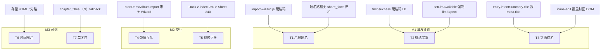

# Travelogue · 合入后 UX 修复包 V1 · 根因调研与完整修复方案

| 属性 | 内容 |
|------|------|
| **PRD** | [PRD-POST-MERGE-UX-FIXPACK-V1.md](./PRD-POST-MERGE-UX-FIXPACK-V1.md) **v0.1** |
| **走查底稿** | [acceptance-records/post-merge-ux-trial-2026-07-22.md](./acceptance-records/post-merge-ux-trial-2026-07-22.md) |
| **DOC-STATUS** | **active** |
| **状态** | **敢合（AC 全绿 · 见 ACCEPTANCE）** |
| **范围** | P0–P1 必修 + P2 可选；与 **PRD-POST-MERGE-UX-FIXPACK-V1 同一修复包一并合入** |
| **更新** | 2026-07-22 |

> **审核结论（2026-07-22）**  
> D1 / D7 产品拍板；D2–D6 按工程建议锁定。本包挂靠 PRD，不另开 SFI/CSC 旁支。

---

## 0. 已锁定决策

| ID | 决策 | **锁定结论** | 来源 |
|----|------|--------------|------|
| **D1** | 示例默认展示名 | **「京都雨季漫游」** · 前端常量 + 后端 fail-closed | 产品拍板 |
| **D2** | 导入 stub vs AI 就绪 | **两维分离**：导入继续 stub；UI **只按** `llm/status` 决定「配置」vs「重新生成」。可诚实说「本次本机文案成稿」，**禁止**因此引导「去配置引擎」 | 工程建议 · 已锁 |
| **D3** | 封面展示名 | **展示只绑 displayTitle**；`/entry` 增字段；保存仍双写；抽屉可预填人话名 | 工程建议 · 已锁 |
| **D4** | 复用卡与 Wizard | **出卡前先关 Wizard；取消再开** | 工程建议 · 已锁 |
| **D5** | 精修 × 被挡 | **Sheet 开时 inert 导出区**（不降整个 Dock） | 工程建议 · 已锁 |
| **D6** | 章名 `（N）` | **时段 → segment → `·二`/`·三`**（完整链）；禁 `（N）`。仅「只要时段」不够（撞车仍需序） | 工程建议 · 已锁 |
| **D7** | 武大 / 存量 | **存量批量重渲不进本包**；只做新产出硬闸；旧页随日后「更新版面」消化 | 产品拍板 |
| **D8** | P2 边角 | 随 M2/M3，不挡 M1 | 默认 |

**与 PRD 挂钩**：合同仅 [PRD-POST-MERGE-UX-FIXPACK-V1](./PRD-POST-MERGE-UX-FIXPACK-V1.md)；对 SFI/FST/CSC 只做旁路硬化与回归，不拆并行修复 PR。

| 里程碑 | 内容 | 估时 |
|--------|------|------|
| **M1** | D1+D2+D3 | 1～1.5 人日 |
| **M2** | D4+D5+大册 CTA | 0.5～1 人日 |
| **M3** | D6 + 新产出时间图注硬闸 + P2；**不含**存量重渲 | 0.5～1 人日 |

---

## 1. 总览：问题 → 根因类型

| 走查 | 现象 | 根因类型 | 一句话根因 |
|------|------|----------|------------|
| **T1** | 再做一遍 →「示例游记」 | **源头硬编码 + 护栏未接管题名** | `import-wizard.js` 写死 title；`share_face_copy` 只管叙事文案 |
| **T2** | Key 就绪仍说「配置写作引擎」 | **前端文案分支错误** | FirstSuccess 不读 status；精修读了却强制显示 L0 expect |
| **T3** | 书架人话 / 封面脏名 | **运行时覆盖** | `/entry.intentSummary.title` 用裸 `meta.title` 盖掉已渲染展示名 |
| **T4** | Wizard + 复用卡叠层 | **缺少弹层互斥** | 出 `studioModal` 前未 `closeImportWizard()` |
| **T5** | 精修 × 点不到 | **故意 z-index 设计副作用** | Dock `250` > Sheet `240`，caret 盖住关闭钮 |
| **T6** | 决定性瞬间见 2015 | **存量未重渲 + 旁路未硬闸** | 低置信抑制已实现；旧 HTML / 缺 `dateConfidence` / `moment_screen` 未传 daySpan |
| **T7** | `5月27日（3）` | **规则回退 + 文档允许** | `chapter_titles.py` 显式 fallback；FST/SFI 未禁止括号序 |



---

## 2. T1 · 示例「再做一遍」写出「示例游记」

### 2.1 现象

- FirstSuccess：`《示例游记》已生成`  
- `trips/demo-album/trip.json`：`meta.title` / `meta.displayTitle` = `示例游记`  
- 封面 / `<title>` 同步污染  
- 「京都雨季漫游」来自**旧落盘**，不是当前 demo 管线稳定产出

### 2.2 完整调用链

```
用户点「用示例照片试一次」
  → import-wizard.js::startDemoAlbumImport()
       body.title = "示例游记"          ← 源头（L1366）
  → （已存在）resolveDemoAlbumExists →「再做一遍」
  → kickoff(true) → startV2Import({..., force:true, title:"示例游记"})
  → import_handlers.handle_import
       _resolve_import_title("示例游记")  ← 仅 humanize 目录噪，不判禁词
  → studio_subprocess → run_studio_pipeline
       force=True → rmtree(demo-album)   ← 旧「京都雨季漫游」被删
       create_trip(title=…) → apply_intent 双写 title+displayTitle
       resolve_display_title() 接受「示例游记」（非目录噪）
  → StudioPipelineResult.title = display_title
  → first-success.js::populateSuccessUi(result.title)
  → render 封面/导出 stem 同用该展示名
```

**关键落点**

| 步骤 | 文件 | 函数 / 行 |
|------|------|-----------|
| 硬编码 | `templates/studio/homepage-v2/import-wizard.js` | `startDemoAlbumImport` · ~1364–1369 |
| 标题解析 | `travelogue/web/studio_handlers/import_handlers.py` | `_resolve_import_title` · ~119–124 |
| 双写 | `travelogue/services/trip.py` | `apply_intent` · ~297–300 |
| 展示名 | `travelogue/domain/title_humanize.py` | `resolve_display_title` · ~180–215 |
| 成功面 | `templates/studio/homepage-v2/first-success.js` | `populateSuccessUi` · ~183/200 |
| 禁词（未接入） | `travelogue/domain/share_face_copy.py` | `"示例游记"` 在表内 · 仅 narrate/caption 路径 |

### 2.3 根因 vs 非根因

| | |
|--|--|
| **根因** | 前端 demo 入口把禁词当默认 title；题名写入/展示链路从未调用 `is_unsafe_share_copy` |
| **非根因** | 禁词表漏项（已有）；`demo_album.py` 缺默认名（它本就不负责 title）；narrate stub「发明」了京都名 |

### 2.4 修复方案（推荐：三层防御）

| 层 | 改动 | 说明 |
|----|------|------|
| **L1 源头** | `import-wizard.js`：`title: "京都雨季漫游"`（抽常量 `DEMO_ALBUM_DISPLAY_TITLE`） | 止血 |
| **L2 后端闸** | demo import（`useDemoAlbum`）在 `_resolve_import_title` 后：若 unsafe 或空 → 强制 demo 展示名 | 防其他客户端/旧前端 |
| **L3 展示 fail-closed** | `resolve_display_title` / `_accept_display`：对题名禁词（至少「示例游记」）拒绝并回退 | 存量脏 trip 打开也不上屏 |

**明确不做**：在 caption sanitize 里「顺带」清 title（语义不同，避免误伤）。

### 2.5 验收

- Playwright：再做一遍 → FirstSuccess / 封面 / `meta.displayTitle` 均为「京都雨季漫游」，零「示例游记」  
- 单元：`_resolve_import_title` + demo 路径对 `"示例游记"` 替换  
- 存量：把 `displayTitle` 暂改为「示例游记」再 `resolve_display_title` → 不得返回该串

---

## 3. T2 · AI 已就绪仍提示「配置写作引擎」

### 3.1 现象

- 设置：`AI 文案已就绪 · DeepSeek`（正确读 `/__travelogue/llm/status`）  
- FirstSuccess：`当前为本机文案；配置写作引擎后可在预览升级`  
- 精修「这本」：同 L0 expect 句仍可见；「重新生成」按钮其实已启用

### 3.2 完整调用链

**设置（正确）**

```
settings-panel.js::refreshAiStatus
  → GET /__travelogue/llm/status
  → applyAiStatus(st.readiness / llmAvailable)
```

**FirstSuccess（错误）**

```
populateSuccessUi()
  → lead.textContent = HELP_COPY.firstSuccessNext   ← 无条件 L0
     （help-onboarding.js 硬编码；不请求 llm/status）
```

**精修（半对半错）**

```
init-v3.js::refreshLlmStatus
  → GET /llm/status → setLlmAvailable(ok)
       正确：启用「重新生成」、隐藏 unavailable/setup
       错误：if (llmExpect) llmExpect.hidden = false;  ← 永远显示 L0 句
  sheet 文案：当前为本机文案 · 配置写作引擎后可升级
```

**后端契约（易被误读）**

```
studio_narrate.resolve_studio_narrate_provider
  → 导入主链永远返回 "stub"（设计如此）
```

导入用 stub ≠ 用户未配置引擎。T2 把「本次成稿来源」错当成「全局能力」。

### 3.3 修复方案

1. **新增共享 helper** `templates/studio/js/llm-readiness.js`  
   - 唯一拉 `/llm/status`，归一化 `unknown | unavailable | available`  
   - 可选广播 `travelogue:llm-status`（设置已拉过则可复用缓存）

2. **FirstSuccess**  
   - `available` → `AI 文案已就绪，可在预览重新生成文案。`（或更短）  
   - `unavailable` → 保留现 L0 句  
   - HTML 初始 fallback 改为中性句，避免闪 L0

3. **精修 `setLlmAvailable(ok)`**  
   ```
   llmHint.hidden = ok
   llmSetup.hidden = ok
   llmExpect.hidden = !ok          // 关键：永远 false
   llmExpect.textContent = ok
     ? "AI 文案已就绪；重新生成不会自动覆盖你的手动修改。"
     : "当前为本机文案 · 配置写作引擎后可升级"
   ```

4. **不改**导入永远 stub 的后端契约。

### 3.4 验收

- mock `llmAvailable=true`：FirstSuccess + 精修均**不含**「配置写作引擎后可升级」  
- mock `false`：保留配置引导  
- 设置摘要与上述分支一致

---

## 4. T3 · 书架「武大 米娜」/ 封面「武大--米娜」

### 4.1 现象

- 书架、辑封（服务端首渲）：人话名  
- 封面可编辑标题（加载后片刻）：脏名 `武大--米娜`  
- `meta.title=武大--米娜`，`meta.displayTitle=武大 米娜`

### 4.2 完整调用链

```
服务端 render
  assemble.py → meta_title = resolve_display_title(meta)  →「武大 米娜」
  cover-opening.hbs {{title}} 正确

浏览器加载后
  initCoverTitleEdit(tripId)
    → fetch /__travelogue/trips/{id}/entry
    → build_intent_summary():
         title = intent.title || meta.title   ← 裸脏名，忽略 displayTitle
    → titleEl.textContent = intentSummary.title  ← 覆盖正确 DOM
```

| | 文件 | 说明 |
|--|------|------|
| 解析 | `title_humanize.resolve_display_title` | 书架正确使用 |
| 书架 | `studio_trips._trip_rows` | 写 humanize `title` |
| 覆盖 | `preview-toolbar/inline-edit.js` ~143–151 | **根因落点** |
| 入口 | `studio_entry.build_intent_summary` ~105–125 | 只吐编辑 SSOT |
| 同类 | `preview-toolbar/features.js` ~107–110 | 只读展示同风险 |

**非根因**：静态 HTML 未重渲；`displayTitle` 未写入；保存路径（用户改名双写 + 自动重渲）已基本正确。

### 4.3 修复方案

| 步骤 | 改动 |
|------|------|
| 1 | `build_intent_summary` 增加 `displayTitle = resolve_display_title(meta)`；保留 `title` 为编辑 SSOT |
| 2 | `initCoverTitleEdit`：封面 DOM **只**用 `displayTitle`；缺省则保留服务端已渲染文本，**禁止**回退裸 `title` |
| 3 | `features.js` 只读展示改 `displayTitle` |
| 4 | 编辑抽屉输入框继续用原始 `title`（用户可见并清理噪音时再保存） |
| 5 | 保存仍走 `apply_intent` 双写；前端不直写 `displayTitle` |

### 4.4 验收

- fixture（武大 / `trip.sfi_wuhan_lowconf`）：Toolbar 初始化后 `.cover-opening__title` ===「武大 米娜」  
- 用户改名保存后 `title`==`displayTitle`==新名，封面/书架/辑封一致

---

## 5. T4 · Wizard 与「示例已经做过了」叠层

### 5.1 调用链

```
openImportWizard()           # z-index 1500, _open=true
startDemoAlbumImport()
  existing demo-album?
    → resolveDemoAlbumExists() → studioModal(..., stacked:true)  # z-index 6000
    → 未调用 closeImportWizard()
kickoff() 才会 closeImportWizard   # 仅「再做一遍」路径
```

- Wizard：`import-wizard.css` · `.v2-wizard-root { z-index: 1500 }`  
- Modal：`studio-modal.css` · `.studio__modal-backdrop { z-index: 6000 }`  
- `stacked:true` 只控制按钮竖排，**不是**互斥

### 5.2 修复

在 `startDemoAlbumImport` 的 `if (existing)` 分支：

```js
closeImportWizard("demo_exists_prompt");
return resolveDemoAlbumExists(...).then(function (choice) {
  if (choice === "open") { location.href = ...; return; }
  if (choice === "regenerate") return kickoff(true);
  openImportWizard(); // 取消 → 回到向导
  return null;
});
```

### 5.3 验收

- 复用卡可见时 `#v2-wizard-root` 隐藏且无 focus trap  
- 取消后 Wizard 可再开；同时仅一个 dialog 持焦点

---

## 6. T5 · 精修关闭 × 被导出设置挡住

### 6.1 根因

| 层 | z-index | 说明 |
|----|---------|------|
| `.preview-sheet-root` | **240** | 精修 sheet |
| `.preview-toolbar__dock` (V4) | **250** | 故意高于 sheet，以便「返回」可用 |
| `.preview-toolbar__longshot-caret` | 随 Dock | 右上角与 sheet 关闭钮命中区重叠 |

Sheet 虽有 `padding-top` 避开工具栏视觉，**未**改变层叠。仓库 E2E 已注释该已知问题（`test_preview_toolbar_v3.py`）。

### 6.2 修复（最小且符合设计）

**不要**把整个 Dock 降到 239（会伤「返回」）。

1. CSS：`body.preview-sheet-open .preview-toolbar__longshot-caret { pointer-events: none; }`（建议扩到 `.preview-toolbar__export-zone-wrap`）  
2. JS：`beginSheetEnter` / `finishSheetExit` 对 export-zone `inert` 切换  

保留：返回、完成、分章可点；Esc 关 sheet。

### 6.3 验收

- Playwright：精修打开后点击 × 中心成功关闭 sheet（不再 pointer intercept）

---

## 7. T6 · 决定性瞬间「2015.07.09 · 下午」

### 7.1 代码现状（重要）

| 能力 | 状态 | 位置 |
|------|------|------|
| 时间离群检测 | ✅ 已实现 | `curation/time_outlier.py` → `curate.py` |
| moment 候选排除 outlier | ✅ | `moment_scoring.py` |
| **低置信不写年份** | ✅ | `render/moment_exif.py`：`dateConfidence=="low"` → 无年 |
| 武大回归测试 | ✅ | `tests/unit/curation/test_sfi_demo_regression.py` 断言不得含 `2015` |

武大 fixture 全册约在 2015-07、且多为 `dateConfidence: low`——**彼此构不成「离群」**，应靠低置信抑制，而非 `timeOutlier`。

走查见到 `2015.07.09 · 下午` 的最可能原因：

1. **存量 `index.html` 未按新 formatter 重渲**；或  
2. 该册 moment asset **丢失 `dateConfidence`**；或  
3. 旁路 `moment_screen.py` 调 `format_moment_exif_line(asset)` **未传 `daySpan`**（仍守 low，但缺「与行程矛盾」第二闸）

### 7.2 修复

| 优先级 | 动作 |
|--------|------|
| P0 工程 | `format_moment_exif_line`：若 `asset.timeOutlier` → 不输出绝对日期 |
| P0 工程 | `moment_screen.build_moment_screen_context`：传入 chapter `daySpan` |
| P0 工程 | `assemble`：moment 引用指向 outlier 时跳过 EXIF 行 |
| 存量重渲 | **不在本包**（D7 已锁）；旧页随用户「更新版面」消化 |
| 可选 | validate：`momentAssetId` 不得指向 `timeOutlier` |

### 7.3 验收

- 武大 fixture 渲染 HTML 不含 `2015`（已有单测 + 实机重渲）  
- 手工指定 outlier 为 moment 时读者面无绝对年

---

## 8. T7 · 章名 `5月27日（3）`

### 8.1 调用链

```
demo 图 dateSource=mtime → 同日多 bucket
  → curate → chapter_titles()
       首章：5月27日
       同日：尝试「·上午/下午/傍晚/晚上」
       失败：f"{base}（{n+1}）"   ← L144 / L192
```

文档现状：**并非违规**——FST `OQ-FST-01`、SFI `D-SFI-08` 允许「时段 / 序号」；实现选了括号数字，观感工程化。

### 8.2 修复（产品向）

统一同日去重 helper：

1. 日期  
2. `日期 · 时段`  
3. `日期 · {segment}`（单日分支今日提前 `continue`，segment 未参与——应放开）  
4. `日期 · 二` / `· 三`（中文序）  
5. **禁止** `日期（N）` 上读者面  

同步改 FST/SFI 文档，去掉「否则（2）（3）」表述。

### 8.3 验收

- 同日 ≥3 章 fixture：无 `（` `）` 数字后缀  
- 示例再做一遍后无 `5月27日（3）`

---

## 9. P2 边角（方案级，不挡 M1）

| ID | 问题 | 修复要点 |
|----|------|----------|
| T8 | 书架两本「武大 米娜」 | Park：副文案加日期范围；或合并引导 |
| T9 | `HEAD /v2` 404 | dispatch 对 HEAD 复用 GET `/v2` → 302 `/` |
| T10 | 大册 CTA 可见文案缺「按章」 | `output-recipe` / longshot CTA：`by_chapter` 时可见文本含「按章导出」 |
| T11 | 预览 390px 近黑屏 | 预览路由复用首页 unsupported gate 或诚实提示条 |

---

## 10. 任务拆解（Go 后勾选）

### M1 · 敢发止血

| ID | 任务 | 落点 | 估时 | 状态 |
|----|------|------|------|------|
| FE-PMX-01 | demo title 常量「京都雨季漫游」 | `import-wizard.js` | 0.5h | ✅ |
| BE-PMX-01 | demo import 题名禁词替换 | `import_handlers.py` | 1h | ✅ |
| BE-PMX-02 | `resolve_display_title` 拒「示例游记」 | `title_humanize.py` | 1h | ✅ |
| FE-PMX-02 | `llm-readiness.js` + FirstSuccess 分支 | `js/` · `first-success.js` · HELP_COPY | 2h | ✅ |
| FE-PMX-03 | 精修 `setLlmAvailable` 修正 expect | `init-v3.js` · sheet 文案 | 1h | ✅ |
| BE-PMX-03 | `intentSummary.displayTitle` | `studio_entry.py` | 0.5h | ✅ |
| FE-PMX-04 | 封面绑定 displayTitle | `inline-edit.js` · `features.js` | 1h | ✅ |
| QA-PMX-01 | 单测 + Playwright M1 门禁 | tests/ · 实机冒烟 | 2h | ✅（单测 + 冒烟；e2e 套件可选后续固化） |

### M2 · 交互

| ID | 任务 | 落点 | 估时 | 状态 |
|----|------|------|------|------|
| FE-PMX-10 | Wizard/复用互斥 | `import-wizard.js` | 1h | ✅ |
| FE-PMX-11 | Sheet 开时 Dock 透传点击（保留返回）+ export inert | `dock.css` / sheet inert | 1.5h | ✅（冒烟加固：整 Dock `pointer-events:none`，非仅 caret） |
| FE-PMX-12 | 大册 CTA 可见「按章」 | `output-recipe` / longshot CTA | 1h | ✅ |
| QA-PMX-02 | Playwright 叠层 + × 可点 | 实机冒烟 | 1.5h | ✅ |

### M3 · 可信边角

| ID | 任务 | 落点 | 估时 | 状态 |
|----|------|------|------|------|
| BE-PMX-20 | moment EXIF 硬闸 + daySpan | `moment_exif` · `moment_screen` · `assemble` | 2h | ✅ |
| BE-PMX-21 | 章名 `·二/·三` helper | `chapter_titles.py` | 2h | ✅ |
| DOC-PMX-01 | 回写 FST/SFI 序号表述 | 相关 PRD | 0.5h | ✅ |
| BE-PMX-22 | HEAD `/v2` | `serve.py` | 0.5h | ✅ |
| FE-PMX-20 | 预览窄屏 gate | `narrow-gate.js` | 1.5h | ✅ |
| ~~OPS-PMX-01~~ | 存量批量重渲 | — | **砍（D7）** | — |

---

## 11. 回归保护（合入门禁）

| 门禁 | 必须绿 |
|------|--------|
| M1 | AC-PMX-01～05（示例名 · 就绪文案 · 封面人话） |
| M2 | AC-PMX-06～08 |
| M3 | AC-PMX-09～12 |
| 全包 | AC-PMX-13：导出成功面 · 意图卡 · 设置 AI 摘要 · 首页窄屏 · 长图人话文件名 **不回退** |

测试隔离：临时 `trips_dir`、自由端口；勿绑本机 8766 长期状态。

---

## 12. 风险与开放点

| 风险 | 缓解 |
|------|------|
| 改 `resolve_display_title` 误伤合法短标题 | 仅拦明确禁词表子集（先「示例游记」）；单测锁白名单 |
| 编辑抽屉仍显示脏 `title` 吓到用户 | 可选：输入框预填 humanize，保存时写回清洁值（需你拍板是否做） |
| 降 Dock z-index 伤返回 | **不做**；Sheet 开时 Dock `pointer-events:none`，仅返回可点 |
| 存量武大不重渲则旧 HTML 仍可能见 2015 | **接受（D7）**；代码闸只保证新产出 / 用户主动更新版面后正确 |
| `·二/·三` 与旧「（N）」文档冲突 | DOC-PMX-01 同步 |

---

## 13. 建议审核结论格式

请回复时可直接勾选：

```
D1 示例名：同意「京都雨季漫游」 / 改为 ______
D2 状态两维：同意
D3 封面 displayTitle：同意
D4 Wizard 互斥：同意
D5 export inert：同意
D6 章名 ·二/·三：同意 / 只要时段不要序
D7 存量重渲：同意纳入 M3
D8 P2：随 M3 / 另排

总评：Go M1 / Conditional Go（附意见）/ 打回
```

---

## 14. 变更记录

| 版本 | 日期 | 变更 |
|------|------|------|
| v0.1 | 2026-07-22 | 初稿 · T1–T7 全链路 RCA + 修复方案 + 任务拆解 · 待审核 |
| v0.2 | 2026-07-22 | 决策锁定：D1/D7 产品拍板；D2–D6 工程建议采纳；存量重渲砍出本包；明确与 PRD 同包一并修复 |
