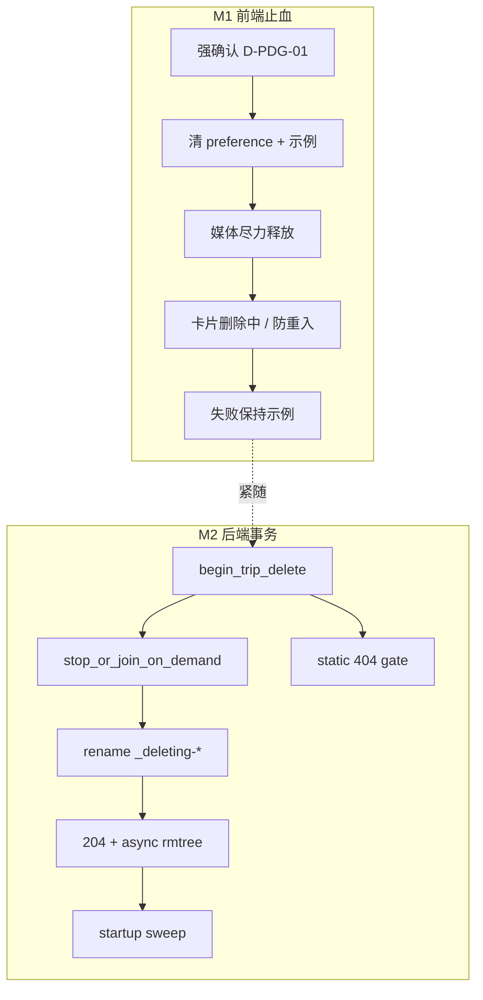

# Travelogue · 预览中删除护栏 V1 · 实施任务清单

| 属性 | 内容 |
|------|------|
| **PRD** | [PRD-PREVIEW-DELETE-GUARD-V1.md](./PRD-PREVIEW-DELETE-GUARD-V1.md) **v0.2** |
| **验收** | 落地后补 `ACCEPTANCE-PREVIEW-DELETE-GUARD-V1.md`（对照 PRD §9） |
| **DOC-STATUS** | **active** |
| **状态** | **M1–M3 主路径已落地**（见 ACCEPTANCE；AC-08b / Windows 大样本可补） |
| **范围** | M1 前端止血 + M2 后端删除事务 + M3 合同/真测闭合；与 PRD 同包，不拆旁支 |
| **验收** | [ACCEPTANCE-PREVIEW-DELETE-GUARD-V1.md](./ACCEPTANCE-PREVIEW-DELETE-GUARD-V1.md) |
| **更新** | 2026-07-23 |

> **落地原则**
>
> 1. **先断开，再删盘**：热路径不得依赖 AC-D14-04 冷启动兜底。  
> 2. **前端 dispose ≠ 句柄安全**：媒体尽力释放；文件占用归 deleting / rename gate。  
> 3. **不扩 `studioModal`**：删除中态在卡片/菜单。  
> 4. **M1 可独立合入**：出口看 AC-PDG-01～05、06a～c；M2 紧随防 Windows/预览页回潮。  
> 5. **测试隔离**：有状态 `page.route`；临时 `trips_dir`；禁止 `?bentoPreviewTrip=` 测硬刷新。

---

## 0. 已锁定决策（实施层写死）

继承 PRD §0.3 D-PDG-01～08。以下为 PRD §10「开放」项在本清单的**实施拍板**（开工不得再摇摆）：

| ID | 议题 | **实施锁定** |
|----|------|--------------|
| **I-PDG-01** | 离线删除 | **不单独禁用入口**。可点则走完整断开→DELETE；网络失败 toast + 保持示例 + 卡片保留。 |
| **I-PDG-02** | rename 失败后 deleting 标记 | **清除** deleting（`end_trip_delete`），返回 `E_TRIP_DELETE_FAILED`，允许用户重试。静态 gate 随 end 解除。 |
| **I-PDG-03** | 墓碑仍在时对原 ID 再 DELETE | **404** `E_TRIP_NOT_FOUND`（逻辑目录已不存在）。不 204 幂等（避免前端误以为刚删成功）。 |
| **I-PDG-04** | 极端「无法切示例」中止条件 | 仅当 `setBentoPreviewTripId(null)` / `renderBentoSurface` **同步抛错**时中止；storage 写失败**忽略**。默认路径几乎不触发。 |
| **I-PDG-05** | `shelf_delete_fail` 遥测 | **加入** allowlist（`studio_events.py` + `analytics.js`）；payload 含 `was_previewing` + `error`。 |
| **I-PDG-06** | on-demand stop 超时 | `stop_or_join_on_demand`：**join 预算 2.0s**；超时仍继续 rename（daemon 线程随后对墓碑写失败应被吞并打日志）。 |
| **I-PDG-07** | rename 重试 | 复用 `TripService` 忙错误语义：WinError 5/32 / `PermissionError`；backoff `(0.05, 0.1, 0.2, 0.4, 0.8, 1.2)`；仍失败 → I-PDG-02。 |
| **I-PDG-08** | 204 语义 | **逻辑摘除完成**（列表不可见、原 ID resolve 失败）；**不**保证物理 `rmtree` 已完成。 |
| **I-PDG-09** | 墓碑命名 | 同 `trips_dir` 下：`_deleting-{tripId}-{8hex}`；`tripId` 内非 `[A-Za-z0-9._-]` 字符替换为 `_`（防路径注入）。列表已跳过 `_` 前缀（核实 `studio_trips.py:167`）。 |
| **I-PDG-10** | 启动续删挂点 | Studio HTTP 服务 **bind 成功后** 调一次 `sweep_deleting_tombstones(trips_dir)`（`serve.py` / `studio_lifecycle` 邻域）；daemon、失败仅日志。 |

**与 PRD 挂钩**：合同仅 [PRD-PREVIEW-DELETE-GUARD-V1](./PRD-PREVIEW-DELETE-GUARD-V1.md)；不另开删除/回收站 PRD。

| 里程碑 | 内容 | 估时 |
|--------|------|------|
| **M1** | 强确认 · 先断开 · 卡片删除中 · 媒体尽力释放 · 防复活 · e2e 01～06 | 1～1.5 人日 |
| **M2** | deleting store · on-demand stop · rename+async · 静态 gate · 启动续删 · 08/08b | 1.5～2.5 人日 |
| **M3** | 邻接回写 · AC-09/10 · Windows 大样本签字 · ACCEPTANCE | 0.5～1 人日 |



---

## 1. 摸底结论（开工前已知）

| 发现 | 含义 |
|------|------|
| `confirmDelete` 仅通用文案；不读 `V2.bentoPreviewTripId` | M1 入口清晰：`shelf-menu.js` |
| `setBentoPreviewTripId(null)` 同步清 memory/storage 并 `renderBentoSurface(demo)` | 可作 1a；**不足**作句柄保证 |
| carousel/phone `dispose` 只清监听/timer，不清 `img.src` | 须加 1b 媒体释放 |
| `bento.js` 背景/`new Image()` 无 generation | 旧 onload 可能回写；须加 generation |
| `onTripDeleted` 不清 preference；`shelf-menu` 成功后总 `reroute` | 须先断开 + 防复活 |
| `handle_delete_trip` 直接 `rmtree`；busy 只查 job | M2 整段重写删除事务 |
| `_on_demand_threads` 私有，无公共 stop | 须新增 API；注意**勿持 `_on_demand_lock` 长 join** |
| `studio_trips` 已 `startswith("_")` skip | 墓碑命名可行，无需改列表过滤规则 |
| `studioModal` 确认后立刻拆 DOM | 删除中态必须落卡片，不改 modal 共享 API |
| allowlist 有 `shelf_delete_{confirm,success,cancel}`，**无** `fail` | I-PDG-05 |
| `test_ac_d14_04` 仅冷启动；`test_studio_trip_delete` 无 busy/失败面 | QA 从零补热路径 |
| harness `studioFixture=multi` 列表不可变、无 DELETE mock | e2e 必须有状态 route |

---

## 2. 目标时序（合同级）

### 2.1 前端（预览中删除）

```
用户确认删除
  → close modal
  → wasPreviewing = (tripId === V2.bentoPreviewTripId)
  → markCardDeleting(tripId) + inFlight.add(tripId)
  → setBentoPreviewTripId(null, { source: "shelf_delete", silent?: })
       · 同步：preference / demo render
       · 异步微任务：disposeBentoMedia + generation bump（不阻塞 DELETE）
  → DELETE /__travelogue/trips/{id}
       · 调用瞬间：preference 必须已空（AC-03）
  → 204: onTripDeleted + toast（含切回示例若 wasPreviewing）+ inFlight.delete + reroute
  → !ok: toast message + clearCardDeleting + inFlight.delete
         preference 保持 null（不回滚）
```

### 2.2 后端 DELETE

```
resolve trip_dir
  → demo protect → 403
  → begin_trip_delete(disk_id)  # 原子：busy|deleting → 409；否则 mark
  → stop_or_join_on_demand(trip_dir, timeout=2.0)
  → rename trip_dir → trips_dir/_deleting-{id}-{nonce}  # 带 I-PDG-07 重试
       fail → end_trip_delete + 500 E_TRIP_DELETE_FAILED
  → 204
  → end_trip_delete(disk_id)   # 逻辑 ID 已不存在；gate 可对原 ID 靠「目录不存在」
  → spawn daemon: rmtree(tombstone) with retries
```

> **静态 gate 细节**：`is_trip_deleting(id)` **或** `resolve_trip_dir` 失败 → 404。rename 成功后即使已 `end_trip_delete`，原路径也不存在，gate 自然成立。begin→rename 窗口内必须靠 `is_trip_deleting` 拒绝新 open。

---

## 3. M1 · 前端止血（P0）

### 3.0 文档

| ID | 任务 | 状态 |
|----|------|------|
| DOC-PDG-01 | PRD v0.2 + 本 IMPLEMENTATION | ☑ |
| DOC-PDG-02 | M1 合入后补 ACCEPTANCE 签字栏（AC-01～06） | ☑ |

### 3.1 强确认与删除编排

| ID | 任务 | 建议位置 | 状态 |
|----|------|----------|------|
| FE-PDG-01 | `confirmDelete`：若 `trip.tripId === V2.bentoPreviewTripId` 使用 §5.1 标题/正文；否则 §5.2 | `shelf-menu.js` | ☑ |
| FE-PDG-02 | 遥测：`confirm`/`cancel`/`success` 增 `was_previewing`；新增 `shelf_delete_fail`（I-PDG-05） | `shelf-menu.js` · `studio_events.py` · `analytics.js` | ☑ |
| FE-PDG-03 | 确认后编排：先 `setBentoPreviewTripId(null,{source:"shelf_delete"})`（等其 Promise **仅**为接住异常；storage 失败不中止），再 `deleteTrip` | `shelf-menu.js` | ☑ |
| FE-PDG-04 | 非预览册删除：同样建议先检查若误匹配则无；成功 toast 分支按 `was_previewing` | 同上 | ☑ |
| FE-PDG-05 | 成功 toast：预览中 → `已删除「{title}」，已切回示例`；否则既有句 | 同上 | ☑ |

### 3.2 卡片删除中 / 防重入

| ID | 任务 | 建议位置 | 状态 |
|----|------|----------|------|
| FE-PDG-10 | 模块级 `Set`/`Map`：`deletingTripIds`；未决忽略第二次删除 | `shelf-menu.js` 或 `shelf.js` | ☑ |
| FE-PDG-11 | 卡片：`data-deleting="1"` / `aria-busy="true"`；菜单「删除画册」`disabled`；可选短文案「删除中」 | `shelf.js` + CSS | ☑ |
| FE-PDG-12 | Modal 确认后立刻关闭（现状）；**不**改 `studio-modal.js` API | — | ☑（约束） |
| FE-PDG-13 | `onTripDeleted`：幂等 `clearBentoPreviewTripId` 若仍等于被删 ID；摘卡后清 deleting 标记 | `shelf.js` | ☑ |

### 3.3 媒体尽力释放 + 防复活

| ID | 任务 | 建议位置 | 状态 |
|----|------|----------|------|
| FE-PDG-20 | carousel/phone dispose：卸载前将现存 `img.src`/`srcset` 置空，清 onload/onerror | `carousel.js` · `phone-strip.js` | ☑ |
| FE-PDG-21 | `bento.js`：背景层与 bench probe 增加 `_bentoMediaGen`；过期回调不写 DOM | `bento.js` | ☑ |
| FE-PDG-22 | 可选导出 `bumpBentoMediaGeneration()`，在 `setBentoPreviewTripId(null)` 内调用 | `bento-tabs.js` · `bento.js` | ☑ |
| FE-PDG-23 | `applyStoredBentoPreviewPreference`：若 stored ∈ `deletingTripIds` 或刚成功删除集合 → 当无效，走 demo（防 reroute 复活） | `bento-preview-picker.js` | ☑ |
| FE-PDG-24 | `bento_preview_select` 允许 `source: "shelf_delete"`（若 source 有枚举校验则扩） | 遥测 allow / 前端 track | ☑ |

### 3.4 测试 · M1

| ID | 任务 | 状态 |
|----|------|------|
| QA-PDG-01 | Playwright：AC-PDG-01 锁定子串 + 标题 | ☑ |
| QA-PDG-02 | Playwright：AC-PDG-02 非预览禁句 | ☑ |
| QA-PDG-03 | Playwright：有状态 DELETE mock（延迟）+ `fetch` 包装采样 → AC-03 | ☑ |
| QA-PDG-04 | Playwright：成功 toast / 摘卡 / 设置钮可点 → AC-04 | ☑ |
| QA-PDG-05 | Playwright：延迟 1s 内重入 → DELETE 次数=1；卡片 `aria-busy` → AC-05 | ☑ |
| QA-PDG-06 | Playwright：409 / 500+message / 500 无 body → AC-06a/b/c | ☑ |
| QA-PDG-07 | 单元/静态：`test_studio_home_v2.py` 可增关键锁字串存在性（可选） | ☑ allowlist |
| QA-PDG-08 | allowlist：`shelf_delete_fail` 前后端一致 | ☑ |

**有状态 mock 最小合同**（写进测试 helper，避免各测复制）：

```text
deleted = new Set()
route DELETE /__travelogue/trips/:id → delay → 204 + deleted.add(id)
route GET  /__travelogue/trips*     → fixture trips.filter(t => !deleted.has(t.tripId))
设预览：UI _select_preview_trip；勿用 bentoPreviewTrip= 测刷新
```

**M1 出口**：AC-PDG-01～05、06a～c 绿；手测「预览中删除 → 回示例、可点设置」一遍。

---

## 4. M2 · 后端删除事务（P1）

### 4.1 JobStore deleting

| ID | 任务 | 建议位置 | 状态 |
|----|------|----------|------|
| BE-PDG-01 | `StudioJobStore`：`_deleting_trip_ids: set[str]`；`begin_trip_delete` / `end_trip_delete` / `is_trip_deleting` | `studio_jobs.py` | ☑ |
| BE-PDG-02 | `is_trip_busy`：**或** job queued/running **或** deleting | 同上 | ☑ |
| BE-PDG-03 | `begin` 必须在同一锁内检查 busy+deleting，防双 DELETE TOCTOU | 同上 | ☑ |

### 4.2 on-demand stop

| ID | 任务 | 建议位置 | 状态 |
|----|------|----------|------|
| BE-PDG-10 | 新增 `stop_or_join_on_demand(trip_dir: Path, *, timeout: float = 2.0) -> None` | `derivatives.py` | ☑ |
| BE-PDG-11 | 实现：锁内取出 thread 引用并 pop；**锁外** `join(timeout)`；超时打 warning 日志后返回 | 同上 | ☑ |
| BE-PDG-12 | `_bg` / `_persist_trip_json`：目录已不存在或 rename 走后 → 静默 return（勿抛到线程外未捕获） | 同上 | ☑ |
| BE-PDG-13 | 测试 hook：可注入「慢线程」或 barrier，供 AC-07（勿依赖真实 PIL 耗时） | `derivatives.py` `register_on_demand_thread_for_tests` | ☑ |

### 4.3 handle_delete_trip 重写

| ID | 任务 | 建议位置 | 状态 |
|----|------|----------|------|
| BE-PDG-20 | 按 §2.2 顺序重写；去掉「裸 `rmtree` 成功才 204」主路径 | `trip_list_handlers.py` | ☑ |
| BE-PDG-21 | rename 辅助：`_rename_trip_to_tombstone(trip_dir) -> Path`，I-PDG-07/09 | 同文件或 `studio_trips` 邻域 | ☑ `studio_trip_delete.py` |
| BE-PDG-22 | rename 失败 → `end_trip_delete` + `E_TRIP_DELETE_FAILED` + 非空中文 `message` | 同上 | ☑ |
| BE-PDG-23 | 204 后 daemon `rmtree`；失败 log + 留墓碑 | 同上 | ☑ |
| BE-PDG-24 | 原 ID 已不存在（含墓碑场景）→ 404（I-PDG-03） | 同上 | ☑ |

### 4.4 静态 gate + 启动续删

| ID | 任务 | 建议位置 | 状态 |
|----|------|----------|------|
| BE-PDG-30 | `_serve_trip_static`：`is_trip_deleting(trip_id)` → **立刻** 404（勿 open） | `serve.py` | ☑ |
| BE-PDG-31 | `sweep_deleting_tombstones(trips_dir)`：扫 `_deleting-*`，rmtree 带短重试 | 新函数（建议 `studio_trip_delete.py` 或 handlers 旁） | ☑ |
| BE-PDG-32 | Studio 启动 bind 后调用 sweep（I-PDG-10） | `serve.py` / 启动路径 | ☑ |
| BE-PDG-33 | 核实列表/resolve 对 `_` 前缀与 rename 后行为；补单测 | `studio_trips.py` 已 skip `_` | ☑ |

### 4.5 测试 · M2

| ID | 任务 | 状态 |
|----|------|------|
| QA-PDG-20 | pytest：正常删除 → 列表无 · 目录逻辑消失（rename 或已扫掉） | ☑ |
| QA-PDG-21 | pytest：demo 403；unknown 404；busy job 409；deleting 中第二 DELETE 409 | ☑ busy/403/404 |
| QA-PDG-22 | pytest：rename 失败（mock）→ `E_TRIP_DELETE_FAILED` + deleting 已清除可再删 | ☑ |
| QA-PDG-23 | pytest：deleting 窗口静态 GET → 404（AC-08） | ☑ |
| QA-PDG-24 | pytest：on-demand hook + 删除无挂起（AC-07，超时 5s） | ☑ |
| QA-PDG-25 | pytest：启动 sweep 清残留墓碑 | ☑ |
| QA-PDG-26 | Playwright 或脚本：首页预览 + 第二页打开 trip → 删除 → 首页 5s 可交互（AC-08b） | ☑ |
| QA-PDG-27 | Windows 手工/夜间：≥20 张多档 WebP 预览中删除；记录 DELETE 至 204 耗时 | ☑ 假文件体积测；真图可选 |

**M2 出口**：AC-PDG-07、08、08b 绿；QA-PDG-20～26 过。

---

## 5. M3 · 契约闭合

| ID | 任务 | 状态 |
|----|------|------|
| DOC-PDG-10 | 回写 Homepage v2 §6.8.4：热删除强确认 + 先清 preference | ☑ |
| DOC-PDG-11 | 回写 DATA-CONTRACT：热路径清空；reroute 不复活；204 逻辑摘除语义 | ☑ |
| DOC-PDG-12 | `ACCEPTANCE-PREVIEW-DELETE-GUARD-V1.md` 全表签字 | ☑ |
| QA-PDG-30 | AC-PDG-09：加强 D14-04（storage null + pageerror=0） | ☑ |
| QA-PDG-31 | AC-PDG-10：热删后硬刷新；无 `bentoPreviewTrip` 重灌；列表持续排除 | ☑ |
| QA-PDG-32 | 回归：非预览删除、示例不可删、书架长图菜单不受影响 | ☑ AC-02 + 后端 demo 403 |

**M3 / 主题 Done**：邻接回写完成 + AC-09/10 + Windows 大样本签字（QA-PDG-27）。

---

## 6. 文件触点清单（实施用）

| 层 | 文件 |
|----|------|
| FE | `templates/studio/homepage-v2/shelf-menu.js` |
| FE | `templates/studio/homepage-v2/shelf.js` |
| FE | `templates/studio/homepage-v2/bento-tabs.js` |
| FE | `templates/studio/homepage-v2/bento.js` |
| FE | `templates/studio/homepage-v2/carousel.js` |
| FE | `templates/studio/homepage-v2/phone-strip.js` |
| FE | `templates/studio/homepage-v2/bento-preview-picker.js` |
| FE | `templates/studio/homepage-v2/css/*`（卡片 deleting 态，若需） |
| FE | `templates/studio/js/analytics.js` |
| BE | `travelogue/domain/studio_events.py` |
| BE | `travelogue/web/studio_jobs.py` |
| BE | `travelogue/media/derivatives.py` |
| BE | `travelogue/web/studio_handlers/trip_list_handlers.py` |
| BE | `travelogue/web/serve.py` |
| BE | （可选新）`travelogue/web/studio_trip_delete.py` — rename/sweep 集中，避免 handlers 膨胀 |
| QA | `tests/e2e/test_studio_home_v2_ac_playwright.py` |
| QA | `tests/unit/web/test_studio_trip_delete.py` |
| QA | （可选）`tests/unit/media/test_derivatives_on_demand_stop.py` |
| DOC | `docs/PRD-STUDIO-HOMEPAGE-v2.md` · `docs/studio-homepage-v2/DATA-CONTRACT.md` |

---

## 7. 风险与缓解

| 风险 | 缓解 |
|------|------|
| M1 合入后 Windows 仍偶发卡死 | M2 紧随；发布说明可写「完整修复含 M2」 |
| on-demand 超时后仍写墓碑 | `_persist` 见目录消失则 return；sweep 兜底 |
| daemon rmtree 进程退出残留 | 启动 sweep（I-PDG-10） |
| e2e fixture 列表复活 | 强制有状态 mock helper；code review 检查点 |
| 双页 08b 不稳定 | 优先集成测静态 404 + 手工双页；Playwright 双 context 可后补 |
| 遥测 `fail` 未进 allowlist | FE-PDG-02 / QA-PDG-08 同车 |

---

## 8. 明确不做

- 扩展 `studioModal` loading/controller  
- 服务端预览 session 租约  
- 回收站 / 可恢复删除 UI  
- 用 `location.reload` 收敛状态  
- 伪造 `StudioJob` 表示 deleting  
- 宣称前端 dispose 已释放 Windows 文件句柄  

---

## 9. 建议 PR 切分

| PR | 内容 | 门禁 |
|----|------|------|
| **PR-A（M1）** | FE-PDG-* + 遥测 allowlist + QA-PDG-01～08 | AC-01～06 |
| **PR-B（M2）** | BE-PDG-* + QA-PDG-20～26 | AC-07/08/08b |
| **PR-C（M3）** | 文档回写 + QA-PDG-30～32 + ACCEPTANCE；可与 B 同车 | 主题 Done |

若评审要求单 PR：A+B 同车，C 快跟（文档不得漏）。

---

## 10. 变更记录

| 版本 | 日期 | 变更 |
|------|------|------|
| v0.1 | 2026-07-23 | 初稿 · 对照 PRD v0.2 Conditional Go · 写死 I-PDG-01～10 · M1/M2/M3 任务拆条 |
| v0.2 | 2026-07-23 | 主路径落地勾选 · 链 ACCEPTANCE · pytest 9 / Playwright ac_pdg 5 绿 |
