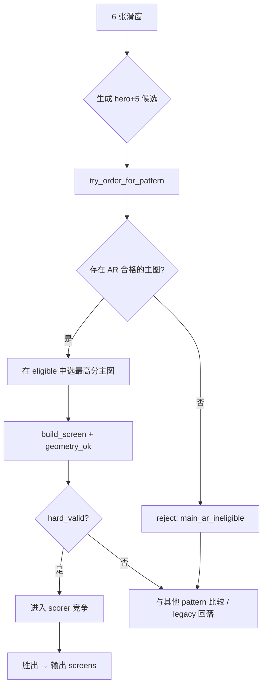

# Travelogue · 6 张拼图优化 PRD

| 属性 | 内容 |
|------|------|
| **产品代号** | Travelogue |
| **文档版本** | v0.2.0 |
| **状态** | Implemented (P0–P3) |
| **主题** | 6 窗主图 + 5 配图拼图 · 主图长宽比资格规则 |
| **前置条件** | Phase 15 MCS 已上线；Phase 16 LTE 模板 Registry 稳定；`screen-mosaic-6-main-hero-plus-5` 为 GA |
| **关联文档** | [PRD-PHASE15-photo-mosaic-evolution.md](./PRD-PHASE15-photo-mosaic-evolution.md)、[PRD-PHASE16-layout-template-engine.md](./PRD-PHASE16-layout-template-engine.md)、[DESIGN-PHASE15-mosaic-system.md](./DESIGN-PHASE15-mosaic-system.md)、[cover-selection-plan.md](./cover-selection-plan.md) |
| **更新日期** | 2026-06-10 |

> **定位**
>
> 6 张拼图的标准形态为 **1 张主图 + 5 张配图**。主图是布局的「锚点」：主图原生长宽比会决定主槽 cover 裁切程度，并间接影响周边配图槽位的视觉协调。本 PRD 定义 **主图长宽比资格规则（R-MAIN-AR-01）**，禁止异型、超宽等非常规比例照片占据主位，并说明如何无缝接入现有 LTE / MCS / Scorer 规则库。

---

## 1. 背景与问题

### 1.1 产品意图

6 张拼图的典型结构：

- **1 张主图**：视觉焦点，占主槽（2×2 格）
- **5 张配图**：围绕主图排列（侧栏竖条 + 底行横图等）

**核心约束**：主图的长宽比会「带动」周边 5 张配图的呈现效果。主图比例异常时，cover 裁切损失大，且侧栏/底行槽位的 asset–slot 匹配质量下降。

**产品规则**：

- 主图应 **优先** 符合 **16:9** 或 **常规照片长宽比**（3:2、4:3 等）
- **异型、超宽、超竖、方图** 等非常规比例 → **禁止** 被选为主图

### 1.2 现状与根因

| ID | 现状 | 根因（代码） |
|----|------|-------------|
| **M6-P-01** | 全景/超宽图常被推为主图 | `_pick_main_landscape_id` 在全部 `landscape` 池中按 `effective_hero_score` 取最高；`hero_score` 对 `panorama` 有 ×1.25 加成 |
| **M6-P-02** | 主图 AR 无硬门槛 | `screen_slots_geometry_ok` 仅校验「竖图进宽格 / 横图进高格」，不校验主槽资产原生 AR |
| **M6-P-03** | 软惩罚不足以阻止 | `hero_slot_aspect` 惩罚「竖图入主位」，但不拦截 panorama / off-ladder 横图 |
| **M6-P-04** | 与封面哲学不一致 | 封面选图已对 web 偏好 16:9；拼图主图尚无对等硬规则 |

### 1.3 适用模板

| 模板 ID | 槽位数 | 主槽 displayAspect | 本 PRD 范围 |
|---------|--------|-------------------|-------------|
| `screen-mosaic-6-main-hero-plus-5` | 6（1 main + 5 tile） | ≈ 1.78（16:9） | **P0 必做** |
| `screen-mosaic-5-main-hero-plus-4` | 6（命名遗留，几何同 hero+5） | ≈ 1.78 | **P0 必做** |
| `screen-mosaic-5-main-portrait-3land` | 5 | 主槽横图 2×2 | P1 推广 |
| `screen-mosaic-5-hero-3-2-plus-4` | 5 | ≈ 0.89（高槽） | **不在范围**（已有 `hero_weighted_geometry_guard`） |

主槽几何（`screen-mosaic-6-main-hero-plus-5`）：

```yaml
# travelogue/layout_templates/templates/screen-mosaic-6-main-hero-plus-5.yaml
stage:
  aspect: '16:9'
  grid: [3, 3]
slots:
  - { index: 0, rect: [1, 2, 1, 2], role: main, fit: auto }   # 2×2 → displayAspect ≈ 16:9
  - { index: 1, rect: [3, 3, 1, 1], role: tile, fit: cover }
  # … 共 5 个 tile 槽
```

---

## 2. 目标与非目标

### 2.1 目标

| ID | 目标 | 衡量方式 |
|----|------|----------|
| **G-M6-01** | 主图仅由常规比例横图担任 | `hero6_with_conventional_main_rate` ≥ 95%（dogfood 集） |
| **G-M6-02** | 禁止 panorama/超宽入主位 | `main_ar_reject_rate` 可观测；panorama 入主 = 0 |
| **G-M6-03** | 无缝接入现有规则库 | 复用 P16 `AR_LADDER`；不破坏 golden parity 基线路径 |
| **G-M6-04** | 可解释、可回滚 | 决策日志含 `main_ar_ineligible` + reason_code；配置开关默认 fail-open 可关 |
| **G-M6-05** | 配图槽位匹配不劣化 | 侧栏/底行 `hero_slot_aspect` penalty 不上升；盲评不劣于基线 |

### 2.2 非目标

| ID | 非目标 |
|----|--------|
| **NG-M6-01** | 不在 ingest 阶段统一裁切用户照片长宽比 |
| **NG-M6-02** | 不修改模板拓扑或 CSS Grid 几何 |
| **NG-M6-03** | 不覆盖 `hero-3-2-plus-4` 的 Plate 63 guard（另一套主槽 ≈ 0.89 逻辑） |
| **NG-M6-04** | 不在本 PRD 内做端到端 ML 主图推荐 |

---

## 3. 规则定义 · R-MAIN-AR-01

### 3.1 规则语义

| 项 | 内容 |
|----|------|
| **规则 ID** | `R-MAIN-AR-01` · 拼图主图长宽比资格 |
| **类型** | **硬约束**（候选 `hard_valid`）+ Scorer **软惩罚兜底** |
| **判定依据** | 资产 **原生** w/h（`width`/`height` 或 `nativeWidth`/`nativeHeight`） |
| **对齐标准** | P16 §4.4 常规 AR 阶梯 + 主槽 `displayAspect` |

### 3.2 常规 AR 阶梯（复用 LTE）

与 `travelogue/layout_templates/validator.py` 保持一致：

```
LADDER = { 2:3≈0.67, 3:4=0.75, 1:1, 4:3≈1.33, 3:2=1.5, 16:9≈1.78 }
容差 tol = ±0.08（AR_LADDER_TOL）
```

### 3.3 禁止入主位（Hard Reject）

| 条件 | 阈值 | reason_code |
|------|------|-------------|
| 全景 | `aspectKind == panorama`（w/h ≥ 2.0） | `blocked_panorama` |
| 超宽横图 | w/h > 2.2（对齐 `LANDSCAPE_AR_BLOCK_HIGH`） | `blocked_ultra_wide` |
| 竖图 / 超长竖 | `portrait` / `tall` | `blocked_portrait` |
| 方图 | `square` | `blocked_square` |
| 偏离阶梯 | min(｜ar − ladder｜) > tol | `blocked_off_ladder` |
| 无尺寸 | width/height 缺失或 ≤ 0 | `blocked_no_dims` |

### 3.4 允许入主位（Eligible）

- `aspectKind == landscape`（不含 panorama）
- 原生 AR 落在 LADDER 某一档 ± tol 内
- **优先档**（选主时加权，非硬门槛）：16:9 > 3:2 > 4:3

### 3.5 判定 API（建议）

```python
def asset_eligible_for_main_slot(
    asset: dict,
    *,
    target_display_ar: float,
    tol: float = AR_LADDER_TOL,
) -> tuple[bool, str]:
    """Returns (eligible, reason_code)."""

def screen_main_slot_eligible(
    screen: dict,
    assets_map: dict[str, dict],
    *,
    pattern_id: str,
) -> tuple[bool, str]:
    """Inspect role=main slot in a built screen."""
```

---

## 4. 与现有规则库的关系

### 4.1 三层约束模型

```
┌─────────────────────────────────────────────────────────────┐
│  LTE 模板层     槽位 geometry / displayAspect / constraints │
├─────────────────────────────────────────────────────────────┤
│  MCS 候选层     hard_valid（结构 + 几何 + 主图 AR）          │
├─────────────────────────────────────────────────────────────┤
│  Scorer 软惩罚   乘性 penalties + reason_codes              │
└─────────────────────────────────────────────────────────────┘
```

### 4.2 与相邻规则分工

| 现有规则 | 管什么 | 与本规则关系 |
|----------|--------|-------------|
| `screen_slots_geometry_ok` | 竖图进宽格、横图进高格 | 管槽位↔kind；**不管**原生 AR |
| `hero_slot_aspect` penalty | 主位竖图、侧栏横图等角色错配 | 软惩罚；本规则是 **硬门槛** |
| `hero_narrow_tiles` | 全横图 hero+4/5 窄条问题 | 互补；6 窗 hero+5 有 `R_HERO6_LAND` boost |
| `hero_weighted_geometry_guard` | hero-3-2-plus-4 高槽裁切 | 不同模板，**不混用** |
| Cover 16:9 偏好 | 封面选图 | **同一 AR 哲学**，复用 ladder |
| LTE `AR_LADDER` / V-P16-13 | 槽位 displayAspect 合规 | **同一 ladder 源**，资产侧对齐 |

---

## 5. 接入方案

### 5.1 共享策略模块（单一事实来源）

**新增** `travelogue/layout_engine/aspect_policy.py`（或 `travelogue/curation/mosaic/main_eligibility.py`）：

- 从 `validator.AR_LADDER` / `AR_LADDER_TOL` import，避免双写
- 导出：
  - `asset_native_ar(asset) -> float`
  - `nearest_ladder_delta(ar) -> float`
  - `asset_eligible_for_main_slot(asset, target_display_ar) -> (bool, str)`
  - `pick_best_main_eligible(landscape_ids, assets_map, target_ar, score_fn) -> str | None`

### 5.2 LTE 模板 YAML 声明

在 hero+tile 模板 `constraints` 增加：

```yaml
constraints:
  mainSlotPolicy:
    slotIndex: 0
    targetDisplayAspect: 1.7778
    eligibleAspectKinds: [landscape]
    forbidKinds: [panorama, tall, portrait, square]
    arLadderTol: 0.08
    preferLadder: [1.7778, 1.5, 1.3333]
```

Validator 可选新增 `V-P16-MAIN-01`：含 `role=main` 且主槽 displayAspect ≈ 16:9 的 composite 模板应声明 `mainSlotPolicy`。

### 5.3 MCS 候选生成 · 硬过滤（M4 · P0 关键）

**文件**：`travelogue/curation/mosaic/candidates.py`

在 `build_screen` 之后：

```python
main_ok, main_reason = screen_main_slot_eligible(screen, assets_map, pattern_id=pat.pattern_id)
geom_ok = screen_slots_geometry_ok(screen, aspects) and main_ok
if not main_ok:
    _reject(rejected, pat.pattern_id, "main_ar_ineligible", detail=main_reason)
```

**效果**：窗内若无合格主图 → 该 pattern `hard_valid=False` → 回落其他 pattern 或 legacy planner。

### 5.4 主图排序（M2 · P0）

**文件**：`travelogue/curation/mosaic/builders.py` · `_order_hero_six`  
**文件**：`travelogue/curation/mosaic/hero.py` · `pick_main_for_pattern`

改造逻辑：

1. 从 `landscapes` 池过滤为 `eligible` 集合
2. `eligible` 为空 → `return None`
3. 在 `eligible` 内按 `effective_hero_score × ar_preference_boost` 选主

### 5.5 Scorer 软惩罚兜底（M5 · P1）

**文件**：`travelogue/curation/mosaic/scorer.py`

新增 `_main_ar_penalty()`，注册 penalty key `main_ar_ineligible`，reason_code `R_MAIN_AR_BLOCK`。

**文件**：`travelogue/layout_engine/strategies/default.yaml`

```yaml
penalties:
  main_ar_ineligible: 0.95
```

### 5.6 配置与开关

```yaml
# config.yaml · mosaic
mosaic:
  main_ar_guard: true
  main_ar_ladder_tol: 0.08
  main_ar_prefer_16_9: true
```

LSE strategy pack 同步；W0 parity 路径可通过 `main_ar_guard: false` 回滚。

---

## 6. 决策流程



### 6.1 典型回落路径

| 场景 | 行为 |
|------|------|
| 6 张均为常规 16:9/3:2 横图 | hero+5 正常胜出（与现网一致或略优） |
| 含 panorama / 超宽，无 eligible 主图 | hero+5 被拒 → 可能选 `landscape-6` 或拆窗 |
| 仅 1 张 eligible + 5 张异型 | eligible 图入主；异型进 tile（受 slot geometry 约束） |
| 全窗无 eligible 主图 | 整窗 hero+5 hard_valid=false → 其他 MCS / legacy |

---

## 7. 实施计划

| 阶段 | 内容 | 改动面 | 风险 |
|------|------|--------|------|
| **P0** | `aspect_policy` + `_order_hero_six` / `hero.py` 过滤 | 2–3 文件 + 单元测试 | 低 |
| **P1** | `candidates.py` hard_valid + reject 日志 + scorer penalty | 2 文件 | 中（影响 pattern 竞争） |
| **P2** | YAML `mainSlotPolicy` + validator + LSE 配置 | 模板 + 配置 | 低 |
| **P3** | golden 重跑 + dogfood 盲评 + probe 指标 | 测试 / 脚本 | 验收 |

---

## 8. 验收标准

### 8.1 单元测试

| ID | 用例 | 期望 |
|----|------|------|
| **AC-M6-01** | panorama（w:h=2.5:1）在 6 横图窗 | 不被选为主图；`_order_hero_six` 选其他 eligible |
| **AC-M6-02** | 16:9、3:2 常规横图 | 正常入主 |
| **AC-M6-03** | 6 张全 panorama | 无 hero+5 `hard_valid` 候选 |
| **AC-M6-04** | 匈牙利 reorder 试图把 panorama 换到 slot 0 | scorer `main_ar_ineligible` penalty 生效 |

### 8.2 Golden / 回归

- 常规横图 trip（`mosaic-landscape-6` golden）行为不变或略优
- chuanzang 等含全景样本：hero+5 曝光率下降、主图裁切投诉率下降

### 8.3 决策日志

```json
{
  "templateId": "screen-mosaic-6-main-hero-plus-5",
  "reason": "main_ar_ineligible",
  "detail": "blocked_panorama"
}
```

Scorer reason_code：`R_MAIN_AR_BLOCK`。

### 8.4 可观测指标（probe）

| 指标 | 说明 |
|------|------|
| `main_ar_reject_rate` | 因 R-MAIN-AR-01 拒绝的候选占比 |
| `hero6_with_conventional_main_rate` | hero+5 屏主图为 16:9/3:2/4:3 的比例 |
| `hero6_fallback_rate` | hero+5 被拒后的回落 pattern 分布 |

---

## 9. 风险与缓解

| 风险 | 缓解 |
|------|------|
| 优质 panorama 无法做主图 | 回落 `screen-panorama-1` 或 tile 槽；panorama 仍可见 |
| golden parity 漂移 | P0 默认 `main_ar_guard=true`；parity 基线可 `--main_ar_guard=false` |
| featured 图被挡在 main 外 | featured 仅在 eligible 池内加权，不 bypass 硬规则 |
| 与 hero_score panorama boost 冲突 | 主图选择路径改用 `pick_best_main_eligible`，不再裸用 `_pick_main_landscape_id` |

---

## 10. 术语

| 术语 | 含义 |
|------|------|
| **主图 / main** | `role=main` 槽位资产，布局锚点 |
| **配图 / tile** | 周边 5 槽，`role=tile` 或 portrait/landscape |
| **displayAspect** | 槽位在舞台上的宽高比（LTE 固化） |
| **原生 AR** | 资产 `width/height` 比值 |
| **eligible** | 通过 R-MAIN-AR-01 硬判定的主图候选池 |
| **AR 阶梯** | P16 常规比例集合 `{2:3, 3:4, 1:1, 4:3, 3:2, 16:9}` |

---

## 11. 变更记录

| 版本 | 日期 | 说明 |
|------|------|------|
| v0.1.0 | 2026-06-10 | 初稿：R-MAIN-AR-01 规则定义 + LTE/MCS/Scorer 接入方案 |
| v0.1.1 | 2026-06-10 | P0+P1 实现：`main_eligibility`、MCS 硬过滤、scorer 惩罚 |
| v0.2.0 | 2026-06-10 | P2：模板 `mainSlotPolicy`、V-P16-MAIN-01；P3：指标 + 日志 `mainArRejectedTemplates` |
| v0.2.1 | 2026-06-10 | 遗漏修复：`main_ar_reject_rate` 读 `rejectedTemplates`；`hero6FallbackRate`；AC-M6-04 测试 |
