# Travelogue · 架构优化 PRD V2（Architecture Governance & Convergence · Round 2）

| 属性 | 内容 |
|------|------|
| **产品代号** | Travelogue（核心管线 + Studio） |
| **文档版本** | **v2.1.0-ARCH-OPT**（评审修订稿） |
| **状态** | **Draft · 四方评审意见已吸收，待复审** |
| **性质** | 工程治理 PRD：**零 intentional 功能变更**；本轮不新增分层重画，聚焦「让 2026-07 已建立的治理机制重新生效并防止再度失效」 |
| **承接关系** | 承接 [PRD-ARCH-OPTIMIZATION.md](./PRD-ARCH-OPTIMIZATION.md)（v1.1.0，WS1 已于 2026-07-09 结项，见 [ARCH-OPT-STATUS.md](./ARCH-OPT-STATUS.md)）。本 PRD **不重复**已完成的 WS1 内容，只处理 WS1 结项后一个月内新产生 / 复发的问题 |
| **评审记录** | 2026-08-11 四方专家评审（架构/开发/算法/测试），详见 [ARCH-OPT-REVIEW-V2-2026-08-11.md](./ARCH-OPT-REVIEW-V2-2026-08-11.md)；v2.0 评审处置摘要见 §0.5 |
| **评审依据** | 2026-08-11 架构评审 + 复审：`python -c "from importlinter.cli import lint_imports_command; lint_imports_command()"` 实测（注：`python -m importlinter.cli lint-imports` 因该模块无 `__main__` 分发块，是失效命令，恒定退出码 0，不可用作验证依据）、`pytest --fast` 全量重跑（4247 passed / 41 failed / ~20m）、`scripts/lint_lse_cross_import.py`/`scripts/lint_csc_god_module_ratchet.py` 实测、`npm run tsc:preview-toolbar` 实测、`curate.py`/`screen_planner.py`/`ingest.py`/`render/context.py`/`templates/studio/` 代码走读、`config.yaml.example` 规模统计、git log 基线文件演进追溯 |
| **关联文档** | [TECH-ARCHITECTURE.md](./TECH-ARCHITECTURE.md) §18 · [ARCH-OPT-STATUS.md](./ARCH-OPT-STATUS.md) · [ARCH-OPT-REVIEW-2026-07-09.md](./ARCH-OPT-REVIEW-2026-07-09.md) · [adr/011-import-strategy.md](./adr/011-import-strategy.md) · [adr/015-lse-planner-migration.md](./adr/015-lse-planner-migration.md) · [PRD-EQUAL-GRID-ADMISSION-V1.md](./PRD-EQUAL-GRID-ADMISSION-V1.md) |
| **更新日期** | 2026-08-11 |

---

## 0. 文档说明

### 0.1 定位：这是一份「治理机制维护」PRD，不是「加功能」也不是「重新设计分层」

2026-07-09 的 WS1 止血非常成功：import-linter 豁免清零、`pytest --fast` 从 57 failed 修复到 0 failed、LSE 跨包边基线校正、god-module 行数棘轮上线。**但一个月后（本次评审）复测，几乎同一套症状原样复现**：

1. **分层契约现破（P0）**：`lint-imports` 在当前 master HEAD 上是红的，由最新一次合入（`62f744d9`）引入，专门守护「零豁免」的回归测试同样失败。
2. **测试基线再度失守（P0）**：`pytest --fast` 实测 41 failed / 4247 passed，故障集中在 `layout_engine`（18/41）与 `p17` 集成用例（10/41）。
3. **god-module 棘轮当前也是失败状态（P0，评审新增）**：`curate.py` 实测 1986 行，超过棘轮基线 1974，`lint_csc_god_module_ratchet.py` 明确报 `REGRESSION`。
4. **前端 tsc 门禁当前也是红的（P0，评审新增）**：`npm run tsc:preview-toolbar` 实测 14 处类型错误、跨 5 个文件，退出码 2。
5. **棘轮方向被系统性反转（P1）**：LSE 跨包边基线一个月内经历 8→7→18→5→13 的剧烈波动，而棘轮的设计初衷是「只降不升」；且真实上调路径不是脚本 CLI 参数，而是直接手改基线 JSON 文件绕过脚本（详见 §5.1）。
6. **架构状态文档漂移（P1）**：`ARCH-OPT-STATUS.md` / `TECH-ARCHITECTURE.md` §18 自 07-08～10 后未再刷新，而这恰是 MTSO/SSG/MEGC/EGA/SCR/LVP/NAS/AIR/SNR/ECC 等十余个功能波次的高强度迭代期。07-09 评审明确点名「文档数字脚本化防漂移」为待办，一个月后同样的漂移又发生了一次——**说明问题不在于「没发现」，而在于发现之后没有变成自动化门禁**，纯靠人工纪律在高频迭代节奏下必然会被冲垮。

因此本 PRD 的核心命题是：**把「止血」这件事从一次性人工修复，升级为自动化、不可绕过、不可无限期悬挂的机制**，否则「止血 → 回潮 → 再止血」会作为季度性仪式持续发生，消耗掉 WS1 本该带来的复利。

> **元教训（2026-08-11 四方评审补充）**：本 PRD v2.0 草案在起草阶段同样犯了它自己批判的错误——§1.1 用来"证明棘轮机制有效"的对照数据本身有误（`curate.py` 当时就已经是 REGRESSION 状态），§5.1 对 LSE 棘轮上调机制的技术描述与代码不符。这不是巧合：**任何治理类文档如果不逐条重跑命令核实，都会在传播过程中脱离代码实况**，这恰恰印证了 D-ARC2-02"元治理自动化"的必要性。v2.1（本版）已按四方评审的实测复核逐条修订，详见 §0.5。

### 0.2 范围承诺

同 v1.1.0 §0.2：**零 intentional 功能变更**；结构性改动经等价门禁验证；本 PRD 不改变任何用户可见产物。补充一条新差异：

| # | 差异 | 来源 | 沟通方式 |
|---|------|------|----------|
| DIFF2-01 | `layout_engine ↔ curation` 棘轮基线在 M2-B1 下沉 4 条零风险边后从 13 降到 9 并冻结；任何新增边必须先在跟踪表登记并给出退役日期，否则 CI 直接拒绝合并 | M2-B1 | 开发者可见（CI 报错信息包含指引） |

### 0.3 问题总览与优先级

| 优先级 | 编号 | 问题 | 证据锚点 |
|--------|------|------|----------|
| **P0** | ARC2-01 | `travelogue.curation.chapter_titles` 两处（L159、L316）函数内懒加载导入 `travelogue.services.narrative_validate`，违反 §18.1 分层规则（curation 第 3 层不得导入 services 第 4 层） | `chapter_titles.py:159,316`；引入提交 `62f744d9` |
| **P0** | ARC2-02 | 专门守护「零豁免」的回归测试 `tests/unit/scripts/test_arch_opt_gates.py::test_lint_imports_no_exemptions` 当前失败 | 同上；`pytest --fast` 实测 |
| **P0** | ARC2-03 | `pytest --fast` 41 failed / 4247 passed，18 处集中在 `layout_engine`，10 处集中在 `tests/integration/p17/*`（且后者本应被排除却仍出现在 --fast 结果里） | 本次 `pytest --fast -q` 实测日志 |
| **P0** | ARC2-04 | 无法确认上述违例为何能落到 master：分支保护 / CI 门禁在该次合入上的实际执行结果未知 | 需核实 `62f744d9` 对应 PR 的 CI 运行记录 |
| **P0（评审新增）** | ARC2-12 | `curate.py` god-module 行数棘轮当前实测 1986 行，超过基线 1974 行，`lint_csc_god_module_ratchet.py` 报 `REGRESSION`；PRD v2.0 草案曾误判为「未超基线」 | `python scripts/lint_csc_god_module_ratchet.py` 实测输出 |
| **P0（评审新增）** | ARC2-13 | 前端 `npm run tsc:preview-toolbar` 门禁当前实测 14 处类型错误（跨 `ai-sheet.js`/`chapter-panel.js`/`longshot.js`/`narrate-diff.js`/`narrative-posture.js` 5 个文件），退出码 2 | `npm run tsc:preview-toolbar` 实测输出 |
| **P1** | ARC2-05 | LSE 跨包边基线一个月内经历 8→7→18→5→13 的剧烈波动；`lint_lse_cross_import.py` **当前无 `--allow-growth` 参数**，`--update-baseline` 会拒绝任何增长，历史上的上调（尤其 5→13）系直接手改基线 JSON 文件绕过脚本（`commit 68d8aafa` 一次性改写 4 个治理基线文件） | `git log -p docs/acceptance-records/lse-cross-import-baseline.json` 全量追溯；`scripts/lint_lse_cross_import.py` 源码（无 `allow-growth` 字样） |
| **P1** | ARC2-06 | god-module 行数棘轮只覆盖 `curate.py` / `studio_pipeline.py` 两个文件；整仓最大的几个「工具袋」模块（`screen_planner.py` ~2009 行、`ingest.py` ~1488 行、`render/context.py` ~1407 行）与前端最大文件（`longshot.js` ~3428 行、`import-wizard.js` ~1556 行）不在任何行数门禁覆盖范围内 | 代码走读 + `scripts/lint_csc_god_module_ratchet.py` 源码 |
| **P1** | ARC2-07 | `ARCH-OPT-STATUS.md` / `TECH-ARCHITECTURE.md` §18 关键数字（分层现状、LSE 边数、开关台账）自 2026-07-08～10 后未再刷新，与代码实况脱节；§18.1 分层图文本连包名枚举本身也不完整（缺 `travelogue.cover_engine`），不仅是数字过期 | 文档最后更新日期 vs `pyproject.toml [tool.importlinter]` 实际 layers 配置对照 |
| **P1** | ARC2-08 | 配置面持续膨胀：`config.yaml.example` 588→787 行（PRD 基线→现状，本次两种方法复测均确认 787），~523 键 / 26 组 / 深度 6；已删除的两个「官方认定」双路径开关（`pipeline.orchestration`、`layout.planner_impl`）之外，同类模式（`layout.web_layout_engine`、`mosaic.fallback_to_legacy`、`studio.import_dual_mode_enabled`、`template_router.shadow_mode`、`curate.arc_mode: legacy` 等）未被纳入开关台账跟踪退役 | `config.yaml.example` 规模统计（`Get-Content` 与 `readlines()` 双方法核对一致）+ 代码走读 |
| **P2** | ARC2-09 | `curate.py`/`screen_planner.py`/`ingest.py`/`render/context.py` 四文件合计约 172 处函数内懒加载 import + 文件尾 `E402` re-export，是维持可导入的主要手段；最重的 `_stage_build_chapters_compose`（~592 行）/ `build_layout_screen`（~346 行）/ `ingest_into_trip`（~326 行）等超大函数基本无直接白盒单测 | 代码走读（AST 统计） |
| **P2** | ARC2-10 | 前端 `templates/studio/` 97 个 JS 文件无构建管线；TypeScript `checkJs` 仅覆盖 `preview-toolbar/`（20 文件，`strict: false`，且该门禁**当前本身也是红的**，见 ARC2-13），`homepage-v2/`（45 文件，实测若接入同等配置将产生 300+ 处类型错误）与 `js/`（24 文件）无类型门禁；两套互不联动的缓存失效策略（journal 内容哈希 vs Studio ETag+mtime） | 代码走读 + `tsc -p` 试跑实测 |
| **P2（评审订正）** | ARC2-11 | 仓库卫生：`README - 副本.md` 未被任何 `.gitignore` 规则覆盖，是唯一真实存在的入库风险（`git status` 显示 `??`）。**订正**：`secrets.json`/`studio-instance.json`/`__pycache__` 早已被 `.gitignore` 正确覆盖，从未构成入库风险，PRD v2.0 草案将其与真实风险项混为一谈；**`.trip.lock` 跨进程文件锁补强其实已经实现**（`services/trip.py` `_CrossProcessTripLock` 类，`TripService.update()` 内已用其包住 CAS 读-改-写区间），07-09 评审记录的"仍未处理"是基于 `ARCH-OPT-STATUS.md` 陈旧记录、未回查代码所致 | `.gitignore` 逐行核对 + `git status --porcelain` 实测 + `services/trip.py:133-176,541` 代码核实 |

### 0.4 设计决策摘要

| # | 决策 | 说明 |
|---|------|------|
| **D-ARC2-01** | **P0 修复优先于一切**：本 PRD 冻结在 M2-A 全部通过之前，不接受任何新增结构性变更合并 | 见 §4 |
| **D-ARC2-02** | **元治理自动化**：棘轮上调、文档数字、开关退役这三类此前依赖人工纪律的环节，一律改造成 CI 可强制拦截的机制，而不是新增文档条款 | 见 §5 |
| **D-ARC2-03** | **不做二次分层重画**：现行 8 层 DAG（§18.1）设计本身是健全的，本轮不改分层拓扑，只修复对现行拓扑的违反与门禁盲区 | — |
| **D-ARC2-04v2** | **god-module 治理面扩容而非新设机制，但先修复已知回归**：行数棘轮机制本身设计合理，但 `curate.py` 当前正处于该机制自己判定的 REGRESSION 状态（ARC2-12），扩容前必须先让现有两个跟踪目标恢复绿灯 | 见 §6.1 |
| **D-ARC2-05** | **前端治理走"扩面"而非"换架构"**：不引入 webpack/vite 等重型构建链（沿用 v1.1.0 D-ARC-06 "不换技术栈"精神），先用 esbuild 做零侵入的可选打包 + 扩大 tsc 覆盖面；但扩面前必须先修复 `preview-toolbar/` 现有的 14 处错误（ARC2-13），不能在已损坏的基线上复制模式 | 见 §6.2 |
| **D-ARC2-06v2** | **每一条"上调 / 豁免 / 悬挂"操作都必须显式绑定到期日与责任人，且基线文件本身必须具备防篡改校验**（不能只靠 CLI 参数约束，因为历史违规从未经过 CLI）| 见 §5.1 |
| **D-ARC2-07（评审新增）** | **治理脚本自身必须有单测**：M2-B/M2-C 新增的 4 个门禁脚本，各自要求至少一组正反例单测，防止"用没有测试的机制去校验别人"的自我矛盾 | 见 §7 AC2-13 |

### 0.5 v2.0 → v2.1 评审处置摘要

2026-08-11 架构/开发/算法/测试四方专家并行评审 v2.0 草案，完整评审报告见 [ARCH-OPT-REVIEW-V2-2026-08-11.md](./ARCH-OPT-REVIEW-V2-2026-08-11.md)。四方结论一致：**有条件通过**——M2-A 原有 A1~A3 证据准确可直接执行；以下问题经主评审二次实测仲裁后处置：

| 评审发现 | 处置 |
|----------|------|
| M2-B1 对 LSE 棘轮上调机制的"作案手法"描述与代码不符（四方一致发现） | 重写 §5.1：明确脚本当前无 `--allow-growth`；解药改为基线文件防篡改校验 + 先下沉 4 条零风险边 |
| §1.1 对照表 `curate.py`/`studio_pipeline.py` 数字有误，`curate.py` 当前正处于 REGRESSION | 订正 §1.1；新增 ARC2-12（P0）纳入 M2-A（新增 M2-A4） |
| `tsc:preview-toolbar` 门禁当前也是红的（开发专家发现，PRD 完全未提及） | 新增 ARC2-13（P0）纳入 M2-A（新增 M2-A5） |
| ARC2-11 "`.trip.lock` 仍未处理"基于陈旧文档，代码里已实现（开发专家发现） | 订正 ARC2-11；M2-C3 改为审计现有实现覆盖面而非新实现 |
| 18 个 `layout_engine` 失败根因定性错误（算法专家：非"共享 fixture 漂移"，实为 EGA 功能变更交互缺口） | 重写 §1.3 与 M2-A2 A2b，要求逐条对照 `PRD-EQUAL-GRID-ADMISSION-V1.md` 评审纪要判断 |
| M2-A1 消费方遗漏 `narrative_brief.py` 与 `_asset_cities` 助手函数（架构专家） | 补充 §4.1 方案的 re-export 覆盖清单 |
| M2-C1 "mosaic 构造"命名与既有 `layout_engine/mosaic/` 包冲突（架构/算法专家） | 改名为"经典 screen 构造器" |
| 4 个新增门禁脚本自身无单测（测试专家） | 新增 AC2-13 |
| AC2-09 缺重放次数埋点（测试专家） | M2-C3 补实现项；新增 AC2-14 |
| R2-02 golden 漂移判定缺可操作流程（测试专家） | 重写 R2-02，补充可执行判定步骤 |
| AC2-01 验证命令实测失效（算法/开发专家独立发现） | 订正为 `lint-imports` 控制台脚本或等价 `python -c` 调用 |
| `config.yaml.example` 行数（三位专家称 757，与 PRD 787 不符） | 主评审二次实测（两种方法）确认 787，**不采纳**，维持原数字 |

---

## 1. 背景与问题证据

### 1.1 与 07-09 评审的对照（历史重演证据，v2.1 已订正）

| 维度 | 2026-07-09（WS1 止血后） | 2026-08-11（本次实测） | 变化方向 |
|------|--------------------------|--------------------------|----------|
| `lint-imports` | 全绿（0 豁免） | **BROKEN**（1 处新违例） | ↓ 回退 |
| `pytest --fast` | 2452 passed / 0 failed | 4247 passed / **41 failed** | ↓ 回退 |
| LSE 跨包边基线 | 8（hotfix 后基线） | **13**（真实轨迹 8→7→18→5→13，非单纯"两次上调"） | ↓ 债务增长，且防护机制本身有洞（见 §5.1） |
| god-module 行数（curate.py） | 基线 1974 行 | **1986 行，超过基线，脚本判定 REGRESSION** | ↓ 回退（v2.0 草案曾误判为"未超基线"，已订正） |
| god-module 行数（studio_pipeline.py） | 基线 1181 行 | **1181 行，与基线打平** | → 稳定（v2.0 草案曾误写为"1034 行优于基线"，来源不明，已订正） |
| 前端 `tsc:preview-toolbar` 门禁 | 未记录基线 | **14 处类型错误，退出码 2**（评审新发现，v2.0 草案未提及） | ↓ 当前即为红灯 |
| 架构状态文档最后更新 | 2026-07-08～10 | 同上（未刷新） | → 停滞 |

结论（v2.1 订正）：**god-module 行数棘轮"机制设计"本身是合理的**（脚本逻辑能正确检测回归），**但"机制运行结果"当前并不健康**——两个被跟踪文件里有一个（`curate.py`）正处于该机制自己判定的失败状态。这意味着 D-ARC2-04 不能简单表述为"复用已验证有效的机制"，而应先承认：**没有被棘轮覆盖的维度（分层契约、测试基线、LSE 边数、前端类型门禁、文档同步）全部回退，而被棘轮覆盖的维度里，也有一个正在回退、只是因为没人去看脚本的实际输出**。这进一步支持本 PRD §0.1 的核心命题：机制存在不等于机制被执行/被检查，纯人工"看一眼"和"自动化阻断"之间有质的差别。

### 1.2 P0 违例的具体场景与修复设计（供实施参考，非最终代码）

```
travelogue/curation/chapter_titles.py:159   from travelogue.services.narrative_validate import unauthorized_place_mentions
travelogue/curation/chapter_titles.py:316   from travelogue.services.narrative_validate import allowed_place_names
```

走读 `travelogue/services/narrative_validate.py` 发现被引用符号及其依赖链的真实依赖面并不对称：

| 符号 | 真实依赖 | 是否可下沉 |
|------|----------|------------|
| `unauthorized_place_mentions` + `OVERSEAS_PLACE_HINTS` + `_place_covered` | 仅模块内常量与局部函数，**零跨层依赖** | 可直接下沉，零风险 |
| `allowed_place_names` | `travelogue.domain.copy_subject.is_generic_place`（已是第 0 层，合法）+ `travelogue.services.validate.asset_map`（第 4 层）+ 内部调用的 `_asset_cities` 助手（`narrative_validate.py:128-135`，**评审补充**：v2.0 草案遗漏了这一助手函数，实为零跨层依赖的纯函数，需一并下沉） | `asset_map` 实现仅 1 行：`{a["id"]: a for a in trip.get("assets", [])}`（`services/validate.py:65-66`），可在下沉位置内联复刻，无需引入整个 `services.validate`；`_asset_cities` 随 `allowed_place_names` 一并迁移 |

**因此这不是一个需要架构决策的疑难违例，而是一个被漏掉的日常下沉动作**——这类"简单违例长期存在"本身也是 ARC2-04 指出的门禁盲区证据：如果 `lint-imports` 是 PR 级强制门禁，这处违例根本不可能被合入。

**消费方核查（评审补充）**：全仓 grep 三个符号的引用点，除 `chapter_titles.py` 两处外，`travelogue/services/narrative_brief.py:121,138` 也调用 `unauthorized_place_mentions`（同层调用，非分层违例，但必须纳入 re-export 覆盖清单，否则该消费方会在符号搬迁后失效）。测试文件未发现对这三个符号的直接引用。

### 1.3 pytest --fast 41 个失败的分布证据（v2.1 已重新定性根因）

| 目录 | 失败数 | 占比 | 备注 |
|------|--------|------|------|
| `tests/unit/layout_engine/` | 18 | 44% | **v2.1 重新定性**：根因不是"共享 fixture/baseline 漂移"，而是 2026-08-03～08-05 落地的 EGA（等权宫准入，见 `PRD-EQUAL-GRID-ADMISSION-V1.md` 与 `ega-equal-grid-admission-v1-review-2026-08-04.md`）与既有 `mtso`/`usage_rules`/`layout_density`/`tri_col` 等不变量测试之间的真实交互缺口（多处失败围绕 `screen-landscape-6` 的准入语义变化），外加 1 个独立的 playwright 视觉探针问题（`test_editorial_4mix_probe`） |
| `tests/integration/p17/` | 10 | 24% | **已定位精确根因**：`tests/conftest.py::pytest_collection_modifyitems` 中 `--fast` 过滤循环排在 `_apply_auto_markers` 自动打标循环之前执行，导致依赖路径自动打标的 `integration` marker 尚未生效时就被判定为"应保留"，与 07-09 评审记录的"conftest 分桶早退破坏 playwright 自动标记"是**同一类根因的第二次发作** |
| `tests/integration/`（其余） | 3 | 7% | `test_g1_narrate_pipeline`、`test_phase10_food_grid_acceptance` ×2，同上收集范围问题 |
| `tests/unit/orchestrator/` | 2 | 5% | `test_happy_path_recipe.py` 基线快照 |
| `tests/unit/trip/` | 2 | 5% | `test_asset_version.py` bundle golden |
| `tests/unit/web/` | 4 | 10% | `layout_vibe_m2`、`desktop_llm_setup_w2`、`studio_home_v2` |
| `tests/unit/curation/` | 1 | 2% | `test_curate_chapters.py`（与 M2-A1 改动相关，建议合并核实） |
| `tests/unit/scripts/` | 1 | 2% | `test_arch_opt_gates.py::test_lint_imports_no_exemptions`（即 ARC2-02） |

**p17 marker 早退的修复方向（已通过实测确认）**：把 `_apply_auto_markers` 循环调整到 `--fast` 过滤循环之前即可，是纯顺序 bug，不需要逐文件手工补 marker；用 `pytest -m "not integration and not e2e and not vision and not playwright_serial and not legacy_homepage" tests/integration/p17` 实测为 0 收集，而 `pytest --fast tests/integration/p17` 实测 87/89 泄漏——两种"理论等价"的过滤方式结果不同，直接证明这是实现 bug 而非语义误解。

---

## 2. 目标与非目标

### 2.1 目标

| ID | 目标 | 验收锚点 |
|----|------|----------|
| **G-ARC2-01** | `lint-imports` 与 `test_lint_imports_no_exemptions` 恢复全绿，且合入路径上不可绕过 | AC2-01/02 |
| **G-ARC2-02** | `pytest --fast` 恢复 0 failed；`tests/integration/p17/*` 不再出现在 `--fast` 收集结果中 | AC2-03/04 |
| **G-ARC2-03v2** | `curate.py` god-module 棘轮与 `tsc:preview-toolbar` 门禁恢复绿灯（评审新增两项已知红灯） | AC2-11/12 |
| **G-ARC2-04** | 任何治理棘轮（LSE 边数、god-module 行数）的上调都必须绑定跟踪 issue 与到期日，且基线文件本身具备防篡改校验，CI 强制拦截 | AC2-05 |
| **G-ARC2-05** | 架构状态文档关键数字改为脚本生成或 CI 漂移校验，人工维护环节归零 | AC2-06 |
| **G-ARC2-06** | god-module 行数棘轮覆盖面从 2 个文件扩到不少于 6 个（Python 4 + 前端 2） | AC2-07 |
| **G-ARC2-07** | 建立集中式 feature-flag / 双路径开关台账，新增 `enabled`/`*_mode` 类配置键强制登记 | AC2-08 |
| **G-ARC2-08** | 审计并确认 `.trip.lock` 跨进程锁（`_CrossProcessTripLock`）覆盖面完整；仓库卫生真实风险项（`README - 副本.md` 一类）清理并纳入 CI 卫生检查 | AC2-09/10 |
| **G-ARC2-09（评审新增）** | 4 个新增治理门禁脚本自身具备单测覆盖 | AC2-13 |

### 2.2 非目标（本 PRD 明确不做）

- 不重画 §18.1 的 8 层分层拓扑（D-ARC2-03）。
- 不做前端框架化改造（不引入 React/Vue 等），不引入 webpack/vite 重型构建链（D-ARC2-05）。
- 不一次性消灭 172 处函数内懒加载 import——只在 M2-C1 中对最重的几个 stage 做增量重构，其余留给后续机会主义还债（沿用 v1.1.0 §8.2 的机会主义还债精神）。
- 不做文档大搬家 / 归档（`DOC-STATUS.md` 已声明"不要求一次清库"，本 PRD 遵循同一节奏）。
- 不改变任何 config 键的默认值或行为语义（本 PRD 只做「治理/门禁」层面的改动）。
- 不重新实现 `.trip.lock` 跨进程锁——评审确认已实现，仅需审计覆盖面（见 §6.3，D-ARC2-04v2 精神的延伸）。

---

## 3. 总体实施框架

```mermaid
flowchart LR
  subgraph M2A [M2-A 止血窗口 P0 · 约3-3.5人日 · 阻塞性]
    A1[M2-A1 修复分层违例]
    A2[M2-A2 核实并修复 --fast 41 failed]
    A3[M2-A3 核实合入路径为何未被拦截]
    A4[M2-A4 修复 curate.py god-module 超限]
    A5[M2-A5 修复 tsc:preview-toolbar 14 处错误]
  end
  subgraph M2B [M2-B 治理收紧窗口 P1 · 约7-9人日]
    B1[M2-B1 LSE 基线防篡改 + 降边 + 棘轮上调绑定 backlog]
    B2[M2-B2 架构状态文档自动化]
    B3[M2-B3 feature-flag 台账]
  end
  subgraph M2C [M2-C 结构重构窗口 P2 · 约14-19人日 · 无 deadline]
    C1[M2-C1 god-module 行数棘轮扩容 + 增量拆分]
    C2[M2-C2 前端类型/构建扩面（拆分为接入+存量收敛）]
    C3[M2-C3 .trip.lock 覆盖面审计 + 仓库卫生]
  end
  M2A --> M2B --> M2C
```



**执行约束**：M2-A 全部 AC 通过前，仓库进入「仅修复类 PR」状态——即除 M2-A 相关 PR 外，暂缓合并任何涉及 `curation`/`layout_engine`/`services` 分层边界的改动（与 v1.1.0 D-ARC-01 的止血优先精神一致）。

---

## 4. M2-A · P0 止血窗口

### 4.1 M2-A1 · 修复 `chapter_titles → narrative_validate` 分层违例（ARC2-01）

| 项 | 规格 |
|----|------|
| 方案 | ① 把 `OVERSEAS_PLACE_HINTS`、`_place_covered`、`unauthorized_place_mentions` 下沉到 `travelogue/domain/place_names.py`（新文件，第 0 层）；② `allowed_place_names` **及其内部调用的 `_asset_cities` 助手函数（评审补充）**同迁，`allowed_place_names` 内部 `asset_map(trip)` 调用替换为等价的 1 行内联字典推导（`{a["id"]: a for a in trip.get("assets", [])}`），消除对 `services.validate` 的依赖；③ `services/narrative_validate.py` 改为从 `domain.place_names` re-export 这四个符号（保持既有对外 import 路径不破坏，供 `narrative_brief.py` 等仍在用旧路径的调用方兼容）；④ `curation/chapter_titles.py` 的两处改为直接 `from travelogue.domain.place_names import ...`，不再触达 `services` |
| 等价性 | 纯移动 + 1 处等价内联，不改变任何函数行为；现有单测原样通过即为间接等价证据；**评审建议（P2，低成本）**：为下沉后的 `domain/place_names.py` 补 2-3 个直接单测，提高"纯移动无行为变化"的证明力度 |
| 影响面（评审补充完整） | 全仓 grep 确认三个符号的引用点：`curation/chapter_titles.py:159,316`（违例，本次修复）+ `services/narrative_brief.py:121,138`（同层调用，需在 re-export 覆盖清单中显式列出，PR 描述附引用点清单）；测试文件未发现直接引用 |
| 验收 | AC2-01 |

### 4.2 M2-A2 · 核实并修复 `pytest --fast` 41 个失败（ARC2-03）

| 子任务 | 内容 |
|--------|------|
| A2a | 修复 `tests/conftest.py::pytest_collection_modifyitems` 中 `--fast` 过滤循环与 `_apply_auto_markers` 自动打标循环的执行顺序（后者需提前到前者之前），使 `tests/integration/p17/*` 等依赖路径自动打标的用例能被正确排除；修复后用 `pytest --fast --collect-only -q tests/integration/p17` 验证收集数为 0 |
| A2b（评审重写） | `tests/unit/layout_engine/` 18 个失败**不得**批量视为"golden 漂移"处理。先用 `git log --oneline --since=2026-07-09 -- travelogue/layout_engine/ travelogue/curation/mosaic/` 定位候选根因 commit（预期指向 EGA 等权宫准入系列提交），对照 `docs/PRD-EQUAL-GRID-ADMISSION-V1.md` 与 `docs/acceptance-records/ega-equal-grid-admission-v1-review-2026-08-04.md` 逐条判断每个失败断言的变化是否是 EGA 的**已评审通过的预期副作用**：若是，更新对应用例的断言/golden 并在 PR 描述引用该 PRD 条款；若不是（即 EGA 上线时未预料到的连带影响），按真实回归处理并与算法侧确认修复方向 |
| A2c | 修复 `test_happy_path_recipe.py`、`test_asset_version.py` 的基线快照 drift（若为预期变化则 bump golden 并在 PR 描述中说明触发变化的具体改动） |
| A2d | 修复 `tests/unit/web/` 4 个失败（`layout_vibe_m2`、`desktop_llm_setup_w2`、`studio_home_v2`） |
| A2e | 修复 `tests/unit/curation/test_curate_chapters.py::test_chapter_titles_clean_long_segment_label`（与 M2-A1 改动相关，建议合并核实） |
| 验收 | AC2-03/04：`pytest --fast -q` 0 failed；`tests/integration/p17/*` 不再出现在 `--fast` 收集结果里 |

### 4.3 M2-A3 · 核实合入路径未被拦截的原因（ARC2-04）

| 项 | 规格 |
|----|------|
| 核实项 | ① `62f744d9` 对应的 PR 是否真的跑过 `ci.yml` 的 `lint` job（含 `lint-imports` 步骤）；② 若跑过且失败，为何仍被合入；③ 若该提交是直接 push 到 master（而非经 PR），核实是否存在绕过 CI 的合入路径 |
| 评审补充（P2 观察，非阻塞） | `62f744d9` 的 `git log` 显示为单一作者对 master 的直接提交（非 merge commit）；`.github/workflows/ci.yml` 头部注释显式声明"Hobbyist-friendly CI budget"，`push` 到 master 触发完整 CI 但属事后可见性而非阻断性门禁——现有证据更倾向于"这是项目预期的个人开发工作方式"而非治理漏洞。建议核实后按此定性，不必然需要引入分支保护规则 |
| 处置 | 若核实后确认存在**非预期**的绕过路径（例如本应属于团队协作但实际未设保护），补齐分支保护规则；若确认是项目既定的个人开发工作方式，记录为既定设计，不强制改造 |
| 验收 | 核实结论记录在案（PR 描述或本 PRD 附录），无法在仓库内直接核实的项需注明"需人工在 GitHub 后台核实" |

### 4.4 M2-A4 · 修复 `curate.py` god-module 棘轮超限（ARC2-12，评审新增）

| 项 | 规格 |
|----|------|
| 现状 | `curate.py` 实测 1986 行，超过棘轮基线 1974 行 12 行，`lint_csc_god_module_ratchet.py` 报 `REGRESSION` |
| 处置 | 先核实超限的 12 行是否为近期真实功能增量：若是（多数情况），走 `lint_csc_god_module_ratchet.py --update-baseline --allow-growth` 正常刷新基线并在 PR 描述说明增量来源；若发现可裁剪的临时/冗余代码，直接裁剪回基线内 |
| 为何纳入 M2-A（而非 M2-C1） | 这是当前就处于失败状态的门禁（与 ARC2-01/02/03 同类），若不先处理，"M2-A 全部通过前只接受修复类 PR"这条执行约束下，任何触碰 `curate.py` 的止血 PR 本身都会撞上这道现存红灯 |
| 验收 | AC2-11 |

### 4.5 M2-A5 · 修复 `tsc:preview-toolbar` 14 处类型错误（ARC2-13，评审新增）

| 项 | 规格 |
|----|------|
| 现状 | `npm run tsc:preview-toolbar` 实测 14 处 `TS2339`/`TS2307` 错误，跨 `ai-sheet.js`、`chapter-panel.js`、`longshot.js`、`narrate-diff.js`、`narrative-posture.js` 5 个文件，退出码 2 |
| 处置 | 逐文件修复：多数为"属性不存在于类型 `{}`/`unknown`/`never`"（缺少 JSDoc 类型标注或需要类型收窄），`narrative-posture.js` 另有 2 处 `Cannot find module '/__studio/js/help-drawer.js'`（模块路径解析问题，需检查 `jsconfig.json` 的 `paths`/`baseUrl` 配置） |
| 为何纳入 M2-A | 与 ARC2-12 同理：这是当前就处于失败状态的门禁，且 M2-C2（前端类型扩面）如果在此基线未修复前就复制模式到其他目录，等于扩散一个已知坏掉的基线 |
| 验收 | AC2-12 |

---

## 5. M2-B · P1 治理收紧窗口

### 5.1 M2-B1 · LSE 基线防篡改 + 零风险降边 + 棘轮上调绑定 backlog（ARC2-05，评审重写）

| 项 | 规格 |
|----|------|
| 现状问题（v2.1 订正） | `scripts/lint_lse_cross_import.py` **当前没有 `--allow-growth` 参数**（该参数只存在于 `lint_csc_god_module_ratchet.py`），`--update-baseline` 路径在 `total > old_total` 时会**主动拒绝**并返回非零退出码。真实的绕过手法是**直接手改基线 JSON 文件，完全不经过脚本**：`git log -p` 追溯显示 `commit 68d8aafa`（"fix(ci): unblock PR #33 lint and JS gates"）一次性改写了 `lse-cross-import-baseline.json` 与另外 3 个治理基线 JSON 文件，把边数从 5 直接改成 13，脚本本身自 2026-07-09 引入以来从未被修改过 |
| 解药（v2.1 重写） | 不是"给不存在的参数加约束"，而是新增**基线文件防篡改校验**：CI 新增一步，重新运行边数统计逻辑（复用 `lse_cross_import_stats.py` 的只读统计能力）得到 `computed_total`，与 committed 的 `lse-cross-import-baseline.json` 里的 `totalCrossEdges` 比较——若两者不一致，说明基线文件被脚本以外的方式手改过，CI 直接失败并提示"基线文件只能通过 `lint_lse_cross_import.py --update-baseline`（需新增 `--allow-growth --tracking-issue --due-date` 三个参数，当前完全不存在）生成，不接受手工编辑" |
| **零风险先降边（评审新增，务必先做）** | 当前 13 条边中，抽查确认至少 4 条（`layout_engine/mosaic/ltn_isolation.py:119,236`、`ltn_weekly.py:249-250`）是指向 `curation.burst_utils`/`curation.layout_planner` 的懒加载 import，而这两个 curation 模块本身已经是纯转发 shim（`from travelogue.layout_contract.burst import *`、`aspect_kind_for_asset` 直接 re-export `layout_contract.orientations`）——可以**今天就把 import 路径改指向 `travelogue.layout_contract.burst`/`travelogue.layout_contract.orientations`**，拿到同一个函数对象，零行为风险。执行后边数应从 13 降到 9，**先降边再冻结**，而不是原地冻结在一个已知可以轻松改善的数字上 |
| 棘轮上调强制绑定 backlog | 降边并接入防篡改校验后，`--allow-growth` 路径**必须**同时传入 `--tracking-issue <url-or-anchor> --due-date <YYYY-MM-DD>`；写入基线 JSON 的同一目录新增 `*-growth-log.json`，追加记录 `{date, old_ceiling, new_ceiling, tracking_issue, due_date}`；`tracking_issue` 若无集中 issue 系统，可指向仓库内 backlog 文档锚点，但必须可被脚本校验其确实存在（如 grep 该锚点字符串确实出现在指定文档内），不接受任意字符串 |
| CI 校验 | 新增 `scripts/lint_ratchet_growth_log.py`：① 校验 growth-log 与基线文件的最新值一致；② 校验基线文件的 `totalCrossEdges` 与脚本独立重算的结果一致（防篡改核心）；③ 校验任意条目的 `due_date` 未过期；④ 校验 `tracking_issue` 锚点可达 |
| **反向边观测（评审新增）** | 除总边数外，growth-log 需单独记录"反向边"（`layout_engine → curation`，架构上更不应该存在的方向）子计数——这条子指标从 1 涨到过 6，比合计数更值得追踪，避免总数达标掩盖方向性恶化 |
| 验收 | AC2-05 |

### 5.2 M2-B2 · 架构状态文档自动化（ARC2-07）

| 项 | 规格 |
|----|------|
| 范围 | `ARCH-OPT-STATUS.md` 「LSE ↔ curation cross-import 基线」表 + `TECH-ARCHITECTURE.md` §18.1 分层现状代码块中的边数/行数类数字**与包名枚举**（评审补充：§18.1 目前缺 `travelogue.cover_engine`，不仅是数字过期，枚举本身也需要脚本化生成，不能只覆盖数字） |
| 方案 | 新增 `scripts/gen_arch_status_snapshot.py`：读取 `lint_lse_cross_import.py`、`lint_csc_god_module_ratchet.py` 的基线 JSON 与实测结果，以及 `pyproject.toml [tool.importlinter]` 的 layers 配置，生成一段 Markdown 片段（数字表格 + 分层图包名枚举） |
| CI 校验 | 新增门禁：CI 里重跑该脚本生成片段，`git diff --exit-code` 校验与文档中对应片段一致；不一致则 CI 失败并提示运行脚本刷新文档（模式对齐现有 `travelogue/layout_templates/cli.py` 的 sync-journal 门禁，`ci.yml` 中已有类似 `git diff --exit-code` 用法可直接参考） |
| 验收 | AC2-06 |

### 5.3 M2-B3 · feature-flag / 双路径开关台账（ARC2-08）

| 项 | 规格 |
|----|------|
| 台账文件 | 新增 `docs/ARCH-OPT-FLAG-LEDGER.md`：登记所有 `web_layout_engine`、`fallback_to_legacy`、`import_dual_mode_enabled`、`shadow_mode`、`arc_mode: legacy` 等「双路径/回退/影子」类配置键，字段含「开关键、引入日期、退役判据、当前状态」 |
| 首批登记 | 按 §0.3 ARC2-08 列出的 5 个开关登记初始状态（多数当前状态为「长期保留，无退役计划」——如实登记，不强行编造退役日期） |
| CI 校验（评审明确扫描口径） | 新增 `scripts/lint_flag_ledger_registered.py`：**全量扫描**（非仅新增字段 diff）`config/*.py` 中 `enabled: bool` / 枚举字段（含 `legacy`/`shadow`/`fallback`/`dual` 等关键词命名），若未出现在台账文件中则 CI **warn-only**（exit code 固定为 0，仅打印 warning，不 block；warning 文本固定包含子串 `"[flag-ledger] unregistered flag:"` 供单测断言）；首版对 §0.3 已列出的 5 个存量开关无需重复告警（先手动登记覆盖，脚本上线时即为 0 告警起点） |
| 验收 | AC2-08 |

---

## 6. M2-C · P2 结构重构窗口（无 deadline，机会主义驱动）

### 6.1 M2-C1 · god-module 行数棘轮扩容 + 增量拆分（ARC2-06 · ARC2-09）

| 项 | 规格 |
|----|------|
| 前置条件 | M2-A4（`curate.py` 恢复绿灯）已完成 |
| 扩容目标 | `scripts/lint_csc_god_module_ratchet.py` 的 `TARGETS` 从 2 个文件扩到 6 个：新增 `travelogue/layout_engine/planner/screen_planner.py`、`travelogue/media/ingest.py`、`travelogue/render/context.py`；前端新增独立脚本或复用同一机制跟踪 `templates/studio/preview-toolbar/longshot.js`、`templates/studio/homepage-v2/import-wizard.js` |
| 拆分方向（评审订正命名 + 补充风险控制） | `screen_planner.py` 约 50 个私有函数按「pattern 表 / slot 适配 / **经典 screen 构造器**（评审改名，**不要**用"mosaic 构造"这个名字——该文件里没有函数在做 MCS mosaic 引擎的事，独立的 `layout_engine/mosaic/` 包才是真正的 mosaic 构造，继续沿用"mosaic"命名会与该包制造概念混淆）/ burst / portrait 状态机」拆成显式子模块，其中 portrait 状态机（约 640 行，含全文件最长的两个函数）优先级最高；`_stage_build_chapters_compose`（~592 行）进一步拆出「mosaic 触发」与「覆盖率/observability」两个子步骤 |
| `ingest.py` 拆分风险控制（评审新增，强制要求） | `ingest_into_trip` 拆分"人像/美学后处理为独立可测函数"时，必须额外满足两条（不能只靠通用的"改动 20 行配单测"规则）：① 该函数中段创建的 `aesthetic_warm` 协调器闭包**同时**被并行路径（`run_parallel_ingest_loop`）与顺序路径复用，拆分后必须补一条**并行 ingest 路径与顺序路径的等价性对比测试**；② 函数内标注为 `F-CLU-CACHE-04` 的时序约束（`existing_asset_ids`/`pipeline_was_locked`/`prev_status`/`prev_locks` 必须在"触碰 pipeline 之前"精确捕获快照）拆分后必须原样保留时序，补一条**锁定/续传（resume/incremental）路径下的资产归属回归测试** |
| 等价性门禁引用（评审补充） | 上述结构拆分与 M2-A2 的 golden 改动均应显式要求跑 `scripts/arch_equivalence_check.py` / `scripts/phase17_golden_metrics.py`（ADR-015 D5 已有机制），不能只依赖新增白盒单测 |
| 触发条件 | 与 v1.1.0 WS3 一致：机会主义驱动，无 deadline；任何 PR 触达上述文件时，若改动超过 20 行，要求同 PR 内至少为改动部分补一个白盒单测 |
| 验收 | AC2-07 |

### 6.2 M2-C2 · 前端类型/构建扩面（ARC2-10，评审拆分为两个子项）

| 项 | 规格 |
|----|------|
| 前置条件 | M2-A5（`tsc:preview-toolbar` 恢复绿灯）已完成，不在已知坏掉的基线上扩面 |
| 子项一：接入 CI（warn-only） | 新增 `templates/studio/homepage-v2/jsconfig.json` 与 `templates/studio/js/jsconfig.json`（对齐现有 `preview-toolbar/jsconfig.json` 的 `checkJs: true, strict: false` 配置），`package.json` 新增对应 `tsc:homepage-v2` / `tsc:js` 脚本并接入 CI，**首版 warn-only**（不 block） |
| 子项二：存量类型错误收敛（评审拆分，工作量单独估算） | 实测在 `homepage-v2/`（45 文件）接入同等配置会产生 **300+ 处**类型错误，量级远超 `preview-toolbar/` 现有的 14 处（修复前）；不要求一次清零，按机会主义还债节奏逐文件补 JSDoc 类型标注或 `@ts-nocheck` 标注，触及文件时顺手清理 |
| 构建管线（可选，不阻断现状） | 评估引入 esbuild 仅做「合并 + 压缩」的可选构建步骤，产出物与现有多文件 ESM 保持行为等价（新增 e2e 冒烟对比拆分前后关键交互路径），**不强制立即切换加载方式**，先证明构建产物等价再决定是否默认启用 |
| 缓存策略统一 | 评估把 Studio 静态资源的 ETag 方案改为与 journal 侧一致的内容哈希版本号，或至少在文档中明确注明两套策略的适用边界与互不联动的已知限制 |
| 验收 | AC2-09（部分）|

### 6.3 M2-C3 · `.trip.lock` 覆盖面审计 + 仓库卫生（ARC2-11，评审订正范围）

| 项 | 规格 |
|----|------|
| `.trip.lock`（评审订正：审计而非新实现） | 代码里已实现跨进程文件锁（`services/trip.py` `_CrossProcessTripLock` 类，`msvcrt.locking`/`fcntl.flock` 包住 `TripService.update()` 的 CAS 读-改-写区间）。本项改为**审计覆盖面**：确认是否所有触及 trip.json 的写路径（handlers/pipeline/render/orchestrator）都经过 `TripService.update()`（可复用 v1.1.0 已有的 `lint_trip_save_calls.py` 门禁核实），而不是重新设计锁机制 |
| 仓库卫生（评审订正范围） | **只处理** `README - 副本.md`（唯一未被 `.gitignore` 覆盖、会被 `git add .` 误提交的文件）；`secrets.json`/`studio-instance.json`/`__pycache__` 已被 `.gitignore` 正确覆盖，**不纳入本项范围**（如需本地清理，属开发者自行维护，不是 CI 卫生门禁的对象） |
| CI 校验 | 新增轻量 `scripts/lint_repo_hygiene.py`：黑名单文件名/扩展名模式（`*副本*` 一类，**不包括**已被 gitignore 覆盖的既有条目）出现在 git 索引中则 CI 失败 |
| 验收 | AC2-09/10 |

---

## 7. 验收标准

| ID | Given | When | Then |
|----|-------|------|------|
| AC2-01（评审订正命令） | 修复后的 `curation/chapter_titles.py` | `lint-imports`（控制台脚本，依赖 `pip install -e ".[dev]"`）或 `python -c "from importlinter.cli import lint_imports_command; lint_imports_command()"`（**不要用** `python -m importlinter.cli lint-imports`，该形式因模块无 `__main__` 分发块，恒定退出码 0、无输出，是失效的假阳性命令） | 全部契约 KEPT，0 broken |
| AC2-02 | 同上 | `pytest tests/unit/scripts/test_arch_opt_gates.py -q` | `test_lint_imports_no_exemptions` 通过 |
| AC2-03 | M2-A2 全部子任务完成 | `pytest --fast -q` | 0 failed |
| AC2-04 | `tests/integration/p17/*` | `pytest --fast --collect-only -q` | 不出现在收集结果中 |
| AC2-05（评审重写） | 任意开发者尝试手工编辑 `lse-cross-import-baseline.json` 后直接提交 | CI | `lint_ratchet_growth_log.py` 检测到 committed 值与脚本独立重算值不一致，CI 失败；改用 `lint_lse_cross_import.py --update-baseline --allow-growth --tracking-issue <anchor> --due-date <date>` 走正规路径时成功且写入 growth-log |
| AC2-06 | `ARCH-OPT-STATUS.md` 与实测基线不一致（人为改动基线文件但不改文档） | CI | 门禁失败，提示重跑 `gen_arch_status_snapshot.py` |
| AC2-07 | 6 个目标文件 | `lint_csc_god_module_ratchet.py`（扩容后） | 全部纳入棘轮跟踪，行数不超过各自基线 |
| AC2-08（评审补充断言细节） | 新增一个命名含 `shadow`/`legacy`/`fallback`/`dual` 的 config 布尔字段但未登记台账 | CI lint | 产出 warning，文本含固定子串 `"[flag-ledger] unregistered flag:"`；exit code 固定为 0（warn-only，不 block） |
| AC2-09（评审补充埋点前置） | `.trip.lock` 覆盖面审计通过后 | 16 线程 + 1 个 import 子进程并发写同一 trip（沿用 v1.1.0 AC-ARC-01/02 的压测设计） | 无静默丢失；`TripService.update` 需先暴露重放次数（返回值或可选 `stats: dict` 出参，本 PRD 新增实现项）才能对"相比纯 CAS 重放次数下降"这一比较性指标写出机器可验证的断言 |
| AC2-10（评审收窄范围） | 仓库根目录新增 `README - 副本.md` 一类黑名单文件并 `git add` | CI | `lint_repo_hygiene.py` 拦截（不再包含已被 gitignore 覆盖的 `secrets.json`/`studio-instance.json`） |
| AC2-11（评审新增） | 修复后的 `curate.py` | `python scripts/lint_csc_god_module_ratchet.py` | 不再报 `REGRESSION`，行数 ≤ 基线（或基线已按正规流程刷新） |
| AC2-12（评审新增） | 修复后的 `templates/studio/preview-toolbar/` | `npm run tsc:preview-toolbar` | exit code 0，0 errors |
| AC2-13（评审新增） | `lint_ratchet_growth_log.py`/`gen_arch_status_snapshot.py`/`lint_flag_ledger_registered.py`/`lint_repo_hygiene.py` 四个新脚本 | 对齐 `tests/unit/scripts/test_arch_opt_gates.py` 现有模式 | 每个脚本各至少一组正例（合规输入 exit 0）+ 反例（违规输入 exit 非 0 或 warning，断言输出含关键子串） |
| AC2-14（评审新增） | golden 类改动的 PR（触及 `tests/_golden/**` 或任意 baseline JSON） | PR 描述 / commit message | 含固定锚点字符串 `GOLDEN-BUMP-JUSTIFICATION:` 及对照说明（触发 commit 引用 + 旧值→新值对照），落实 R2-02 的"需产品/算法侧确认"要求，避免仅靠人工纪律 |

---

## 8. 排期与容量治理

| ID | 范围 | 依赖 | 预估 | 排期 |
|----|------|------|------|------|
| M2-A1 | 修复分层违例（含 `narrative_brief.py` 消费方核查、`_asset_cities` 下沉） | 无 | 0.5d | **立即，阻塞性** |
| M2-A2 | 核实并修复 41 个测试失败（含 EGA 根因逐条对照） | 无 | 1.5-2d（评审上调：EGA 根因判定比"批量重签 golden"更耗时但更可靠） | **立即，阻塞性** |
| M2-A3 | 核实合入路径 | 无（需人工核实 CI/分支保护记录） | 0.5d | **立即，阻塞性** |
| M2-A4（评审新增） | 修复 `curate.py` god-module 超限 | 无 | 0.5d | **立即，阻塞性** |
| M2-A5（评审新增） | 修复 `tsc:preview-toolbar` 14 处错误 | 无 | 0.5-1d | **立即，阻塞性** |
| M2-B1 | LSE 基线防篡改 + 零风险降边 + 棘轮上调绑定 backlog | M2-A 全部完成 | 3d（评审上调：需新增而非改造 `--allow-growth`，且新增防篡改校验逻辑，工作量高于简单加参数） | P1，2 周内 |
| M2-B2 | 架构状态文档自动化 | M2-B1 | 2d | P1，2-4 周内 |
| M2-B3 | feature-flag 台账 | 无 | 1.5d | P1，2-4 周内 |
| M2-C1 | god-module 棘轮扩容 + 增量拆分 | M2-A4 完成 | 3d（扩容）+ 机会主义（拆分） | P2，无 deadline |
| M2-C2 子项一 | 前端 tsc 接入 CI（warn-only） | M2-A5 完成 | 1.5-2d | P2，无 deadline |
| M2-C2 子项二 | homepage-v2 存量类型错误收敛（300+ 处） | M2-C2 子项一 | 机会主义，工作量另计 | P2，无 deadline |
| M2-C3 | `.trip.lock` 覆盖面审计 + 仓库卫生（README 副本） | 无 | 1d（评审下调：审计而非新实现） | P2，无 deadline |

**容量视图**（评审后修订）：M2-A（阻塞性止血，5 项）≈ 3-3.5 人日；M2-B（治理收紧）≈ 6.5 人日；M2-C（结构重构，扩容 + 接入部分）≈ 5.5-6 人日 + homepage-v2 存量收敛与拆分工作量另计。

---

## 9. 风险与回滚

| # | 风险 | 应对 |
|---|------|------|
| R2-01 | M2-A1 的 re-export 兼容路径遗漏某个隐藏消费方，导致 `services.narrative_validate` 的旧 import 路径失效 | 合入前用 AST 扫描全仓对四个符号（含 `_asset_cities`）的引用点，逐一验证 re-export 覆盖；PR 内附引用点清单（已确认覆盖 `narrative_brief.py:121,138`） |
| R2-02（评审重写，补充可操作判定流程） | M2-A2 修复 layout_engine 18 个失败时，若误把"预期的 EGA 功能变化未同步不变量测试"当作"golden 过期"批量重签，会掩盖真实的功能协调缺口 | 判定流程：① `git log --since <07-09 评审> -- <失败测试触达的模块>` 定位候选意图变更 commit；② 在该 commit **之前**的树上重跑同一失败用例，若"改前通过、改后失败"且差异字段对应该 commit 改动点，归类为"预期变化"；③ 否则默认按真实回归处理；④ 对 layout_engine 这批失败，优先验证"revert EGA 候选 commit 能否让 18 个同时转绿"作为高效收敛验证；⑤ golden 类改动的 PR 必须含 `GOLDEN-BUMP-JUSTIFICATION:` 锚点（见 AC2-14），落实"需产品/算法侧确认"而非仅靠人工纪律 |
| R2-03 | M2-B1 的强制 `--tracking-issue` 参数在没有集中 issue 系统的情况下难以落地 | 若仓库无 issue tracker，`--tracking-issue` 可指向仓库内的 backlog 文档锚点，但脚本需校验该锚点确实存在（grep 命中），不接受任意字符串（评审强调：不能只做存在性检查） |
| R2-04 | M2-C2 引入 esbuild 构建产物与现有多文件加载行为不完全等价（模块副作用顺序等） | 先做「可选构建、默认不启用」，充分 e2e 冒烟对比后再决定默认开启，遵循 D-ARC2-05 |
| R2-05 | M2-B2/B3 的新增 CI 门禁在存量违规过多时首版即 block 会造成大范围 PR 卡死 | 两个新门禁首版均为 warn-only 或仅对新增项生效（AC2-06 例外，因其对应的是明确的文档同步而非存量清理） |
| R2-06（评审新增） | M2-C1 的 `ingest.py` 拆分若未覆盖并行路径等价性与 `F-CLU-CACHE-04` 时序约束，可能引入并发场景下才暴露的隐蔽行为差异 | 强制要求见 §6.1；不接受"改动 20 行配单测"的通用规则替代这两条专项测试 |
| R2-07（评审新增） | 新增的 4 个治理门禁脚本自身若无测试覆盖，其正确性无法验证，复刻 PRD 自己批判的"机制存在但未被校验"模式 | AC2-13 强制要求，对齐 `test_arch_opt_gates.py` 现有模式 |

---

## 10. 开放问题

| # | 问题 | 建议默认 |
|---|------|----------|
| Q2-01（评审调整默认建议） | M2-A3 核实的分支保护现状是否需要整改 | 现有证据（`62f744d9` 为直接 push、`ci.yml` 注释显式声明"hobbyist-friendly"）倾向于这是项目预期的个人开发工作方式；默认先确认是否符合预期设计，若确认则记录为既定方式而非漏洞，不必然引入团队级分支保护 |
| Q2-02 | `tests/integration/p17/*` 究竟应归为 `--fast` 范围内还是应被排除 | 默认排除（与 `pyproject.toml` 现有注释「Fast local/PR subset」的设计意图一致） |
| Q2-03 | M2-C2 的 esbuild 构建产物是否要默认启用 | 默认不启用，作为可选路径先跑通等价性验证，视后续 PRD 决定 |
| Q2-04（评审新增） | `narrative-posture.js` 里 `Cannot find module '/__studio/js/help-drawer.js'` 的模块路径解析问题，是否是 `jsconfig.json` 配置缺口的普遍模式（可能在其他文件里也存在） | M2-A5 修复时顺带排查 `preview-toolbar/jsconfig.json` 的 `paths`/`baseUrl` 是否需要补充规则，避免同类错误在扩面到 homepage-v2/js 时重复出现 |

---

## 11. 版本历史

| 版本 | 说明 |
|------|------|
| v2.0.0 | 初版：承接 v1.1.0 WS1 止血成果，处理 2026-08-11 评审发现的复发问题——分层契约破裂、测试基线失守、棘轮方向反转、文档漂移、配置膨胀、god-module 与前端治理盲区；核心命题从「修复具体债务」升级为「让治理机制本身具备自动化的自我校验能力」 |
| **v2.1.0**（评审修订稿） | 吸收 2026-08-11 架构/开发/算法/测试四方评审（见 [ARCH-OPT-REVIEW-V2-2026-08-11.md](./ARCH-OPT-REVIEW-V2-2026-08-11.md)）：重写 §5.1（LSE 棘轮真实漏洞是基线文件可被手改绕过，而非 CLI 参数缺约束，补充零风险降边步骤）；订正 §1.1 god-module 对照数据（`curate.py` 实为 REGRESSION，`studio_pipeline.py` 为打平非改善）；新增 ARC2-12/ARC2-13 两个评审发现的当前红灯（`curate.py` 超限、`tsc:preview-toolbar` 14 处错误）纳入 M2-A（新增 M2-A4/A5）；订正 ARC2-11（`.trip.lock` 已实现，仓库卫生范围收窄至真实风险项）；重新定性 18 个 layout_engine 失败根因为 EGA 功能变更交互缺口而非简单 golden 漂移；补充 M2-A1 消费方核查（`narrative_brief.py`、`_asset_cities`）；M2-C1 拆分命名去歧义 + `ingest.py` 拆分风险控制；补充 4 个新增门禁脚本自测要求（AC2-13）、AC2-09 重放埋点前置、golden-bump 判定流程与 PR 锚点要求（AC2-14）；订正 AC2-01 验证命令；工期估算全面上调以反映真实工作量 |

