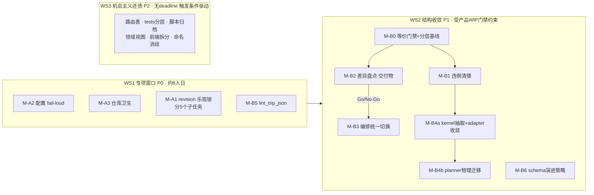

# Travelogue · 架构优化 PRD（Architecture Governance & Convergence）

| 属性 | 内容 |
|------|------|
| **产品代号** | Travelogue（核心管线 + Studio） |
| **文档版本** | **v1.1.0-ARCH-OPT**（评审修订稿） |
| **状态** | **Draft · 五方评审意见已吸收，待复审** |
| **性质** | 工程重构 PRD：**零 intentional 功能变更 + 等价性守护 + 可接受差异清单**（见 §0.2） |
| **评审记录** | 2026-07-07 五方专家评审（开发/测试/算法/产品/架构）；v1.0 阻塞项处置见 §0.5 |
| **关联文档** | [TECH-ARCHITECTURE.md](./TECH-ARCHITECTURE.md) · [adr/008-trip-storage-boundaries.md](./adr/008-trip-storage-boundaries.md) · [adr/010](./adr/010-studio-handler-decomposition.md) · [PRD-PHASE17-layout-strategy-engine.md](./PRD-PHASE17-layout-strategy-engine.md) · [PRD-IMPORT-SHEET-v3-WIZARD.md](./PRD-IMPORT-SHEET-v3-WIZARD.md) · [QUALITY-GATE.md](./QUALITY-GATE.md) |
| **更新日期** | 2026-07-07 |

---

## 0. 文档说明

### 0.1 定位：这是一份「还债」PRD，不是「加功能」PRD

项目经过 23 个 Phase 的快速迭代，工程基本盘优秀（1:1.1 测试比、分层 CI、13 篇 ADR、schema 数据契约），但积累了典型的 Phase 驱动增长债务：

1. **数据安全债（P0）**：`ThreadingHTTPServer` 多线程 + import 子进程环境下 `trip.json` 写保护不全，存在静默丢数据竞态；**ADR-008 已采纳的 `meta.revision` 乐观锁至今未实现**。
2. **结构收敛债（P1）**：布局子系统四层重叠且 LSE 迁移停在中间态；CLI 与 Studio 双编排并存；底层包反向依赖上层包。
3. **治理演进债（P2）**：领域层空心化、423 个测试文件扁平堆放、69 个 phase 一次性脚本无退役机制、前端巨型单文件。

### 0.2 范围承诺：零 intentional 功能变更 + 可接受差异清单

本 PRD **不承诺**字面意义的"零行为变更"（v1.0 该表述经评审否决）。承诺修订为：

1. **零 intentional 功能变更**：不有意改变任何用户可见功能、产物版式、API 语义。
2. **等价性守护**：所有结构性改动经 §3.2 分层等价门禁验证。
3. **可接受差异清单**（用户/运维可感知，属修复而非回归，随 release note 沟通）：

| # | 差异 | 来源 | 沟通方式 |
|---|------|------|----------|
| DIFF-01 | 并发写冲突时返回 HTTP 409 `E_TRIP_CONFLICT`（此前为静默覆盖丢数据） | M-A1 | 前端 toast 文案 +  release note；见 §4.1.5 前端契约 |
| DIFF-02 | config.yaml 重复顶层键 → 启动报 `ConfigError`（此前后者静默覆盖前者） | M-A2 | release note + 报错消息含修复指引 |
| DIFF-03 | config.yaml 未知键 → 聚合 warning（`strict: true` 时报错；默认 false，翻转需独立沟通计划，见 Q-03） | M-A2 | release note + 迁移指南 |
| DIFF-04 | `curation.screen_planner` 旧 import 路径发 DeprecationWarning（行为不变） | M-B4 | 开发者可见；CI 不得将其升级为 error |
| DIFF-05 | Studio 进度事件的**时间间隔**可能因编排统一而变化（事件类型、顺序、payload schema 不变） | M-B3 | dogfood 观察；若节奏变化用户可感知则调整 hook 上报频率 |

### 0.3 总体策略：绞杀者模式 + 等价性守护 + 机会主义还债

- **不做大爆炸重写**。每个工作项独立可合并、独立可回滚，旧路径在新路径验证等价后才删除。
- **专项窗口只保留 WS1 + M-B5**（约 6 人日）。WS2 设**产品 WIP 门禁**（§8.1），WS3 全部转为**机会主义还债**（触发条件驱动，无 deadline）。
- **每个工作项交付三件东西**：代码变更、等价性证据（测试/对比脚本输出）、回滚说明。
- **双路径开关有删除 DoD**（§3.3），防止开关本身成为新债务。

### 0.4 问题总览与优先级

| 优先级 | 编号 | 问题 | 证据锚点 |
|--------|------|------|----------|
| **P0** | ARC-01 | trip.json 写保护不全：`_trip_write_lock` 仅覆盖 `serve.py` 2 处；`svc.save` 无保护调用点 ≥23 处（handlers 14 + pipeline 5 + serve 2 + `render/engine.py` L705 + orchestrator 闭包）；import 子进程与 HTTP 线程跨进程竞态 | `web/serve.py` L29/226/257 · `trip_intent_handlers.py` L66-333 · `studio_pipeline.py` L567-736 · `render/engine.py` L697-705 · `orchestrator/run.py` L87-88 |
| **P0** | ARC-02 | `config.yaml.example` 重复顶层键 `curate:`（L28 与 L426），PyYAML 后者覆盖前者；且导致 `deterministic_strict` 双源（mosaic L264 vs clustering L463）生效值不确定 | `config.yaml.example` |
| **P0** | ARC-03 | 配置未知键静默忽略，用户调参无反馈 | `config/loader.py` 各 `*_from_dict` |
| **P0** | ARC-04 | 仓库卫生：`registry.cache.json` 未 ignore；git status 出现同一文件正反斜杠双路径条目 | git status 快照 |
| **P1** | ARC-05 | 双编排：Studio 导入主路径手写 ingest→cluster→curate，绕过 orchestrator；且 `run_trip` **不含 clustering stage**（`AGENT-ARCHITECTURE.md` L685-687 明文） | `web/studio_pipeline.py` L574-658 vs `orchestrator/run.py` L90-151 |
| **P1** | ARC-06 | 布局四层重叠，LSE 迁移停在中间态：adapter 回调 curation；`screen_planner*` 三文件共 ~3,000 行仍在 curation | `layout_engine/adapter.py` L12 |
| **P1** | ARC-07 | 分层倒置与依赖环：media→curation、render→curation、templating→web、layout_engine→web、**curation→services、services↔templating、export→render**（后三项 v1.0 遗漏，评审补充） | §5.3 违例清单 |
| **P1** | ARC-08 | ADR-008 未落地项：`meta.revision` 乐观锁、`lint_trip_json.py`、CacheRegistry 均无实现；trip.schema.json 已膨胀至 ~1793 行 | `IMPLEMENTATION-PHASE22.md` 任务 ☐ |
| **P1** | ARC-15 | trip.json schema 版本演进无策略：version 固定 0.2，唯一迁移逻辑仅 `strip_legacy_curation_fields` | `curation/trip_migration.py` |
| **P2** | ARC-09 | 领域层空心化：`domain/` 仅 1 常量文件，业务全靠裸 dict 操作 trip | `travelogue/domain/pipeline.py` |
| **P2** | ARC-10 | tests/ 423 文件扁平堆放 | `tests/` |
| **P2** | ARC-11 | 69 个 `phaseN_*` 一次性脚本无退役机制 | `scripts/` |
| **P2** | ARC-12 | 前端巨型单文件无静态检查：`preview-toolbar.js` 3,428 行、`studio-home-v2.css` 3,985 行 | `templates/studio/` |
| **P2** | ARC-13 | 路由为手写 if-chain；且 `serve.py` L96-117 另有 trip 级 POST 第二分发入口 | `web/studio_routes.py` · `web/serve.py` |
| **P2** | ARC-14 | "v3" 命名三义（classic 旧首页 / Import Wizard v3 / Preview v3 sheet） | `studio_homepage_gate.py` L183-189 |

### 0.5 v1.0 → v1.1 评审处置摘要

| 评审阻塞项 | 处置 |
|------------|------|
| 锁方案与 ADR-008 冲突；`updatedAt` 秒级假阴性；三层锁过重（架构 B-02/I-03 · 开发 B1/B2） | **重写 §4.1**：以 ADR-008 `meta.revision` 乐观锁为主干；删除 updatedAt 兜底；文件锁降为 import 子进程写窗口的可选补强 |
| `svc.update` 改造面低估；rerender 在锁内；render/orchestrator 内嵌 save 遗漏（开发 B3） | M-A1 拆 5 个子任务，改造清单补全，rerender 显式出锁；工期 3d→5-7d |
| AC-ARC-06 逐字节等价不可达；差异基准应以 Studio 为准；clustering 非 run_trip 一等 stage（算法 B-01 · 测试 B-02 · 开发 B4） | **重写 §5.1 与 AC-ARC-06**：clustering 升为一等 stage；基准=Studio 现行产物；等价改为分层判定；M-B2+B3 工期 5d→8-12d |
| AC-ARC-08「零 import curation」不可达；「纯移动」不现实；与 R-P17-04/ADR-010 D5 冲突（算法 B-02/B-04 · 架构 B-03） | **重写 §5.2**：改为「两步渐进」路线（先 kernel 抽取与 adapter 收敛，后物理迁移）；验收改为语义不变 + golden 签名；需新 ADR-015 声明 supersede；mosaic ContextVar 升为必选 |
| §5.3 分层违例清单不全；curation/layout_engine 上下层关系不成立（架构 B-01/I-01） | **重写 §5.3**：curation 与 layout_engine 同层 + 共享 kernel；违例清单补齐 4 处 |
| `arch_equivalence_check.py` 规格不可实现；`phase7_equivalence_check.py` 引用误导（测试 B-01/B-03） | **重写 §3.2**：给出规范化 profile、剔除字段清单、浮点策略、CLIP cache 条款；明确复用的是双门槛**思想**而非该脚本 |
| 与 Import Wizard v3 排期冲突；29 人日不符小团队容量；「零行为变更」不可信（产品 B1-B4） | 新增 §8.1 产品 WIP 门禁；排期改为 WS1 专项 + Parking Lot；范围承诺改写为 §0.2；工期修正为 42-50 人日全景（但仅 WS1+M-B5 立即排期） |
| 开关删除无 DoD（架构 B-05） | 新增 §3.3 开关删除 DoD |
| Q-02 contract 合并方向错误（架构 B-04） | **不合并**：`render_contract.py` 改名 `render_fingerprint.py`，与 `layout_contract` 保持分离 |
| schema 演进、G-ARC-07 不可度量等遗漏 | 新增 §5.5（schema 演进）、§2.1 度量修订 |

### 0.6 设计决策摘要

| # | 决策 | 说明 |
|---|------|------|
| **D-ARC-01v2** | **revision 乐观锁为主干**（落实 ADR-008 §3） | `meta.revision` 单调整数 + `TripService.update(mutator)` CAS 重试；文件锁仅作 import 子进程写窗口补强；见 §4.1 |
| **D-ARC-02** | **配置 fail-loud** | 重复键报错、未知键告警；`deterministic_strict` 双源统一优先级；见 §4.2 |
| **D-ARC-03v2** | **编排单一事实来源，基准 = Studio 现行产物** | `run_trip` 增设 clustering 一等 stage；CLI 向 Studio 语义对齐（telemetry 字段除外）；见 §5.1 |
| **D-ARC-04v2** | **LSE 两步渐进收敛**（supersede R-P17-04 / ADR-010 D5，须出 ADR-015） | 第一步 kernel 抽取 + adapter 收敛；第二步物理迁移 planner；验收=算法语义不变 + golden 签名；见 §5.2 |
| **D-ARC-05v2** | **分层契约工具化，curation 与 layout_engine 同层** | import-linter 契约 + 显式豁免清单渐进清零；见 §5.3 |
| **D-ARC-06** | **不换技术栈** | 不迁移 Flask/FastAPI、不引入前端框架/构建链、不数据库化 |
| **D-ARC-07** | **声明式路由表** | 约 100-150 行自研分发器（含异构 matcher 与 serve.py 第二入口收编）；见 §6.4 |
| **D-ARC-08v2** | **薄领域视图 = trip 高频面唯一合法 mutation 入口** | 函数集 + TypedDict + AST lint 强制；见 §6.1 |
| **D-ARC-09** | **归档而非删除** | phase 脚本、旧测试移入 archive/ 并建 registry |
| **D-ARC-10** | **机会主义还债** | WS3 无 deadline，按触发条件拉活（触达文件时顺手还）；见 §8.2 |

---

## 1. 背景与问题证据

### 1.1 规模快照（2026-07-07）

| 维度 | 数据 |
|------|------|
| 源码 .py | 389 个（web 层约 8,491 行；curation 包约 26,818 行） |
| 测试 test_*.py | 423 个（全部在 tests/ 顶层） |
| 前端 JS/CSS/HTML | 约 22,424 行（无构建链、无类型检查） |
| config.yaml.example | 588 行 / ~20 顶层段 / 22 个配置模块 |
| trip.schema.json | ~1,793 行（version 0.2） |
| scripts/*.py | 159 个（其中 69 个 `phaseN_*`） |
| docs/*.md | 312 篇（ADR 13 篇） |

### 1.2 P0 竞态问题的具体场景

服务器为 `ThreadingHTTPServer`（`web/serve.py` L380），以下并发组合均可造成 load-modify-save 覆盖丢失：

| 线程/进程 A | 线程/进程 B | 现状保护 |
|--------|--------|------|
| 预览页 inline edit（save-copy） | intent PATCH | A 有全局锁、B 无锁 → 可互相覆盖 |
| 后台 curate job（`trip_pipeline_handlers.py` L88-116） | 前台任意 PATCH | 均无锁 |
| **import 子进程**（`studio_subprocess.py` multiprocessing spawn）内 `on_persist` 高频写（`studio_pipeline.py` L566-567） | HTTP PATCH 同一 trip | **跨进程**，线程锁不可达 |
| render 尾部写 pipeline status（`render/engine.py` L697-705，`update_pipeline=True`） | 任意 PATCH | 无锁（v1.0 遗漏，评审补充） |

注意：`utc_now_iso()` 为**秒级精度**（`util/datetime_.py` L8-9 去微秒），任何基于 `updatedAt` 字符串相等的冲突检测在同一秒内有假阴性窗口——这是 v1.1 改用单调 `meta.revision` 的直接原因。

### 1.3 双编排的行为漂移（已确认非假设）

关键事实（评审核实）：**CLI `run_trip` 不跑 `run_clustering_layer`**，Studio 在 curate 前显式跑（`studio_pipeline.py` L625-640；`docs/AGENT-ARCHITECTURE.md` L685-687 明文「run_trip 不会自动跑聚类，Studio 显式调用」）。`curate.py` 的 `_build_curate_buckets` 在有聚类结果时消费之、无则 fallback `group_assets_by_segments`（L608-616）——**两条路径的章节分桶语义当前就不同**。

Studio 相对 `run_trip` 的特化差异经盘点 **≥12 项**（trip 创建+intent、per-trip LSE rollout、keep_near_duplicates、ParallelEmbedCoordinator、ingest 回调组、clustering 前置、editorial hints、细粒度 timings、G1 draft 分支、preview jpg、telemetry finalize、ingest 子进度），而现有 `StudioHooks` 仅 1 个回调（`orchestrator/studio_hooks.py` L11-19）。

### 1.4 布局四层现状

| 层 | 位置 | 现状 |
|----|------|------|
| Legacy 行布局 | `curation/layout_planner.py`（595 行） | 被 `services/layout.py` L111-117 调用 |
| Screens 规划 | `curation/screen_planner.py`（~1,358 行）+ `screen_planner_stages.py`（~896）+ `screen_planner_attach.py`（~746）+ `curation/mosaic/` | **实际主实现**；三文件间存在刻意设计的延迟 import 破环（`screen_planner.py` L1354-1358 底部 E402） |
| LSE（Phase 17） | `layout_engine/` | 策略/rollout 层，`adapter.py` L12 回调 curation |
| LTE（Phase 16） | `layout_templates/` | 几何/CSS，边界清晰，不动 |

既有决策约束（v1.1 显式承认）：Phase 17 PRD **R-P17-04** 决定 MCS 保留在 `curation/mosaic/`；ADR-010 **D5** 决定 planner 渐进迁移、adapter 保持薄包装。本 PRD 若推进物理迁移，**必须**以新 ADR-015 正式 supersede 上述两项（见 §5.2）。

---

## 2. 目标与非目标

### 2.1 目标（含可度量口径，评审修订）

| ID | 目标 | 验收锚点 |
|----|------|----------|
| **G-ARC-01** | trip.json 并发写零静默丢失 | AC-ARC-01/02；全仓 `svc.save` 直调清零（lint） |
| **G-ARC-02** | 配置错误可见 | AC-ARC-03/04 |
| **G-ARC-03** | 单一编排：CLI 与 Studio 走同一阶段机，clustering 为一等 stage | AC-ARC-06（分层等价，基准=Studio） |
| **G-ARC-04** | 布局收敛：curation 不再持有 screen 规划实现；adapter 不再反向回调 | AC-ARC-08v2 + golden 签名门禁 |
| **G-ARC-05** | 分层契约 CI 强制，豁免清单收敛至零 | AC-ARC-10 |
| **G-ARC-06** | ADR-008 三项落地：revision、lint_trip_json、CacheRegistry 立项 | AC-ARC-11 + §5.5 |
| **G-ARC-07v2** | 工程北极星与代理指标（替代 v1.0 不可度量表述）： | 6 个月复评 |

G-ARC-07v2 具体口径：

| 类型 | 指标 | 度量方式 |
|------|------|----------|
| 北极星 | Studio import 链路 4 周内零「产物不等价」回归 | `arch_equivalence_check` 进 release checklist 后统计 |
| 代理 1 | 新增 Studio API 的 lead time | M-C1 前后各抽 2 次新增路由计时对比 |
| 代理 2 | `studio_pipeline.py` 并行 PR 冲突次数/月 | git 统计 |
| 代理 3 | trip 静默覆盖类 incident = 0 | 用户报告 + 409 telemetry |
| 代理 4 | config/trip lint 告警可行动率（误报 <10%） | CI 记录抽查 |

### 2.2 非目标（本 PRD 明确不做）

- 不做 intentional 功能变更（可接受差异见 §0.2 清单）。
- 不换技术栈（D-ARC-06）。
- 不做全量领域模型 / ORM 化：trip 的存储真相仍是 dict + JSON Schema。
- 不动 LTE（`layout_templates/`）。
- 不做多用户 / 远程部署改造。**并发模型上限声明**：多标签页 + 单 import job + 后台 job（import/narrate/g1/longshot 类型互斥由 `StudioJobStore` 承担）；不支持多写者协同编辑；trips_dir 位于云同步盘（OneDrive 等）时不承诺跨进程锁语义。
- 不清理 docs/ 历史文档内容，只建索引与归档机制。
- **不合并** `layout_contract` 与 `render_contract`（评审裁定二者职责不同：前者为布局摘要类型地基，后者为渲染指纹隔离；仅将后者改名 `render_fingerprint.py` 消除命名混淆）。

---

## 3. 总体实施框架

### 3.1 工作流分解



**执行约束**（评审新增）：并发上限为「最多 1 个 WS2 里程碑在途 + 1 个 WS1/WS3 小 PR」；WS2 启动受 §8.1 产品 WIP 门禁约束。

### 3.2 等价性守护（v1.1 重写为可实现规格）

> 复用的是 Phase 7 NR 的**双门槛思想**（fixed fixture 100% / real trip ≥95%），实现载体是**新建** `scripts/arch_equivalence_check.py`。注意：现有 `phase7_equivalence_check.py` 是记录校验器（读预填 hash rate 算布尔），**不可扩展复用**；layout 侧参考实现为 `phase7_nr_collect.py` + `tests/_golden/helpers.layout_snapshot`。

#### 3.2.1 门禁分层

| 守护层 | 手段 | 判据 |
|--------|------|------|
| L1 快速回归 | `pytest --fast -q` | 全绿 |
| L2 集成/E2E | CI `test-integration` + `test-e2e` | 全绿 |
| **L3a 规范化 trip diff** | `arch_equivalence_check.py` | fixed fixture **100%**（按 §3.2.2 规范化后） |
| **L3b 布局/DOM 语义签名** | `layout_snapshot(chapters)` + `dom_signature`（`render/dom_compare.py`） | fixed fixture **100%** |
| **L3c 聚类/CLIP 专项** | embedding cache hash + `subject_class_agreement`（参考 `phase7_nr_collect.py` L132-169） | cached-embed 路径 100%；跨环境场景见 R-08 |
| L4 真实 trip 抽查 | `scripts/e2e_trip_acceptance.py` 对 ≥2 个真实 trip | ≥95% + 人工 sign-off，结果写入 `docs/acceptance-records/arch-equiv-real-trip.json`（机器可读，禁止口头确认） |

**禁止**任何形态的 HTML 逐字节比对（`dom_compare._strip_preview_chrome` 会剥离 chrome script，逐字节无意义）。

#### 3.2.2 `arch_equivalence_check.py` 实现规格

| 项 | 规格 |
|----|------|
| 规范化 profile | 强制 `clustering.deterministic_strict=true`、`pipeline.parallel_embed=false`、`vision.batch_size=0`、`mosaic.deterministic_strict=true`（参考 `phase7_nr_collect._p6_equivalent_config()`）；fixture 须预置 embedding cache 或 `vision.enabled=false`（heuristic-only） |
| trip.json 剔除清单（完整路径） | `updatedAt` · `pipeline.timings.*` · `pipeline.runs[].startedAt/finishedAt` · `curation.clustering.embedStats.elapsedMs/decisionLog[].ts` · mosaic decision log wall-clock 字段（DESIGN-PHASE15 §strict 已约定可去）· LSE `weightsHash`（若 runtime store 可变） |
| embedding 向量 | 不进 trip（ADR-008），无需处理；cache 文件比对用 hash-only |
| 浮点策略 | 数值字段 `round(x, 6)` 后比较；评分类字段允许 `math.isclose(rel_tol=1e-9)` |
| JSON 规范化 | `json.dumps(sort_keys=True)`；列表**不**重排（asset 顺序本身是被守护的语义） |
| 输出 | 逐字段 diff 报告（JSON + 人读摘要）；exit code 非零即门禁失败 |
| CI 接入 | validate job：M-B0 起 PR **warn**；M-B3 合并前升级为 **block**（对齐 phase17 warn/block 分级模式）；核心 fixture 集至少含 `trip.render_golden.json` + `golden-mixed-scenes` |

### 3.3 双路径开关的删除 DoD（评审新增）

| 项 | 规格 |
|----|------|
| 开关 | `pipeline.orchestration: unified\|legacy`（M-B3）、`layout.planner_impl: layout_engine\|curation`（M-B4b） |
| CI 策略 | **默认只跑 unified/新路径**；legacy 路径仅在每周一次的定时 job 中双跑对比（防 CI 时长膨胀） |
| 删除触发条件（全部满足） | ① 开关上线满 **4 周**（日历上限，不是"一个版本周期"的弹性表述）；② 期间双跑 diff 报告全部为空；③ 无任何用户/dogfood 反馈需切回；④ legacy 配置在已知用户 config 中零出现 |
| 删除动作 | M-D1 删除 legacy 代码路径 + 开关键 + 对应测试；config 中残留 legacy 值时启动报 warning（不阻断） |
| 暂停语义 | 若 WS2 中途暂停，**必须**先完成当前开关的删除或回退到单路径，不允许双路径带病搁置（回应 R-07"暂停不产生中间态债务"的评审质疑） |

### 3.4 回滚总原则

每个里程碑独立 PR、独立 revert；M-B3 切 `pipeline.orchestration: legacy`；M-B4b 切 `layout.planner_impl: curation`；M-C 系列按 PR 粒度 revert。

---

## 4. WS1 · P0 专项窗口

### 4.1 trip.json 写入原子化（D-ARC-01v2 · ARC-01）

#### 4.1.1 方案主干：落实 ADR-008 `meta.revision` 乐观锁

v1.0 的「updatedAt 兜底」方案经评审否决（秒级精度假阴性 + 与已 Accepted 的 ADR-008 冲突）。v1.1 与 ADR-008 §3 对齐：

```python
# services/trip.py · TripService
def update(self, trip_json_path: Path, mutator: Callable[[dict], T],
           *, max_retries: int = 3) -> T:
    """原子 read-modify-write（CAS 语义）：
    锁内 load → 记录 meta.revision → mutator(trip) → revision+1 → save。
    save 时磁盘 revision 与 load 快照不一致 → 重放 mutator（幂等前提）或
    重试耗尽后抛 TripConflictError（HTTP 409 E_TRIP_CONFLICT）。
    updatedAt 统一在 save 内赋值（消除 trip_moment_handlers.py L59 自写不一致）。"""
```

**保护分层**：

| 层 | 机制 | 覆盖场景 |
|----|------|----------|
| 进程内串行 | per-trip `threading.Lock`。注册表 key = `os.path.normcase(str(path.resolve()))`（Windows 大小写/短路径归一，评审 I1）；注册表本身以模块级锁做 double-checked 插入；注册表为**进程全局**，不绑 TripService 实例 | HTTP 线程之间（主要场景） |
| 跨进程 | `meta.revision` CAS：import 子进程与 HTTP 线程各自 update，冲突方重放/409 | import 子进程 vs HTTP（§1.2 第三行） |
| 补强（可选，非核心层） | `.trip.lock` 文件锁**仅**保护 import 子进程的写窗口，缩小 CAS 重放频率。若采用：子进程**独立 open**（不继承句柄）、`msvcrt.locking` 锁第 0 字节 1 长度、`LK_NBLCK` + 指数退避 ≤2s、stale lock 按 mtime>10min 判弃；文件锁不可用（OneDrive/杀毒）时**回退纯 CAS，不静默降级为无保护** | import 高频 `on_persist` 期 |
| job 级互斥 | 现有 `StudioJobStore`（import/narrate/g1/longshot 互斥）不变，继续作为粗粒度防线 | 长任务之间 |

**为什么不用三层锁做核心**（评审 I-03 采纳）：revision CAS 对线程与进程一视同仁、与 ADR-008 一致、无 Windows 文件锁的平台风险；文件锁只解决"减少重放"的性能问题，故降为补强。

#### 4.1.2 改造范围（完整收口清单，v1.1 补全）

| 区域 | 处数 | 备注 |
|------|------|------|
| `studio_handlers/trip_intent_handlers.py` | 6 | L66/119/225/266/288/333 |
| `studio_handlers/` 其余（pipeline/list/replan/moment/asset_media/template） | 8 | moment L59-61 自写 updatedAt 一并删除 |
| `web/serve.py` save-copy / promote-tier | 2 | 改 `svc.update`；**rerender 必须移出临界区**（现 L226-233 在锁内 rerender，照搬会引入延迟回归，评审 B3） |
| `web/studio_narrate.py` | 1 | |
| `web/studio_pipeline.py` 含 `on_persist` | 5+回调 | ingest 中途高频 partial persist 是 CAS 竞争最激烈路径，单独出子任务与压测 |
| `render/engine.py` L697-705 | 1 | v1.0 遗漏，评审补充 |
| `orchestrator/run.py` save 闭包 | 6+ | L87-88 闭包改为经 `svc.update` |
| CLI 内零散 save | 若干 | 顺手收口 |

**长事务约定**：ingest/curate 等分钟级阶段基于内存副本计算，完成后经 `svc.update` 短临界区合并写回；mutator 只包含合并逻辑，**不得**在 mutator 内执行 render/耗时计算。

#### 4.1.3 静态防回归

`scripts/lint_trip_save_calls.py`（AST）：`svc.save(` / `.save(trip` 仅允许出现在 `services/trip.py` 内部；orchestrator/render/handlers 一律经 `update`。CI lint job 强制，附一组 fixture 正反例（评审 I-04 测试缺口）。

#### 4.1.4 M-A1 子任务拆分（评审 B3 采纳）

| 子任务 | 内容 | 预估 |
|--------|------|------|
| A1a | `TripService.update` + revision 字段 + schema 增量（`meta.revision` integer，缺省视为 0）+ 单测 | 1.5d |
| A1b | handlers 14 处收口 + serve.py 2 处（rerender 出锁） | 1.5d |
| A1c | pipeline 5 处 + `on_persist` 路径 + 子进程 CAS 验证 | 1.5d |
| A1d | render/orchestrator 收口 | 1d |
| A1e | lint 脚本 + 并发压测（AC-ARC-01/02）+（可选）import 写窗口文件锁 | 1.5d |
| 合计 | | **5-7d**（v1.0 的 3d 经评审修正） |

#### 4.1.5 前端契约（DIFF-01）

409 `E_TRIP_CONFLICT` 复用现有 `js/http.js` `withJobBusyRetry` 模式扩展：intent/copy 类 PATCH 冲突时自动重试 1 次，仍失败则 toast「内容已被其他操作更新，请刷新」。此为可接受差异，不是零变更。

### 4.2 配置 fail-loud（D-ARC-02 · ARC-02/03）

| 项 | 规格 |
|----|------|
| **ARC-02 即时修复**（独立 0.5d PR，不等 M-A1，评审 S1） | 合并 `config.yaml.example` 两个 `curate:` 段，逐键人工核对归属；**同时显式统一 `deterministic_strict` 双源优先级**（mosaic vs clustering，`mosaic/trip.py` L57 取值语义写入注释与文档） |
| 重复键 | 自定义 `yaml.SafeLoader` 子类，重复键抛 `ConfigError`（含行号） |
| 未知键 | 各 `*_from_dict` 消费后检查剩余键，聚合为**单条** warning；`config.strict: true` 升级为报错。默认翻转 true 需独立 release note + 迁移指南（Q-03，评审 S6：面向非技术用户需可见沟通，不能只靠 log） |
| 回归保护 | 「存量合法 config.yaml.example 在 strict=false 下零告警」纳入测试（评审 I-04） |
| 例外 | `phase6`、`template_admin` 等动态子键段显式声明 `allow_extra` |

### 4.3 仓库卫生（ARC-04）

- `.gitignore` 增加：`travelogue/layout_templates/registry.cache.json`、`trips/.cache/`。
- 排查 git status 中 `import-wizard.js` 正/反斜杠双路径条目并修复索引。**注意：该文件属 Import Wizard v3 开发热区，仅修 git 索引，不动文件内容**（§8.1）。
- 根目录遗留 log/PNG 确认 ignore 规则，不动已提交历史文件。

### 4.4 lint_trip_json 落地（M-B5，提入 WS1 专项窗口——评审 I-08：与 P0 数据安全同类且无依赖）

| 检查 | 规格 |
|------|------|
| Denylist | embedding 向量、全量 decision log、base64 blob 等模式（ADR-008 §分类表） |
| 体积 | 单 trip.json warn 512KiB / fail 2MiB |
| 接入 | CI validate job 全 fixture + `e2e_trip_acceptance.py` 真实 trip |

---

## 5. WS2 · P1 结构收敛（受产品 WIP 门禁约束，见 §8.1）

### 5.1 统一编排（D-ARC-03v2 · ARC-05）

#### 5.1.1 语义基准（v1.1 修正：以 Studio 为准）

**算法产物基准 = Studio 现行产物**（用户实际所见），CLI/orchestrator 向其对齐——v1.0 「以 CLI 为准」经算法评审否决。具体：

1. `run_trip` 阶段序修订为 `ingest → clustering → curate → layout → lock_structure → narrate → lock_copy → render → export`，**clustering 升为一等 stage**（内部调 `run_clustering_layer`，可由 config/参数关闭以兼容纯 CLI 轻量场景，但 Studio 与默认 CLI `run` 均开启）。
2. S1 差异矩阵中每项标注类别：**Studio 特化（吸收进阶段机）/ 漂移（以 Studio 为准修正 CLI）/ telemetry（可剔除）**。ingest 参数差异（parallel embed、featuredDir、resume、generate_crops、rollout 解析）为一等公民条目。

#### 5.1.2 实施步骤

| 步骤 | 内容 | 门禁 |
|------|------|------|
| **S1（独立交付物）** | 外部化差异矩阵文档（≥12 项已知 + 盘点补全），含每项的类别与处置 | **Go/No-Go 评审**：若发现 G1/LSE rollout 级别的深度分歧超预期，M-B3 延期而非硬切（评审 S2） |
| S2 | 阶段机参数面设计：`StudioProfile` dataclass（ingest 选项组、clustering 开关、G1 分支、preview 产物）+ `StudioHooks` 扩展（进度/计时/阶段回调）。现有 hooks 仅 1 个回调，扩展量按 S1 矩阵定 | 设计评审 + 新 hook 单测（progress 回调、timing 上报为最低用例） |
| S3 | `studio_pipeline.py` 切换 `run_trip(from_stage="ingest", profile=..., hooks=...)`；legacy 手写路径挂 `pipeline.orchestration: legacy` 开关 | L3a/b/c 门禁：**先** legacy-Studio vs unified 等价（AC-ARC-06 第一阶段），**后** unified vs CLI（第二阶段） |
| S4 | 按 §3.3 DoD 删除 legacy | 每周双跑 diff 连续 4 周为空 |

**约束**：进度事件类型/顺序/payload schema 不变（DIFF-05 仅允许时间间隔变化）；`pipeline.timings`、`embedStats` schema 不变。

#### 5.1.3 工期

M-B2（S1+S2）**5-7d**，M-B3（S3）**3-5d**，合计 **8-12d**（v1.0 的 5d 经评审修正）。

### 5.2 LSE 两步渐进收敛（D-ARC-04v2 · ARC-06）

#### 5.2.0 决策前置：ADR-015

物理迁移与 Phase 17 **R-P17-04**（MCS 留 curation）、ADR-010 **D5**（渐进 + adapter 薄包装）冲突。M-B4a 启动前必须提交 **ADR-015**：声明 supersede 范围、迁移判据（下表）、回退路径。ADR 未获通过则本节仅执行 B4a（kernel 抽取），B4b 搁置。

**迁移判据**（「adapter 足够 vs 必须物理搬迁」，评审 B-03 要求）：迁移后 `layout_engine ↔ curation` cross-import 边数应下降 ≥80%；若 kernel 抽取后测算达不到，则维持 adapter 方案、关闭 B4b。

#### 5.2.1 第一步 M-B4a：kernel 抽取 + adapter 收敛

| 项 | 规格 |
|----|------|
| kernel 抽取 | 将 `AspectKind`、`layout_constraints`、`screen_layout_state` 等**共享原语**（planner 与 LSE 双向依赖的根源）抽入 `layout_contract/`（扩容为 layout kernel：共享 DTO + 纯函数，无状态） |
| adapter 收敛 | `layout_engine/adapter.py` 的 `ChapterPlanRequest` DTO 扩展为规划入口的完整参数面；`screen_planner_attach.py` ↔ `adapter.py` 三角依赖改为单向（attach 经 adapter） |
| **mosaic 全局 override 治理（必选，评审升级）** | `mosaic/runtime.py` 的 `_mosaic_cfg_override` / `_disabled_pattern_ids` 改 `ContextVar`（与 `mosaic/hook.py` L21-22 既有 ContextVar 模式对齐）；长期方向为 `ChapterPlanRequest` 显式携带，本步先 ContextVar。附并发单测：`deterministic_strict=True` 下双线程各跑 `run_curate`，断言 override 不串扰 |
| `render_contract.py` | 改名 `render_fingerprint.py`（不并入 layout_contract，评审 B-04） |

#### 5.2.2 第二步 M-B4b：planner 物理迁移（ADR-015 通过后）

| 项 | 规格 |
|----|------|
| 迁移对象 | `screen_planner.py` / `screen_planner_stages.py` / `screen_planner_attach.py`（**保持现有三文件边界**，v1.0「1218 行拆 ≤3 模块」表述已过时——现状即三文件）+ `curation/mosaic/` → `layout_engine/planner/`、`layout_engine/mosaic/` |
| 边界外 | trip 级 beam 入口 `mosaic/trip.py::compose_trip` 与 `curation/layout_search.py` 的归属在 ADR-015 内一并裁定（评审 I-05：不得留第三处边界） |
| 迁移约束（v1.1 改写） | 「纯移动、函数体不动」改为「**算法语义不变**」：允许 (a) 破环所需的 import 结构调整（底部 E402 延迟 import、双向 lazy import 必须重排）；(b) ContextVar 化（已在 B4a 完成）。**禁止**：改 `PATTERN_GRID_CLASS` 等常量表顺序、改任何 sorted key、改 float 累加顺序 |
| shim | `curation.screen_planner` 保留**完整 re-export 列表**（含 `ScreenLayoutPlannerState` 等 L24-35 既有 re-export 符号）+ DeprecationWarning；按 §3.3 DoD 删除 |
| 验收（替代 v1.0 AC-ARC-08） | ① `curation/` 不再持有 screen 规划实现（shim 除外）；② `layout_engine ↔ curation` cross-import 边数达 ADR-015 判据；③ golden 门禁全绿：`layout_snapshot` + `phase17_golden_metrics.py` + mosaic decision log 签名一致 |

#### 5.2.3 三条排版路径收敛

| 路径 | 处置 |
|------|------|
| `run_curate(apply_layout=True)` | 主路径，内部经 adapter 调 planner |
| orchestrator `layout` stage | 保留（replan 场景），同一 adapter 入口；`layout_engine/sandbox.py`、`metrics.py` 内嵌的完整 curate 管线标注为「实验路径」，禁止扩散为第四套编排（评审 R-15） |
| `services/layout.apply_layout_to_trip`（legacy 行布局） | 盘点调用方；默认冻结标 deprecated，产品确认前不删（Q-01） |

工期：M-B4a **3d**，M-B4b **4-5d**（v1.0 合计 3d 经评审修正为 7-8d）。

### 5.3 分层契约工具化（D-ARC-05v2 · ARC-07）

#### 5.3.1 目标依赖 DAG（v1.1 重画：curation 与 layout_engine 同层）

```
第0层  util · types · domain · layout_contract(kernel)
第1层  config
第2层  media · vision · llm
第3层  curation ·|· layout_engine · layout_templates     ← 同层；互访仅经 layout_contract DTO 与 adapter 单向入口
第4层  services · templating
第5层  render · export
第6层  orchestrator
第7层  cli · web · desktop
```

规则：仅上层 import 下层；第 3 层内部：`curation → layout_engine` 仅允许 `adapter` 与 `rollout/replan` 白名单模块；`layout_engine → curation` 目标为零（B4b 后）。例外须在契约配置显式登记并附 issue。

#### 5.3.2 违例清偿清单（v1.1 补全，含评审新增 4 处）

| 违例 | 修法 |
|------|------|
| `media/ingest.py` → `curation.asset_quality`/`media_classify`（L17-23） | **默认选下沉**（评审 I-04 裁定）：`apply_layout_eligibility_marks` 仅依赖 Ingest/CullConfig，下沉 `media/quality.py`；`media_classify` 随迁（其对 asset_quality 的引用变为 media 包内互引）。hook 注入方案仅作过渡备选——若采用，CI 必须断言「默认 hook 与内联调用产物一致」（否则 layoutEligible 缺标会改变 curate 资产池 → 章节数/beam 空间/mosaic 触发条件全变） |
| `media/ingest_report.py` → `curation.layout_planner`（L5） | 所需符号下沉 `layout_contract` |
| `render/assemble.py` → `curation.curate.resolve_cover_asset_id`（L33） | 纯 trip-dict 函数，下沉 `domain/` |
| **`render/surface.py` → `curation.screen_planner`**（评审新增） | B4b 后改指 `layout_engine.planner`（shim 期自动兼容） |
| `templating/roles.py` → `web.studio_auth`（L8） | `is_loopback_host` 移 `util/net.py` |
| `layout_engine/sandbox.py` → `web.studio_bento_preview`（L153） | 预览回调参数注入 |
| `services/cover_opening_style.py` → `web.studio_homepage_telemetry` | 同上或摘要函数下沉 |
| **`curation/curate.py` → `services.pipeline_state`**（评审新增） | `pipeline_state` 迁入 `domain/`（与 §6.1 M-C4 合并处理） |
| **`curation/bucket_planning.py`、`chapter_titles.py` → `services.copy_subject`**（评审新增） | `copy_subject` 纯函数部分下沉 `domain/` 或 `util/` |
| **`services/trip_factory.py` ↔ `templating` 环**（评审新增） | `templating.router` 的选型函数抽接口注入，或 trip_factory 上移；M-B1 内出具体方案 |
| **`export/packager.py` → `render.engine`**（评审新增） | 分层图已调整：render 与 export 同层但 export 允许依赖 render（第 5 层内白名单），不强拆 |

#### 5.3.3 落地方式

`pyproject.toml` 增 `[tool.importlinter]`；`lint-imports` 进 CI lint job；初始豁免清单 = 上表全量，逐条清偿收紧。**里程碑顺序修订**（评审 I-08）：M-B0 契约基线（全豁免）→ M-B4a/b 迁移（迁移本身制造 import 变更）→ M-B1 收紧清零。

### 5.4 TECH-ARCHITECTURE 文档先行（评审 S-04）

M-B0 交付 `TECH-ARCHITECTURE.md` **v0.9 增量章节**：现行分层图 + 本 PRD 目标图 + 开关清单，作为实施期 SSOT；M-D1 再做全量更新。

### 5.5 trip.json schema 版本演进策略（M-B6 · ARC-15，评审新增）

| 项 | 规格 |
|----|------|
| 版本语义 | `trip.version` 补充升级规则：新增可选字段不 bump；字段语义变更/删除 bump minor；`meta.revision` 的加入按「新增可选字段」处理（缺省 0） |
| 迁移注册表 | `curation/trip_migration.py` 扩展为 `MIGRATIONS: list[(from_version, migrate_fn)]`，`TripService.load` 时按序应用（现仅 `strip_legacy_curation_fields` 一项，纳入注册表） |
| 兼容窗口 | 至少向后兼容一个 minor 版本；超窗版本 load 时报可读错误 |
| 与 lint 联动 | `lint_trip_json.py` 校验 version 字段合法性 |

---

## 6. WS3 · P2 机会主义还债（无 deadline，触发条件见 §8.2）

### 6.1 薄领域视图层（D-ARC-08v2 · ARC-09）

三个高频操作面 typed 访问模块（`domain/`）：`pipeline_view.py`（合并 `services/pipeline_state.py`，与 §5.3 违例清偿共用改动）、`assets_view.py`、`chapters_view.py`。

**防半吊子约束**（评审 I-04 采纳）：

1. 视图函数是 trip dict 对应字段的**唯一合法 mutation 入口**——与 `lint_trip_save_calls.py` 同级 AST 规则强制（检测 handlers/services 内对 `trip["pipeline"]` 等路径的直接下标赋值）。
2. 视图层单测覆盖状态转换边界（revision bump、status 迁移）。
3. **优先级上调**：M-C4 应在 M-B3 前或同期完成（编排统一期 pipeline 状态操作最易错），不再排 P2 末尾——故其触发条件为「M-B2 启动即拉起」。

### 6.2 tests/ 目录分层（ARC-10）

按 `tests/unit/{包名}/`、`tests/integration/`、`tests/e2e/` 分批 `git mv`。**守护强化**（评审 I-02 采纳，替代单一 collected count）：

```text
每批迁移后四项核对：
1. pytest --collect-only -q 总数一致
2. 分 job 收集数一致（test-pr / test-integration / test-e2e 三条 -m 表达式各自 --collect-only）
3. scripts/quality_gate.py 的 REGRESSION_TESTS 硬编码路径已同步更新（L22-29）
4. 抽样 5 个迁移文件的 marker 与迁移前快照一致
```

`conftest.py` 自动打标改为按目录判定（文件名判定保留过渡）；迁移批次间 CI 检查「禁止新增顶层 test_*.py」；与 M-B4 错开窗口（评审：均为大规模文件变动）。同步重写 `docs/TESTING.md`。

### 6.3 Phase 资产退役机制（D-ARC-09 · ARC-11）

`scripts/archive/phase{N}/` + `docs/archive/`；`scripts/gen_scripts_registry.py` 扫描 CI/docs 引用自动产出 registry（**AC：归档后 CI 全绿**，防引用断裂——评审 I-04）；退役规则：Phase 验收通过满一个版本周期且无 CI/docs 引用即归档；`docs/README.md` 增「现行有效文档」索引。

### 6.4 声明式路由表（D-ARC-07 · ARC-13）

- 规模修正（评审 I3）：分发器 **100-150 行**（需支持 exact / prefix / `match_*` capture / per-route auth / `startswith` 异构 matcher），非 v1.0 的 50 行。
- **收编 `serve.py` L96-117 的 trip 级 POST 第二入口**（save-copy/promote-tier/rerender）进同一路由表；`studio_trip_parts` 静态 fallback 标注为非路由表管辖。
- 迁移前先落「路由枚举快照测试」（method+path+handler 三元组），分 GET / POST / PATCH+DELETE 三个 PR，每 PR 断言快照 diff 为空。
- 工期 **3d**（v1.0 2d 修正）。

### 6.5 前端拆分与零构建类型检查（ARC-12）

- **硬性前置**（评审 I4/AC 缺口）：拆分前先补 Playwright 冒烟并 merge 进 CI e2e job，用例明确为 **AC-ARC-14a 翻页 / 14b inline edit / 14c 导出长图 / 14d 分享面板**（现有 `test_preview_toolbar_v3.py` 仅覆盖 dock/sheet 布局，不触达上述流程）。
- `preview-toolbar.js` 按功能域拆 ESM，入口同名同 URL，`studio_chrome.py` 零改动；拆分只做物理移动。
- `jsconfig.json` + `tsc --checkJs --noEmit`（devDependency 仅 typescript）；存量 `@ts-nocheck` 渐进。
- CSS 按区块拆 + `@import`；验证 `SimpleHTTPRequestHandler` 的 CSS MIME 与相对路径。
- 工期 **4-5d**（v1.0 3d 修正）。触发条件：**Homepage v2.2 M23 系列全部交付后**（同为 CSS/首页热区，评审 B1）。

### 6.6 "v3" 命名消歧（ARC-14）

**Defer 强化**（评审 I6）：Import Wizard v3 灰度期内**只做** `docs/GLOSSARY.md`（一页登记三个 "v3" 指代）与 `store.js` L4-5 过期注释清理；`studio_homepage_gate.py` variant `"v3"→"classic"` 改名推迟至 Wizard 全量稳定后，避免品牌混淆。

---

## 7. 验收标准

| ID | Given | When | Then |
|----|-------|------|------|
| AC-ARC-01 | 同一 trip | 16 线程并发 200 次 `svc.update`，每个 mutator 写唯一键 `mutations.{thread}.{seq}`（互不重叠） | 最终 trip.json 中唯一键**集合**与预期全集相等（集合比对，非时序）；schema 校验通过。标记 `integration`；参数可 `--stress-iterations` 调节；**在 windows-latest CI matrix 或本地 release 门禁执行**（当前 CI 仅 ubuntu，Windows 语义必须显式覆盖——评审 I-01） |
| AC-ARC-02 | import 子进程写 trip 期间（含 `on_persist` 高频窗口） | HTTP PATCH 同一 trip | PATCH 经 CAS 成功合并，或重试耗尽返回 409；两侧写入均不静默丢失；测试脚本为 subprocess worker + 主进程 PATCH 交错驱动 |
| AC-ARC-03 | config.yaml 含重复顶层键 | `load_config()` | `ConfigError` 含键名与行号 |
| AC-ARC-04 | config.yaml 含未知键 | `load_config()` | 单条聚合 warning；strict=true 时报错；**存量合法 example 零告警** |
| AC-ARC-05 | 仓库新增 `svc.save(` 直调或视图外 pipeline 字段直赋 | CI lint | 失败并给出替代指引（附 fixture 正反例） |
| AC-ARC-06v2 | 同一 fixture（预置 embedding cache，§3.2.2 profile） | **第一阶段**：legacy Studio 路径 vs unified 路径；**第二阶段**：unified vs CLI `run` | L3a 规范化 trip diff 为空 + L3b layout_snapshot 与 dom_signature 一致 + L3c cached-embed hash 一致。**基准=Studio 现行产物**。不做 HTML 逐字节比对 |
| AC-ARC-07 | `pipeline.orchestration: legacy` | Studio import | 旧路径可用且每周双跑 diff 为空（开关存续 ≤4 周，§3.3 DoD） |
| AC-ARC-08v2 | M-B4b 完成后 | 检查 curation 包 | `curation/` 不持有 screen 规划实现（shim 除外）；cross-import 边数达 ADR-015 判据；shim re-export 完整且发 DeprecationWarning |
| AC-ARC-09 | golden fixture 集 | B4a/B4b 前后各跑管线 | `arch_equivalence_check` diff 为空；`phase17_golden_metrics.py` 全绿；mosaic decision log 签名一致；ContextVar 并发单测通过 |
| AC-ARC-10 | 全仓 | `lint-imports` | 契约通过；豁免清单在 M-B1 完成时为空 |
| AC-ARC-11 | fixture 注入超体积/denylist 字段 | `lint_trip_json.py` | 分别 warn/fail；CI validate 已接入 |
| AC-ARC-12v2 | tests/ 迁移每批 | §6.2 四项核对 | 全部一致 |
| AC-ARC-13 | 路由表每个迁移 PR | 路由快照测试 | method+path+handler 三元组 diff 为空（含 serve.py 收编入口） |
| AC-ARC-14a-d | preview-toolbar 拆分前后 | Playwright：翻页/inline edit/导出长图/分享 | 拆分前基线绿、拆分后全绿；`studio_chrome.py` 零改动 |
| AC-ARC-15 | 全部里程碑 | CI 全量 | 全绿；覆盖率门槛不降；**M-B3 后 `travelogue.orchestrator` 纳入 cov 范围**（评审 M-04） |
| AC-ARC-16 | 含旧 version trip.json | `TripService.load` | 迁移注册表按序应用；超窗版本报可读错误 |

---

## 8. 排期与容量治理（v1.1 重构）

### 8.1 产品 WIP 门禁（评审 B1/B2 采纳）

| 门禁 | 规则 |
|------|------|
| **G-WIP-01** | M-B2/B3（统一编排，动 `studio_pipeline.py`）**硬依赖 Import Wizard v3 全量 AC（含其 §16 下游零侵入）通过**。并行期内对该文件只允许 M-A1c 的锁收口（不改阶段逻辑） |
| **G-WIP-02** | M-C5（前端拆分，动 `studio-home-v2.css` 等）依赖 Homepage v2.2 M23 系列交付 |
| **G-WIP-03** | M-C6 命名改名依赖 Import Wizard v3 全量稳定 |
| **G-WIP-04** | 架构债投入 ≤ 每迭代容量 20%，直至 Wizard + HP22 交付；冲突时产品负责人拍板，默认产品优先 |
| **G-WIP-05** | 热区文件清单（`studio_pipeline.py`、`import_handlers.py`、`import-wizard.js`、`import-sheet.js`、`studio-home-v2.css/html`）每周核对一次在途 PR |

### 8.2 里程碑总表

| ID | 范围 | 依赖/触发 | 预估 | 排期 |
|----|------|-----------|------|------|
| **M-A0** | ARC-02 即时修复（example 重复键合并 + deterministic_strict 双源统一） | 无 | 0.5d | **立即（独立 PR）** |
| **M-A1（a-e）** | revision 乐观锁 + 全收口 + 压测 + lint | 无 | 5-7d | **WS1 专项** |
| **M-A2** | 配置 fail-loud | M-A0 | 1d | WS1 专项 |
| **M-A3** | 仓库卫生 | 无 | 0.5d | WS1 专项 |
| **M-B5** | lint_trip_json + CI | 无 | 1d | WS1 专项（评审提级） |
| **M-B0** | arch_equivalence_check + import-linter 基线（全豁免）+ TECH-ARCH v0.9 增量 | 无 | 2d | WS2 首项 |
| **M-B2** | S1 差异矩阵（独立交付物 + Go/No-Go）+ S2 StudioProfile/Hooks 设计 | M-B0 + **G-WIP-01** | 5-7d | Wizard 交付后 |
| **M-B3** | 编排切换 + legacy 开关 + AC-ARC-06v2 | M-B2 Go | 3-5d | 同上 |
| **M-C4** | 领域视图三模块（含 pipeline_state 迁移） | M-A1；与 M-B2 同期拉起（评审提级） | 2d | 同上 |
| **ADR-015** | LSE 迁移决策文档（supersede 声明 + 判据） | M-B0 | 1d | WS2 |
| **M-B4a** | kernel 抽取 + adapter 收敛 + mosaic ContextVar（必选） | ADR-015 | 3d | WS2 |
| **M-B4b** | planner 物理迁移 + shim | ADR-015 通过 + M-B4a | 4-5d | WS2，与 M-C2 错开 |
| **M-B1** | import-linter 豁免清零 | M-B4a/b | 2d | WS2 末 |
| **M-B6** | schema 演进策略 + 迁移注册表 | M-A1（revision 字段） | 1.5d | WS2 |
| **M-C1** | 路由表化（3 PR + 快照测试 + serve.py 收编） | 触发：新增 Studio API 需求时 | 3d | 机会主义 |
| **M-C2** | tests/ 分层 + TESTING.md | 触发：与 M-B4b 错开的空窗 | 2d | 机会主义 |
| **M-C3** | 脚本/文档归档 + registry | 触发：任一 Phase 验收后 | 1.5d | 机会主义 |
| **M-C5** | 前端拆分 + tsc（含 AC-14a-d 前置冒烟） | **G-WIP-02** | 4-5d | 机会主义 |
| **M-C6** | GLOSSARY（立即）+ variant 改名（**G-WIP-03**） | — | 0.5d | 分两段 |
| **M-D1** | 按 §3.3 DoD 删除开关与 shim；TECH-ARCHITECTURE 全量更新 | 各开关满足 DoD | 1d | 开关满 4 周后 |

**容量视图**：立即排期的仅 **WS1 专项 ≈ 8-10 人日**（M-A0/A1/A2/A3/B5）；WS2 ≈ 22-27 人日按 G-WIP 门禁后置；WS3 ≈ 11-13 人日无 deadline。全景合计 **42-50 人日**（v1.0 的 29 人日经评审修正），但**不作为连续冲刺排期**。

---

## 9. 风险与回滚

| # | 风险 | 应对 |
|---|------|------|
| R-01 | 文件锁（若启用）与 OneDrive/杀毒交互异常 | 文件锁仅为补强层，失败回退纯 CAS（核心保护不降级）；同步盘场景在 docs 声明不支持跨进程锁语义 |
| R-02 | S1 差异盘点发现分歧大于预期 | S1 独立交付物 + Go/No-Go；允许 `StudioProfile` 分支，先收敛入口再收敛语义 |
| R-03 | LSE 迁移隐性行为差（import 顺序、模块副作用、E402 破环重排） | 「算法语义不变」验收 + golden 签名三重门禁 + ADR-015 判据不达即停 B4b |
| R-04 | tests/ git mv 干扰进行中分支 | 迁移窗口约定 + 分批小 PR + 与 M-B4b 错开 |
| R-05 | 未知键告警噪音 | 首版仅 warn 聚合单条；strict 翻转配迁移指南（DIFF-03） |
| R-06 | preview-toolbar 拆分回归 | AC-ARC-14a-d 冒烟为硬性前置，先 merge 进 CI 再拆 |
| R-07v2 | 挤占产品迭代 | §8.1 容量 20% 上限 + Parking Lot + 开关共存 ≤4 周硬上限 + 产品负责人 escalation |
| **R-08**（新增） | CLIP 跨硬件/torch 版本非确定性（现仅 `torch.manual_seed`，无 cudnn deterministic flags） | 等价测试强制 cached-embed 或 heuristic-only（§3.2.2）；验收绑定 `cache_abi_version` 与 CI 环境 pin |
| **R-09**（新增） | `deterministic_strict` 双配置源（mosaic vs clustering）生效值混乱 | M-A0 即时统一优先级并文档化 |
| **R-10**（新增） | mosaic 全局 override 并发串扰（import 子进程 + HTTP + 后台 job） | M-B4a ContextVar 必选 + 并发基线单测 |
| **R-11**（新增） | 循环 import 破环重排导致静默行为差 | B4b 迁移 PR 强制 golden 三重门禁；ImportError 类失败快速显性化 |
| **R-12**（新增） | 统一编排若漏 clustering stage，curate fallback 分桶导致产物大变 | §5.1.1 明文 clustering 为一等 stage；AC-ARC-06v2 第一阶段先对 legacy-Studio |
| **R-13**（新增） | embedding cache 状态不固定导致 L3 flaky | fixture 预置 cache 并锁 `cache_abi_version` |
| **R-14**（新增） | replan/G1 与首次 curate 经不同 planner 入口 | B4b 后强制同一 adapter 入口；AC 覆盖 replan 路径 |
| R-15（新增） | `sandbox.py`/`metrics.py` 内嵌管线成第四套编排 | 标注实验路径 + import-linter 限制其依赖面 |
| R-16（新增） | PyInstaller frozen 环境下锁/CAS 行为差异 | release 前在打包产物上跑 AC-ARC-01 精简版 |

**回滚矩阵**：M-A1 revert PR（revision 字段向后兼容，旧代码忽略之）；M-A2 revert；M-B3 切 legacy 开关；M-B4b 切 `layout.planner_impl: curation`；M-C1 按 PR revert；M-C2 逆向 mv 脚本。

---

## 10. 开放问题

| # | 问题 | 建议默认 |
|---|------|----------|
| Q-01 | `services/layout.apply_layout_to_trip` legacy 行布局是否仍有产品场景 | 盘点后默认冻结标 deprecated |
| Q-03 | `config.strict` 默认翻 true 的时机与沟通 | M-A2 上线一个版本周期后 + release note + 迁移指南（评审：必须有面向非技术用户的可见沟通，不能只靠 log） |
| Q-05 | tests/unit 目录粒度 | 按顶层包名一目录，≤15 目录 |
| Q-06（新增） | `compose_trip` beam 与 `layout_search.py` 归属 | ADR-015 内裁定，倾向随 planner 同迁 |
| Q-07（新增） | AC-ARC-01 是否进常规 CI 或仅 release 门禁 | integration marker + windows matrix 每日/release 跑，PR 不跑（时长控制） |

> v1.0 的 Q-02（contract 合并）已裁定不合并（§2.2）；Q-04（mosaic ContextVar）已升级为 M-B4a 必选项，不再开放。

---

## 11. 版本历史

| 版本 | 说明 |
|------|------|
| v1.0.0（草案） | 首版：P0 止血 / P1 结构收敛 / P2 治理演进，29 人日 |
| **v1.1.0**（评审修订稿） | 吸收 2026-07-07 五方评审：锁方案改 ADR-008 revision 乐观锁主干；AC-ARC-06/08 重写（分层等价、基准=Studio、clustering 一等 stage）；LSE 改两步渐进 + ADR-015 前置；分层图重画（curation/layout_engine 同层 + kernel）；`arch_equivalence_check` 可实现规格；产品 WIP 门禁 + 机会主义还债排期；开关删除 DoD；范围承诺改「零 intentional 变更 + 差异清单」；新增 schema 演进（M-B6）与 R-08~R-16 风险；工期全景修正 42-50 人日（仅 WS1 立即排期） |
