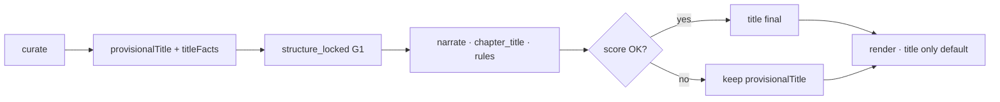

# Travelogue · 章节名称产品需求文档（PRD · 章名与章入口）

| 属性 | 内容 |
|------|------|
| **产品代号** | Travelogue |
| **文档版本** | v1.1.0 |
| **状态** | Draft · **跨职能评审已收敛** |
| **评审纪要** | [chapter-naming-prd-review-2026-06-15.md](./acceptance-records/chapter-naming-prd-review-2026-06-15.md) |
| **主题代号** | 「章名编辑」— 让分章有标签、可区分，而不是 AI 替用户写散文诗 |
| **前置条件** | Phase 3 聚类稳定；Phase 4 intent / `memoryAnchors` 可用；Phase 11 `decorLine` 或 COPY-OPT sparse 管线已合入或并行不冲突；`visual-journal` manifest `chapterTitleMaxChars=12` |
| **关联文档** | [PRD-COPY-OPTIMIZATION.md](./PRD-COPY-OPTIMIZATION.md)、[PRD-PHASE4.md](./PRD-PHASE4.md) §4.3、[PRD-PHASE11-copy-optimization.md](./PRD-PHASE11-copy-optimization.md)、[TEMPLATE-visual-journal.md](./TEMPLATE-visual-journal.md) §6.1、[NARRATIVE-PROMPTS.md](./NARRATIVE-PROMPTS.md)、[DATA-MODEL.md](./DATA-MODEL.md)、`travelogue/curation/chapter_titles.py`、`travelogue/services/narrative_brief.py`、`travelogue/services/narrative_validate.py` |
| **验收** | [ACCEPTANCE-CHAPTER-NAMING.md](./ACCEPTANCE-CHAPTER-NAMING.md)（评审通过后撰写） |
| **实施清单** | [IMPLEMENTATION-CHAPTER-NAMING.md](./IMPLEMENTATION-CHAPTER-NAMING.md)（评审通过后撰写） |
| **更新日期** | 2026-06-15 |

> **相邻主题脚注（2026-07-24 · Share-Face Purity）**  
> 同日多章读者面 **禁止**「·二 / ·三」序号腔；默认同名日期，仅弱桶合并。冻结决策见 [PRD-SHARE-FACE-PURITY-V1.md](./PRD-SHARE-FACE-PURITY-V1.md) **D-SFP-01/02**（supersede 原「时段/序号可接受」口述）。

> **相邻主题脚注（2026-08-10 · Share Narrative Readiness）**  
> 无 AI 薄章名升维：地点短标（±时段）→ 场景短标 → 日期±时段 → 同名日期（靠章号）。冻结决策见 [PRD-SHARE-NARRATIVE-READINESS-V1.md](./PRD-SHARE-NARRATIVE-READINESS-V1.md) **D-SNR-03**；实现 `chapter_titles._pick_thin_chapter_title`。本 PRD §5.2 策略链仍为正式命名愿景；SNR 为 curate/refresh 路径的近期合同。

> **定位**
>
> Travelogue 章级入口在 **读者面** 以 **`title`（≤12 字）为主**；`decorLine` / `lead` 服从 COPY-OPT **sparse** 策略，**默认空**。当前 **章名在 curate 阶段由规则生成**（日期 / 地理 segment 为主），**narrate 不写 title**，导致：有 anchor 时章名仍可能是「4月12日」；无 anchor 时虽可接受，但与 stub `Day N · 日期 · 地点` lead **信息重复**。
>
> 本 PRD 定义：**章名如何从用户记忆与章节语义中生成**、**何时宁可用日期也不凑文艺词**、**与 decorLine/lead 如何分工**，以及 **Studio 如何轻量校正**。
>
> **产品共识（六条铁律 · v1.1 评审版）**
>
> 1. **章名是标签，不是摘要** — 像相册文件夹名，不像散文小标题。  
> 2. **原词直通** — 有 `memoryAnchors` 时 **原样截断**，禁止自动润色（如「寺」→「寺里的雨」）。  
> 3. **宁缺毋滥** — 低置信候选 **不替换** `provisionalTitle`；**起不好就用日期/segment**。  
> 4. **读者面只露 title** — decorLine / lead 默认空；explain / candidates **仅 Studio 二级**。  
> 5. **走心 = 用户信号，不是系统文艺** — 用户原词 > 地名 segment > 日期 >>> theme/arc 模板词。  
> 6. **可改、可回滚** — `titleEdited` 保护；`mode=legacy` 回退现网行为。

---

## 1. 背景与问题

### 1.1 现状摘要

| 环节 | 模块 | 当前行为 | 读者感知 |
|------|------|----------|----------|
| **章名生成** | `chapter_titles.py` · curate | 优先级：跨年 span → segment → plan 城市 → **日期** → `抵达`/`尾声` | 「4月12日」— 可接受但缺记忆点 |
| **章导语** | `narrate.py` stub | `Day N · 日期 · 地点` | 与章名 **重复**，像 AI 填槽 |
| **章点缀** | `decor_line.py` | voice / anchors → decorLine | sparse；与 title 未联动 |
| **校验** | VR-N04 | lead 不得复述 title | 不约束 title 质量 / AI 味 |

### 1.2 问题陈述（P-CN-*）

| ID | 问题 | 影响 |
|----|------|------|
| **P-CN-01** | 章名在 curate 锁死，narrate 无法消费 anchors | 用户填了锚点，title 仍可能是日期 |
| **P-CN-02** | stub lead 与 title 叠述日期地点 | **画蛇添足**；比单独日期更像 AI |
| **P-CN-03** | 无章名「AI 味 / 用户改回率」度量 | 易把文艺模板当改进 |
| **P-CN-04** | v1.0 草案 theme/arc 策略 | **系统替用户写「餐桌之间」「抵达」** — AI 味主因 |
| **P-CN-05** | explain 暴露给读者 | 破坏沉浸，像算法在解说 |
| **P-CN-06** | 强制「非日期章名 KPI」 | 与「按天翻相册」用户心智冲突 |

### 1.3 核心判断（v1.1 修订）

> **章名首要职责是「可扫读的分章标签」**，其次才是「有一点个人记忆色彩」。  
> **五章 title 连读应「彼此可区分」**，不强制构成叙事弧或故事线。  
> **AI 味主要来自系统文艺词**，而非 LLM；P0 用 **规则 + 原词直通** 即可显著改善。  
> **本 PRD 只管 `title`**；lead 默认空，decorLine 服从 COPY-OPT，避免章入口文字堆叠抢图。

### 1.4 与用户 SOP 的对齐

| 用户排版 SOP | 本 PRD 承接 |
|--------------|-------------|
| 第四步 · 分组聚类 | curate 写 `provisionalTitle` + `titleFacts` |
| 第七～八步 · 排版 | narrate 在 G1 后写 final `title`；**不**为 KPI 硬改首末章 arc 词 |
| 第九步 · 补充文案 | decorLine / lead **optional**；与 title 正交 |

### 1.5 跨职能评审摘要（2026-06-15 · v1.1 收敛）

| 角色 | 关键结论 |
|------|----------|
| **产品** | 保留 provisional→narrate 架构；KPI 增 **AI 味盲评**；**P0=rules，LLM 默认关** |
| **UX** | 读者面 **只展示 title**；explain/candidates **Studio 二级**；禁止附录式三层全满 |
| **UX 研究** | 70% 用户接受日期章名；怕的是 **日期 + AI 导语重复**；新增 `namingStyle` |
| **内容** | **原词直通**；扩展禁用「那场/之间/计划赶不上」；theme_map **P0 不上线** |
| **算法** | P0 策略链 **4 项**；`titleConfidence` 低则保留 provisional；砍掉 sequence 强制文艺 |
| **LLM** | 仅 P2 **禁词兜底选候选**；禁止 paraphrase；temperature ≤0.3 |
| **前端** | 章名区一行 + 铅笔；「其他名字」进 **⋯**；锚点保存 **不** auto-regenerate |

---

## 2. 目标与非目标

### 2.1 产品目标

| ID | 目标 | 验收口径 |
|----|------|----------|
| **G-CN-01** | **有 anchor 时原词命中** | 存在 `memoryAnchors[0]` 的章，≥90% title **等于 anchor 原词截断**或 `{a0}·{a1}` 拼接（无增字润色） |
| **G-CN-02** | **无 anchor 时允许 plain** | 无 anchor/voice 的 trip，**允许** ≥60% 章为日期或 segment label；**不**考核「非日期占比」 |
| **G-CN-03** | **序列可区分** | 人工盲评：≥80% 样本「五章章名彼此不混淆」 |
| **G-CN-04** | **低 AI 味** | 盲评三档（用户自己/App/ChatGPT）：≥80% 判「用户自己」或「App 但不像 ChatGPT」 |
| **G-CN-05** | **宁缺毋滥** | `titleScore < min_score` 时保留 `provisionalTitle`；**零** theme/arc 硬凑 |
| **G-CN-06** | **正交与 sparse** | VR-N04 / VR-N10 零回归；章入口 **lead 默认空** |
| **G-CN-07** | **Studio 可改** | inline-edit + `titleEdited`；candidates 从 **⋯** 换名 |
| **G-CN-08** | **可回滚** | `mode=legacy` 与现网一致 |
| **G-CN-09** | **不增强制步骤** | 零输入 trip 可完成；`namingStyle` 默认 `memory` |

**观测指标（不硬考核）**

| 指标 | 观测目的 |
|------|----------|
| `title_edit_downgrade_rate` | 用户把 poetic title **改回** 日期/segment 的比例 ↓ |
| `photos_only_chapter_clarity` | 纯照片模式下，仅靠序号 + title 能否辨章 |
| `title_regenerate_after_anchor_rate` | 用户 **主动** 点「按锚点更新章名」占比 |

### 2.2 非目标

- **不**追求五章连读像「抵达→高潮→尾声」故事线
- **不**在 P0 启用 theme_map / arc 词表 / place_mood（见 `namingStyle=literary` · P2）
- **不**在读者 HTML 渲染 `titleExplain` / `titleCandidates`
- **不**为 G-CN 硬改 lead / decorLine（属 COPY-OPT）
- **不**用 LLM paraphrase 「更美」章名
- **不**将 manifest `chapterTitleMaxChars` 扩至 >12（v1.1）

---

## 3. 已拍板决策（D-CN · v1.1）

| ID | 决策 | 结论 |
|----|------|------|
| **D-CN-01** | 定稿时机 | curate → `provisionalTitle`；narrate → 读者可见 `title` |
| **D-CN-02** | 生成模式 | **P0 默认 `rules`**；LLM **P2 可选**，默认 **off** |
| **D-CN-03** | P0 策略优先级 | **anchor 原词 > anchor 拼接 > segment > date**（§5.2） |
| **D-CN-04** | decorLine | title 先于 decorLine；decorLine ≠ title（VR-N10）；**默认空** |
| **D-CN-05** | lead | **默认空**；废弃 Day 框架；若存在不得复述 title |
| **D-CN-06** | arc 词表 | **P0 禁用**；`literary` 模式 P2 可选，**不** sequence 强制首末 |
| **D-CN-07** | 用户编辑 | `titleEdited: true` → regenerate 跳过 |
| **D-CN-08** | Studio 候选 | `titleCandidates` ≤3；**⋯ 菜单**换名，不 rerun curate |
| **D-CN-09** | LLM 边界 | 仅选 `ruleCandidates`；**禁止 invent / paraphrase** |
| **D-CN-10** | **宁缺毋滥** | `titleScore < min_score` 或 `titleConfidence=low` → **保留 provisionalTitle** |
| **D-CN-11** | **原词直通** | `anchor_primary` = `anchors[0][:12]`，**禁止**加「里的/那场/之间」 |
| **D-CN-12** | **命名风格** | `namingStyle`: `plain` \| `memory`（**默认**）\| `literary` |
| **D-CN-13** | **读者面** | 渲染 **仅 title 必显**；explain/candidates **Studio-only** |

---

## 4. 章级入口与读者面策略

### 4.1 职责分工（sparse 默认）

| 字段 | 上限 | 读者功能 | P0 默认 | 示例 |
|------|------|----------|---------|------|
| **`title`** | 12 字 | 章标签 | **必有** | `避雨` |
| **`decorLine`** | 30 字 | 点缀 | **空** | — |
| **`lead`** | 80 字 | 导语 | **空** | — |

**章名 PRD 范围**：仅规范 **`title` 生成与编辑**；decorLine / lead 见 COPY-OPT。

### 4.2 正交规则

1. **title**：名词/名词短语；无句号；**禁止** VR-N13 / VR-N16 禁用模式。  
2. **decorLine / lead**：默认空；有则遵守 VR-N04 / VR-N10。  
3. **读者 HTML**：不输出 `titleExplain`、`titleStrategy`、`titleCandidates`。  
4. **日期信息**：通过 `chapterMeta` / `daySpan` 展示，**不**强制写入 title。

### 4.3 渲染（不变 DOM · 改默认内容）

- `chapter-separator`：展示 `title`；`hasLead` / `hasDecorPull` 默认 **false**  
- 纯照片模式：章序号 + title 须仍可辨章（G-CN 观测）

---

## 5. 章名生成规范

### 5.1 好章名分级（评审版 · Normative）

| 等级 | 标准 | 示例 |
|------|------|------|
| **最佳** | 用户 anchor **原词** | `避雨` `小酒馆` |
| **良好** | segment / 地点 / 日期 | `岚山` `4月12日` |
| **可接受** | `literary` + 用户显式开启 | `鸭川边` |
| **应避免** | 系统 theme / arc 模板 | `餐桌之间` `抵达` |
| **禁止** | 感悟体 / 「那场」体 | `计划赶不上变化` `那场暴雨` |

**编辑标准**

| 标准 | 说明 | 反例 |
|------|------|------|
| **可扫读** | 3 秒内知「哪一段」 | `第2章` |
| **像用户起的** | 优先原词/地名/日期 | `餐桌之间` |
| **序列可区分** | 五章不撞名 | 两章皆 `京都` |
| **不升华** | 不像 AI 散文标题 | `最难忘的一天` |

### 5.2 P0 命名策略链（Rule Engine · v1.1）

对每章按序尝试；候选须 `score ≥ min_score`（默认 **0.60**）且 `confidence ≠ low`；否则 **保留 provisionalTitle**（常为日期/segment）。

| 优先级 | 策略 ID | 触发条件 | 产出 | 示例 |
|--------|---------|----------|------|------|
| 1 | `anchor_primary` | `memoryAnchors[0]` 存在 | **`anchors[0][:12]` 原词** | `避雨` |
| 2 | `anchor_blend` | anchors≥2 | `{a0}·{a1}` 截断 12 字 | `避雨·小酒馆` |
| 3 | `segment_label` | geo segment label 或 plan city | label 截断 | `岚山` |
| 4 | `date_fallback` | 以上皆不足或低置信 | 现有 `chapter_titles` | `4月12日` |

**P0 明确禁用**：`theme_scene`、`arc_slot`、`place_mood`、`voice_noun`（挪 P1/P2，见 §5.5）。

**`namingStyle` 行为**

| 值 | 行为 |
|----|------|
| `plain` | 跳过 anchor；**segment → date**（服务「按天翻」用户） |
| `memory` | **默认**；§5.2 全链 |
| `literary` | P2：在 memory 链后追加 §5.5 扩展策略 |

### 5.3 置信度与 D-CN-10

| 字段 | 说明 |
|------|------|
| `titleScore` | 策略内打分 0–1 |
| `titleConfidence` | `high` \| `medium` \| `low` |
| **降级** | `low` 或 `score < min_score` → **不写 final**，用 `provisionalTitle` |

**低置信示例**：anchor 为单字且与别章重复；segment label 为空；CLIP tag 噪声。

### 5.4 Sequence Pass（P1 · 弱化版）

| 规则 ID | 条件 | 动作 |
|---------|------|------|
| **S-02** | 相邻两章 title 完全相同 | 后章 append `·二` 或 fallback segment/date |
| ~~S-01~~ | ~~≥3 章日期强制改文艺~~ | **删除**（v1.1） |
| ~~S-03~~ | ~~首末强制抵达/尾声~~ | **删除**（v1.1） |
| ~~S-04~~ | ~~peak 强制 theme~~ | **删除**（v1.1） |

### 5.5 P2 扩展策略（仅 `namingStyle=literary`）

| 策略 ID | 说明 | 约束 |
|---------|------|------|
| `voice_noun` | voice excerpt ≤12 字且过 filler 过滤 | 原句截断，不改写 |
| `theme_scene` | theme_map 映射 | **score 上限 0.5**；不得压过 anchor/segment |
| `arc_slot` | 首/末 arc 词 | **默认关**；用户显式 `literary` 才启用 |
| `place_mood` | 地点+tag | 同上 |

**theme_map（P2 · literary only · 示例）**

| 信号 | 候选 | 备注 |
|------|------|------|
| food | `第一顿` | 避免「餐桌之间」 |
| rain | `下雨` | 避免「那场雨」 |

### 5.6 LLM 模式（P2 · 可选 · 默认 off）

**任务**：仅在 `ruleCandidates[0]` 命中 VR-N13/VR-N16 时，**改选** candidates[1]；否则 **原样采用 candidates[0]**。

**禁止**：paraphrase、增字润色、生成 alternates 以外新词。

```json
{
  "title": "避雨",
  "chosenStrategy": "anchor_primary",
  "source": "ruleCandidates[0]"
}
```

**Prompt 增量**：temperature ≤0.3；「优先原样采用 ruleCandidates[0]」。

---

## 6. 管线与数据模型

### 6.1 管线



| 阶段 | 字段 | 说明 |
|------|------|------|
| curate | `provisionalTitle` | 常为日期/segment |
| curate | `titleFacts` | 命名 facts |
| narrate | `title` | 高置信 final；否则 = provisional |
| narrate | `titleCandidates` | Studio-only |
| narrate | `titleExplain` | Studio-only · 人话 |
| narrate | `titleStrategy` / `titleScore` / `titleConfidence` | 审计 |
| user | `titleEdited` | 保护 |

### 6.2 新增字段

与 v1.0 相同，新增：

| 字段 | 说明 |
|------|------|
| `titleConfidence` | `high` \| `medium` \| `low` |
| `intent.namingStyle` | `plain` \| `memory` \| `literary` |

**`titleExplain` 人话模板（Studio）**

| strategy | 展示文案 |
|----------|----------|
| `anchor_primary` | 来自你填的词：{detail} |
| `segment_label` | 来自行程段：{detail} |
| `date_fallback` | 按拍摄日期 |
| `kept_provisional` | 暂无更合适的名字，保留：{detail} |

### 6.3 Brief 示例（P0）

```json
{
  "task": "fill_chapter_title",
  "limits": { "chapterTitleMaxChars": 12 },
  "namingStyle": "memory",
  "chapter": {
    "provisionalTitle": "4月12日",
    "titleFacts": { "memoryAnchors": ["避雨"], "segmentLabel": "祇园" }
  },
  "ruleCandidates": [
    { "title": "避雨", "strategy": "anchor_primary", "score": 0.92 },
    { "title": "祇园", "strategy": "segment_label", "score": 0.71 },
    { "title": "4月12日", "strategy": "date_fallback", "score": 0.50 }
  ],
  "fieldsRequested": ["title"]
}
```

---

## 7. 配置

```yaml
narrative:
  chapter_title:
    enabled: true
    mode: rules              # legacy | rules | hybrid | llm · P0 默认 rules
    naming_style: memory     # plain | memory | literary
    min_score: 0.60
    llm_refine: false        # P2 才 true；且仅禁词兜底
    allow_date_fallback: true
    sequence_pass: true        # 仅 S-02
    deprecate_day_lead: true
    # P2 · literary only:
    theme_map: {}
    arc_open: []
    arc_close: []
```

| mode | 行为 |
|------|------|
| `legacy` | curate 直接写 `title`（现网） |
| `rules` | **P0 默认** · §5.2 四策略 |
| `hybrid` | P2 · rules + LLM 禁词兜底 |
| `llm` | P2 · 同上，无 Key 则 rules |
| `auto` | 无 Key → `rules` |

---

## 8. 校验规则

| ID | 级别 | 规则 |
|----|------|------|
| **VR-N04** | error | lead 不得复述 title |
| **VR-N10** | error | decorLine ≠ title |
| **VR-N11** | warn | 有 anchors 但 title 为纯日期 → 建议检查 anchor 是否生效 |
| **VR-N12** | error | title 超长 |
| **VR-N13** | error | 共用禁用词（美不胜收、令人难忘…） |
| **VR-N14** | info | 五章 ≥3 纯日期 — **无 anchor trip 合法** |
| **VR-N15** | error | LLM title 含 brief 外地点 |
| **VR-N16** | error | title 命中 **AI 味模式**（§8.1） |

### 8.1 VR-N16 · AI 味禁用模式

**整词/短语禁用**（extend narrate banned）：

`那场` `之间` `深处` `印记` `温柔` `治愈` `奔赴` `计划赶不上` `餐桌之间` `令人难忘` `抵达` `尾声` `告别` `落地`

**模式禁用**（regex）：

- `^第\d+章`  
- `^Day\s*\d`  
- `.*的那.*`（「寺里的雨」类润色 · anchor 原词除外若用户确实输入「里的」）

---

## 9. Studio 与 G1 体验

### 9.1 原则

- **不增强制步骤**；零输入可完成。  
- **读者面安静**：无 explain、无「AI 建议」badge。  
- **Studio 轻量**：章名 **一行** + 铅笔；深度操作进 **⋯**。

### 9.2 交互规格

| 触点 | 行为 |
|------|------|
| **章 separator · title** | inline-edit → `titleEdited: true` |
| **⋯ → 其他名字** | 列表 `titleCandidates`；选用即写 title |
| **⋯ → 为什么是这个？** | 折叠 `titleExplain` **人话**（§6.2） |
| **记忆锚点保存** | **不** auto-regenerate；⋯ 内可选「按锚点更新章名」 |
| **G1 分章抽屉** | 可选列：当前 title；**不**展示 provisional→final 箭头 |
| **G2 copy lock** | title 随 copy 锁定 |

### 9.3 可选输入（Tier 2）

G1 锚点 UI 旁：

> **这一章你最想记住的一个词**（≤6 字，可空）→ `memoryAnchors[0]`

另：设置中 **`namingStyle`** 三选一（默认 `memory`）。

---

## 10. 与 lead / decorLine

| 场景 | title | decorLine | lead |
|------|-------|-----------|------|
| **P0 默认** | anchor/segment/date | **空** | **空** |
| 有 voice（COPY-OPT） | anchor 原词 | voice 精简（可选） | **空** |
| plain 用户 | segment/date | 空 | 空 |

**本 PRD 不扩展 lead**；废弃 `_build_lead_frame` 与章名同期上线。

---

## 11. 验收标准（摘要）

| ID | 条件 |
|----|------|
| **AC-CN-01** | 有 anchor fixture：≥90% title = anchor 原词截断（无增字） |
| **AC-CN-02** | 无 anchor fixture：允许 ≥60% 日期/segment |
| **AC-CN-03** | VR-N04 / VR-N10 / VR-N16 零回归 |
| **AC-CN-04** | `titleScore < min_score` → title = provisionalTitle |
| **AC-CN-05** | 读者 HTML 无 explain/candidates |
| **AC-CN-06** | Studio ⋯ 可换名 + 人话 explain |
| **AC-CN-07** | `titleEdited` 后 regenerate 不覆盖 |
| **AC-CN-08** | `mode=legacy` 行为不变 |
| **AC-CN-09** | 盲评 AI 味：≥80% 非 ChatGPT 档 |
| **AC-CN-10** | P0 不产出 theme_map / arc 词 |

---

## 12. 实施分期

| 期 | 范围 | 产出 |
|----|------|------|
| **P0** | §5.2 四策略 + provisional + narrate title + VR-N16 + 废弃 Day lead + 读者面 title-only 默认 | **可 ship** |
| **P1** | S-02 + candidates/explain Studio ⋯ + `titleConfidence` + namingStyle plain/memory | 可改、可区分 |
| **P2** | literary 扩展 + LLM 禁词兜底 + 盲评脚本 + telemetry | 质量闭环 |
| **P3** | theme_map 配置化 + `title_edit_downgrade_rate` 观测 | 迭代 |

---

## 13. 风险与缓解

| 风险 | 缓解 |
|------|------|
| anchor 太短/重复 | confidence=low → 保留 provisional |
| 用户想要日期却被 anchor 覆盖 | `namingStyle=plain` |
| literary 误开 | 默认 memory；literary 需显式设置 |
| 与 COPY-OPT 冲突 | 章入口 lead/decorLine 默认空 |
| 迁移旧 trip | 无 provisional 时以现有 title 为 provisional |

---

## 14. 附录 A · 示例（sparse · v1.1）

**Baseline（现状）**

```json
{
  "title": "4月12日",
  "lead": "Day 2 · 4月12日 · 京都。"
}
```

**Target · 有 anchor（P0 推荐）**

```json
{
  "title": "避雨",
  "lead": "",
  "decorLine": "",
  "curation": {
    "provisionalTitle": "4月12日",
    "titleStrategy": "anchor_primary",
    "titleScore": 0.92,
    "titleConfidence": "high",
    "titleCandidates": ["避雨", "祇园", "4月12日"]
  }
}
```

**Target · 无 anchor（plain / 可接受）**

```json
{
  "title": "4月12日",
  "lead": "",
  "curation": {
    "titleStrategy": "date_fallback",
    "titleConfidence": "high"
  }
}
```

**Target · 低置信（宁缺毋滥）**

```json
{
  "title": "4月12日",
  "curation": {
    "provisionalTitle": "4月12日",
    "titleStrategy": "kept_provisional",
    "titleExplain": [{ "detail": "暂无更合适的名字，保留：4月12日" }]
  }
}
```

**反例（v1.0 已废弃 · 禁止作为验收标准）**

```json
{
  "title": "那场暴雨",
  "decorLine": "计划赶不上变化",
  "lead": "本来说去岚山，雨太大……"
}
```

---

## 15. 附录 B · 相关文档

| 文档 | 关系 |
|------|------|
| [PRD-COPY-OPTIMIZATION.md](./PRD-COPY-OPTIMIZATION.md) | sparse · 图主文辅 |
| [PRD-PHASE4.md](./PRD-PHASE4.md) | memoryAnchors |
| [acceptance-records/chapter-naming-prd-review-2026-06-15.md](./acceptance-records/chapter-naming-prd-review-2026-06-15.md) | v1.1 评审纪要 |

---

## 16. 版本历史

| 版本 | 日期 | 说明 |
|------|------|------|
| v1.0.0 | 2026-06-15 | 初稿 |
| v1.1.0 | 2026-06-15 | 跨职能评审收敛：六条铁律、P0 四策略、宁缺毋滥、原词直通、sparse 附录、KPI/LLM/Studio 修订、VR-N16 |
