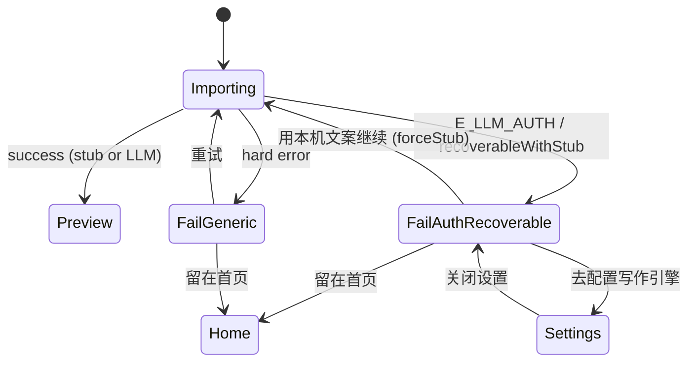

# Travelogue · 无 Key 主路径加固与首启预期管理 V1

| 属性 | 内容 |
|------|------|
| **产品代号** | Travelogue Studio（桌面打包 / 本机 Studio） |
| **文档版本** | **v1.0.0** |
| **状态** | **Draft · W1/W2 已落地 · 待评审/狗粮** |
| **主题代号** | 「L0 不死循环 · 首启说清楚」 |
| **触发来源** | 2026-07-15 打包实测：无 API Key 时导入末尾弹「导入失败 / 要生成杂志感文案…」，仅「重试」「留在首页」→ 死循环；用户建议首启提醒配 API |
| **基线 PRD** | [PRD-DESKTOP-LLM-SETUP-V1.md](./PRD-DESKTOP-LLM-SETUP-V1.md) **v1.1.0**（能力分层 · 能力卡 · 设置面已合同） |
| **关联** | [PRD-HELP-ONBOARDING-V1.md](./PRD-HELP-ONBOARDING-V1.md) §12.4 · [PRD-DESKTOP-INSTALLER-V1.md](./PRD-DESKTOP-INSTALLER-V1.md) · [ERROR-CODES.md](./ERROR-CODES.md) · [adr/019-desktop-user-data-llm-secrets.md](./adr/019-desktop-user-data-llm-secrets.md) |
| **验收** | 本文 §10；落地后回写 [ACCEPTANCE-DESKTOP-LLM-SETUP-V1.md](./ACCEPTANCE-DESKTOP-LLM-SETUP-V1.md) 增补段 |
| **实施清单** | [IMPLEMENTATION-DESKTOP-L0-GUIDANCE-HARDENING-V1.md](./IMPLEMENTATION-DESKTOP-L0-GUIDANCE-HARDENING-V1.md)（W1 ✅） |
| **更新日期** | 2026-07-15 |

> **定位**
>
> 本主题是 Desktop LLM Setup V1 的 **体验与工程加固增量**，不另开能力面、不改 L0/L1 产品铁律。  
> 解决两件事：
>
> 1. **工程**：无 Key（或 Key 无效）时，导入主链不得以 `E_LLM_AUTH` 整单失败，不得把用户锁进「重试 ↔ 留在首页」。  
> 2. **认知**：第一次启动就把预期说清——**基础能力现在就能用**；API 是 **可选升级**，不是门槛。
>
> **与基线 PRD 的关系**：能力卡 T-CAP-01、设置 Modal、H7、预览 LLM 行合同 **继承** Desktop LLM Setup；本文只补 **缺口、错位文案、失败出口、引导时序**。

---

## 0. 读者指南

| 章节 | 澄清什么 |
|------|----------|
| §1 | 实测痛点与根因假设 |
| §2 | 目标 / 非目标 |
| §3 | 体验合同与冻结决策 |
| §4 | 触点与文案矩阵（友好引导） |
| §5 | 后端任务 |
| §6 | 前端任务 |
| §7 | 错误码与失败态合同 |
| §8 | 埋点 |
| §9 | 里程碑与任务拆分 |
| §10 | 验收 AC |
| §11 | 风险与开放问题 |

---

## 1. 背景与问题

### 1.1 用户真实路径（As-Is 痛点）

```
首次打开 exe
  →（能力卡可能未感知 / 未出现 / 被关掉且未记住要点）
  → 新建游记 / 选相册导入
  → 等待数分钟
  → 弹窗「导入失败」
     标题色：失败红
     正文：要生成杂志感文案，请先在设置中配置写作引擎
     主按钮：重试（配置未变 → 再失败）
     次链：留在首页（放弃）
  → 死循环 / 放弃
```

用户感受：**跑到最后才被告知缺 API，且没有「继续用不配 API 的路径」**。

### 1.2 产品共识（继承 + 本主题强调）

继承 Desktop LLM 六条铁律，本主题再钉三条：

| # | 原则 | 一句话 |
|---|------|--------|
| **R1** | **L0 永不因缺 Key 失败** | 无 Key → stub → 预览 → 长图必须通 |
| **R2** | **配置是升级，不是门槛** | 禁止强制「先填 API」向导；首启主 CTA 必须是「开始导入」类 |
| **R3** | **失败归因局部化** | `E_LLM_AUTH` 只属于「杂志感文案」路径；**禁止**作为导入失败主因展示 |

### 1.3 根因假设（待实现时用测试钉死）

| 假设 | 说明 | 加固动作 |
|------|------|----------|
| **H1** | 用户目录首次从 `config.yaml.example` 引导，其中 `llm.provider: deepseek` | 桌面引导默认改为 `stub`；或 bootstrap 强制 stub |
| **H2** | 某条导入路径未传入 `resolve_studio_narrate_provider()`，回退读 cfg → 调 LLM → `E_LLM_AUTH` | Studio 导入管线强制无凭证则 stub；单测覆盖 |
| **H3** | 有无效 Key / 环境变量导致半开状态仍打 LLM | `llmAvailable=false` 时一律 stub；认证失败可降级不整单失败（见 §5） |
| **H4** | 导入失败 UI 把 `E_LLM_AUTH` 当硬失败，无「用本机文案继续」 | 专用失败态 CTA 矩阵（§4.4 / §7） |
| **H5** | 首启预期未建立：能力卡未出、或文案偏「请先配 API」 | 能力卡必现验收 + 首页轻状态 + 文案重心纠偏 |

### 1.4 问题清单（P-L0G-*）

| ID | 问题 | 用户感知 | 严重度 |
|----|------|----------|--------|
| **P-L0G-01** | 无 Key 导入末尾以 `E_LLM_AUTH` 整单失败 | 「生成失败」 | **P0** |
| **P-L0G-02** | 失败屏仅「重试 / 留在首页」 | 死循环 | **P0** |
| **P-L0G-03** | 跑完全程才告知缺 API | 愤怒 / 不信任 | **P0** |
| **P-L0G-04** | 首启未稳定建立「不配也能用」预期 | 以为必须先配 Key | **P1** |
| **P-L0G-05** | 首页无常驻轻状态 | 关掉能力卡后失忆 | **P1** |
| **P-L0G-06** | 引导配置默认 deepseek | 放大 H1/H2 | **P1** |

---

## 2. 目标与非目标

### 2.1 目标

| ID | 目标 | 可观测 |
|----|------|--------|
| **G-L0G-01** | 干净机无 Key：导入→预览→长图 **100% 可完成** | AC-L0G-01～03 |
| **G-L0G-02** | 任何缺 Key / 鉴权类错误 **不得**以「导入失败」为唯一出口 | AC-L0G-04～05 |
| **G-L0G-03** | 首启 30 秒内用户能理解：基础可用；AI 文案可选 | AC-L0G-10～12 |
| **G-L0G-04** | 想升级的人 3 步内进设置并测通 | 复用 AC-DLLM-10；本主题不重开设置面 |

### 2.2 非目标

| 不做 | 原因 |
|------|------|
| 强制「先填 API」多步向导 | 违反铁律 2；会重演死循环认知 |
| 官方代付 LLM / 内置 Key | Desktop LLM 非目标 |
| 改 stub 文案算法质量 | 属 Copy / Chapter Naming 另轨 |
| 审美 MLLM 等 L2 | 仍远期 |
| 重做 Help FirstSuccess 主链 | 仅交叉索引；写作引擎仍是支线 |

---

## 3. 体验合同与冻结决策

### 3.1 正确首启剧本（目标态）

```
第一次打开 TravelogueStudio
  → 首页 idle
  → 【能力卡】一次、可关
       主信息：本机即可生成杂志卷轴与长图
       次信息：杂志感 AI 文案可选（自备 Key）
       主 CTA：开始导入
       文内链：升级 AI 文案（可选）
  → 关闭后首页可见轻状态条（未配置时）：
       「当前：本机文案 · 升级 AI 文案」
  → 导入 Job（忙碌态不弹配置卡）
  → 成功进预览（stub 文案）
  → 预览工具条：「当前为本机文案 · 配置写作引擎后可升级」
  → 长图可导出
```

**禁止剧本**：导入末尾才首次出现「请配置写作引擎」且无继续路径。

### 3.2 文案重心（强制）

| 对 | 错 |
|----|-----|
| 「本机即可出游记和长图；配 API 后文案更像杂志（可选）」 | 「请先设置 API，否则 AI 无法使用」作主句 |
| 主 CTA = 开始导入 / 用本机文案继续 | 主 CTA = 去设置 API，次按钮才是跳过 |
| 「杂志感文案暂不可用」 | 「导入失败」因缺 API |

### 3.3 冻结决策（D-L0G-*）

| ID | 决策 | 说明 |
|----|------|------|
| **D-L0G-01** | **导入管线：无可用凭证 → 强制 stub** | 覆盖所有 Studio 导入入口；不得静默回退 `cfg.llm.provider` |
| **D-L0G-02** | **桌面首次引导配置默认 `llm.provider: stub`** | example 与 `ensure_user_data_layout` 对齐；已有用户目录不强制覆写（见 OQ） |
| **D-L0G-03** | **`E_LLM_AUTH` 不得作为导入硬失败的唯一出口** | 后端优先降级 stub；若历史/边界仍返回该码，前端走「可继续」失败态 |
| **D-L0G-04** | **缺 Key 失败态主 CTA =「用本机文案继续」** | 次：「去配置写作引擎」；再次：「留在首页」 |
| **D-L0G-05** | **首启提醒保留能力卡形态（非强制向导）** | 继承 D-DLLM-01；文案按 §3.2 纠偏 |
| **D-L0G-06** | **首页未配置时增加常驻轻状态（T-CAP-06）** | 一行 + 链；可随 `llmAvailable` 消失；不挡导入 |
| **D-L0G-07** | **忙碌态零配置打扰** | 继承 D-DLLM-08 |
| **D-L0G-08** | **可选 LLM 重写失败：局部 toast + 保留本机稿** | 不踢回首页、不标整本导入失败 |
| **D-L0G-09** | **「重试」仅在用户可能已改配置后展示为次要** | 缺 Key 场景禁止「重试」作唯一主按钮 |

---

## 4. 触点与友好信息提示

### 4.1 触点矩阵（增量）

| ID | 触点 | 相对基线 | 触发 | 内容要点 |
|----|------|----------|------|----------|
| **T-CAP-01** | 首页能力卡 | 继承；**文案验收强化** | 首次 idle；未见过；非 busy | 见 §4.2 |
| **T-CAP-06** | 首页轻状态条 | **本主题新增** | `llmAvailable=false` 且首页可见 | 见 §4.3 |
| **T-CAP-03** | 预览 LLM 行 | 继承 | 预览工具条 | 本机文案归因 + 配置出口 |
| **T-CAP-05** | 首次预览 stub 轻提示 | 基线可选 → **本主题建议 W1 落地** | 首次进预览 | 「当前为本机文案」一行 |
| **T-FAIL-01** | 导入失败 · 缺引擎态 | **本主题新增** | `code ∈ {E_LLM_AUTH, …}` 且判为缺凭证 | 见 §4.4 |
| **T-CAP-02 / H7** | 设置 / 帮助 | 继承 | 用户主动 | 空态继续强调「不配也能用」 |

### 4.2 能力卡文案（定稿建议）

```
标题：本机即可生成杂志卷轴与长图
正文：照片留在你的电脑。不必先配置任何接口，也能导入、预览和导出长图。
      若需要更强的杂志感文案，可稍后配置自己的 API Key（可选）。
主按钮：开始导入
文内链：升级 AI 文案（可选）→
关闭：× / Esc（写 seen）
```

**禁止**：标题或正文以「请先设置 API」起句；禁止倒计时强制跳设置。

### 4.3 首页轻状态条（T-CAP-06）

```
[ 本机文案 ]  不配置 API 也可正常使用。  升级 AI 文案 →
```

| 规则 | 规格 |
|------|------|
| 位置 | 首页主 CTA 上方或标题区下方；不遮挡导入按钮 |
| 显示 | `GET /__travelogue/config` 或 status → `llmAvailable=false` |
| 隐藏 | `llmAvailable=true`；或用户对本条 dismiss（可选，seen 键 `travelogue.desktop.homeStubBanner.v1`） |
| 点击「升级」 | 打开写作引擎设置 Modal（`source: home_banner`） |
| 与能力卡 | 能力卡可见时 **不**叠轻状态；卡关闭后本会话可显示 |

### 4.4 导入失败 · 缺引擎专用态（T-FAIL-01）

当错误码为 `E_LLM_AUTH`（或后端标记 `recoverableWithStub: true`）时，**不要**用通用「导入失败」红标题 + 仅重试。

```
标题：杂志感文案暂不可用          （中性/提示色，非失败红为主）
正文：可以改用本机文案继续生成游记；配置写作引擎后可再升级文案。
辅助：打开设置 → AI 文案，粘贴 API Key 并测试连接。
主按钮：用本机文案继续
次按钮：去配置写作引擎
第三：留在首页（文字链）
```

| 动作 | 行为 |
|------|------|
| **用本机文案继续** | 以 `narrate_provider=stub`（或等价 flag）重提同一 pending import；成功进预览 |
| **去配置写作引擎** | 打开设置 Modal；关闭后用户可再点「用本机文案继续」或「重试」 |
| **留在首页** | 现有 dismiss |
| **重试** | 仅作为「去配置」之后的次要入口；或配置已变更时显示 |

### 4.5 预览与局部失败文案

| 场景 | 文案 | CTA |
|------|------|-----|
| 未配置 · 预览工具条 | 当前为本机文案 · 配置写作引擎后可升级 | 配置写作引擎 |
| 已配置未点生成 | 本机文案 · 点此生成杂志感（不会自动重写） | 生成杂志感文案 |
| 点生成但 Key 失效 | toast：连接写作引擎失败 · 仍保留本机文案 | 去检查配置 |
| 导出长图 | 不提 API | — |

### 4.6 文案总表（COPY-L0G）

| ID | 位置 | 中文定稿 |
|----|------|----------|
| COPY-L0G-01 | 能力卡标题 | 本机即可生成杂志卷轴与长图 |
| COPY-L0G-02 | 能力卡正文 | 照片留在你的电脑。不必先配置任何接口，也能导入、预览和导出长图。若需要更强的杂志感文案，可稍后配置自己的 API Key（可选）。 |
| COPY-L0G-03 | 能力卡主 CTA | 开始导入 |
| COPY-L0G-04 | 能力卡次链 | 升级 AI 文案（可选）→ |
| COPY-L0G-05 | 首页轻状态 | 不配置 API 也可正常使用。 |
| COPY-L0G-06 | 首页轻状态链 | 升级 AI 文案 → |
| COPY-L0G-07 | 预览未配置 | 当前为本机文案 · 配置写作引擎后可升级 |
| COPY-L0G-08 | 缺引擎失败标题 | 杂志感文案暂不可用 |
| COPY-L0G-09 | 缺引擎失败正文 | 可以改用本机文案继续生成游记；配置写作引擎后可再升级文案。 |
| COPY-L0G-10 | 缺引擎主 CTA | 用本机文案继续 |
| COPY-L0G-11 | 缺引擎次 CTA | 去配置写作引擎 |
| COPY-L0G-12 | 设置空态 | 不配置也可以正常导入、排版和导出长图。配置后可在预览中生成杂志感文案。 |
| COPY-L0G-13 | 首次预览 tip | 当前为本机文案（可随时在设置中升级） |

`E_LLM_AUTH` 用户可见长文案建议改为与 COPY-L0G-09 一致；短码仍可用于遥测。

---

## 5. 后端任务

### 5.1 任务表（BE）

| ID | 任务 | 锚点（建议） | 优先级 | 验收 |
|----|------|--------------|--------|------|
| **BE-01** | Studio 所有导入 / `run_trip` 入口强制 `narrate_provider = resolve_studio_narrate_provider()` | `studio_pipeline.py` · `studio_g1.py` · 其它 import job | P0 | 无 Key 不抛 `E_LLM_AUTH` |
| **BE-02** | `resolve_studio_narrate_provider`：无可用凭证恒返回 `"stub"`；单测覆盖 cfg=deepseek 无 Key | `studio_narrate.py` | P0 | 单测 |
| **BE-03** | 防御：即便上层误传 deepseek，Studio 导入上下文在无 Key 时降级 stub 并打 warn 日志（无 Key 明文） | narrate / pipeline | P0 | 单测 + 日志探针 |
| **BE-04** | 桌面 `ensure_user_data_layout`：首次写入用户 `config.yaml` 时 `llm.provider=stub` | `paths` / desktop bundle | P0 | 干净机引导文件断言 |
| **BE-05** | `config.yaml.example`：默认 `llm.provider: stub`，注释说明桌面 L0；deepseek 作示例注释块 | 仓库根 example | P1 | diff 评审 |
| **BE-06** | 导入 Job 错误响应：若仍可能返回 `E_LLM_AUTH`，附加 `recoverableWithStub: true` 与 `userMessage`（COPY-L0G-09） | job result JSON | P0 | 契约测试 |
| **BE-07** | 可选 LLM narrate API：继续可返回 `E_LLM_AUTH`，但 **不得**影响 trip 已成稿状态 | `run_studio_llm_narrate` | P0 | AC-DLLM-05 强化 |
| **BE-08** | 「用本机文案继续」：支持客户端带 `forceStub: true`（或等价）重跑同一 album pending | import API | P0 | 与 FE-04 联调 |
| **BE-09** | ERROR-CODES / `user_message`：`E_LLM_AUTH` 文案与 COPY-L0G 对齐；文档注明「非导入硬失败」 | `studio_errors.py` · ERROR-CODES.md | P1 | 文案审 |

### 5.2 后端不变量

```
∀ Studio 导入 Job:
  if not llmAvailable:
    narrate_provider MUST be "stub"
    Job MUST NOT fail solely due to E_LLM_AUTH

∀ 可选「生成杂志感文案」:
  if not llmAvailable:
    return E_LLM_AUTH (局部)
    trip preview / longshot remain usable
```

---

## 6. 前端任务

### 6.1 任务表（FE）

| ID | 任务 | 锚点（建议） | 优先级 | 验收 |
|----|------|--------------|--------|------|
| **FE-01** | 能力卡文案对齐 COPY-L0G-01～04；确认打包页加载 `capability-card.js` | `capability-card.js` | P0 | AC-L0G-10 |
| **FE-02** | 首页轻状态条 T-CAP-06 | homepage-v2 + status 拉取 | P1 | AC-L0G-11 |
| **FE-03** | 导入失败屏：识别 `E_LLM_AUTH` / `recoverableWithStub` → T-FAIL-01 UI | `import-failed.js` · `errors.js` · HTML | P0 | AC-L0G-04 |
| **FE-04** | 「用本机文案继续」：读 pending import，带 stub 强制重提 | `import-failed.js` · `import-run.js` | P0 | AC-L0G-05 |
| **FE-05** | 次 CTA「去配置写作引擎」→ `openLlmSettings({ source: "import_fail" })` | llm-settings | P0 | 手工 |
| **FE-06** | 通用失败态：缺引擎时隐藏或降级「重试」为主按钮 | import-failed 模板 | P0 | AC-L0G-04 |
| **FE-07** | 预览 LLM 行文案确认 COPY-L0G-07；局部失败 toast | preview-toolbar | P1 | 回归 |
| **FE-08** | T-CAP-05 首次预览 stub tip（seen `stubHint.v1`） | preview / help-onboarding | P1 | AC-L0G-12 |
| **FE-09** | constants / STUDIO_ERROR_MESSAGES 与 COPY 对齐 | `constants.js` · `errors.js` | P0 | 单测字符串 |
| **FE-10** | 能力卡 vs 轻状态 vs Help：继承 D-DLLM-13；轻状态不与卡同帧 | help-onboarding / capability-card | P1 | 仲裁单测 |
| **FE-11** | 埋点：见 §8 | analytics.js | P1 | 探针 |

### 6.2 前端状态机（缺引擎失败）



---

## 7. 错误码与失败态合同

| 码 | 含义 | 导入 Job | 可选 narrate | UI |
|----|------|----------|--------------|-----|
| **E_LLM_AUTH** | 无凭证 / 鉴权失败 | **不应出现**（应已 stub）；若出现须带 `recoverableWithStub` | 可返回 | T-FAIL-01 或 toast |
| **E_LLM_NETWORK** 等 | 调用失败 | 不应用于「未配置」；若 LLM 路径误开，优先降级 stub | toast | 局部 |
| **E_STUDIO_PIPELINE** | 真·导入失败 | 通用失败屏 | — | 重试 / 留在首页 |

文档要求：在 [ERROR-CODES.md](./ERROR-CODES.md) 为 `E_LLM_AUTH` 增加备注——**「桌面 L0：不得作为导入终止的唯一用户出口」**。

---

## 8. 埋点（无密钥）

| 事件 | 何时 | 属性（示例） |
|------|------|----------------|
| `capability_card_show` | 卡展示 | — |
| `capability_card_cta` | 开始导入 / 升级 / dismiss | `action` |
| `home_stub_banner_click` | 点升级 | — |
| `import_fail_auth_shown` | T-FAIL-01 展示 | `code` |
| `import_continue_stub` | 点「用本机文案继续」 | `source` |
| `import_fail_open_settings` | 点去配置 | `source=import_fail` |

禁止：API Key、完整路径中的隐私段、照片内容。

---

## 9. 里程碑与任务拆分

| 里程碑 | 范围 | Go/No-Go |
|--------|------|----------|
| **W0** | 本文评审；确认 D-L0G-01～09；钉 H1～H5 | Conditional Go |
| **W1** | **P0**：BE-01～04、06、08 + FE-01、03～06、09 | 无 Key 导入不再死循环 |
| **W2** | **P1**：轻状态、stub tip、example 默认、ERROR-CODES、埋点 | 首启预期可狗粮 |
| **W3** | 重打包冒烟 + AC-L0G 全表 + 回写 Desktop LLM ACCEPTANCE | 发布门 |

### 9.1 建议排期（合计约 2～3 人日）

| 批次 | 项 | 估时 |
|------|-----|------|
| W1 后端 | BE-01～04、06、08 | 1.0d |
| W1 前端 | FE-01、03～06、09 | 1.0d |
| W2 | FE-02、07、08、10、11 + BE-05、07、09 | 0.75d |
| W3 | 打包 + 实机 AC | 0.5d |

---

## 10. 验收（AC-L0G-*）

### 10.1 P0 · 不死循环

| ID | 前置 | 步骤 | 期望 |
|----|------|------|------|
| **AC-L0G-01** | 干净机；无 Key；用户 config 若存在含 deepseek | 导入至预览 | 成功；文案可为 stub；**无**导入失败弹窗 |
| **AC-L0G-02** | 同上 | 导出长图 | 成功 |
| **AC-L0G-03** | 引导刚生成的用户 config | 读 `llm.provider` | 为 `stub`（首次引导） |
| **AC-L0G-04** | 人为制造导入返回 `E_LLM_AUTH`（测试钩子或旧包） | 看失败屏 | 标题非单纯「导入失败」或 CTA 含「用本机文案继续」；**主按钮不是唯一「重试」** |
| **AC-L0G-05** | 在 T-FAIL-01 | 点「用本机文案继续」 | 进入预览；可导出长图 |
| **AC-L0G-06** | 无 Key | 点预览「生成杂志感」 | 局部 `E_LLM_AUTH`；预览与长图仍在 |

### 10.2 P1 · 首启预期

| ID | 步骤 | 期望 |
|----|------|------|
| **AC-L0G-10** | 清 seen；冷启首页 | 能力卡出现；文案含「不必先配置」；主 CTA「开始导入」 |
| **AC-L0G-11** | 关卡后仍未配置 | 首页轻状态可见；点升级进设置 |
| **AC-L0G-12** | 首次进预览 | stub tip 或工具条归因可见 |
| **AC-L0G-13** | 导入 Job 进行中 | 不弹能力卡 / 设置强迫 |

### 10.3 自动化建议

```powershell
python -m pytest tests/unit/web/test_studio_narrate_provider.py tests/unit/web/test_import_fail_auth_recoverable.py -q
# 以及：引导 config stub、import-failed 文案快照、capability-card 字符串断言
```

（测试文件名以实现为准；W1 须至少覆盖 BE-02 与 FE-03/09。）

### 10.4 与 Desktop LLM ACCEPTANCE 的关系

落地后在 [ACCEPTANCE-DESKTOP-LLM-SETUP-V1.md](./ACCEPTANCE-DESKTOP-LLM-SETUP-V1.md) 增加 **「L0 Hardening」** 段，引用 AC-L0G-01～06；原 AC-DLLM-01 视为被本主题强化。

---

## 11. 风险与开放问题

| ID | 问题 | 默认建议 |
|----|------|----------|
| **OQ-L0G-01** | 已存在用户目录且 `provider=deepseek` 无 Key | **不静默改写文件**；运行时 resolve→stub 即可；可选设置页提示「建议改回本机文案默认」 |
| **OQ-L0G-02** | 「用本机文案继续」是重跑整 Job 还是只重跑 narrate | 优先 **整 Job 带 forceStub**（实现简单、状态一致）；若耗时可做 narrate-only 快路径（W2+） |
| **OQ-L0G-03** | 轻状态是否可永久 dismiss | 允许；帮助「重播引导」可清；默认建议可关 |
| **OQ-L0G-04** | 能力卡是否已在某安装未见 | W3 冒烟必须勾 AC-L0G-10；若 frozen 未打进模板则先修打包清单 |

---

## 12. 附录

### 12.1 与基线决策映射

| 基线 | 本主题 |
|------|--------|
| D-DLLM-01 能力卡非阻断 | D-L0G-05 继承 + 文案纠偏 |
| D-DLLM-02 默认 stub | D-L0G-01/02 工程兑现 |
| D-DLLM-06 禁用文案改写 | COPY-L0G-07 等 |
| D-DLLM-08 忙碌态 | D-L0G-07 |
| D-DLLM-13 仲裁 | FE-10 |

### 12.2 审核清单（评审用）

- [ ] 同意 D-L0G-01～09  
- [ ] 同意文案重心：主信息是「不配也能用」，不是「请先配 API」  
- [ ] 同意 T-FAIL-01 三出口（继续 / 配置 / 首页）  
- [ ] 同意 W1 必须含后端强制 stub + 前端可继续 CTA  
- [ ] OQ-L0G-01～04 有默认或拍板  

### 12.3 修订记录

| 版本 | 日期 | 说明 |
|------|------|------|
| v1.0.0 | 2026-07-15 | 首版：综合死循环修复、首启预期、前后端任务与文案矩阵 |
