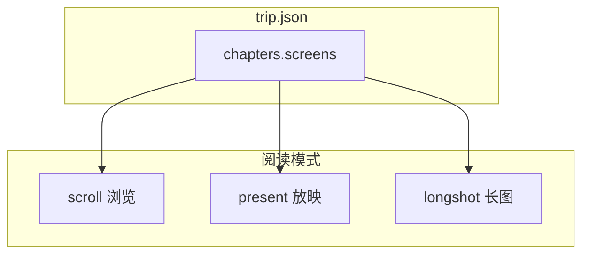
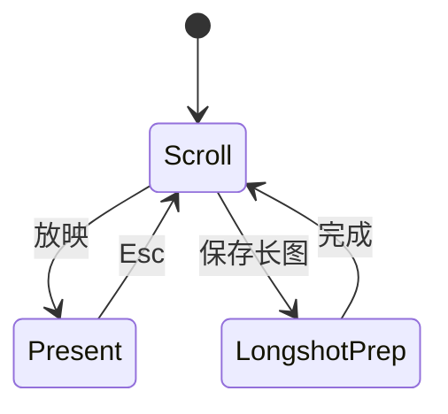

# Travelogue · 阅读体验 PRD（三模式 + Hybrid）

| 属性 | 内容 |
|------|------|
| **文档类型** | 产品 PRD · 体验架构 · 配置权威 |
| **文档版本** | v1.0 |
| **状态** | 已采纳（见 [ADR-003](./adr/003-experience-reading-modes.md)） |
| **关联** | [PRD-MVP.md](./PRD-MVP.md)、[TEMPLATE-SURFACES.md](./TEMPLATE-SURFACES.md)、[RENDER-CONTRACT.md](./RENDER-CONTRACT.md)、[PRD-LAYOUT.md](./PRD-LAYOUT.md)、[DATA-MODEL.md](./DATA-MODEL.md) |
| **附录** | [A · 精选上传](./PRD-EXPERIENCE-附录A-精选上传.md) · [B · 滚动动效](./PRD-EXPERIENCE-附录B-滚动动效.md) · [C · Folio 版式](./PRD-EXPERIENCE-附录C-Folio版式.md) |
| **机器可读** | [experience-matrix.yaml](./experience-matrix.yaml) |
| **更新日期** | 2026-05-27 |

---

## 1. 文档目的

定义 Travelogue **阅读体验**的产品目标、三种阅读模式、Hybrid 融合架构、统一配置（`export.reading`）、路线图与验收标准。

**产品一句话**（对外）：一本游记，三种读法——**滑动浏览**、**全屏放映**、**保存长图**；精选照片影响封面与章首，杂志版式与 Gentle 动效仅在 Web 浏览默认开启。

**本文档不包含代码实现**；领域细节见三份附录。

---

## 2. 问题与目标

### 2.1 问题

| 问题 | 影响 |
|------|------|
| scroll / screenplay / longshot 未统一命名 | 用户不知「自动播放」与长图关系 |
| 78 屏林芝若做整站 deck | 不可维护；longshot 导出失败 |
| 呼吸感 / Folio / 精选 配置分散 | 组合冲突、回归遗漏 |
| Chicago 式 scroll-jacking 与微信离线 | 性能与 a11y 风险 |

### 2.2 目标

| ID | 目标 | 衡量 |
|----|------|------|
| **EXP-G1** | 三模式 **同一屏序** | AC-EXP-01 · 林芝自动化 |
| **EXP-G2** | 用户理解 **浏览 / 放映 / 长图** | toolbar 文案 + G1 说明 |
| **EXP-G3** | Hybrid 默认可上线 | `default_hybrid` profile |
| **EXP-G4** | longshot / 编辑 / a11y 不回归 | AC-EXP-03、05 |
| **EXP-G5** | 附录能力可组合 | [experience-matrix.yaml](./experience-matrix.yaml) |

### 2.3 非目标

- 整站 Folio 式 `overflow:hidden` deck  
- mobile 面默认 breath / folio（12 个月内）  
- 修改 Agent 0–2 核心语义（附录 A 仅扩展字段）  
- MVP 范围外：PDF、URL 深链（P3 可选）

---

## 3. 三阅读模式



| 模式 | ID | 隐喻 | 入口 | 表面 |
|------|-----|------|------|------|
| **浏览** | `scroll` | 翻阅打开的画册 | 打开 `index.html` | web · mobile |
| **放映** | `present` | 幻灯放映 | toolbar **放映** | web only |
| **长图** | `longshot` | 竖版总览 / 微信 | **长图** · `index-longshot.html` | web · mobile |

### 3.1 Scroll（默认）

- DOM：`layout-screen` 纵向堆叠 + cover + epilogue  
- 增强（可关）：`scroll-snap` · breath reveal · folio 版式 · 可选 Lenis  
- 参考：[Chicago Current](https://chicago-current.vercel.app/) 连续叙事 + section snap  

### 3.2 Present

- 实现：`screenplay.js` · 克隆 `layout-screen` · 全屏步进  
- **1 screen = 1 slide**；不展平 slot  
- 规划：与 scroll **位置同步**（E3）；可选 **仅精选**（E6）  
- toolbar：「自动播放」→ **放映**

### 3.3 Longshot

- 实现：`longshot.js` · screens **按 slot 展平**为竖 `media-card`  
- 捕获前 **teardown** 动效层（E4）  
- profile 强制 `performance`（folio/breath off）

---

## 4. 屏序列契约（硬约束）

```
cover → [全书前置块*] → chapter₁ → … → chapterₙ → epilogue
```

章内：

```
chapter-header [→ chapter-lead] → screen₁ → … → screenₖ
```

| 规则 | 说明 |
|------|------|
| 顺序源 | `trip.chapters[].screens[]` only |
| 原子单位 | 1 `layout-screen` = 1 present slide |
| longshot | 每 screen 展平为 Σ slots 张 card |
| featured | 改 pattern/权重，**不改序** |
| 前置块 | `trip-index` / `featured-grid` 在 cover 后（folio full） |

**Invariant**：

```text
scroll_order(i) = present_order(i)
longshot_cards(i) = flatten(screen_i)
```

---

## 5. Hybrid 架构

**Hybrid** = 同一 DOM · scroll 为主干 + 离散节拍（snap / folio 版式 / reveal）+ 可切换 present / longshot。

### 5.1 分层

| 层 | 职责 | 文档 |
|----|------|------|
| **L0** | 屏序 · 文案 · `userTier` | 附录 A |
| **L1** | 三模式 · 契约 · profile | **本文档** |
| **L2a** | 版式 skin（Plate / Index） | 附录 C |
| **L2b** | 滚动动效（breath） | 附录 B |
| **L3** | present overlay | `screenplay.js` |
| **L4** | longshot 捕获 | `longshot.js` |

依赖：L3/L4 只读 L0；L2 不改顺序。

### 5.2 章级节拍（叙事结构）

```text
[全书] Cover → trip-index? → featured-grid?
[每章] foreword-spread? → screen-plate? → screens… → screen-spread?
[全书] epilogue-screen
```

Present 可配置跳过 auxiliary 块（`present.skipAuxBlocks`）。

### 5.3 业内对照

| 实践 | 采纳 | 避免 |
|------|------|------|
| Scrollytelling | breath flow + 有限 pin | 全页 hijack |
| Section snap | `.layout-screen` proximity | mandatory 全站 |
| Dual mode | scroll + present | 两套 trip |
| Progressive disclosure | Index + Plate | 一次 250 图墙 |
| Content first | 无 JS 可读 | deck-only |

---

## 6. 模式切换



| 切换 | 行为 |
|------|------|
| scroll → present | 记录屏索引；暂停 Lenis |
| present → scroll | scrollIntoView 对齐；恢复 Lenis |
| → longshot 捕获 | `breath.teardown()`；folio off |
| inline-edit | profile→legacy；禁用 present |
| prefers-reduced-motion | snap/breath off |

---

## 7. 表面 × 模式

| 表面 | scroll | present | longshot | 默认 profile |
|------|--------|---------|----------|--------------|
| `index.html` web | ✅ | ✅ | 桥接 | `default_hybrid` |
| `index-mobile.html` | ✅ | ❌ | ✅ | `legacy` |
| `index-longshot.html` | ✅ 竖读 | ❌ | ✅ | `performance` |
| share zip | ✅ | ✅ | ✅ | `performance` |
| inline-edit | ✅ | ❌ | — | `legacy` |

---

## 8. 配置（权威）

### 8.1 Profile 预设

完整矩阵见 [experience-matrix.yaml](./experience-matrix.yaml)。

| profile | 用户文案 | scroll | 用途 |
|---------|----------|--------|------|
| `legacy` | 经典浏览 | snap/breath/folio 全 off | 回归基线 |
| `performance` | 性能优先 | 全 off | **share zip** · longshot |
| `default_hybrid` | 默认 | snap proximity + breath soft + folio lite | **工坊 draft** |
| `magazine` | 杂志感 | + breath flow + folio full | 桌面验收 |

### 8.2 `trip.json`

```json
{
  "export": {
    "longShot": true,
    "reading": {
      "profile": "default_hybrid",
      "present": {
        "dwellMs": 2000,
        "featuredOnly": false,
        "syncScrollOnExit": true,
        "skipAuxBlocks": false
      },
      "scroll": {
        "snap": "proximity",
        "breath": "soft",
        "folio": "lite"
      },
      "longshot": {
        "breath": "off",
        "folio": "off"
      }
    }
  }
}
```

| 字段 | 说明 |
|------|------|
| `profile` | 预设；存在时展开为 scroll/present/longshot 默认值 |
| `scroll.breath` | `off` \| `soft` \| `flow` \| `cinematic` \| `gallery` → 附录 B |
| `scroll.folio` | `off` \| `lite` \| `full` → 附录 C |
| `scroll.snap` | `off` \| `proximity` \| `mandatory` |
| `assets[].userTier` | **独立 L0 字段** → 附录 A |

**废弃别名（兼容 1 版本）**：`export.breathMode` → `reading.scroll.breath`；`export.folioMode` → `reading.scroll.folio`。

### 8.3 `config.yaml`

```yaml
render:
  reading:
    default_profile: default_hybrid
    share_profile: performance
    mobile_profile: legacy
```

### 8.4 渲染注入

```html
<script>
  window.__TRAVELOGUE_READING__ = {
    profile: "default_hybrid",
    scroll: { snap: "proximity", breath: "soft", folio: "lite" },
    present: { dwellMs: 2000, featuredOnly: false },
    featuredAssetIds: ["asset-003"]
  };
</script>
```

---

## 9. 组合与降级

权威规则见 [experience-matrix.yaml](./experience-matrix.yaml) `conflicts`。

| 冲突 | 赢家 |
|------|------|
| present vs Lenis | 暂停 Lenis |
| longshot vs folio/breath | teardown + off |
| gallery pin vs capture | kill pin |
| featured-grid vs screens 同图 | **去重**（ADR-003 D4-1） |
| cinematic + folio full + 林芝 | 降为 `default_hybrid` 或 WARN |

### 9.1 模式 × 能力速查

| 能力 | scroll | present | longshot |
|------|--------|---------|----------|
| breath reveal | ✅ | ❌ | ❌ |
| Lenis | 可选 | ❌ | ❌ |
| scroll-snap | ✅ | — | ❌ |
| folio plate meta | ✅ | ✅ 页码 | ❌ |
| trip-index | ✅ | 跳转 | 静态 |
| featured-grid | ✅ | 书签 | 展平（去重后） |

---

## 10. 路线图（Experience Epic）

| Epic | 交付 | 附录 | 用户感知 |
|------|------|------|----------|
| **E0** | 屏序契约 + AC-EXP-01 测试 | — | 低 |
| **E1** | profile 解析 + schema | — | 低 |
| **E2** | **Hybrid 最小包** | B P0 · C P0 | **高** |
| **E3** | present ↔ scroll sync | — | 高 |
| **E4** | longshot teardown API | B | 中（防回归） |
| **E5** | 双文件夹 + plate 加权 | A | 高 |
| **E6** | breath flow · featured present | A · B | 中 |
| **E7** | folio full | C | 中 |
| **E8** | cinematic + gallery pin | B | 低 |

**发布顺序**：E0 → E1 → **E2+E4** → E3 → E5 → E6/E7/E8 可选。

---

## 11. 验收标准（总表）

| ID | 场景 | 通过条件 | 细则 |
|----|------|----------|------|
| **AC-EXP-01** | 林芝 web | scroll 屏序 = present 序 | §4 |
| **AC-EXP-02** | `default_hybrid` | snap + soft + lite 同开无错 | matrix |
| **AC-EXP-03** | longshot · 曾开 flow | smoke PASS；无 transform 残留 | 附录 B |
| **AC-EXP-04** | 双文件夹 ingest | userTier 正确 | 附录 A · AC-DF-* |
| **AC-EXP-05** | featured + plate | cover/hero ∈ featured 优先 | 附录 A/C |
| **AC-EXP-06** | present → scroll | 视口对齐 ±1 snap | E3 |
| **AC-EXP-07** | share zip | profile=performance | ADR-003 |
| **AC-EXP-08** | mobile | 无 present；legacy profile | §7 |
| **AC-EXP-09** | inline-edit | present 禁用 | matrix |
| **AC-EXP-10** | reduced-motion | 内容完整；动效 off | 附录 B |
| **AC-EXP-11** | featured-grid | 与 screens **无重复 asset** | ADR-003 |
| **AC-EXP-12** | 无 JS | 全文可读 | §5.3 |

附录 AC（AC-DF / AC-BR / AC-FO）仍有效；上表为 **发布门禁**，细节见附录。

---

## 12. CLI / 工坊

```powershell
# 渲染指定 profile
python -m travelogue render trips/linzhi/trip.json --dual --reading-profile default_hybrid

# 回归基线
python -m travelogue render trips/linzhi/trip.json --reading-profile legacy

# 分享包（应写入 performance）
python -m travelogue export linzhi --confirm-privacy
```

`workshop-pipeline.ps1` 默认不显式传参 → 使用 `config.yaml` `default_profile`。

---

## 13. 文档体系

| 文档 | 回答什么 |
|------|----------|
| **本文档** | 三模式 · Hybrid · profile · Epic · 总 AC |
| [附录 A](./PRD-EXPERIENCE-附录A-精选上传.md) | 哪张图是精选？ingest/curate |
| [附录 B](./PRD-EXPERIENCE-附录B-滚动动效.md) | scroll 怎么「呼吸」？ |
| [附录 C](./PRD-EXPERIENCE-附录C-Folio版式.md) | 怎么像杂志版式？ |
| [ADR-003](./adr/003-experience-reading-modes.md) | 拍板结论 |
| [experience-matrix.yaml](./experience-matrix.yaml) | 机器可读组合 |

**旧文件名**（`双文件夹.md` 等）指向本体系，见各文件顶部重定向。

---

## 14. 与现有 PRD 关系

| 文档 | 关系 |
|------|------|
| [PRD-MVP.md](./PRD-MVP.md) | MVP 范围不变；Experience 为 G1.5 增强 |
| [PRD-LAYOUT.md](./PRD-LAYOUT.md) | screens 算法不变；folio 增 presentation |
| [SHARING.md](./SHARING.md) | 长图 P0；share 用 `performance` profile |
| [AGENT-ARCHITECTURE.md](./AGENT-ARCHITECTURE.md) | 附录 A→Agent 0/1；其余→Agent 3 |

---

## 附录 · 术语

| 术语 | 定义 |
|------|------|
| **Reading Mode** | scroll / present / longshot |
| **Hybrid** | scroll 主干 + 可选 snap/breath/folio |
| **Profile** | 预设配置包 |
| **Screen** | 一个 `layout-screen` |
| **Teardown** | longshot/模式切换前卸载动效 |

## 附录 · 实现锚点

| 模块 | 路径 |
|------|------|
| 放映 | `templates/visual-journal/screenplay.js` |
| 长图 | `templates/visual-journal/longshot.js` |
| 动效 | `templates/visual-journal/breath.js`（规划） |
| 样式 | `templates/visual-journal/journal.css` |
| 渲染 | `travelogue/render/engine.py` |
| 精选 | `travelogue/media/ingest.py` · `curate_scoring.py` |
