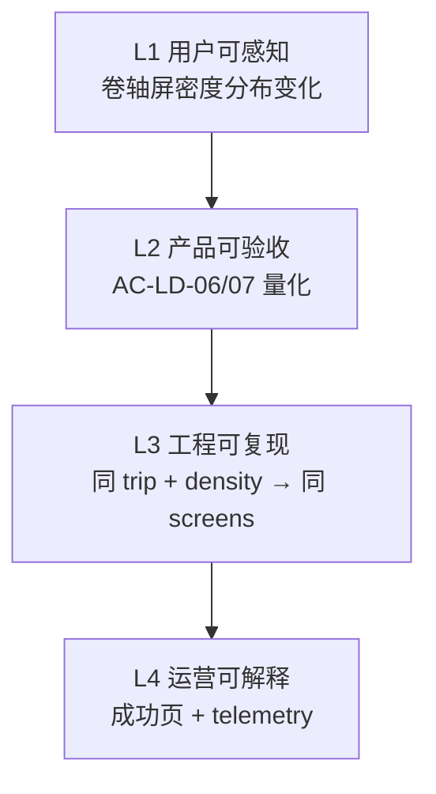
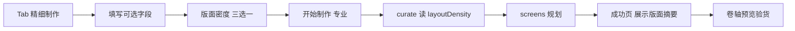

# Travelogue · 精细制作「版面密度」产品需求文档（PRD）

| 属性 | 内容 |
|------|------|
| **产品代号** | Travelogue |
| **文档版本** | v0.1.1 |
| **状态** | Draft · 跨职能评审已纳入（产品 / 前端 / UI/UX / 开发 / 算法） |
| **功能代号** | 「版面密度」— 大图为主 / 拼图为主 / 智能平衡 |
| **前置条件** | [PRD-PHASE14.md](./PRD-PHASE14.md) 双模式导入已上线；[PRD-PHASE4.md](./PRD-PHASE4.md) `trip.intent` 写入链路稳定；`layoutEngine=screens` 与 Phase 15 mosaic 子系统可用 |
| **关联文档** | [智能排版V2.md](./智能排版V2.md)、[AGENT-ARCHITECTURE.md](./AGENT-ARCHITECTURE.md) §15/§17、`schemas/trip.schema.json`、`travelogue/curation/screen_layout_state.py`、`travelogue/curation/screen_planner.py` |
| **实施清单** | [IMPLEMENTATION-FINE-CRAFT-LAYOUT-DENSITY.md](./IMPLEMENTATION-FINE-CRAFT-LAYOUT-DENSITY.md) |
| **更新日期** | 2026-06-04 |

> **定位**
>
> - 在 **精细制作** Import Sheet 中新增可选控件，让用户表达「更想要大图单张」还是「更想要宫格/拼图组合」。
> - **快速分享** 模式 **不展示、不读取** 该偏好，继续沿用现有自动排版逻辑。
> - 偏好仅影响 **curate 阶段的 screens 组屏**（像素层），**不**改变 narrate 文案生成策略（意图与像素分离）。
> - **精准落地** = 用户可感知 + AC 可量化 + 工程可复现 + 运营可解释（见 §2.1）。

---

## 1. 背景与问题

### 1.1 当前痛点

| 痛点 | 现状 | 用户影响 |
|------|------|----------|
| 排版风格不可控 | 精细制作可填书名/感受，但无法表达「杂志感大图」vs「信息密度拼图」 | 编辑型用户觉得成稿「太碎」或「太散」 |
| 算法单一默认 | `orientationSummary` + 九宫 `nine_min/max` + burst 自动平衡，无用户旋钮 | 同一相册无法满足不同审美 |
| 产品语义模糊 | 用户口语「拼图」涵盖九宫、4/6 宫、五联 mosaic 等 | 若只改 mosaic 窗，体验与预期不符 |

### 1.2 目标

1. 精细制作增加 **版面密度** 三选一（默认智能平衡），写入 `trip.intent` 并在 curate 可解释消费。  
2. 快速分享 **零行为变化**（回归保护）。  
3. 偏好 **不破坏** 智能排版 V2 硬契约（章首 hero、人脸 contain、peak 后呼吸、长文案章首单图等）。  
4. 为 telemetry / G1 二次调整 / 未来 Intent Brief 预留字段。

### 1.3 非目标

| 非目标 | 说明 |
|--------|------|
| 改变快速分享排版 | `mode=quick_share` 忽略 `layoutDensity` |
| LLM 每窗选版式 | 违反 L2 校验与 benchmark 可复现性 |
| 影响长图 sidecar 独立规则 | 本期仅约束 **卷轴 screens**；长图导出若独立 pipeline 另文说明 |
| 替代模板选择 | `template_mode` / `template_id` 与版面密度正交 |
| 强制用户二选一 | 默认 **智能平衡**（= 今日算法），可跳过 |
| G1 改密度重跑排版 | **P2**；MVP 不做 layout-only replan |

---

## 2. 已拍板决策（冻结）

### 2.1 「精准落地」四层契约（跨职能评审 · 冻结）

各角色交付时必须对齐以下四层，**缺一不可**：



| 层级 | 责任角色 | Operational 定义 |
|------|----------|------------------|
| **L1** | UI/UX、产品 | 同一 golden 相册三档并排：相对 `balanced`，`hero_first` **单槽屏占比** ↑ ≥10pp；`collage_first` **≥4 槽屏占比** ↑ ≥10pp（见 §11.2） |
| **L2** | 算法、QA | `tests/test_layout_density.py` 对固定 fixture 通过 AC-LD-06～08 |
| **L3** | 开发负责人 | `quick_share` screens 规划与 Phase 14 基线 **golden 无 diff**；非法值 fail-open |
| **L4** | 前端、产品 | MVP 含 `runs/studio-intent.json` + 精细成功页一行（非 `balanced` 时展示，见 **D-LD-09**） |

### 2.2 决策表（初稿 + 跨职能评审结论）

| 决策 ID | 决策项 | 结论 |
|---------|--------|------|
| **D-LD-01** | 生效范围 | 仅 **精细制作**（`fine_craft`）；快速分享不读不写 UI |
| **D-LD-02** | 默认值 | **`balanced`（智能平衡）** = 当前算法，保证老用户无感 |
| **D-LD-03** | 对外命名 | 控件标题：**版面密度**；选项：**智能平衡（推荐）** / **大图为主** / **拼图为主** |
| **D-LD-04** | 存储字段 | `trip.intent.layoutDensity`：`balanced` \| `hero_first` \| `collage_first` |
| **D-LD-05** | 与文案关系 | 只调 **layout**；**narrate 不变**；`userNotes` 不自动覆盖显式选项 |
| **D-LD-06** | 硬规则优先 | 长 `lead` 章首单图、人脸 contain、相邻 pattern 禁令等 **覆盖** 用户密度偏好（见 §7.8） |
| **D-LD-07** | 小册子预期 | 总量 **&lt; 35** 时：**不禁用**「拼图为主」；选夹后弱提示 + `layoutDensityEffect=limited` |
| **D-LD-08** | MVP 算法范围 | **仅** 九宫配额 + 选格顺序；**不** 在 MVP 对 `hero_first` 全局 `enable_mosaic=false`（mosaic 调权放 P1） |
| **D-LD-09** | 成功页反馈 | **MVP 必做**：`hero_first` / `collage_first` 成功页展示「版面：…」一行；`balanced` 不展示 |
| **D-LD-10** | Schema 版本 | 保持 `intent.version: "1"`，**仅增** `layoutDensity` property |
| **D-LD-11** | 选项文案 | 首版保留 **「拼图为主」**；hint 脚注说明含宫格与照片组合（非仅五联窗）；「组合为主」列为 P2 文案 A/B |
| **D-LD-12** | 工程单入口 | `run_curate` 经 **`layout_density_params(intent)`** 单函数下发参数；禁止 planner 内散落读取 intent |
| **D-LD-13** | 快速路径提交 | `quick_share` **不得** `append layoutDensity`（防 localStorage 草稿污染） |
| **D-LD-14** | 回滚开关 | `app.yaml` 增加 `layoutDensity.enabled`（默认 `true`），关闭时全体当 `balanced` |

---

## 3. 设计原则

| ID | 原则 | 说明 |
|----|------|------|
| **P-LD-01** | 倾向非保证 | 偏好调整 **概率与配额**，不承诺「每张精选单独一页」 |
| **P-LD-02** | 确定性执行 | 同一 `tripId` + `layoutDensity` + 配置 → 可 golden 对比 |
| **P-LD-03** | 输入有回报 | **MVP**：成功页一行 + telemetry（D-LD-09） |
| **P-LD-04** | Fail-open | 非法/缺失值当 `balanced`；不阻断 import |
| **P-LD-05** | 分层旋钮 | 一条 intent → 九宫配额 + 选格顺序（MVP）；+ mosaic / beam（P1） |

---

## 4. 用户分层与旅程

### 4.1 适用 Persona

| Persona | 场景 | 推荐选项 |
|---------|------|----------|
| 杂志感编辑者 | 希望横/竖单图撑满、少缩略图墙 | 大图为主 |
| 连拍记录者 | 同场景多图、希望成组呈现 | 拼图为主 |
| 不确定 | 信任算法 | 智能平衡（默认） |

### 4.2 旅程（精细制作内）



快速分享路径 **不经过** 节点 C、G 的版面摘要。

### 4.3 用户可感知样例（评审必演示）

会上算法侧需提供 **同一 trip**（建议 `trips/demo-day-3` 或 ≥35 张 golden fixture）三档卷轴并排截图，并标注 1 处 **硬规则覆盖** 样例（如：`collage_first` 但长 `lead` 章首仍为单图），用于产品对外说明与客服脚本。

---

## 5. 信息架构与交互规格

### 5.1 Import Sheet 结构增量

在 [PRD-PHASE14.md](./PRD-PHASE14.md) §5.1 精细制作 Tab 中，于 **模板选择** 字段 **正上方** 插入（UI/UX 评审定稿：与 `v2-sheet__field--full` 同宽）：

```
精细制作 Tab（增量）
├─ … 既有字段（名称、地点、日期、userNotes、travelNotes、文件夹、plan）
├─ 【新增】版面密度（可选）          ← 模板选择正上方
│  ○ 智能平衡（推荐）
│  ○ 大图为主
│  ○ 拼图为主
│  └─ role=note 副文案 + 脚注（见 §5.3、§10）
└─ 模板选择
```

### 5.2 控件规格

| 项 | 规格 |
|----|------|
| 类型 | `radiogroup`（首版）；分段控件（segmented）列为 P2 视觉优化 |
| 默认 | `balanced` |
| 可见性 | 仅 `fine_craft` Tab；`quick_share` **hidden** |
| 持久化 | `localStorage` 键 `travelogue.studio.layoutDensity`（与 `studioIntent` 并列，仅精细草稿恢复） |
| 触控 | 单选项热区高度 ≥ 40px |
| 可访问性 | 每项：主标签 + 副文案；朗读顺序：组标题 → 选项 → 脚注 |

### 5.3 说明文案（hint）

常驻 `role="note"` 段落：

| 选项 | 副文案 |
|------|--------|
| 智能平衡 | 根据照片数量与横竖比自动排版（推荐） |
| 大图为主 | 更多单张全幅画面，节奏更偏杂志感 |
| 拼图为主 | 更多宫格与照片组合，连拍更易成组 |

**组级脚注**（`role="note"`，位于三选项下方）：

> 仅影响卷轴游记排版，不影响快速分享长图。不保证每张照片单独占一页；章首重要画面与阅读节奏优先。

**弱提示触发**（**D-LD-07**）：

| 时机 | 行为 |
|------|------|
| 选夹前 | 不展示张数相关提示 |
| 选夹后且可获知 `eligibleCount &lt; 35` | 若当前选中「拼图为主」，展示弱提示（§10）；**不禁用**该选项 |
| 导入后 | 后端写 `layoutDensityEffect=limited` |

### 5.4 模式切换与草稿

| 场景 | 行为 |
|------|------|
| 精细 → 快速 | 草稿保留 `layoutDensity`；提交时 **不传** 该字段（**D-LD-13**） |
| 快速 → 精细 | 恢复草稿；无则 `balanced` |
| 关闭 Sheet 再开 | 同 Phase 14 session 草稿规则 |

### 5.5 UI/UX 交付物（会后）

| 交付物 | 负责人 | 截止 |
|--------|--------|------|
| 1280 两列 + 移动单列线框各 1 帧 | UI/UX | +2 工作日 |
| 文案终稿（含脚注） | UI/UX + 产品 | +2 工作日 |
| 三档卷轴并排参考截图 | 算法 | +5 工作日 |

---

## 6. 字段设计与数据契约

### 6.1 字段总表

| UI 标签 | 模式 | API 字段 | 类型 | 默认 | 存储 |
|---------|------|----------|------|------|------|
| 版面密度 | 精细制作 | `layoutDensity` | enum | `balanced` | `trip.intent.layoutDensity` |

### 6.2 Schema（`trip.intent` 增量）

```json
{
  "intent": {
    "version": "1",
    "layoutDensity": "balanced"
  }
}
```

| 枚举值 | 含义 | 用户文案 |
|--------|------|----------|
| `balanced` | 当前自动算法 | 智能平衡 |
| `hero_first` | 倾向单槽大屏 | 大图为主 |
| `collage_first` | 倾向多槽/宫格/mosaic | 拼图为主 |

**校验**：`additionalProperties: false` 下新增 property；非法值 **降级为 `balanced`**，不阻断 import（**D-LD-10**：不升 `intent.version`）。

### 6.3 派生只读 hints（`trip.curation.intentHints`）

由 `build_intent_hints()` 合并写入（只读，非用户编辑）：

```json
{
  "intentHints": {
    "layoutDensity": "hero_first",
    "preferMosaic": false,
    "nineQuotaScale": 0.5
  }
}
```

| 源 `layoutDensity` | `preferMosaic` | `nineQuotaScale`（示意） |
|------------------|----------------|-------------------------|
| `balanced` | 不写入 / 算法默认 | `1.0` |
| `hero_first` | `false` | `0.25`–`0.6`（实现取整到 `nine_min/max`） |
| `collage_first` | `true` | `1.1`–`1.2`（带上限 cap） |

与 [AGENT-ARCHITECTURE.md](./AGENT-ARCHITECTURE.md) §17.4 `layoutHints.preferMosaic` 对齐。

### 6.4 字段消费链路

| 字段 | 消费者 | 方式 |
|------|--------|------|
| `intent.layoutDensity` | `curate.run_curate` | **`layout_density_params()` 单入口** → planner / mosaic |
| `intent.layoutDensity` | `mosaic/hook`、`mosaic/scorer` | **P1**：权重与阈值 |
| `intent.layoutDensity` | `layout_search` / `layout_scoring` | **P1**：槽位密度加减分 |
| `intent.layoutDensity` | **不消费** | `narrative_brief`、ingest 选图 |

### 6.5 优先级规则

| 优先级 | 规则 |
|--------|------|
| 1（最高） | 智能排版 V2 **硬契约**（§7.8） |
| 2 | 用户显式 `layoutDensity` |
| 3 | `userNotes` 关键词 → **P2** G1 建议，不覆盖显式选项 |
| 4 | `orientationSummary` / burst / 总量配额 |

### 6.6 工程接口契约（开发负责人 · 冻结）

```text
trip.intent.layoutDensity
  → curate.run_curate()
  → layout_density_params(trip) -> LayoutDensityParams
       { density, nine_min_scale, nine_max_scale, grid_candidate_order, mosaic_bias }
  → ScreenLayoutPlannerState.from_trip_total(..., params=...)
  → ChapterScreenPlanner / (P1) mosaic hook
```

| 要求 | 说明 |
|------|------|
| 单入口 | 仅 `layout_density_params` 读取 `intent.layoutDensity` |
| 回滚 | `layoutDensity.enabled=false` → 返回与 `balanced` 等价参数 |
| Job 回传 | `studio_subprocess` / pipeline `result.layoutDensity` 供成功页（前端 **MVP**） |

---

## 7. 引擎行为规格（curate / layout）

### 7.1 术语映射（产品 ↔ 引擎）

| 层级 | 代码概念 | `hero_first` | `collage_first` | `balanced` |
|------|----------|--------------|-----------------|------------|
| L1 单槽大屏 | `screen-landscape-1`、`screen-portrait-1`、`screen-tall-1` | ↑ 优先 | ↓ | 现状 |
| L2 多宫格 | `screen-*-4/6/9`、九宫配额 | ↓ `nine_min/max` | ↑ | 现状 |
| L3 五联 mosaic | `screen-mosaic-5-*`、`mosaic/hook`（≥35 张） | P1 降权/提阈值 | P1 加权 | 现状 |

**MVP 只动 L1+L2**（**D-LD-08**）；L3 放 P1。

### 7.2 九宫配额调整（MVP · 必做）

基于 `nine_grid_limits_for_trip(total_photos)` 的 `(nine_min, nine_max)`：

| `layoutDensity` | `nine_min` | `nine_max` | `should_prefer_nine()` |
|-----------------|------------|------------|------------------------|
| `hero_first` | `max(0, floor(min × 0.25))` | `floor(max × 0.6)` | 禁用或仅无单图可选时 |
| `balanced` | 不变 | 不变 | 不变 |
| `collage_first` | `min(cap, ceil(min × 1.2))` | `min(cap, ceil(max × 1.1))` | 更积极 |

`cap` 与现有 `>200` 张上限规则一致。

### 7.3 选格顺序（MVP · 必做）

`screen_planner._pick_largest_allowed_grid` 的 **candidates 顺序**：

| `layoutDensity` | 横图 run 候选顺序 |
|-----------------|-------------------|
| `hero_first` | `1` → `3/4` → `6` → `9` |
| `collage_first` | quota 推 `9` → burst `9/6/4` → 默认 |
| `balanced` | 保持现状 |

竖图 run、`portrait_heavy` 保留；`hero_first` 降低 `9` 槽优先级。

### 7.4 Mosaic 五联（P1）

| `layoutDensity` | 行为 |
|-----------------|------|
| `hero_first` | 提高 legacy 5 窗有效阈值（建议 50+）或 scorer 降权；**非** MVP 全局关 mosaic |
| `collage_first` | 提高 `mosaic.scorer.weights` 中 `aspect_match` 等 |
| `balanced` | 现状 |

### 7.5 Beam 密度分（P1）

- `hero_first`：槽位 &gt; 2 → 总分 ×0.92  
- `collage_first`：槽位 ≥ 4 → 总分 ×1.05  

权重须小于 `arc_segment` / intent peak。

### 7.6 与旅行团种子（cohort）共存

`collage_first` + `intent.featuredSubjects` 时，沿用 `cohort.mosaic_weight`（P1 与 §7.4 一并验收）。

### 7.7 决策可解释（日志）

```json
{
  "layoutDensity": "collage_first",
  "layoutDensityEffect": "full",
  "nineQuotaAdjusted": { "min": 2, "max": 6, "baseMin": 2, "baseMax": 5 }
}
```

### 7.8 硬规则覆盖表（产品演示 · 必备案）

以下规则 **始终高于** `layoutDensity`，用于 L1 预期管理与客服：

| 规则 | 来源 | 对用户偏好的影响 |
|------|------|------------------|
| 长 `lead` 章首单图 | 智能排版 V2 §5.8 | 可覆盖 `collage_first` 的「高密度章首」预期 |
| 章首 hero（章内 ≥5 张） | `screen_planner` | 两种偏好下均可能存在 |
| 人脸 `contain` | layout | 不降级 |
| 相邻同 pattern 禁令 | `ScreenLayoutPlannerState` | 限制连续九宫 |
| 小册 `&lt;35` 张 | **D-LD-07** | `collage_first` 效应弱，`layoutDensityEffect=limited` |

---

## 8. 后端与 API

### 8.1 Import API 扩展

`POST /__travelogue/import` 增量字段：

| 字段 | 类型 | 必填 | 说明 |
|------|------|------|------|
| `layoutDensity` | enum | ❌ | 仅 `fine_craft` 提交；`quick_share` **禁止携带**（**D-LD-13**） |

合法值：`balanced` | `hero_first` | `collage_first`。

### 8.2 Pipeline

1. `import_handlers` 解析 → `studio_pipeline.apply_intent(..., layout_density=...)`。  
2. `apply_intent` 写入 `trip.intent.layoutDensity`（非法值降级）。  
3. `run_curate` → `layout_density_params()` → screen planner。  
4. `runs/studio-intent.json`：`layoutDensity`、`layoutDensityEffect`（`full` | `limited` | `ignored_quick`）。  
5. Job `result.layoutDensity` 回传前端（**D-LD-09**）。

### 8.3 配置回滚（D-LD-14）

```yaml
# app.yaml（示意）
layoutDensity:
  enabled: true   # false → 全 trip 当 balanced，UI 仍可展示但不影响 curate
```

### 8.4 前端提交契约

| 模式 | `layoutDensity` |
|------|-----------------|
| `fine_craft` | 提交当前 radiogroup 值，默认 `balanced` |
| `quick_share` | **不 append**；服务端忽略即使误传 |

---

## 9. 成功页与 G1

### 9.1 成功页（MVP · D-LD-09）

精细制作成功页增加一行摘要（非阻断）：

| `layoutDensity` | 展示文案 |
|-----------------|----------|
| `hero_first` | 版面：大图为主 |
| `collage_first` | 版面：拼图为主 |
| `balanced` | **不展示** |

数据来源：`Job.result.layoutDensity`（或 `trip.intent` 只读回显）。

### 9.2 G1 二次调整（P2）

「改为大图为主 → 仅重跑 layout」依赖 Phase 7 增量 replan；**本期不承诺**。  
`userNotes` 与 `layoutDensity` 冲突提示放 P2。

---

## 10. 交互文案（首版 · 评审冻结）

| 位置 | 文案 |
|------|------|
| 字段标签 | 版面密度（可选） |
| 选项 1 | 智能平衡（推荐） |
| 选项 2 | 大图为主 |
| 选项 3 | 拼图为主 |
| 组级脚注 | 仅影响卷轴游记排版，不影响快速分享长图。不保证每张照片单独占一页；章首重要画面与阅读节奏优先。 |
| 弱提示（&lt;35 张且选拼图为主） | 照片较少时，拼图为主的效果可能不明显，系统仍会以保证阅读节奏为先。 |

**避免**：「保证全是拼图」「AI 最优排版」等夸大承诺。

**P2 备选**：选项 3 文案 A/B「组合为主」——需与 §7.1 L2/L3 脚注同步。

---

## 11. 验收标准（AC）

### 11.1 功能与回归

| AC ID | 验收项 | 通过标准 |
|-------|--------|----------|
| **AC-LD-01** | 精细 Tab 可见 | 三选项 radiogroup；快速 Tab 不可见 |
| **AC-LD-02** | 默认智能平衡 | 首次打开精细 Tab 为 `balanced` |
| **AC-LD-03** | 落盘 | `fine_craft` 导入后 `trip.intent.layoutDensity` 与提交一致 |
| **AC-LD-04** | 快速忽略 | `quick_share` 不传字段；screens golden 与 Phase 14 基线 **无 diff** |
| **AC-LD-05** | 非法降级 | `layoutDensity=foo` → `balanced`，import 成功 |
| **AC-LD-08** | 硬契约 | 章首 hero、人脸 contain：三档 golden 不回归失败 |
| **AC-LD-09** | telemetry | `runs/studio-intent.json` 含 `layoutDensity`、`layoutDensityEffect` |
| **AC-LD-10** | 小册子 | 总量 &lt;35 + `collage_first` → `layoutDensityEffect=limited` |
| **AC-LD-11** | 成功页 | 精细 + 非 `balanced` → 成功页展示「版面：…」 |
| **AC-LD-12** | 快速不传 | `quick_share` 请求体无 `layoutDensity`（E2E 或 handler 单测） |
| **AC-LD-13** | 回滚开关 | `layoutDensity.enabled=false` 时与 `balanced` 行为一致 |

### 11.2 算法量化（L2 · 冻结阈值）

在 **固定 golden fixture**（首选 `trips/demo-day-3` 或评审指定的 ≥35 张 trip）上，对 **全 trip screens** 统计：

| 指标 | 定义 | `hero_first` vs `balanced` | `collage_first` vs `balanced` |
|------|------|---------------------------|------------------------------|
| 单槽屏占比 | `pattern_slot_count(pattern)==1` 的屏数 / 总屏数 | ↑ ≥ **10pp** | — |
| 高密度屏占比 | 槽位数 ≥4 的屏数 / 总屏数 | — | ↑ ≥ **10pp** |

| AC ID | 验收项 | 通过标准 |
|-------|--------|----------|
| **AC-LD-06** | hero_first 效应 | 满足单槽屏占比 ↑ ≥10pp |
| **AC-LD-07** | collage_first 效应 | 满足高密度屏占比 ↑ ≥10pp |

实现：`tests/test_layout_density.py` + 可选 `--snapshot` 记录三档 `pattern` 序列 hash。

### 11.3 Golden fixture 清单

| Fixture | 张数 | 用途 |
|---------|------|------|
| `demo-day-3`（或等价 ≥35 张 trip） | ≥35 | AC-LD-06、07、08 |
| 小册 fixture（新建，~20 张） | &lt;35 | AC-LD-10 |
| Phase 14 `quick_share` baseline | — | AC-LD-04 |

---

## 12. 埋点

| 事件 | 属性 |
|------|------|
| `import_start` | `layoutDensity`, `mode`, `eligibleCount`（若已知） |
| `import_success` | `layoutDensity`, `layoutDensityEffect`, `durationMs` |
| `layout_density_change` | `from`, `to`（精细 Tab 切换，可选） |
| `success_primary_click` | 继承 Phase 14，增加 `layoutDensity` |

---

## 13. 风险与缓解

| 风险 | 影响 | 缓解 |
|------|------|------|
| 大图为主 + 超大相册 | 卷轴过长 | 仅倾向单图；保留章内上限 |
| 拼图为主 + 长文案章 | 文字挤压 | §7.8 硬规则 + 演示样例 |
| 用户以为影响长图 | 预期不符 | §10 组级脚注 |
| 与 `userNotes` 冲突 | 信任下降 | P2 G1 提示；显式选项优先 |
| 快速路径回归 | 80% 受损 | **D-LD-13** + AC-LD-04 |
| 效果不明显引发客诉 | 差评 | &lt;35 弱提示 + `limited` telemetry + 成功页确认已采纳 |

---

## 14. 实施里程碑

### 14.1 分期范围（评审修订）

| 里程碑 | 范围 | AC |
|--------|------|-----|
| **M-LD-1 MVP**（约 1 迭代，3–5 人日） | schema、`apply_intent`、单入口 params、九宫配额、选格顺序、Import UI/API、成功页一行、telemetry、golden 测试 | AC-LD-01～07、08～13 |
| **M-LD-2 P1** | mosaic 权重、beam 密度分、`layout_density_change` 埋点 | 效应加固 + 评审指标复核 |
| **M-LD-3 P2** | G1 layout-only replan；Intent Brief 建议；「组合为主」文案 A/B | 编辑闭环 |

### 14.2 MVP 任务墙（看板 Ready）

| 任务 ID | 内容 | Owner |
|---------|------|-------|
| M-LD-1.1 | schema + `apply_intent` + import API + telemetry | Backend |
| M-LD-1.2 | `layout_density_params()` + curate 接线 | Algorithm |
| M-LD-1.3 | `nine_quota` + `_pick_largest_allowed_grid` 顺序 | Algorithm |
| M-LD-1.4 | Import Sheet UI + 提交 + localStorage + 不传 quick | Frontend |
| M-LD-1.5 | 成功页 `result.layoutDensity` 展示 | Frontend |
| M-LD-1.6 | `test_layout_density.py` + quick_share 回归 | QA / Algorithm |
| M-LD-1.7 | `app.yaml` `layoutDensity.enabled` | Backend |

**依赖**：1.1 → 1.2 → 1.3；1.4、1.5 可并行；1.6 最后。

### 14.3 模块路径

| 层 | 路径 |
|----|------|
| Schema | `schemas/trip.schema.json` |
| Intent | `travelogue/services/trip.py` |
| Params | `travelogue/curation/layout_density.py`（**新建**，建议） |
| API | `travelogue/web/studio_handlers/import_handlers.py` |
| Pipeline | `travelogue/web/studio_pipeline.py`、`studio_subprocess.py` |
| UI | `templates/studio/studio-home-v2.html`、`homepage-v2/import-sheet.js`、`import-run.js`、`first-success.js` |
| Hints | `travelogue/curation/intent_hints.py` |
| 配额 / 选格 | `screen_layout_state.py`、`screen_planner.py` |
| Curate | `travelogue/curation/curate.py` |
| Telemetry | `travelogue/web/studio_intent_telemetry.py` |
| 测试 | `tests/test_studio_intent.py`、`tests/test_layout_density.py` |

### 14.4 RACI（会后执行）

| 交付物 | R | A | C | I |
|--------|---|---|---|---|
| PRD v0.1.1 | 产品 | 产品 | 算法、UI、前端、开发 | 全员 |
| IMPLEMENTATION 清单 | 开发负责人 | 开发负责人 | 前端、算法 | 产品 |
| UI 线框终稿 | UI/UX | UI/UX | 产品、前端 | — |
| 三档 golden 对比报告 | 算法 | 算法 | QA | 产品 |
| MVP 合并 | 开发负责人 | 开发负责人 | 全员 | 产品 |

---

## 15. 跨职能评审记录（2026-06-04）

| 角色 | 核心结论 |
|------|----------|
| **产品** | 承诺「倾向」非「保证」；MVP 成功页必须反馈；&lt;35 不禁用拼图选项 |
| **UI/UX** | 控件在模板正上方；组级脚注说清不影响长图；选夹后再显示张数弱提示 |
| **前端** | `quick_share` 严禁提交；`localStorage` 独立键；读 `Job.result.layoutDensity` |
| **开发负责人** | 单 PR 可拆 schema+pipeline / curate 两 PR；建议新建 `layout_density.py`；3–5 人日 MVP |
| **算法** | MVP 仅配额+选格；AC 量化 10pp；/demo-day-3 三档并排为验收物 |

**原开放问题结案**（并入 §2.2，不再开放）：

| 原 ID | 结案 |
|-------|------|
| Q-LD-01 | → **D-LD-08** MVP 不调 mosaic 全局开关 |
| Q-LD-02 | → **D-LD-09** 成功页纳入 MVP |
| Q-LD-03 | → **D-LD-10** 保持 intent v1 |
| Q-LD-04 | → §11.2 阈值 **10pp** |
| Q-LD-05 | → **D-LD-11** 保留「拼图为主」 |
| Q-LD-06 | → **D-LD-07** 不禁用，弱提示 |

---

## 16. 修订记录

| 版本 | 日期 | 说明 |
|------|------|------|
| v0.1.0 | 2026-06-04 | 初稿：版面密度三档 + 引擎旋钮 + AC/分期 |
| v0.1.1 | 2026-06-04 | 纳入跨职能评审：四层契约、决策 D-LD-08～14、量化 AC、工程单入口、MVP 范围与任务墙、开放问题结案 |
