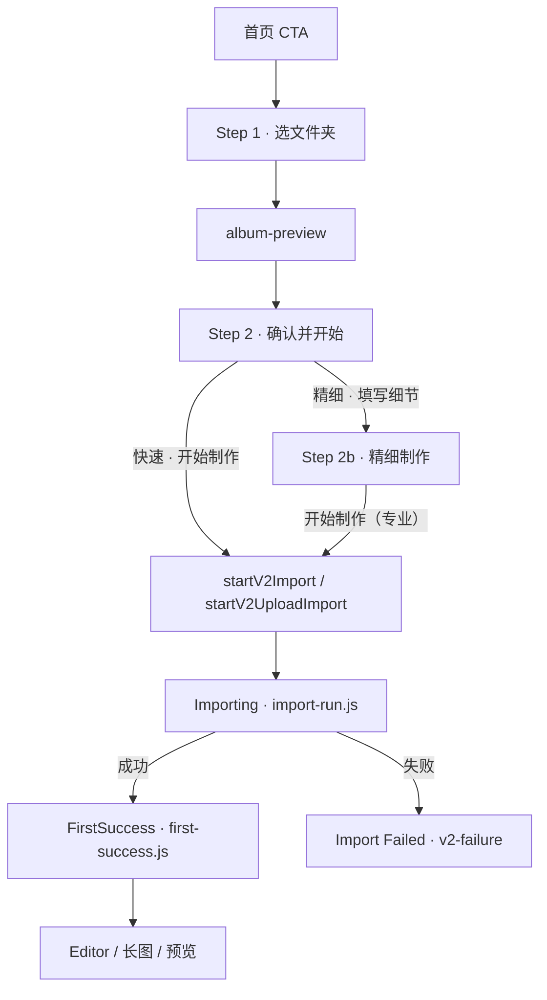

# Travelogue Studio · Import Sheet v3「两步向导 + 智能默认」PRD

| 属性 | 内容 |
|------|------|
| **产品代号** | Travelogue Studio · Import Wizard |
| **文档版本** | **v3.0.2-IMPORT-WIZARD**（Sheet 退役后勘误） |
| **状态** | **Approved · Wizard 唯一入口**（旧 Sheet 已删，见 [IMPLEMENTATION-IMPORT-SHEET-RETIRE.md](./IMPLEMENTATION-IMPORT-SHEET-RETIRE.md)） |
| **触发入口** | 首页主 CTA「开始制作我的游记」/ 书架新建卡（D-23）→ 本弹窗 |
| **父文档** | [PRD-PHASE14.md](./PRD-PHASE14.md) · [PRD-STUDIO-HOMEPAGE-v2.md](./PRD-STUDIO-HOMEPAGE-v2.md) §7 |
| **关联文档** | [PRD-PHOTO-CULL-USER-TOGGLE.md](./PRD-PHOTO-CULL-USER-TOGGLE.md) · [PRD-KEEP-BURST-TOGGLE.md](./PRD-KEEP-BURST-TOGGLE.md) · [TELEMETRY.md](./studio-homepage-v2/TELEMETRY.md) |
| **评审依据** | 2026-07-07 弹窗走查 + 同日跨职能设计评审（产品/UX/UI/交付/前后端/测试） |
| **更新日期** | 2026-07-12 |

---

## 0. 文档说明

### 0.1 定位

Import Sheet 是北极星漏斗的咽喉：`cta_click → sheet_open → folder_picked → import_start → import_success`。

本稿将现有「单页大表单 + 双 Tab」重构为「**两步向导 + 智能默认**」，并**明确与 Importing / FirstSuccess / Failed / Editor 的下游衔接契约**（§16），确保 v3 仅改「入口体验」，不改「制作与交付链路」。

### 0.2 服务两类用户

| 用户 | 占比假设 | 路径 | 目标 |
|------|---------|------|------|
| **快速分享型** | ~80% | 选夹 → 开始制作 | **2 次点击、≤15 秒**发起制作；Step 1/2 零滚轮 |
| **精细制作型** | ~20% | 选夹 → 选精细卡 → 填写细节 → 开始（专业） | 字段分组清晰、返回不丢草稿 |

### 0.3 评审决议摘要（v3.0.1 已纳入）

| 决议 | 内容 |
|------|------|
| **立项** | ✅ 批准；M-IW-0 完成后进入开发 |
| **Q-01** | v3.0 **不接 Lightbox**；缩略图纯展示；v3.1 再评估 |
| **Q-02** | 精细 CTA 改为 **「填写细节 →」**（非「继续填写」） |
| **一屏约束** | Step 2 **折叠态**一屏硬约束；**抽屉展开态**允许 dialog body 内滚动 |
| **UX-02** | 头部「← 重新选择」与验货行「更换」**同义同逻辑**（均回 Step 1） |
| **D-W8 补充** | **首次打开 Studio** 强制快速分享默认；第 2 次起读 localStorage |
| **工期** | **10 工作日**（含测试）；M-IW-5 灰度观察另计 7d |

### 0.4 继承的冻结决策

| 来源 | 决策 | v3 落点 |
|------|------|---------|
| v2 §7 | CTA 弹出 Sheet；路径仅在 Sheet 内 | 不变 |
| P14 | 双模式 · 「开始制作（专业）」 | 模式卡片化 |
| P9-F1/F2 | 智能挑选/连拍开关逻辑与文案 | 收进抽屉，逻辑不变 |
| v2 §7.1 | dialog a11y · Esc 关闭 · 焦点归还 CTA | 向导切步延伸 |
| §16 | **下游链路** | payload / 状态机 / 埋点 / FirstSuccess 展示 **零变更** |

---

## 1. 背景与问题证据

（同 v3.0.0 · IS-01～IS-06，略）

| # | 问题 | 证据 |
|---|------|------|
| IS-01 | 确认态需滚轮才见主 CTA | 1024×768 走查截图 |
| IS-02 | 选夹前后 UI 不互斥 | `studio-home-v2.html` pick 与 confirm 并存 |
| IS-03 | 两 checkbox 卡片对 80% 用户是噪音 | P9-F1/F2 默认即最优 |
| IS-04 | 精细字段与快速 Tab 同屏 | `#v2-sheet-panel-fine` |
| IS-05 | 选夹无验货反馈 | `album-preview` 已有 thumbs 未用 |
| IS-06 | Bottom Sheet 浪费桌面垂直空间 | `.v2-sheet` 底部贴边 |

---

## 2. 目标与指标

### 2.1 目标

| ID | 目标 | 验收 |
|----|------|------|
| **G-IW-01** | 快速路径 2 次点击、Step 1/2 零滚轮 | AC-IW-01/02 |
| **G-IW-02** | 选夹后 3 秒内验货确认感 | 照片数 + 缩略图；preview 失败不阻塞 |
| **G-IW-03** | 快速用户不被高级选项打扰 | 默认无 checkbox |
| **G-IW-04** | 精细路径完整不降级 | Step 2b 字段零删减 |
| **G-IW-05** | 首次用户免教育 | M-IW-5 前 5 人走查（评审门禁） |
| **G-IW-06** | **下游衔接零回归** | §16 AC-IW-DS-01～08 全过 |

### 2.2 非目标

- 不改 `POST /__travelogue/import` 契约与 import pipeline
- 不改 Importing / FirstSuccess / Failed / Editor 页面结构与文案（仅 Wizard 入口变）
- 不做拖拽文件夹（v3.1 候选 Q-03）
- 不做移动端 Sheet 布局

---

## 3. 设计决策

| # | 决策 | 说明 |
|---|------|------|
| **D-W1** | 居中 Dialog | `width: clamp(560px, 52vw, 720px)`；去 handle |
| **D-W2** | 两步向导同 dialog 切步 | 120ms 过渡；前进左进、返回右进 |
| **D-W3** | 智能默认收纳 | 两开关进抽屉；摘要行反映非默认态 |
| **D-W4** | 模式卡片 radio | 快速默认；精细选中 → CTA「填写细节 →」 |
| **D-W5** | Step 2b 独立子页 | 四分组；允许滚动 + sticky 底栏 |
| **D-W6** | 选夹即验货 | thumbs + photoCount；1024 显示 4 张、1280+ 显示 6 张 |
| **D-W7** | 帮助仅在 Step 1 | Step 2 增加「⋯ 更多导入方式」失败兜底 |
| **D-W8** | 记住上次模式 | localStorage；**首次打开强制快速** |
| **D-W9** | ~~flag 灰度~~ → **已退役** | Wizard 为唯一导入入口；flag / 旧 Sheet 已删除（RETIRE P2/P3） |
| **D-W10** | 步骤指示器 | Step 2 标题下：`① 选文件夹 → ② 确认并开始` |
| **D-W11** | 下游零侵入 | Wizard 仅替换 Sheet UI；**调用现有 `import-run.js` 出口**（§16） |

---

## 4. 信息架构与流程

### 4.1 流程图



### 4.2 Step 1 · 选择照片文件夹

| 元素 | 规格 |
|------|------|
| 标题 | 制作我的游记画册 |
| 主按钮 | 📁 SVG 图标 + 「选择本次旅行的照片文件夹」（min-height 56px） |
| 副文案 | 一次旅行一个文件夹，照片留在本机 |
| 帮助 | 「文件夹怎么选？」「其他导入方式」（现有功能原样） |
| 高度 | 折叠态 ≤ 260px |

**行为**：选夹成功 → 切 Step 2 + 并行 `album-preview`；失败 → 错误 + 展开「其他导入方式」。

### 4.3 Step 2 · 确认并开始

```
┌────────────────────────────────────────────────┐
│  ← 重新选择      确认并开始                [×]  │
│  ① 选文件夹  →  ② 确认并开始（当前）            │
│                                                │
│  📁 贵州暑假游 · 已清点 134 张          [更换]  │
│  制作时将自动去重与挑选（脚注，11px 灰）         │
│  [▣][▣][▣][▣]  ← 1024:4张；1280+:6张           │
│                                                │
│  ┌─ ● 快速分享（推荐）──┐ ┌─ ○ 精细制作 ─────┐ │
│  │ 生成微信长图，即刻分享 │ │ 成稿更贴你的旅程  │ │
│  └──────────────────────┘ └──────────────────┘ │
│                                                │
│  照片处理：智能挑选已开启 · 连拍自动择优 [调整照片处理] │
│                                                │
│  ┌──────────────────────────────────────────┐  │
│  │            开始制作  →                    │  │
│  └──────────────────────────────────────────┘  │
│  每个文件夹会生成一本新游记画册，不会覆盖已有作品  │
└────────────────────────────────────────────────┘
```

| 区块 | 规格 |
|------|------|
| 步骤指示（D-W10） | 当前步高亮金色 |
| 验货区 | folderName + 已清点 N 张；preview 中「正在清点照片…」；超时「照片较多，制作时将自动清点」 |
| 验货脚注（DD-02） | 「制作时将自动去重与挑选」 |
| 缩略图 | 56px · lazy load · **不可点击**（v3.0 不接 Lightbox） |
| 模式卡 | 视觉降一级（描边）；主 CTA 独占 cream 大按钮 |
| 照片处理 | 「调整照片处理」文字按钮（非链接样式） |
| 主 CTA | 快速→「开始制作 →」；精细→「填写细节 →」；上传→「开始上传」 |
| 一屏 | **抽屉折叠态** ≤480px 内容区；AC-IW-02 硬约束 |

**「← 重新选择」与「更换」**：均调用同一 `goToStep1()`，清空当前 pending path 可选（保留草稿字段）。

**Step 2 兜底**：头部 ⋯ 菜单含「更多导入方式」（粘贴路径 / 小文件夹上传），与 Step 1 帮助内容相同。

### 4.4 照片处理抽屉

- 两开关逻辑、文案、optout、分支副文案 **与 P9-F1/F2 完全一致**
- 展开态允许 body 内滚动；折叠态不持久化
- 用户改过开关 → 摘要行实时同步（§8）

### 4.5 Step 2b · 精细制作

- 字段清单与现版 **零删减**
- 四分组：基本信息 · 叙事素材 · 照片组织 · 排版与模板
- 验货单行回显（无缩略图条，省高度）
- sticky 底栏：「开始制作（专业）→」+「← 返回上一步」
- 允许内部滚动

---

## 5. 状态机

| 状态 | 进入 | 退出 |
|------|------|------|
| `wizard_step1` | openImportSheet | 选夹成功→step2；关闭 |
| `wizard_step2` | 选夹/上传/粘贴成功 | 开始制作→**下游 Importing**；精细+填写细节→2b；返回→step1 |
| `wizard_step2b` | step2 精细+继续 | 开始（专业）→**下游 Importing**；返回→step2 |

**与 V2.state 关系**：

| 阶段 | Wizard 内部 | V2.state | 说明 |
|------|------------|----------|------|
| Sheet 打开 | step1/2/2b | Idle* | `variant-guard` 不锁 |
| 点击开始制作 | Sheet 关闭 | **Importing** | `renderImportingPanel` 设置 |
| 导入成功 | — | **FirstSuccess** | `showFirstSuccess` |
| 导入失败 | — | **Failed** | `showImportFailed` |
| 关闭 Success | — | Idle* | `reroute` |

**草稿恢复**：

- session 草稿含 `wizardStep` + 全部字段
- 重开时若 `albumPath` 存在 → 先 **path 校验**（`album-preview` 或 HEAD）；失败 → Step 1 + toast「文件夹不可用，请重新选择」
- 优先级：**session 草稿 mode > localStorage 上次模式 > 默认快速**（首次打开跳过 localStorage）

---

## 6. 前端任务拆解

| # | 任务 | 文件 | 预估 |
|---|------|------|------|
| FE-01 | Dialog 壳层 + flag 双壳 | html/css | 0.5d |
| FE-02 | **`import-wizard.js` 新模块** + 切步状态机 | js | 1.5d |
| FE-03 | Step 1 | html/css/js | 0.5d |
| FE-04 | Step 2 验货 + 步骤指示 + 缩略图分档 | js/css | 0.5d |
| FE-05 | 模式卡 + D-W8 首次用户逻辑 | js | 0.5d |
| FE-06 | 照片处理摘要+抽屉（Step2/2b 共享实例） | js | 1.5d |
| FE-07 | Step 2b 四分组 + sticky | html/css/js | 1d |
| FE-08 | **下游出口**：`buildSheetPayload` → `startV2Import` / `startV2UploadImport`（§16） | js | 0.5d |
| FE-09 | a11y + 切步 aria-live | js | 0.5d |
| FE-10 | 视口自动化 AC-IW-01/02 | tests | 0.5d |
| FE-11 | 埋点 + §16 下游回归 | js/tests | 0.5d |
| FE-12 | 线框 `docs/wireframes/import-wizard-v3.html` | docs | 0.5d |

**前端合计 ≈ 8d**（含线框）。

## 7. 后端任务拆解

| # | 任务 | 预估 |
|---|------|------|
| BE-01 | ~~flag `importWizardV3Enabled`~~ → **已退役**（不再注入） | — |
| BE-02 | `album-preview` 性能：6 thumbs · 2s 超时降级 · benchmark | 0.5d |
| BE-03 | 响应增量 `folderName` | 0.25d |
| BE-04 | import payload 契约回归测试 | 0.5d |

**后端合计 ≈ 1.5d**。

---

## 8. 微文案表

| 位置 | 文案 |
|------|------|
| Step 1 副文案 | 一次旅行一个文件夹，照片留在本机 |
| Step 2 标题 | 确认并开始 |
| 步骤指示 | ① 选文件夹 → ② 确认并开始 |
| 验货行 | 📁 {folderName} · 已清点 {N} 张 |
| 验货·preview 中 | 正在清点照片… |
| 验货·超时 | 照片较多，制作时将自动清点 |
| 验货脚注 | 制作时将自动去重与挑选 |
| 快速卡 | **快速分享（推荐）** / 生成微信长图，即刻分享 |
| 精细卡 | **精细制作** / 成稿更贴你的旅程 |
| 摘要·默认 | 照片处理：智能挑选已开启 · 连拍自动择优 |
| 主 CTA·精细 | **填写细节 →** |
| 调整入口 | **调整照片处理**（文字按钮） |
| Step 2b CTA | 开始制作（专业） |

抽屉内 P9-F1/F2 文案 **一字不改**。

---

## 9. 交互与可访问性

- 打开 Sheet → 焦点 Step 1 选夹按钮
- 进入 Step 2 → 焦点主 CTA；aria-live 播报验货结果
- 模式卡 radiogroup ←/→ 切换
- Esc → 关闭整 Sheet（非回退）
- `prefers-reduced-motion` → 禁用切步动画
- 五主题对比度 AC-IW-14

---

## 10. 数据与接口契约

### 10.1 不变

- `POST /__travelogue/import` 全部字段
- `POST /__travelogue/pick-folder`
- Import job poll / cancel 流程

### 10.2 增量

| 接口 | 变更 |
|------|------|
| `album-preview` | +`folderName`；thumbs max 6 |
| `config` | +`importWizardV3Enabled` |

---

## 11. 埋点

| 事件 | 属性 |
|------|------|
| `wizard_step_view`（新） | `{ step: "pick" \| "confirm" \| "fine" }` |
| `preview_loaded`（新） | `{ photoCount, thumbCount, elapsedMs, degraded: bool }` |
| `import_mode_view` | +`source: "default" \| "remembered" \| "user" \| "first_visit"` |
| `advanced_drawer_open`（新） | `{ step }` |
| `sheet_abandon` | +`{ step }` |
| **`import_start`** | **不变** · `surface: "v2_sheet"` 保留 |
| **`import_success`** | **不变** |

灰度判据同 v3.0.0 §11.2。

---

## 12. 验收标准

### 12.1 Wizard 本体

| ID | Then |
|----|------|
| AC-IW-01 | 1024×768 Step 1 无滚轮 |
| AC-IW-02 | 1024×768 Step 2 折叠态主 CTA 可见无滚轮；1280+ 同 |
| AC-IW-03 | 验货区：folderName + N 张 + ≥1 缩略图；失败降级不阻塞 |
| AC-IW-04 | 默认态无可见 checkbox |
| AC-IW-05 | 取消智能挑选 → 摘要行更新 + payload false |
| AC-IW-06 | 两开关 4 组合 → payload 正确（P9-F1/F2 回归） |
| AC-IW-07 | 2b 填表 → 返回 → 再进 → 字段保留 |
| AC-IW-08 | 日期校验与现版一致 |
| AC-IW-09 | 非首次 + 上次精细 → 精细卡默认选中 |
| AC-IW-09b | **首次打开** → 强制快速卡默认 |
| AC-IW-10 | 键盘全程可达 |
| AC-IW-11 | ~~flag 关 → 旧 Sheet~~ → **作废**（Sheet / flag 已删） |
| AC-IW-12 | 上传路径与现版一致 |
| AC-IW-13 | 快速路径 2 次点击（不含系统选夹器） |
| AC-IW-14 | 五主题 axe 通过 |
| AC-IW-15 | ~~flag 切换无样式/脚本泄漏~~ → **作废** |
| AC-IW-16 | 关 Sheet 重开 → 步序+字段正确 |
| AC-IW-17 | P9-F1×F2 四组合矩阵 |
| AC-IW-18 | 键盘-only 精细路径 |
| AC-IW-19 | preview 超时仍可开始制作 |
| AC-IW-20 | 新埋点字段断言 |

### 12.2 视口分档

| ID | Then |
|----|------|
| AC-IW-21 | 1024 宽 Step 2 缩略图 **≤4** 张 |
| AC-IW-22 | 1280+ Step 2 缩略图 **≤6** 张 |

---

## 13. 里程碑

| ID | 范围 | 工期 |
|----|------|------|
| **M-IW-0** | PRD v3.0.1 ✅ + 线框 `import-wizard-v3.html` | 1d |
| **M-IW-1** | 壳层 + wizard 骨架 + Step 1 + BE-01 | 2d |
| **M-IW-2** | Step 2 核心 + BE-02/03 | 3d |
| **M-IW-3** | Step 2b + 下游出口联调（§16） | 2d |
| **M-IW-4** | a11y + AC 全量 + BE-04 | 2d |
| **M-IW-5** | 7d dogfood + **5 人走查门禁**（G-IW-05） | 7d 观察 |

**合计：10 工作日 + 7d 观察**。

---

## 14. 风险与开放问题

| # | 风险 | 应对 |
|---|------|------|
| R-01 | 精细多一跳 | D-W8 + 卡片文案 + 灰度监控精细占比 |
| R-02 | 大相册 preview 慢 | 2s 超时降级 |
| R-03 | 抽屉可发现性 | 「调整照片处理」按钮 + 摘要行 |
| R-04 | 双壳体积 | 灰度后删旧壳 |
| R-05 | **下游回归** | §16 专章 + AC-IW-DS 系列 |
| Q-03 | 拖拽文件夹 | v3.1 |
| Q-01 | Lightbox | v3.1 |

---

## 15. 版本历史

| 版本 | 说明 |
|------|------|
| v3.0.0 | 首版草案 |
| v3.0.1 | 评审修订：决议纳入 · 下游衔接 §16 · AC 扩展 · 工期 10d |
| **v3.0.2** | Sheet 退役勘误：作废 AC-IW-11/15、AC-IW-DS-08；D-W9/BE-01/DS-03～05 对齐唯一入口 |
| （关联） | 体验增量见 [PRD-IMPORT-WIZARD-A1-DELTA.md](./PRD-IMPORT-WIZARD-A1-DELTA.md) · 实施 [IMPLEMENTATION-IMPORT-WIZARD-A1.md](./IMPLEMENTATION-IMPORT-WIZARD-A1.md) · 线框 [import-wizard-a1.html](./wireframes/import-wizard-a1.html) |

---

## 16. 下游功能衔接（Downstream Integration）

> **本章为 v3.0.1 评审必补项。** Wizard 的成功标准是：用户感知变了，但 Importing → 成稿 → 编辑 链路**行为与数据完全一致**。

### 16.1 衔接原则

| 原则 | 说明 |
|------|------|
| **单出口** | Wizard 不得自行 `fetch /import`；必须经 `import-run.js` 的 `startV2Import` / `startV2UploadImport` |
| **先关后启** | 保持现序：`closeImportSheet(reason)` → toast → `startV2Import(body)` |
| **payload 等价** | `buildSheetPayload()` 输出与现版 `import-sheet.js` **逐字段一致** |
| **状态不抢跑** | `V2.state = Importing` 仅由 `renderImportingPanel` 设置，Wizard 不得预设 |
| **session 续跑** | `SS.activePending` / `SS.activeJobId` 写入格式不变，支持刷新续 poll |

### 16.2 衔接链路图

```
Import Wizard (v3)
  │
  ├─ startFromConfirm() / startUploadFromConfirm()
  │     ├─ buildSheetPayload()  ← 字段与现版相同
  │     ├─ readPlanFileText()   ← 精细模式 planFile
  │     ├─ saveSheetDraft()
  │     ├─ _importStarted = true
  │     ├─ closeImportSheet("start" | "start_upload")
  │     └─ startV2Import(body) | startV2UploadImport(files, opts)
  │
  ▼
import-run.js
  ├─ trackStudioEvent("import_start", { surface:"v2_sheet", mode, photoCullEnabled, … })
  ├─ sessionStorage.activePending = JSON.stringify(body)
  ├─ renderImportingPanel(source)  → V2.state = "Importing"
  ├─ POST /__travelogue/import → 202 + jobId
  ├─ pollImport → import_success 埋点
  │
  ├─ 成功 → showFirstSuccess({ result })
  ├─ 失败 → showImportFailed(err) → V2.state = Failed
  └─ 取消 → cancelImport → reroute → Idle
  │
  ▼
first-success.js
  ├─ 读取 result.importMode → quick_share | fine_craft
  ├─ 读取 result.photoCount / layoutEligibleCount → P9-F1 N/M 文案
  ├─ 读取 result.keepNearDuplicates → P9-F2 完成态说明
  ├─ 读取 result.layoutDensity → 精细模式密度摘要
  ├─ 主 CTA：quick → 保存长图；fine → 卷轴预览（feature flag 控制）
  └─ dismiss → reroute → 书架含新画册
```

### 16.3 字段映射：Wizard → Import → FirstSuccess

| Wizard 采集 | import payload 字段 | FirstSuccess 消费 |
|-------------|---------------------|-------------------|
| 文件夹路径 | `albumPath` | `result.title` 来源 |
| 模式卡 | `mode: quick_share \| fine_craft` | `_successMode` · 主/次 CTA 分支 |
| 游记名称（2b） | `title` | 成功页标题 |
| 地点 / 日期 / notes | `place` `dateRange` `userNotes` `travelNotes` | editor 语料（非 Success 直接展示） |
| 精选/素材夹 | `featuredDir` `materialDir` | ingest 封面优先逻辑 |
| 版面密度 | `layoutDensity` | `densitySummaryLine()` |
| 模板 | `template_mode` `template_id` | 创建逻辑 |
| 智能挑选 | `photoCullEnabled` | `cullUserLine` / `cullDisabledDetailLine()` |
| 保留连拍 | `keepNearDuplicates` | `keepDupesDetailLine()` |
| 照片数（preview） | `eligibleCount`（可选） | import_start 埋点 |
| 计划文件 | `planText`（读 file 后注入） | 叙事参考 |

**Wizard 不得新增、删除、重命名上述字段。** v3 仅改变用户如何到达 `buildSheetPayload()`。

### 16.4 模式 → 下游交付物

| mode | Importing 文案 | FirstSuccess 主 CTA | 次要出口 |
|------|---------------|---------------------|---------|
| `quick_share` | 同现版 | 「保存长图」（flag 开）或「预览卷轴」 | 设为首页预览 |
| `fine_craft` | 同现版 | 「预览卷轴」/ 进入 editor | 保存长图（次） |

Wizard 不改变 Success 页逻辑；仅需保证 `body.mode` 正确传入。

### 16.5 Importing 态互锁（Wizard 必须尊重）

| 模块 | Importing 时行为 | Wizard 要求 |
|------|-----------------|-------------|
| `openImportSheet()` | 现版 toast「正在制作中」 | **原样保留** |
| `closeImportSheet` Esc | `V2.state !== Importing` 才关 | **原样保留** |
| `variant-guard` | 锁 classic 链接 | Wizard 不参与 |
| `settings-panel` | 锁定 | Wizard 不参与 |
| `shelf` | 隐藏 | Wizard 已关闭 |
| 首页 CTA | 应 disabled 或 toast | 回归 AC-IW-DS-04 |

### 16.6 失败与重试衔接

| 场景 | 现版行为 | v3 要求 |
|------|---------|---------|
| import API 4xx/5xx | `showImportFailed` overlay | 不变；Wizard 已关闭 |
| E_DEMO_EXISTS | modal 确认覆盖 → `force: true` 重调 | 不变；在 import-run 内 |
| E_STUDIO_JOB_BUSY | toast + 留 Importing 或 reroute | 不变 |
| 用户点「重试」 | 重新 open Sheet 或直重 import | **重试应回到 Step 1**（空路径），避免 stale confirm |
| 用户点「留在首页」 | reroute Idle | 不变 |

**新增（v3）**：Failed 态「重试」若带 flag v3 → `openImportSheet()` 打开 **Step 1**（不恢复上次 confirm），避免 path 已变导致 silent error。

### 16.7 埋点漏斗衔接

完整漏斗必须可串联（[TELEMETRY.md](./studio-homepage-v2/TELEMETRY.md)）：

```
cta_click → open_sheet → wizard_step_view(pick)
  → pick_folder / folder_picked → wizard_step_view(confirm)
  → [wizard_step_view(fine)?] → import_start → import_success
```

| 检查项 | 要求 |
|--------|------|
| `import_start.surface` | 仍为 `"v2_sheet"`（Holdback 看板不断裂） |
| `import_start.mode` | 与 Wizard 模式卡一致 |
| `import_start.photoCullEnabled` | 与抽屉开关一致 |
| `sheet_abandon.step` | 新属性；旧看板兼容（可选字段） |
| P9 偏好埋点 | `trackImportKeepDupesPref` / `readPhotoCullPrefSource` 仍触发 |

### 16.8 下游验收标准（AC-IW-DS）

| ID | Given | When | Then |
|----|-------|------|------|
| AC-IW-DS-01 | Wizard 快速路径 · 默认开关 | 开始制作 → 成功 | `import_start` payload 与现版等价；FirstSuccess 主 CTA=长图 |
| AC-IW-DS-02 | Wizard 精细 · 填名称+密度 | 开始（专业）→ 成功 | `mode=fine_craft`；Success 显示密度摘要行 |
| AC-IW-DS-03 | 关智能挑选 + 129 张 | 成功 | FirstSuccess 显示「不做智能挑选 · N/M 张…」（AC-F1-02） |
| AC-IW-DS-04 | Importing 进行中 | 点首页 CTA / 开 Wizard | toast「正在制作中」；Wizard 不打开 |
| AC-IW-DS-05 | import 失败 | 点重试 | Wizard 打开 Step 1（非 Step 2 confirm） |
| AC-IW-DS-06 | 浏览器上传 N 张 | 开始上传 → 成功 | `via: upload`；Success 正常 |
| AC-IW-DS-07 | 导入中刷新 | 页面 reload | `resumeImportIfNeeded` 续 poll；不进 Wizard |
| AC-IW-DS-08 | ~~flag v3 开/关双路径~~ → **作废**（无双入口可对照） |

### 16.9 下游开发任务（纳入 M-IW-3 联调）

| # | 任务 | Owner | 说明 |
|---|------|-------|------|
| DS-01 | `import-sheet.js` 拆为 wizard UI + 薄编排层 | FE | wizard 调现有 export |
| DS-02 | Failed 重试入口改 Step 1 | FE | 查 `v2-failure-retry` 接线 |
| DS-03 | `buildWizardPayload` 字段契约 snapshot（冻结 §16.3 键集） | FE/QA | ✅ unit + e2e |
| DS-04 | Playwright：Wizard → Success → 预览/Editor 链接 200 | QA | ✅ e2e harness |
| DS-05 | ~~Holdback 分 wizard flag~~ → **搁置**（flag 已删；`surface` 仍 `v2_sheet`） |

---

## 17. 线框交付物

| 文件 | 内容 | 节点 |
|------|------|------|
| `docs/wireframes/import-wizard-v3.html` | Step 1 / 2 / 2b 三态 + 抽屉展开态 | M-IW-0 |

（线框于 M-IW-0 交付，本文档定稿后同步创建。）
