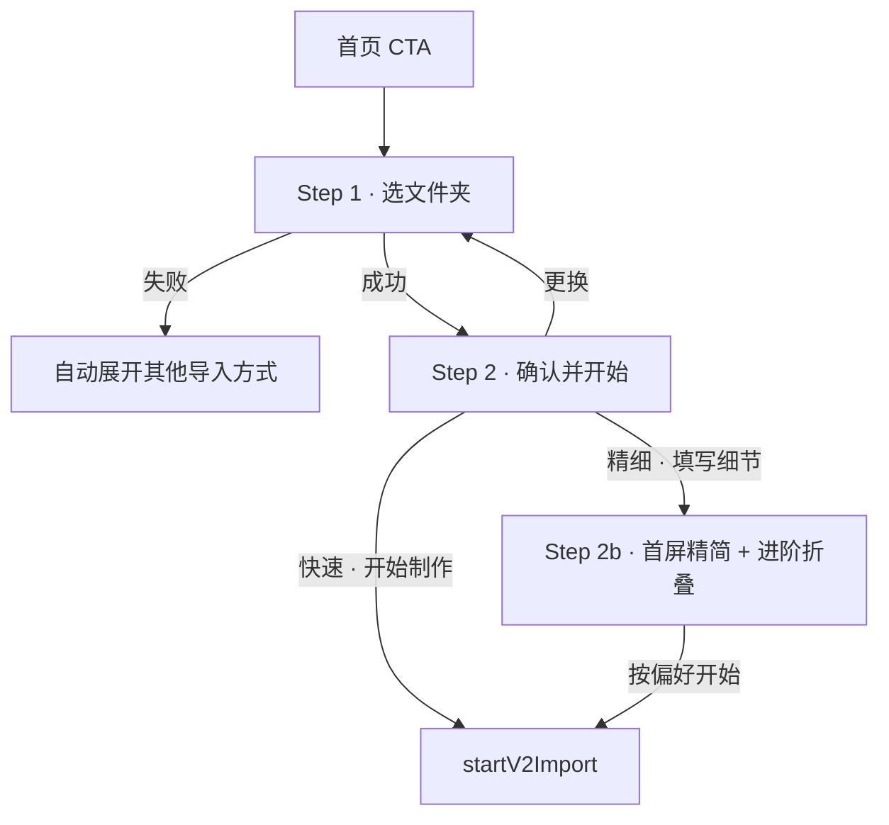

# Import Wizard · 方案 A.1 增量规格

| 属性 | 内容 |
|------|------|
| **产品代号** | Travelogue Studio · Import Wizard A.1 |
| **文档版本** | **v1.0-A1-DELTA** |
| **状态** | **Implemented · P0/P1/A.1.1 已落地；Wizard 默认开启**（研发跳过灰度） |
| **基线** | [PRD-IMPORT-SHEET-v3-WIZARD.md](./PRD-IMPORT-SHEET-v3-WIZARD.md) **v3.0.1**（Approved） |
| **线框** | [wireframes/import-wizard-a1.html](./wireframes/import-wizard-a1.html) |
| **对比稿** | [archive/import-sheet/import-modal-compare-v1.html](./archive/import-sheet/import-modal-compare-v1.html)（已归档） |
| **实施清单** | [IMPLEMENTATION-IMPORT-WIZARD-A1.md](./IMPLEMENTATION-IMPORT-WIZARD-A1.md) |
| **更新日期** | 2026-07-12 |

---

## 0. 定位

方案 A.1 = **Wizard v3.0.1 全量实现** + 下列**不改下游契约**的体验增量。

| 做 | 不做 |
|----|------|
| 在 v3 两步向导内打磨文案、验货、精细降噪、边界提示 | 交付物双栏插画 / 拖放主舞台（属方案 B） |
| 精细字段进阶折叠（能力零删减） | 偏好后置到 FirstSuccess（属 B / v3.1+） |
| 关闭草稿轻确认、张数弱提示 | Lightbox、拖拽文件夹（仍挂 v3.1 Q-01/Q-03） |

**下游原则继承 v3 §16**：单出口 `startV2Import` · payload 等价 · `surface: "v2_sheet"` 不变。

---

## 1. 增量清单（按优先级）

### 1.1 P0 · 与 v3 同发或紧随灰度（建议一并进 M-IW-2/3）

| ID | 增量 | 落点 | 预估 |
|----|------|------|------|
| **A1-01** | Step 2 头部去掉「← 重新选择」；仅保留验货行 **「更换」**（逻辑仍 = `goToStep1()`） | Step 2 / 2b 头栏 | 0.25d |
| **A1-02** | 精细 Step 2b：**进阶折叠**——首屏仅名称、地点、一句话+chips；其余进 `<details>` | Step 2b | 0.5d |
| **A1-03** | 张数弱提示（不挡开始）：&lt;4 / &gt;300 各一句 | Step 2 验货区下方 | 0.25d |
| **A1-04** | 主 CTA 下信任行：「约 3–8 分钟 · 可关闭此窗，稍后回来」 | Step 2 / 2b CTA 下 | 0.1d |
| **A1-05** | 选夹/路径/上传**失败** → 自动展开「其他导入方式」+ 焦点落到可用输入 | Step 1 | 0.25d |

**P0 合计 ≈ 1.35d**（在 v3 10d 之上）。

### 1.2 P1 · A.1 体验厚度（可同里程碑或 M-IW-4 后补丁）

| ID | 增量 | 落点 | 预估 |
|----|------|------|------|
| **A1-06** | 模式卡副文案贴结果（仍纯文字，无插画） | Step 2 模式卡 | 0.1d |
| **A1-07** | 进 2b：**名称←文件夹名**；**日期← EXIF 范围**（有则预填，可改） | Step 2b | 0.5d |
| **A1-08** | 缩略图轻交互：hover/focus 显示序号或文件名截断；**不可点开放大** | Step 2 thumbs | 0.25d |
| **A1-09** | 关闭确认：仅当 2b 有改动 **或** 照片开关非默认时弹出 | Dialog close / Esc | 0.5d |
| **A1-10** | 照片处理摘要：非默认态用警示色文案 | Step 2 / 2b 摘要行 | 0.15d |

**P1 合计 ≈ 1.5d**。

### 1.3 P2 · 可进 A.1.1 / dogfood 后（不堵 v3 发版）

| ID | 增量 | 说明 |
|----|------|------|
| **A1-11** | 2b 分组标题改为决策问句 | 字段与 DOM id 不变，仅 label/group-title |
| **A1-12** | Chips 点击后高亮「已选用」；可再加 1～2 条高频 | 文案表扩展 |
| **A1-13** | 2b 主 CTA 对外文案「按这些偏好开始 →」 | 埋点/mode 仍 `fine_craft` |
| **A1-14** | 从 2b 返回 Step 2：精细卡保持选中，CTA「继续编辑细节 →」 | 状态机小改 |
| **A1-15** | 首次用户 Step 1 一次性弱提示（localStorage 标记） | 可关、只出一次 |
| **A1-16** | 同名 trip 脚注「将新建一本，不会覆盖《…》」 | 需书架/trip 列表轻量查询 |

---

## 2. 信息架构（相对 v3 的差异）



与 v3 相同的步序；**仅 Step 2 头栏、2b 信息密度、验货提示、关闭与失败容错**有差。

---

## 3. 界面规格增量

### 3.1 Step 2 头栏（A1-01）

```
┌────────────────────────────────────────────┐
│           确认并开始                    [×] │
│  ① 选文件夹 → ② 确认并开始                 │
└────────────────────────────────────────────┘
```

- **删除**头栏「← 重新选择」
- 「更换」留在验货行；a11y：`aria-label="更换文件夹，返回选择步骤"`

### 3.2 验货区增量（A1-03 / A1-08）

| 条件 | 文案 | 样式 |
|------|------|------|
| `photoCount < 4`（且已得出 N） | 照片偏少，成册可能较短 | `hint--warn`，不禁用开始 |
| `photoCount > 300` | 照片较多，预计需要多几分钟 | 同上 |
| preview 中 / 超时 | 沿用 v3：「正在清点…」/「制作时将自动清点」 | 不叠加张数警告 |

缩略图：`title` / 可见 tooltip = `第 {i} 张` 或 `basename` 截断 16 字；`tabindex="0"`；**click 无 Lightbox**。

### 3.3 模式卡文案（A1-06）

| 卡 | 标题 | 副文案（替换 v3） |
|----|------|------------------|
| 快速 | 快速分享（推荐） | 优先出微信长图，适合马上分享 |
| 精细 | 精细制作 | 多填一点，文案和节奏更贴你 |

选中精细 → 主 CTA 仍为 v3 决议：**填写细节 →**。

### 3.4 CTA 信任行（A1-04）

主按钮下方、覆盖脚注上方：

> 约 3–8 分钟 · 可关闭此窗，稍后回来

覆盖脚注保持 v3：「每个文件夹会生成一本新的游记画册，不会覆盖已有作品。」

### 3.5 Step 2b 首屏与进阶（A1-02 / A1-07 / A1-13）

**首屏（默认可见）**

| 字段 | 预填 |
|------|------|
| 游记名称 | `folderName`（可编辑） |
| 主要地点 | 空（或未来 geocode；A.1 不强制） |
| 写给编辑的一句话 + chips | 空 |

**进阶（`<details>`，默认折叠）**

- 开始/结束日期（有 EXIF 范围则预填）
- 旅途见闻、行程计划文件
- 精选/素材文件夹名
- 版面密度、模板
- 照片处理入口（与 Step 2 共享抽屉状态）

**底栏 CTA**

| 对外文案（A1-13，P2 可先用 v3 文案） | 内部 |
|--------------------------------------|------|
| 按这些偏好开始 → | `start` fine_craft |
| ← 返回上一步 | 回 Step 2，保留草稿 |

### 3.6 照片处理摘要（A1-10）

| 状态 | 摘要文案 | 样式 |
|------|----------|------|
| 双默认 | 照片处理：智能挑选已开启 · 连拍自动择优 | muted |
| 关挑选 | 照片处理：已关闭智能挑选 · … | warn |
| 保留连拍 | 照片处理：… · 已保留连拍与近似照片 | warn |
| 两者皆非默认 | 合并上述，warn | warn |

### 3.7 关闭确认（A1-09）

**触发**：用户点 × / Esc / 点 scrim（若允许），且满足：

- 当前在 Step 2b，且任一精细字段相对「进入 2b 时快照」有变更；**或**
- 照片两开关相对产品默认有变更

**不触发**：Step 1；Step 2 且开关为默认、未进过 2b。

**文案（确认框，复用 `studio-modal`）**

- 标题：保留这次的填写？
- 主按钮：保留并关闭
- 次按钮：丢弃并关闭
- 保留 → 写 session 草稿后关闭；丢弃 → 清相关草稿字段后关闭

### 3.8 Step 1 失败容错（A1-05）

选夹 / 粘贴路径 / 上传失败后：

1. 错误 `role="alert"` 展示（现有）
2. `<details id="…-more-import">` **强制 open**
3. 焦点：优先路径输入，否则上传控件

---

## 4. 微文案表（A.1 增量 / 替换）

| 位置 | 文案 |
|------|------|
| 张数少 | 照片偏少，成册可能较短 |
| 张数多 | 照片较多，预计需要多几分钟 |
| CTA 信任 | 约 3–8 分钟 · 可关闭此窗，稍后回来 |
| 快速卡副 | 优先出微信长图，适合马上分享 |
| 精细卡副 | 多填一点，文案和节奏更贴你 |
| 摘要·关挑选 | 照片处理：已关闭智能挑选 |
| 摘要·留连拍 | 照片处理：已保留连拍与近似照片 |
| 关闭确认标题 | 保留这次的填写？ |
| 关闭·保留 | 保留并关闭 |
| 关闭·丢弃 | 丢弃并关闭 |
| 2b CTA（P2） | 按这些偏好开始 → |
| 返回后再进精细 CTA（P2） | 继续编辑细节 → |
| 首次弱提示（P2） | 选一次旅行的文件夹即可，不用先整理 |
| 同名脚注（P2） | 将新建一本，不会覆盖《{title}》 |

抽屉内 P9-F1/F2 文案 **一字不改**（继承 v3）。

---

## 5. 验收标准（增量）

| ID | Then |
|----|------|
| **AC-A1-01** | Step 2 头栏无「重新选择」；「更换」回 Step 1 且与 v3 UX-02 等价 |
| **AC-A1-02** | 2b 默认折叠态：进阶内字段不可见；展开后字段齐全且 payload 含全部键 |
| **AC-A1-03** | N=3 显示偏少提示且「开始制作」可点；N=301 显示较多提示且可点 |
| **AC-A1-04** | Step 2 / 2b 主 CTA 下可见信任行 |
| **AC-A1-05** | 选夹失败 →「其他导入方式」为 open，焦点在兜底控件 |
| **AC-A1-06** | 模式卡副文案为 A.1 表；选精细 → CTA「填写细节 →」 |
| **AC-A1-07** | 进 2b 名称 = folderName；有 EXIF 则日期预填 |
| **AC-A1-08** | thumb focus 有可访问名称；click 不打开 Lightbox |
| **AC-A1-09** | 2b 改过名称后 Esc → 确认框；选保留后再开 → 名称仍在 |
| **AC-A1-10** | 关智能挑选 → 摘要为 warn 文案且 payload `photoCull=false` |
| **AC-A1-DS** | §16 下游 AC-IW-DS-01～08 **全过**（回归） |

视口硬约束 **继承 AC-IW-01/02**：A1-03/04 文案不得把 Step 2 折叠态撑破一屏；若冲突，信任行可改为 CTA 按钮内第二行小字（实现时二选一，AC 注明）。

---

## 6. 埋点增量

| 事件 / 属性 | 说明 |
|-------------|------|
| `wizard_step_view` | 不变 |
| `photo_count_hint_show`（新） | `{ bucket: "few" \| "many", photoCount }` |
| `advanced_fields_toggle`（新） | `{ open: bool }`（2b 进阶 details） |
| `close_confirm`（新） | `{ action: "keep" \| "discard" \| "cancel" }` |
| `import_start` | **不变** |

---

## 7. 工期与里程碑建议

| 策略 | 内容 | 工期 |
|------|------|------|
| **推荐：A.1 与 v3 同发** | v3 M-IW-1～4 + P0（A1-01～05）+ P1 能并行者（A1-06/10） | v3 10d + **≈2d** |
| **稳健：v3 先灰，A.1 补丁** | M-IW-5 观察中收 P0/P1 | +2～3d 补丁窗 |
| **P2** | A1-11～16 单列 A.1.1 | 另估 1.5～2d |

---

## 8. 评审决议

> 实施开工默认值（未书面推翻则按此执行）。详见 [IMPLEMENTATION-IMPORT-WIZARD-A1.md](./IMPLEMENTATION-IMPORT-WIZARD-A1.md) §0.2。

| # | 议题 | 选项 | 决议 |
|---|------|------|------|
| R-A1-01 | P0 是否与 v3 同发 | 同发 / 灰度后补丁 | **同发** |
| R-A1-02 | 2b CTA 是否立刻改「按这些偏好开始」 | 立刻 / 留 P2 | **立刻（并入 P1）** |
| R-A1-03 | 关闭确认是否含 scrim 点击 | 含 / 仅 × 与 Esc | **仅 × 与 Esc**（scrim 若可关则同 Esc） |
| R-A1-04 | 张数阈值 | &lt;4 / &gt;300（本稿）是否调整 | **维持 &lt;4 / &gt;300** |

---

## 9. 版本历史

| 版本 | 说明 |
|------|------|
| **v1.0-A1-DELTA** | 首版：P0/P1/P2 增量、文案、AC、埋点、工期；线框 `import-wizard-a1.html` |
| **v1.0.1** | §8 写入实施默认决议；挂接 IMPLEMENTATION-IMPORT-WIZARD-A1 |
