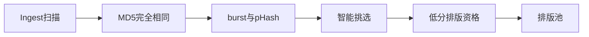
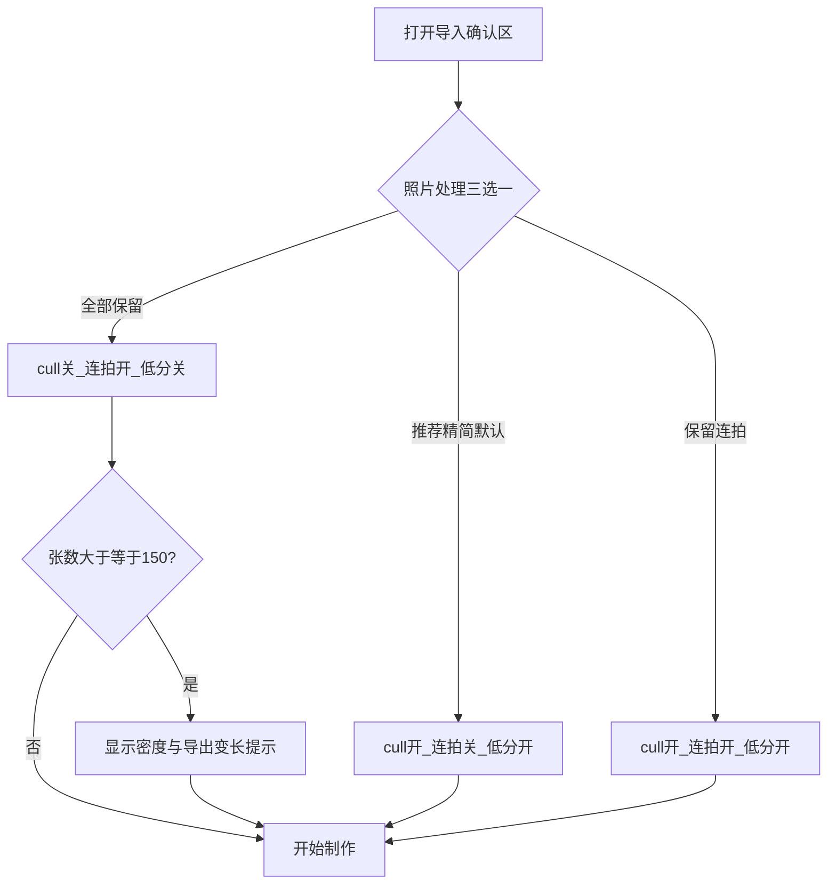

# Travelogue · 全部保留照片模式 产品需求文档（PRD）

| 属性 | 内容 |
|------|------|
| **产品代号** | Travelogue Studio |
| **功能名称** | 全部保留照片模式（Keep All Photos Mode） |
| **文档版本** | **v0.1.3** |
| **状态** | **In progress**（按草案开工 · 决策暂按建议结论） |
| **DOC-STATUS** | **active** |
| **功能代号** | **P9-F3** |
| **前置条件** | [P9-F1 智能挑选](./PRD-PHOTO-CULL-USER-TOGGLE.md) · [P9-F2 保留连拍](./PRD-KEEP-BURST-TOGGLE.md) 已上线；Import Wizard v3 确认区为默认入口 |
| **关联文档** | [PRD-PHASE9.md](./PRD-PHASE9.md) · [PRD-IMPORT-SHEET-v3-WIZARD.md](./PRD-IMPORT-SHEET-v3-WIZARD.md) · [MEDIA-PIPELINE.md](./MEDIA-PIPELINE.md) |
| **实现锚点** | [`studio-home-v2.html`](../templates/studio/studio-home-v2.html) 照片处理区 · [`import-wizard.js`](../templates/studio/homepage-v2/import-wizard.js) · [`studio_pipeline.py`](../travelogue/web/studio_pipeline.py) · [`curate.py`](../travelogue/curation/curate.py) `apply_low_resolution_exclusion` |
| **更新日期** | 2026-07-22 |

> **定位（一句话）**
>
> 让已预筛选或「一张都不能少」的用户，在导入时用**互斥第三档「全部保留」**跳过智能挑选、连拍/近似去重与低分辨率排版资格硬闸；**不做**第三个可与前两开关自由组合的平行勾选。

> **完成定义**
>
> | 门 | 含义 | 不等于 |
> |----|------|--------|
> | **M1 Go** | 确认区可选「全部保留」；payload 可审计；低分闸可跳过 | 字面「损坏文件也进册」 |
> | **M2 Go** | 摘要 / 进度 / FirstSuccess 诚实说明仍去掉的项 | 新恢复被筛图 UI |

---

## 0. 读者指南与边界

### 0.1 与 P9-F1 / P9-F2 的关系

| 主题 | 关系 | 本主题做什么 |
|------|------|--------------|
| [P9-F1](./PRD-PHOTO-CULL-USER-TOGGLE.md) | **被本档覆盖** | 「全部保留」⇒ `photoCullEnabled=false`；不再与「智能挑选勾选」自由正交 |
| [P9-F2](./PRD-KEEP-BURST-TOGGLE.md) | **被本档覆盖** | 「全部保留」⇒ `keepNearDuplicates=true`；并补上 F1/F2 **未覆盖的低分闸** |
| Phase 9 总览 | **硬化旁路** | 不改 cull 算法阈值；只增加用户意图档位 |

### 0.2 为什么不做「第三个 checkbox」

现状两开关**正交**，但低分辨率 / `layoutEligible` 硬闸是**第三条独立链路**，用户关挑选 + 勾保留连拍后仍可能丢进不了排版池的图——「我想全留」的真缺口在此。

若再平行加第三个勾选「保留所有」：

1. 与「智能挑选仍勾选」语义打架（谁赢？）  
2. 3 布尔 → 8 态，摘要与成功面必然糊  
3. 能力可用组合表达，但 **UI 必须互斥**，避免用户自组矛盾态  

**产品拍板（草案）**：能力上 = 关 cull + 开保留连拍 + 跳过低分闸；交互上 = **三选一模式**（或主开关强制覆盖前两框）。

---

## 1. 背景与问题

### 1.1 现状管线分层



| 层 | 默认行为 | 现有用户控制 |
|----|----------|--------------|
| MD5 完全相同 | 去重 | 无（永远去） |
| burst / pHash | 去重保清晰帧 | P9-F2 `keepNearDuplicates` |
| Phase 9 cull | 模糊/截图/配额 | P9-F1 `photoCullEnabled` |
| 低分 / layoutEligible | 标记不合格 | **无 Studio 入口**（本主题补齐） |
| `max_photos` | 扫描上限 | 无（性能硬约束） |

### 1.2 用户诉求

| Persona | 诉求 |
|---------|------|
| 预筛选编辑者 | 文件夹已是精选，不要再被低分/模糊闸暗砍 |
| 瞬间记录者 | 连拍 + 略糊的抓拍都要进册，自己在预览里决定 |
| 普通分享者（默认） | 仍要系统减噪 —— **默认档不变** |

### 1.3 目标

1. Import 确认区提供可发现的 **「全部保留」** 档位（与推荐精简 / 保留连拍互斥）。  
2. 默认仍为 **推荐精简**（等同今日：智能挑选开、保留连拍关、低分闸开）。  
3. 「全部保留」时跳过：Phase 9 cull、burst/pHash、低分排版资格硬丢。  
4. 意图可审计、可复现；旧 trip 缺字段行为不变。  
5. 文案诚实：永不承诺「损坏文件 / 完全相同重复文件也保留」。

### 1.4 非目标

| 非目标 | 说明 |
|--------|------|
| 第三个自由组合 checkbox | 见 §0.2 |
| 关闭 MD5 全同去重 | 同文件双份无叙事价值（继承 D-F2-04） |
| 关闭 `max_photos` | 性能硬约束（继承 D-F1-06 / D-F2-05） |
| 纳入无法解码的损坏文件 | 仅跳过「质量/近似/低分」类闸 |
| 预览页二次改档后重跑 ingest | v1 仅导入时设定；改档需重新导入 |
| 被筛照片 Gallery / 恢复 UI | 延续 D-P9-04 |
| 调整 cull / 低分算法阈值本身 | 属算法 / config PRD |

---

## 2. 待拍板决策（评审填写）

| 决策 ID | 决策项 | **结论（开工锁定）** | 备选 |
|---------|--------|----------------------|------|
| **D-F3-01** | UI 形态 | **三选一**：推荐精简 / 保留连拍 / 全部保留（radio） | 主开关「全部保留」勾选后强制覆盖并灰显前两框 |
| **D-F3-02** | 字段 | `intent.photoKeepMode`: `"recommended" \| "keep_bursts" \| "keep_all"` | 仅加 `keepAllPhotos: boolean` + 派生写两旧字段 |
| **D-F3-03** | 兼容写入 | 选档后**同时**写回 `photoCullEnabled` / `keepNearDuplicates`，旧读路径不破 | 只写新字段 |
| **D-F3-04** | 默认档 | `recommended`（= 今日默认） | — |
| **D-F3-05** | 低分闸 | `keep_all` 时 **跳过** `apply_low_resolution_exclusion` 硬丢 | 仅降阈值（不推荐，难解释） |
| **D-F3-06** | MD5 / 损坏 / max_photos | **仍执行** | — |
| **D-F3-07** | 「保留连拍」档与智能挑选 | `keep_bursts` ⇒ `keepNearDuplicates=true`，**智能挑选仍开**；完整成组引导至 `keep_all` | `keep_bursts` 同时关 cull |
| **D-F3-08** | 记忆 | 仅 session 草稿；新会话回默认 `recommended`（同 D-F1-10） | localStorage |
| **D-F3-09** | 大册提示 | ≥150 张选 `keep_all` 时一句风险提示（更密/更长/可能更碎） | 无提示 |
| **D-F3-10** | 遥测 | `import_photo_keep_mode` + 派生布尔（`derived_from_mode`） | 只打新事件 |

**建议冻结句（供评审勾选）**：

```
D-F3-01 UI：同意三选一 / 改主开关覆盖
D-F3-02 字段：同意 photoKeepMode / 改 boolean
D-F3-05 低分闸：同意 keep_all 跳过硬丢
D-F3-07 保留连拍档：同意仍开智能挑选 / 改为同时关 cull
总评：Go M1 / Conditional Go / 打回
```

---

## 3. 设计原则

| ID | 原则 | 说明 |
|----|------|------|
| **P-F3-01** | 默认保守 | 默认推荐精简，保护大多数成稿质量 |
| **P-F3-02** | 互斥清晰 | 同一时刻只表达一种「照片处理」意图 |
| **P-F3-03** | 能力覆盖缺口 | 全保留必须覆盖低分闸，否则名不副实 |
| **P-F3-04** | 文案诚实 | 空优于假；写清仍去掉的项 |
| **P-F3-05** | 意图单写 | 经 `apply_intent()`；与 F1/F2 字段兼容双写 |
| **P-F3-06** | 管线不 fork | 不复制全局 AppConfig；按 trip intent 覆盖入口行为 |
| **P-F3-07** | 向后兼容 | 无 `photoKeepMode` 时由两旧布尔推断；旧 trip 不变 |

---

## 4. 范围边界：「全部保留」精确定义

### 4.1 三档映射

| 模式 `photoKeepMode` | 智能挑选 | 保留连拍/近似 | 低分排版资格硬闸 | 用户心智 |
|----------------------|:--------:|:-------------:|:----------------:|----------|
| **`recommended`**（默认） | 开 | 关 | 开 | 帮我去掉糊的、杂的 |
| **`keep_bursts`** | 开* | 开 | 开 | 连拍/近似进资产池；系统仍可质量择优 |
| **`keep_all`** | 关 | 开 | **关** | 能进就进，少替我扔 |

\* D-F3-07 建议：`keep_bursts` 保持智能挑选开启；若用户要「一张不少成组」，应选 **`keep_all`**（UI 文案引导，替代今日「再取消智能挑选」双操作）。

### 4.2 `keep_all` 跳过 / 保留对照

| 环节 | `keep_all` |
|------|------------|
| MD5 完全相同去重 | **仍去重** |
| burst / pHash | **跳过（保留）** |
| Phase 9 photo cull | **跳过** |
| 低分资格硬丢（exclusion） | **跳过**（**仅当**显式 `photoKeepMode==keep_all`；独立 `skipLowResExclusion` 不得优先于 mode — [QFX](./PRD-QUALITY-FIXPACK-V1.md) D-QFX-07） |
| `backfill_native_dimensions`（尺寸回填） | **仍执行**（回填 ≠ 硬丢；[QFX](./PRD-QUALITY-FIXPACK-V1.md) D-QFX-08） |
| 无法解码 / 损坏文件 | **仍排除** |
| `max_photos` 扫描上限 | **仍执行** |
| 分章 / 封面 / 排版算法 | **仍执行**（全留 ≠ 更好版式） |

### 4.3 派生布尔（兼容 F1/F2）

```text
recommended  → photoCullEnabled=true  · keepNearDuplicates=false · skipLowResExclusion=false
keep_bursts  → photoCullEnabled=true  · keepNearDuplicates=true  · skipLowResExclusion=false
keep_all     → photoCullEnabled=false · keepNearDuplicates=true  · skipLowResExclusion=true
```

旧客户端若只传两布尔、不传 `photoKeepMode`：服务端按既有 F1/F2 行为，**不**自动跳过低分闸（避免静默改变旧路径）。

### 4.4 推断（读旧盘）

```text
if photoKeepMode present → 用档位
else if photoCullEnabled==false AND keepNearDuplicates==true → 展示为 keep_bursts（非 keep_all）
  （因旧路径未跳低分闸，不得谎称「全部保留」）
else if keepNearDuplicates==true → keep_bursts
else → recommended
```

---

## 5. 信息架构与交互规格

### 5.1 用户旅程



### 5.2 确认区线框（草案）

```text
照片处理
  ( ) 推荐精简（默认）
      自动去掉过于模糊和截图类照片；相近连拍择优保留。
  ( ) 保留连拍与近似照片
      连拍/画面相近的照片进入资产池；智能挑选仍可能在成册时择优。
  ( ) 全部保留
      跳过智能挑选、连拍去重与低清过滤；仍去掉损坏文件与完全相同的重复文件。
      [≥150 张时] 照片很多时成册更密、导出更长，观感可能变碎。
```

**迁移策略（M1）**：若三选一改动面过大，允许 **主开关覆盖** 过渡态——保留现有两 checkbox，其下增加「全部保留」；勾选后强制：`photoCull=false`、`keepDupes=true`、跳过低分，并 **禁用** 前两框 + 说明「已由全部保留接管」。评审优先三选一（D-F3-01）。

### 5.3 摘要行（确认区折叠态）

| 模式 | 摘要 |
|------|------|
| recommended | 照片处理：智能挑选已开启 · 连拍自动择优 |
| keep_bursts | 照片处理：智能挑选已开启 · 已保留连拍与近似照片 |
| keep_all | 照片处理：**全部保留**（已跳过挑选 / 连拍去重 / 低清过滤） |

`keep_all` 摘要用 warn 色可选（与「已关闭智能挑选」同级可发现性）。

### 5.4 FirstSuccess / 进度文案

| 模式 | 成功面补充句（草案） |
|------|----------------------|
| keep_all | 已尽量保留全部可用照片（仍去掉损坏与完全相同的重复文件） |
| keep_bursts | 沿用 P9-F2：`已保留连拍与近似照片（仍去除了完全相同的重复文件）` |
| recommended | 沿用现有 cull 摘要行 |

进度子 hint：`keep_all` 时不出现「正在挑选照片…」「正在去掉重复连拍…」。

### 5.5 帮助 / 设置

不新增设置页入口；帮助抽屉若已有「智能挑选」条目，增一句：「需要一张不少时，在导入照片处理里选『全部保留』。」

---

## 6. 数据与 API

### 6.1 Intent 字段

| 字段 | 类型 | 默认 | 说明 |
|------|------|------|------|
| `intent.photoKeepMode` | string enum | 缺省 → 按 §4.4 推断 | `recommended` \| `keep_bursts` \| `keep_all` |
| `intent.photoCullEnabled` | bool | true | **继续双写**（兼容） |
| `intent.keepNearDuplicates` | bool | false | **继续双写**（兼容） |
| `intent.skipLowResExclusion` | bool | false | 可选显式字段；或仅由 `keep_all` 派生、不落盘 |

**建议（D-F3-02）**：落盘 `photoKeepMode` + 双写两旧布尔；`skipLowResExclusion` 可由模式派生，不必第三布尔（减少组合）。

### 6.2 Import payload

| 字段 | 说明 |
|------|------|
| `photoKeepMode` | 优先 |
| `photoCullEnabled` / `keepNearDuplicates` | 无 mode 时回退（旧客户端） |

服务端：若收到 `photoKeepMode=keep_all`，忽略与之矛盾的 cull/dupes 组合，按 §4.3 强制派生。

### 6.3 管线钩子

| 步骤 | 行为 |
|------|------|
| ingest 配置覆盖 | 同 F2：`keep_all` / `keep_bursts` ⇒ `dedupe_burst=false`、`dedupe_phash=false` |
| `apply_photo_cull` | `keep_all` ⇒ 跳过（同 `photoCullEnabled=false`） |
| `apply_low_resolution_exclusion` | `keep_all` ⇒ **跳过**（本主题新增） |
| 损坏文件 / MD5 / max_photos | 不变 |

---

## 7. 遥测

复用 `studio-event`，建议：

| 事件 / 字段 | 用途 |
|-------------|------|
| `import_photo_keep_mode` | `{ mode, photo_count_estimate? }` 确认区变更与 import_start |
| `import_start.photoKeepMode` | 主路径抽样 |
| 既有 `import_photo_cull_pref` / `import_keep_dupes_pref` | 可继续打派生值，或加 `derived_from_mode=true` |

成功后可抽样：`layoutEligibleCount / photoCount` 在 `keep_all` 下接近 1.0（扣除损坏与 MD5）。

---

## 8. 里程碑

| 里程碑 | 范围 | 出口 |
|--------|------|------|
| **M1** | 三选一（或主开关覆盖）+ intent/payload + 跳过低分闸 + 摘要/成功面文案 | AC-F3-01～06 |
| **M2** | 大册提示 · 帮助一句 · 遥测 · 旧盘推断单测 | AC-F3-07～09 |
| **Park** | 预览内改档重跑、被筛图恢复 | 非本包 |

---

## 9. 验收标准（AC-F3-*）

| ID | 标准 | 验证 |
|----|------|------|
| **AC-F3-01** | 默认进入确认区为「推荐精简」；行为与今日默认一致 | Playwright |
| **AC-F3-02** | 选「全部保留」后 payload：`photoKeepMode=keep_all`（或等价派生：`cull=false`、`keepDupes=true`） | 网络 / 单测 |
| **AC-F3-03** | `keep_all` 行程：低分资产仍可进排版池（对照同相册 `recommended` 被硬丢的样本） | fixture 单测 |
| **AC-F3-04** | `keep_all` 仍去除 MD5 全同与损坏文件 | 单测 |
| **AC-F3-05** | 不可同时呈现「智能挑选开」与「全部保留」为生效态 | UI |
| **AC-F3-06** | FirstSuccess / 摘要不含「正在挑选」类假承诺；含诚实保留句 | Playwright |
| **AC-F3-07** | ≥150 张选 `keep_all` 出现风险提示（若 D-F3-09 采纳） | UI |
| **AC-F3-08** | 旧 trip 无 `photoKeepMode`：行为与改前一致（低分闸仍执行） | 回归 |
| **AC-F3-09** | `keep_bursts` 不跳过低分闸（与 `keep_all` 可区分） | 单测 |

---

## 10. 风险与开放问题

| # | 项 | 状态 |
|---|-----|------|
| 1 | 三选一 vs 主开关覆盖的改动成本 | **开放**：评审锁 D-F3-01；工程可先主开关过渡 |
| 2 | `keep_bursts` 是否同时关智能挑选 | **建议否**（D-F3-07）；完整成组引导至 `keep_all` |
| 3 | 全保留后大册版式变碎 / 导出变慢 | **接受**；用 D-F3-09 提示缓解 |
| 4 | 「跳过低分」是否仍写 `layoutEligible=false` 仅不硬丢 | **草案**：跳过硬丢即可；细节 IMPLEMENTATION 定 |
| 5 | 与小程序 `user_curated` 选图模式关系 | **旁路**：本主题仅桌面 Import Wizard；小程序另见 [PRD-MINIAPP-PHOTO-PICK](./PRD-MINIAPP-PHOTO-PICK-V1.md) |

---

## 11. 变更记录

| 版本 | 日期 | 变更 |
|------|------|------|
| v0.1 | 2026-07-22 | 初稿 · 基于「勿第三平行勾选」产品建议 · P9-F3 · 三选一 + 跳过低分闸 · AC-F3-01～09 |
| v0.1.1 | 2026-07-22 | 按建议结论开工：D-F3-01～10 锁定为实施基线；分支 `feat/p9-f3-keep-all-photos` |
