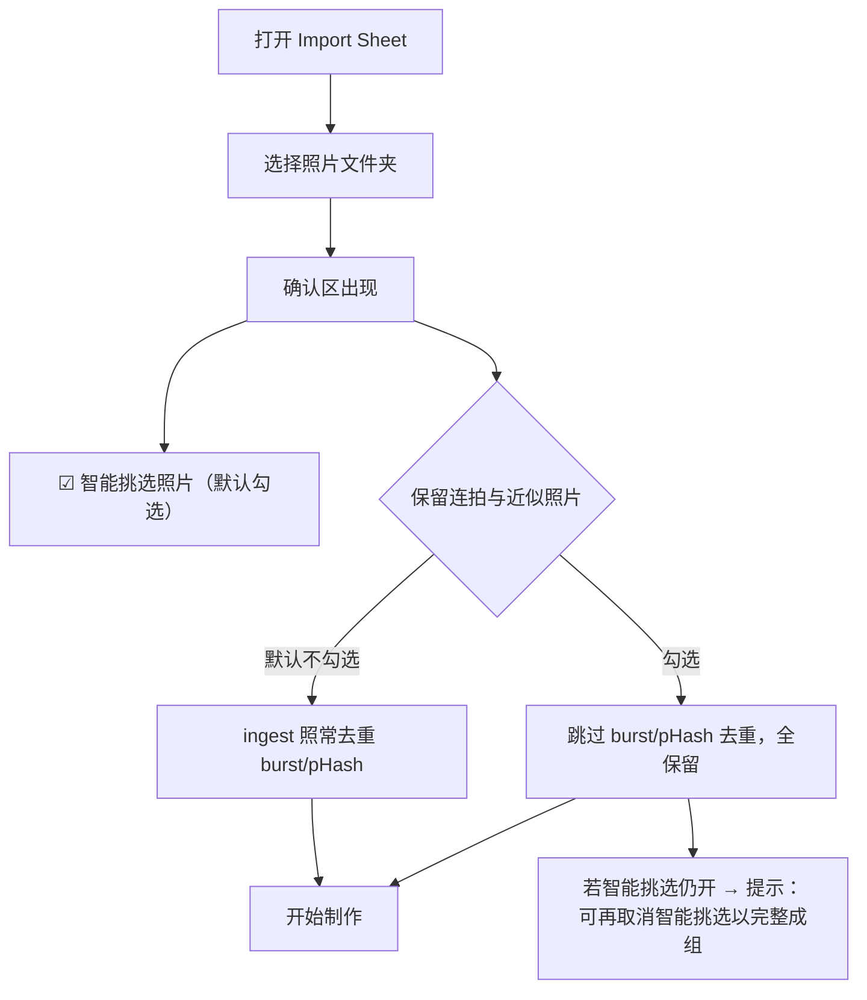

# Travelogue · 保留连拍与近似照片用户开关 产品需求文档（PRD）

| 属性 | 内容 |
|------|------|
| **产品代号** | Travelogue |
| **功能名称** | 保留连拍与近似照片开关（Keep Near-Duplicates Toggle） |
| **文档版本** | v0.1（Draft） |
| **状态** | **Draft**（待评审） |
| **功能代号** | P9-F2 |
| **方案** | A（独立开关，仅关 burst + pHash 去重；MD5 完全相同仍去重） |
| **前置条件** | [PRD-PHOTO-CULL-USER-TOGGLE.md](./PRD-PHOTO-CULL-USER-TOGGLE.md)（P9-F1）已上线；Studio 首页 v2 Import Sheet 为默认入口 |
| **关联文档** | [PRD-PHASE9.md](./PRD-PHASE9.md)、[PRD-PHOTO-CULL-USER-TOGGLE.md](./PRD-PHOTO-CULL-USER-TOGGLE.md)、[PRD-KEEP-ALL-PHOTOS-V1.md](./PRD-KEEP-ALL-PHOTOS-V1.md)（P9-F3 · 全部保留）、[PRD-PHASE4.md](./PRD-PHASE4.md)、[MEDIA-PIPELINE.md](./MEDIA-PIPELINE.md)、[PRD-PORTRAIT-CULL.md](./PRD-PORTRAIT-CULL.md)、[algorithm-inventory.md](./algorithm-inventory.md) |
| **实现锚点** | [studio-home-v2.html](../templates/studio/studio-home-v2.html) Import Sheet；[ingest.py](../travelogue/media/ingest.py) dedupe 段 |
| **更新日期** | 2026-07-02 |

> **定位（一句话）**
>
> 让用户在导入前显式选择：「精彩瞬间的连拍/近似照片，我想完整保留」。
> 勾选后 **跳过 ingest 的连拍（burst）与感知哈希（pHash）去重**，
> **保留** MD5 完全相同文件的去重（避免同一文件复制两份）。

---

## 1. 背景与问题

### 1.1 现状

Travelogue 在 **导入（ingest）阶段** 默认执行三层去重（`travelogue/media/ingest.py`）：

| 层 | 机制 | 判据 | 用户可控？ |
|----|------|------|-----------|
| L1 | **MD5 完全相同** | `contentSig`（size:md5）命中 | 仅 CLI `--no-dedupe` / demo 相册 |
| L2 | **连拍（burst）** | 3 秒内 + 同分辨率（`burst_seconds=3.0`）；保留更清晰帧 | ❌ **无 Studio 入口** |
| L3 | **感知哈希（pHash）** | dHash 汉明距离 ≤ `phash_threshold`（默认 8）；保留更清晰帧 | ❌ **无 Studio 入口** |

- **P9-F1**（智能挑选开关）只控制 **Phase 9 photo cull**（模糊/截图/质量配额），
  其决策 **D-F1-05** 明确：关闭智能挑选后 **burst / pHash / MD5 去重仍执行**。
- 因此，用户 **无论如何都无法** 在 Studio 里保留「时间/画面很接近但有情感价值」的连拍帧。

### 1.2 真实案例（demo-2025-8）

| 阶段 | 数量 |
|------|------|
| 原始相册 `D:\Photos\2025东澳岛8` | **129** |
| 导入后 `trip.assets` | **121**（burst/pHash 去掉 8 张） |

被去掉的 8 张中，7 张是同一组微信连拍（`…5268–5277`），1 张是尼康近似帧。
用户**已关闭智能挑选**，仍丢失了这组连拍 —— 这正是本 PRD 要解决的缺口。

### 1.3 用户诉求（原话归纳）

> 「连拍确实很接近，但人类有时候乐意看到精彩时刻的连拍，哪怕很接近 —— 那一刻情感的连接与表达。」

| Persona | 占比（估） | 诉求 |
|---------|------------|------|
| 普通分享者 | ~90% | 相册杂乱，连拍去重是减噪 —— **应默认开启去重** |
| 瞬间记录者 | ~10% | 抓拍/连拍讲的就是「一连串瞬间」，希望**成组完整保留** |

### 1.4 目标

1. 在 Import Sheet 提供 **可发现、样式与智能挑选开关一致** 的开关。
2. **默认不勾选**（维持现状：burst/pHash 去重照常），保障 90% 主路径与全部旧 trip 行为不变。
3. 勾选后 **仅跳过 burst + pHash**，**保留** MD5 去重与 `max_photos` 上限。
4. 选择写入 `trip.intent.keepNearDuplicates`，可审计、可复现、旧 trip 兼容。
5. 成功态与进度文案 **诚实**：勾选后不再声称「去掉重复连拍」。

### 1.5 非目标

| 非目标 | 说明 |
|--------|------|
| 关闭 MD5 完全相同去重 | 同一文件复制两份无叙事价值，永远去重 |
| 关闭 `max_photos` 扫描上限 | 性能硬约束，保留 |
| 预览页/书架二次修改该开关 | v1 仅导入时设定；改 intent 走既有 PATCH（二期） |
| 拆成「连拍」「近似」两个独立开关 | v1 合并为一个；有数据再拆（见 §11 方案 C） |
| 恢复已被去重的历史 trip 照片 | 需重新导入；不做 retroactive 回补 |
| 修改 burst/pHash 阈值（`burst_seconds`、`phash_threshold`） | 属 config/算法范畴 |

---

## 2. 待拍板决策（评审填写）

| 决策 ID | 决策项 | 建议结论 | 备选 |
|---------|--------|----------|------|
| **D-F2-01** | 字段名 | `intent.keepNearDuplicates`（boolean） | `keepBurstPhotos` / `ingestDedupeMode` |
| **D-F2-02** | 默认值 | `false`（维持现状去重） | — |
| **D-F2-03** | 关闭去重范围 | **仅** burst（L2）+ pHash（L3） | 含 MD5（不推荐） |
| **D-F2-04** | MD5 去重 | **仍执行** | — |
| **D-F2-05** | `max_photos` 上限 | **仍执行** | — |
| **D-F2-06** | UI 控件 | Checkbox，默认 **不勾选** | Toggle |
| **D-F2-07** | 放置位置 | Import Sheet 确认区，智能挑选开关**下方**，两模式共用 | 折叠进高级区 |
| **D-F2-08** | 记忆策略 | 仅 `sessionStorage` 草稿；新会话默认不勾选（同 D-F1-10） | localStorage |
| **D-F2-09** | 与智能挑选的关系 | **正交**：本开关只管 ingest 去重；智能挑选管 Phase 9 cull | — |
| **D-F2-10** | 智能挑选文案 | **移除**「重复连拍」字样，避免与本开关双重声明（见 §5.5） | 保留 |
| **D-F2-11** | 增量 ingest | 以 trip 既有 `keepNearDuplicates` 为准；仅显式携带时更新 | — |

---

## 3. 设计原则

| ID | 原则 | 说明 |
|----|------|------|
| **P-F2-01** | 默认保守 | 默认去重，保护 90% 主路径与旧 trip；保留是显式 opt-in |
| **P-F2-02** | 管线不 fork | 不复制/分叉 AppConfig 全局态；在 ingest 入口按 intent 覆盖 `IngestConfig` 子字段 |
| **P-F2-03** | 意图单写 | 经 `apply_intent()` 写入，与 `photoCullEnabled`、`layoutDensity` 同级 |
| **P-F2-04** | 正交清晰 | 与智能挑选（P9-F1）互不覆盖；两者可任意组合 |
| **P-F2-05** | 文案诚实 | 勾选后进度/成功态不出现「去掉重复连拍」；数字口径与实际一致 |
| **P-F2-06** | 向后兼容 | 缺省字段视为 `false`（去重开），旧 trip 行为完全不变 |
| **P-F2-07** | 会话内记忆、会话外重置 | 避免误勾一次后长期改变主路径 |

---

## 4. 范围边界：「保留连拍与近似照片」的精确定义

### 4.1 管线环节对照表

| 环节 | 模块 | `keepNearDuplicates=false`（默认） | `keepNearDuplicates=true` |
|------|------|-----------------------------------|---------------------------|
| MD5 完全相同去重（L1） | `ingest.py` `known_md5` | 去重 | **仍去重** |
| 连拍去重（L2） | `ingest._is_burst_duplicate` | 去重（保留更清晰帧） | **跳过（全保留）** |
| 感知哈希去重（L3） | `ingest._find_phash_asset_index` | 去重（保留更清晰帧） | **跳过（全保留）** |
| `max_photos` 扫描上限 | `scan_image_paths` | 执行 | **仍执行** |
| 低清 `layoutEligible` 标记 | `asset_quality.apply_layout_eligibility_marks` | 执行 | **仍执行**（正交） |
| Phase 9 photo cull | `photo_cull.py` | 由 `photoCullEnabled` 决定 | 由 `photoCullEnabled` 决定（正交） |

### 4.2 有效去重判定公式

```text
effective_burst_dedupe =
  request.dedupe == true                       # demo/上传路径既有开关，仍最高优先
  AND config.ingest.dedupe_burst == true       # 管理员全局开关
  AND trip.intent.keepNearDuplicates != true   # 缺省 false → 去重

effective_phash_dedupe =
  request.dedupe == true
  AND config.ingest.dedupe_phash == true
  AND trip.intent.keepNearDuplicates != true

MD5 去重 = request.dedupe（不受本开关影响）
```

- 管理员 config 关掉 `dedupe_burst/phash` 时，无论用户开关，均不做该层（全局优先）。
- demo 相册 / 小文件上传路径 `dedupe=false` 时，本开关不改变结果（已全保留）。

### 4.3 与智能挑选（P9-F1）的组合矩阵

| 智能挑选 `photoCullEnabled` | 保留连拍 `keepNearDuplicates` | 行为 | demo-2025-8 预期 |
|:---:|:---:|------|------|
| true（默认） | false（默认） | 现状：ingest 去重 8 张 + cull 质量挑选 | 121 → 排版更少 |
| **false** | **false** | 关 cull；ingest 仍去重 8 张 | **121 ingest**（当前案例） |
| true | **true** | ingest 全保留；但 cull Pass2/配额可能仍下选连拍 | 129 ingest，排版张数由 cull 定 |
| **false** | **true** | **完全保留**：ingest 129 张、无质量挑选 | **129 ingest**（低清门仍可能标记 layoutEligible=false） |

> **重要交互（§5.5 文案随之调整）**：`keepNearDuplicates=true` 只保证「连拍/近似帧**进入资产池**」。
> 若智能挑选仍开启，Phase 9 cull 的 **组内择优 / 质量配额** 可能在排版阶段再抑制部分近重复帧。
> 想「一张不少地成组展示」的用户，应**同时**取消智能挑选。UI 需给出这一提示（§5.4）。

---

## 5. 信息架构与交互规格

### 5.1 用户旅程



### 5.2 Import Sheet 线框（确认区扩展）

```text
制作我的游记（Sheet）
├─ [选择本次旅行的照片文件夹]
└─ 确认区（选文件夹后出现）
   ├─ 已选：D:\Photos\2025东澳岛8（129 张）
   ├─ 模式 Tab：快速分享 | 精细制作
   ├─ ☑ 智能挑选照片（推荐）                 ← 既有（P9-F1）
   │     自动去掉模糊和截图类照片。          ← 文案改：移除「重复连拍」
   ├─ ☐ 保留连拍与近似照片                    ← 新增（P9-F2），默认不勾选
   │     [?] 展开说明（默认收起）
   ├─ （勾选时 · aria-live 区域）
   │     将保留时间相近或画面相似的照片，适合完整记录精彩瞬间。
   │     （若同时开启智能挑选，仍可能在排版时择优，取消智能挑选可完整成组。）
   ├─ [快速分享面板] / [精细制作表单]
   └─ [开始制作]
```

### 5.3 控件规格（样式复用智能挑选开关）

| 项 | 规格 |
|----|------|
| 容器 | `<div class="v2-sheet__photo-cull" id="v2-keep-dupes-field">`（**复用** `.v2-sheet__photo-cull*` 全部样式） |
| Checkbox | `#v2-keep-dupes-enabled`（`type="checkbox"`） |
| 短说明 | `#v2-keep-dupes-hint-short`（`.v2-sheet__photo-cull-summary`） |
| 展开说明 | `<details>` + `#v2-keep-dupes-hint-detail`（`.v2-sheet__hint`） |
| 勾选副文案 | `#v2-keep-dupes-note`（`.v2-sheet__photo-cull-optout` · `aria-live="polite"`） |
| 默认状态 | **unchecked**（`keepNearDuplicates: false`） |
| 新会话 | 无 session 草稿时 **始终 unchecked**（D-F2-08） |
| 显示时机 | `#v2-sheet-confirm` 可见后常显；两模式 Tab **共用** |
| 模式切换 | 不重置 checkbox |
| 映射 | `keepNearDuplicates = checkbox.checked`（**直接 1:1**，无反向） |
| 触控目标 | checkbox + label 可点区域高度 ≥ 44px（复用 `.v2-sheet__photo-cull-label { min-height:44px }`） |
| 可访问性 | `aria-describedby` → 短说明 + 副文案；勾选时 `aria-live` 播报；classic/dawn/mist/folio/atelier 主题变量已覆盖 |
| focus 顺序 | 模式 Tab → 智能挑选开关 → **本开关** → 主按钮 |

**建议 HTML（插入到 `#v2-photo-cull-field` 之后、`#v2-sheet-panel-quick` 之前）**：

```html
<div class="v2-sheet__photo-cull" id="v2-keep-dupes-field">
  <label class="v2-sheet__photo-cull-label">
    <input type="checkbox" id="v2-keep-dupes-enabled"
           aria-describedby="v2-keep-dupes-hint-short v2-keep-dupes-note" />
    <span>保留连拍与近似照片</span>
  </label>
  <p class="v2-sheet__photo-cull-summary" id="v2-keep-dupes-hint-short">
    默认会合并时间相近或画面相似的照片；勾选后全部保留。
  </p>
  <details class="v2-sheet__photo-cull-details">
    <summary class="v2-sheet__photo-cull-more">说明</summary>
    <p class="v2-sheet__hint" id="v2-keep-dupes-hint-detail">
      连拍与抓拍常记录同一瞬间的连续画面。默认系统会择优保留一张；
      若你希望完整保留这组精彩瞬间，勾选此项。完全相同的重复文件仍会自动去重。
    </p>
  </details>
  <p class="v2-sheet__photo-cull-optout" id="v2-keep-dupes-note" hidden
     aria-live="polite"></p>
</div>
```

> 无需新增 CSS —— 复用 `.v2-sheet__photo-cull`、`.v2-sheet__photo-cull-label`、
> `.v2-sheet__photo-cull-summary`、`.v2-sheet__photo-cull-details`、
> `.v2-sheet__photo-cull-more`、`.v2-sheet__photo-cull-optout`（studio-home-v2.css:2453–2499）。

### 5.4 文案规范

| 场景 | 文案 |
|------|------|
| 标签 | 保留连拍与近似照片 |
| 短说明（收起态） | 默认会合并时间相近或画面相似的照片；勾选后全部保留。 |
| 说明（展开） | 连拍与抓拍常记录同一瞬间的连续画面。默认系统会择优保留一张；若你希望完整保留这组精彩瞬间，勾选此项。完全相同的重复文件仍会自动去重。 |
| 副文案（勾选，智能挑选**关**） | 将保留时间相近或画面相似的照片，适合完整记录精彩瞬间。 |
| 副文案（勾选，智能挑选**开**） | 将保留相近照片进入排版池；智能挑选仍可能在成册时择优。取消「智能挑选照片」可完整成组。 |
| MD5 提示 | 完全相同的重复文件仍会自动去重。 |

**禁止**：勾选后仍在任何位置声称「已去掉重复连拍」。

### 5.5 智能挑选文案联动修订（D-F2-10）

现状 `studio-home-v2.html:335–342` 智能挑选说明含「重复连拍」，与本开关语义冲突（连拍去重实际发生在 ingest，与 `photoCullEnabled` 无关）。**修订为**：

| 元素 | 原文案 | 新文案 |
|------|--------|--------|
| `#v2-photo-cull-hint-short` | 自动去掉模糊、重复连拍和截图类照片。 | 自动去掉过于模糊和截图类照片。 |
| `#v2-photo-cull-hint-detail` | 自动去掉过于模糊、重复连拍和截图类照片。若文件夹里已是你的精选集，可取消勾选。 | 自动去掉过于模糊和截图类照片。若文件夹里已是你的精选集，可取消勾选。 |

`import-sheet.js:226` 的 optout 文案（"相同文件仍会自动去重，与智能挑选无关。"）保留 —— 该句描述的正是 MD5，本 PRD 不改。

### 5.6 Importing 进度文案

| 条件 | 说明 |
|------|------|
| `keepNearDuplicates=false` | 沿用现状（含 P9-F1 的挑选 hint 逻辑） |
| `keepNearDuplicates=true` | 进度 hint **不出现**「合并连拍/去重」表述；沿用 `已处理 X/Y 张` |

### 5.7 FirstSuccess 完成态

沿用 P9-F1 的 N/M 口径，新增去重维度说明：

- **N** = `photoCount`（扫描/导入候选）
- **A** = 实际写入 `trip.assets` 的数量（去重后）
- **M** = `layoutEligibleCount`（进入排版）

| `keepNearDuplicates` | 次要说明 |
|:---:|------|
| false（默认） | 沿用现状（`cullUserLine` 或 N/M） |
| true 且 A=N | 追加：`已保留全部相近照片` |
| true 且 A<N | 追加：`已保留连拍与近似照片（仍去除了完全相同的重复文件）` |

> `keepNearDuplicates=true` 时，若 A<N 只可能来自 **MD5 完全相同** 或 `max_photos` 截断，
> 文案须如实说明，不得暗示「全部保留」。

---

## 6. 数据模型与 API 契约

### 6.1 `trip.intent` 扩展

```json
{
  "intent": {
    "version": "1",
    "photoCullEnabled": false,
    "keepNearDuplicates": true
  }
}
```

| 属性 | 类型 | 必填 | 默认 | 说明 |
|------|------|------|------|------|
| `keepNearDuplicates` | boolean | 否 | `false` | `true` = 跳过 ingest burst+pHash 去重，全保留（MD5 仍去重） |

**schema 改动**（`schemas/trip.schema.json` `$defs.intent.properties`，紧邻 `photoCullEnabled`）：

```json
"keepNearDuplicates": {
  "type": "boolean",
  "description": "When true, skip ingest burst/pHash dedupe for this trip (PRD-P9-F2); MD5 exact dedupe still runs; default false when omitted"
}
```

### 6.2 Import 请求（Studio API）

| 字段 | 类型 | 默认 | 说明 |
|------|------|------|------|
| `keepNearDuplicates` | boolean | `false` | 未传 / 空 / 非法 → `false` |

multipart 取值：`true`/`false`/`1`/`0`/`on`/`off`。解析函数镜像 `_parse_photo_cull_enabled`，但 **默认 false**（`_parse_keep_near_duplicates`）。

### 6.3 worker_payload 透传链

```
import-run.js (FormData)
  → import_handlers._parse_...            # multipart / json 两入口
  → worker_payload["keepNearDuplicates"]
  → studio_subprocess.run_studio_pipeline(keep_near_duplicates=...)
  → run_studio_pipeline → ingest 配置覆盖
```

### 6.4 `apply_intent` 扩展

```python
apply_intent(trip, keep_near_duplicates=True | False | None)
```

- `True` / `False` → 写入 `intent.keepNearDuplicates`
- `None` → 清除该字段
- 未传（`_UNSET`）→ 不修改已有值（增量 ingest 依赖此语义，D-F2-11）

### 6.5 Job result / stats

| 字段 | 说明 |
|------|------|
| `keepNearDuplicates` | **必回传**；FirstSuccess 分支依据 |
| `photoCount` | 扫描 N（既有） |
| `assetsWritten` | 去重后写入 A（新增；来自 `IngestResult.stats.total_assets`） |
| `dedupedBurst` / `dedupedPhash` | 本批 burst/pHash 去掉数（既有 ingest_stats，透传供文案/telemetry） |

### 6.6 Telemetry

`build_studio_intent_telemetry` 增加字段：

```json
{
  "keepNearDuplicates": true,
  "assetsWritten": 129,
  "photoCount": 129,
  "dedupedBurst": 0,
  "dedupedPhash": 0
}
```

Analytics 事件 `import_keep_dupes_pref`（勾选时发）：`{ enabled, mode, photo_count, pref_source }`。
上线 2 周观测 `enabled=true` 占比；若 >20% 复核默认值与位置。

---

## 7. 技术方案

### 7.1 管线顺序（不变，仅在 ingest 入口按 intent 覆盖 IngestConfig）

```text
scan (max_photos)
  → dedupe: MD5(L1) → burst(L2) → pHash(L3)   ← L2/L3 受 keepNearDuplicates 控制
  → build assets
  → apply_photo_cull            ← 受 photoCullEnabled 控制（正交）
  → apply_layout_eligibility_marks
  → persist → clustering → curate
```

### 7.2 核心改动点

**(a) 配置覆盖（`studio_pipeline.run_studio_pipeline`）** —— 用 `dataclasses.replace` 生成本次 ingest 的 `IngestConfig`，不改全局：

```python
from dataclasses import replace

def run_studio_pipeline(..., keep_near_duplicates: bool = False):
    ...
    if keep_near_duplicates:
        cfg = replace(
            cfg,
            ingest=replace(cfg.ingest, dedupe_burst=False, dedupe_phash=False),
        )
    # 现有：with app_config_scope(cfg): ... ingest_into_trip(..., app_cfg=cfg, dedupe=dedupe)
```

> `ingest_into_trip(dedupe=...)` 仍传原值（demo 路径可为 False）。
> MD5 去重由 `dedupe` 控制、burst/pHash 由 `cfg.ingest.dedupe_burst/phash` 控制，
> 两者已在 `_process_one_ingest_photo` 分开判断（`use_burst = dedupe and cfg.dedupe_burst`），
> 因此覆盖 cfg 即可精确关掉 L2/L3、保留 L1。**核心逻辑零改动**。

**(b) intent 写入** —— 在 pipeline 内既有 `apply_intent(...)` 调用处追加 `keep_near_duplicates=keep_near_duplicates`。

**(c) 增量 ingest / re-curate** —— ingest 若需读 trip 既有意图，新增 helper：

```python
def keep_near_duplicates_for_trip(trip: dict) -> bool:
    return bool((trip.get("intent") or {}).get("keepNearDuplicates", False))
```

### 7.3 改造文件清单

| 层级 | 文件 | 改动 |
|------|------|------|
| Schema | `schemas/trip.schema.json` | `intent.keepNearDuplicates` |
| Intent | `travelogue/services/trip.py` | `apply_intent(keep_near_duplicates=...)` |
| Config 覆盖 | `travelogue/web/studio_pipeline.py` | 新增参数 + `replace(cfg.ingest, ...)` + `apply_intent` 透传 |
| Subprocess | `travelogue/web/studio_subprocess.py` | payload → `keep_near_duplicates` |
| API | `travelogue/web/studio_handlers/import_handlers.py` | `_parse_keep_near_duplicates` + 两入口 payload |
| Ingest helper（增量） | `travelogue/media/ingest.py` | `keep_near_duplicates_for_trip`（增量/re-ingest 用） |
| Telemetry | `travelogue/web/studio_intent_telemetry.py` | 新字段 |
| Result | `travelogue/web/studio_pipeline.py`（`StudioPipelineResult`） | `keep_near_duplicates` / `assets_written` |
| HTML | `templates/studio/studio-home-v2.html` | 新 checkbox 区 + 智能挑选文案修订 |
| JS | `import-sheet.js` · `import-run.js` · `first-success.js` | 读写草稿、FormData、成功态文案 |
| Analytics | `templates/studio/js/analytics.js` | `import_keep_dupes_pref` |

> CSS **无需新增**（复用 `.v2-sheet__photo-cull*`）。

### 7.4 前端 JS 规格（镜像 photoCull 既有函数）

| 既有（photoCull） | 新增（keepDupes） |
|------|------|
| `readPhotoCullEnabled()` | `readKeepDupesEnabled()` |
| `setPhotoCullEnabled(v)` | `setKeepDupesEnabled(v)`（默认 false） |
| `updatePhotoCullOptoutUi()` | `updateKeepDupesNoteUi()`（按智能挑选状态切副文案） |
| draft `photoCullEnabled` / `photoCullTouched` | draft `keepNearDuplicates` / `keepDupesTouched` |
| `saveSheetDraft()` / `restoreModeAndDraft()` | 追加读写 |
| `import-run.js` `form.append("photoCullEnabled", ...)` | `form.append("keepNearDuplicates", checked ? "true" : "false")` |

- `updateKeepDupesNoteUi()` 需读取 `readPhotoCullEnabled()` 决定副文案分支（§5.4）。
- 智能挑选 checkbox 的 `change` 事件需同时触发 `updateKeepDupesNoteUi()`（联动副文案）。

---

## 8. 风险与对策

| 风险 | 对策 |
|------|------|
| 用户勾选后照片暴增、成册变慢 | `max_photos` 仍生效；N 大时可复用「照片较多」弱提示 |
| 期望「全保留成组」但智能挑选仍择优 | §5.4 分支副文案明确提示；FirstSuccess 如实说明 |
| 与「智能挑选」语义混淆 | 两开关文案正交；移除智能挑选中的「连拍」字样（D-F2-10） |
| 误以为连 MD5 也保留 | 短说明 + 副文案均声明「完全相同文件仍去重」 |
| 旧 trip 行为漂移 | 缺省 `false`；schema `additionalProperties:false` 已容纳新字段 |
| 增量 ingest 意图错乱 | `apply_intent` `_UNSET` 语义 + `keep_near_duplicates_for_trip` 读 trip 现值 |

---

## 9. 验收标准（AC）

| ID | 场景 | 期望 |
|----|------|------|
| **AC-F2-01** | 默认不勾选 → 开始制作 | `intent.keepNearDuplicates` 缺省/false；burst+pHash 照常去重 |
| **AC-F2-02** | 勾选 → 开始制作 | `intent.keepNearDuplicates=true`；burst+pHash **不去重**；MD5 仍去重 |
| **AC-F2-03** | demo-2025-8 · 勾选 + 关智能挑选 | ingest 写入 **129** 张（低清门仍可标 `layoutEligible=false`） |
| **AC-F2-04** | demo-2025-8 · 不勾选 | 沿用现状 **121** 张 |
| **AC-F2-05** | 构造两份 MD5 完全相同文件 + 勾选 | 仍去重为 1 张（L1 不受影响） |
| **AC-F2-06** | 旧 trip 无字段 | 等同 `false`，行为不变 |
| **AC-F2-07** | `config.ingest.dedupe_burst=false`（全局） | 无论开关，burst 均不去重（全局优先） |
| **AC-F2-08** | 新会话打开 Sheet | 本开关 **默认不勾选** |
| **AC-F2-08b** | 同会话关 Sheet 再开 | session 草稿恢复上次勾选态 |
| **AC-F2-09** | 390px 视口 | checkbox 区不横向溢出（复用既有样式） |
| **AC-F2-10** | 快速/精细切换 | checkbox 保持；提交正确 |
| **AC-F2-11** | 勾选 + 智能挑选开 | 副文案显示「智能挑选仍可能择优…」分支 |
| **AC-F2-12** | 勾选 + 智能挑选关 | 副文案显示「适合完整记录精彩瞬间」分支 |
| **AC-F2-13** | multipart 缺字段 | 解析为 `false` |
| **AC-F2-14** | Job result | 含 `keepNearDuplicates`、`assetsWritten` |
| **AC-F2-15** | `studio-intent.json` | 含 `keepNearDuplicates` |
| **AC-F2-16** | schema | `validate_trip` 通过 |
| **AC-F2-17** | 智能挑选说明文案 | 不再包含「连拍」字样（D-F2-10） |
| **AC-F2-18** | a11y | 勾选后 `aria-live` 副文案可被读屏感知 |
| **AC-F2-19** | dev harness import | 字段不丢、默认 false |

### 9.1 测试落点

| 类型 | 文件 |
|------|------|
| 单测（ingest 去重开关） | `tests/test_ingest_enrichment.py`（已有 `dedupe_burst/phash` 参数化，扩展 intent 覆盖路径） |
| Intent | `tests/test_studio_intent.py` |
| API | `tests/test_studio_handlers_import_export.py` |
| 配置覆盖 | 新增 `tests/test_studio_keep_near_duplicates.py`（`replace(cfg.ingest,...)` 生效） |
| E2E | `tests/test_studio_home_v2_ac_playwright.py`（开关渲染/草稿/副文案分支） |
| 冒烟 | `tests/test_studio_home_v2.py` |

---

## 10. 分期交付

### 10.1 Phase 1 · MVP（预估 1.5–2 人日）

1. Schema + `apply_intent` + `keep_near_duplicates_for_trip`（0.25d）
2. `run_studio_pipeline` 配置覆盖 + result 字段（0.25d）
3. API 解析 + subprocess 透传（0.25d）
4. 前端 checkbox + 草稿 + FormData + 副文案分支 + 智能挑选文案修订（0.5d）
5. FirstSuccess / telemetry / analytics（0.25d）
6. 单测 + E2E + demo-2025-8 验收（0.5d）

### 10.2 Phase 2 · 可选

- 预览页 intent PATCH（导入后再改，触发提示重导入）
- CLI `--keep-near-duplicates`（对齐 Studio）
- 拆分为「保留连拍」「保留近似」两开关（见 §11 方案 C，需数据支撑）
- localStorage 跨会话记忆（若数据证明高频使用）

---

## 11. 备选方案对比（决策留痕）

| 方案 | 描述 | 结论 |
|------|------|------|
| **A（本 PRD）** | 独立开关，仅关 burst+pHash，MD5 仍去重 | ✅ 采纳：语义清晰、与 P9-F1 正交、核心逻辑零改动 |
| B | 关智能挑选时自动保留连拍 | ❌ 违反 D-F1-05；两个诉求耦合，难解释 |
| C | 拆「连拍」「近似」两开关 | ⏳ 二期：UI 更重；先用 A 收集数据 |

---

## 12. 与既有功能关系

| 既有 ID | 关系 |
|---------|------|
| P9-F1（photoCullEnabled） | **正交**；本开关不改 cull，cull 不改 ingest 去重 |
| D-F1-05 | 本 PRD 即为 D-F1-05「dedupe 仍执行」提供的**显式豁免入口** |
| MEDIA-PIPELINE §4（去重） | 新增用户可控层；MD5 永远执行不变 |
| PRD-PORTRAIT-CULL D5 | ingest tiebreak（连拍择优）仅在 **去重发生时** 生效；本开关关掉去重后该 tiebreak 不触发（无冲突） |

---

## 13. 修订记录

| 版本 | 日期 | 说明 |
|------|------|------|
| v0.1 | 2026-07-02 | 初稿（方案 A）：字段 `keepNearDuplicates`、Import Sheet 开关、管线配置覆盖方案、AC、分期 |
