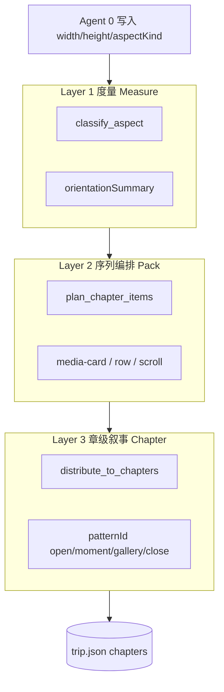

# Travelogue · 排版布局 PRD（Layout Composer）

| 属性 | 内容 |
|------|------|
| **产品代号** | Travelogue |
| **文档类型** | 排版与布局子系统 PRD |
| **文档版本** | v0.1 |
| **状态** | Draft · 规则引擎 v0 已落地；专职 Agent 规划中 |
| **关联文档** | [LTE-TEMPLATE-CATALOG.md](./LTE-TEMPLATE-CATALOG.md)、[PRD-PRODUCT-LAYOUT-PRINCIPLES.md](./PRD-PRODUCT-LAYOUT-PRINCIPLES.md)（**纲领**）、[PRD-MVP.md](./PRD-MVP.md)、[AGENT-ARCHITECTURE.md](./AGENT-ARCHITECTURE.md)、[LAYOUT-PLANNER.md](./LAYOUT-PLANNER.md)、[TEMPLATE-visual-journal.md](./TEMPLATE-visual-journal.md)、[ADAPTIVE-LAYOUT.md](./ADAPTIVE-LAYOUT.md)、[DATA-MODEL.md](./DATA-MODEL.md) |
| **实现参考** | `travelogue/curation/layout_planner.py`、`travelogue/media/image_ops.py` |
| **更新日期** | 2026-06-11 |

---

## 0. 产品纲领（排版优先）

本 PRD 服从 **[PRD-PRODUCT-LAYOUT-PRINCIPLES.md](./PRD-PRODUCT-LAYOUT-PRINCIPLES.md)**：

| ID | 要点 |
|----|------|
| **P-LAY-01** | 拼图 **≤9 张/屏**；丰富度 **P0 = 4 / 5 / 6 张**；7 / 8 / 9 张维持、非重点 |
| **P-LAY-02** | 拼图、单张横版、单张竖版须 **合理、美观**（裁切、节奏、主次） |
| **P-LAY-03** | **章节、叙事、文案** 优先级 **低于** 拼图与排版 |

Layout Composer / LTE / mosaic 选型为本子系统的北极星；叙事与长文案不在本子系统验收范围内。

---

## 1. 文档目的

本 PRD 定义 Travelogue **「根据用户上传图片的比例关系，自动形成版面结构」** 的产品目标、边界与未来 **排版专职 Agent（Layout Composer）** 的职责，作为：

- 产品 / 设计 / 研发的**单一需求来源**；
- Agent 架构拆分的**依据**（与策展人、叙事师、出版人分工）；
- 算法与 manifest 演进的**验收基准**。

> **算法细则**（阈值、rowLayout 表、CSS 契约）见 [LAYOUT-PLANNER.md](./LAYOUT-PLANNER.md)。  
> 本文档回答：**为什么做、做到哪、谁负责、如何验收**。

---

## 2. 背景与问题

### 2.1 用户素材现实

一次旅行上传的图片 rarely 只有「标准竖图」或「标准横图」，常见混合包括：

| 类型 | 典型比例 | 若强行统一 9:16 或 16:9 的后果 |
|------|----------|--------------------------------|
| 标准竖 | 9:16、3:4、4:5 | 可接受 |
| 标准横 | 16:9、3:2 | 竖屏单张横图 → **窄条浪费** |
| 方图 | 1:1 | 被裁切过多或上下黑边 |
| 全景 | ≥2:1 | 被裁成「假竖图」，损失气势 |
| 超长竖 | 长截图、窄条 | 并排两列无效、单张过高 |

### 2.2 产品目标

| ID | 目标 | 衡量 |
|----|------|------|
| L-G1 | 同一批图在 **mobile / web** 意图下都有**合理结构**（card / row / scroll） | 金样例 + fixture 相册回归 |
| L-G2 | 用户**可理解**「为何这三张横着摆」 | G1 闸口展示 `orientationSummary` + 规则摘要 |
| L-G3 | 结构**可复现**、可回归 | 同 `trip.json` 重跑布局结果一致 |
| L-G4 | 与「杂志模板」一致 | 仅输出 manifest 白名单块，禁止自由 HTML |

### 2.3 非目标

- 像素级平面设计（字距、逐页 InDesign 式微调）  
- 无限种 grid / 自由拖拽排版器  
- LLM 每次生成不同 DOM 结构  
- 替代 CSS 断点自适应（`auto` 仍依赖 [ADAPTIVE-LAYOUT.md](./ADAPTIVE-LAYOUT.md)）

---

## 3. 产品定位：排版 vs 策展 vs 出版

```text
┌─────────────────────────────────────────────────────────────┐
│  Agent 0 媒体工坊     像素、EXIF、裁切、aspectKind、WebP       │
├─────────────────────────────────────────────────────────────┤
│  Agent 1 策展人       「选哪些图、分几章、封面、章级 pattern」  │
├─────────────────────────────────────────────────────────────┤
│  Agent 1.5 排版师 ★   「章内怎么摆：card/row/scroll、rowLayout」│
├─────────────────────────────────────────────────────────────┤
│  Agent 2 叙事师       标题、hook、图注、语音精简文案           │
├─────────────────────────────────────────────────────────────┤
│  Agent 3 出版人       trip.json → HTML/CSS（零 LLM）           │
└─────────────────────────────────────────────────────────────┘
```

| 维度 | 策展人 Curator | **排版师 Layout Composer** | 出版人 Publisher |
|------|----------------|---------------------------|------------------|
| 人类类比 | 分堆、选代表作 | 拼图、拉版式、横竖搭配 | 印前检查、导出 |
| 主要输出 | `chapters[]` 骨架、`patternId`、选图列表 | `chapters[].items[]`、`rowLayout`、`layout.slot` | `index.html` |
| 是否改文案 | 否 | 否 | 否 |
| 是否改像素文件 | 否 | 可建议 `cropForLayout` 重裁（P1） | 拷贝资源 |
| 默认实现 | 规则 + 少量 LLM | **规则 100%**（MVP） | 模板引擎 |

**现状（过渡）**：`demo from-album` 将策展与排版合并在脚本内；**目标态**由专职 Agent 1.5 接管 `items[]` 生成。

---

## 4. 用户故事

| ID | 作为… | 我想要… | 以便… |
|----|--------|---------|--------|
| US-L01 | 旅行者 | 系统自动识别横/竖/方/全景/超长竖数量 | 知道相册是否适合手机长图分享 |
| US-L02 | 旅行者 | 选择 **手机 9:16** 版式意图 | 横图自动三列宽条，而不是单张细条 |
| US-L03 | 旅行者 | 选择 **Web 16:9** 版式意图 | 竖图两列并排，版面饱满 |
| US-L04 | 旅行者 | 全景图单独成「横幅」 | 不破坏全景的宽度感 |
| US-L05 | 旅行者 | 在 G1 看到排版预览摘要 | 确认后再锁结构 |
| US-L06 | 编辑 | 改 `exportLayout` 后一键「重新排版」 | 同一批图适配朋友圈 / 桌面 |
| US-L07 | 开发者 | 布局结果写入 `trip.json` 可测 | CI 回归 fixture 相册 |

---

## 5. 构图分类（产品层）

采用 **分桶（bucket）**，不对每个小数比例单独建类。详见 [LAYOUT-PLANNER.md](./LAYOUT-PLANNER.md) §3。

| aspectKind | 用户感知 | 布局策略摘要 |
|------------|----------|--------------|
| `panorama` | 全景、超宽条 | 单独宽条卡，**禁止**进入横版三联 |
| `landscape` | 普通横图、3:2、5:4 | 手机：2/3 并列 row；Web：band 或单卡 |
| `square` | 1:1 | 2/3 方格 row 或单张 1:1 卡 |
| `portrait` | 普通竖图、4:5 | 手机：单卡叠放；Web：双竖 row |
| `tall` | 长截图、超长竖 | 单独竖卡，**禁止**双列并排 |

**非标准但「不过分」的比例**（如 4:5、3:2）归入 `portrait` / `landscape`，由裁切与 CSS 比例盒优化观感，**不新增类型**。

---

## 6. 版面意图（exportLayout）

| 值 | 产品含义 | 排版规则集 |
|----|----------|------------|
| `mobile` | 朋友圈 / 微信群 / 竖屏扫读 | 横 band、方宫格、竖单卡、全景宽条 |
| `web` | 桌面 / 小程序内宽屏阅读 | 竖双列、横 band、版心出血 |
| `auto` | 用户未指定 | **编排默认 `mobile` 规则**；阅读态由 CSS 断点适配 |

用户可在创建 Trip 或导出前切换；切换后应触发 **Agent 1.5 重跑**（保留章级选图时可仅重排 `items[]`）。

---

## 7. 布局输出契约（trip.json）

### 7.1 统计块

```json
"curation": {
  "orientationSummary": {
    "total": 18,
    "landscape": 5,
    "portrait": 7,
    "square": 2,
    "panorama": 3,
    "tall": 1,
    "exportLayout": "mobile"
  },
  "layoutPlanVersion": "0.2.0",
  "layoutPlanRunId": "layout-20250419-001"
}
```

### 7.2 章内结构（Agent 1.5 主写入）

```json
{
  "chapters": [
    {
      "id": "ch-02",
      "patternId": "moment",
      "items": [
        {
          "type": "media-row",
          "assetIds": ["asset-004", "asset-005", "asset-006"],
          "rowLayout": "landscape-triple"
        },
        {
          "type": "media-card",
          "assetId": "asset-007",
          "layout": { "fill": true, "bleed": true, "overlay": true, "slot": "panorama" }
        }
      ]
    }
  ]
}
```

### 7.3 白名单（manifest 对齐）

| `type` | 子类型 / 字段 | 说明 |
|--------|---------------|------|
| `media-card` | `layout.slot` 可选 | `panorama` \| `square` \| `tall` |
| `media-row` | `rowLayout` 必填（row 时） | 见 LAYOUT-PLANNER §2.2 |
| `media-scroll` | `assetIds[]` | 3–5 张，横滑章 |

**禁止**：自定义 HTML、任意列数、未在 manifest 登记的 `rowLayout`。

---

## 8. 布局算法架构（三层）



| 层 | 职责 | 不负责 |
|----|------|--------|
| **L1** | 每张图 aspectKind、全 trip 统计 | 分章、文案 |
| **L2** | 有序 assetId 列表 → `items[]` | 跨章调配 |
| **L3** | `items[]` 分到 3–5 章、赋 `patternId` | 改图注 |

**原则**：L2/L3 分离，避免单一巨型「布局算法」难以测试。

---

## 9. 未来专职 Agent：排版师（Layout Composer）

### 9.1 编号与命名

| 项 | 建议 |
|----|------|
| 代号 | **Agent 1.5** 或 **Agent L**（Layout Composer / 排版师） |
| 流水线位置 | **Agent 1 策展之后**、**Agent 2 叙事之前** |
| 实现形态 | 确定性 Python 模块（`layout_planner` + 规则表）；**默认零 LLM** |

### 9.2 职责（做 / 不做）

| 做 | 不做 |
|----|------|
| 读取 `assets[]`（含 `aspectKind`、宽高） | 选择「是否去京都」级分章（属策展） |
| 读取 `exportLayout`、用户章序与章内 asset 列表（若策展已指定） | 写 hook、caption、title |
| 输出 / 更新 `chapters[].items[]`、`rowLayout`、`layout.slot` | 输出 HTML |
| 写入 `curation.orientationSummary`、`layoutPlanVersion` | 修改 `source/` 原图 |
| 提案「重新排版」diff（P1 UI） | 虚构未上传的 asset |
| （P1）对单张触发 `cropForLayout` 重裁建议 | 覆盖 `locked: true` 的 items |

### 9.3 输入 / 输出

**输入（最小集）**

| 字段 | 来源 |
|------|------|
| `assets[]` | Agent 0 |
| `exportLayout` | 用户 / trip 顶层 |
| `chapters[].id` + 章内候选 `assetIds[]` | Agent 1 或用户 |
| `coverAssetId` | Agent 1（排版避开封面重复逻辑由编排器协调） |
| `templateId` + `manifest.json` limits | 模板 |

**输出**

| 字段 | 说明 |
|------|------|
| `curation.orientationSummary` | 统计 |
| `chapters[].items[]` | 完整块列表 |
| `chapters[].patternId` | 可与策展协商；排版可建议 `gallery`（横滑章） |
| `pipeline.layoutStatus` | 见 §10（建议新增） |

### 9.4 是否使用 LLM

| 阶段 | 策略 |
|------|------|
| **P0 / MVP** | **不用 LLM**；纯规则 + 可测 fixture |
| **P1** | 可选：LLM 仅在「两种合法布局二选一」时打分（如 moment 章用 scroll 还是 row） |
| **禁止** | LLM 直接输出 `items[]` JSON 且无 schema 校验 |

### 9.5 与策展人的协作模式

**模式 A（推荐）**：策展输出 **章级** 信息，排版输出 **块级** 信息

```text
Agent 1  →  chapters[].{ id, title, patternId?, assetIdsOrdered[] }
Agent 1.5 →  chapters[].items[]  （由 assetIdsOrdered 生成）
```

**模式 B（过渡）**：策展一次性输出 `items[]`，排版仅 **重算** `items[]`（`exportLayout` 变更时）

当前代码库为 **模式 B 合体**（`from_album`）；迁移时拆命令：`travelogue curate` vs `travelogue layout`。

---

## 10. 流水线与闸口

### 10.1 建议状态扩展

在 `pipeline.status` 旁增加布局子状态（可选字段）：

```json
"pipeline": {
  "status": "structure_draft",
  "layoutStatus": "layout_draft",
  "locks": { "structure": false, "layout": false, "copy": false }
}
```

| layoutStatus | 含义 |
|--------------|------|
| `pending` | 未排版 |
| `layout_draft` | Agent 1.5 已写 `items[]`，待确认 |
| `layout_locked` | 用户确认排版；Agent 2 可动笔 |

### 10.2 闸口 G1 扩展（建议）

| 闸口 | 时机 | 用户确认内容 |
|------|------|--------------|
| **G1a** | Agent 1 后 | 章数、章名、每章有哪些图、封面 |
| **G1b** | Agent 1.5 后 | 排版摘要：「横 6→2 组三联；全景 3→宽条」 |

MVP 可 **G1 合并展示**（结构 + 排版摘要一页），不必拆两个 UI 页。

### 10.3 重跑矩阵

| 用户操作 | 重跑 |
|----------|------|
| 仅改 `exportLayout` | Agent 1.5 → 3 |
| 章内调图序（不改章列表） | Agent 1.5 → 3 |
| 删图 / 换章 | Agent 1 → 1.5 → 2? → 3 |
| 仅改 caption | Agent 3 |

---

## 11. 功能需求（FR）

| ID | 优先级 | 描述 | 验收 |
|----|--------|------|------|
| FR-L-01 | P0 | `classify_aspect` 五类判定 | 单元测试 + 文档阈值 |
| FR-L-02 | P0 | `mobile` 规则：横三联、全景宽条、方宫格 | fixture 相册 |
| FR-L-03 | P0 | `web` 规则：竖双列、横 band | fixture 相册 |
| FR-L-04 | P0 | 写入 `orientationSummary` | demo CLI 可见 |
| FR-L-05 | P0 | 渲染器识别 `rowLayout` / `layout.slot` | 金样例 DOM 类名 |
| FR-L-06 | P1 | CLI `travelogue layout <tripId>` | 仅重排 items |
| FR-L-07 | P1 | Orchestrator 调用 Agent 1.5 节点 | 状态机单测 |
| FR-L-08 | P1 | G1 UI 排版摘要与缩略结构预览 | 人工 |
| FR-L-09 | P2 | 基于 tags 的例外（如「夜景横图不三联」） | 配置表 |
| FR-L-10 | P2 | 章内节奏启发式（全景后接竖卡） | A/B 可选 |

---

## 12. 与分享策略的关系

| 分享路径 | 排版关注点 |
|----------|------------|
| 微信群长图（P0） | 默认 `mobile` 规则；长图导出前结构已优化 |
| 小程序 HTML（P2） | 可用 `web` 或 `auto`；鉴权与排版正交 |

见 [SHARING.md](./SHARING.md)。

---

## 13. 成功指标

| 指标 | 目标 |
|------|------|
| 横图占比较高的相册，手机预览无「单横细条」占比 | 主观 0 次 / trip |
| 布局回归测试 | fixture ≥6 套，CI 必过 |
| 用户 G1 改 `exportLayout` 后重排版耗时 | <5s（本地 30 张） |
| Agent 1.5 无 LLM 调用失败 | 100% 确定性 |

---

## 14. 里程碑

| 阶段 | 交付 | 负责模块 |
|------|------|----------|
| **v0（当前）** | `layout_planner.py` + LAYOUT-PLANNER + demo 接入 | 脚本 |
| **v0.5** | 本文档 PRD 冻结；manifest 登记 `rowLayout` 枚举 | 文档 + schema |
| **v1** | `travelogue layout`；从 Curator 拆出 items 生成 | Agent 1.5 CLI |
| **v1.5** | Orchestrator + G1 排版摘要 | 编排器 + UI |
| **v2** | 可选 LLM 辅助二选一；`cropForLayout` 重裁 | P1 |

---

## 15. 风险与缓解

| 风险 | 缓解 |
|------|------|
| 规则膨胀 | 新 `rowLayout` 必须过 manifest + 金样例 checklist |
| 策展/排版职责模糊 | 本文档 §3、§9.5；代码模块分目录 |
| CSS 与 JSON 不一致 | 渲染契约测试 `data-row-layout` |
| 用户困惑 | G1 展示 `orientationSummary` 与一句人话规则 |

---

## 16. 附录

### 16.1 术语

| 术语 | 定义 |
|------|------|
| 排版 | 决定 `items[]` 块类型与组合，不涉及文案 |
| 构图桶 aspectKind | 五类比例分类 |
| rowLayout | `media-row` 的列语义 |
| layout.slot | 单卡特殊比例盒 |

### 16.2 相关文件

```
travelogue/curation/layout_planner.py   # 规则引擎 v0
travelogue/media/image_ops.py           # classify_aspect / crop
templates/visual-journal/journal.css    # 比例盒与 row 样式
docs/LAYOUT-PLANNER.md                  # 算法与阈值细则
```

### 16.3 版本记录

| 版本 | 日期 | 说明 |
|------|------|------|
| v0.1 | 2026-05-19 | 初稿：排版 PRD + Agent 1.5 Layout Composer 规划 |

---

**文档结束**
