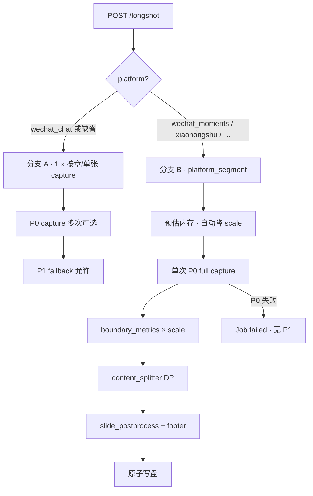

# Travelogue · 导出长图 2.0 产品需求文档（PRD）

| 属性 | 内容 |
|------|------|
| **产品代号** | Travelogue Studio |
| **文档版本** | **v0.3.3-LONGSHOT**（Guizang 参考写回） |
| **状态** | Draft · 含开发负责人已采纳增补 |
| **模块代号** | **Longshot 2.0 · 平台化分段导出** |
| **前置条件** | Phase 2 服务端长图 Job 稳定；M14 书架/预览双入口；[ADR-005](./adr/005-longshot-server-side.md)；**[ADR-016](./adr/016-longshot-platform-export.md)（本 PRD 架构约束）** |
| **关联文档** | [SHARING.md](./SHARING.md) · [PRD-M14-shelf-save-longshot.md](./PRD-M14-shelf-save-longshot.md) · [IMPLEMENTATION-LONGSHOT-2.0.md](./IMPLEMENTATION-LONGSHOT-2.0.md) · [PRD-LONGSHOT-2.0-ENG-SUPPLEMENT.md](./PRD-LONGSHOT-2.0-ENG-SUPPLEMENT.md) · [ACCEPTANCE-LONGSHOT-2.0.md](./ACCEPTANCE-LONGSHOT-2.0.md) · [research/GUIZANG-LONGSHOT-CROSSREF.md](./research/GUIZANG-LONGSHOT-CROSSREF.md) · [wireframes/studio-longshot-export-v2.html](./wireframes/studio-longshot-export-v2.html) |
| **更新日期** | 2026-07-08 |

> **定位**
>
> - Longshot 1.x：**微信群竖版长图**（技术/按章分段）。
> - Longshot 2.0：在同一渲染面之上，增加 **平台 Profile → 内容感知切分 → 后处理**，首发 **朋友圈 9 张**，次发 **小红书 3:4**。
> - **架构约束**见 [ADR-016](./adr/016-longshot-platform-export.md)：`wechat_chat` 走旧路径；平台模式走 **一次 full capture + Python 切分**，**禁止 P1 fallback**。

> **评审修订摘要（v0.2 → v0.3）**
>
> - 消除 fail-open / API 400、smart_crop 默认、水印复用等 **5 处内部矛盾**
> - 切分算法升级为 **DP + scale 坐标映射**（见 §6.3）
> - 朋友圈 **6–9 张降级**（合法切点不足时）
> - 小红书默认 **letterbox**；smart_crop 标为实验
> - Phase A 工期 **4 周**；Phase C **仅后端 YAML**，不做「更多平台」前端
> - 补 UX：动态 CTA、导出预期、发布步骤指引、Job 原子性
>
> **v0.3.2 开发落地修订**（见 [ENG-SUPPLEMENT](./PRD-LONGSHOT-2.0-ENG-SUPPLEMENT.md)）：
>
> - 分支 B 独立模块 `platform_longshot.py` · `PlatformExportWriter`
> - Phase A **CLI 先行**内测 · Pillow 仅 footer
> - T-small 验收 trip **8–12 张** · 极小 trip 1–5 张规则
> - 降 scale 须 **重采集 boundary + 重 capture**
> - 成功 Modal **缩略条延后 v2.0.1**
> - RENDER-CONTRACT 绑定 boundary selector
>
> **v0.3.3 Guizang 参考写回**（见 [GUIZANG-LONGSHOT-CROSSREF](./research/GUIZANG-LONGSHOT-CROSSREF.md)）：
>
> - 切点 **优先级权重**（章首/封面 · 旅行图先行原则）
> - 小红书 **safe area**（Phase B · 参考值非 MVP 硬 AC）
> - auto 张数 **5–9 为主** 校准 · 超长压到 8–10
> - Phase P3 **社交卡片重排模式** backlog

---

## 1. 背景与问题

### 1.1 Longshot 1.x 能力

| 维度 | 现状 |
|------|------|
| 定位 | 微信群直发 · 竖版杂志风 PNG |
| 渲染 | Playwright + `captureMainToBlob`，宽 428px × scale(1–3) |
| 分段 | 高度 / 20MB / 单章 60 张 → **按章多次 capture** |
| UI | 完整 / 按章 + 2×/3× + full/photos |
| 平台 | 仅微信 UA 提示 |

### 1.2 痛点

| 痛点 | 影响 |
|------|------|
| 朋友圈需手动凑 9 张 | 按章张数不可控 |
| 小红书非 3:4 轮播 | 二次裁切、常切人脸 |
| 多平台重复导出 | 效率低 |
| 分段不可预期 | 用户不知最终张数 |

---

## 2. 目标与非目标

### 2.1 产品目标

| ID | 目标 | 衡量 |
|----|------|------|
| **G-LNG2-01** | 可选分享平台，输出符合规格 | Phase A 朋友圈 AC 100% |
| **G-LNG2-02** | 朋友圈一键 **6–9 张**（目标 9），不在单张照片中间切断 | AC-LNG2-01/02 |
| **G-LNG2-03** | 小红书：张数可选 + 1080×1440 letterbox | AC-LNG2-03/04 |
| **G-LNG2-04** | 无 `platform` 时与 1.x **100% 一致** | 回归全绿 |
| **G-LNG2-05** | 成功态含 **发布步骤指引** | 手测 |
| **G-LNG2-06** | stale 覆盖新产物 glob | AC-LNG2-06 |
| **G-LNG2-07** | Phase A P95 耗时 ≤ 1.x 同 trip **150%** | QA-LNG2-06 |
| **G-LNG2-08** | Phase A 上线 30 天内 `wechat_moments` 导出占比 ≥ **10%** | Telemetry |
| **G-LNG2-09** | 平台模式 Job 成功率 ≥ **95%** | Telemetry |

### 2.2 非目标

- 真一键发到微信/小红书 App
- 小红书每屏 3:4 **重排版**（P3 PRD）
- trip.json 持久化平台偏好（v2.0 仅 localStorage）
- 客户端 html2canvas 平台 parity
- Phase C **前端**「更多平台」菜单（仅后端 profile）
- 自动删除旧平台产物（v2.0；OQ 留 v2.1）

---

## 3. 已拍板决策（D-LNG2 · 评审修订）

| ID | 决策 | 结论 |
|----|------|------|
| **D-LNG2-01** | 默认 platform | `wechat_chat` |
| **D-LNG2-02** | 朋友圈张数 | **目标 9**；合法切点不足时 **6–9 张** + userHint 说明 · **✅ 产品已确认 2026-07-08** |
| **D-LNG2-03** | 朋友圈比例 | 不强制统一；竖版切片自然比例 |
| **D-LNG2-04** | 小红书张数 | auto 或用户 1–18 |
| **D-LNG2-05** | 小红书比例 | 3:4 → 1080×1440 |
| **D-LNG2-06** | 小红书填充 | 默认 **`letterbox`**；`smart_crop` 为 **实验**（feature flag） |
| **D-LNG2-07** | 切分 | 内容感知；**DP 最小段高方差**；贪心 fallback |
| **D-LNG2-08** | 切点粒度 | 不在 **单张 `` / photo cell** 中间切断（见 §6.3.4） |
| **D-LNG2-09** | 坐标 | boundary CSS px × **scale** → canvas px（ADR-016 D3） |
| **D-LNG2-10** | 平台模式 capture | **一次 full capture**；**禁止 P1** |
| **D-LNG2-11** | 水印 | 平台切分：**Pillow footer** `{i}/{n}`；不按章 DOM 水印 |
| **D-LNG2-12** | 非法 platform | API **400** + 明确 message；**不静默回退** |
| **D-LNG2-13** | 内存 | 预估超 400MB → 自动降 scale；仍超 → `E_LNG2_CAPTURE_TOO_LARGE` |
| **D-LNG2-14** | Job 写入 | **原子**：`.part` 临时文件 → 全成功 rename；失败清理 |
| **D-LNG2-15** | UI 互斥 | 非 wechat_chat 隐藏「按章/完整」 |
| **D-LNG2-16** | 书架 v2.0 | 不改默认（3×+photos+wechat_chat） |
| **D-LNG2-17** | sparse 提示 | 照片 **<15** 选朋友圈 → toast 建议微信群，**不阻断** |
| **D-LNG2-18** | stale | **任一** longshot 产物过期 → `longshotStale=true` |
| **D-LNG2-19** | 分支 B 模块 | 独立 **`platform_longshot.py`**；`longshot.py` 仅路由 + 分支 A |
| **D-LNG2-20** | Phase A 交付顺序 | **CLI 可跑通 moments → Studio Popover**；禁止 UI 先于切分引擎合并 |
| **D-LNG2-21** | T-small 验收 trip | **8–12 张照片**（测 6–9 张降级）；见 ACCEPTANCE T-small |
| **D-LNG2-22** | 极小 trip | 照片 **1–5 张**：输出 **N = max(1, 合法段数)**，userHint 建议微信群；**不要求**凑满 6 张 |
| **D-LNG2-23** | 降 scale | 自动降 scale 后须 **重新 collect boundaries + 重 capture**（ADR-016 增补） |
| **D-LNG2-24** | 成功 Modal 缩略条 | Phase A **仅文件列表 + publishGuide**；缩略条 → **v2.0.1** |
| **D-LNG2-25** | Phase A Pillow | **仅** crop + `draw_page_footer`；letterbox/smart_crop → Phase B |
| **D-LNG2-26** | 模板契约 | boundary selector 写入 **[RENDER-CONTRACT.md](./RENDER-CONTRACT.md)** §Longshot2 |
| **D-LNG2-27** | 平台 Job 失败文案 | P0 失败须提示：**不支持兼容模式，请改用微信群按章** |
| **D-LNG2-28** | 前端模块 | Popover 逻辑 **必须**在 `longshot-export-panel.js`；禁止大幅堆叠 `preview-toolbar.js` |
| **D-LNG2-29** | 切点优先级 | DP 候选切点带 **权重**（章分隔 > 封面后 > photo cell > card 顶）；见 §6.3.7 |
| **D-LNG2-30** | 小红书 safe area | Phase B letterbox 内保留 **参考安全区**（非 Phase B MVP 硬 AC）；见 §6.4.2 |
| **D-LNG2-31** | xhs auto 张数 | 在 `photo_count/4` 公式基础上 **clamp 至 5–9 为主**，超长 trip 上限 **10**；见 §6.4.3 |
| **D-LNG2-32** | 页码元数据 | footer `{i}/{n}` 定位为 **orientation**（非装饰）；publishGuide 须提及 |

---

## 4. 设计原则

| ID | 原则 |
|----|------|
| **P-LNG2-01** | 渲染一次（平台模式 single capture） |
| **P-LNG2-02** | Profile YAML 驱动 |
| **P-LNG2-03** | 无 platform = 1.x |
| **P-LNG2-04** | 切点尊重 photo 粒度 |
| **P-LNG2-05** | 告诉用户几张、怎么用、发哪里 |
| **P-LNG2-06** | 前端校验 platform；后端 400，不 silent fallback |

---

## 5. 架构概览（ADR-016）



---

## 6. 平台 Profile 规格

配置文件：`config/platform_profiles.yaml`。

### 6.1 Profile 总表

| profile id | 显示名 | 张数 | 输出尺寸 | 分段 | Phase |
|------------|--------|------|----------|------|-------|
| `wechat_chat` | 微信群 | — | 428×scale 宽 | technical/chapter | 1.x |
| `wechat_moments` | 朋友圈 | **1–9（目标 9）** | 428×scale 宽 | **content_balanced**（整卷连续切分） | **A** |
| `xiaohongshu` | 小红书 | 1–18 | **1080×1440** | content_balanced + letterbox | **B** |
| `instagram` | Instagram | 1–10 | 1080×1350 | 同 xhs 管线 | C 后端 only |
| `weibo` | 微博 | 1–9 | 1080 宽 | 同 xhs 管线 | C 后端 only |
| `douyin_cover` | 抖音封面 | 1 | 1080×1920 | 首屏 crop | C 后端 only |
| `custom` | 自定义 | 1–18 | 按 ratio | CLI / API only | C 后端 only |

**Phase 交付范围**：

| Phase | 前端 | 后端 |
|-------|------|------|
| **A** | 微信群 + **朋友圈** | moments profile |
| **B** | + **小红书** UI | xhs + postprocess |
| **C** | **无新 UI** | YAML 扩展 + CLI |

### 6.2 微信群 · `wechat_chat`

与 Longshot 1.x **完全一致**（分支 A）。参见 ADR-005。

### 6.3 朋友圈 · `wechat_moments`

#### 平台约束

| 约束 | 值 |
|------|-----|
| 发布上限 | 9 张/条 |
| 单张体积 | ≤ 20MB |
| 输出宽 | 428 × scale（856@2×，1284@3×） |
| 切分策略 | **content_balanced**：整卷长图连续切成 ≤9 段；切点仅落在照片/卡片边界；各段高度可变；照片少时允许 1 段 |

> 边界必须在 **capture 布局 settle 后**采集（与 PNG 同坐标系）。禁止为凑 9 张做几何硬切（会切穿照片）。

#### 6.3.1 边界采集 · `boundary_metrics`

Playwright 注入 JS，返回：

```typescript
{
  scrollHeightCss: number,
  boundariesCss: number[],  // 单调递增，含 0 与 scrollHeight
  boundaryKinds: ("photo" | "chapter" | "card")[]
}
```

**候选切点**（优先级）：

1. `chapter-separator` 底边
2. `media-card` 顶边（整 card 边界）
3. 单张 photo cell 顶边（`.media-card img` 或模板契约 selector）

**photos 模式**：隐藏文案 DOM **不影响** card/photo 边界采集（capture 前已注入 `data-photos-only`）。

#### 6.3.2 坐标映射

```
y_canvas = round(y_css × scale)
H_canvas = round(scrollHeightCss × scale)
```

#### 6.3.3 切分算法

**输入**：`H_canvas`，合法切点集合 `B`（canvas px），目标段数 `N_target = 9`。

**主算法 · DP**：

- 将 `B` 排序，必含 `0` 与 `H_canvas`
- DP 求 `N_target-1` 个中间切点，**最小化各段高度方差**
- 约束：相邻切点间高度 ≥ `H_canvas / (N_target × 2)`（防极薄段）

**降级**：

| 条件 | 行为 |
|------|------|
| 合法切点支持 **≥6 段** | `N = 9`（目标） |
| 合法切点支持 **6–8 段** | `N = 合法段数`（6–9），userHint：「内容较少，已生成 N 张」 |
| 照片 **8–12 张**（T-small 验收集） | 期望 **6–9 张**（D-LNG2-21） |
| 照片 **1–5 张**（极小 trip） | `N = max(1, 合法段数)`，userHint 建议微信群；**不凑满 6 张**（D-LNG2-22） |
| DP 无解 | 贪心 nearest ideal boundary |
| 单段 > 20MB | 降 scale → **重 boundary + 重 capture**（最多 2 次）；再 jpeg |

**禁止**：为凑 9 张插入空白页（v2.0；尾页模板 v2.1 OQ）。

#### 6.3.4 切分粒度 AC

- **通过**：切线不穿过任一 **photo cell** 内部
- **允许**：在 **media-card** 边界切（一张 card 含多图时，切在 card 之间）

#### 6.3.5 水印与命名

- Pillow **`draw_page_footer(i, n)`**（Phase A 唯一 Pillow 用途 · D-LNG2-25）
- 文件：`{title}-moments-{nn}.png`（`nn` 01 起，**n = 实际张数**）

#### 6.3.6 模板契约 · boundary selector

以下 selector **须**登记 [RENDER-CONTRACT.md](./RENDER-CONTRACT.md) **§Longshot 2.0**（D-LNG2-26）：

| 边界类型 | Selector（实现期冻结） |
|----------|------------------------|
| photo cell | `.media-card img` 或模板定义的 photo cell |
| media-card | `.media-card` |
| chapter | `.chapter-separator` / `section.chapter` 顶边 |

变更 selector 须同步：`boundary_metrics.py` + golden trip 快照测试。

#### 6.3.7 切点优先级（Guizang · 旅行图先行 · Phase A 起采用）

DP/贪心在 **等距 ideal 边界附近** 选切点时，对候选 boundary 施加权重（越高越优先）：

| 优先级 | 边界类型 | 权重 | 说明 |
|--------|----------|------|------|
| 1 | `.cover-opening` / `.cover-hero` 底边 | **1.5** | 首张后自然分页 |
| 2 | `.chapter-separator` / 章标题后 | **1.4** | 一章一屏节奏 |
| 3 | `section.chapter` 顶边（非首章） | **1.2** | 章首落点 |
| 4 | photo cell 顶边 | **1.0** | 默认 |
| 5 | media-card 顶边（非 photo） | **0.9** | 拼图 card 边界 |

**原则**（借鉴 Guizang Image-Led Sequence，Phase A 仅作切点偏好，不重排版）：

- 避免 **连续两页都以同一张大图中部** 起切（若权重可识别 cover-hero 全 bleed，下一段优先落在章分隔或文案区）
- **不**在 Phase A 实现「一页一 Hook 角色」或 Copy 重写

实现：`content_splitter.nearest_boundary()` 用 `distance / weight` 作代价。

### 6.4 小红书 · `xiaohongshu`

#### 6.4.1 约束

| 项 | 值 |
|----|-----|
| 张数 | auto：见 §6.4.3；或用户 1–18 |
| 输出 | **1080×1440** PNG |
| 默认填充 | **letterbox**（模糊背景 + 等比缩放） |
| smart_crop | `studio.longshot2.smart_crop.enabled` 默认 **false** |

#### 6.4.2 Safe area（Phase B · 参考 Guizang `platform-specs`）

letterbox 或 smart_crop 完成后，**关键内容与文案**应落在参考安全区内（D-LNG2-30）：

| 边 | 参考留白（1080×1440 画布） |
|----|---------------------------|
| 左右 | 72–96px |
| 上 | 72–112px |
| 下 | 80–120px（页码 footer 占用下沿时合并计算） |

| 阶段 | 要求 |
|------|------|
| **Phase B MVP** | 实现 **参考检测**（warn log）；不阻塞导出 |
| **Phase B+** | 可选 AC：抽检关键 trip 无文字贴边 |

#### 6.4.3 auto 张数（Guizang Page Count 校准 · D-LNG2-31）

基础公式：`N0 = ceil(photo_count / 4)`

校准（相对 Guizang「5–7 / 7–9 / 8–10 压缩」原则，按 **照片数** 映射）：

```
N = clamp(N0, 5, 9)           # 常规 trip：5–9 张为主
若 photo_count > 48: N = min(N, 10)   # 超长：上限 10，其余留在笔记正文
若 photo_count < 12: N = clamp(N0, 3, 6)  # 短 trip：3–6
```

`userHint`（auto 模式）：「已生成 N 张 3:4 配图 · 更多细节可写在笔记正文」

#### 6.4.4 管线

同 §6.3 切分（含 §6.3.7 权重）→ 每 slice `fit_aspect(3:4, letterbox|smart_crop)` → footer `{i}/{n}`。

命名：`{title}-xhs-{nn}.png`。

### 6.7 外部参考 · Guizang Social Card（不改变 Phase A 主路径）

| 来源 | 采纳 | 不采纳 |
|------|------|--------|
| [GUIZANG-LONGSHOT-CROSSREF.md](./research/GUIZANG-LONGSHOT-CROSSREF.md) | 张数区间、页码 orientation、§6.3.7 切点权重、§6.4.2 safe area | Hook 重写、逐页 Page Roles HTML、公众号 1:1 封面 |

**范式边界**：

- **Longshot 2.0** = 导出已有杂志 scroll（切分 / 裁切）
- **Guizang skill** = 从文稿 **创作** 新社交卡片 HTML

二者可未来并列（**OQ-LNG2-05 · Phase P3**），不在 v2.0 合并管线。

---

## 7. 交互规格

### 7.1 导出 Popover（预览页）

线框：[wireframes/studio-longshot-export-v2.html](./wireframes/studio-longshot-export-v2.html)（实现前评审）。

```
导出设置
├─ 分享平台
│  ● 微信群  ○ 朋友圈  ○ 小红书
├─ [动态二级]
│  ├─ 微信群：导出范围 + 清晰度
│  ├─ 朋友圈：预计 9 张 · 约 30–60 秒 + 清晰度
│  └─ 小红书：张数 + 填充 + 清晰度
└─ 确定 / 取消
```

| 规则 | 说明 |
|------|------|
| 动态 CTA | 平台非微信群时，主按钮：`导出 9 张朋友圈配图` / `导出小红书配图` |
| 预期张数 | 朋友圈固定文案「9 张（内容少时可能 6–9 张）」；小红书 auto 显示估算 N |
| coach | 首次选朋友圈：「将按编号 01→09 选图发布」 |
| 模块 | UI 逻辑抽到 **`longshot-export-panel.js`**（减轻 preview-toolbar.js） |

### 7.2 进度 Modal

| 阶段 | stageHint 权重 |
|------|----------------|
| 打开页面 | 10% |
| full capture | 30% |
| 切分 + 后处理 | 50% |
| 写盘 | 10% |

示例：`正在切分朋友圈配图（3/9）…`

### 7.3 成功 Modal

| 平台 | 标题 | 指引 |
|------|------|------|
| wechat_moments | ✓ N 张朋友圈配图已就绪 | **发布步骤**：1. 在文件夹按 **01→09** 全选（图底 **i/n** 助 orientation）2. 朋友圈 → 从相册选择 3. 按顺序发布 · 滑动可连读 |
| xiaohongshu | ✓ N 张 3:4 配图已就绪 | **发布步骤**：保存到相册 → 小红书 → 发笔记 → 选图；**详情写在笔记正文**，配图是视觉提纲 |

**UI**：文件列表 + **publishGuide**（D-LNG2-24：Phase A **不含**缩略条；v2.0.1 增补）；reveal 打开文件夹。

### 7.4 失败态

| code | 文案 |
|------|------|
| `E_LNG2_INVALID_PLATFORM` | 不支持的平台，请更新客户端 |
| `E_LNG2_CAPTURE_TOO_LARGE` | 内容过长，请降低清晰度或改用微信群按章导出 |
| `E_LNG2_CAPTURE_P0_FAILED` | 无法生成朋友圈配图（不支持兼容模式），请改用 **微信群 · 按章导出** |
| `E_LNG2_SLICE_TOO_LARGE` | 单张超过 20MB，请降低清晰度 |
| `E_LNG2_BOUNDARY_FAILED` | 无法安全切分，请改用微信群按章导出 |
| `E_LNG2_SPLIT_PARTIAL` | 仅生成 N 张（内容较少）— 信息态非错误 |

---

## 8. API 与数据契约

### 8.1 `POST /__travelogue/longshot`

```json
{
  "tripId": "linzhi",
  "scale": 2,
  "format": "png",
  "copyDisplay": "full",
  "segmentMode": "auto",
  "platform": "wechat_moments",
  "slideCount": null,
  "aspectRatio": "auto",
  "padMode": "letterbox"
}
```

| 字段 | 默认 | 说明 |
|------|------|------|
| `platform` | `wechat_chat` | Profile id |
| `slideCount` | null | null=auto；moments **忽略** |
| `padMode` | `letterbox` | xhs：`letterbox` \| `smart_crop`（需 flag） |
| `segmentMode` | `auto` | **仅 wechat_chat** |

**校验**：

- 未知 `platform` → **400**
- `slideCount` 超 profile max → **400**
- `platform != wechat_chat` → 忽略 `segmentMode`

### 8.2 Job result（追加字段）

```json
{
  "tripId": "linzhi",
  "outputs": ["林芝-moments-01.png", "..."],
  "platform": "wechat_moments",
  "profileLabel": "朋友圈",
  "pageCount": 9,
  "targetPageCount": 9,
  "segmentReason": "platform_wechat_moments",
  "userHint": "已生成 9 张…",
  "publishGuide": "在文件夹按 01→09 全选…"
}
```

### 8.3 命名与 stale

见 §6.3.5、§6.4；stale glob 扩展（ADR-016 D7）：

```
*-moments-*.*  *-xhs-*.*  *-ins-*.*  *-weibo-*.*  *-douyin-cover.*  *-custom-*.*
```

### 8.4 localStorage

键：`travelogue.studio.longshotExportPrefs`

```json
{
  "platform": "wechat_chat",
  "mode": "chapter",
  "scale": 2,
  "slideCount": null,
  "padMode": "letterbox"
}
```

### 8.5 CLI

```bash
travelogue export-longshot <trip> --platform wechat_moments --scale 2
travelogue export-longshot <trip> --platform xiaohongshu --slide-count 6 --pad-mode letterbox
```

---

## 9. 后端任务（摘要）

完整清单见 [IMPLEMENTATION-LONGSHOT-2.0.md](./IMPLEMENTATION-LONGSHOT-2.0.md)。  
Sprint / PR 拆分见 [PRD-LONGSHOT-2.0-ENG-SUPPLEMENT.md](./PRD-LONGSHOT-2.0-ENG-SUPPLEMENT.md) §2。

| 里程碑 | 周期 | 核心交付 |
|--------|------|----------|
| **M-LNG2.0 护栏** | 1w | API + profile + splitter 单测 + 分支 A 回归 |
| **M-LNG2.1 切分引擎** | — | （并入 W1–W2）boundary + DP + scale |
| **M-LNG2.2 朋友圈** | **2w** | **`platform_longshot.py`** E2E + **CLI 内测** + footer + 原子写盘 |
| **M-LNG2.3 小红书** | 2w | letterbox postprocess + UI（**独立 Epic**） |
| **M-LNG2.4 后端扩展** | 1w | Ins/weibo/douyin YAML + CLI + stale |
| **M-LNG2.5 发布** | 1w | AC + telemetry |

**Phase A 合计：4 周** · **首个可测交付：CLI `--platform wechat_moments`（W2 末）**。

### 9.1 关键模块

| 模块 | 职责 |
|------|------|
| `longshot.py` | 分支 A · 路由 `platform` → B |
| **`platform_longshot.py`** | **分支 B 唯一入口**（D-LNG2-19） |
| `platform_profiles.py` | YAML 加载、slideCount 解析 |
| `boundary_metrics.py` | JS 边界采集（RENDER-CONTRACT） |
| `content_splitter.py` | DP + 贪心 fallback |
| **`PlatformExportWriter`** | 原子 `.part` → rename / rollback（D-LNG2-14） |
| `slide_postprocess.py` | **Phase B**：letterbox、smart_crop；Phase A 仅 footer 可放此或 writer 内 |

---

## 10. 前端任务（摘要）

| 里程碑 | 核心 |
|--------|------|
| FE-LNG2.0 | **`longshot-export-panel.js`** + 平台 seg |
| FE-LNG2.1 | 动态 CTA + 预期文案 + Job 请求 |
| FE-LNG2.2 | publishGuide + 文件列表（**无缩略条** · D-LNG2-24） |
| FE-LNG2.3 | 小红书二级（Phase B） |
| ~~FE 更多平台~~ | **Phase C 不做** |

---

## 11. 验收标准

| ID | 验收项 |
|----|--------|
| **AC-LNG2-01** | T-large · moments → **9 张**（常态） |
| **AC-LNG2-01s** | T-small（**8–12 张**）· moments → **6–9 张** + userHint |
| **AC-LNG2-01t** | 极小 trip（1–5 张）→ **1–5 张** + 建议微信群 |
| **AC-LNG2-02** | 切线不穿过 **photo cell** 内部 |
| **AC-LNG2-03** | xhs 指定 6 张 → 6×1080×1440 letterbox |
| **AC-LNG2-04** | xhs auto N：常规 **5–9**；短 trip 3–6；超长 ≤10（D-LNG2-31） |
| **AC-LNG2-05** | 无 platform = 1.x |
| **AC-LNG2-06** | stale 含 moments/xhs glob |
| **AC-LNG2-07** | Popover prefs + 动态 CTA |
| **AC-LNG2-07d** | Phase A 成功 Modal **无缩略条**（v2.0.1 另验） |
| **AC-LNG2-08** | >20MB → 降 scale/jpeg 或明确失败 |
| **AC-LNG2-09** | footer `i/n` 正确 |
| **AC-LNG2-10** | 书架 M14 非回归 |
| **AC-LNG2-11** | Job 失败无残缺 `moments-*.png`（原子性） |
| **AC-LNG2-12** | platform 模式 P0 失败 **无 P1** |
| **AC-LNG2-13** | photos 模式 moments 仍满足 AC-LNG2-02 |
| **AC-LNG2-02w** | 切点权重：首切点优先 cover/章分隔（单测 fixture · 可选） |
| **AC-LNG2-03s** | xhs safe area 参考内（Phase B+ 抽检 · 非 MVP 硬 AC） |

完整 AC 见 [ACCEPTANCE-LONGSHOT-2.0.md](./ACCEPTANCE-LONGSHOT-2.0.md)。

### 非回归

M14 书架 · full/photos toggle · CLI 无 flag · ADR-005 分支 A · copy-display.css

---

## 12. Telemetry

| 事件 | 属性 |
|------|------|
| `longshot_export_start` | `platform`, `scale`, `slide_count`, `photo_count` |
| `longshot_export_success` | `platform`, `output_count`, `target_page_count`, `duration_ms` |
| `longshot_export_fail` | `platform`, `error_code` |
| `longshot_platform_change` | `from`, `to` |

**Dashboard**：platform 分布 · 成功率 · P95 duration · partial split 次数。

本地落盘：`~/.travelogue/telemetry/studio-homepage-events.jsonl`（与 Studio homepage 漏斗共用；CLI `export-longshot` 亦写入）。

---

## 13. 兼容与回退

| 开关 | 默认 | 作用 |
|------|------|------|
| `studio.longshot2.enabled` | `true` | 关则隐藏平台 UI，API 忽略 platform |
| `studio.longshot2.platforms` | `["wechat_moments"]` Phase A 灰度 | 开放列表 |
| `studio.longshot2.smart_crop.enabled` | `false` | 实验裁切 |

---

## 14. 风险与缓解

| 风险 | 缓解 |
|------|------|
| full capture 内存 | 400MB 预算 + 自动降 scale（D-LNG2-13） |
| P1 与切分不兼容 | 平台模式禁止 P1（D-LNG2-10） |
| 切分 DOM 漂移 | RENDER-CONTRACT 绑定 selector + golden trip 快照 |
| 磁盘多套产物 | v2.0 不自动删；UI 提示「本次写入 moments 前缀」 |
| Popover 过载 | 仅 3 个一级平台；抽离 panel 模块 |

---

## 15. 开放问题

| ID | 问题 | v2.0 |
|----|------|------|
| **OQ-LNG2-01** | sparse 尾页品牌模板 | 否 |
| **OQ-LNG2-02** | 书架记住 platform | 否 |
| **OQ-LNG2-03** | 导出前清理旧 moments 文件 | 否 |
| **OQ-LNG2-04** | zip 子目录打包 | 独立 PRD |
| **OQ-LNG2-05** | **社交卡片重排模式**（Guizang Page Roles · 逐页 3:4 重排） | **Phase P3 独立 PRD** |

---

## 16. Phase P3 方向（Guizang 借鉴 · 非 v2.0 承诺）

| 能力 | 说明 | 参考 |
|------|------|------|
| **P3-LNG2-01** | `layoutEngine=xhs-slide`：每屏固定 3:4 画框，非切片 | Guizang layout-recipes |
| **P3-LNG2-02** | Page Roles：Hook cover / 图文交替 / 总结页 | content-planning §Good Page Roles |
| **P3-LNG2-03** | Image-Led：最强图 P1 全 bleed，禁止连续两屏同尺度大图 | content-planning §Image-Led |
| **P3-LNG2-04** | Compression Ladder：导出前压缩叙事为 4–8 屏要点 | content-planning §Compression Ladder |

**前置**：Phase A/B 数据稳定 · 用户反馈「切片不够像小红书原生笔记」

---

## 17. 配套文档

| 文档 | 说明 |
|------|------|
| [IMPLEMENTATION-LONGSHOT-2.0.md](./IMPLEMENTATION-LONGSHOT-2.0.md) | 任务 ID · 文件路径 |
| [PRD-LONGSHOT-2.0-ENG-SUPPLEMENT.md](./PRD-LONGSHOT-2.0-ENG-SUPPLEMENT.md) | Sprint/PR · DoD · Code Review 清单 |
| [ACCEPTANCE-LONGSHOT-2.0.md](./ACCEPTANCE-LONGSHOT-2.0.md) | pytest + 手测 + Go 闸门 |
| [ADR-016](./adr/016-longshot-platform-export.md) | 三分支 Pipeline |
| [RENDER-CONTRACT.md](./RENDER-CONTRACT.md) | §Longshot 2.0 boundary（实现期增补） |
| [research/GUIZANG-LONGSHOT-CROSSREF.md](./research/GUIZANG-LONGSHOT-CROSSREF.md) | Guizang skill 对照 · 采纳/不采纳清单 |
| [SHARING.md](./SHARING.md) | §2.5 平台化导出（实现期增补） |

---

## 18. 版本记录

| 版本 | 日期 | 说明 |
|------|------|------|
| v0.2.0 | 2026-07-08 | 初稿 |
| v0.3.0 | 2026-07-08 | 跨职能评审修订 |
| v0.3.1 | 2026-07-08 | D-LNG2-02 产品确认；ACCEPTANCE 落地 |
| **v0.3.2** | **2026-07-08** | **开发负责人建议写回：D-LNG2-19～28 · CLI 先行 · T-small/极小 trip · 缩略条延后 · ENG-SUPPLEMENT** |
| **v0.3.3** | **2026-07-08** | **Guizang 参考写回：D-LNG2-29～32 · §6.3.7/6.4.2–4/6.7 · Phase P3 · CROSSREF** |
