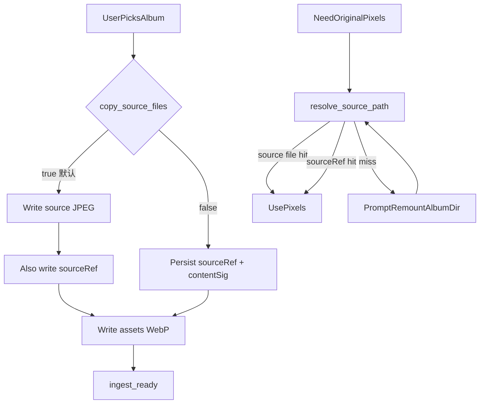

# Travelogue · 媒体存储省盘与引用模式 V1 产品需求文档（PRD）

| 属性 | 内容 |
|------|------|
| **产品代号** | Travelogue Studio（本机 Studio / 桌面打包同等体验） |
| **文档版本** | **v0.2.0** |
| **状态** | **W2 已落地 · 待狗粮出口**（见 [IMPLEMENTATION](./IMPLEMENTATION-MEDIA-REFERENCE-STORAGE-V1.md)）；评审 [Conditional Go](./acceptance-records/media-reference-storage-v1-review-2026-07-15.md) |
| **主题代号** | 「省盘不惊吓」— 默认保持现状 · 开关走引用 · 一键清理止血 |
| **触发来源** | 2026-07-15 开发/狗粮工作区体积膨胀；产品讨论定案混合策略；同日五席评审 Conditional Go |
| **前置条件** | Studio 导入主链可用；设置入口沿用并**扩展** [PRD-DESKTOP-LLM-SETUP-V1.md](./PRD-DESKTOP-LLM-SETUP-V1.md)「设置」容器（见 D-MRS-12）；存储边界遵循 [ADR-008](./adr/008-trip-storage-boundaries.md)（须附录回写 `media.*` / `sourceRef`） |
| **关联文档** | [DATA-MODEL.md](./DATA-MODEL.md) · [MEDIA-PIPELINE.md](./MEDIA-PIPELINE.md) · [PRD-PHASE22-storage-platform.md](./PRD-PHASE22-storage-platform.md) · [adr/008-trip-storage-boundaries.md](./adr/008-trip-storage-boundaries.md) · [adr/018-desktop-installer-layout.md](./adr/018-desktop-installer-layout.md) · [PRD-IMPORT-SHEET-v3-WIZARD.md](./PRD-IMPORT-SHEET-v3-WIZARD.md) · [PRD-PREVIEW-EXPORT-FACADE-V1.md](./PRD-PREVIEW-EXPORT-FACADE-V1.md) · [PRD-DESKTOP-LLM-SETUP-V1.md](./PRD-DESKTOP-LLM-SETUP-V1.md) · [SHARING.md](./SHARING.md) · [ACCEPTANCE.md](./ACCEPTANCE.md) · [ERROR-CODES.md](./ERROR-CODES.md) |
| **评审记录** | [acceptance-records/media-reference-storage-v1-review-2026-07-15.md](./acceptance-records/media-reference-storage-v1-review-2026-07-15.md) |
| **验收** | 本文 §10；可后续拆 `ACCEPTANCE-MEDIA-REFERENCE-STORAGE-V1.md` |
| **实施清单** | [IMPLEMENTATION-MEDIA-REFERENCE-STORAGE-V1.md](./IMPLEMENTATION-MEDIA-REFERENCE-STORAGE-V1.md)（W0–W2 已落地 · 待狗粮 AC） |
| **更新日期** | 2026-07-16 |

> **定位**
>
> 当前 ingest **默认把用户相册解码拷贝进** `trips/{id}/source/`，并生成多档 `assets/` WebP，导致工作区随使用线性膨胀。  
> 本 PRD **不**要求全员立刻改为「只引用原图」，而是交付可理解的控制面：
>
> 1. **默认保持现状**（复制源文件）——不惊吓既有狗粮与自包含习惯；  
> 2. **设置开关**关闭「导入时复制源文件」后，新导入走**引用模式（方案 A）**；  
> 3. **一键清理**可安全回收可再生缓存，并在确认后可选删除已拷贝的 `source/`。
>
> **一句话目标**：用户能主动选择省盘，且已膨胀的工作区能一键降体积；引用模式下原相册缺失时有明确修复路径，而不是静默坏掉。
>
> **完成定义**
>
> | 门 | 含义 | 不等于 |
> |----|------|--------|
> | **W0 Go** | 合同齐：schema/并行 ingest/Resolve/清理治理/Facade·设置合流已写死；可开 IMPLEMENTATION | 主题未交付 |
> | **W1 Go** | 开关 + 串行/并行引用 ingest + 安全清理 + 占用可见 | 深度清理/remount 未齐 |
> | **W2 Go** | 深度清理 + remount + 导出阻断闭环；AC 全绿 | 才算 V1 Done |
>
> **产品共识（四条铁律）**
>
> 1. **默认不惊吓** — 出厂/未改设置时，行为与今日一致（拷贝 `source/` + **现网默认 WebP 档位不变**，见 D-MRS-04）。  
> 2. **开关只管「以后导入」** — 与「清理已有拷贝」是两件独立事，禁止做成含糊的一个总闸。  
> 3. **清理不得以不可逆方式坑用户** — 删 `source/` 必须说清后果；无稳定原图引用时不得假装「还能找回原像素」。  
> 4. **引用失效可修复且可感知** — 提示「原相册已不存在或无法访问」，引导**重新指定相册目录**；禁止 CLIP/聚类静默降质而不提示。

### 0.1 v0.2.0 相对 v0.1.0（Must-Fix 回写摘要）

| BLK | 回写结论 |
|-----|----------|
| **BLK-01** | §5.3：`sourceFile` 移出 required；引用模式省略/`null`；`sourceRef` `$def`；schema 小版本 + fixtures |
| **BLK-02** | §6.1：串行/并行双路径同改；禁止 worker 无条件写 JPEG；mediaClass/美学不得二次依赖已删 `source/` |
| **BLK-03** | §6.1.1：incremental/pending-assets 走 `sourceRef`；禁止静默丢弃 |
| **BLK-04** | §6.2：统一 `resolve_source_path`；CLIP 失败可观测，禁静默 heuristic |
| **BLK-05** | D-MRS-04：W1 **不**改默认 `webp_widths`；收窄单独立项 |
| **BLK-06** | §4.2.3 / §5.4：清理经 `TripService`、`bump_revision=True`；CacheRegistry 临时扫描白名单 |
| **BLK-07** | 权威字段仅 `media.storageMode`；深度清理 **asset 级**；删 `sourceMaterialized` |
| **BLK-08** | D-MRS-12 / §7.1：设置第三组修订 DLLM；导出阻断接入 Facade 栈 |
| **BLK-09** | §4.2.2 冻结深度清理文案；附录 B：`F-ING-02a/b` 回写责任 |
| **BLK-10** | §6.3：挂载失败分级 + 进度预算 |
| **BLK-11** | §8.1 / AC-MRS-08′：`E_MEDIA_*`；zip+渲染产物禁绝对路径断言 |
| **BLK-12** | 铁律 3 文案订正 |

---

## 0. 读者指南

| 章节 | 澄清什么 |
|------|----------|
| §0.1 | v0.2 Must-Fix 回写摘要 |
| §1 | 背景与问题（P-MRS-*） |
| §2 | 目标 / 非目标 / 完成定义 |
| §3 | 已拍板决策（D-MRS-*） |
| §4 | 设置与一键清理 UX |
| §5 | 数据模型 · schema · revision |
| §6 | 管线合同（双 ingest · resolve · remount） |
| §7 | 导出 / 分享 / Facade 合流 |
| §8 | 错误码 · 埋点 · 非功能 |
| §9 | 里程碑与估时 |
| §10 | 验收 AC |
| §11 | 风险与已关闭 OQ |
| 附录 | 磁盘构成 · F-ING-02 · 测试矩阵 · 版本记录 |

---

## 1. 背景与问题

### 1.1 As-Is

| 项 | 现状 |
|----|------|
| 导入 | 扫描用户目录 → **解码后写入** `trips/{id}/source/{assetId}.jpg`（去 EXIF）→ 写 `assets/*-w{N}.webp`（代码默认 4 档） |
| 双路径 | 串行 `ingest.py` 与并行 `ingest_worker.py` / `ingest_parallel.py` **均无条件写 source**；并行主进程会**再次打开** `source/{id}.jpg` 做 mediaClass/美学 |
| `sourceFile` | schema **required**；相对 trip 根，惯例 `source/{assetId}.jpg` |
| Resolve | `reexport` 只认 `sourceFile`；CLIP `_resolve_asset_path` 在 miss 时可能**静默** heuristic |
| 分享 zip | 已不打包 `source/`，主要依赖 `assets/`；**未**断言渲染产物无绝对路径 |
| 开发态路径 | `trips_dir` 常落在仓库根；叠加 `.cache/pt-bench-*` 等 |

粗算：单本相册磁盘 ≈ **归一化 JPEG + 多档 WebP**，接近「原图体积 × 1.5～2+」，并随相册数量线性增长。

### 1.2 问题清单（P-MRS-*）

| ID | 问题 | 严重度 | 说明 |
|----|------|--------|------|
| **P-MRS-01** | 默认双份像素（用户相册 + trip `source/`） | P0 | 根因；随使用必然再爆 |
| **P-MRS-02** | 多档 WebP 叠加 | P1 | 可配置；**默认收窄不在本 V1 W1**（D-MRS-04） |
| **P-MRS-03** | 无产品面清理 | P0 | 用户只能手删目录，风险高 |
| **P-MRS-04** | 无「引用模式」合同 | P0 | reexport / CLIP 假定 trip 内 `sourceFile` |
| **P-MRS-05** | 一刀切改默认引用会惊吓狗粮 | P1 | V1 采用开关而非硬切 |
| **P-MRS-06** | 开发缓存与产品数据混在仓库 | P2 | 运维建议；不强制迁 `trips_dir` |
| **P-MRS-07** | 双 ingest 实现不一致风险 | P0 | 评审新增；只改串行则开关虚设 |

### 1.3 为何采用混合策略（而非纯 A）

| 策略 | 结论 |
|------|------|
| 全员默认引用、禁止拷贝 | **拒绝作为 V1 默认** |
| 仅文档建议「把 trips 挪走」 | **不足** |
| **默认拷贝 + 开关引用 + 一键清理** | **采纳** |

---

## 2. 目标与非目标

### 2.1 目标

| ID | 目标 | 验收口径 |
|----|------|----------|
| **G-MRS-01** | 设置中可开关「导入时复制源文件」，**默认开** | §4.1；AC-MRS-01 |
| **G-MRS-02** | 关闭复制后，新导入走引用模式（串行**与**并行均不写 `source/` 像素） | §6；AC-MRS-02 / AC-MRS-02b |
| **G-MRS-03** | 一键清理可回收 cache，并在确认后可选删除 `source/` | §4.2；AC-MRS-03～05 |
| **G-MRS-04** | 引用失效时阻断需原片操作，并引导重新指定相册目录 | §7；AC-MRS-06 |
| **G-MRS-05** | 旧自包含 trip 在默认模式下行为不变 | AC-MRS-07 |
| **G-MRS-06** | 分享 zip **与渲染产物**不泄漏用户本机相册绝对路径 | AC-MRS-08′ |
| **G-MRS-07** | 需原片路径统一 Resolve；失效可观测 | §6.2；AC-MRS-11 |

### 2.2 非目标（V1）

- **不做** 云对象存储 / 跨设备同步原图。
- **不做** 内容寻址全局 blob 仓（方案 B）作为主路径。
- **不做** 强制 zip/长图在「无原相册」时仍保证可打开（见 D-MRS-10）。
- **不做** 本阶段把新安装默认改为引用（V1.1：可跳过的存储偏好二选一，忌静默改默认）。
- **不做** W1 默认收窄 `webp_widths`（见 D-MRS-04）。
- **不做** 硬链接 / 符号链接作为产品承诺。
- **不替代** Phase 22 Document/Blob 纪律；本 PRD 是其省盘产品面增量。
- **W1 不做**「引用 → 重新物化 source」完整反向向导（P1 / Should-Fix；W2 可 stub「高级」）。

### 2.3 完成定义

见文首「完成定义」表（W0 / W1 / W2）。

---

## 3. 已拍板决策（D-MRS-*）

| ID | 决策 |
|----|------|
| **D-MRS-01** | **默认模式 = 复制源文件（As-Is）**。配置键：`ingest.copy_source_files: true`（默认 `true`）。 |
| **D-MRS-02** | **引用模式** = `ingest.copy_source_files: false`。新导入**不**写入 `trips/{id}/source/*.jpg`；必须持久化 `sourceRef` + `contentSig`。 |
| **D-MRS-03** | **开关只影响之后的导入**；不自动删除已有 `source/`。清理必须由用户触发「一键清理」。 |
| **D-MRS-04** | **衍生图仍生成**。W1 **保持现网默认** `webp_widths`（当前代码 `(800,1600,2400,3200)`）；配置可改。**默认收窄不在本 PRD W1 范围**，单独立项并附画质 AC / 与 `render/context.py`、裁剪基准解耦方案后再改。 |
| **D-MRS-05** | **一键清理分两档**：① **安全清理**（默认推荐）：trip/工作区 cache、上传暂存、可识别开发 scratch（桌面正式版**隐藏** scratch 项）；② **深度清理**：按 **asset 级**删除已选 trip 内仍物化的 `source/` 文件，需二次确认。W1 **默认不勾选**删除历史大档 WebP（OQ-MRS-02）。 |
| **D-MRS-06** | **深度清理前置（asset 级）**：对每个将被删除的 `source/` 资产，须满足（a）该 asset 已有可重新挂载的 `sourceRef`，或（b）用户在确认框勾选「我接受仅保留衍生图，放弃这些照片的原图像素能力」。整 trip 为 `mixed` 时：只清理满足条件的资产；不满足的跳过并列入结果。 |
| **D-MRS-07** | **Demo / 浏览器上传**：无稳定用户原路径时，**仍可物化**到 trip 内，不受「不复制」开关约束；UI 注明「示例/上传包仍保存在作品内」。 |
| **D-MRS-08** | **`sourceFile` 语义**：复制模式 = `source/{id}.jpg`（required 在该模式下由数据满足）；引用模式 = **省略字段或 `null`（禁止空字符串）**；权威原片路径以 `sourceRef` 为准。schema 见 §5.3。 |
| **D-MRS-09** | **解析顺序**（唯一实现：建议 `resolve_source_path`）：需要原图像素时 → ① trip 内物化 `sourceFile`（若文件存在）→ ② `sourceRef` 文件系统路径 → ③ 失败 → `E_MEDIA_SOURCE_MISSING` + 缺失 UX。展示优先 `displayFile` / `srcset`。CLIP `prefer_web_derivative=false` **必须**走同一函数；**禁止** miss 后静默 heuristic 顶替而不上报。 |
| **D-MRS-10** | **导出/分享不承诺「无原相册可打开」**：仅依赖已有衍生图的预览/长图可继续；需原片或引用批量失效则**阻断**并引导 remount。 |
| **D-MRS-11** | **文案拆分**：「重新指定相册目录」≠「选择导出保存位置」。 |
| **D-MRS-12** | **设置入口**：在首页「设置」Modal 增加第三组「存储与磁盘」。**本 PRD 正式修订** [PRD-DESKTOP-LLM-SETUP-V1](./PRD-DESKTOP-LLM-SETUP-V1.md) 容器契约：由「两 Tab/两组」扩展为 **三组**（导入偏好 \| 写作引擎 \| 存储与磁盘）。实施归本主题 W1；改 DLLM 交叉引用一句即可，不重开 DLLM 范围。 |
| **D-MRS-13** | **trips_dir 外置**为强力运维建议；设置页展示路径与估算占用；占用超阈值时设置页/书架可出**非阻断角标**（V1，无弹窗）。 |
| **D-MRS-14** | **复制模式必须预写 `sourceRef`**（OQ-MRS-01）。存量 trip：尽力补写（路径可能已失效仍记录）；无法补写则深度清理仅能走「仅衍生图」确认。 |
| **D-MRS-15** | **双 ingest 同改**：`ingest.py`、`ingest_worker.py`、`ingest_parallel.py` 必须遵守同一 `copy_source_files` 语义；W1 切片允许 W1a 先关并行验证，但 **W1 Go 前并行路径必须对齐**。 |
| **D-MRS-16** | **存储模式权威字段**仅为 trip 级 `media.storageMode`：`copied` \| `referenced` \| `mixed`。删除任何 `sourceMaterialized` 平行字段。单资产是否仍物化：以磁盘上 `sourceFile` 指向文件是否存在为准（或 asset 级派生标志，实施任选，**不得**与 `storageMode` 双写冲突）。 |

---

## 4. 设置与一键清理 UX

### 4.1 设置项

| 控件 | 规格 |
|------|------|
| **标题** | 导入时复制源文件 |
| **默认** | 开 |
| **开启说明** | 「作品内保存一份处理后的照片，重导出更稳；会占用更多磁盘。」 |
| **关闭说明** | 「只引用你选择的相册目录，并生成预览用图片；更省空间。若原相册被移动或删除，需要重新指定目录。」 |
| **生效范围** | 仅之后的导入任务；当前进行中的 import 不中途切换 |
| **持久化** | 用户 `config.yaml`（桌面 user_data overlay，复用 LLM settings 同类写法）+ Studio settings API |

辅助信息（只读）：

- 当前 `trips_dir` 绝对路径  
- 作品库估算占用（`source/` + `assets/` + 已知 cache；允许近似，标注「约」）  
- 当前 trip（若上下文有）存储模式纯文字：`已复制源文件` / `引用原相册` / `混合`（OQ-MRS-03 · W1）  
- 链到「一键清理」  
- 占用超阈值：非阻断角标（阈值实施可配置，默认建议 5 GiB 作品库）

### 4.2 一键清理

**入口**：设置「存储与磁盘」→「清理磁盘…」；书架次要入口（P1）。

**范围**：整个作品库 ✅；选中的一本/多本 trip ✅；开发 scratch ✅（**仅非 frozen / 开发构建可见**）。

**步骤**：

1. 展示类别与估算可回收体积（安全 / 深度分列；cache 分项见下）。  
2. 默认勾选 **安全清理**；**深度清理 source** 默认不勾选。  
3. 勾选深度清理时展示冻结文案（§4.2.2）；不满足 D-MRS-06 的资产不可被勾进删除集或确认后跳过。  
4. 执行中可取消；**已删文件不回滚**；取消后展示「已完成 / 已跳过 / 失败」列表（半清理态可接受，须可见）。  
5. 完成后刷新占用；若清理了 `.cluster-cache`，结果页提示「下次整理该作品可能重新计算场景分组」。

#### 4.2.1 安全清理内容

| 目标 | 说明 | 提示 |
|------|------|------|
| `trips/{id}/.cluster-cache/` | CLIP embeddings | 「下次整理将重建场景缓存（本地计算）」 |
| `trips/{id}/cache/`（含美学等） | 可再生 | 若含 MLLM 美学 cache：额外提示「可能产生再次调用/等待」 |
| `trips/{id}/.cache/narrate/` | LLM cache | — |
| `trips/_uploads/` 过期项 | 触发既有 sweep | — |
| 开发 scratch（`pt-bench-*` 等） | 仅开发构建 | 桌面正式版隐藏 |

**不在 W1 默认勾选**：删除 `*-w2400.webp` / `*-w3200.webp`（OQ-MRS-02）。

#### 4.2.2 深度清理 · 冻结文案（唯一字符串）

确认框主句：

> 将删除作品内已拷贝的源照片文件。预览用图片会保留，但重导出原图像素可能需要你的原相册仍可访问。此操作无法撤销。

勾选项（启用「仅衍生图」分支时）：

> 我接受仅保留衍生图，放弃这些照片的原图像素能力

主按钮：`删除源文件拷贝` · 次按钮：`取消`

#### 4.2.3 清理写入治理（BLK-06）

| 项 | 合同 |
|----|------|
| Document 更新 | 经 `TripService`（或等价）持久化 `media.storageMode` / `media.albumRoots` / asset `sourceFile` 清除等 |
| `bump_revision` | **`True`**（用户发起的清理视为用户写） |
| 并发 | 支持 `expectedRevision`；冲突 → 409，清理任务将该 trip 标失败并提示重试 |
| 可取消 | 协作取消；不回滚已删 Blob；Document 以最终扫描结果为准 reconcile |
| Cache 路径来源 | W1：**本主题维护「安全清理路径白名单」**（代码常量表），并在 IMPLEMENTATION 标注「待 Phase22 `CacheRegistry` 落地后迁入」；**禁止**散落第二套互相矛盾的路径列表。W1 不阻塞等待完整 CacheRegistry 工程 |

### 4.3 导入向导文案（轻量）

- 复制模式：保持现有信任行。  
- 引用模式：增加一行「不会把原片再复制进 Travelogue；请保持相册目录可访问。」  
- Demo/上传：说明「示例/上传包仍保存在作品内」（AC-MRS-09）。  
- 「更改存储设置」链到 §4.1。

---

## 5. 数据模型与兼容

### 5.1 配置

```yaml
ingest:
  copy_source_files: true   # D-MRS-01 默认 true；W1 新增
  # webp_widths: 保持现网默认，不在本 PRD 强制改 example 默认值（D-MRS-04）
```

### 5.2 Asset / Trip 字段（权威）

| 字段 | 说明 |
|------|------|
| `sourceFile` | string \| null \| 省略。物化后为相对 trip 路径（如 `source/{id}.jpg`） |
| `sourceRef` | object：`{ "kind": "filesystem", "path": string, "albumRoot"?: string, "relativePath"?: string }`。绝对路径仅本机 Document，**禁止进分享包** |
| `contentSig` | 已有（size+MD5）；挂载校验主键 |
| `media.storageMode` | `copied` \| `referenced` \| `mixed` |
| `media.albumRoots[]` | 曾用于导入/挂载的根路径（本机） |

ADR-008：`sourceRef`、`media.*` 属 **Document 白名单**（实施前短附录或修订 ADR-008 §2.1）。像素仍在 Blob；`assets/` 为展示 Blob。

### 5.3 Schema 迁移合同（BLK-01）

| 项 | 要求 |
|----|------|
| `asset.required` | 从 `["id","type","sourceFile"]` 改为 `["id","type"]` |
| `sourceFile` | 类型允许 string；引用模式校验：若缺省则 **必须** 有 `sourceRef`（oneOf / if-then） |
| `sourceRef` | 新增 `$defs.sourceRef`；`additionalProperties` 按现网策略放行已知键 |
| trip 顶层 | 允许 `media` 对象 |
| 版本 | trip schema / `version` 小版本递增（实施定号，如 0.2.x）；`trip_migration` 或等价迁移：旧 fixture 仍合法 |
| 同步 | `schemas/fixtures/*`、`validate_trip`、CI lint、DATA-MODEL §6 同批回写 |

### 5.4 旧 trip 与补写

| 状态 | 行为 |
|------|------|
| 仅有 `source/` + `sourceFile` | 按 `copied` 工作；后台/首次打开尽力补写 `sourceRef`（D-MRS-14） |
| 深度清理后部分无 `sourceFile` 文件 | `storageMode` → `mixed` 或 `referenced`（按剩余物化比例规则：无任何 source 文件则为 `referenced`） |
| 引用模式新导入 | `sourceRef` + `contentSig` + 衍生图；无 `sourceFile`；`storageMode=referenced` |
| 同 trip 追加导入且开关已变 | 允许 `mixed`；设置/详情纯文字提示 |

### 5.5 清理 / remount 与 revision

见 §4.2.3。Remount 成功更新 `sourceRef` / `albumRoots`：`bump_revision=True`。

---

## 6. 管线合同



### 6.1 Ingest（含并行 · BLK-02）

| 模式 | 必须 | 禁止 |
|------|------|------|
| 复制 | 写 `source/{id}.jpg`；设 `sourceFile`；**必须**写 `sourceRef` + `contentSig` | — |
| 引用 | 写 `sourceRef` + `contentSig`；写约定档位 WebP；**不**设 `sourceFile`（或显式 null） | 写 `source/*.jpg`（Demo/上传例外 D-MRS-07） |

**双路径强制点名**：

| 模块 | 合同 |
|------|------|
| `travelogue/media/ingest.py` | 串行路径遵守上表 |
| `travelogue/media/ingest_worker.py` | worker **不得**在引用模式调用 `save_jpeg_without_exif` 落最终 `source/`；provisional 策略由 IMPLEMENTATION 定，最终 commit 不得留下 source JPEG |
| `travelogue/media/ingest_parallel.py` | merge 不得假定 `source/{id}.jpg` 存在；mediaClass / 美学评分须（a）worker 回传所需特征/像素句柄，或（b）从**原始相册路径 / sourceRef** 解码——**禁止**引用模式下静默退化为 `"photo"` / 跳过美学且无告警 |

Checkpoint：`sourceRoot` / album root 可恢复；resume **不得**假定 source 已物化（现网 checkpoint 已偏 album_root，须保持）。

W1 切片建议：W1a `parallel_ingest=false` 先通 → W1b 并行对齐 → W1c 安全清理 UI（估时见 §9）。

#### 6.1.1 Incremental / pending-assets（BLK-03）

结构锁定后追加导入 / pending 重放：

- 解析像素顺序同 D-MRS-09（`sourceFile` 文件 → `sourceRef`）。  
- **禁止**硬编码仅 `trip_dir/source/{name}` 且 miss 时静默丢弃。  
- 无法解析：计入失败列表 + `E_MEDIA_SOURCE_MISSING`（或批量子码）；不得假装成功。

### 6.2 Resolve / Reexport / Vision（BLK-04）

| 调用方 | 合同 |
|--------|------|
| `reexport_asset` / `reexport_trip_assets` | 经 `resolve_source_path`；失败 → `E_MEDIA_SOURCE_MISSING`（代码内可保留旧异常别名映射到此码，**文档以 `E_MEDIA_*` 为准**） |
| `clip_encoder._resolve_asset_path`（prefer source） | 同上；miss **不得**静默 heuristic；应记 `referenceMissing`（或等价）并让上层提示「部分照片暂不可用，本次使用降级评分」若产品选择降级续跑；默认聚类入口在大量 miss 时应引导 remount |
| 展示 / 长图 | 优先衍生图，不强制读原片 |

需原片步骤白名单（导出阻断用，可实施扩展）：reexport、显式「补大档/改焦点」类、CLIP 高保真 prefer-source、深度清理后的原片校验。**仅预览/长图读 WebP 不在此列。**

### 6.3 重新指定相册目录（BLK-10）

1. 提示：原相册已不存在或无法访问。  
2. 用户选新相册根（pick-folder）。  
3. 匹配：`contentSig` 为主；相对路径/文件名仅作启发式候选，**签不匹配则拒绝顶替**。  
4. 结果分级：  
   - **matched**：更新 `sourceRef`  
   - **missing**：目录内找不到候选  
   - **content_changed**：同名/同相对路径但 `contentSig` 不同（云优化、转码、重导出）→ 文案「照片内容已变化，无法自动关联；请重新导入或跳过」——**禁止**引导用户在同一无效目录上无限重试而不解释  
5. 大相册：后台任务 + 进度；可先按 size 分桶再 MD5（性能预算：UI 不假死）。  
6. P1：多 trip 共享同一 `albumRoot` 时提供「应用到其他作品」批量 remount。  
7. 导出解除阻断：当**本次导出所需**的原片资产全部 matched（或导出路径仅需衍生图）即可继续；未匹配资产保持失效。

---

## 7. 导出 / 分享与缺失相册

### 7.1 与导出门面合流（BLK-08）

对齐 [PRD-PREVIEW-EXPORT-FACADE-V1](./PRD-PREVIEW-EXPORT-FACADE-V1.md)：

| 项 | 合同 |
|----|------|
| 优先级 | 源缺失阻断插在现有注意力栈中，建议：`G1 > layoutPending > sourceMissing > longshotStale`（实施时回写 Facade 一句交叉引用） |
| 按钮 | 主：`重新指定相册目录`；次：`稍后`（逃生，不强制立刻修）；**不加**第四个并列主按钮 |
| 文案 | 见下；与「保存位置」分离（D-MRS-11） |

### 7.2 场景行为

| 场景 | 行为 |
|------|------|
| 长图 / 预览仅需已有 `assets/` + HTML | 允许继续 |
| 导出前：需原片步骤或引用批量失效 | **阻断** → remount |
| SHARING 路径 B（HTML 完整游记） | 同路径 A：不要求包内含用户原片；若导出流水线需原片校验则同阻断；zip/产物仍禁绝对路径 |
| 修复成功后 | 回到导出；保存位置用现有门面 |
| zip + 渲染产物 | 不打包 `source/`；**不得**内联 `sourceRef.path` 等本机绝对路径（AC-MRS-08′） |

**阻断文案（合同）**：

> 原相册已不存在或无法访问。请重新指定相册目录后，再继续导出。

次要说明（可折叠）：「预览用图片仍在，但需要原片的操作已暂停。」

---

## 8. 错误码 · 埋点 · 非功能

### 8.1 ERROR-CODES（W0/W1 须写入 [ERROR-CODES.md](./ERROR-CODES.md)）

| 码 | 何时 | 用户向摘要 |
|----|------|------------|
| `E_MEDIA_SOURCE_MISSING` | 解析原片失败（含 reexport/CLIP prefer-source） | 原相册无法访问，请重新指定目录 |
| `E_MEDIA_REMOUNT_MISMATCH` | 挂载后大量 missing / content_changed | 所选目录与作品照片对不上 |
| `E_MEDIA_CONTENT_CHANGED` | 单资产路径候选存在但 sig 变 | 照片内容已变化，无法自动关联 |
| `E_MEDIA_CLEANUP_REFUSED` | 深度清理不满足 D-MRS-06 | 无法安全删除源文件拷贝 |
| `E_MEDIA_CLEANUP_PARTIAL` | 部分删除失败 | 清理未完成，查看详情 |
| `E_MEDIA_INCREMENTAL_SOURCE` | pending 重放无法解析源 | 追加导入缺少可访问的原片 |

代码内若仍抛历史字符串 `E_REEXPORT_SOURCE`，须映射到 `E_MEDIA_SOURCE_MISSING`；**文档与用户文案不以未登记旧码为准**。

### 8.2 埋点

| 事件 | 属性 |
|------|------|
| `storage_settings_open` | — |
| `storage_copy_source_toggle` | `enabled=bool` |
| `storage_cleanup_run` | `scope` · `safe` · `deep_source` · `bytes_freed` · `ok` |
| `storage_remount_album` | `matched` · `missing` · `content_changed` · `ok` |
| `export_blocked_source_missing` | `tripId`（勿带绝对路径） |
| `clip_reference_missing` | `count`（可观测降级） |

W1 尽早上线，服务 V1.1 策略数据。

### 8.3 非功能

| 项 | 要求 |
|----|------|
| 清理 / remount | 后台 + 进度；可取消；不阻塞 UI |
| 占用估算 | 近似 +「约」 |
| 隐私 | `sourceRef` 绝对路径不进 zip、渲染产物、telemetry 明文 |
| 性能 | 引用 ingest ≤ 复制模式「读盘+编 WebP」主路径耗时量级 |

---

## 9. 里程碑与估时

| 里程碑 | 内容 | 出口 |
|--------|------|------|
| **W0** | 本合同 v0.2；IMPLEMENTATION + 并行 ingest 技术小节；ADR-008 白名单附录；ERROR-CODES / F-ING-02a·b 回写计划；线框：设置第三组 · 清理确认 · 导出阻断 · remount | 可 Kickoff W1 |
| **W1** | schema 迁移；`copy_source_files`；串行+并行引用 ingest；`sourceRef` 预写；安全清理；占用+存储模式文字；设置第三组 | 可狗粮省盘 |
| **W2** | 深度清理；remount 分级；导出 Facade 阻断；Resolve 全调用方；AC 全绿 | V1 Done |
| **V1.1** | 磁盘角标数据驱动；新装「存储偏好」可跳过二选一（忌静默改默认）；可选 trips_dir 迁移 | 降再膨胀 |

**开发粗估（评审）**：W1 ≈ 11 PD；W2 ≈ 11 PD。切片：W1a 串行 → W1b 并行 → W1c 安全清理 → W2a Resolve+深度清理 → W2b remount+导出阻断。

---

## 10. 验收（AC-MRS-*）

| ID | 场景 | 期望 |
|----|------|------|
| **AC-MRS-01** | 干净配置打开设置 | 「导入时复制源文件」默认开；第三组「存储与磁盘」可见 |
| **AC-MRS-02** | 关闭复制后导入（串行） | 无新增 `source/*.jpg`；`sourceRef`/`contentSig` 齐；无 `sourceFile`（或 null）；预览可开；通过 schema |
| **AC-MRS-02b** | 关闭复制后导入（`parallel_ingest=true`） | 同 AC-MRS-02；mediaClass/美学无静默退化（有特征或明确跳过告警） |
| **AC-MRS-03** | 复制模式导入后安全清理 | cache 降；`source/` 与展示 WebP 仍在；可预览 |
| **AC-MRS-04** | 无 sourceRef 的旧 trip 深度清理 | 拒绝或强制「仅衍生图」勾选；不得静默删 |
| **AC-MRS-05** | 已有 sourceRef 的 trip 深度清理 | 对应 `source/` 删除；预览仍可用；`storageMode` 更新 |
| **AC-MRS-06** | 引用模式移走相册后导出（需原片或检测失效） | Facade 阻断；合同文案；主 CTA remount；「稍后」可关；修后可继续 |
| **AC-MRS-07** | 默认复制旧 trip 全链 | 与改前一致 |
| **AC-MRS-08′** | 引用模式导出 | zip **与**解压后 `index.html`/`*.js` 等渲染产物全文无本机相册绝对路径 / 用户名路径片段 |
| **AC-MRS-09** | Demo/上传 + 复制开关关 | 作品内仍有可用像素；说明文案可见 |
| **AC-MRS-10** | 开关开→关 | 已有 trip 的 `source/` 不被自动删除 |
| **AC-MRS-11** | 引用 trip 上 reexport / CLIP prefer-source 且相册可读 | 经 `sourceRef` 成功；相册不可读时错误可观测，非静默 heuristic |
| **AC-MRS-12** | pending-assets 重放 + 引用模式 | 不静默丢资产；失败有码 |
| **AC-MRS-13** | remount：同名但 contentSig 变 | `content_changed` 文案，不错误关联 |
| **AC-MRS-14** | 复制模式新导入 | `source/` 存在且 **同时** 有 `sourceRef` |

---

## 11. 风险与已关闭 OQ

### 11.1 风险

| 风险 | 缓解 |
|------|------|
| 用户关复制以为旧相册已省盘 | 「仅之后导入」文案 + 清理入口并列 |
| 只改串行 ingest | D-MRS-15；AC-MRS-02b |
| CLIP 静默降质 | D-MRS-09；AC-MRS-11 |
| 默认仍膨胀 | 占用数字+角标；V1.1 可跳过二选一 |
| 双模式测试矩阵 | 附录 D 最小矩阵；W1 先锁复制回归 |

### 11.2 OQ（已关闭）

| ID | 决议 |
|----|------|
| **OQ-MRS-01** | **是** — 复制模式强制预写 `sourceRef`；存量尽力补写 |
| **OQ-MRS-02** | **暂缓**默认勾选删大档；与默认档收窄分开；日后仅删「高于当前有效配置且可验证可再生」的历史文件 |
| **OQ-MRS-03** | 书架徽标 P1；**W1** 设置/详情纯文字存储模式（含 mixed） |

---

## 附录 A · 磁盘构成

| 位置 | 性质 | 清理策略 |
|------|------|----------|
| `trips/*/source/` | 拷贝的源 JPEG | 深度清理（asset 级） |
| `trips/*/assets/` | 展示衍生图 | W1 默认保留 |
| `trips/*/.cluster-cache` 等 | Derived cache | 安全清理 |
| `trips/_uploads/` | 暂存 | 安全清理 |
| 仓库 `.cache/pt-bench-*` | 开发 scratch | 安全清理（仅开发构建） |
| 用户原相册目录 | 用户资产 | **永不由本产品删除** |

## 附录 B · 与 `F-ING-02` 的关系

| 新编号 | 口径 |
|--------|------|
| **F-ING-02a**（复制模式） | 原图在 `source/`，不破坏用户相册目录（保持现 `F-ING-02`） |
| **F-ING-02b**（引用模式） | 不破坏用户相册目录；作品内不强制持有源 JPEG；`sourceRef` 可解析或可重新挂载 |

| 项 | 责任 |
|----|------|
| 回写 [ACCEPTANCE.md](./ACCEPTANCE.md) | 测试 + 产品 · **W0 出口前**合入或登记 follow-up PR |
| 回写 MEDIA-PIPELINE | 开发 · 与 W1 ingest 同批 |
| 回写 ADR-008 §2.1 白名单 | 架构 · W0 |

## 附录 C · 版本记录

| 版本 | 日期 | 说明 |
|------|------|------|
| v0.1.0 | 2026-07-15 | 初稿：默认复制 + 开关引用 + 一键清理 |
| v0.2.0 | 2026-07-15 | 五席评审 Must-Fix 全量回写；OQ 关闭；可 Kickoff W0 |

## 附录 D · 测试矩阵最小集（QA）

| 模式 \ 操作 | ingest | reexport | export/zip | 安全清理 | 深度清理 | remount |
|-------------|--------|----------|------------|----------|----------|---------|
| 复制默认 | `source/`+`sourceRef` | `source/` | 无泄漏 | cache 降 | 需确认 | N/A |
| 引用 | 无 source JPEG | 经 `sourceRef` | AC-MRS-08′ | 无 source 可清 | 跳过或提示 | AC-MRS-06/13 |
| 旧 trip 无 ref | 兼容 | `source/` | 同复制 | 允许 | AC-MRS-04 | 无元数据则拒绝自动挂 |
| Demo/上传 | 仍物化 | `source/` | 无用户路径 | 允许 | 同复制 | N/A |
| mixed | 部分 | 逐资产 Resolve | 无泄漏 | 部分 | asset 级 D-MRS-06 | 仅 referenced |

负面必测：sig 拒绝顶替；清理拒绝不误删；取消后结果列表诚实；并行引用无静默丢 pending。
