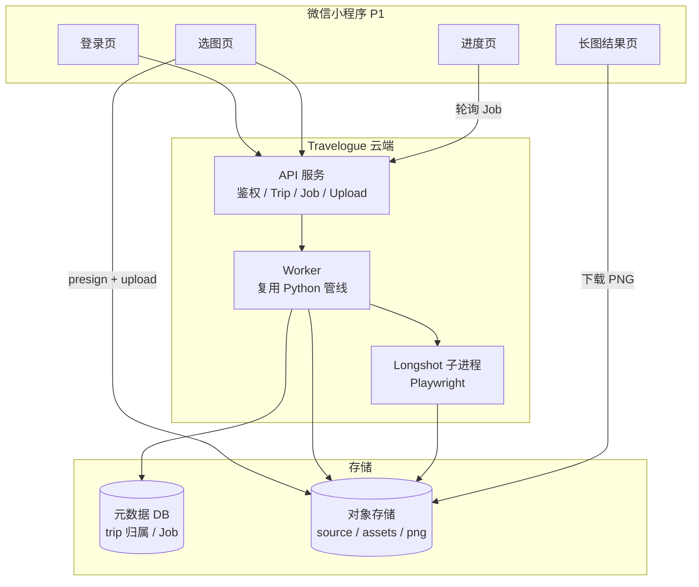
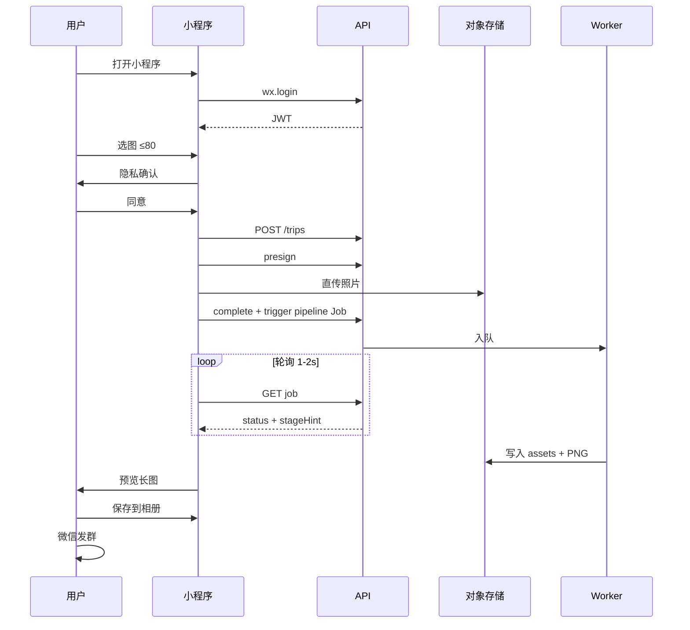

# Travelogue · 小程序 P1 产品需求文档（PRD）

| 属性 | 内容 |
|------|------|
| **产品代号** | Travelogue |
| **文档版本** | v0.2.0-MINIAPP-P1 |
| **状态** | Draft · 待评审 |
| **Phase 代号** | 「小程序 P1 · 混合云长图交付」— 从本地 Studio 向微信生态过渡的 **最小可行云端形态** |
| **前置条件** | Phase 2 Studio 可完成导入→curate→render→export-longshot；`trip.json` v0.2 + schema 稳定；建议 Phase 22 revision 锁与 document/blob 分离约定（ADR-008）至少 MVP 落地 |
| **交付形态** | 微信小程序（**手机微信 + 电脑微信** 双端）：**选图 → 上传 → 等待处理 → 预览/保存长图 PNG → 发微信群** |
| **关联文档** | [CHARTER.md](./CHARTER.md)、[SHARING.md](./SHARING.md)、[API-MINIAPP.md](./API-MINIAPP.md)、[PRD-MINIAPP-PHOTO-PICK-V1.md](./PRD-MINIAPP-PHOTO-PICK-V1.md)（**选图双主权**，细化 `F-MP1-PICK`）、[PRD-PHASE2.md](./PRD-PHASE2.md)、[PRD-PHASE22-storage-platform.md](./PRD-PHASE22-storage-platform.md)、[adr/005-longshot-server-side.md](./adr/005-longshot-server-side.md)、[adr/008-trip-storage-boundaries.md](./adr/008-trip-storage-boundaries.md)、[DATA-MODEL.md](./DATA-MODEL.md)、[ERROR-CODES.md](./ERROR-CODES.md) |
| **实施清单** | [IMPLEMENTATION-MINIAPP-P1.md](./IMPLEMENTATION-MINIAPP-P1.md)（待创建） |
| **验收** | [ACCEPTANCE-MINIAPP-P1.md](./ACCEPTANCE-MINIAPP-P1.md)（待创建） |
| **更新日期** | 2026-07-01 |

> **定位**
>
> Travelogue 当前以 **本地 Studio + 服务端长图** 服务 Windows 桌面用户。小程序 P1 在不重写核心算法的前提下，把 **路径 A（长图直发）** 搬到微信内：**用户在手机选旅行照片，云端 Worker 复用现有 Python 管线，交付竖版 PNG**。
>
> **战略原则（已共识）**
>
> 1. **P1 只做路径 A**，不做路径 B（鉴权 HTML / web-view 阅读）。  
> 2. **保留本地 Studio** 作为工坊子产品线，不废弃。  
> 3. **复用 `trip.json` 契约与 CLI 同等业务函数**，不在小程序内跑 Python。  
> 4. **诚实切换产品承诺**：从「照片留在本机」变为「加密上传、可配置保留期、处理后可删原图」。
>
> **v0.2 变更**：微信小程序在 **电脑版微信** 同样可运行，而「照片本就在电脑、大屏挑图」常使 **PC 成为主使用场景之一**。本版把 **电脑端** 纳入 P1 支持范围：新增 PC persona / 用户故事、跨端能力矩阵（§3.4）、PC 选图与「保存长图」差异（§7.5）、以及相关开放问题。**注意：电脑版微信小程序（云端处理）≠ 本地 Studio（本地处理）**，二者虽都在电脑上，但架构与隐私承诺不同，勿混淆。

---

## 0. PRD 必须说清楚的内容（读者指南）

本文档面向产品、设计、后端、小程序、算法与合规多方。下列章节为 **不可省略** 的决策面；评审时若某节空白，则不应进入开发。

| 章节 | 必须澄清的问题 |
|------|----------------|
| §1 背景 | 为何现在做、与 Studio 的关系、章程边界如何演进 |
| §2 目标/非目标 | P1 范围锁死，防止 scope creep |
| §3 用户与场景 | 谁在什么设备（**手机/电脑**）、什么时间窗、完成什么任务；§3.4 跨端能力矩阵 |
| §4 产品承诺变更 | 隐私、留存、登录心智 — **与 local-first 的差异必须写清** |
| §5 双轨分享 | P1 走路径 A 到什么程度；路径 B 何时做 |
| §6 系统架构 | 小程序 / API / Worker / 存储分工 |
| §7 功能需求 | 按端拆分、带 ID，可追踪验收 |
| §8 用户旅程 | 逐步页面流与异常分支 |
| §9 数据与存储 | document/blob、retention、与 ADR-008 对齐 |
| §10 API 契约 | 引用或摘录关键端点；与 `API-MINIAPP.md` 一致 |
| §11 管线与 Job | 默认跑哪些阶段、默认算法配置、超时与重试 |
| §12 长图交付规格 | 分段、scale、文件大小、保存到相册 |
| §13 非功能需求 | 性能 P90、成本上限、可用性、安全 |
| §14 合规 | 隐私政策要点、微信类目、内容安全（若适用） |
| §15 验收标准 | 可执行的 AC，含种子用户实测 |
| §16 里程碑 | 分阶段交付与 Go/No-Go |
| §17 风险与开放问题 | 未决项必须有默认建议 |

---

## 1. 背景与问题陈述

### 1.1 当前产品状态（As-Is）

| 维度 | 现状 |
|------|------|
| **入口** | 本地 Studio（`127.0.0.1:8766`）或 CLI；Windows 桌面为主 |
| **数据** | local-first：`trips/{id}/trip.json` + 本地 `source/`、`assets/` |
| **管线** | `ingest → curate → layout → narrate → render → export-longshot` |
| **主交付物** | 杂志风 HTML + **微信长图 PNG**（Playwright 服务端截图） |
| **分享** | 用户保存 PNG 到本机，自行拖入微信群 |
| **云端** | 仅可选 LLM / Nominatim；`API-MINIAPP.md` 为设计稿，**未实现** |

Phase 2 已解决「非开发者从文件夹到长图」的 **桌面断裂**；尚未解决 **手机端入口** 与 **无 Windows 设备** 用户的触达。

### 1.2 要解决的断裂点（P1）

| 断裂 | 现状 | P1 目标感受 |
|------|------|-------------|
| **断裂 1 · 设备** | 必须 Windows + 本地 Studio | 微信内选图即可开始 |
| **断裂 2 · 传输** | 照片已在 PC；手机相册需先同步到电脑 | 手机相册 **直接上传** |
| **断裂 3 · 分发** | 长图在 PC 磁盘，再传到手机发群 | 小程序内 **预览 → 保存到相册 → 发群** |
| **断裂 4 · 承诺** | 「照片留在本机」 | 明确 **云端处理 + 留存策略**，不悄悄改心智 |

### 1.3 与章程（CHARTER）的关系

[CHARTER.md](./CHARTER.md) MVP Out of Scope 含「应用商店、账号体系、云同步」。小程序 P1 **有意扩展范围**，需在章程层做 **Phase 级修订**（非 MVP 补丁）：

| 章程条目 | P1 演进 |
|----------|---------|
| 默认本地处理 | → **双模式**：小程序=云端；Studio=本地（保留） |
| 无账号体系 | → **微信 openid 轻登录**，无独立注册 |
| 云同步 Out of Scope | → **Trip 元数据 + Blob 对象存储**；非全设备实时同步 |
| P3 小程序鉴权 HTML | → P1 **不做**；P2 再做路径 B |

### 1.4 P1 产品定位（一句话）

> **把 Phase 2 已验证的「相册 → 杂志长图」管线，包装成微信内的「选图 → 等一等 → 保存长图发群」体验；算法在云端，交互在小程序，交付物仍是路径 A 竖版 PNG。**

---

## 2. 目标与非目标

### 2.1 产品目标

| ID | 目标 | 衡量方式 |
|----|------|----------|
| **G-MP1-01** | 非技术用户可在 **微信内（手机或电脑）** 完成从选图到拿到长图 | ≥3 位种子用户实测（含 ≥1 位电脑端）；记录起止时间 |
| **G-MP1-01b** | **电脑端** 用户能选电脑照片并把长图 **存出/发出** | 电脑端 dogfood 至少 1 人完整走通 |
| **G-MP1-02** | 端到端 P90 **≤15 分钟**（80 张以内、规则 narrate、无 CLIP） | 云端日志 + 客户端埋点 |
| **G-MP1-03** | 长图可直接发微信群，群友 **无需链接** | 与 Phase 2 AC-P2-02 同等视觉标准 |
| **G-MP1-04** | 单次 trip **云端处理成功率 ≥95%**（排除用户侧网络中断） | Job 成功数 / 完成数 |
| **G-MP1-05** | 单次 trip **可变成本可测算** 且 P1 有上限策略 | 成本报表；见 §13.3 |
| **G-MP1-06** | Worker **复用现有 Python 业务函数**，不 fork 第二套逻辑 | 代码审查 + 同 fixture 输出 diff |
| **G-MP1-07** | 隐私承诺 **产品内可见**（首次上传前确认） | UX 验收 + 隐私政策链接 |

### 2.2 非目标（P1 明确不做）

| 类别 | 非目标 |
|------|--------|
| **分享** | 路径 B：鉴权 HTML、web-view 完整游记、share token 阅读 |
| **编辑** | 小程序内改章序、删图、改文案、模板切换、LSE 调试 |
| **Studio 替代** | 不在 P1 废弃或冻结本地 Studio |
| **算法** | 默认启用 CLIP 聚类、ML cull、LLM narrate（均为 **P1 可选升级**，非默认） |
| **社交** | 评论、点赞、公开广场、邀请协作编辑 |
| **商业化** | 订阅、支付、算力包（P3）；P1 仅记录成本 |
| **平台** | iOS/Android 独立 App；抖音/支付宝小程序（**微信手机端 + 电脑端 = P1 范围内**） |
| **视频** | 短视频 ingest（P1 仅照片；视频留 P2） |
| **RAW** | 支持 RAW 格式（与 Agent 0 一致：**拦截并中文说明**） |

### 2.3 后续 Phase 预览（非 P1 承诺）

| Phase | 代号 | 范围 |
|-------|------|------|
| **P2** | 体验完整 | 轻量文案 PATCH、路径 B web-view、书架历史、100→250 张 |
| **P3** | 商业化 | LLM/高清长图/模板皮肤、算力包、本地 Studio Pro |

---

## 3. 目标用户与场景

### 3.1 Persona

**Persona MP1-A · 微信群分享者（P1 主用户 · 手机）**

- 旅行结束后 24–72 小时内想整理照片
- 主力设备是 **手机**；照片在手机相册
- 接受「照片上传云端处理」；接受长图发群后被群友看到
- 不愿学排版工具；不愿配置 API Key
- 期望比九宫格 **更有故事感** 的竖版长图

**Persona MP1-A2 · 电脑整理者（P1 主用户 · 电脑）**

- 相机/手机照片 **已导入电脑**；习惯在 **大屏** 挑图、看排版
- 用 **电脑版微信** 时更愿意在电脑里直接完成，而非切到手机
- 有线/Wi-Fi 网络，上传更快、可传更多张
- 痛点：以为「小程序=只能手机」，或长图做完 **不知怎么从电脑存出/发群**
- **不等于** Studio 用户：多数人不会为此装桌面软件，但愿意用「电脑微信里的小程序」

**Persona MP1-B · Studio 回流用户**

- 已在 PC 用 **本地 Studio** 做过 trip；希望在手机 **只看进度/下载长图**
- P1 **不优先**；P2 可做「云端 trip 与本地 trip 互导」

**Persona MP1-C · 私密分享者（P2）**

- 需要路径 B 鉴权 HTML；**不在 P1**

### 3.2 核心 User Stories

| ID | 作为… | 我想要… | 以便… |
|----|--------|---------|--------|
| **US-MP1-01** | 旅行者 | 微信授权登录后直接使用 | 不用注册账号 |
| **US-MP1-02** | 旅行者 | 从手机相册选旅行照片（首版 ≤80 张）；可 **自己圈定成册** 或 **交给应用精选** | 不用先传到电脑，且选择权在自己 |
| **US-MP1-03** | 旅行者 | 上传前看到隐私与留存说明并确认 | 知道照片会去哪里 |
| **US-MP1-04** | 旅行者 | 看到上传与处理进度（阶段文案） | 知道还要等多久 |
| **US-MP1-05** | 旅行者 | 处理完成后预览长图 | 确认满意再保存 |
| **US-MP1-06** | 旅行者 | 一键保存长图到手机相册 | 直接去微信发群 |
| **US-MP1-07** | 旅行者 | 失败时看到 **中文原因与建议** | 知道是网络、格式还是张数问题 |
| **US-MP1-08** | 旅行者 | 弱网中断后可 **续传或重试** | 不用从头选 80 张 |
| **US-MP1-09** | 旅行者 | 多篇长图过高时 **按章分段** 逐张保存 | 微信发图不被截断 |
| **US-MP1-10** | 运营/开发 | 在后台看到 Job 失败率与耗时 | 快速定位 Worker 问题 |
| **US-MP1-11** | 电脑整理者 | 在 **电脑微信** 里就能用这个小程序 | 照片在电脑，不想再导回手机 |
| **US-MP1-12** | 电脑整理者 | 从 **电脑文件夹** 选旅行照片 | 直接用电脑里的原图 |
| **US-MP1-13** | 电脑整理者 | 长图做好后能 **存到电脑 / 发到手机 / 发给好友** | 电脑没有「手机相册」，也要能发出去 |
| **US-MP1-14** | 电脑整理者 | 电脑端不支持的操作有 **明确提示与替代** | 不会点了没反应、卡住 |

### 3.3 场景约束

| 项 | P1 默认 |
|----|---------|
| 照片上限 | **80 张**（验证稳定后 P2 扩至 250） |
| 时间窗 | 旅行结束后 24–72 小时（与 CHARTER 一致） |
| 网络 | 4G/Wi-Fi/有线；弱网需 degrade 而非 silent fail |
| 设备 | 微信基础库建议 ≥2.25.0；**手机（iOS + Android）+ 电脑版微信（Windows + macOS）** |

### 3.4 跨端能力矩阵（手机 vs 电脑）

> 微信小程序在电脑版微信可运行，但 **部分 API 在 PC 上行为不同或不支持**。下表为 P1 的产品约定；带「⚠ 待验证」的须在 M-MP1-0 用真机/真电脑微信核实（见 §17 OQ-MP1-11）。

| 能力 | 手机端 | 电脑端 | P1 处理 |
|------|--------|--------|---------|
| 登录 `wx.login` | ✅ | ✅ | 一致 |
| 选照片 | 相册 `wx.chooseMedia` | 从 **电脑文件系统** 选（⚠ API 与体验待验证） | 见 §7.5；能力探测后走对应选图 |
| 上传 | 4G/Wi-Fi | 有线/Wi-Fi，通常更快 | 一致；PC 可放宽并发 |
| 进度轮询 | ✅ | ✅ | 一致 |
| 预览长图 | `<image>` | `<image>`（大屏可看更全） | 一致 |
| **保存长图** | 存手机相册 `saveImageToPhotosAlbum` | **PC 无相册**：另存到电脑文件夹 / 「发送到手机」（⚠ 待验证） | 见 §7.5；PC 走替代保存路径 |
| 发到微信群 | 相册→聊天 | 电脑微信直接把文件发给好友/群 | 文案分端引导 |
| 保存到相册授权 | 需授权 | 可能不适用 | 能力探测，PC 不弹无效授权 |

**核心判断**：电脑端 **选图更方便**（照片就在电脑），但 **「拿走长图」更需要设计**（没有手机相册概念）。P1 必须为 PC 提供明确的「存出/发出」路径，否则用户做完却发不出去。

---

## 4. 产品承诺与隐私（必须对外一致）

### 4.1 承诺变更对照

| 维度 | Studio（保留） | 小程序 P1 |
|------|----------------|-----------|
| 照片存放 | 本机 `trips/` | 对象存储（COS/S3 兼容） |
| 登录 | 无需 | 微信 `wx.login` |
| 注册 | 无 | 无（openid 即身份） |
| 长图生成 | 本地 Playwright | **云端 Worker Playwright** |
| 默认 narrate | stub 规则 | **同 stub 规则** |
| GPS | 用户本机可见 | 展示用图 **剥离精确 EXIF**；原图 retention 见 §4.2 |

### 4.2 数据留存策略（P1 默认 · 可配置）

| 数据类型 | 默认留存 | 用户可控 |
|----------|----------|----------|
| 原图（`source/`） | 处理完成后 **7 天** 自动删除 | P2：立即删除选项 |
| 展示 WebP（`assets/`） | 与 trip 同生命周期 **30 天** | 删除 trip 即删 |
| 长图 PNG | **30 天**（供重新下载） | 用户可主动删除 trip |
| `trip.json` 快照 | **30 天** | 同上 |
| 账号元数据（openid） | 长期 | 注销账号流程 P2 |

> **OQ-MP1-01**：7/30 天默认值需法务与成本评审后拍板。

### 4.3 首次上传确认（UX 必做）

用户 **首次** 触发上传前，展示简明说明（可滚动）：

1. 照片将 **加密传输** 至服务器用于排版与生成长图  
2. 原图默认 **7 天后删除**（链接隐私政策全文）  
3. 长图由用户 **自行保存并发群**；产品不对微信群传播做访问控制（对齐 [SHARING.md](./SHARING.md) §2.3）  
4. 勾选「我已阅读并同意」后可继续  

写入 `privacy.confirmedAt`（ISO 8601）至 trip；未确认 **禁止** 触发 ingest Job。

### 4.4 隐私政策 / 用户协议（合规交付物）

P1 上线前必须有独立 H5 或小程序内页，至少覆盖：

- 收集项：照片、EXIF（处理后剥离）、openid、设备信息  
- 用途：排版、长图生成、故障排查  
- 第三方：云存储、（若启用）LLM 提供商  
- 保留期与删除方式  
- 联系方式  

---

## 5. 分享策略（P1 范围）

严格遵循 [SHARING.md](./SHARING.md) **路径 A**：

| 项 | P1 规格 |
|----|---------|
| 交付物 | 竖版 PNG（9:16 杂志风） |
| 鉴权 | **无**（长图文件 URL 或临时下载链；不做过链公开索引） |
| 分段 | 高度 **>5000px** 或单章 **>60** media-card → `{title}-ch{nn}.png` |
| 默认 scale | **2**（与 Studio UI 推荐一致；见 ADR-005 D4） |
| 预览 | 小程序 `<image>` 或内置预览页；**不做** HTML 卷轴阅读 |

路径 B（小程序 web-view + token）整体 **defer 至 P2**。

---

## 6. 系统架构

### 6.1 逻辑架构



### 6.2 与本地 Studio 的关系（双产品线）

| 能力 | 本地 Studio | 小程序 P1 |
|------|-------------|-----------|
| 批量文件夹导入 | ✅ | ❌ |
| 手机相册选图 | ❌ | ✅ |
| 深度编辑 | ✅ | ❌ |
| 模板/LSE 治理 | ✅ internal | ❌ |
| 长图交付 | ✅ | ✅ |
| 数据 SSOT | 本地 `trips/` | 云端 snapshot + COS |
| 互相同步 | ❌ P1 | P2 评估 |

**原则**：同一套 **渲染与长图逻辑**；不同 **入口与存储**。

### 6.3 技术栈（P1）

| 层 | 选型 |
|----|------|
| 小程序 | 微信原生 或 Taro（**OQ-MP1-02** 待决） |
| API | Python FastAPI / 现有栈扩展（**OQ-MP1-03**） |
| Worker | 容器 / 队列；复用 `travelogue` 包 |
| 队列 | Redis + RQ / Celery / 云 SCF+MQ（**OQ-MP1-04**） |
| 元数据 | SQLite 或 PostgreSQL（仅 trip 归属、Job；**非** chapters 拆表） |
| 对象存储 | 腾讯云 COS（微信生态优先）或 S3 兼容 |
| 长图 | Playwright + Chromium（Worker 内） |
| CDN | P1 可用 COS 默认域名；自定义域名需备案 |

---

## 7. 功能需求

### 7.1 小程序端

| ID | 需求 | 优先级 | 验收要点 |
|----|------|--------|----------|
| **F-MP1-LOGIN** | `wx.login` → 后端换 JWT；token 本地缓存与刷新 | P0 | 冷启动免重复授权（session 有效时） |
| **F-MP1-PLATFORM** | 启动时用 `wx.getDeviceInfo`/`getSystemInfo` 探测 **平台（手机/PC）**，驱动选图与保存路径分端 | P0 | PC 与手机各自走对应分支；不暴露无效操作 |
| **F-MP1-PICK** | 选图：**双主权**（我来选图 / 交给应用挑）；手机 `wx.chooseMedia`；**电脑从文件系统选**（见 §7.5）；首版仅 image；计数与 80 上限。**细则以 [PRD-MINIAPP-PHOTO-PICK-V1.md](./PRD-MINIAPP-PHOTO-PICK-V1.md) 为准** | P0 | 两端均可选到图；超上限中文提示；模式与 cull 默认映射见选图 PRD |
| **F-MP1-CONSENT** | 首次上传隐私确认；写 `privacy.confirmedAt` | P0 | 未确认不可上传（两端一致） |
| **F-MP1-UPLOAD** | presign → 直传 COS → complete；展示上传进度 | P0 | 单张失败可重试 |
| **F-MP1-RESUME** | 上传中断后从 failed 对象续传（P1 可简化为「重选未传完」） | P1 | 见 §17 OQ-MP1-05 |
| **F-MP1-PROGRESS** | 轮询 Job；阶段文案映射 `pipeline.status` | P0 | 见 §7.4 文案表 |
| **F-MP1-PREVIEW** | 长图完成後预览；支持多段 PNG 左右滑 | P0 | 与 Studio 长图视觉一致 |
| **F-MP1-SAVE** | 取回长图：手机 `wx.saveImageToPhotosAlbum`（授权引导）；**电脑 走替代路径**（存电脑/发送到手机/发好友，见 §7.5） | P0 | 两端都能把长图「拿走」；保存成功反馈 |
| **F-MP1-ERR** | 错误码映射中文（复用 ERROR-CODES）；含 **电脑端不支持操作** 的替代提示 | P0 | 无裸 `E_*` 暴露；PC 无「点了没反应」 |
| **F-MP1-SHELF** | 历史 trip 列表 | P2 | P1 可只做「当前 trip」 |
| **F-MP1-EDIT** | 改标题/hook | P2 | defer |

### 7.2 API 服务

| ID | 需求 | 优先级 |
|----|------|--------|
| **F-MP1-API-AUTH** | `POST /auth/wechat/login` | P0 |
| **F-MP1-API-TRIP** | `POST/GET/PATCH/DELETE /trips` | P0 |
| **F-MP1-API-UPLOAD** | presign + complete | P0 |
| **F-MP1-API-JOB** | `POST /trips/{id}/jobs` + `GET .../jobs/{jobId}` | P0 |
| **F-MP1-API-LONG** | Job type `export_longshot` 或 pipeline 含 export 阶段 | P0 |
| **F-MP1-API-DL** | 长图 signed URL 或临时下载 | P0 |

详细契约见 [API-MINIAPP.md](./API-MINIAPP.md)；P1 实现子集见 §10。

### 7.3 Worker

| ID | 需求 | 优先级 |
|----|------|--------|
| **F-MP1-WK-INGEST** | 从 COS 拉 source → ingest_into_trip | P0 |
| **F-MP1-WK-PIPE** | 默认一键 pipeline 至 longshot | P0 |
| **F-MP1-WK-RENDER** | assets URL 回写 HTTPS | P0 |
| **F-MP1-WK-LNG** | Playwright export-longshot；scale=2 | P0 |
| **F-MP1-WK-VALID** | 每阶段后 validate trip schema | P0 |
| **F-MP1-WK-ISO** | 单 Job 单 Worker 进程；超时可 kill | P0 |
| **F-MP1-WK-RET** | 任务结束触发 retention 计时 | P1 |

### 7.4 进度阶段文案（用户可见）

| `pipeline.status`（简化） | 用户文案 |
|---------------------------|----------|
| `draft_ingest` / 上传中 | 正在上传照片… |
| `ingest_ready` → curate 中 | 正在整理照片、分章节… |
| structure / layout | 正在排版… |
| narrate | 正在撰写文案… |
| render | 正在生成页面… |
| export / longshot | 正在生成长图… |
| `exported` | 完成了 |

### 7.5 电脑端专项规格（PC 差异必读）

电脑端与手机端 **登录、上传、进度、预览、云端处理完全一致**；差异集中在 **两端** —— 选图入口 与 取回长图。

#### 7.5.1 选图（PC）

| 项 | 规格 |
|----|------|
| 入口 | 电脑版微信小程序从 **电脑文件系统** 选图；优先复用 `wx.chooseMedia`，若 PC 表现受限则回退 `wx.chooseMessageFile`/文件选择（⚠ 待 OQ-MP1-11 验证） |
| 计数 | 与手机同：≤80 张、仅 image |
| 优势 | 照片多在电脑，选原图更直接；有线网络上传更快 |
| 提示 | 若 PC 选图 API 受限，给中文引导（如「从聊天/文件选择」），不静默失败 |

#### 7.5.2 取回长图（PC · 最关键）

> **电脑没有「手机相册」概念**，`saveImageToPhotosAlbum` 在 PC 可能不可用。P1 必须为 PC 提供可用的「拿走长图」路径，否则用户做完发不出去。

| 方案 | 说明 | P1 取舍 |
|------|------|---------|
| 另存到电脑 | 把 PNG 保存到电脑文件夹（若 API 支持 `saveFileToDisk` 类能力） | 首选（⚠ 待验证） |
| 发送到手机/文件传输助手 | 电脑微信内把长图发给「文件传输助手」再从手机发群 | 兜底、可靠 |
| 直接发给好友/群 | 电脑微信内把图片文件拖/发到会话 | 引导文案支持 |
| 提供下载链接 | 展示 signed URL / 二维码，让用户在别处下载 | 最终兜底 |

**P1 要求**：PC 端「保存」按钮点开后，**至少提供一条可靠路径**（发送到手机 或 下载链接），并配中文说明；不得只放一个在 PC 无效的「保存到相册」。

#### 7.5.3 文案分端

| 场景 | 手机文案 | 电脑文案 |
|------|----------|----------|
| 保存成功 | 已保存到相册 | 已保存到电脑 / 已发送到手机 |
| 发群引导 | 去微信群发送这张长图 | 在电脑微信里把长图发给好友或群 |
| 无法保存 | — | 该操作在电脑暂不支持，可「发送到手机」或「复制下载链接」 |

---

## 8. 用户旅程（Happy Path）



### 8.1 关键异常分支

| 场景 | 产品行为 |
|------|----------|
| 选图含 RAW | 上传前或 ingest 失败：中文说明「不支持 RAW，请选 JPG/HEIC」 |
| 张数 < 最低阈值 | 「至少需要 N 张照片才能排版」 |
| 上传超时 | 重试单张；连续失败提示换 Wi-Fi |
| Job failed | 展示 `error.message` + 「重试」按钮（重新触发 pipeline，skip 已成功阶段 — 依赖 Phase 22 增量） |
| 长图 OOM | Worker 自动按章分段；小程序展示多张 |
| 保存相册被拒权（手机） | 引导打开设置 |
| **电脑端保存到相册不可用** | 不弹无效授权；改提供「发送到手机 / 下载链接 / 发给好友」（见 §7.5.2） |
| **电脑端选图 API 受限** | 中文引导替代选图方式；不静默失败（见 §7.5.1） |

---

## 9. 数据与存储

### 9.1 三层分离（ADR-008）

| 层 | P1 落地 |
|----|---------|
| **Document** | `trip.json` 快照存 Meta DB + COS `trips/{id}/trip.json` |
| **Blob** | `source/*`、`assets/*`、`*.png` → COS；content-addressable 可选 P2 |
| **Derived** | HTML 中间产物可 ephemeral；长图 PNG 持久 30 天 |

### 9.2 Schema 规则

- 响应中 `trip` **严格**符合 `schemas/trip.schema.json` v0.2  
- 云端字段（`ownerId`、`publish`）作为 **兄弟键**，不塞进 `trip`（见 API-MINIAPP §4）  
- `assets[].displayFile` 允许 HTTPS 绝对 URL  

### 9.3 Trip 命名

- `tripId`：用户可编辑标题 slug 或服务端生成 `trip-{date}-{rand}`  
- 与 CLI 目录名规则兼容，便于 Worker 复用  

---

## 10. API 契约（P1 实现子集）

完整草案：[API-MINIAPP.md](./API-MINIAPP.md)。P1 **必须**实现：

| 方法 | 路径 | 说明 |
|------|------|------|
| POST | `/auth/wechat/login` | code → JWT |
| POST | `/trips` | 创建 trip |
| GET | `/trips/{tripId}` | 含 pipeline 状态 |
| POST | `/trips/{tripId}/uploads/presign` | 批量 presign |
| POST | `/trips/{tripId}/uploads/complete` | 完成上传 |
| POST | `/trips/{tripId}/jobs` | type=`pipeline` 或等价一键任务 |
| GET | `/trips/{tripId}/jobs/{jobId}` | 轮询 |
| GET | `/trips/{tripId}/deliverables/longshot` | 长图 URL 列表（**P1 新增端点名**，实现时可调整） |

P1 **不实现**：`publish`、`share-url`、web-view token。

### 10.1 默认 Pipeline Job 定义

```json
{
  "type": "pipeline",
  "options": {
    "from": "ingest",
    "until": "export",
    "exportLayout": "mobile",
    "narrate": { "mode": "stub" },
    "longshot": { "scale": 2, "segment": true },
    "applyLayout": true,
    "autoLock": true
  }
}
```

与 Studio 默认行为对齐（自动 lock structure/copy — 参考 Phase 2 OQ-P2-06）。

---

## 11. 管线、算法与 Job 策略

### 11.1 P1 默认算法配置

| 阶段 | P1 默认 | 备注 |
|------|---------|------|
| ingest | 全开（dedupe、WebP、审美信号） | RAW 拦截 |
| curate | 规则 + native clustering | **不默认 CLIP** |
| layout / LSE | mobile exportLayout | 与 Phase 2 一致 |
| narrate | **stub** | LLM P2 可选 |
| render | visual-journal | 唯一模板 |
| export | longshot scale=2 | ADR-005 |

### 11.2 Job 超时与重试

| 项 | 值 |
|----|-----|
| 单 Job 超时 | 10 min（80 张） |
| 轮询间隔 | 1–2 s |
| 客户端总等待 | 15 min 后提示「仍在处理，完成后通知」— 订阅消息 **P2** |
| Worker 重试 | 瞬时失败最多 2 次 |

### 11.3 增量 pipeline（依赖）

若 Phase 22 增量未就绪：Job 失败重跑 **全链**（接受 P1 成本）；若已就绪：重试 skip 已成功阶段。

---

## 12. 长图交付规格

| 项 | 规格 |
|----|------|
| 输入 | `index-longshot.html`（Worker 内 HTTP 服务或 file server） |
| 宽度 | 390px × scale（scale=2 → 780px 物理宽） |
| 分段 | >5000px 高 → 按章 PNG |
| 格式 | PNG |
| 最大文件 | 单张建议 ≤15MB；超出提示分段 |
| 质量 | 与 Studio `--scale 2` golden 对比 SSIM / 人工抽检 |
| 交付 | COS signed URL；小程序下载后保存相册 |

---

## 13. 非功能需求

### 13.1 性能

| 指标 | P1 目标 |
|------|---------|
| 上传 80 张（手机 Wi-Fi） | P90 ≤5 min |
| 上传 80 张（电脑有线/Wi-Fi） | P90 ≤3 min（通常更快） |
| 处理 80 张 | P90 ≤8 min |
| 端到端 | P90 ≤15 min（两端同标） |
| API p99 延迟 | ≤500 ms（不含 Worker） |

### 13.2 可用性

| 指标 | 目标 |
|------|------|
| API 月度可用性 | ≥99.5% |
| Job 成功率 | ≥95% |

### 13.3 成本（单 trip 估算框架）

| 成本项 | 估算变量 |
|--------|----------|
| 存储 | 原图 MB × 留存天 |
| egress | 长图下载次数 |
| 计算 | Worker CPU-min + Playwright |
| LLM | P1 默认 **0** |

**P1 要求**：上线前用 demo-2025-8 级别 album 实测填表；设定 **单 trip 成本上限**（OQ-MP1-06）。

### 13.4 安全

- HTTPS only  
- JWT 短期有效；refresh 策略  
- COS presign 限时  
- 长图 URL 短期 signed；不可枚举  
- 日志 **不** 打印 openid 与 EXIF 明文  

---

## 14. 合规与微信生态

| 项 | P1 要求 |
|----|---------|
| 小程序类目 | 工具 / 图片处理（**OQ-MP1-07** 确认） |
| 权限 | `chooseMedia`、`saveImageToPhotosAlbum`（手机）、用户信息 optional；**电脑端按实际支持的能力申请，缺失能力走 §7.5 替代** |
| 备案 | API 域名 + COS 自定义域名 |
| 隐私政策 | 必须；见 §4.4 |
| 内容安全 | P1 无 UGC 公开分享；**可不接** msgSecCheck；P2 路径 B 必须接 |
| 订阅消息 | Job 完成通知 — P2 |

---

## 15. 验收标准

| ID | 验收项 | 方法 |
|----|--------|------|
| **AC-MP1-01** | 新用户微信登录 → 选 30 张 → 得长图 → 保存相册 | 3 人实测 |
| **AC-MP1-02** | 长图视觉与 Studio `--scale 2` 同 trip **无明显版式差异** | 并排对比 |
| **AC-MP1-03** | 80 张端到端 P90 ≤15 min | 云端日志 10 次 |
| **AC-MP1-04** | RAW 拦截中文提示 |  fixture 测试 |
| **AC-MP1-05** | 未确认隐私无法上传 | 自动化 |
| **AC-MP1-06** | >5000px 自动分段且可逐张保存 |  synthetic trip |
| **AC-MP1-07** | Job 失败展示中文原因 | 注入失败 |
| **AC-MP1-08** | `trip.json` 通过 schema validate | Worker 输出 |
| **AC-MP1-09** | 原图 7 天后删除（可测缩短 TTL） | 生命周期测试 |
| **AC-MP1-10** | Studio 同管线 regression 不回退 | pytest CI |
| **AC-MP1-11** | **电脑版微信** 完成：选电脑照片 → 处理 → 预览 → 取回长图 | 电脑端实测 ≥1 人 |
| **AC-MP1-12** | 电脑端 **无「点了无反应」**：不支持的操作给中文替代 | 手测 PC 保存/选图分支 |

详细步骤见 [ACCEPTANCE-MINIAPP-P1.md](./ACCEPTANCE-MINIAPP-P1.md)（待创建）。

---

## 16. 里程碑与 Go/No-Go

| 里程碑 | 周期（建议） | 交付 | Go 条件 |
|--------|--------------|------|---------|
| **M-MP1-0 · 契约冻结** | W1 | API 子集 OpenAPI；COS 桶；Worker spike 跑通 demo trip；**电脑版微信 选图/保存 能力验证（OQ-MP1-11/12）** | 本地 Worker 输出 PNG；PC 能力矩阵 §3.4 落定 |
| **M-MP1-1 · 上传闭环** | W2 | presign + complete + ingest Job | 80 张入库 |
| **M-MP1-2 · 管线闭环** | W3–4 | pipeline Job + longshot | AC-MP1-02 |
| **M-MP1-3 · 小程序 MVP** | W4–5 | 登录/选图/进度/预览/保存（**含 PC 分端选图与取回长图**） | AC-MP1-01；AC-MP1-11 |
| **M-MP1-4 · 种子内测** | W6 | 5–10 人 dogfood | 成功率 ≥90% |
| **M-MP1-5 · 审核上线** | W7–8 | 隐私政策、类目、灰度 | 合规签字 |

**No-Go 条件**：单 trip 成本超上限且无优化路径；Playwright 在目标 Worker 环境不稳定；微信审核类目不可行。

---

## 17. 风险、缓解与开放问题

### 17.1 风险

| 风险 | 影响 | 缓解 |
|------|------|------|
| 隐私承诺反弹 | 用户不信任上传 | §4 明示 + 短 retention |
| 上传体验差 | 80 张劝退 | P1 限 80；续传；Wi-Fi 提示 |
| Worker Playwright 不稳定 | 长图空白 | ADR-005 fallback；按章重试 |
| 成本失控 | 不可持续 | 默认 stub/无 CLIP；队列限流 |
| 与 Studio 逻辑分叉 | 双份 bug | 强制复用 Python 包；golden diff |
| Phase 22 未就绪 | 重跑贵、慢 | M-MP1-0 评估；可接受 P1 全链重跑 |
| 微信审核 | 延迟上线 | 提前类目咨询；隐私页齐全 |
| **PC 选图/保存 API 不如预期** | 电脑端走不通 | M-MP1-0 真机验证（OQ-MP1-11）；备好「发送到手机/下载链接」兜底 |
| **用户混淆「电脑小程序」与「本地 Studio」** | 隐私误解 | 文案明确「电脑微信里=云端上传」；与 Studio 分区表述 |

### 17.2 开放问题

| ID | 问题 | 建议默认 |
|----|------|----------|
| **OQ-MP1-01** | 原图/asset 留存天数 | 7 / 30 天 |
| **OQ-MP1-02** | 小程序框架 | 原生（首版简单） |
| **OQ-MP1-03** | API 框架 | FastAPI 新服务，与 Studio 代码 monorepo |
| **OQ-MP1-04** | 任务队列 | Redis + RQ |
| **OQ-MP1-05** | 上传续传 | P1 整批重传；P1.1 断点续传 |
| **OQ-MP1-06** | 单 trip 成本上限 | 待 spike 填表 |
| **OQ-MP1-07** | 小程序类目 | 工具-图片处理 |
| **OQ-MP1-08** | P1 是否接 LLM 可选按钮 | **否**；P2 |
| **OQ-MP1-09** | 多 trip 书架 | P2 |
| **OQ-MP1-10** | COS 厂商 | 腾讯云 COS |
| **OQ-MP1-11** | 电脑版微信小程序 **选图 API** 实际能力（`chooseMedia`/`chooseMessageFile`/文件系统） | M-MP1-0 真机验证；以验证结果定 §7.5.1 |
| **OQ-MP1-12** | 电脑端 **保存长图** 可用能力（另存到磁盘 / 发送到手机 / 下载链接） | 至少保证一条兜底路径 |
| **OQ-MP1-13** | 是否需要「电脑做、手机取」跨端接续（同账号在手机看到电脑 trip） | 建议 P1 即支持（同 openid 拉列表）；否则 PC 取图更难 |
| **OQ-MP1-14** | 电脑端最低微信版本 / 基础库门槛 | 验证后写入 §3.3 |

---

## 18. 成功指标（上线后 30 天）

| 指标 | 目标 |
|------|------|
| 完成率（创建 trip → 保存长图） | ≥60% |
| 平均端到端时长 P90 | ≤15 min |
| Job 成功率 | ≥95% |
| 种子用户 NPS 开放式「愿推荐」 | ≥3/5 人提及「愿发群」 |
| Studio 回归 | 0 P0 bug |

---

## 19. 附录

### 19.1 术语表

| 术语 | 定义 |
|------|------|
| **路径 A / B** | [SHARING.md](./SHARING.md) |
| **P1 / P2 / P3** | 小程序产品分期，非开发 Phase 编号 |
| **Studio** | 本地 `travelogue studio`，继续维护 |
| **Worker** | 云端执行 Python 管线的异步进程 |
| **Document / Blob** | ADR-008 分层 |

### 19.2 文档修订记录

| 版本 | 日期 | 说明 |
|------|------|------|
| v0.1.0 | 2026-07-01 | 初稿：P1 混合云长图交付 |
| v0.2.0 | 2026-07-01 | 增补电脑端使用：新增 PC persona（MP1-A2）、US-11~14、跨端能力矩阵 §3.4、PC 专项规格 §7.5（选图/取回长图/文案分端）、F-MP1-PLATFORM、PC 异常分支、PC 性能、AC-MP1-11/12、OQ-MP1-11~14 |
| v0.2.1 | 2026-07-11 | `F-MP1-PICK` / US-02 对齐选图双主权；细则见 [PRD-MINIAPP-PHOTO-PICK-V1.md](./PRD-MINIAPP-PHOTO-PICK-V1.md) |

### 19.3 待创建配套文档

| 文档 | 用途 |
|------|------|
| IMPLEMENTATION-MINIAPP-P1.md | 工程任务拆解 |
| ACCEPTANCE-MINIAPP-P1.md | 测试用例与 dogfood 脚本 |
| [PRD-MINIAPP-PHOTO-PICK-V1.md](./PRD-MINIAPP-PHOTO-PICK-V1.md) | 选图双主权（已起草） |
| ADR-013-miniapp-cloud-boundary.md | Studio vs 云端边界 ADR（建议） |

---

*本文档描述从当前本地 Studio 产品态向微信小程序 P1 过渡的需求边界。评审通过后，应同步修订 CHARTER Out of Scope 与 ROADMAP 索引。*
