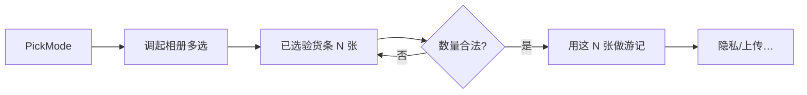
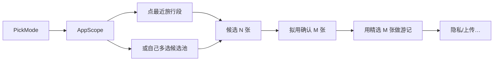

# Travelogue · 小程序选图体验 V1 产品需求文档（PRD）

| 属性 | 内容 |
|------|------|
| **产品代号** | Travelogue |
| **文档版本** | v1.0.0-MINIAPP-PICK |
| **状态** | Draft · 待评审 |
| **主题代号** | 「选图双主权」— 用户自选 / 应用代选，选择权在用户 |
| **父文档** | [PRD-MINIAPP-P1.md](./PRD-MINIAPP-P1.md)（替换并细化其中 `F-MP1-PICK`） |
| **关联文档** | [API-MINIAPP.md](./API-MINIAPP.md) · [PRD-PHOTO-CULL-USER-TOGGLE.md](./PRD-PHOTO-CULL-USER-TOGGLE.md) · [PRD-KEEP-BURST-TOGGLE.md](./PRD-KEEP-BURST-TOGGLE.md) · [PRD-IMPORT-SHEET-v3-WIZARD.md](./PRD-IMPORT-SHEET-v3-WIZARD.md) · [PRD-PHASE9.md](./PRD-PHASE9.md) |
| **实施清单** | [IMPLEMENTATION-MINIAPP-PHOTO-PICK-V1.md](./IMPLEMENTATION-MINIAPP-PHOTO-PICK-V1.md)（待创建） |
| **验收** | [ACCEPTANCE-MINIAPP-PHOTO-PICK-V1.md](./ACCEPTANCE-MINIAPP-PHOTO-PICK-V1.md)（待创建） |
| **线框** | [wireframes/miniapp-photo-pick-v1-wireframe.html](./wireframes/miniapp-photo-pick-v1-wireframe.html)（待创建） |
| **更新日期** | 2026-07-11 |

> **定位**
>
> 手机端「指定文件夹」远不如电脑方便。本 PRD 定义小程序 **选图阶段** 的完整体验：把「哪些图进这本游记」的决定权交给用户——既可以 **自己方便地圈定成册集合**，也可以 **把候选池交给应用智能挑选**。选图之后的上传、管线、长图交付仍遵循 [PRD-MINIAPP-P1.md](./PRD-MINIAPP-P1.md)，本文件不改下游契约，只补齐入口心智与交互。
>
> **产品铁律**
>
> 1. **选择权在用户** — 自选与代选均为一等公民，不做隐形默认替用户「偷偷扔掉」已明确自选的图。  
> 2. **手机主路径不模仿桌面选夹** — 以相册多选 + 时间段粗收替代「文件夹路径」。  
> 3. **粗收与精选分离** — 「交给应用」先收候选池，再展示拟用集合；「我来选」直接形成成册集合。  
> 4. **与 Studio 智能默认对齐** — 代选默认开启 photo cull / 连拍择优；自选默认跳过二次剔除（对齐 P9-F1「我已预筛选」心智）。  
> 5. **验货前移** — 上传前必须让用户看见「将用多少张、大概成册感」，避免盲传。

---

## 0. 读者指南

| 章节 | 必须澄清的问题 |
|------|----------------|
| §1 | 为何手机不能照搬选夹；双主权要解决什么 |
| §2 | 目标 / 非目标 / 与 Miniapp P1 边界 |
| §3 | 两种选图模式的定义与切换 |
| §4 | 信息架构与页面流 |
| §5 | 功能需求（可验收 ID） |
| §6 | 数量、引导与上限策略 |
| §7 | 与管线 / intent / cull 的契约 |
| §8 | 电脑端差异 |
| §9 | 埋点与成功指标 |
| §10 | 验收标准 |
| §11 | 开放问题 |

---

## 1. 背景与问题

### 1.1 桌面 vs 手机的选图断裂

| 维度 | Studio（桌面） | 小程序（手机）若不做设计 |
|------|----------------|--------------------------|
| 主动作 | 选一个 **文件夹** | 只能进系统相册 **一张张点** |
| 候选范围 | 文件夹边界即「这一趟」 | 相册混杂多年多地，难找边界 |
| 精选责任 | 可交给 cull（文件夹常偏杂） | 用户若已精点，再 cull 会伤信任 |
| 验货 | `album-preview` 张数 + 缩略图 | 多选过程中「我选了啥」难感知 |

### 1.2 问题陈述（P-PICK-*）

| ID | 问题 | 影响 |
|----|------|------|
| **P-PICK-01** | 仅提供「多选相册」时，用户既怕漏又怕多 | 放弃或胡乱少选，成册质量差 |
| **P-PICK-02** | 仅提供「全交给 AI」时，控制感不足 | 丢重要瞬间；不信任产品 |
| **P-PICK-03** | 自选集合仍被强行 cull | 「我明明选了」的背刺感（Studio 已用 P9-F1 规避） |
| **P-PICK-04** | 上传前无验货 | 传完才发现张数不对 / 传了废片 |
| **P-PICK-05** | 无数量引导 | 不知道「多少张合适」，卡在选图页 |

### 1.3 核心判断

> **不要二选一做成对立功能，而要做成同一目标下的两种主权声明。**  
> - **我来选**：用户定义成册集合 → 应用忠实排版。  
> - **交给应用**：用户定义候选池（时间段 / 大批量）→ 应用定义成册集合 → 用户轻确认。  
> 两种路径在「确认上传」汇合，下游 Job 契约一致。

---

## 2. 目标与非目标

### 2.1 目标

| ID | 目标 | 衡量 |
|----|------|------|
| **G-PICK-01** | 用户在选图首页 **一眼看懂两种方式**，无需教程 | 5 人走查：≥4 人正确描述差异 |
| **G-PICK-02** | 「我来选」路径：从打开相册到确认集合 **≤60 秒**（中位，约 30–50 张） | 埋点 `pick_confirm - pick_mode_choose` |
| **G-PICK-03** | 「交给应用」路径：时间段一键 → 拟用确认 **≤2 次主点击**（不含系统相册授权） | 走查 + 埋点 |
| **G-PICK-04** | 自选路径 **默认不二次 cull**；代选路径 **默认 cull**；用户可改 | intent 审计 + AC |
| **G-PICK-05** | 上传前 100% 展示拟用张数与缩略验货条 | AC-PICK-VERIFY |
| **G-PICK-06** | 选图完成率（进入选图 → 触发上传）≥70%（种子期） | 漏斗 |

### 2.2 非目标（本 PRD 不做）

| 非目标 | 说明 |
|--------|------|
| 小程序内深度编辑成册集合（拖拽章序、逐张恢复被筛图 Gallery） | 对齐 Miniapp P1 / P9 MVP；被筛图恢复留 P2 |
| 读取相册全库做本地索引 / 常驻「旅行时间轴」后台扫描 | iOS/Android 权限与审核风险；V1 用系统选择器 + 轻量时间提示 |
| 视频选入 | 同 Miniapp P1：仅 image |
| 替代隐私确认 / 上传 / Job / 长图保存 | 仍归 [PRD-MINIAPP-P1.md](./PRD-MINIAPP-P1.md) |
| 微信聊天记录批量导入为默认主路径 | V1.1 候选（见 §11） |

### 2.3 与父 PRD 的边界

| 事项 | 归属 |
|------|------|
| 登录、隐私确认、presign 上传、Job、长图保存 | Miniapp P1 |
| 选图模式、集合确认、数量引导、cull 默认映射 | **本文** |
| `F-MP1-PICK` 条文 | 以本文为准；P1 文档改为引用 |

---

## 3. 设计决策：双主权模式

### 3.1 模式定义

| 模式 ID | 用户可见名 | 一句话 | 用户交付物 | 应用职责 |
|---------|------------|--------|------------|----------|
| **`user_curated`** | **我来选图** | 你定哪些进册 | **成册集合**（最终集） | 忠实 ingest；**默认关闭** photo cull |
| **`app_assisted`** | **交给应用挑** | 你圈范围，我帮你挑 | **候选池**（可大于成册） | 智能挑选 + 连拍择优；展示拟用集供确认；**默认开启** cull |

### 3.2 首页双卡（必选其一，不可跳过）

```
┌─────────────────────────────────────┐
│  做一本游记长图                        │
│  先决定：谁来挑图？                     │
├─────────────────────────────────────┤
│  ┌──────────────┐  ┌──────────────┐ │
│  │ 我来选图      │  │ 交给应用挑    │ │
│  │ 自己点选要的  │  │ 圈出这一趟    │ │
│  │ 适合已有精选  │  │ 适合相册很杂  │ │
│  └──────────────┘  └──────────────┘ │
│  稍后仍可返回改方式                     │
└─────────────────────────────────────┘
```

**默认高亮**：不做系统替用户预选模式；**记忆**：第二次起可读本地偏好（`lastPickMode`），但首页仍展示双卡，避免锁死。

### 3.3 模式对照（决策表）

| 维度 | 我来选图 `user_curated` | 交给应用挑 `app_assisted` |
|------|-------------------------|---------------------------|
| 系统相册动作 | `wx.chooseMedia` 多选 | 优先「时间段建议」→ 再批量选入候选；或直接多选大批量 |
| 选完后的对象 | = 拟上传集合 | = 候选池 → 本地/边缘规则出 **拟用集** → 用户确认 |
| 默认 `intent.photoCull` | `enabled: false` | `enabled: true` |
| 默认连拍择优 | 关（尊重用户连拍意图） | 开（对齐 Studio 快速分享） |
| 主 CTA 文案 | 「用这 N 张做游记」 | 「用精选 M 张做游记」（可展开看候选 N） |
| 适合谁 | 已刷过相册、有明确审美 | 刚结束旅行、相册很杂、懒得精点 |

### 3.4 可切换性

- 确认上传 **之前**：可返回模式首页重选；已选媒体可提示「更换方式将清空当前选择」。  
- 确认上传 **之后**：不可改模式；重做需新建 trip（P1 无书架编辑）。

---

## 4. 信息架构与用户旅程

### 4.1 页面栈

| 页 | 代号 | 说明 |
|----|------|------|
| 选图模式 | `PickMode` | 双卡 |
| 自选相册 | `UserPick` | 调起系统选择器 + 已选验货条 |
| 代选范围 | `AppScope` | 时间段建议 / 自己圈选候选 |
| 拟用确认 | `CullConfirm` | **仅 `app_assisted`**：展示拟用 M / 跳过 N−M |
| 数量与偏好 | `PickPrefs`（可折叠抽屉） | 可选：是否允许智能再挑、标题草稿等；V1 最小集 |
| → 汇合 | 隐私确认（若首次）→ 上传 → 进度… | 归 P1 |

### 4.2 Happy Path A · 我来选图



### 4.3 Happy Path B · 交给应用挑



### 4.4 「最近旅行段」如何来（V1 务实方案）

微信小程序 **无法静默遍历整机相册**。V1 采用：

| 层级 | 做法 | 说明 |
|------|------|------|
| **L0（必做）** | 文案引导 + 一键打开相册 | 「选出这一趟的照片（可多选，多了我们帮你挑）」 |
| **L1（推荐）** | **时间段芯片**（客户端生成，不读相册） | 如「近 3 天」「近 7 天」「上周末」；点击后仍进系统相册，并 toast：「请选择该时段内的照片」 |
| **L2（P1.1）** | 若基础库支持有限相册能力再增强 | 不阻塞 V1 |

> **诚实原则**：时间芯片是 **意图声明 + 引导**，不是保证系统相册已滤好；滤镜能力因系统而异时，以文案降低预期。

### 4.5 关键异常

| 场景 | 行为 |
|------|------|
| 拒绝相册权限 | 中文说明 + 去设置；双模式均不可继续 |
| 自选 N &lt; 最低张数 | CTA 禁用 + 「至少再选 k 张」 |
| 自选 / 候选 N &gt; 上限 | 阻止确认；提示删减或改走代选（若自选超上限且开启「允许应用再挑」——见 §6） |
| 代选候选过少 | 同最低张数 |
| 代选拟用 M 过少 | 提示放宽 / 补选 / 关闭部分挑剔规则（高级，V1 可仅「重新圈选」） |
| 用户从拟用集「补回」单张 | V1：**不做**逐张 Gallery；提供「重新选择候选」或「改为我来选图」 |
| RAW / 非 image | 选入时剔除或确认前拦截，中文说明 |

---

## 5. 功能需求

### 5.1 小程序端

| ID | 需求 | 优先级 | 验收要点 |
|----|------|--------|----------|
| **F-PICK-MODE** | `PickMode` 双卡；必须显式选择模式 | P0 | 无默认静默提交 |
| **F-PICK-USER** | `user_curated`：`wx.chooseMedia`（image、多选）；已选网格/横滑验货条；可继续添加 / 移除 | P0 | 移除后 N 更新 |
| **F-PICK-APP-SCOPE** | `app_assisted`：时间芯片 L1 +「自己选候选」入口 | P0 | 芯片可点；最终仍经系统选择器 |
| **F-PICK-CULL-UI** | 代选路径展示「拟用 M / 候选 N」摘要；主 CTA 用 M | P0 | 数字诚实 |
| **F-PICK-CULL-ENGINE** | V1 拟用集：优先 **客户端轻量规则**（见 §7.2）；可选上传后服务端 cull 二次对齐 | P0 | 见 OQ-PICK-02 |
| **F-PICK-GUIDE** | 选图过程数量引导（§6）实时更新 | P0 | 甜区/过少/过多三态文案 |
| **F-PICK-SWITCH** | 确认前可返回改模式；清空需二次确认 | P1 | |
| **F-PICK-PREF-CULL** | 自选路径提供「仍允许应用微调」开关（默认关）；代选提供「尽量保留我选的」开关（默认关=正常 cull） | P1 | 写入 intent |
| **F-PICK-PC** | 电脑端：双卡文案适配（「从文件夹选」）；无时间芯片或弱化 | P0 | 见 §8 |
| **F-PICK-MEM** | 记住上次模式偏好（可关） | P2 | |

### 5.2 与上传汇合的契约

确认 CTA 触发时，客户端必须已具备：

| 字段 | 说明 |
|------|------|
| `pickMode` | `user_curated` \| `app_assisted` |
| `media[]` | **实际上传文件列表** = 成册集合（自选=用户集；代选=确认后的拟用集） |
| `candidateCount` | 代选时的候选 N（可埋点；可选写入 trip 扩展元数据） |
| `intent.photoCull` | 见 §7.1 |
| `intent.keepBurst` 等 | 对齐 Studio 开关语义（有则透传） |

> **重要**：代选路径 **只上传拟用集 M**，不上传被跳过的 N−M（省流量、省成本、省时间）。候选池仅作客户端挑选输入。

### 5.3 文案（用户可见 · 初稿）

| 位置 | 文案 |
|------|------|
| 双卡 · 自选标题 | 我来选图 |
| 双卡 · 自选副文 | 自己点选要进游记的照片 |
| 双卡 · 代选标题 | 交给应用挑 |
| 双卡 · 代选副文 | 先圈出这一趟，我们帮你精选 |
| 自选 CTA | 用这 {N} 张做游记 |
| 代选 CTA | 用精选 {M} 张做游记 |
| 代选摘要 | 候选 {N} 张 · 拟用 {M} 张 · 已跳过连拍与模糊等 |
| 引导 · 过少 | 再选几张，故事会更完整 |
| 引导 · 甜区 | 数量刚好，可以做出好看的一册 |
| 引导 · 偏多（自选） | 有点多；可删减，或改用「交给应用挑」 |
| 引导 · 偏多（代选候选） | 候选很多，我们会帮你精选到合适数量 |

---

## 6. 数量策略

对齐 Miniapp P1 与 Studio sweet spot，V1 数值：

| 常量 | 值 | 说明 |
|------|-----|------|
| `MIN_PHOTOS` | **4** | 低于则不可确认（与 Studio 一致） |
| `SWEET_MIN` | **20** | 引导「再选几张」上沿之下为偏少 |
| `SWEET_MAX` | **80** | 与 P1 上传硬上限一致的体验甜区上沿 |
| `HARD_CAP` | **80**（P1） | 成册集合硬上限；P2 可扩 250 |
| `CANDIDATE_SOFT_CAP` | **200** | 代选候选建议上限（仅客户端挑选，不上传）；超出提示分批或收窄时间 |

**规则**：

1. **成册集合**（实际上传）永远 ≤ `HARD_CAP`。  
2. `user_curated`：用户选超 `HARD_CAP` → 不可确认，引导删减或切换代选。  
3. `app_assisted`：候选可大于 `HARD_CAP`，拟用集压到 ≤ `HARD_CAP`（优先压到 `SWEET_MAX` 附近）。  
4. 引导文案用甜区，**不把硬上限当恐吓文案**。

---

## 7. 管线与 Intent 契约

### 7.1 `trip.intent` 映射（与 Studio 对齐）

| 模式 | `photoCull.enabled` 默认 | 用户可改（P1） |
|------|--------------------------|----------------|
| `user_curated` | `false` | 「仍允许应用微调」→ `true` |
| `app_assisted` | `true` | 「尽量保留原选」→ `false`（则拟用集=候选集，仅受 HARD_CAP 截断） |

另建议写入（云端兄弟元数据或 `intent` 扩展，实现时与 schema 评审）：

```json
{
  "pickMode": "app_assisted",
  "pick": {
    "candidateCount": 186,
    "selectedCount": 52,
    "scopeHint": "last_7_days"
  }
}
```

Worker **以实际上传对象为准**；`candidateCount` 仅用于分析与文案，不要求 COS 存在未上传文件。

### 7.2 V1「拟用集」算法（客户端轻量）

目标：在 **上传前** 给出可感知的 M，且不阻塞主路径。

| 优先级 | 规则 | 说明 |
|--------|------|------|
| 1 | 格式过滤 | 排除明显非 JPG/PNG/HEIC（能力范围内） |
| 2 | 连拍折叠 | 拍摄时间间隔 &lt; 2s 的组保留 1 张（可用文件体积/分辨率作弱代理） |
| 3 | 过暗/过小启发式 | 可选；无可靠信号则跳过 |
| 4 | 均匀时间抽样 | 若仍 &gt; `SWEET_MAX`，按时间线均匀保留至甜区 |

**诚实声明**：客户端拟用 ≠ 服务端最终 cull 结果。若服务端仍开启 cull：

- **推荐（OQ-PICK-02 默认建议）**：代选已上传拟用集且 `photoCull=true` 时，服务端做 **轻量二次**（仅去重/坏图），避免大砍；或  
- **严格**：服务端跳过 cull（`enabled` 在确认后写 false），信任客户端拟用——需在评审拍板。

### 7.3 与 Studio Import Wizard 的心智对齐

| Studio | 小程序选图 |
|--------|------------|
| 选文件夹 | 选模式 + 相册/时间范围 |
| 快速分享 + 默认 cull | `app_assisted` |
| 精细制作 / 关 cull | `user_curated`（或自选开「微调」） |
| album-preview 验货 | 已选/拟用验货条 |

---

## 8. 电脑端差异

电脑版微信小程序：**选图更易、时间轴动机更弱**。

| 项 | 手机 | 电脑 |
|----|------|------|
| 双卡 | 完整 | 完整；副文改为「从电脑选照片」 |
| 时间芯片 | 展示 | **默认隐藏**或降为「提示：可按拍摄日期在资源管理器中先筛」 |
| 选择器 | 相册 | 文件系统（同 P1 §7.5.1） |
| 双主权语义 | 不变 | 不变：自选=成册集；代选=大批量后精选 |

---

## 9. 埋点与成功指标

### 9.1 漏斗事件

`pick_mode_view → pick_mode_choose → pick_selector_open → pick_media_ready → pick_confirm →（P1）privacy → upload_start`

| 事件 | 关键属性 |
|------|----------|
| `pick_mode_choose` | `pickMode` |
| `pick_media_ready` | `pickMode`, `N` 或 `N,M`, `scopeHint` |
| `pick_confirm` | `pickMode`, `uploadCount`, `photoCull` |

### 9.2 北指标（上线 30 天）

| 指标 | 目标 |
|------|------|
| 模式选择后到达确认率 | ≥75% |
| `user_curated` / `app_assisted` 占比 | 记录分布（不预设对错）；用于迭代文案 |
| 选图→上传转化 | ≥70% |
| 因「张数不对」导致的放弃（问卷/客诉） | 下降趋势 |

---

## 10. 验收标准（AC）

| ID | 断言 |
|----|------|
| **AC-PICK-01** | 新用户进入选图，必须先看到双卡；未选模式无法调起无语境的「裸选图」作为唯一入口 |
| **AC-PICK-02** | `user_curated` 确认上传张数 = 用户验货条张数；默认 `photoCull.enabled=false` |
| **AC-PICK-03** | `app_assisted` 确认上传张数 = 拟用 M；摘要展示 N 与 M；默认 `photoCull.enabled=true` |
| **AC-PICK-04** | N &lt; 4 时主 CTA 不可用且有中文引导 |
| **AC-PICK-05** | 成册集合 &gt; 80 时不可确认，有中文引导 |
| **AC-PICK-06** | 确认前返回换模式会提示清空 |
| **AC-PICK-07** | 电脑端双卡可用；不依赖手机相册权限文案 |
| **AC-PICK-08** | 拒绝相册权限时有中文与设置引导，无白屏 |
| **AC-PICK-VERIFY** | 任一模式确认前可见缩略验货（至少首屏 8 张缩略或横滑条） |

---

## 11. 开放问题

| ID | 问题 | 默认建议 |
|----|------|----------|
| **OQ-PICK-01** | 时间芯片是否引起「系统已滤好」的误解？ | 文案加「请在相册中选出该时段」；走查验证 |
| **OQ-PICK-02** | 客户端拟用 vs 服务端 cull 谁最终说了算？ | 代选：上传 M + 服务端仅去重/坏图；自选：尊重关 cull |
| **OQ-PICK-03** | 自选是否允许「选 150 张再求应用压到 80」？ | V1 **否**（引导切换代选）；V1.1 可做「自选过多时一键转代选」 |
| **OQ-PICK-04** | 微信聊天导入是否进 V1？ | **否**，列为 V1.1 |
| **OQ-PICK-05** | 拟用确认页是否允许单张补回？ | V1 不做；P2 Gallery |
| **OQ-PICK-06** | `pickMode` 是否进 `trip.schema.json`？ | 先放云端兄弟元数据；稳定后再升 schema |

---

## 12. 里程碑（建议）

| 里程碑 | 内容 | 出门标准 |
|--------|------|----------|
| **M-PICK-0** | 文案与双卡线框走查（含 PC 文案） | 5 人理解双主权 |
| **M-PICK-1** | `user_curated` 端到端通 P1 上传 | AC-02/04/05/08 |
| **M-PICK-2** | `app_assisted` + 客户端拟用 + 确认页 | AC-03/VERIFY |
| **M-PICK-3** | intent/cull 映射 + 埋点 | 与 Studio 开关语义一致 |
| **M-PICK-4** | 种子 dogfood（手机+电脑各 ≥2 人） | G-PICK-01/06 |

---

## 13. 附录

### 13.1 术语

| 术语 | 定义 |
|------|------|
| **成册集合** | 最终进入上传与排版的照片集合 |
| **候选池** | 代选模式下用户圈出的较大集合，供应用挑选 |
| **拟用集** | 应用（或客户端规则）从候选池得到、经用户确认的成册集合 |
| **双主权** | 用户在「自定成册」与「委托挑选」之间显式选择 |

### 13.2 修订记录

| 版本 | 日期 | 说明 |
|------|------|------|
| v1.0.0 | 2026-07-11 | 初稿：双主权选图；时间段粗收；验货前移；与 P9 cull / Miniapp P1 汇合 |

### 13.3 待创建配套

| 文档 | 用途 |
|------|------|
| IMPLEMENTATION-MINIAPP-PHOTO-PICK-V1.md | 工程拆解 |
| ACCEPTANCE-MINIAPP-PHOTO-PICK-V1.md | 用例与 dogfood |
| wireframes/miniapp-photo-pick-v1-wireframe.html | 可点击线框 |

---

*本文档细化小程序「选图」体验，使手机用户在不便指定文件夹时仍能掌控「谁来决定进册照片」。评审通过后，应回写 [PRD-MINIAPP-P1.md](./PRD-MINIAPP-P1.md) 的 `F-MP1-PICK` 引用，并视需要修订 CHARTER / ROADMAP 索引。*
