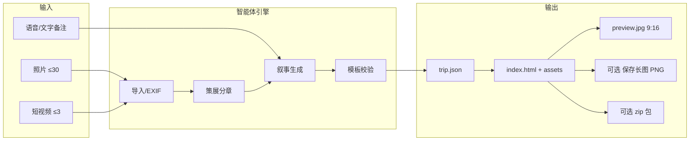

# 游记智能体 · MVP 产品需求文档（PRD）

| 属性 | 内容 |
|------|------|
| **产品代号** | Travelogue |
| **文档版本** | v0.2.1-MVP |
| **状态** | Draft · 本地验证阶段（P0 文档已齐） |
| **交付形态** | 照片 + 可选短视频 → 杂志风 HTML 游记包（zip 离线单元） |
| **MVP 阶段** | P0 本地工坊 + P1 轻量分享实验 |
| **关联文档** | [docs/README.md](./README.md)、`CHARTER.md`、`PRD-LAYOUT.md`、`SHARING.md`、`adr/001-delivery-and-media.md`、`AGENT-ARCHITECTURE.md`、`DATA-MODEL.md`、`MEDIA-PIPELINE.md`、`NARRATIVE-PROMPTS.md` |
| **更新日期** | 2026-05-19 |

---

## 1. 背景与问题陈述

### 1.1 背景

旅行者在行程中会产生大量照片与少量短视频，但：

- 相册是 **乱序、重复、难检索** 的素材堆；
- 手写游记 **门槛高、易拖延**，往往在回家后放弃；
- 通用 AI 写作工具产出 **流水账、缺人味**，且与版式、选图脱节；
- 现有产品多偏向 **Vlog 视频** 或 **博客平台绑定**，缺少「一页可收藏、可转发、像杂志」的 HTML 交付物。

市场上存在 `photo-essay-skill` 等「照片 → HTML」能力，但 **「照片 + 可选短视频 → 可分享游记包」** 的端到端 C 端产品仍稀缺。MVP **不以 Base64 巨型单文件 HTML 为默认**（见 [adr/001](./adr/001-delivery-and-media.md)）。

### 1.2 要解决的问题

| 用户痛点 | MVP 要解决到什么程度 |
|----------|----------------------|
| 素材整理费时 | 自动按时间/地点分章、去重、提案封面与章节 |
| 不会排版讲故事 | 固定杂志模板 + Pattern，Agent 填槽而非自由排版 |
| 文字难写 | 基于视觉标签、G1 记忆锚点、EXIF 与用户备注生成导语/图注 |
| 分享不好看 | 轻量 HTML + zip；9:16 `preview.jpg` 引流 |
| 隐私顾虑 | 发布前剥离精确 GPS，本地优先处理 |

### 1.3 产品定位（MVP）

> **本地旅行记忆的杂志编辑台**：导入文件夹 → 智能策展与叙事 → 输出可离线打开的 **zip 游记包**（`index.html` + 资源）；分享时先发封面图再发全文，而不是 AI 写作工具。

**MVP 不追求**：应用商店上架、用户增长、付费、多模板商城、社交评论、完整地图 SDK。

---

## 2. 目标与非目标

### 2.1 产品目标（MVP）

| ID | 目标 | 衡量方式 |
|----|------|----------|
| G1 | 开发者/种子用户能在 **20 分钟内** 从文件夹得到满意游记 | 自用 3 次旅行，平均编辑时长 |
| G2 | 输出物 **愿分享** 给至少 1 位非技术朋友 | 主观 + 是否发出链接/zip |
| G3 | 叙事与版式 **稳定可预期**（非每次随机布局） | 同一模板重渲染一致 |
| G4 | 支持 **可选短视频** 嵌入（非完整 Vlog） | 至少 1 次真实 trip 含 video-loop |
| G5 | 为 P2 托管分享 **预埋数据模型** | `trip.json` 含 privacy/slug 字段 |

### 2.2 非目标（MVP 明确不做）

- 用户注册/登录、云同步、协作编辑  
- 应用商店 / 小程序发布  
- 多语言、多主题商城、自定义 CSS  
- 评论、点赞、信息流发现  
- 实时地图动画、精确 GPS 公开展示  
- 完整视频剪辑时间线、长视频托管  
- SEO 站点、博客订阅、付费订阅  

---

## 3. 目标用户与场景

### 3.1 主要用户（MVP）

**Persona A · 独立开发者 / 种子创作者（=P0 你自己）**

- 旅行后 1–3 天内仍有表达欲  
- 接受本地选文件夹，能接受配置 API Key  
- 重视隐私与交付物所有权（HTML 在本地）

**Persona B · 微信群分享者（=P0 核心场景之一）**

- 希望「比九宫格更有故事感」，**一张长图发群里** 就能看完  
- **不介意** 群内好友看到旅途照片（与私密完整游记区分）  
- 不愿学习排版工具；**无需** 对方点开链接  

**Persona C · 私密分享者（=P2 小程序）**

- 完整 HTML 游记 + 语音/横滑，但 **仅受邀者可访问**  
- 通过 **小程序 + 身份验证** 打开，而非公开长图或公开链接

### 3.2 核心场景（User Stories）

| ID | 作为… | 我想要… | 以便… |
|----|--------|---------|--------|
| US-01 | 旅行者 | 选择本地照片文件夹一键导入 | 不用手动排序上百张图 |
| US-02 | 旅行者 | 系统自动分章并推荐封面 | 快速得到叙事骨架 |
| US-03 | 旅行者 | 删图、调章序、改标题和语气 | 保留控制感、注入人味 |
| US-04 | 旅行者 | 可选添加 1–3 条短视频 | 记录「那一刻」而非做 Vlog |
| US-05 | 旅行者 | 录一句语音或写三行备注 | 游记里出现我的原话 |
| US-06 | 旅行者 | 预览并导出 HTML 目录 + zip | 离线保存、发给朋友 |
| US-07 | 旅行者 | 导出 9:16 封面图 | 发朋友圈引流到全文 |
| US-07b | 旅行者 | **一键保存整篇竖版长图，直发微信群** | 群内读完旅程，无需点开链接 |
| US-09 | 私密分享者 | 通过 **小程序** 打开完整 HTML 游记 | 访问需验证身份；敏感行程不走长图 |
| US-08 | 旅行者 | 发布前确认隐私（剥离精确位置） | 安心分享 |

### 3.3 场景时间窗

**主场景**：旅行结束后 **24–72 小时** 内完成第一篇游记。  
超过 2 周未做 → 降级为「相册归档」需求，非 MVP 优化重点。

---

## 4. MVP 范围定义

### 4.1 功能范围总览



### 4.2 In Scope（MVP 必做）

| 模块 | 功能点 | 优先级 |
|------|--------|--------|
| **导入** | 选择本地目录；支持 JPEG/PNG/HEIC/WebP；拷贝到 `trips/{id}/source/` | P0 |
| **元数据** | 读取拍摄时间、GPS（若有）；生成城市级地点标签 | P0 |
| **策展** | 去重/按天·地点聚类；提案 3–5 章；选封面候选 3 张 | P0 |
| **编辑** | 删图、调章序、改章标题、选封面、选语气（轻松/纪实） | P0 |
| **叙事** | 生成 title、hook、章 lead、图注；语音转写精简进 caption / voice-bar | P0 |
| **视频** | ≤3 条，每条 ≤15s 源文件；输出 3–8s 静音循环 + poster | P0 |
| **模板** | 仅 `visual-journal`；4 种 pattern（open/gallery/moment/close） | P0 |
| **渲染** | `trip.json` → `index.html` + `assets/` 相对路径 | P0 |
| **预览** | 系统浏览器打开本地 HTML | P0 |
| **导出** | 相对路径 HTML + 打包 zip；Pillow 生成 `preview.jpg`（9:16） | P0 |
| **视觉标签** | Agent 0 写入 `assets[].tags`（3–5 个）；可选本地 CLIP/VLM | P0 启发式 / P0.5+ |
| **G1 锚点** | 每章 `curation.memoryAnchors`（0–3 条用户原话） | P0 |
| **隐私** | 导出展示用图剥离精确 EXIF；发布前确认勾选 | P0 |
| **配置** | 本地 `config.yaml`：API Key、模型、输出目录 | P0 |
| **保存长图** | 浏览器内将整篇游记导出为竖版 PNG（9:16，390px）；**微信群直发** | **P0** |
| **分享实验** | 手动上传目录到静态托管 / 发 zip（无产品内托管） | P1 |

### 4.3 Out of Scope（MVP 不做）

见 §2.2；另：**toc-jump**、**map-overview** 仅线框占位，MVP 渲染器可不输出或隐藏。

### 4.4 MVP 模板裁剪（visual-journal）

| 块 / 能力 | MVP |
|-----------|-----|
| cover-hero, trip-meta, hook-line | ✅ |
| chapter-header, chapter-lead（可空） | ✅ |
| media-card（fill/bleed/overlay） | ✅ |
| media-row, media-scroll | ✅ |
| voice-bar + transcript 折叠 | ✅ |
| 短视频（media-card--video） | ✅ |
| divider-place | ✅ |
| epilogue, footer-cta | ✅ |
| map-overview | ❌ v0.3 |

---

## 5. 用户旅程与主流程

### 5.1 端到端流程

```
[开始] → 新建 Trip → 选择文件夹 → 等待导入/分析
      → 查看「章节提案」→ 用户确认/微调
      → （可选）录制语音或输入备注
      → 选择语气 → 生成文案 → 预览 HTML
      → 编辑文字/图片（可选）
      → 隐私确认 → 导出 zip + 封面图
      → [结束] 浏览器预览 / 发给朋友
```

### 5.2 关键交互原则

1. **先结构后文案**：用户先认可章节与选图，再生成全文。  
2. **可回退**：改章序后仅重跑 narrative + render，不重新导入。  
3. **默认私密**：无「一键公开全网」；分享由用户主动拷贝文件或自建链接。  
4. **失败可继续**：单张图损坏/无 EXIF 不阻断全流程，降级为「未定位」分组。

### 5.3 线框与原型

以 `templates/visual-journal/golden.html` 为视觉与 IA 基准；正式 UI（本地工具）应保持与 `data-block` 一致。`editorial-light` 仅作历史参考。

### 5.4 分享路径（双轨 · 已拍板）

> 详述：[SHARING.md](./SHARING.md)

| 路径 | 交付物 | 优先级 | 隐私 |
|------|--------|--------|------|
| **A · 长图** | 单张 PNG（金样例 9:16 版式） | **P0** | 用户自担；**不** 强制鉴权；适合微信群 |
| **B · 完整游记** | HTML + assets（zip / 托管） | P0 本地导出；**小程序鉴权 P2** | 剥离精确 GPS；`privacy.confirmedAt`；访问需验证身份 |

**原则**：不要把「群内长图」与「私密 HTML」混为同一套隐私流程。长图由用户主动保存并发送；敏感完整游记走小程序 + 验证，**不** 依赖长图保密。

---

## 6. 功能需求详述

### 6.1 模块：Trip 管理

| 需求 ID | 描述 | 验收标准 |
|---------|------|----------|
| F-TRIP-01 | 用户可创建新 Trip，指定名称或使用文件夹名 | 生成唯一 `tripId`，目录 `trips/{tripId}/` |
| F-TRIP-02 | Trip 流水线状态 | 持久化在 `trip.json` → `pipeline.status`（见 `DATA-MODEL.md`） |
| F-TRIP-03 | 列出历史 Trip，可重新打开编辑 | 读取本地 `trips/` 目录 |

### 6.2 模块：媒体导入

| 需求 ID | 描述 | 验收标准 |
|---------|------|----------|
| F-ING-01 | 扫描文件夹内图片，忽略非媒体 | 支持 jpg/jpeg/png/heic/webp |
| F-ING-02 | 将原文件拷贝至 `source/`（不修改相册原件） | 拷贝完成后可断点重入 |
| F-ING-03 | 解析 EXIF：DateTimeOriginal、GPS | 无 EXIF 标记 `undated` |
| F-ING-04 | 导入 ≤30 张图片；超出提示裁剪或分批 | 硬上限可配置，默认 30 |
| F-ING-05 | 导入 ≤3 个视频（mp4/mov）；单文件 ≤15s（超出提示裁剪） | 元数据记录时长 |
| F-ING-06 | 生成 `assets/` 展示用图：WebP，宽 1600/800 两档 | 主图 1600，缩略 800 |

### 6.3 模块：智能策展（规则为主）

| 需求 ID | 描述 | 验收标准 |
|---------|------|----------|
| F-CUR-01 | 按拍摄时间排序，按天切分 | 跨天产生新章候选 |
| F-CUR-02 | GPS 反查至城市级（可离线缓存或 API） | 不展示街道级坐标 |
| F-CUR-03 | 相似图去重（ perceptual hash 或时间+尺寸启发式） | 同 burst 保留 1–2 张 |
| F-CUR-04 | 每章分配锚点图 + 配角 | 符合 manifest `maxMediaCardsPerChapter` 等 limits |
| F-CUR-05 | 提案 3–5 章，每章绑定 patternId | pattern 仅来自 manifest 白名单 |
| F-CUR-06 | 推荐 3 张封面候选 | 用户必选 1 |
| F-CUR-07 | 五类构图统计 + 按 `exportLayout` 编排（见 [PRD-LAYOUT.md](./PRD-LAYOUT.md)、[LAYOUT-PLANNER.md](./LAYOUT-PLANNER.md)） | P0 |

### 6.4 模块：叙事生成（LLM）

| 需求 ID | 描述 | 验收标准 |
|---------|------|----------|
| F-NAR-01 | 生成 trip.title（≤20 字）、subtitle（可选）、hook（≤56 字） | 超长按 manifest 截断 |
| F-NAR-02 | 每章：title（≤12）、lead（≤80，可空）、caption（≤60） | 禁止虚构未出现地点/人物 |
| F-NAR-03 | 语气：轻松 / 纪实 两档 | 切换后仅重生成文案 |
| F-NAR-04 | 用户备注/语音转写 → 至少 1 处 voice 或 caption 保留原话（若提供） | 原文优先，不润色掉口吻 |
| F-NAR-05 | 禁用词过滤：「综上所述」「值得一提的是」等 | 词表可配置 |
| F-NAR-06 | 生成前校验 JSON 符合模板 limits | 不通过则自动裁剪或报错 |

### 6.5 模块：视频处理

| 需求 ID | 描述 | 验收标准 |
|---------|------|----------|
| F-VID-01 | ffmpeg 截取 3–8s，输出 mp4/webm | 静音、可 loop |
| F-VID-02 | 生成 poster 帧 | 用于 `media-card--video` |
| F-VID-03 | 视频不出现在封面章（第 1 章） | 模板规则强制 |
| F-VID-04 | 每章 ≤1 视频，全 trip ≤3 | 超限拒绝或提示 |

### 6.6 模块：编辑与预览

| 需求 ID | 描述 | 验收标准 |
|---------|------|----------|
| F-ED-01 | 拖拽或按钮调整章节顺序 | 更新 `trip.json` |
| F-ED-02 | 从章内移除图片、跨章移动图片 | 重算 pattern 或提示不匹配 |
| F-ED-03 | 手动编辑标题、hook、导语、图注 | 保存后仅重渲染 |
| F-ED-04 | 一键浏览器预览 `index.html` | file:// 或本地 static server |
| F-ED-05 | 重生成：仅文案 / 全量渲染 两种粒度 | 耗时操作有进度提示 |

### 6.7 模块：导出与分享（P0/P1）

| 需求 ID | 描述 | 验收标准 |
|---------|------|----------|
| F-EXP-01 | 渲染 `index.html` + `assets/` + `trip.json` | 相对路径，无 CDN 依赖 |
| F-EXP-02 | **阅读**默认零 JS；横滑块可用 CSS overflow；长图为可选 JS bundle | 微信内置浏览器可阅读 |
| F-EXP-03 | 生成 `preview.jpg` 9:16，基于封面+标题合成 | 宽 1080px |
| F-EXP-04 | 打包 `trip-{id}.zip` | 解压即开 index.html |
| F-EXP-05 | 隐私确认页：剥离 GPS、含人脸提醒 | 未确认不可 export |
| F-EXP-06 | P1：文档说明如何用 GitHub Pages / Cloudflare 托管 | 非产品内功能 |
| F-EXP-07 | **保存长图**（P0）：浮动按钮 → 整页 PNG，可直发微信群 | 见 §6.7.1 |
| F-EXP-08 | **私密 HTML 分享**（P2）：小程序打开游记，访问需身份验证 | 见 [SHARING.md](./SHARING.md) §3 |

#### 6.7.1 保存长图（F-EXP-07 · P0）

**定位**：P0 核心分享形态——「一张竖图在微信群看完旅程」。版式与 `golden.html` 金样例一致。用户 **主动** 保存并发送到群；产品 **不** 对长图传播做访问控制（与路径 B 区分）。

| 维度 | 规格 |
|------|------|
| **入口** | 页面右下角浮动按钮「保存长图」；金样例顶栏同款（预览壳） |
| **版式** | 导出时强制 `data-layout="mobile"`，固定画布宽 **390px**，与朋友圈 9:16 卡片一致 |
| **格式** | PNG；文件名 `{title}-长图.png` |
| **技术** | 渐进增强：`longshot.js` +  vendored `html2canvas`；**阅读态仍可无 JS** |
| **默认开关** | draft / share / zip：**均开启** |
| **显式关闭** | `trip.json` → `export.longShot: false` 或 `travelogue export --no-longshot` |
| **隐私闸口** | 长图 **不** 要求 `privacy.confirmedAt`；zip/HTML 导出仍要求（路径 B） |
| **横滑章** | 截图前将 `media-scroll` **纵向展开**，尽量包含全部图片（非仅首屏可见项） |
| **语音转写** | 导出前折叠 `<details class="voice-transcript">`，避免长文撑破版式 |
| **限制** | 极长 trip（>30 图）可能内存偏高；视频仅 poster 静帧；需 **http(s)** 打开（非 `file://`） |
| **体积** | zip 含长图 bundle 时约 +200KB（html2canvas vendor） |

**验收**：

1. draft / share 渲染的 `index.html` 含 FAB，点击后下载 PNG，竖版可读。  
2. 默认 `export` zip **含** longshot bundle；`--no-longshot` 可剔除。  
3. 金样例 `golden.html` 顶栏与 FAB 行为一致。  
4. 至少 1 次真实 trip：长图发微信群，群友 **无需链接** 即可阅读。  

**非目标（MVP）**：服务端渲染长图、PDF、多页分页、微信 JS-SDK 直传、**小程序鉴权**（→ F-EXP-08 / P2）。

### 6.8 模块：配置与依赖

| 需求 ID | 描述 | 验收标准 |
|---------|------|----------|
| F-CFG-01 | `config.yaml`：llm provider、api key、ffmpeg 路径 | 首次启动检测并提示 |
| F-CFG-02 | 可选：地理反查 API Key | 无 key 时仅显示「未知地点」 |

---

## 7. 内容模型（trip.json v0.2）

MVP 的单一真相源；Agent 与渲染器只读写此结构。

> **完整说明**：[DATA-MODEL.md](./DATA-MODEL.md)  
> **机器校验**：[schemas/trip.schema.json](../schemas/trip.schema.json)  
> **模板字段示例**：[TEMPLATE-visual-journal.md](./TEMPLATE-visual-journal.md) §10

要点摘要：

- `version`: `"0.2"`；`templateId`: `"visual-journal"`  
- `pipeline.status` + `pipeline.locks` 驱动 Agent 流水线  
- `chapters[].items[]`：`media-card` | `media-row` | `media-scroll`  
- 语音挂在 `assets[].voice` 或 scroll 组级；caption 为转写精简  
- `privacy.confirmedAt` 非空才允许 `exported`

---

## 8. 模板与渲染需求

### 8.1 模板 ID

- **MVP 唯一模板**：`visual-journal` v0.2.1  
- 规格：`templates/visual-journal/manifest.json`、`docs/TEMPLATE-visual-journal.md`  
- 金样例：`templates/visual-journal/golden.html` + `golden.css`

### 8.2 渲染器输入输出

| 输入 | 输出 |
|------|------|
| `trip.json` + `templateId` + `assets/` | `index.html`、`journal.css`、更新后的 `assets/` |

### 8.3 必须遵守的模板规则（摘自 manifest）

1. 首屏 `cover-hero` + `trip-meta`；`hook-line` 可省略。  
2. 每章以 `chapter-header` 开头；`chapter-lead` 可空。  
3. 主图 `media-card--fill` + `--bleed`；手机 overlay 标题。  
4. 封面无视频；有视频原声则不叠同卡 voice。  
5. `divider-place` 仅跨天/跨地。  
6. 分享导出时转写默认折叠。  

详见 `TEMPLATE-visual-journal.md` 与 `ADAPTIVE-LAYOUT.md`。

### 8.4 非功能（页面）

| 指标 | 目标 |
|------|------|
| 首屏可读（4G） | 封面图优化后 &lt; 500KB，LCP 主观 2s 内 |
| 整页体积 | 30 图 trip 导出 zip &lt; 25MB（可配置压缩率） |
| 无障碍 | 图片必有 alt；语义标签 section/figure |
| 打印 | `@media print` 隐藏 video、可选隐藏 toc |

---

## 9. 智能体架构需求

> **详述见 [`AGENT-ARCHITECTURE.md`](./AGENT-ARCHITECTURE.md)**：按人类写游记步骤拆为 Agent 0（媒体工坊，可选）+ Agent 1 策展 + Agent 2 叙事 + Agent 3 出版；Orchestrator + `trip.json` 状态机 + G0–G3 人工闸口。

### 9.1 流水线阶段（摘要）

| 阶段 | Agent | 实现方式 | 人工确认点 |
|------|-------|----------|------------|
| Ingest | Agent 0 媒体工坊 | 确定性代码 | G0（可自动） |
| Curate | Agent 1 策展人 | 70% 规则 + 30% LLM | **G1**：章节与选图 |
| Narrative | Agent 2 叙事师 | LLM 填槽 | **G2**：文案 |
| Validate | Agent 3 子步骤 | 对照 manifest | 自动 |
| Render / Export | Agent 3 出版人 | 模板引擎 + zip | **G3**：预览与隐私 |

### 9.2 Agent 边界

- **不允许** Agent 直接输出最终 HTML 字符串（防布局漂移）。  
- **允许** Agent 输出/修改 `trip.json` 字段（遵守各 Agent 读写契约，见架构文档 §10）。  
- 失败重试：仅重试当前阶段；Agent 2 最多 2 次自动修校验错误。

### 9.3 本地工具形态（MVP）

任选其一实现，PRD 不绑定：

- **方案 A**：CLI + 可选 Tauri 壳（选文件夹、进度条、打开预览）  
- **方案 B**：Cursor Skill + 脚本（开发者自用最快）  

交付物需满足同一 `trip.json` 与目录结构。

---

## 10. 系统架构（MVP）

> **详述**：[TECH-ARCHITECTURE.md](./TECH-ARCHITECTURE.md) · **本地运行**：[DEVELOPMENT.md](./DEVELOPMENT.md)

```
┌─────────────────────────────────────────────────┐
│  UI 层（CLI / Tauri / Cursor Skill）              │
└────────────────────┬────────────────────────────┘
                     │
┌────────────────────▼────────────────────────────┐
│  Trip Service（创建、状态、历史列表）              │
├─────────────────────────────────────────────────┤
│  Ingest │ Curate │ Narrative │ Video │ Render    │
│  (Py/TS)   rules    LLM API   ffmpeg  templates  │
└────────────────────┬────────────────────────────┘
                     │
┌────────────────────▼────────────────────────────┐
│  本地文件系统：trips/{id}/trip.json + assets/      │
└─────────────────────────────────────────────────┘
```

**外部依赖**：LLM API、ffmpeg、可选地理反查 API。

---

## 11. 非功能需求

| 类别 | 要求 |
|------|------|
| **隐私** | 默认本地处理；导出剥离精确 GPS；不上传用户未确认的 trip |
| **安全** | API Key 仅存本地 config，不入库、不写进 trip.json |
| **可靠性** | 单 asset 失败不崩溃；日志可追溯 tripId |
| **可维护** | 模板与引擎解耦；manifest 版本号与 trip.json version 对齐 |
| **兼容性** | 输出 HTML 在 Chrome/Safari/微信内置浏览器可读 |
| **许可** | 第三方图库/字体注意商用许可；MVP 优先系统字体栈 |

---

## 12. 成功指标与验收

> **完整验收清单与记录表**：[ACCEPTANCE.md](./ACCEPTANCE.md)

### 12.1 MVP 发布闸门（给自己用）

| # | 标准 | 通过 |
|---|------|------|
| AC-01 | 用 3 次真实旅行数据各生成 1 篇 | ☐ |
| AC-02 | 平均从导入到「愿导出」&lt; 20 分钟 | ☐ |
| AC-03 | 至少 2 篇愿发给非开发者朋友 | ☐ |
| AC-04 | 含短视频的 trip ≥1 且播放正常 | ☐ |
| AC-05 | 导出 zip 在另一台手机微信内打开可读 | ☐ |
| AC-06 | 隐私：导出图无精确 home GPS | ☐ |
| AC-07 | 至少 1 篇游记「保存长图」得到竖版 PNG，并 **实际发到微信群** 可读 | ☐ |

### 12.2 过程指标（日志即可）

- 策展后用户删图比例  
- Narrative 后手动改字比例  
- Export 次数 / Trip 创建次数  

---

## 13. 里程碑与排期（建议 8 周）

| 周次 | 里程碑 | 交付物 |
|------|--------|--------|
| W1–2 | M1 导入与数据模型 | EXIF、`trip.json`、目录结构 |
| W3 | M2 策展 | 分章、选图、pattern 分配 |
| W4 | M3 渲染 v1 | visual-journal 正式渲染（对齐 golden） |
| W5 | M4 视频 | ffmpeg 裁切 + video-loop |
| W6 | M5 叙事 | LLM 文案 + voice/caption + 语气 |
| W7 | M6 导出 | zip、preview.jpg、隐私确认 |
| W8 | M7 自用验收 | 3 次真实 trip + 问题清单 |

**MVP 完成定义**：满足 §12.1 全部 AC（含 **AC-07** 长图）。

---

## 14. 风险与缓解

| 风险 | 影响 | 缓解 |
|------|------|------|
| LLM 胡编地点/事实 | 信任崩塌 | 校验城市列表；caption 仅描述画面 |
| HEIC/视频兼容性 | 导入失败 | 明确支持列表；ffmpeg 统一转码 |
| 微信打开 file:// zip 不便 | 分享受阻 | P1 文档教静态托管；封面图先导流 |
| 单页过大加载慢 | 分享跳出 | WebP、lazy load、限制 30 张 |
| 独立开发资源不足 | 延期 | 严格 MVP 范围；先 CLI 后 UI 壳 |
| API 费用 | 成本 | 策展规则化；文案缓存 |

---

## 15. 开放问题（MVP 期间需决策）

| ID | 问题 | 建议默认 |
|----|------|----------|
| OQ-01 | 首版 UI：CLI only 还是 Tauri？ | 先 CLI + 脚本，Tauri 可 W9+ |
| OQ-02 | 地理反查供应商 | 可选；无则仅「未知地点」 |
| OQ-03 | LLM 默认模型 | 配置项，不写死 |
| OQ-04 | 是否在 MVP 内置简易本地 static server | 可选，一行命令 `npx serve` |
| OQ-05 | 语音输入 MVP 是否包含 | 可降为「仅粘贴转写文本」 |
| OQ-06 | 小程序鉴权与托管栈 | P2；见 `SHARING.md`；MVP 仅 zip + 文档 |
| OQ-07 | 长图是否叠加水印 / trip 标题 | P2；P0 仅文件名 `{title}-长图.png` |

---

## 16. 附录

### 16.1 术语表

| 术语 | 定义 |
|------|------|
| Trip | 一次旅行的完整游记项目 |
| Block | HTML 模板中最小版式单元，如 `media-card`、`media-scroll` |
| Pattern | 一章内 Block 的固定序列 |
| 策展 | 选图、分章、分配 pattern，非写文案 |

### 16.2 相关文件路径

```
travelogue/
├── README.md
├── docs/                        ← P0 文档包（见 docs/README.md）
├── schemas/trip.schema.json
├── templates/visual-journal/
└── 游记备忘录.md                 ← 归档参考
```

### 16.3 版本历史

| 版本 | 日期 | 变更 |
|------|------|------|
| v0.1-MVP | 2026-05-19 | 初稿 |
| v0.2-MVP | 2026-05-19 | 对齐 visual-journal v0.2；链至 P0 文档包 |
| v0.2.1-MVP | 2026-05-19 | 新增 F-EXP-07 保存长图、US-07b、AC-07 |
| v0.2.2-MVP | 2026-05-19 | 长图升 P0；双轨分享（`SHARING.md`）；F-EXP-08 小程序鉴权 HTML（P2） |

---

**文档结束**
