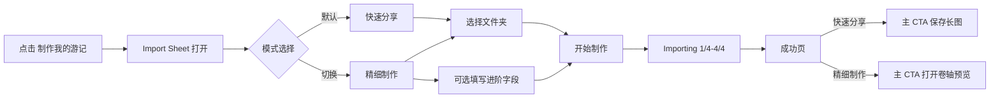

# Travelogue · Phase 14 产品需求文档（PRD）

| 属性 | 内容 |
|------|------|
| **产品代号** | Travelogue |
| **文档版本** | v0.14.1-PHASE14 |
| **状态** | Draft（修订版） |
| **Phase 14 代号** | 「双模式导入」— 快速分享 / 精细制作 |
| **前置条件** | [PRD-PHASE5.md](./PRD-PHASE5.md) 双路径策略稳定；[PRD-PHASE13.md](./PRD-PHASE13.md) 模板能力稳定 |
| **线框参考** | [archive/import-sheet/studio-import-sheet-v2-dual-mode.html](./archive/import-sheet/studio-import-sheet-v2-dual-mode.html)（已归档） |
| **关联文档** | [PRD-PHASE4.md](./PRD-PHASE4.md)、[SHARING.md](./SHARING.md)、[DATA-MODEL.md](./DATA-MODEL.md) |
| **更新日期** | 2026-06-04 |

> **定位**
>
> - Phase 14 不新增业务主链，重点是重构导入入口心智：  
>   - **快速分享**：最少输入，最快拿到长图用于分享。  
>   - **精细制作**：补充更多上下文，追求更高质量卷轴体验。  
> - 用双 Tab 明确 80% / 20% 人群路径，减少当前“同一面板承载过多意图”的认知负担。

---

## 1. 背景与问题

### 1.1 当前痛点

| 痛点 | 现状 | 用户影响 |
|------|------|----------|
| 导入入口心智混杂 | 快速出稿与进阶输入混在同一层 | 新用户不知道是否要填、填到什么程度 |
| 80/20 分层不显性 | 产品策略有分层，UI 无清晰分流 | 主路径效率被可选项打断 |
| 成功页动作不区分 | 两类用户默认动作一致 | 快速用户和进阶用户都不是最优下一步 |
| 弹窗面积偏小 | 精细模式字段多，滚动频繁、信息拥挤 | 填写体验差，完成率受影响 |

### 1.2 Phase 14 目标

1. 在不破坏现有管线前提下，引入 **双模式导入 UI**。  
2. 让快速用户「少想、少填、快完成」，让进阶用户「可控、可解释、可复现」。  
3. 明确成功页分层默认动作：快速偏长图、精细偏卷轴验货。  
4. 统一输入字段与消费链路，杜绝“可填但无消费”。

---

## 2. 已拍板决策（冻结）

| 决策 ID | 决策项 | 结论 |
|---------|--------|------|
| **D14-01** | 「旅途见闻与感悟」 | **独立 textarea**（≤500 字） |
| **D14-02** | 日期范围 | **允许用户手填**；EXIF 推断兜底 |
| **D14-03** | 精细模式主按钮 | **开始制作（专业）** |
| **D14-04** | 成功页默认动作差异 | 快速分享：主 CTA 保存长图；精细制作：默认先卷轴预览 |
| **D14-05** | 模式命名 | **快速分享 / 精细制作** |
| **D14-06** | 弹窗尺寸 | **导入弹窗放大**（见 §5.4） |
| **D14-07** | 精细成功页触发策略 | **首版不自动跳转**，采用主 CTA 高亮引导 |

---

## 3. 设计原则

| ID | 原则 | 说明 |
|----|------|------|
| **P14-01** | 默认保守 | 默认进入快速分享，保障 80% 用户效率 |
| **P14-02** | 进阶可见 | 精细制作可发现，但不干扰主路径 |
| **P14-03** | 输入有回报 | 每个字段必须有明确消费与反馈 |
| **P14-04** | 不强制填表 | 精细制作字段均可选，主流程可随时启动 |
| **P14-05** | 兼容优先 | 历史 trip / API / 成功页行为平滑兼容 |

---

## 4. 用户分层与核心旅程

### 4.1 Persona 与路径

| Persona | 占比（估） | 目标 | 推荐模式 |
|---------|------------|------|----------|
| 分享者 | ~80% | 快速生成并分享长图 | 快速分享 |
| 编辑者 | ~20% | 提升叙事质量并沉浸阅读 | 精细制作 |

### 4.2 端到端旅程



---

## 5. 信息架构与交互规格

### 5.1 Import Sheet 结构（双 Tab）

```
制作我的游记（Sheet）
├─ Tab 1：快速分享（默认）
│  ├─ 选择文件夹（主按钮）
│  ├─ 已选文件夹摘要（选后出现）
│  ├─ 智能挑选照片（checkbox，默认勾选 · P9-F1）
│  ├─ 开始制作
│  └─ 精选/素材一行说明（常显）
└─ Tab 2：精细制作
   ├─ 选择文件夹（共享）
   ├─ 基本信息：名称、地点、日期范围
   ├─ 编辑偏好：写给编辑的一句话（≤200）
   ├─ 见闻感悟：独立 textarea（≤500）
   ├─ 照片组织：精选/素材文件夹
   ├─ 智能挑选照片（checkbox，与快速分享共享状态 · P9-F1）
   ├─ plan 文件（可选）
   └─ 开始制作（专业）
```

### 5.2 模式命名与文案

| 模式 | 标签文案 | 副文案 |
|------|----------|--------|
| 快速分享 | 快速分享 | 选文件夹即可，自动生成长图 |
| 精细制作 | 精细制作 | 补充信息，产出更贴旅程的游记 |

### 5.3 交互细节（关键）

1. **默认模式**：每次打开 Sheet 默认快速分享。  
2. **模式切换**：切换不丢已填内容。  
3. **启动条件**：两模式都要求至少有 `albumPath`。  
4. **并发保护**：Importing 状态下 Sheet 不可再次打开。  
5. **可访问性**：Tab 支持键盘切换；字段错误需 `role=alert`。

### 5.4 弹窗尺寸与布局（新增 · P0）

| 项 | 规格 |
|----|------|
| 容器宽度 | `clamp(560px, 64vw, 860px)` |
| 容器高度 | `max-height: min(86dvh, 920px)` |
| 滚动策略 | 仅表单 body 内滚；标题区和主按钮区固定可见 |
| 栅格策略 | 视口 `>=1280px` 时精细模式采用两列；其余单列 |
| 触控目标 | 主按钮高度 `>=44px`；Tab 热区 `>=40px` |

### 5.5 模式切换与草稿保留规则（细化）

| 场景 | 行为 |
|------|------|
| 快速 → 精细 | 自动带入已选文件夹；名称预填为文件夹 basename |
| 精细 → 快速 | 不丢弃精细字段；快速开始可携带已填 intent |
| 关闭 Sheet 再打开（同会话） | 恢复未提交草稿（sessionStorage） |
| 导入失败后重试 | 保留上次输入，用户可直接修正 |
| 清空行为 | 仅“重置本次填写”显式触发 |

### 5.6 字段帮助与示例交互

#### 5.6.1 写给编辑的一句话

- 常驻提示：`不填也能正常出稿；这里写偏好，不是写完整游记。`
- 可点击示例 chip（点击即填入，可再编辑）：
  1. `带娃慢走，别写成导游词`
  2. `想表达静谧，雨天的感觉`
  3. `第3天最难忘`

#### 5.6.2 旅途见闻与感悟

- 提示：`可写真实细节，系统会优先用于文案语料，不会原样照抄。`
- 长度建议：`建议 50–220 字；最多 500 字。`

---

## 6. 字段设计与数据契约

### 6.1 字段总表

| UI 字段 | 模式 | 类型 | 限制 | 存储建议 |
|---------|------|------|------|----------|
| 选择文件夹 | 全部 | path | 必填 | `albumPath` |
| 游记名称 | 精细制作 | string | ≤20 | `intent.title` + `meta.title` |
| 日期范围（开始/结束） | 精细制作 | date | 可空 | `intent.dateRange.start/end`（新增） |
| 主要地点 | 精细制作 | string/string[] | 可空 | `intent.places` + `meta.places` |
| 精选文件夹 | 精细制作 | string | 可空 | `intent.folders.featuredDir` |
| 素材文件夹 | 精细制作 | string | 可空 | `intent.folders.materialDir` |
| 写给编辑的一句话 | 精细制作 | textarea | ≤200 | `intent.userNotes` + `trip.userNotes` |
| 旅途见闻与感悟 | 精细制作 | textarea | ≤500 | `intent.travelNotes`（新增） |
| plan 文件 | 精细制作 | file | txt/md ≤32KB | `intent.travelPlan` |

### 6.2 新增字段定义

```json
{
  "intent": {
    "dateRange": {
      "start": "2025-04-02",
      "end": "2025-04-06",
      "source": "user"
    },
    "travelNotes": "在祇园避雨时闯进一家小酒馆，老板推荐了本地清酒..."
  }
}
```

### 6.3 日期范围与 EXIF 兜底规则

| 情况 | 规则 |
|------|------|
| 用户填写开始/结束日期 | 使用用户输入作为主标签与叙事 hint |
| 用户未填写日期 | 沿用 EXIF 推断 |
| 用户仅填一侧 | 缺失侧用 EXIF 兜底；若 EXIF 缺失则留空 |
| 用户输入与 EXIF 冲突 | 以用户输入优先；EXIF 保留在资产元数据 |

### 6.4 日期输入校验与提示文案

| 校验项 | 规则 | 用户提示 |
|--------|------|----------|
| 开始晚于结束 | 阻断提交 | `开始日期不能晚于结束日期` |
| 仅填一侧 | 允许提交 | `另一侧将用照片时间自动推断` |
| 与 EXIF 差异过大（>365 天） | 不阻断，弱提示 | `你填写的日期与照片时间差异较大，仍将按你填写的日期生成` |
| 非法日期 | 阻断提交 | `请输入有效日期` |

### 6.5 字段消费链路（函数级约束）

| 字段 | 消费位置 | 方式 |
|------|----------|------|
| `intent.userNotes` | `services/narrative_brief.py` | 注入 `build_meta_brief()` 与 `build_chapter_brief()` |
| `intent.travelNotes` | `services/narrative_brief.py` | 注入 meta/chapter brief（建议截断 500） |
| `intent.dateRange` | curate + narrate brief | 作为时间标签与叙事锚点，缺失侧 EXIF 兜底 |
| `intent.folders.*` | ingest | 用于覆盖自动检测目录 |

**硬约束**：新增字段全部 fail-open，不得阻断导入主流程。

---

## 7. 成功页差异化策略

### 7.1 快速分享成功页

- 主 CTA：**保存长图**
- 次 CTA：打开卷轴预览
- 目标：快速完成生成与分享

### 7.2 精细制作成功页

- 默认行为：**主 CTA 高亮引导打开卷轴预览（不自动跳转）**
- 主 CTA：打开卷轴预览
- 次 CTA：保存长图
- 目标：先验货叙事与排版，再决定导出

### 7.3 触发细则（冻结）

| 项 | 规则 |
|----|------|
| 自动跳转 | 首版不启用 |
| 高亮引导 | 成功页首屏对卷轴预览 CTA 高亮 + 一行解释 |
| 预览失败回退 | 主 CTA 降级为保存长图，并提示原因 |

### 7.4 回访态提示

- 成功卡片记录上次模式（快速/精细），用于后续入口文案推荐。

---

## 8. 后端与 API 变更建议

### 8.1 Import API 扩展

`POST /__travelogue/import` 增量字段：

| 字段 | 类型 | 必填 | 说明 |
|------|------|------|------|
| `mode` | enum | ✅ | `quick_share` / `fine_craft` |
| `dateRange.start` | string(date) | ❌ | 精细制作填写 |
| `dateRange.end` | string(date) | ❌ | 精细制作填写 |
| `travelNotes` | string | ❌ | ≤500 |
| `featuredDir` | string | ❌ | 手动覆盖自动检测 |
| `materialDir` | string | ❌ | 手动覆盖自动检测 |

### 8.2 Pipeline 消费

1. `mode=quick_share`：保持当前默认管线，优先速度与稳定。  
2. `mode=fine_craft`：叙事 brief 注入 `travelNotes/dateRange/userNotes`。  
3. 新增字段读取失败均 fail-open，不阻断主流程。

### 8.3 请求与状态持久化

| 对象 | 建议 |
|------|------|
| `sessionStorage.importDraft` | 保存当前会话草稿（mode + 表单值） |
| `sessionStorage.lastImportMode` | 记录上次模式（用于实验） |
| `POST /import` 响应 | 回传 `mode`，用于成功页分层渲染 |

---

## 9. 交互文案（首版）

### 9.1 Tab 文案

- 快速分享：`快速分享`
- 精细制作：`精细制作`

### 9.2 按钮文案

- 快速分享：`开始制作`
- 精细制作：`开始制作（专业）`

### 9.3 字段文案

- `写给编辑的一句话（可选）`
- `旅途见闻与感悟（可选）`
- `日期范围（可选）`

### 9.4 一致性说明

- 命名统一使用 `快速分享 / 精细制作`。  
- 按钮保留冻结决策 `开始制作（专业）`（运营导向例外）。  
- 避免“AI夸大承诺”，统一“自动生成/自动排版”。

---

## 10. 验收标准（AC）

| AC ID | 验收项 | 通过标准 |
|-------|--------|----------|
| **AC-P14-01** | 双 Tab 默认快速分享 | 首次打开默认选中快速分享 |
| **AC-P14-02** | 精细字段完整可提交 | 日期、见闻、编辑一句话可见且可提交 |
| **AC-P14-03** | 命名生效 | 全量替换为快速分享/精细制作 |
| **AC-P14-04** | 按钮文案生效 | 精细主按钮为开始制作（专业） |
| **AC-P14-05** | 成功页分层动作 | 快速主 CTA=保存长图；精细主 CTA=卷轴预览 |
| **AC-P14-06** | 日期兜底规则正确 | 未填走 EXIF，冲突用户优先 |
| **AC-P14-07** | travelNotes 落盘消费 | `intent.travelNotes` 入库并进入 brief |
| **AC-P14-08** | 主路径不回归 | 快速路径点击预算不高于 Phase 5 基线 |
| **AC-P14-09** | 弹窗尺寸升级 | 1440×900 下弹窗宽 ≥560px，关键信息首屏可见 |
| **AC-P14-10** | 切换与草稿保留 | 切换、关闭重开、失败重试不丢输入 |
| **AC-P14-11** | 日期校验文案正确 | `start>end` 阻断并提示；单侧填写提示生效 |
| **AC-P14-12** | 精细触发策略正确 | 首版不自动跳转，仅主 CTA 高亮引导 |

---

## 11. 埋点与开发评估（开发阶段）

### 11.1 建议事件

| 事件 | 说明 |
|------|------|
| `import_mode_view` | 打开 Sheet 时看到的默认模式 |
| `import_mode_switch` | 用户切换模式 |
| `import_start` | 携带 mode 与字段填写概况 |
| `import_success` | 成功耗时与 mode |
| `success_primary_click` | 成功页主 CTA 点击（分 mode） |
| `preview_open_from_success` | 从成功页进入卷轴预览 |

### 11.2 开发阶段验证口径（无真实用户）

> 当前处于开发阶段，无需灰度发布与线上业务 KPI 门槛。  
> 本阶段以“回归稳定 + 可观测 + 人工走查”作为验收口径。

1. **功能正确性**：AC-P14 全部通过。  
2. **回归稳定性**：快速分享链路耗时与失败率不劣于 Phase 5 本地基线。  
3. **行为可观测**：`mode`、成功页主 CTA、预览打开路径在日志/埋点中可区分。  
4. **跨页连续性**：导入中刷新页面后可继续通过 job 状态恢复 UI。  
5. **低分辨率可用性**：1366×768 / 1280×720 下精细模式可完整提交。

### 11.3 推荐策略（后置项）

- 模式弱推荐（如检测到精选/素材目录后提示切到精细）保留为后置项。  
- 本期不做自动推荐、不做自动切换，避免引入额外行为复杂度。

---

## 12. 风险与回滚

| 风险 | 影响 | 缓解 |
|------|------|------|
| 精细字段多导致放弃率上升 | 导入转化下降 | 字段均可选；快速模式默认 |
| 新增 schema 与旧 trip 冲突 | 验证失败 | `intent` 子字段 optional + migrate-on-write |
| 成功页分层引发混淆 | 找不到长图按钮 | 精细仍保留保存长图次 CTA |
| Windows 选夹阻塞 | 操作中断 | 先开 Sheet 再触发选夹 |
| 弹窗放大遮挡低分辨率内容 | 可用性下降 | `clamp + max-height + 分区滚动` |

---

## 13. 实施里程碑（开发落地顺序）

| 里程碑 | 范围 | 目标 |
|--------|------|------|
| **M14.0 护栏层** | schema/API 兼容、回退开关、旧请求合同 | 保证不损升级 |
| **M14.1 UI 壳层** | 双 Tab + 弹窗放大 + 快速路径不回归 | 入口可用 |
| **M14.2 数据落盘** | `dateRange/travelNotes/folders` 入库与读取 | 字段闭环 |
| **M14.3 成功页分流** | 精细模式主 CTA 高亮卷轴，禁用自动跳转 | 行为一致 |
| **M14.4 回归验收** | 自动化 + 人工回归 + 文档同步 | 可交付 |

---

## 14. 开放问题（需评审确认）

1. `travelNotes` 是否需在预览 drawer 二次编辑（建议：需要）。  
2. 日期范围是否上屏为标签（建议：可选显示，不强制）。  
3. 精细模式下，精选/素材路径是否提供选择器辅助（而非纯文本输入）。

---

## 15. 兼容与升级策略（新增 · 不损升级）

### 15.1 兼容合同（必须遵守）

1. **旧请求兼容**：`POST /__travelogue/import` 不要求新增字段，旧 payload 行为不变。  
2. **新增字段可缺省**：`mode/dateRange/travelNotes/featuredDir/materialDir` 全部 optional。  
3. **旧 trip 兼容**：无 `intent.dateRange/travelNotes` 的历史 trip 不报错。  
4. **读取失败 fail-open**：新增字段解析失败时，回退到当前线上默认逻辑。

### 15.2 迁移顺序（必须顺序执行）

1. 先改 `trip.schema.json` 与后端读取（新增字段 optional）。  
2. 再改 `import_handlers.py` / `studio_subprocess.py` / `studio_pipeline.py` 参数透传。  
3. 再改前端 Sheet 与成功页分流。  
4. 最后补齐自动化测试与文档。

### 15.3 成功页冲突修正（与现状对齐）

当前 `first-success.js` 仍存在倒计时自动跳转预览。Phase 14 要求：

- 精细模式首版：**不自动跳转**，仅高亮主 CTA；
- 快速模式：保持“保存长图”为主；
- 若保留倒计时逻辑，必须由配置开关显式关闭（默认关闭）。

### 15.4 回退开关（开发阶段也保留）

> 非灰度用途，仅用于开发与联调阶段快速回退。

| 开关 | 默认 | 作用 |
|------|------|------|
| `studio.import_dual_mode.enabled` | `true` | 关闭后退回单模式 Sheet |
| `studio.success_refined_default.enabled` | `true` | 关闭后退回旧成功页 CTA 逻辑 |
| `studio.import_sheet_large.enabled` | `true` | 关闭后退回原尺寸弹窗 |

### 15.5 断点与布局保护（弹窗放大配套）

| 视口 | 布局策略 |
|------|----------|
| `>=1440` | 精细模式双列，固定底部主按钮 |
| `1024–1439` | 单列，保留放大弹窗宽度上限 |
| `768–1023` | 单列，降低内边距，保留主按钮可见 |
| `<768` | 强制全宽 + 分区滚动，确保提交按钮始终可达 |

---

## 16. 结论

Phase 14 通过「快速分享 / 精细制作」双模式导入，将既有能力按用户目标重排：

- 对 80% 用户：更快到达“保存长图并分享”。
- 对 20% 用户：更完整输入、更高质量产出、先验货卷轴。

该方案在不改主管线架构前提下，提升入口清晰度与体验匹配度；并通过兼容合同、迁移顺序与回退开关保证“开发阶段直上也不损升级”。

