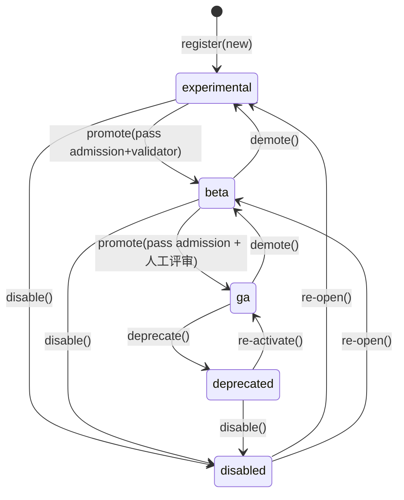

# Travelogue · Phase 16 产品需求文档（PRD · 布局模板引擎）

| 属性 | 内容 |
|------|------|
| **产品代号** | Travelogue |
| **文档版本** | v0.16.4-PHASE16 |
| **状态** | Draft · 已过四方评审 · 收口中 |
| **Phase 16 代号** | 「布局模板引擎」（Layout Template Engine，**LTE**） |
| **前置条件** | Phase 15 MCS（`mosaic/`）S1–S3 已落地；`layout_engine=screens` Web 16:9 舞台稳定 |
| **关联文档** | [PRD-PRODUCT-LAYOUT-PRINCIPLES.md](./PRD-PRODUCT-LAYOUT-PRINCIPLES.md)（产品纲领 · 丰富度 ≤9）、[PRD-PHASE15-photo-mosaic-evolution.md](./PRD-PHASE15-photo-mosaic-evolution.md)、[DESIGN-PHASE15-mosaic-system.md](./DESIGN-PHASE15-mosaic-system.md)、[IMPLEMENTATION-PHASE15.md](./IMPLEMENTATION-PHASE15.md)、[智能排版.md](./智能排版.md)、`travelogue/curation/mosaic/`、`templates/visual-journal/journal-screens.css` |
| **更新日期** | 2026-06-06 |

> **定位**
>
> Phase 15 解决了「**多候选 + 统一打分选模板**」（MCS）。模板定义仍散落在 `constants.py`、`grid_specs.py`、`pattern_policy.py`、`journal-screens.css` 等多处，**增删启停、槽位几何审计、权重调优**成本高，且已出现用户可见缺陷（如 `3P+2L` 左下超宽槽裁切过重、退役 pattern CSS 残留、MCS 几乎只出 `screen-portrait-3`）。
>
> Phase 16 将拼图/组屏 **模板** 升格为 **一等公民**：由 **布局模板引擎（LTE）** 统一管理模板的注册、生命周期、几何元数据、校验与策略配置；MCS **消费** LTE 注册表进行候选生成与打分，**不重复实现** 模板拓扑逻辑。
>
> **本 Phase 以设计与契约为主，不急于大规模改代码**；实施按 P16-W0 → W3 渐进，与 P15 并行兼容。

---

## 1. 背景与问题

### 1.1 Phase 15 之后仍存在的结构性问题

| ID | 问题 | 工程表现 | 用户/运营体感 |
|----|------|----------|---------------|
| **P16-P-01** | 模板定义分散 | 新增 pattern 需改 Python 常量 + `grid_specs` + CSS + 偶发 `pattern_policy` | 迭代慢、易漏改 |
| **P16-P-02** | 启停无统一入口 | `deprecated` / `retired` / `hidden` 混用；CSS 仍渲染旧 pattern | 行为与文档不一致 |
| **P16-P-03** | 槽位几何不可见 | 无发布前「槽位 AR 表」；缺陷靠 dogfood 才发现 | 横图在 3.6:1 槽内被狠裁 |
| **P16-P-04** | 校验过浅 | `render_check` 仅查 CSS class 字符串存在 | 布局错位、空位、裁切问题漏到线上 |
| **P16-P-05** | 模板与素材 AR 策略割裂 | 讨论「是否统一长宽比」无权威答案；`contain`/`cover` 规则绑死在 planner | 人像格留白、竖进宽格 |
| **P16-P-06** | 优化无闭环 | 权重在 `config.yaml`，模板元数据不在；telemetry 难按 template 聚合 | 调参靠猜、A/B 困难 |
| **P16-P-07** | 组合爆炸无治理 | 理论上百种 3×3 跨格组合；候选池缺乏「按 N 配额」 | MCS 倾向安全模板（如 portrait-3） |

### 1.2 与 Phase 15 非目标的关系

[PRD-PHASE15](./PRD-PHASE15-photo-mosaic-evolution.md) §2.2 明确：**本 phase 不重写模板引擎架构**。Phase 16 **正是** 该架构债的偿还阶段，且 **不推翻** MCS 打分与段内 beam，仅在 MCS **上游** 提供模板注册与治理层。

### 1.3 设计讨论中已拍板的前置认知（本文档约束）

| ID | 认知 | 对 LTE 的要求 |
|----|------|---------------|
| **D-P16-01** | Web 默认舞台 **16:9**；**portrait 系列默认 9:16**（与现网 `slot_geometry._PORTRAIT_STAGE_ASPECT` 一致） | 模板 `stage.aspect` 为**逐模板权威**；槽位 `displayAspect` **相对该模板自身 `stage.aspect` 计算**，禁止全局假设 16:9 |
| **D-P16-02** | **不** 入库时把照片统一裁成一种物理比例 | LTE 管「槽位↔素材匹配」与默认 `fit`，不做预裁 |
| **D-P16-03** | 理论拼图组合极多，产品只维护 **curated 子集** | Registry 按张数 N **配额** + `primitive` / `composite` 分层 |
| **D-P16-04** | 混排（竖+横）是缺陷高发区 | Composite 模板发布前 **强制** 槽位 AR 校验 + 探针图回归 |
| **D-P16-05** | `patternId` 写入 `trip.json`，需长期兼容 | 删除=软删；拓扑大变用新 `id`，小改用 `version` |

### 1.4 四方评审决议（v0.16.1 · 已拍板）

| ID | 决议 |
|----|------|
| **R-P16-01** | 新包路径：**`travelogue/layout_templates/`**；现 `mosaic/registry.py` 在 W1 改名或改为 LTE 薄封装，避免两套 Registry 长期双轨 |
| **R-P16-02** | **YAML 为唯一权威源码**；`grid_specs` / `constants` 由 **导出 CI** 生成，禁止人工双写 |
| **R-P16-03** | W3 默认 `read_templates_from_lte=true`；保留 config 一键回退至 P15 硬编码 |
| **R-P16-04** | `screen-mosaic-5-3portrait-2land-balanced` → **`deprecated`**；**`mosaic-5-2p3l-equal`** 为 P16 首个新增 composite 样板 |
| **R-P16-05** | TemplateDef 增补：`scoring.rhythm`、`compatibilityHints`、`render.fitPolicy`、`visualWeight`（可选）、`balancePolicy`（composite） |
| **R-P16-06** | **fit 三层模型**：LTE 声明默认 → curate 固化到 `screens[].slots[]` → render 只执行固化值 |
| **R-P16-07** | `registry.cache.json` + 按 `photoCount` 倒排索引为 **W1 必做**；`list_active()` p99 \<1ms |
| **R-P16-08** | 新增 `layout.template_engine.overrides.disable[]` 紧急关停，无需改 YAML 文件 |
| **R-P16-09** | 7 张 **4P+3L** 移出 P16 必做 → **P17**（需 `4×3` 舞台） |
| **R-P16-10** | W3 交付 **Studio internal 模板目录**（dev 模式）；C 端「为何选此版式」读决策日志即可 |
| **R-P16-11** | W0 产出 `layout_template.schema.json` + `python -m travelogue.layout_templates.cli validate` |
| **R-P16-12** | **管理后台复用既有 `travelogue/templating/` 治理平台**（admin_store/roles/review/admission/config_governance/audit + studio `template_admin_handlers`），LTE 仅加几何 hook，不另造 `LayoutTemplateAdmin`（设计评审 议题A） |
| **R-P16-13** | **生命周期对齐既有 5 态** `experimental/beta/ga/deprecated/disabled`（`templating/lifecycle.py`），废弃 PRD 早期 draft/active 4 态（设计评审 议题A） |
| **R-P16-14** | **几何固化**：curate 把 `cols/rows/rect/displayAspect` 固化进 `screens[]`，**CSS 由 YAML 生成/变量驱动**（不再手写 gridClass），根除 trip 副本漂移（设计评审 议题C） |
| **R-P16-15** | 加权轨道补 `stage.gap`；§4.4 增 `cli solve-tracks`（按目标 AR 反解轨道权重）；自动调权产出"提案"经 `config_governance` 两人审批方生效；full-frame collage 用 blurred fill（设计评审 议题B/D/E/G） |

---

## 2. 目标与非目标

### 2.1 目标

| ID | 目标 | 说明 |
|----|------|------|
| **G-P16-01** | **模板一等公民** | 每模板一份声明式定义（Registry），含拓扑、约束、渲染、打分权重 |
| **G-P16-02** | **完整生命周期** | 支持增加、软删、启动、停用、版本调整、deprecated 仍可渲染 |
| **G-P16-03** | **几何可审计** | 自动导出每槽 `displayAspect`；发布门禁拦截超宽/超高槽配横竖角色 |
| **G-P16-04** | **MCS 解耦** | MCS 从 LTE 读取 active 模板列表与元数据，不再硬编码 pattern 族 |
| **G-P16-05** | **调优可配置** | 模板级 `base_weight`、`tags`、启停比例可配置，带 `templateRegistryVersion` |
| **G-P16-06** | **优化可观测** | 按 `templateId` 聚合曝光、fallback、槽位 AR 距离、探针裁切分 |
| **G-P16-07** | **渐进迁移** | P16-W1 YAML 权威 + 导出 CI 等价于现 `grid_specs` / `constants`，不阻断 curate |
| **G-P16-08** | **版式多样性可度量** | North Star：`layout.chapter.pattern_diversity_p50`、五宫格/混排 exposure 在 dogfood 集可对比 |

### 2.2 非目标

| ID | 非目标 |
|----|--------|
| **NG-P16-01** | 不做可视化拖拽拼版编辑器 |
| **NG-P16-02** | 不在 LTE 内做图像预裁/统一长宽比文件处理 |
| **NG-P16-03** | 不替代 MCS 的选图、burst 窗口、段内 beam、叙事 Editorial Layer |
| **NG-P16-04** | 不做**运行时自动生成**任意拓扑（生成式合成放 P17）。但 P16 **支持加权轨道舞台**（`stage.cols/rows`，§4.6）以实现"主大配小"可变槽位；张数硬上限 **9**（用户补充②） |
| **NG-P16-05** | 不要求 C 端用户手动指定单屏布局；**用户手动调序 ≠ 模板变更**（inline-edit 不触发换模板） |
| **NG-P16-06** | 不在 P16 默认开启端到端 ML 模板推荐 |
| **NG-P16-07** | 不在 P16 对旧 trip 自动迁移 deprecated 模板（视觉会变）；可选「重排版」放 P17 |

---

## 3. 系统定位与边界

### 3.1 全链路位置

```
[筛选 P9] → [聚类/分段 P3/P8] → [★ LTE 模板引擎] → [MCS 候选+打分] → [Editorial] → [Render]
                                      ↑                      ↑
                               模板注册/校验/启停          消费 active 模板
                               槽位 AR / fit 默认          选 Top-1 填槽
```

### 3.2 职责边界

| 模块 | 负责 | 不负责 |
|------|------|--------|
| **LTE** | 模板 Registry、lifecycle、geometry 预计算、validator、policy（启停/配额）、版本、文档/探针导出、**fit 默认声明** | 选哪些照片、章序、叙事弧、curate 后 fit 执行 |
| **MCS**（P15 已有） | 窗口枚举（**≤9**）、候选实例化、乘性打分、beam、决策日志、**curate 时固化 slots[].fit**、**按 `mediaClass` 做候选资格过滤（排除 `collage`）** | 模板拓扑定义、CSS 是否存在、collage 检测 |
| **Render** | 读 `screens[]` 中**已固化的几何（cols/rows/rect）+ fit + focalPoint**，渲染到 CSS Grid（轨道由变量/生成 CSS 驱动）、每槽 `aspect-ratio` 防 CLS、hero `fetchpriority=high` | 模板是否 active、fit/几何 决策、推断拓扑 |
| **素材层** | 原图保留、aspect 分类、人物标签、**`collage` 检测与打标（§3.4）** | 模板注册、是否进候选（MCS 决定） |
| **Studio** | internal 模板目录（dev）、决策日志只读展示「为何选此版式」 | 用户指定模板、inline-edit 换版式 |

### 3.3 LTE 与 MCS 接口（契约）

```python
# 概念接口 · 落于 travelogue/layout_templates/（R-P16-01）

# ① 消费侧（MCS 只用这组只读接口）
class LayoutTemplateEngine:
    def list_active(*, window_size: int | None, tags: set[str] | None) -> list[TemplateDef]: ...
    def get(template_id: str, version: int | None = None) -> TemplateDef: ...
    def validate_for_publish(template: TemplateDef) -> ValidationReport: ...
    def slot_aspect_table(template_id: str) -> list[SlotAspect]: ...
    def export_legacy_registry() -> dict[str, MosaicPattern]: ...  # W1 等价性 CI

# ② 管理侧 —— Phase 16 的产品核心：**复用既有 `travelogue/templating/` 治理平台，不另造一套**（评审决议 R-P16-12）
#    LTE 仅提供"拼图几何特有"的校验 hook，治理动作全部委托既有平台：
#      · 生命周期/启停 → templating.admin_store.update_template_lifecycle（乐观锁 If-Match/revision）
#      · 增/删       → templating.template_admin_crud.register_template_from_disk / logical_delete_template
#      · 评审/晋升   → templating.review（submit/approve/reject；ga 需人工批准）
#      · 准入门禁     → templating.admission.run_admission_check（晋升 beta/ga 前跑，内含 LTE §6 校验器）
#      · 调优/灰度   → templating.config_governance.propose/approve_router_change（两人审批）
#      · 审计/回滚    → templating.admin_store.list_audit / apply_rollback
#      · RBAC        → templating.roles（viewer / template_operator / template_admin）
#      · Web 后台     → studio_handlers.template_admin_handlers（list/patch/register/delete/dashboard/version_diff）

class LayoutTemplateGeometryHook:        # LTE 唯一新增的管理侧代码
    def validate_for_publish(template_id: str) -> ValidationReport: ...  # 供 admission 调用（§6 全门禁）
    def slot_aspect_table(template_id: str) -> list[SlotAspect]: ...     # 供后台详情/探针条展示
    def geometry_diff(template_id: str, va: int, vb: int) -> GeometryDiff: ...  # 供 version_diff 展示
```

> **复用而非重造（R-P16-12）**：项目已存在成熟治理平台 `travelogue/templating/`（生命周期状态机、RBAC、评审、准入、审计、乐观并发、两人审批、Web admin handlers）。Phase 16 的"管理/调整能力"**通过接入该平台获得**，LTE 只补"拼图几何特有"的 `validate_for_publish` / `slot_aspect_table` / `geometry_diff` 三个 hook（被 `admission` / 后台详情调用）。
> **职责分离仍成立**：改几何/拓扑 = GitOps（YAML + PR + CI，强制 `version++`，对齐 §5.3）；改运营参数（启停 / base_weight / rollout% / overrides.disable）= 后台 `config_governance` 两人审批，不动 trip。
> **晋升强制过门禁**：任何 → `beta`/`ga` 必经 `admission.run_admission_check`，其中嵌入 LTE §6 校验器，杜绝绕过门禁上线。

MCS 改造点（P16 实施期）：

1. `generate_window_candidates()`：**仅** 对 `lte.list_active(window_size=n)` 实例化候选。
2. `score_candidate()`：读取 `TemplateDef.scoring.base_weight`、`scoring.rhythm`（与 P15 `layout_rhythm` **合并口径**，避免双重惩罚）与 `constraints` 加成/惩罚。
3. `pattern_policy` / 硬编码 `MOSAIC_5_PATTERN_IDS`：**W4 废弃**；W3 起改 LTE `status` + `overrides.disable`。
4. curate 输出：`screens[].slots[].fit` 由 MCS 按 LTE 默认 + 素材特征 **固化**；render 不二次推断。
5. **资格过滤（新增）**：候选生成前先按 `mediaClass` 过滤——`collage`（用户自制拼图）**不进多槽拼图候选**，仅路由到 full-frame / 单图模板（§3.4）。

### 3.4 素材资格契约：已是拼图的图（用户补充③）

> 用户可能上传**已用其他软件拼好的拼图**。若再塞进我们的多槽拼图 → "拼图套拼图"，杂乱且裁切失控。

| 环节 | 规则 |
|------|------|
| **检测**（素材层 · `media_classify.py` 扩 `MediaClass`= … \| `collage`） | v1 无 ML：① EXIF `Software` 白名单（拼图类 App）② 接缝/边框启发式（规则网格的均匀分隔线、面板边框、近方形 AR 先验）③ Studio 手动改判兜底。**保守优先，宁漏勿误杀** |
| **资格**（MCS） | `mediaClass == collage` 的资产**排除出多槽拼图候选**；路由到 `full-frame` / `landscape-1` / `portrait-1`，**整图完整展示**（fit 默认 `contain`，不裁主体）。full-frame 对 AR 不匹配处用**模糊延展背景（blurred fill）**替代纯黑边（评审 G/H 决议） |
| **边界** | LTE 只需提供 full-frame 单图模板；**collage 检测器是独立工作项**，不阻断 LTE 主线；config 开关 `mcs_integration.exclude_collage_from_mosaic: true` |

---

## 4. 核心概念与分层

### 4.1 模板卡片（TemplateDef）

每个模板由 **一份 YAML**（**唯一权威源码**，R-P16-02）描述；引擎启动时加载、索引并写入 `registry.cache.json`。

**权威 Schema**：`travelogue/layout_templates/layout_template.schema.json`（W0 冻结，R-P16-11）。

**必备字段分组**：

| 分组 | 字段（示例） | 说明 |
|------|--------------|------|
| 身份 | `id`, `version`, `status`, `displayName`, `description` | `id` 稳定，对应 `patternId` |
| 舞台 | `stage.aspect`, `stage.grid`, `stage.cols`, `stage.rows`, `stage.variants[]` | 默认 `16:9` + `[3,3]`；`cols`/`rows` 为**加权轨道**（fr，默认全 `1`=均匀），支持主大配小（§4.6）；`variants` 预留 `mobile:9:16`（W1 仅 web） |
| 槽位 | `slots[]`：`index`, `rect`, `role`, `fit`, `visualWeight` | `rect` = `[c0,c1,r0,r1]` 1-based 闭区间；跨越的是**轨道**而非等分格 |
| 张数 | `photoCount.min/max` | 通常 min=max；**硬上限 `max ≤ 9`（用户补充②，V-P16-12）** |
| 混排 | `mix.portrait`, `mix.landscape` | 须与 `slots[].role` 计数一致（Validator error） |
| 约束 | `constraints.*`, `balancePolicy` | composite 可声明 `equal_width` \| `equal_height` \| `equal_area` |
| 兼容 | `compatibilityHints.*` | 如 `prefers_burst`, `min_trip_photos`；MCS 软筛 |
| 打分 | `scoring.base_weight`, `scoring.tags`, `scoring.rhythm` | `rhythm` 与 P15 节奏项合并，不单独立项惩罚 |
| 渲染 | `render.gridClass`, `render.cssBundle`, `render.fitPolicy` | `fitPolicy`: `slot` \| `asset` \| `auto_delegate` |
| 元数据 | `kind`, `aesthetic` | `kind`: primitive \| composite \| stack；`aesthetic`: airy \| dense（只读信号） |

### 4.2 模板三层 taxonomy

| 层级 | kind | 说明 | 示例 | 维护方式 |
|------|------|------|------|----------|
| **L0 Primitive** | `primitive` | 均匀宫格，参数化 | `uniform-grid cols=3 rows=1 slots=3` | 引擎生成 slots，CSS 复用 `--3col` |
| **L1 Composite** | `composite` | 加权轨道跨格拼图（主大配小，§4.6） | `mosaic-5-2p3l-equal`、`hero-3-2-plus-4` | 手写 YAML + 专用 CSS |
| **L2 Stack** | `stack` | 竖向堆叠，槽高随内容 | `landscape-3` | 无 3×3 grid；走 **§6.4** 独立校验 |

**配额策略（可配置）**：每个张数 N 最多 `max_active_composite` 个，防止 MCS 候选爆炸。

```yaml
# lte_policy.yaml 片段
quotas:
  5: { max_active_composite: 6, max_active_total: 10 }
  9: { max_active_primitive: 2, max_active_total: 4 }
```

### 4.3 槽位显示宽高比（核心几何）

`displayAspect` **相对模板自身 `stage.aspect` 与加权轨道计算（不可硬编码 16:9，也不假设均匀格）**。设 `stage.cols`/`stage.rows` 为轨道权重（默认全 `1`），槽跨越列区间 `[c0,c1]`、行区间 `[r0,r1]`：

```
displayAspect(slot) = ( Σ cols[c0..c1] / Σ cols × stageW )
                    / ( Σ rows[r0..r1] / Σ rows × stageH )
```

> 均匀网格是 `cols=rows=[1,1,1]` 的特例（退化为旧公式）。同一 rect 在不同 stage / 轨道权重下结果不同：`16:9, [3,3]` 均匀时 1×1 = 1.78；**portrait 系列 `stage.aspect=9:16`** 须按自身 stage 算。§15.2 速查表**仅对 16:9 均匀舞台成立**。

引擎为每个模板 **预计算** `SlotAspect` 表，写入：

- Registry 派生缓存（**`registry.cache.json`，W1 必做**，R-P16-07）
- 按 `photoCount` 倒排索引（`list_active` p99 \<1ms）
- 发布门禁报告（`docs/templates/slot-aspect/<id>.md` 自动生成）

**门禁阈值（首版 · 针对各模板按自身 `stage.aspect` 算出的 `displayAspect`）**：

| 角色 | displayAspect 建议区间 | 超出时 |
|------|------------------------|--------|
| `landscape` | 1.25 – 2.2 | 发布 warning；>2.5 **block** |
| `portrait` | 0.55 – 0.95 | <0.5 或 >1.0 **block**（竖禁宽格） |
| `main` | 按模板说明 | 需人工 sign-off |

### 4.4 素材长宽比策略（回答「是否先统一」）

LTE **明确规定**：

1. **禁止** 在 LTE 或 ingest 阶段把用户照片统一裁成单一比例。
2. **必须** 在模板层声明每槽 `role` + 可接受 `aspectBins`（可选细化）。
3. MCS 打分特征 `f_slot_ar_match` = Σ 槽位 `distance(assetAR, slotAR)`，由 LTE 提供 slotAR。
4. **常规 AR 阶梯（用户补充① · 落实"比例符合常规"）**：每槽 `displayAspect` 必须吸附到规范阶梯 `LADDER = {2:3≈0.67, 3:4=0.75, 1:1, 4:3≈1.33, 3:2=1.5, 16:9≈1.78}`（含倒数）某一档，容差 `±tol`（默认 0.08）；超容差发 warning，主图豁免需人工 sign-off（V-P16-13）。这让"主大配小"的可变槽位仍落在常规比例。

### 4.5 fit + 几何 三层模型（R-P16-06；评审决议③ 扩展为"几何固化"）

| 层 | 负责模块 | 行为 |
|----|----------|------|
| **声明** | LTE | 每槽 `fit` 默认 + `render.fitPolicy`；`auto` = 有人物 → `contain`，风景 → `cover`（对齐 `asset_subject.portrait_fit_for_asset`）；**声明 `stage.cols/rows` + 每槽 `rect`** |
| **固化** | MCS（curate） | 解析 `auto` 写 `screens[].slots[].fit`；**并把解析后的几何（`cols/rows/rect/displayAspect`）一并固化进 `screens[]`**——旧 trip 不重跑 curate 则行为不变 |
| **执行** | Render | 只读 trip 已固化 `fit` + `focalPoint` + **几何**；CSS 轨道由变量/生成 CSS 驱动；**不二次推断、不依赖 trip 那份可能过期的 CSS 类** |

> **几何固化根除副本漂移（替代旧 rerender 提示）**：既然几何随 `screens[]` 走，旧 trip 无论其 `journal-screens.css` 副本是否含新 `gridClass` 都能正确渲染。CSS 由 YAML **生成/变量驱动**（不再手写），V-P16-06 升级为校验"生成产物"一致（§6.1）。Studio 的 rerender 提示从"必须"降为"可选美化"。

### 4.6 加权轨道舞台与可变槽位（用户补充① · 取代固定均匀网格）

> 需求：同一模板内**主图槽更大、配图槽更小**，但每槽比例仍是常规比例（如主 3:2 + 配 1:1）。固定整数均匀网格做不到（2×2 主图在 16:9 上 AR 仍 1.78，只变大小不变比例，且混排易留洞）。

**模型**：舞台不再是"N 等分宫格"，而是**加权轨道**——

- `stage.cols: [w1, w2, …]`、`stage.rows: [h1, h2, …]`（相对权重 fr，默认全 `1` 即旧均匀网格，**向后兼容**）。
- 槽 `rect` 跨越的是轨道区间；槽宽/高 = 所跨权重之和占比 × 舞台边长（§4.3 公式已推广）。
- **渲染零成本**：直接映射 CSS `grid-template-columns: <w1>fr <w2>fr …; grid-template-rows: …`，原生支持，无需新布局算法。

**示例（hero + 4 配图，主 3:2 配 1:1，16:9 舞台）**：

```yaml
stage: { aspect: "16:9", cols: [2, 1, 1], rows: [1, 1] }   # 主列更宽
slots:
  - { index: 0, rect: [1, 1, 1, 2], role: main,      visualWeight: 1.0 }  # 占 2/4 宽 × 满高 → AR≈(0.5×16)/(1×9)=0.89… 由权重精调到目标档
  - { index: 1, rect: [2, 2, 1, 1], role: landscape, visualWeight: 0.6 }
  - { index: 2, rect: [3, 3, 1, 1], role: landscape, visualWeight: 0.6 }
  - { index: 3, rect: [2, 2, 2, 2], role: landscape, visualWeight: 0.6 }
  - { index: 4, rect: [3, 3, 2, 2], role: landscape, visualWeight: 0.6 }
```

> 设计者/生成器调 `cols`/`rows` 权重让各槽 `displayAspect` 吸附到 §4.4 常规 AR 阶梯；校验器（V-P16-13/14）兜底。**这套模型同时让 6×6 仅是 `cols=rows=[1]*6` 的特例**，并根治了 v0.16.2 中 2P+3L 必须用 0.59 瘦竖 hero 的妥协——P17 的 6×6 诉求被本模型吸收，不再单列。

---

## 5. 生命周期与操作规格

### 5.1 状态机

**对齐既有 `travelogue/templating/lifecycle.py` 5 态状态机（评审决议 R-P16-13）**，不另立 draft/active：



| lifecycle | MCS 候选 | 新 trip 可选用 | 旧 trip 可渲染 | 说明（对齐既有平台语义） |
|-----------|----------|----------------|----------------|------|
| `experimental` | 仅探针/灰度 | 否（除非 rollout 命中） | 是 | 入库初态；仅合成探针与内部灰度 |
| `beta` | 是（限流） | 是（rollout 比例） | 是 | 过 admission 后限流放量 |
| `ga` | 是 | 是 | 是 | 默认生产（≈原 `active`） |
| `disabled` | 否 | 否 | 是 | 紧急关停 |
| `deprecated` | 否 | 否 | 是 | 软删，兼容历史 |

> 晋升 `→ beta / → ga` 必经 `templating.admission.run_admission_check`（内嵌 LTE §6 校验器）；`→ ga` 额外需 `templating.review` 人工批准。物理删仅限从未晋升过的 `experimental`（`logical_delete_template` 兜底）。

### 5.2 六类操作定义

> 六类操作**全部复用既有平台**（R-P16-12），不新增并行 API。下表为操作 → 既有平台落点映射。

| 操作 | 落点（既有 `templating` / studio handler） | 规则 |
|------|---------------------------------------------|------|
| **增加** | `template_admin_crud.register_template_from_disk` → `experimental` | 新增 `templates/<id>.yaml` + CSS，先入 experimental |
| **删除** | `template_admin_crud.logical_delete_template` | 仅未晋升的 experimental 可物理删；其余 `deprecated`（高危二次确认） |
| **启动/晋升** | `admin_store.update_template_lifecycle`（+ `admission` + `review`） | `experimental→beta→ga`，每级过准入/评审门禁 |
| **停用** | `update_template_lifecycle(target=disabled)` | 乐观锁 `If-Match`；即时生效于 MCS |
| **调整（几何）** | GitOps：改 `templates/<id>.yaml` → PR → CI → `version++` | 拓扑变更走代码评审，不在后台改几何 |
| **优化（运营）** | `config_governance.propose/approve_router_change` | `base_weight` / `tags` / 配额 / rollout%，**两人审批**，bump `templateRegistryVersion`，不动 trip |
| **灰度** | `rollout.percent` + `tripId` **确定性哈希**（固定 hash fn + salt，写入决策日志） | 同输入可复现；跨 registryVersion 可回放 |

### 5.3 版本与兼容

- **`patternId`**（= `template.id`）对 `trip.json` / `screens[].patternId` **永久稳定**。
- **拓扑结构变化**（槽位 rect 变更影响视觉）：必须新 `id`（如 `mosaic-5-2p3l-equal-v2`）或重大 `version` bump + 迁移说明。
- **权重/启停变化**：仅 bump `templateRegistryVersion`，不需改 trip。
- **`templateVersion`**：自 W3 写入 `screens[]`（可选字段）；渲染 **只认 `patternId`**，version 用于 telemetry 与回放。

---

## 6. 校验器（Template Validator）

### 6.1 发布门禁（经 `templating.admission` 调用；全过才可晋升 `beta`/`ga`）

| 检查 ID | 内容 | 失败级别 |
|---------|------|----------|
| **V-P16-01** | 槽位矩形不重叠 | error |
| **V-P16-02** | `gap_cells` 为空或显式声明 `intentionalGaps` | error |
| **V-P16-03** | `len(slots)` 与 `photoCount` 一致 | error |
| **V-P16-04** | 每槽 `displayAspect` 与 `role` 匹配阈值 | error/warn |
| **V-P16-05** | CSS 由 YAML **生成**（`journal-screens.generated.css` 或变量驱动），生成产物与 YAML 一致；不再手写 `gridClass`（评审决议③） | error |
| **V-P16-06** | 生成的 `grid-template-columns/rows` 与 `stage.cols/rows` 等价、每槽 `grid-column/row` 与 `rect` 等价（深度校验，P16-W2） | error |
| **V-P16-07** | 探针图回归：标准 AR 探针 cover/contain 截图 diff | **PR：warn**；**release / nightly：error** |
| **V-P16-08** | `id` 不与 deprecated 列表冲突命名 | warn |
| **V-P16-09** | `mix.portrait/landscape` 与 `slots[].role` 计数一致 | error |
| **V-P16-10** | `balancePolicy: equal_width` 时同行横槽列 span 一致；`equal_height` 时同栏槽行 span 一致（如旗舰右栏三横） | warn |
| **V-P16-11** | 导出物与现网 **全部 legacy 源**逐字段等价：`registry.default_registry()`（roles/accepts/grid_class/slot_count）∪ `grid_specs.EXPLICIT_GRID_SPECS`/`AUTO_FLOW_GRIDS`/`STACK_PATTERNS` ∪ `constants.PATTERN_GRID_CLASS` 与各 `MOSAIC_*_PATTERN_IDS` ∪ `slot_geometry._PORTRAIT_FORBIDDEN_WIDE`/`_LANDSCAPE_FORBIDDEN_TALL` | error（CI） |
| **V-P16-12** | `photoCount.max ≤ 9` 且 `len(slots) ≤ 9`（用户补充②，`MAX_MOSAIC_SLOTS`） | error |
| **V-P16-13** | 每槽 `displayAspect` 吸附 §4.4 常规 AR 阶梯某档（容差内）；`main` 豁免须人工 sign-off | warn（超容差）/ block（无 sign-off 的极端档） |
| **V-P16-14** | `stage.cols`/`stage.rows` 权重 > 0；`rect` 轨道区间不越界；加权后无 `gap_cells`（与 V-P16-02 联动，加权轨道版） | error |

### 6.2 探针图套件（Dogfood）

固定 4–6 张 **合成探针图**（非用户隐私），覆盖：

- 竖图 3:4、9:16
- 横图 3:2、16:9
- 方图 1:1
- 人物/无人物各一

每次 `publish` 自动生成预览条；W3 对接 **Studio internal 模板目录**（R-P16-10）。

**CI 分级**（评审收口）：PR 门禁跑 V-P16-01～06 + V-P16-09～11（确定性）；V-P16-07 截图 diff 放 nightly 或 release 分支 block。

> **探针指标演进（W4+）**：当前测 cover/contain 截图 diff + AR 距离；建议把 `face_crop_proxy_rate` 泛化为 **显著区域保留率（saliency-retention %）**——用现有人物/焦点信息度量「裁掉了多少主体」。AR 距离只反映几何，saliency 才贴近用户体感（横图进窄槽不一定难看，关键看主体是否被切）。

### 6.3 已知缺陷模板处理（首版迁移 · R-P16-04）

| 现有 pattern | LTE 处置 |
|--------------|----------|
| `screen-mosaic-5-3portrait-2land-balanced` | **`deprecated`**（保留历史渲染；新 trip 不候选）；由 `mosaic-5-2p3l-equal` 替代 |
| `screen-mosaic-5-2portrait-3land-balanced` | 保持 `deprecated`（右上空位；新旗舰 `mosaic-5-2p3l-equal` 用 twin-hero-rail 拓扑根除该空位） |
| `screen-mosaic-5-main-landscape-2portrait-2land` | **`deprecated`**（现网 `pattern_policy._RETIRED_MOSAIC_PATTERNS` 已 retire；LTE 统一映射为 `deprecated`，旧 trip 仍渲染） |
| `screen-portrait-3`（uniform） | `ga`；下调 `scoring.base_weight` + `scoring.rhythm` 曝光上限，**并用 §9.4 多样性闭环**缓解 MCS 垄断 |

### 6.4 Stack 类模板校验（`kind: stack`）

| 检查 | 内容 | 级别 |
|------|------|------|
| **V-P16-S01** | `stage.grid` 为空或 `stack` 专用标记 | error |
| **V-P16-S02** | 槽位 `minHeight` / `maxSlots` 声明合法 | error |
| **V-P16-S03** | `render.gridClass` 对应 stack CSS（如 `layout-screen__stack--landscape-3`） | error |
| **V-P16-S04** | 不适用 §4.3 3×3 `displayAspect`；改用 per-slot 最小展示高度探针 | warn |

---

## 7. 模板目录（首版 curated · 按张数）

> 以下为 **产品应维护** 的模板矩阵。✓ = 已有；◐ = 需修；**＋P16** = P16 必做；**＋P17** = 下阶段。

> **张数硬上限 = 9（用户补充②）**：N>9 不在拼图范围；`full-frame`（单图全幅）为 `collage` 及超大单图的归属模板（用户补充③）。

| N | Primitive（均匀） | Composite（跨格） | P16 范围 |
|---|-------------------|-------------------|----------|
| 1 | portrait-1, landscape-1, **full-frame ＋P16** | — | 迁移 + 新增 full-frame（collage 归属） |
| 2 | portrait-2, landscape-2 ✓ | portrait-left-2landscape ✓ | 迁移 |
| 3 | portrait-3 ✓, landscape-3 stack ✓ | portrait-1-landscape-2 ✓ | 迁移 + portrait-3 降权 |
| 4 | portrait-4, landscape-4, 2×2 ✓ | portrait-2-landscape-2 ✓ | 迁移 |
| 5 | — | main-portrait-3land ✓；3P+2L → deprecated；**2P+3L-equal ＋P16** | **P16 核心** |
| 6 | portrait-6, landscape-6 ✓ | hero+5 ✓ | 迁移 |
| 7 | — | 4P+3L **＋P17** | 移出 P16（R-P16-09） |
| 8 | portrait-grid-8 ✓ | — | 迁移 |
| 9 | portrait-9, landscape-9 ✓ | — | 迁移 |

**首版 Registry 迁移（P16-W1 · R-P16-02）**：

1. 从现 `grid_specs` + `constants` + `mosaic/registry.default_registry()` **逆向生成** YAML（一次性脚本）。
2. `scripts/lte_export_legacy.py` 从 YAML **导出** `grid_specs` / `constants` 片段；CI 跑 `test_lte_registry_parity` 保证等价。
3. **禁止** 两处人工双写；YAML 为唯一编辑入口。
4. **脏数据如实复刻**：现网存在 name 与 slot_count 不符的历史项（如 `screen-mosaic-5-main-hero-plus-4` 名为 5 实为 6 槽、复用 6 宫格 class）。逆向阶段**一律 1:1 复刻以保 parity**；任何清洗必须走**独立 `version++` 提交 + 迁移说明**，严禁在迁移 PR 内顺手"修正"（迁移与修正解耦，否则 parity CI 与视觉回归同时失守，难定位）。

---

## 8. 配置与开关

```yaml
# config.yaml · layout.template_engine
layout:
  template_engine:
    enabled: true
    registry_path: "travelogue/layout_templates/registry"
    registry_version: "p16-2026-06"
    policy_path: "travelogue/layout_templates/lte_policy.yaml"
    publish:
      require_validator: true
      probe_regression: true
    max_mosaic_slots: 9                  # 用户补充②：拼图张数硬上限
    mcs_integration:
      read_templates_from_lte: true   # false = 回退 P15 硬编码列表
      exclude_collage_from_mosaic: true  # 用户补充③：已是拼图的图不进多槽候选
    telemetry:
      emit_per_template: true
    overrides:
      disable: []   # 紧急关停，无需改 YAML（R-P16-08）
      # 例: ["screen-mosaic-5-3portrait-2land-balanced"]
```

**灰度与回滚**：

- W1–W2：`mcs_integration.read_templates_from_lte: false`（默认），MCS 与 P15 末态一致。
- **W3 起默认 `true`**（R-P16-03）；回滚：`read_templates_from_lte=false` + `registry_version` pin 上一 tag（写入 RUNBOOK）。
- 单模板灰度：`rollout.percent` + **tripId 确定性哈希**（§5.2）。
- Incident：`overrides.disable` 即时生效，优先于 YAML `status`。

---

## 9. 可观测与优化闭环

### 9.1 指标（按 templateId）

**North Star（产品）**：

| 指标 key | 说明 |
|----------|------|
| `layout.chapter.pattern_diversity_p50` | 每章 distinct `patternId` 数中位数 |
| `layout.mosaic5.exposure_rate` | 五宫格 exposure（延续 P15 KPI） |
| `layout.mosaic.mixed_layout_exposure_rate` | 竖横混排 composite 胜出占比 |

**模板级（工程）**：

| 指标 key | 说明 |
|----------|------|
| `layout.template.exposure_count` | MCS 胜出次数 |
| `layout.template.exposure_share` | 胜出次数 / `window_opportunities`（同章分母） |
| `layout.template.candidate_count` | 进入候选次数 |
| `layout.template.win_score_p50/p90` | 胜出分数分布 |
| `layout.template.fallback_rate` | 低分回退率 |
| `layout.template.slot_ar_distance_p50` | 槽位-素材 AR 匹配度 |
| `layout.template.face_crop_proxy_rate` | 人脸安全 proxy 触发率 |
| `layout.template.render.error_rate` | 渲染链失败（按 patternId） |

### 9.2 优化工作流

```
dogfood 相册集 → 曝光/裁切报表 → 调整 weight / 启停 / 新版本模板
        ↓
phase15_mosaic_eval 扩展为 phase16_template_eval
        ↓
门禁通过 → 提升 rollout.percent → 100%
```

### 9.3 决策日志扩展

在 P15 `layoutDecisionLog` 基础上增加：

- `templateRegistryVersion`
- `templateVersion`（per pattern）
- `slotArMatchScore`
- `rejectedTemplates[]`（含 validator 级拒绝原因，仅 debug）

### 9.4 多样性闭环与自动调权（W4 · 取代纯静态手调）

> 直击 P16-P-07（组合爆炸）与 `screen-portrait-3` 垄断；把 G-P16-05「调优可配置」强化为「调优可收敛」。

1. **候选多样性（章内）**：MCS 章内挑选叠加 **MMR / 行列式点过程（DPP）** 多样性项——拓扑相似的候选互斥，自然分散版式，比 `rhythm.max_per_chapter` 硬 cap 平滑。开关 `scoring.diversity.mode: off | mmr | dpp`（默认 `mmr`，λ 可配）。
2. **曝光负债闭环（跨相册）**：为每模板设目标 `exposure_share`，`phase16_template_eval` 报表回灌实际偏离，比例控制器（带阻尼，防震荡）算出建议权重。**控制器只产出"提案"，经 `config_governance` 两人审批方生效（R-P16-15）**，不全自动改线上。每轮记 `templateRegistryVersion`，可回放、可 A/B。
3. **护栏**：调权仅在 `[min_weight, max_weight]` 内；越界报警人工介入，绝不静默关停模板。
4. **指标基数上限（评审 议题E）**：`per-template × registryVersion × rollout 桶` 维度乘积有界——registryVersion 仅留近 N 个、rollout 桶离散化，防 telemetry 基数爆炸。

---

## 10. 功能模块拆分（实施架构）

**包路径（已决议 R-P16-01）**：`travelogue/layout_templates/`

```
travelogue/layout_templates/          # LTE 仅做"拼图几何"本职，治理委托既有平台（R-P16-12）
├── __init__.py
├── registry.py          # 加载、索引、registry.cache.json
├── geometry.py          # 加权轨道 displayAspect；solve_tracks（反解权重，R-P16-15）
├── validator.py         # §6 发布门禁（供 templating.admission 调用）
├── css_gen.py           # 由 YAML 生成 grid CSS / 变量（R-P16-14，替代手写）
├── cli.py               # validate / export / docgen / solve-tracks（R-P16-11/15）
├── layout_template.schema.json
├── lte_policy.yaml
├── templates/*.yaml     # 权威源码
└── probes/              # 合成探针图（含可变轨道用例）

travelogue/curation/mosaic/
├── lte_adapter.py       # MCS 唯一入口
└── pattern_catalog.py   # 原 registry.py 改名或 generated re-export（W1）

# 复用（不新增）：
travelogue/templating/                 # 既有治理平台（R-P16-12）
├── admin_store / lifecycle / roles / review / admission / config_governance / decision_log
travelogue/web/studio_handlers/template_admin_handlers.py   # 既有 Web 后台（扩展几何展示）
```

| 模块 | 职责 | 新建/复用 |
|------|------|-----------|
| **Registry** | YAML 加载、`photoCount` 倒排索引、`list_active` \<1ms p99 | 新建 |
| **Geometry** | 加权轨道 `displayAspect`、`solve_tracks` 反解 | 新建 |
| **Validator** | §6 全部门禁 + parity 等价校验；以 hook 注入 `admission` | 新建 |
| **CSS-Gen** | YAML → `grid-template-*` / 变量；V-P16-05/06 校验对象 | 新建 |
| **Lifecycle / Admin / Audit / RBAC / Review / Governance** | 启停晋升、审计、乐观锁、两人审批 | **复用 `templating/`** |
| **CLI** | `validate | export | docgen | solve-tracks` | 新建 |
| **Probe** | `scripts/lte_probe_regress.py`；PR warn / release block | 新建 |
| **Adapter** | `mosaic/lte_adapter.py`；MCS **禁止**直接读 YAML | 新建 |
| **Studio** | 在既有 `template_admin_handlers` 上**扩展**几何图示/探针条/slotAspect/exposure_share | **复用+扩展** |

**与现有文件关系**：

| 现文件 | P16 处置 |
|--------|----------|
| `mosaic/registry.py` | W1 改名 **`pattern_catalog.py`** 或改为 `lte_adapter` 生成的 thin re-export |
| `mosaic/grid_specs.py` | W1 起由 **`lte_export_legacy.py` 导出**；W4 可删手写 |
| `mosaic/constants.py` | 同上导出；W4 仅保留 import 兼容 |
| `mosaic/pattern_policy.py` | 逻辑迁入 LTE `status` + `overrides`；W4 删除 |
| `mosaic/slot_geometry.py` | 几何迁入 `geometry.py`，保留 thin wrapper |
| `mosaic/render_check.py` | 升级为调用 `Validator`（V-P16-05/06） |

---

## 11. 验收标准（AC）

| ID | 验收条件 |
|----|----------|
| **AC-P16-01** | 存在 `layout.template_engine` 配置与 Registry 加载路径；`enabled=false` 时行为与 P15 末态一致 |
| **AC-P16-02** | 现网全部 **active** `patternId` 有 YAML 定义；parity CI 覆盖 **V-P16-11 列举的全部 6 类 legacy 源**（不止 `default_registry()`），逐字段等价 |
| **AC-P16-03** | `Validator` 对已知缺陷模板（3P+2L 左下超宽槽）发布时产生 **error/block** |
| **AC-P16-04** | 每模板可导出 `slotAspect` 表；docs 或 CI  artifact 自动更新 |
| **AC-P16-05** | MCS 在 `read_templates_from_lte=true` 时仅从 LTE 取候选；停用某模板后曝光降为 0 |
| **AC-P16-06** | `deprecated` 模板不出现在新 trip MCS 候选中，但旧 trip 渲染正常 |
| **AC-P16-07** | 探针回归脚本纳入 CI（至少 warn）；新 composite 模板合并前必跑 |
| **AC-P16-08** | telemetry 可按 `templateId` 查询 exposure；与 `phase16_template_eval` 脚本对齐 |
| **AC-P16-09** | 至少 1 个 **新增** composite（建议 `mosaic-5-2p3l-equal`）走完 `experimental → beta → ga` 全流程（复用 `templating` 平台） |
| **AC-P16-10** | 文档：`DESIGN-PHASE16-layout-template-engine.md`（可选）与实施清单 `IMPLEMENTATION-PHASE16.md` 齐备 |
| **AC-P16-11** | 新 active 模板 `gridClass` 在模板源 CSS 与 render 路径一致；trip 副本缺 class 时 Studio 有 rerender 提示 |
| **AC-P16-12** | `list_active(window_size)` 内存索引 p99 \<1ms；`registry.cache.json` 存在且与 YAML 同步 |
| **AC-P16-13** | W3 起 `read_templates_from_lte` 默认 true；`overrides.disable` 可在不改 YAML 下 0 曝光 |
| **AC-P16-14** | Studio dev 模式可打开 internal 模板目录（探针条 + slot AR + exposure_share） |
| **AC-P16-15** | dogfood 集上 `layout.chapter.pattern_diversity_p50` 与 `layout.mosaic5.exposure_rate` 可报表对比 |
| **AC-P16-16** | 加权轨道模型可用：至少 1 个含 `stage.cols/rows` 的"主大配小"composite（如 `hero-3-2-plus-4`）走完 `experimental→ga`，各槽 `displayAspect` 过 V-P16-13；render CSS 由 YAML 生成 `grid-template-*fr`（用户补充①、R-P16-14） |
| **AC-P16-17** | `photoCount.max>9` 或 `len(slots)>9` 被 V-P16-12 block（用户补充②） |
| **AC-P16-18** | `mediaClass=collage` 资产不进多槽拼图候选、路由 full-frame 整图展示；`exclude_collage_from_mosaic=false` 可回退（用户补充③） |

---

## 12. 实施计划（建议四阶段 · 不急于一次写完代码）

| 阶段 | 周期 | 内容 | 出口 |
|------|------|------|------|
| **P16-W0** | 设计冻结 | PRD v0.16.3、`layout_template.schema.json`（含 `stage.cols/rows` 加权轨道、`photoCount.max≤9`）、`cli validate` 骨架 | R-P16-01～11 齐备 |
| **P16-W1** | 1–2 周 | Registry + 逆向 YAML（均匀轨道）+ **导出 CI** + `registry.cache.json` + parity 测试；**加权轨道几何 `displayAspect` 推广 + V-P16-12/14**；**MCS 仍读 legacy** | AC-P16-01、02、12、17 |
| **P16-W2** | 1–2 周 | Validator 全量（含 V-P16-13 常规 AR 阶梯）+ slotAspect docgen + CSS 深度校验（`grid-template-*fr`）+ 探针（PR warn） | AC-P16-03、04、07、16 |
| **P16-W3** | 1–2 周 | MCS adapter 默认开 LTE + 2P+3L-equal + 加权轨道样板 `hero-3-2-plus-4` + telemetry + **Studio internal 目录** + overrides + **collage 资格过滤 + full-frame 路由** | AC-P16-05、06、08、09、13、14、18 |
| **P16-W4** | 持续 | primitive 参数化、配额调优、删 legacy 常量手写、§9.4 多样性闭环、collage 检测器精化、P17 生成式/匈牙利预研 | AC-P16-15、优化闭环 |

**原则**：每波可独立合并；W3 门禁通过前 `read_templates_from_lte=false`；W3 起默认 true（R-P16-03）。

---

## 13. 测试计划

### 13.1 单元测试

- Registry：加载、status 过滤、版本解析、quota 限制、`photoCount` 索引。
- **`tests/test_lte_registry_parity.py`**：导出物 ≡ **6 类 legacy 源**（`default_registry` + `EXPLICIT_GRID_SPECS` + `AUTO_FLOW_GRIDS` + `STACK_PATTERNS` + `PATTERN_GRID_CLASS`/`MOSAIC_*_PATTERN_IDS` + 两张 forbidden 映射）逐字段；含 `MAIN_HERO_PLUS_4` 脏数据**如实复刻**；**含 `grid-template` 字符串等价**（现网 `minmax(0,1fr) minmax(0,2fr)` → `cols:[1,2]` 等价，评审 议题F）。
- Geometry：加权轨道 `displayAspect` 与现值一致（golden）；`solve_tracks` 反解正确。
- Validator：重叠、gap、超宽槽、mix/roles 不一致、stack 分支、轨道越界、max9、常规 AR 阶梯。
- Lifecycle：复用 `templating` 5 态转移（experimental→beta→ga）、`overrides.disable`、deprecated 过滤。
- **CSS-Gen**：YAML → 生成 CSS 与 V-P16-06 期望一致；几何固化进 `screens[]` 后旧 trip 渲染快照不变。

### 13.2 集成测试

- MCS + LTE adapter：W1–W2 候选集 ≡ P15；W3 起仅 LTE。
- 停用 `screen-portrait-3`（`overrides.disable`）后新 trip 曝光为 0。
- `deprecated` 模板：新 curate 不出现；旧 trip HTML 快照不变。
- `disabled` vs `deprecated` 各独立 E2E。

### 13.3 回归与 Dogfood

- 扩展 `scripts/phase15_mosaic_eval.py` → `phase16_template_eval.py`（含 diversity、mosaic5、mixed_layout）。
- Golden trip **三类各 ≥2 本**：家庭混排 / 风景横图 / 人像竖图（现有 fixture 过小，8 窗全 portrait-3）。
- 用户报告案例（5 张 3P+2L）纳入 golden 探针。
- **可变轨道用例**（主大配小 hero）纳入探针套件（评审 议题F）。
- **collage 检测标注集**：正例（各拼图 App 产物）/ 负例（多人合影、规则建筑），报准确率/召回（评审 议题F）。
- 探针截图：**PR warn，release block**。

---

## 14. 风险与缓解

| 风险 | 影响 | 缓解 |
|------|------|------|
| 导出 CI 不等价 | MCS 行为漂移 | `test_lte_registry_parity` 阻断合并 |
| 与 `mosaic/registry.py` 重名 | 工程师误用旧 API | W1 改名 `pattern_catalog.py`；adapter 单入口 |
| YAML 与 CSS 漂移 | 渲染错位 | **CSS 由 YAML 生成 + 几何固化进 screens[]（R-P16-14）**；V-P16-05/06 校验生成产物 |
| 复用既有平台耦合 | LTE 与 templating 版本绑定 | 仅依赖其稳定接口（admin_store/admission/roles）；几何 hook 单向注入，不反向依赖 |
| 5 态对纯布局偏重 | experimental/beta/ga 流程冗余 | admission 对"无用户数据合成探针"放宽；小改仍可 experimental→beta 直晋 |
| 迁移工作量大 | 延期 | 逆向生成 YAML 一次；先 active，deprecated 归档 |
| 过度设计 | 交付慢 | 不做拖拽编辑器；4P+3L 放 P17 |
| 旧 trip 兼容 | 用户投诉 | deprecated 永可渲染；不自动迁移（NG-P16-07） |
| MCS 仅 portrait-3 | 体验单调 | Registry  alone 不够；**同步** 降 weight + rhythm 上限 + 2P+3L-equal |
| fit 归属混乱 | telemetry 对不上 | fit 三层模型（§4.5）；curate 固化 |
| 加权轨道增加校验复杂度 | composite 出难看比例 | §4.4 常规 AR 阶梯 + V-P16-13 兜底；轨道权重纳入探针回归 |
| collage 误判（漏检/误杀） | 拼图套拼图 或 好图被全屏 | 保守检测（EXIF 白名单优先）+ Studio 手动改判 + `exclude_collage_from_mosaic` 可回退；检测器独立工作项不阻断主线 |

---

## 15. 附录

### 15.1 YAML Schema 草案（v0）

```yaml
id: mosaic-5-2p3l-equal
version: 1
status: experimental        # 5 态生命周期（R-P16-13）；晋升 beta/ga 经 admission+review
kind: composite
displayName: 五图 · 双竖 hero + 三横右栏
description: >
  左中两列满高双竖 hero（displayAspect≈0.59）+ 右栏三等高横图（1.78）。
  3×3 整数网格下唯一可无缝平铺、不留空位、不把竖图塞进宽格的 2P+3L 拓扑。
  注：均匀 3×3 无法在不留洞前提下给竖图 0.75~0.89 理想 AR；如需 balanced 版式，改用 §4.6 加权轨道（`stage.cols/rows`）调窄竖列即可，本旗舰保留为均匀轨道基线样板。
aesthetic: dense
balancePolicy: equal_height   # 右栏三横行高等分；schema 扩充见 §4.1

stage:
  aspect: "16:9"
  grid: [3, 3]
  variants:
    - { layout: web, aspect: "16:9" }
    - { layout: mobile, aspect: "9:16" }   # schema 预留，W1 不实现

photoCount: { min: 5, max: 5 }
mix: { portrait: 2, landscape: 3 }

slots:   # 完整平铺 3×3 全 9 格，无 gap_cells（V-P16-02 通过）
  - { index: 0, rect: [1, 1, 1, 3], role: portrait,  fit: auto,  visualWeight: 0.95 }  # 左竖 hero · ≈0.59
  - { index: 1, rect: [2, 2, 1, 3], role: portrait,  fit: auto,  visualWeight: 0.95 }  # 中竖 hero · ≈0.59
  - { index: 2, rect: [3, 3, 1, 1], role: landscape, fit: cover, visualWeight: 0.70 }  # 右栏上 · 1.78
  - { index: 3, rect: [3, 3, 2, 2], role: landscape, fit: cover, visualWeight: 0.70 }  # 右栏中 · 1.78
  - { index: 4, rect: [3, 3, 3, 3], role: landscape, fit: cover, visualWeight: 0.70 }  # 右栏下 · 1.78

constraints:
  portrait_forbidden_in_wide_slots: []
  landscape_forbidden_in_tall_slots: []
  intentionalGaps: []

compatibilityHints:
  prefers_burst: true
  min_trip_photos: 12

scoring:
  base_weight: 1.05
  tags: [family, indoor, mixed]
  rhythm:
    max_per_chapter: 2
    diversity_bonus: 0.08

render:
  gridClass: layout-screen__grid--mosaic-5-2p3l-equal
  cssBundle: journal-screens.css
  fitPolicy: auto_delegate

rollout:
  percent: 0
  hash_key: tripId
```

### 15.2 槽位 AR 速查（3×3 · **16:9 舞台专用**；portrait 系列 9:16 须按自身 stage 另算）

| rect (c0-c1, r0-r1) | col×row 占比 | displayAspect ≈ |
|---------------------|--------------|-----------------|
| 1×1 单格 | 1/3 × 1/3 | 1.78 (16:9) |
| 2×1 顶行两格 | 2/3 × 1/3 | 3.56 |
| 1×2 单列两行 | 1/3 × 2/3 | 0.89 |
| 2×2 左上块 | 2/3 × 2/3 | 1.78 |
| 1×3 底行单格 | 1/3 × 1/3 | 1.78 |
| 2×1 底行两格宽 | 2/3 × 1/3 | **3.56** ← 3P+2L 问题槽 |
| 1×3 满高单列 | 1/3 × 3/3 | **0.59** ← 旗舰 `2p3l-equal` 双竖 hero 槽 |

### 15.3 关联 Phase 路线图

```
P15 MCS（候选+打分） → P16 LTE（模板引擎·管理/调整能力） → P17（root-cause 扩展）
```

**P17 root-cause 候选（本次评审新增，源于 P16 几何约束分析）**：

- ~~更细基准网格 / fr-track 舞台~~ → **已提前并入 P16 §4.6 加权轨道模型**（应用户补充①"主大配小可变槽位"+ 允许大改重构），6×6 成为其特例。
- **参数化 / 生成式 composite 合成**：给定 `(n_portrait, n_landscape, 目标AR分布)`，用 guillotine/treemap 平铺器在 §4.6 轨道模型上**自动枚举**可完整平铺的拓扑 → §6 校验器自动筛 → 人工 sign-off，把「curated 子集」从手写变成「机器枚举 + 门禁过滤」，根治组合爆炸。schema 预留 `generator` 字段标记来源。
- **slot↔asset 最小代价二分匹配**：把「N 资产填 N 槽」建模为**匈牙利算法**（代价 = AR 距离 + 显著区域裁切 + 人物 fit 惩罚），全局最优分配并天然输出「该模板对此组素材不可行」信号，替代逐槽贪心，对混排提升最大。可在 P16-W4 先做离线评估。

### 15.4 修订记录

| 版本 | 日期 | 说明 |
|------|------|------|
| v0.16.4 | 2026-06-06 | 多专业设计评审决议并入（R-P16-12～15）：① **管理后台复用既有 `travelogue/templating/` 治理平台**（生命周期/RBAC/评审/准入/审计/两人审批/Web handlers），LTE 仅加几何 hook；② **生命周期对齐 5 态** experimental/beta/ga/deprecated/disabled（改 §5.1/5.2/状态机/§15.1）；③ **几何固化进 `screens[]` + CSS 由 YAML 生成**（改 §4.5/V-P16-05/06/§3.2），根除副本漂移；④ 加权轨道补 `stage.gap` + `solve-tracks` 反解；自动调权提案经两人审批；指标基数上限；parity 含 `grid-template`；探针加轨道用例 + collage 标注集；full-frame collage blurred fill；§10 模块表区分新建/复用 |
| v0.16.3 | 2026-06-06 | 用户三点补充并入（新建分支 `phase16/layout-template-engine`，授权大改/重构）：① **加权轨道舞台 §4.6**（`stage.cols/rows`，主大配小可变槽位，吸收原 P17 6×6）+ 常规 AR 阶梯 §4.4 + V-P16-13/14 + AC-P16-16；② 张数硬上限 9（V-P16-12 / `max_mosaic_slots` / AC-P16-17）；③ collage 资格契约 §3.4（`media_classify` 扩 `collage` + MCS 资格过滤 + full-frame 路由 + AC-P16-18）；实施计划 W1–W3 相应加项 |
| v0.16.2 | 2026-06-06 | 首席评审：修旗舰 `mosaic-5-2p3l-equal` 几何（twin-hero-rail 无缝平铺，根除右上空位）；`stage.aspect` 逐模板化（修 D-P16-01 / §4.3 公式与阈值 / §15.2）；parity 口径扩至 6 类 legacy 源（V-P16-11 / AC-P16-02 / §13.1）；脏数据如实复刻 + 清洗走 version++ 规则；管理/调整核心 API（`LayoutTemplateAdmin`）；§9.4 多样性闭环 + 自动调权；§15.3 P17 root-cause（6×6 网格 / 生成式合成 / 匈牙利匹配）；探针 saliency；补 `equal_height` / NG 编号 |
| v0.16.1 | 2026-06-06 | 四方评审收口：R-P16-01～11 并入正文；fit 三层模型；导出 CI 替代双写；North Star 指标；Studio internal 目录 W3 |
| v0.16.0 | 2026-06-06 | 初稿：布局模板引擎 PRD；含 Registry、生命周期、校验、MCS 接口、迁移与验收 |

---

## 16. 评审会纪要索引（已决议）

> 完整发言摘要见设计评审讨论；以下为 **已写入本文档** 的正式决议，W0 起视为开工约束。

| 原议题 | 决议 |
|--------|------|
| 目录命名 | **`travelogue/layout_templates/`**（R-P16-01） |
| Registry 格式 | **YAML only**；JSON 仅 `registry.cache.json` / 导出物（R-P16-02） |
| MCS 接 LTE 时机 | W3 默认 `read_templates_from_lte=true`；W1–W2 legacy（R-P16-03） |
| P16 样板模板 | **`mosaic-5-2p3l-equal`**（R-P16-04） |
| 3P+2L 处置 | **`deprecated`**，不自动迁移旧 trip（R-P16-04、NG-P16-07） |
| Studio 模板页 | **复用既有 `template_admin_handlers` 扩展**，W3 internal dev；不对 C 端开放（R-P16-10、R-P16-12） |
| **管理后台形态** | **复用 `travelogue/templating/` 治理平台**，不另造 admin（R-P16-12） |
| **生命周期模型** | **5 态** experimental/beta/ga/deprecated/disabled（R-P16-13） |
| **几何/CSS 落地** | **几何固化进 screens[] + CSS 由 YAML 生成**（R-P16-14） |
| 多专业评审补充 | `stage.gap` / `solve-tracks` / 自动调权两人审批 / 指标基数 / parity 含 grid-template / blurred fill（R-P16-15） |

**P16 成功标准（评审闭幕）**：

1. Registry 等价迁移（parity CI 通过，含 `grid-template` 字符串）
2. Validator（经 `admission` 注入）拦住 3P+2L 类超宽槽缺陷
3. `mosaic-5-2p3l-equal` 走完 `experimental → beta → ga`（复用既有平台）
4. 加权轨道"主大配小"样板走完晋升、各槽过常规 AR 阶梯
5. dogfood 集上五宫格 / 混排 exposure 与 **版式多样性指数** 可度量提升

---

*本文档 v0.16.1 已过四方评审；实施前请配套 `layout_template.schema.json`（W0）与 `IMPLEMENTATION-PHASE16.md`（W1 开工）。*
