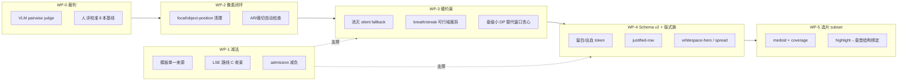

# Travelogue · Phase 19 精益观感跃迁产品需求文档（PRD）

| 属性 | 内容 |
|------|------|
| **产品代号** | Travelogue |
| **阶段代号** | Phase 19 · LQU（Lean Quality Uplift · 精益观感跃迁） |
| **文档版本** | v0.2 |
| **状态** | 工程收尾 · [ACCEPTANCE-PHASE19](./ACCEPTANCE-PHASE19.md) · 护栏通过 · 北极星未达 |
| **战略定位** | 替代 P18 BQP 的执行方式：**减法先行、像素闭环、约束变硬、裁判可扩展**，两周一验，12 周交付 |
| **前置结论** | [P17-LSE-处置建议.md](./P17-LSE-处置建议.md)（LSE 冻结 · 路线 A）、[观感提升路线图.md](./观感提升路线图.md)（P0–P4 优先级）、[ROADMAP-PHASE18-BOOK-QUALITY.md](./ROADMAP-PHASE18-BOOK-QUALITY.md)（方向采纳、执行方式由本 PRD 重构，见 §10） |
| **关联文档** | [PRD-PRODUCT-LAYOUT-PRINCIPLES.md](./PRD-PRODUCT-LAYOUT-PRINCIPLES.md)（**后续阶段纲领**）、[IMPLEMENTATION-PHASE19.md](./IMPLEMENTATION-PHASE19.md) · [PRD-PHASE16-layout-template-engine.md](./PRD-PHASE16-layout-template-engine.md)、[PRD-排版规则优化.md](./PRD-排版规则优化.md)、[观感提升-业内调研.md](./观感提升-业内调研.md)、[LAYOUT-SCORING.md](./LAYOUT-SCORING.md) |
| **验收样本** | Golden Dogfood 8+1 本（沿用 ROADMAP-P18 §2.3：`demo-2025`、`demo-80301df45c`、`demo-1506104ebf`、`demo-5a7c161a12`、`demo-2019`、`linzhi`、`chuanzang-studio`、`demo-151e7b488c`/`demo-ef0cef1d1d`、BSP `demo-d66fe642a9`） |
| **更新日期** | 2026-06-11 |

> **定位**
>
> - P15→P17 三次升级修的都是「维护模板的体验」，不是「看模板的体验」。本阶段以 **可感知观感提升** 为唯一目标，所有交付项必须通过盲评 / VLM 裁判验证，否则回滚。
> - 与 P18 BQP（28–32 周 Program）的区别：**先做减法、Schema v2 前置、裁判轻量化（VLM pairwise + 人评校准）、两周一验**；不以基础设施交付为里程碑。
> - 本 PRD 是执行文档：每个工作包给出需求编号（R-P19-xx）、实现入口、Gate 条件与回滚方式。
>
> **阶段后纲领（2026-06-11）**：P19 收尾后，产品北极星以 **[PRD-PRODUCT-LAYOUT-PRINCIPLES.md](./PRD-PRODUCT-LAYOUT-PRINCIPLES.md)** 为准（拼图 ≤9 且丰富、横竖单美观、叙事次于排版）。本 PRD 中的「盲评胜率 / 故事更清楚」Gate **不替代** 该纲领。

---

## 1. 背景与问题

### 1.1 一句话诊断

> 观感天花板不在 solver，而锁死在四处：**①约 21 个对称网格模板的同质模板库；②约束系统的 silent fallback（节奏规则形同虚设）；③算法—像素断层（focal 被 CSS 硬编码覆盖）；④无可扩展裁判（proxy 饱和、人评不可日常化）。**

### 1.2 根因清单（2026-06-11 架构评审结论）

| # | 根因 | 证据 |
|---|------|------|
| RC-1 | **模板表达力天花板**：LTE schema 只能表达「网格填充」——固定 16:9 舞台 + rect 槽位 + 单一 gap；无 margin/bleed/留白 token；`photoCount.min==max` 刚性；9 片封顶（V-P16-12） | `layout_templates/models.py`、`layout_template.schema.json` |
| RC-2 | **治理抑制内容生产**：新增一个模板需七道工序（YAML→schema→validator→admission→lte_policy `_BY_SIZE`→legacy 同步→overlay CSS）；引擎上线后模板库停滞在 24 个（半数为 legacy 逆向迁移） | `admission.py`、`lte_policy.yaml` |
| RC-3 | **三处同源复杂度税**：LTE YAML（权威）→ `mosaic/_legacy_generated.py`（离线同步）→ `constants.py`/`PATTERN_GRID_CLASS`（fallback）；双 registry、双 fallback 链、拓扑逻辑散落三处 | `grid_specs.py`、`lte_adapter.py`、`render/context.py` |
| RC-4 | **Silent fallback 掏空约束**：节奏/呼吸约束无解时回退 unfiltered candidates 或 legacy planner；竖版墙、4 连 portrait-2 由此漏出 | `mosaic/compose.py`、`screen_planner_stages.py` 日志 `no plan satisfies consecutive pattern` |
| RC-5 | **算法—像素断层**：focal CSS 变量已部分接通，但 `journal-screens.css` 仍有十余处 pattern 级 `object-position: top center / center` 硬编码覆盖 focal | `journal-screens.css` L913/999/1055/1183/1226/1247/1288/1354/1415 等 |
| RC-6 | **评测错位**：proxy 饱和（`aspectPatternMatchRate≈1.0`）、P17 golden 靠合成探针救援；盲评尚无固化基线，且 3 人 × 8 本 × 30min 的人评无法支撑日常迭代 | `p17-golden-metrics-baseline.json`、观感路线图 §10 |
| RC-7 | **冻结代码的认知税**：LSE 35 个模块（shadow/golden_probe/algorithm_lock/governance…）已证伪却全量保留在主路径；三套独立灰度机制并存 | `layout_engine/`、P17 处置建议 §3 |

### 1.3 已证伪 / 已共识（不再重复验证）

- LSE 上量、capability 调参 → **不做**（dogfood 0%~3.8% 屏变、肉眼无差异）。
- 仅凭 golden proxy 上涨合并 → **禁止**（P18 BQP 已立规，本 PRD 继承）。
- 选片 > 模板 > 结构 > solver 的优先级 → **采纳**（观感提升路线图 P0–P4）。

---

## 2. 目标与非目标

### 2.1 目标

| ID | 目标 | 衡量 |
|----|------|------|
| **G-P19-01** | 建立**可日常化的感知裁判**：VLM pairwise judge + 人评校准，每次 curate 改动可在 30 分钟内拿到 8 本 trip 的胜率 | judge 与人评一致率 ≥ 75% |
| **G-P19-02** | **像素闭环**：算法输出（focal、displayAspect、fit）在渲染层 100% 生效，消灭 CSS 硬编码覆盖 | focal 覆盖检查 0 违规 |
| **G-P19-03** | **约束变硬**：节奏/呼吸/连发规则从打分惩罚升级为可行域裁剪，消灭 silent fallback | breath/streak 违规率 = 0；fallback 仅剩显式兜底单图 |
| **G-P19-04** | **模板表达力升级（Schema v2）**：支持留白 token、AR 区间槽位、photoCount 区间；新增 justified-row、whitespace-hero、spread 三个版式族 | 新版式族在混排 trip 占比 ≥ 15% |
| **G-P19-05** | **选片 subset v1**：场景 medoid + coverage，进排版资产 −25%~−40% | 盲评「故事更清楚」≥ 60% |
| **G-P19-06** | **减法**：模板单一来源、LSE 收束路线 C、admission 减负至 3 步；新增模板上线 ≤ 1 天 | 三处同源归一；`_legacy_generated.py` 删除 |
| **G-P19-07** | **北极星**：8 本 golden trip 上，P19 终态 vs P16 baseline 盲评胜率 ≥ 60%（绝对值），任一 Sprint 不达 Gate 即回滚该 Sprint 改动 | 盲评 + judge 双口径 |

### 2.2 非目标

| 非目标 | 说明 |
|--------|------|
| 重启 LSE capability 调参 / 上量 | P17 处置不变；本阶段执行其「路线 C」收束 |
| trip 级全局 ILP / Cassowary | 章级 DP/beam 足够；全局编排留待 P19 后评估 |
| story_planner 全量叙事弧 | 仅做 highlight → 章首 hero 的结构绑定（轻量）；五段弧留待后续 |
| 端到端 LLM/VLM 直接生成 layout | VLM 仅作裁判，不做排版器（不可解释、不可回归） |
| mobile / legacy 渲染路径改造 | 仅 web screens 引擎 |
| 多租户 / SaaS | 与 P18 BQP 非目标一致 |

---

## 3. 总体方案

### 3.1 四条原则

1. **减法先于加法**：先删三处同源与冻结代码，再建新能力，避免五层引擎叠床架屋。
2. **裁判先于算法**：没有可日常化的感知裁判之前，不合并任何「观感优化」。
3. **约束硬于打分**：能用可行域裁剪解决的，不用 soft weight（P17 消融已证软乘子翻不动离散决策）。
4. **像素优先于策略**：渲染层一行 CSS 能否决整条打分链；最后一公里缺陷优先修。

### 3.2 工作包总览



依赖关系：WP-0 与 WP-1、WP-2 可并行启动；WP-3 依赖 WP-1 的单一来源；WP-4 依赖 WP-1 的 admission 减负；WP-5 独立于模板链，可与 WP-4 并行。

---

## 4. 工作包详述

### WP-0 · 感知裁判（VLM pairwise + 人评校准）

**本质问题**：proxy 饱和、人评不可扩展（RC-6）。没有日常裁判，后续所有 WP 都是盲飞。

| ID | 需求 | 说明 |
|----|------|------|
| R-P19-001 | `scripts/book_quality_vlm_judge.py`：输入两版成稿截图序列（复用 `lse_flags_preview_ablate.py` 并排 HTML + Playwright 截图），输出 pairwise 判断 + 分维度评分（节奏 / 留白 / 裁切 / 单调感 / 像成品书）。**抽样屏**：每本 ≤12 屏关键屏（章首、hero/mosaic、breath 邻接对、随机补足），以 tripId+screens 签名为种子，两版成稿抽相同位置（DQ-01） | VLM 可配置（API key 走 config，不入库）；模型版本与 prompt 锁定入库，换模型须重跑校准 |
| R-P19-002 | 人评校准：首轮 ≥3 人 × 8 本盲评建立基线（沿用 ROADMAP-P18 BQ-001/002 设计），计算 judge–人评一致率；**一致率 ≥ 75% 后 judge 方可作为日常门禁** | 校准结果写 `docs/acceptance-records/p19-judge-calibration.json` |
| R-P19-003 | 每个 P19 PR 必附 judge 结果（8 本胜率 + 分维度）；人评仅在 Sprint Gate 时批量执行 | PR 模板更新 |
| R-P19-004 | judge 不可用 / 一致率不达标时的降级路径：退回纯人评 Gate，节奏放缓但规则不变 | 写入 runbook |

**交付物**：judge 脚本、校准记录、`.cache/book-quality/` 基线打分板（P16 默认路径）。

### WP-1 · 减法（架构收束）

**本质问题**：RC-2、RC-3、RC-7。

| ID | 需求 | 说明 |
|----|------|------|
| R-P19-101 | **模板单一来源**：`grid_specs.py` 等运行时直读 LTE registry；删除 `_legacy_generated.py`、`legacy_codegen.py`、`scripts/lte_export_legacy.py` 同步链与 `default_registry()` legacy 池 | `read_templates_from_lte` 开关与 LTE-off 路径一并移除 |
| R-P19-102 | **拓扑逻辑归一**：`try_order_for_pattern` / `scorer.py` 中 `if pattern_id == PATTERN_MOSAIC_5_*` 分支改为读模板声明（slots role / constraints） | 模板真正「声明式」 |
| R-P19-103 | **LSE 路线 C 收束**：`shadow.py`、`golden_probe.py`、`algorithm_lock.py`、`weights_audit.py` 等验收/治理模块移出主包（归档至 `layout_engine/_archive/` 或独立 dev extra）；保留 rhythm 配置、pattern 黑名单、decision log 三项已收编能力。`/lse-flags-admin` 降级为只读快照视图，写路径移除（DQ-04） | 与 P17 处置建议 §4 路线 C 对齐；实验改由脚本 + config.yaml |
| R-P19-104 | **Admission 减负**：beta 阶段 warn-only probe 移除；准入压缩为 YAML → `validate --semantic` → CSS 生成三步；`mosaic_unified_groups` 按 `photoCount` 自动归组，删除手工枚举 | 新模板上线 ≤ 1 天（AC-P19-06） |
| R-P19-105 | 灰度机制归一：LTE percent / LSE traffic / Phase6 rollout 三套 bucket 收敛为单一 rollout util | 行为兼容现有 trip |

**回滚方式**：本 WP 为纯重构，以「8 本 trip curate 输出 screens 签名零 diff」为合并门禁（行为不变才能删）。

### WP-2 · 像素闭环

**本质问题**：RC-5——打分链精心计算的 salient retention 在像素层被一行 CSS 否决。**全项目 ROI 最高的单项。**

| ID | 需求 | 说明 |
|----|------|------|
| R-P19-201 | 清理 `journal-screens.css` / `journal.css` 中所有 pattern 级 `object-position` 硬编码（`top center`、`center`），统一走 `--focal-x/--focal-y` CSS 变量；无 focal 数据时的默认值由变量 fallback 提供 | 含 overlay 层 |
| R-P19-202 | 渲染上下文保证每个 slot 输出 focal 变量（已有数据链：`assets_map.focalPoint` → render context） | 缺失时记录 telemetry |
| R-P19-203 | **自动化像素检查**：扩展 `probe_screenshot.py`，对每个 ga 模板 × 典型 AR 组合断言「slot 声明 displayAspect ↔ 实际渲染 AR」误差 ≤ 容差、focal 点保留在可视区 | 进 CI（非 release-only） |
| R-P19-204 | badcase 回归：3P+2L 超宽槽类缺陷（P16-P-03）补入检查样例 | |

### WP-3 · 硬约束 + 章级规划

**本质问题**：RC-4 + 局部贪心。

| ID | 需求 | 说明 |
|----|------|------|
| R-P19-301 | **消灭 silent fallback**：`mosaic/search` 与 planner 在约束无解时**丢弃 plan 并回溯换窗口切分**，禁止回退 unfiltered candidates；每次 reject 记录 reason 入 decision log | 继承 P18 BQ-201 |
| R-P19-302 | 节奏规则升级为**可行域裁剪**：连续 ≥3 多槽屏 → 必须插 `breath-pause`；`portrait-2` streak ≤2、满屏竖单不连续（与 [PRD-排版规则优化](./PRD-排版规则优化.md) R-06/V-08 对齐）在候选生成阶段过滤而非打分惩罚 | 阈值走 `layout.rhythm` 配置 |
| R-P19-303 | **章级小规模 DP/beam**：一章（通常 ≤20 屏）内对「窗口切分 × 模板选择」做动态规划，替代逐窗口贪心；目标函数沿用现有 scorer，但硬约束为可行域 | 性能预算：curate P95 ≤ +15% |
| R-P19-304 | 显式兜底：DP 无解（极端输入）时降级为单图序列 + error telemetry，**不得**降级为违规版式 | |

### WP-4 · Schema v2 + 设计师版式族

**本质问题**：RC-1——版式美学天花板。

| ID | 需求 | 说明 |
|----|------|------|
| R-P19-401 | **Schema v2 最小集**：新增 `stage.margins` / `slots[].inset` / `bleed`（full/inset）/ `maxFillRatio`（留白页型）；`photoCount` 支持真区间 + 可选槽位；解除 9 片硬封顶；`stage.aspect` 解除 16:9 隐含假设，validator/css_gen/像素检查按声明 aspect 推导，首批支持 16:9 与 3:2 双档（DQ-05） | 向后兼容 v1 模板（缺省值等价旧行为）；其余比例仅 schema 放开、不做专项验证 |
| R-P19-402 | 槽位 AR 从「网格副产品」变为「设计约束」：`slots[].aspectRange` + `cropPolicy`（focal 对齐方式）；validator 同步升级 | |
| R-P19-403 | **justified-row 版式族**：引入 Flickr justified-layout 算法（MIT），行高自适应、不规则列宽，主治竖图 trip 的「竖版墙」；**仅 web screens 引擎**，mobile/legacy 不引入（DQ-02） | 新 `kind: justified` |
| R-P19-404 | **whitespace-hero**：大留白单图页型（有意 scale-down + margins，非 full-bleed），绑定 `maxFillRatio` token | |
| R-P19-405 | **spread / asymmetric-hero**：对开双 hero 与非对称 hero+侧栏条两个 composite SKU（参考 kore/photobook 页型语言） | 共 3 个设计师 SKU，对齐 P18 BQ-204 |
| R-P19-406 | `css_gen` 升级支持 token → CSS 变量输出；overlay 层职责收窄为行为类规则 | |

**前置**：R-P19-104（否则每个 SKU 又要过七道工序）。

### WP-5 · 选片 subset v1 + 高光结构绑定

**本质问题**：进排版的是「不差」而非「该出现」（观感路线图 P1，最大 ROI）。

| ID | 需求 | 说明 |
|----|------|------|
| R-P19-501 | 新模块 `curation/subset_planner.py`：scene cluster medoid（embedding 彼此最远 + 质量下限）+ day × {person, landscape, food} coverage 贪心；插入点在 `run_clustering_layer` 后、`plan_screens` 前 | 继承 P18 BQ-101~103 设计 |
| R-P19-502 | 进排版资产削减为**硬上限**（非软目标），按 trip 规模分三档：精选/小集（≤80 张）−40%、混排常规 −30%、大集活动（≥300 张）−25%；档位自动判定、`curation.subset` 可覆盖；Studio 星标资产无条件豁免且不计入削减基数（DQ-03） | `curation.subsetPlan` 写入 trip.json |
| R-P19-503 | DPP/MMR 内核从 `mosaic/diversity.py` 上移复用至 asset 层（可选路径） | |
| R-P19-504 | **highlight → 结构绑定**：`highlight_windows` 输出从 mosaic ×1.25 boost 改为强制章首 hero / opener 页型（改 `screen_planner` 的 `preferred_hero_id`） | 继承 P18 BQ-303 的轻量版 |
| R-P19-505 | 独立 kill switch：`curation.subset.enabled`（默认先关，Gate 通过后默认开） | |

---

## 5. 里程碑与节奏（12 周 · 两周一验）

每个 Sprint 结束跑 8 本 trip judge + 抽样人评；**不达 Gate 即回滚该 Sprint 的行为性改动**（纯重构以零 diff 门禁豁免）。

| Sprint | 周 | 内容 | Gate（在 8 本 golden 上） |
|--------|----|------|---------------------------|
| **S1** | W1–2 | WP-0 judge v0 + 人评基线；WP-2 像素闭环（R-201/202） | judge 跑通且一致率初测 ≥ 70%；focal 违规 = 0；裁切维度 judge 胜率 ≥ 55% |
| **S2** | W3–4 | WP-1 减法（R-101~105，零 diff 重构）；WP-2 自动化检查（R-203/204） | 8 本 screens 签名零 diff；CI 像素检查上线 |
| **S3** | W5–6 | WP-3 硬约束（R-301/302/304） | breath/streak 违规率 = 0；judge 整体胜率 ≥ 55%，节奏维度 ≥ 60% |
| **S4** | W7–8 | WP-4 Schema v2 + justified-row + whitespace-hero（R-401~404、406） | 竖图 trip（`demo-2025` 系）judge 胜率 ≥ 60%；新版式占比 ≥ 10%；BSP `demo-d66fe642a9` 3:2 视口截图检查通过（DQ-05） |
| **S5** | W9–10 | WP-4 spread/asymmetric SKU（R-405）；WP-3 章级 DP（R-303） | 混排 trip judge 胜率 ≥ 60%；设计师 SKU 占比 ≥ 15%；curate P95 ≤ +15% |
| **S6** | W11–12 | WP-5 subset v1 + highlight 绑定（R-501~505）；集成、默认开启、人评终验 | **北极星：盲评（人评）胜率 ≥ 60% · ≥6/8 本**；「故事更清楚」≥ 60% |

并行规则：S4 与 S5 的 WP-5 spike（单 trip `demo-1506104ebf` 验证 subset）可提前 overlap。

---

## 6. 验收标准

| ID | 验收项 | 标准 |
|----|--------|------|
| AC-P19-01 | 感知裁判 | judge–人评一致率 ≥ 75%（校准记录归档）；所有 P19 行为性 PR 附 judge 结果 |
| AC-P19-02 | 像素闭环 | `journal-screens.css` 无 pattern 级 `object-position` 硬编码；CI 像素检查通过；focal 缺失率有 telemetry |
| AC-P19-03 | 硬约束 | 8 本 trip：breath 违规 = 0、portrait-2 streak ≤2、满屏竖单不连续；decision log 含全部 reject reason；无 unfiltered fallback 代码路径 |
| AC-P19-04 | Schema v2 | v1 模板零迁移成本加载；3 个设计师 SKU + justified-row 上线且占比达标；新模板上线流程 ≤ 3 步 |
| AC-P19-05 | 选片 | 进排版资产 −25%~−40%（8 本中位数）；「故事更清楚」人评 ≥ 60% |
| AC-P19-06 | 减法 | `_legacy_generated.py` 等同步链删除；LSE 主包仅剩收编三项；新增模板（含 CSS）实测 ≤ 1 人天 |
| AC-P19-07 | **北极星** | 8 本 golden：P19 终态 vs P16 baseline 人评盲评胜率 ≥ 60%（≥6/8 本），Share Intent ≥ 4/5 比例 ≥ 60% |
| AC-P19-08 | 性能与稳定 | curate P95 ≤ +15% vs P16 baseline；structure_draft / render 成功率无回归 |

---

## 7. 指标与门禁体系

```text
【日常层】VLM judge：每 PR · 8 本 · 胜率 + 5 维度（节奏/留白/裁切/单调感/成品感）
【Gate 层】人评盲评：每 Sprint · ≥3 人 · pairwise + 分维度
【护栏层】proxy 仅作回归哨兵（不作合并依据）：breath 违规率、layoutRepeatStreak、
          pattern_diversity、curate P95、像素 AR/focal 检查
```

- 继承 P18 BQP 规则：**仅 proxy 改善而无 judge/盲评结果的 PR 不得合并**（docs/test only 除外）。
- judge 维度与人评维度一一对应，便于校准与漂移监控；每 Sprint 复测一致率，跌破 70% 触发重校准。

---

## 8. 风险与缓解

| 风险 | 影响 | 缓解 |
|------|------|------|
| VLM judge 偏好与人评漂移 | 误导日常迭代 | 每 Sprint 复测一致率；Gate 始终以人评为准；judge prompt/模型版本入库锁定 |
| 减法重构引入行为 diff | 隐性回归 | R-P19-101~105 以「8 本 screens 签名零 diff」为硬门禁；分小 PR |
| 硬约束无解率上升 | curate 失败 / 兜底单图过多 | reject reason 监控；S3 先在 2 本 trip 灰度；兜底率 > 5% 视为 Gate 失败 |
| Schema v2 兼容破坏 | 旧 trip 渲染异常 | v1 缺省值等价旧行为；`geometry_diff` 快照对比全部 24 个存量模板 |
| subset 过狠丢故事 | 用户负面 | coverage 硬约束 + 星标豁免 + 默认关，Gate 后才默认开 |
| 12 周节奏过紧 | 质量妥协 | 允许 S5/S6 顺延，但**不允许跳过 Gate**；砍范围优先于砍验证 |

---

## 9. 资源估算

| 角色 | 投入 | 主要职责 |
|------|------|----------|
| 首席算法 | 50% × 3mo | WP-3 章级 DP、WP-5 subset、judge 校准 |
| 后端 | 1 FTE × 3mo | WP-1 减法、WP-4 schema/css_gen、curate 编排 |
| 设计 | 0.3 FTE × 6w | 3 个 SKU 页型 + 留白 token 规范 |
| 全栈 | 0.3 FTE × 3mo | judge 截图链路、compare 投票 UI、telemetry |
| QA/Dogfood | 0.2 FTE 持续 | Sprint Gate 盲评组织、8 本维护 |

---

## 10. 与 P18 BQP 的关系

| 维度 | P18 BQP（ROADMAP） | P19 LQU（本 PRD） |
|------|--------------------|--------------------|
| 方向 | 选片→结构→版式→裁判，**采纳不变** | 同方向 |
| 周期 | 28–32 周、5 个 IG | **12 周、6 个 Sprint Gate** |
| 裁判 | 纯人评盲评 | VLM judge 日常 + 人评 Gate 校准 |
| 顺序 | 裁判→选片→版式→结构 | 裁判+像素+减法 → 硬约束 → 版式 → 选片 |
| 减法 | 无条目 | WP-1 一等公民（防第四次「治理升级」） |
| story_planner | 18.3 全量 | 仅 highlight→章首绑定；全量叙事弧 P19 后评估 |

**处置**：P18 BQP 文档保留为方向性参考；其交付项编号（BQ-xxx）在本 PRD 中按继承关系标注。P19 完成后，依据北极星结果决定是否启动 BQP 剩余项（story_planner 全量、swap pass、偏好学习 re-ranker）。

---

## 11. 已决策事项（v0.2 拍板，原开放问题）

| ID | 问题 | **决策** | 理由与影响 |
|----|------|----------|------------|
| DQ-01 | VLM judge 选型与成本上限 | **抽样屏方案**：每本固定抽 ≤ 12 屏关键屏（章首、hero/mosaic、breath 前后邻接对、随机补足），抽样以 tripId+screens 签名为种子保证可复现；同一对比的两版成稿抽**相同位置**的屏。模型版本与 prompt 锁定入库，更换模型须重跑校准（R-P19-002） | 每 PR 成本约 8 本 × ≤12 屏 × 2 版，可控；可复现性保证 judge 结果可作门禁。落入 R-P19-001 |
| DQ-02 | justified-row 是否进 mobile/auto 双输出 | **本阶段仅 web screens**。mobile/legacy 路径不引入新版式族；`exportLayout=auto` 的 mobile 产物维持现状 | 与 §2.2 非目标一致，避免双端联调拖累 S4 节奏；mobile 适配在 P19 北极星达标后单独立项 |
| DQ-03 | subset 硬上限是否按 trip 类型分档 | **分三档**：精选/小集（≤80 张）−40%、混排常规 −30%、大集活动（≥300 张，如 `demo-2019`）−25%；档位按进排版前资产数自动判定，可在 `curation.subset` 配置覆盖；Studio 星标资产无条件豁免且不计入削减基数 | 大集活动信息密度本身是卖点，削减过狠会丢事件覆盖；落入 R-P19-502 |
| DQ-04 | LSE 开关页（`/lse-flags-admin`）去留 | **保留只读、下线写路径**：页面降级为「当前生效策略/能力快照」视图；写操作（capability 开关、权重 patch）随路线 C 收束移除，实验改由脚本（`lse_flags_curate_compare.py` 系）+ config.yaml 完成 | 保留可观测性、消除「页面可改但无效果」的误导；与 R-P19-103 一并交付 |
| DQ-05 | Schema v2 是否支持非 16:9 舞台 | **支持**：`stage.aspect` 解除 16:9 隐含假设，validator/css_gen/像素检查（R-P19-203）按声明 aspect 推导；首批落地 3:2（BSP `demo-d66fe642a9` 视口）与 16:9 双档，其余比例仅 schema 放开不做专项验证 | BSP 已是第 9 本验收样本，顺势补齐；whitespace-hero/spread 在 3:2 下的表现纳入 S4/S5 Gate 截图 |

---

## 12. 修订记录

| 版本 | 日期 | 说明 |
|------|------|------|
| v0.1 | 2026-06-11 | 初版：基于 2026-06-11 LTE 架构评审结论，重构 P18 BQP 执行方式为 12 周精益方案 |
| v0.2 | 2026-06-11 | §11 五项开放问题拍板（OQ→DQ）：judge 抽样屏方案、justified-row 仅 web、subset 三档硬上限、LSE 开关页降级只读、Schema v2 支持 3:2 舞台；决策同步至 R-P19-001/103/401/403/502 与 S4 Gate |
