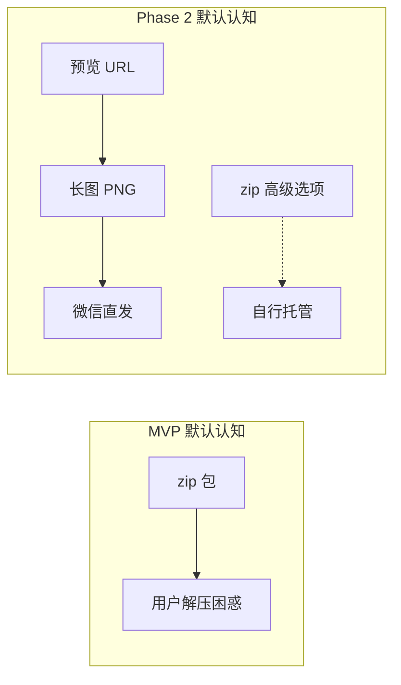
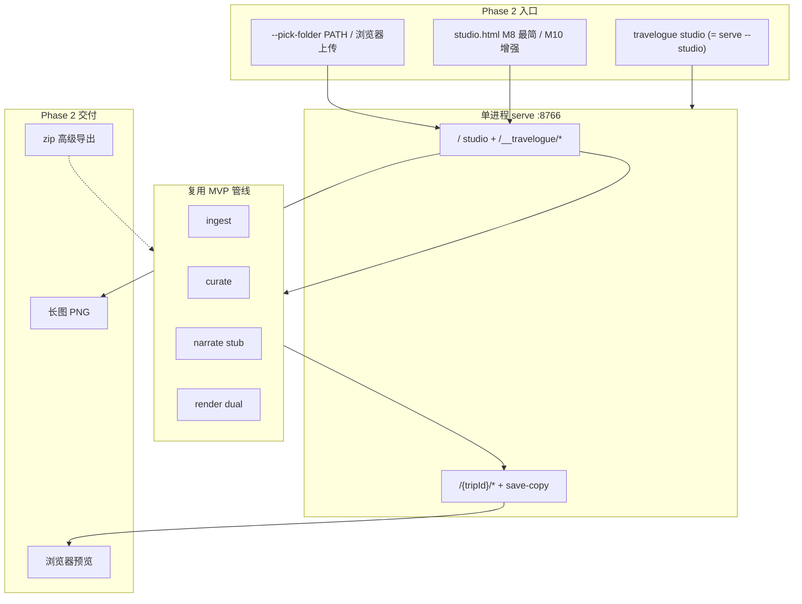
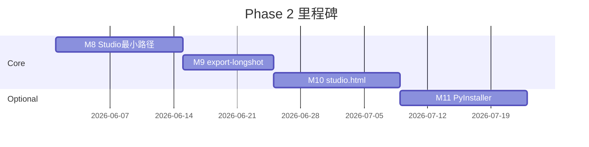

# Travelogue · Phase 2 产品需求文档（PRD）

| 属性 | 内容 |
|------|------|
| **产品代号** | Travelogue |
| **文档版本** | v0.3.1-PHASE2 |
| **状态** | Draft · v0.3.1 开发准入补丁（M8 启动前） |
| **Phase 2 代号** | 「可分享体验」— Studio 工作台 + 服务端长图 |
| **前置条件** | [PRD-MVP.md](./PRD-MVP.md) 管线能力就绪（ingest / curate / narrate / render / serve / export） |
| **交付形态** | 非开发者：**选文件夹 → 浏览器预览 → 保存长图 PNG → 发微信**；zip 降为高级选项 |
| **关联文档** | [SHARING.md](./SHARING.md)、[WORKSHOP.md](./WORKSHOP.md)、[CLI-SPEC.md](./CLI-SPEC.md)、[API-MINIAPP.md](./API-MINIAPP.md)（设计稿 · 未实现）、[ACCEPTANCE-PHASE2.md](./ACCEPTANCE-PHASE2.md)、[IMPLEMENTATION-PHASE2.md](./IMPLEMENTATION-PHASE2.md)、[adr/004](./adr/004-studio-hub-server.md)、[adr/005](./adr/005-longshot-server-side.md) |
| **更新日期** | 2026-05-27 |

---

## 1. 背景与问题陈述

### 1.1 MVP 已完成什么

MVP（P0 本地工坊）已交付完整的 **照片 → trip.json → HTML 游记** 技术管线：

- `ingest` / `curate` / `narrate` / `render` / `export` CLI 命令
- `travelogue serve`：HTTP 预览 + inline edit + 自动重渲染
- `index-longshot.html` + `longshot.js`：浏览器内保存长图（html2canvas）
- `preview.jpg`：9:16 封面引流图
- `workshop-pipeline.ps1`：开发者一条龙脚本

详见 [PRD-MVP.md](./PRD-MVP.md)（**冻结**，不再追加功能需求）。

### 1.2 Phase 2 要解决的断裂点

当前用户旅程存在两个 **产品级断裂**，阻碍非开发者完成「从照片到可转发」：

| 断裂 | 现状 | 目标用户感受 |
|------|------|--------------|
| **断裂 1 · 入口** | 照片文件夹 → `[需 PowerShell / workshop 脚本]` → 看到游记 | 双击或一条命令 → 浏览器自动打开预览 |
| **断裂 2 · 分享** | 看到游记 → `[zip]` → 朋友在微信里打不开 | 点「保存长图」→ 得到 PNG → 拖到微信即发 |

**断裂 1 根因**：目标用户是旅行者，不是开发者。要求运行 `workshop-pipeline.ps1` 或记忆多条 CLI，对 99% 用户不可行。

**断裂 2 根因**：中国用户不会下载 zip 再解压找 `index.html`（[SHARING.md](./SHARING.md) 已拍板路径 A）。客户端长图虽已实现（F-EXP-07），但依赖 `serve` + 手动进入 `index-longshot.html` + html2canvas，路径长且微信内置浏览器不稳定。

### 1.3 Phase 2 产品定位

> **把 MVP 的「开发者管线」包装成「旅行者工作台」**：默认交付物从 zip 变为 **浏览器预览 + 长图 PNG**；zip 保留为高级导出。

Phase 2 **不重新发明** ingest / curate / render 逻辑，而是新增：

1. **Studio** — `travelogue studio`（=`serve --studio`）+ **M8 最简 studio.html**
2. **export-longshot** — Playwright 服务端长图（P0 + P1 fallback）
3. **交付物层级调整** — 对齐 [SHARING.md](./SHARING.md) 路径 A

---

## 2. 目标与非目标

### 2.1 产品目标

| ID | 目标 | 衡量方式 |
|----|------|----------|
| **G-P2-01** | **非开发者**能在 **20 分钟内** 从照片文件夹得到可转发长图 | 1 位非技术用户实测；起止时间记录 |
| **G-P2-02** | 零 PowerShell / 零命令行可见（Phase 2a 可接受一条双击 exe） | 用户旅程无终端窗口 |
| **G-P2-03** | 长图 PNG 可直接发微信群，群友 **无需链接** 即可读完 | AC-P2-02 验收 |
| **G-P2-04** | 第二次打开可继续编辑已有 trip（非每次重新导入） | studio trip 列表可用 |
| **G-P2-05** | 默认 pipeline 不依赖 LLM API Key | stub narrate + scope=frame |
| **G-P2-06** | 本地 Job JSON 字段对齐云端草案 | 见 §9.2；HTTP **不**拆双服务 |

### 2.2 非目标（Phase 2 明确不做）

- 微信小程序发布、云端托管、用户账号体系
- 完整 Tauri / Electron 桌面应用
- **PyInstaller exe 阻塞 Phase 2 完成**（M11 降为 P2 backlog）
- 服务端 PDF 导出（已有 `export-pdf`，不在 Phase 2 范围）
- 长图叠加水印 / 二维码（P2 传播增强）
- 替换或删除客户端 html2canvas 长图（保留为轻量预览）
- 修改 MVP 已冻结的核心 Agent 行为（curate 规则、模板结构等）

---

## 3. 目标用户与场景

### 3.1 主要用户（Phase 2 升级）

**Persona A · 普通旅行者（= Phase 2 主用户）**

- 旅行结束后 1–3 天想整理照片发微信群
- 不会 PowerShell，不愿配置 API Key
- 接受「照片发群里被看到」；不需要复杂隐私鉴权
- 使用 Windows 笔记本或台式机（Phase 2 首发平台）

**Persona B · 进阶创作者（= MVP Persona A 延续）**

- 愿意配置 DeepSeek / DashScope，追求杂志感文案
- 仍可使用 CLI / workshop 脚本调试
- 需要 zip 高级导出、share 态 HTML

**Persona C · 私密分享者（= P3，不在 Phase 2）**

- 完整 HTML + 小程序鉴权；见 [SHARING.md](./SHARING.md) 路径 B

### 3.2 核心场景（User Stories）

| ID | 作为… | 我想要… | 以便… |
|----|--------|---------|--------|
| **US-P2-01** | 旅行者 | 双击打开 Studio，选一个照片文件夹 | 不用学命令行 |
| **US-P2-02** | 旅行者 | 看到进度条（导入 → 排版 → 生成） | 知道还要等多久 |
| **US-P2-03** | 旅行者 | 自动在浏览器里打开游记预览 | 立刻看到效果 |
| **US-P2-04** | 旅行者 | 在预览页改一句标题或 hook | 注入个人风格 |
| **US-P2-05** | 旅行者 | 点「保存长图」得到 PNG 文件 | 直接拖到微信发群 |
| **US-P2-06** | 旅行者 | 知道 PNG 保存在哪 | 能找到文件发出去 |
| **US-P2-07** | 旅行者 | 下次打开 Studio 看到上次的 trip | 继续编辑而非重来 |
| **US-P2-08** | 进阶用户 | 可选「生成杂志感文案」（LLM） | 默认 stub 不够时升级 |
| **US-P2-09** | 进阶用户 | 在「高级」菜单里导出 zip | 自行托管或备份 |
| **US-P2-10** | 旅行者 | 导入失败时看到中文原因与建议 | 不是 `E_INGEST_TOO_FEW` 英文码 |

### 3.3 场景时间窗

与 MVP 一致：**旅行结束后 24–72 小时** 内完成第一篇可转发长图。  
Phase 2 默认 pipeline（stub narrate）目标：**选文件夹后 ≤3 分钟** 看到预览（250 张以内，普通 Windows 笔记本）。

---

## 4. 交付物层级变更

Phase 2 改变「默认交付物」优先级，不改变 MVP 已有产物能力。

| 用户动作 | 默认交付物 | 技术 | 优先级 |
|----------|------------|------|--------|
| 选文件夹 → 等待 | 浏览器预览 URL | `serve --studio` + 最简 studio.html | **P0** |
| 编辑文案 | 实时保存 + 重渲染 | 已有 `POST /__travelogue/save-copy` | **P0**（已有） |
| 保存长图 | PNG（单张或按章多张） | `export-longshot`（Playwright） | **P0** |
| 封面卡（可选） | `preview.jpg` | 已有 Pillow；Studio 可展示路径 | P0.5 |
| 导出完整包 | zip | 已有 `export`；移入「高级导出」 | P1（降级 UI） |
| 分享给朋友（链接） | 小程序 URL | P3 | 不做 |



---

## 5. 功能范围总览



### 5.1 In Scope（Phase 2 必做）

| 模块 | 功能点 | 优先级 |
|------|--------|--------|
| **Studio 最小路径** | `serve --studio` + **M8 最简 studio.html** + `--pick-folder PATH` | **P0 · M8** |
| **serve 扩展** | 单端口 8766；Studio 路由 + 现有 trip 路由 | **P0 · M8** |
| **export-longshot** | P0 captureMainToBlob + P1 screenshot fallback | **P0 · M9** |
| **Studio 工作台增强** | M10：trip 列表、完整 toolbar、zip 降级 | **P0 · M10** |
| **Studio 可分享闭环** | M9：预览页长图按钮 + 路径面板 | **P0 · M9** |
| **默认 stub pipeline** | auto layout；lock structure 自动；narrate stub + scope=frame | **P0** |
| **错误中文提示** | 常见 ERROR-CODES 映射为用户可读文案 | **P0** |
| **stub 文案增强** | 从 EXIF/日期/地点生成章 lead 模板 | **P1** |
| **PyInstaller exe** | Windows 原生选文件夹 + exe | **P2 · M11 backlog** |
| **zip UI 降级** | 移入「高级导出」菜单 | **P1** |

### 5.2 Out of Scope

见 §2.2；另：**浏览器拖拽文件夹传绝对路径** 不可行（Web 安全限制），见 §7.2。

---

## 6. 用户旅程与主流程

### 6.1 Phase 2 端到端流程（目标体验）

```
[开始]
  → 启动 Studio（双击 exe 或 travelogue studio）
  → 选择照片文件夹（原生对话框 或 工作台上传）
  → 观看进度：导入 → 排版 → 文案 → 渲染
  → 浏览器自动打开预览（index.html）
  → （可选）改标题 / hook / 图注
  → 点击「保存长图」
  → 得到 PNG（路径明示）
  → 拖到微信发群
[结束]
```

### 6.2 关键交互原则

1. **默认不走 LLM**：stub 文案 + 照片即内容；LLM 为可选「进阶」按钮。  
2. **默认不走 zip**：zip 仅在「高级导出」出现，文案注明「自行托管用」。  
3. **长图不强制隐私闸口**：与 [SHARING.md](./SHARING.md) 路径 A 一致；长图流程不强制 `privacy.confirmedAt`。  
4. **失败可理解**：错误必须中文 + 可操作下一步（如「至少需要 4 张照片」）。  
5. **复用而非重写**：pipeline 调用 `run_demo_from_album` / `run_trip` 同等服务，不 fork 业务逻辑。

### 6.3 与 MVP 旅程对照

| 步骤 | MVP（开发者） | Phase 2（旅行者） |
|------|---------------|-------------------|
| 导入 | `from-album` / workshop.ps1 | Studio 选文件夹 |
| 预览 | `serve` + 手动开 URL | 自动 `webbrowser.open` |
| 改字 | serve inline edit | 同左（复用） |
| 长图 | serve → longshot 页 → html2canvas | Studio「保存长图」→ Playwright |
| 分享 | export zip | 长图 PNG 直发 |

---

## 7. Studio 规格

Studio = **`travelogue serve <trips_dir> --studio`** 的单进程模式；`travelogue studio` 为糖衣命令。详见 [adr/004-studio-hub-server.md](./adr/004-studio-hub-server.md) v0.3。

### 7.1 命令

| 项 | 规格 |
|----|------|
| **命令** | `python -m travelogue studio [OPTIONS]` ≡ `serve <trips_dir> --studio` |
| **默认行为** | 启动 serve（`127.0.0.1:8766`）→ 打开浏览器至 `/`（studio.html） |
| **`--pick-folder PATH`** | **必填路径**；先跑 pipeline → 再 `--studio` serve → 打开 `/{tripId}/index.html` |
| **`--no-open`** | 不自动打开浏览器 |
| **`--port` / `--host` / `--config`** | 与现有 `serve` 一致 |

**M8 不做**原生文件夹对话框（推迟 M11 exe）。

### 7.2 文件夹导入

| 场景 | 机制 | 优先级 |
|------|------|--------|
| **CLI / 粘贴路径** | `--pick-folder PATH` 或 studio.html 路径表单 → JSON `albumPath` | **主路径（M8）** |
| **浏览器上传** | `webkitdirectory` multipart → `trips/_uploads/{jobId}/`；须 **上传进度条** | 备选 |
| **双击入口** | `scripts/start-studio.bat` 启动 `travelogue studio` | AC-P2-03 |
| **exe（P2）** | Windows IFileDialog | M11 backlog |

**浏览器兼容（M8）**：**Chrome 90+ / Edge 90+（Windows）**；不承诺 Safari / Firefox 完整支持 `webkitdirectory`。

### 7.3 默认 Pipeline 与进度

**Pipeline**（同 v0.1）：

```
from-album(layout=auto, render=false)
→ lock structure（自动）
→ narrate(stub, scope=frame)
→ render --dual
```

**进度（Phase 2 简化）**：Job 仅报告 **离散 stage**，不做 ingest 内部百分比：

| stage | 展示文案示例（含预估时间） |
|-------|------------------------------|
| ingest | 1/4 正在导入（约 1–2 分钟）… |
| curate | 2/4 正在排版（约 30 秒）… |
| narrate | 3/4 正在生成文案（约 10 秒）… |
| render | 4/4 正在渲染（约 30 秒）… |

字段：`stageIndex` / `stageCount` / **`stageHint`**（见 §9.2）。**M8 采用方案 A+**：固定分档文案，**import 前**按相册文件数估算（不改造 pipeline 内部 API）：

| 照片数（import 前统计） | ingest stageHint 示例 |
|-------------------------|------------------------|
| ≤50 | 约 30 秒 |
| 51–100 | 约 1 分钟 |
| 101–250 | 约 2 分钟 |

curate / narrate / render 各 stage 的 hint 维护于 `templates/studio/studio_stages.yaml`（固定秒级文案）。**不**实现 `progress: 0.65` 连续条。

### 7.4 studio.html 分期交付

| 阶段 | 内容 |
|------|------|
| **M8（必交付）** | 空态引导文案 + 样例长图；粘贴路径（主）+ 可选上传（带 progress）+ stage 进度（含预估时间）+ 照片数量软引导；**最近 trip 极简链接**（读 `/__travelogue/trips`） |
| **M9（必交付）** | **Studio Chrome** 最小「保存长图」按钮 + Job 轮询 + **成功路径面板**（见 §7.5、F-LNG-11） |
| **M10（增强）** | trip 列表 UI、完整 preview-toolbar、zip 降级、LLM 按钮、改字后 stale 长图提示 |

**浏览器**：Chrome 90+ / Edge 90+（Windows）；见 §7.2。

### 7.5 Studio Chrome（预览页注入层）

`serve --studio` 模式下，所有 `/{tripId}/*.html` 响应注入 **`studio-chrome.js`**（或由 Handler 注入 `<script>`），**集中维护**导航与工具，避免 `index.html` / `index-mobile.html` / `index-longshot.html` 分叉。

| 里程碑 | Chrome 内容 |
|--------|-------------|
| **M8** | `← 返回工作台`（`href="/"`）；可关闭 **编辑提示条** |
| **M9** | + 最小 **「保存长图」** 按钮；longshot Job 轮询；**成功路径面板** |
| **M10** | 替换为完整 **`preview-toolbar.js`** |

**注入 allowlist（v0.3.1 · 必守）**：仅对下列路径注入；**禁止**污染长图捕获面。

| 注入 | 不注入 |
|------|--------|
| `/{tripId}/index.html` | `/{tripId}/index-longshot.html` |
| `/{tripId}/index-mobile.html` | 其他 `*.html`、静态资源 |

`index-longshot.html` 是 P0 `captureMainToBlob` 截图目标；Chrome UI 进入 `<main>` 会导致 PNG 含工作台元素。

提示条与空态 banner 使用 `localStorage` 记录 dismiss 状态（首次打开显示，关闭后不再出现）。

### 7.6 功能需求 · Studio

| 需求 ID | 描述 | 验收标准 |
|---------|------|----------|
| **F-STU-01** | `travelogue studio` 单端口 serve | 8766；`/` 为 studio.html |
| **F-STU-02** | `--pick-folder PATH` 先 pipeline 再预览 | trip `rendered` |
| **F-STU-03** | 自动 pipeline（§7.3） | `index.html` + `index-longshot.html` |
| **F-STU-04** | 完成后打开 preview URL | `--no-open` 可关 |
| **F-STU-05** | M8：studio.html 选图 + stage 进度 | 非开发者可完成 AC-P2-01a |
| **F-STU-06** | M8：`GET /__travelogue/trips` JSON；M10：列表 UI | 最近 trip 可发现 |
| **F-STU-07** | 失败态中文；`E_DEMO_EXISTS` → 确认后 `force:true` 重试 | 见 §11.1 |
| **F-STU-08** | 仅 localhost | 默认 `127.0.0.1` |
| **F-STU-09** | 无 `--studio` 时 serve 与 MVP 一致 | NR-P2-02 |
| **F-STU-10** | M8：Studio Chrome · 返回工作台链接 | 预览页可回到 `/` |
| **F-STU-11** | M8：编辑可发现性提示条（可 dismiss） | US-P2-04 可触发 |
| **F-STU-12** | M8：空态价值主张 + 样例长图截图 | 见 §11.2 |
| **F-STU-13** | M8：照片数量软引导 | 推荐 50–100 张；>100 张 soft warning |
| **F-STU-14** | M8：stage 文案含预估时间 | 见 §7.3 stageHint |

---

## 8. export-longshot 规格

详见 [adr/005-longshot-server-side.md](./adr/005-longshot-server-side.md) v0.3。

### 8.1 命令

| 项 | 规格 |
|----|------|
| **命令** | `python -m travelogue export-longshot <trip> [OPTIONS]` |
| **`--scale`** | CLI 默认 **`1`**；Studio UI 默认 **`2`（推荐）**；`3` 为可选「超高清」 |
| **`--format`** | `png`（默认）；`jpeg` 可选 |
| **`--chapter`** | 仅导出第 N 章（1-based） |
| **依赖** | `travelogue[playwright]` + `playwright install chromium` |

### 8.2 捕获路径（分级）

| 级 | 方法 | 说明 |
|----|------|------|
| **P0** | `TravelogueLongshot.captureMainToBlob` | 默认；像素与 F-EXP-07 同源 |
| **P1** | Playwright `main` element screenshot | P0 失败 / blob 过大 / 超时 |
| **P2** | 客户端 html2canvas | Playwright 不可用（Plan B） |

P1 触发时记录 `captureMethod`；日志 + 可选 UI「兼容模式」。**M9 出口**：≥5 真实 trip 上 P0 成功率 ≥80%。

### 8.3 分段规则

| 条件 | 行为 |
|------|------|
| 单次 capture 输出高度 **≤ 5000px** | 单张 `{title}-longshot.png` |
| 预估/实际高度 **> 5000px** | 按章 `{title}-ch{nn}.png` |
| **兜底**：单章 media-card **> 60** | 强制按章 |

（产品语义对齐客户端「图多时多张发微信」；**不**再用固定 45 张作为唯一阈值。）

### 8.4 功能需求 · 长图

| 需求 ID | 描述 | 验收标准 |
|---------|------|----------|
| **F-LNG-01** | CLI 输出非空 PNG | exit 0 |
| **F-LNG-02** | P0 + P1 fallback | 见 §8.2 |
| **F-LNG-03** | 高度 ≤5000px 单张 | 宽 ≈ 390×scale |
| **F-LNG-04** | 高度 >5000px 或兜底按章 | 命名规范 |
| **F-LNG-05** | Studio 长图按钮 / API | **M9** 最小按钮 + Job；**M10** 完整 toolbar |
| **F-LNG-06** | 改字后再生成 | 内容更新；**M10** stale 提示 |
| **F-LNG-07** | 无 privacy 闸口 | 与 zip 区分 |
| **F-LNG-08** | >30s 等待提示 | UI 或 CLI |
| **F-LNG-09** | CLI 默认 scale=1；Studio UI 默认 scale=2 | Studio 标注「推荐 · 适合手机」 |
| **F-LNG-10** | P1 fallback 时 UI 提示 | 「已使用兼容模式导出，与预览可能有细微差异」 |
| **F-LNG-11** | M9：成功路径面板 | 完整绝对路径 +「在文件夹中显示」；按章多张列路径 |
| **F-LNG-12** | M10：改字后 stale 长图提示 | save-copy 后按钮旁「内容已更新，请重新生成长图」 |
| **F-LNG-13** | P2：按章 PNG 页码水印 | 底部半透明 `2/5`；不影响阅读 |

---

## 9. Studio API（`serve --studio`）

架构见 [adr/004-studio-hub-server.md](./adr/004-studio-hub-server.md) v0.3。**单进程单端口**（默认 8766）。

### 9.1 路由表

| 方法 | 路径 | 说明 |
|------|------|------|
| `GET` | `/` | `studio.html` |
| `GET` | `/__travelogue/trips` | trip 列表 JSON（**M8** API；M10 UI） |
| `POST` | `/__travelogue/import` | import Job；body 可含 `"force": true` |
| `GET` | `/__travelogue/status?jobId=` | Job 状态 |
| `POST` | `/__travelogue/cancel` | 取消 Job（**M10**；M8 仅 Ctrl+C） |
| `POST` | `/__travelogue/longshot` | longshot Job |
| `POST` | `/__travelogue/reveal` | **M9** · 在文件夹中显示（body `{ "path" }`） |
| `GET` | `/{tripId}/index.html` | trip 静态文件 |
| `POST` | `/{tripId}/__travelogue/save-copy` | **现有** inline edit（无路径委托） |
| `POST` | `/{tripId}/__travelogue/promote-tier` | **现有** tier promote |

### 9.2 Job 模型

```json
{
  "jobId": "job-abc123",
  "type": "import",
  "status": "running",
  "stage": "curate",
  "stageIndex": 2,
  "stageCount": 4,
  "stageHint": "约 30 秒",
  "tripId": "kyoto-2025",
  "error": null,
  "result": {
    "previewUrl": "http://127.0.0.1:8766/kyoto-2025/index.html",
    "tripDir": "C:/Users/.../trips/kyoto-2025"
  }
}
```

| `status` | 含义 |
|----------|------|
| `queued` / `running` / `succeeded` / `failed` | 同 v0.1 |

**不**要求 `progress` 浮点百分比（Phase 2）。

### 9.3 `POST /__travelogue/import`

**请求（exe / CLI 路径）**：

```json
{
  "albumPath": "D:\\Photos\\Kyoto2025",
  "title": "雨后京都",
  "place": "京都",
  "tripId": null,
  "force": false
}
```

**请求（浏览器上传路径）**：`multipart/form-data`，字段 `files[]` + 可选 `title` / `place`。

**响应**：`202` + `{ "jobId": "..." }`。

**冲突（`E_DEMO_EXISTS`）**：`409` + body：

```json
{
  "error": "E_DEMO_EXISTS",
  "message": "该游记已存在。是否覆盖？",
  "existingTripId": "kyoto-2025"
}
```

前端 confirm 后 **`POST /import`** 且 `"force": true`（同 albumPath）。

### 9.4 `POST /__travelogue/longshot`

```json
{
  "tripId": "kyoto-2025",
  "scale": 2,
  "format": "png"
}
```

**响应**：Job 模型；`result.outputs` 为 PNG 路径数组。

### 9.5 `POST /__travelogue/reveal`（M9）

浏览器无法调用 `explorer.exe`；由服务端代为打开。

**请求**：

```json
{ "path": "C:/Users/.../trips/kyoto-2025/kyoto-2025-longshot.png" }
```

**行为（Windows）**：校验 `path` 位于 `trips_dir` 下 → `subprocess.Popen(['explorer', '/select,', path])`（或 `os.startfile(dirname)` 作为 fallback）。

**响应**：`200` + `{ "ok": true }`；路径非法 → `400` / `403`。

**不采用** `file:///` 作为主路径（浏览器限制且无法 `/select`）。

### 9.6 复用已有 API

trip 预览路由下继续支持（已实现）：

- `POST /__travelogue/save-copy` — inline 文案编辑
- `POST /__travelogue/promote-tier` — userTier 升格

---

## 10. 默认 Pipeline 与 Narrate 策略

### 10.1 配置默认值（Studio 专用）

Studio 启动时应 **pin** 下列.effective 默认（可通过 `config.yaml` 覆盖）：

| 配置项 | Studio 默认 | 说明 |
|--------|-------------|------|
| `max_photos` / `maxPhotosPerTrip` | **250** | 技术上限；**体验 sweet spot 50–100 张**（F-STU-13 软引导）。**非** MVP F-ING-04 草案的 30 |
| `llm.provider` | `stub` | 不调 LLM |
| `narrative.scope` | `frame` | 仅 hook + epilogue + 章 lead 骨架 |
| `exportLayout` | `auto` | 横竖图自适应 web/mobile |
| `export.longShot` | `true` | 渲染 longshot sidecar |
| `export.reading.profile` | `default_hybrid` | 与 [PRD-EXPERIENCE.md](./PRD-EXPERIENCE.md) 一致 |

> **与 MVP PRD 关系**：[PRD-MVP.md](./PRD-MVP.md) F-ING-04 写「≤30 张」为早期草案；**实现与 manifest 默认 250**（见 `config.yaml.example`、`ingest.py`）。Phase 2 Studio 以 **250** 为性能与验收基准。

### 10.2 stub 文案增强

| 需求 ID | 描述 | 验收标准 |
|---------|------|----------|
| **F-NAR-P2-01** | 章 lead 从 EXIF 日期 + 地点 + 章序号生成 | 如「Day 2 · 4月12日 · 京都」 |
| **F-NAR-P2-02** | hook：**M8** 底线 = title 或 place 或「我的旅途」；**M10** 模板库（如「在{place}的{n}天」） | 无 LLM 可读 |
| **F-NAR-P2-03** | LLM narrate 为显式进阶操作 | 无 Key 时不报错，仅隐藏或禁用按钮 |
| **F-NAR-P2-04** | **M10**：stub 图注（封面 + 每章前 2 张） | EXIF / 构图 / fallback；**M8 不阻塞**（stub 不写 caption，模板 `hasCaption` 为空则不渲染） |

---

## 11. 错误处理与空态

### 11.1 错误码 → 用户文案（至少覆盖）

| 错误码 | 用户可见文案（示例） |
|--------|----------------------|
| `E_INGEST_TOO_FEW` | 至少需要 4 张照片，请换一个文件夹 |
| `E_INGEST_EMPTY` | 文件夹里没有找到照片 |
| `E_DEMO_NOT_DIR` | 所选路径不是文件夹 |
| `E_DEMO_EXISTS` | 该游记已存在。是否覆盖？→ 确认后 **重试 import 且 `force: true`** |
| HEIC 无 pillow-heif | 发现 HEIC 照片，请安装支持或转换为 JPG |
| Playwright 未安装 | 无法生成长图，请运行：pip install 'travelogue[playwright]' |

完整映射维护于 [ERROR-CODES.md](./ERROR-CODES.md) Phase 2 附录。

### 11.2 空态与引导

| 状态 | UI |
|------|-----|
| 无历史 trip（M8） | **标题**：Travelogue · 旅行游记工坊 · **副标题**：把旅行照片变成一篇杂志风长图，直接发微信 · **CTA**：选择照片文件夹开始 · **特性**：自动分章排版 / 无需注册 / 照片留在本地 · **样例**：golden trip 长图截图（`templates/studio/assets/sample-longshot.jpg`） |
| 导入前 soft warning | 文案推荐 **50–100 张**；用户选择 >100 张时提示「照片较多，建议精选后导入，效果更佳」（不硬拦） |
| 导入中 | 「2/4 正在排版（约 30 秒）…」（stageIndex/stageCount + stageHint） |
| 长图生成中 | Studio 默认 scale=2 约 30–40 秒；scale=1 约 20–25 秒 |
| 长图成功（M9+） | **路径面板**（非仅 toast）：完整路径 +「在文件夹中显示」；按章多张逐条列出 |

---

## 12. 验收标准

Phase 2 完整验收见 **[ACCEPTANCE-PHASE2.md](./ACCEPTANCE-PHASE2.md)**。本节列出 PRD 级闸门。

### 12.1 发布闸门（必须全部 ☑）

| ID | 标准 | 验证方法 |
|----|------|----------|
| **AC-P2-01a** | 非开发者：打开 Studio → 看到预览 **≤ 5 分钟** | **M8 闸门**；未读过 WORKSHOP；未用 CLI |
| **AC-P2-01b** | 非开发者：选图 → 改字 → **UI 生成长图** → 找到 PNG → 发微信 **≤ 20 分钟** | **M9 闸门**；含 01a + 编辑 + F-LNG-11 路径面板 |
| **AC-P2-02** | 服务端长图 PNG 发微信群可读 | 主路径 P0；P1 记录 captureMethod |
| **AC-P2-03** | 受测者 **双击 `scripts/start-studio.bat`**；之后仅 Web；**不**输入 PowerShell/CLI | 见 [ACCEPTANCE-PHASE2.md](./ACCEPTANCE-PHASE2.md) |
| **AC-P2-04** | 第二次打开 → **最近链接（M8）或 trip 列表（M10）** → 继续编辑 | M8 极简链接 + Chrome 返回；M10 完整 UI |
| **AC-P2-05** | 无 LLM Key → stub 全流程 | |
| **AC-P2-06** | zip 仅「高级导出」 | |
| **NR-P2-01** | 全量 pytest **0 失败** | 每个 Phase 2 PR |

**Phase 2 完成**：上表全部为 ☑ + M8/M9/M10 Done。

### 12.2 量化性能指标

见 **[ACCEPTANCE-PHASE2.md](./ACCEPTANCE-PHASE2.md) §3**（PF-P2-*）；PRD 不重复列举。

### 12.3 长图稳定性（M9 出口）

≥ **5 个真实 trip** 上 P0（`captureMainToBlob`）成功率 **≥ 80%**（LS-P2-01）。

### 12.4 与 MVP 验收关系

- MVP **AC-01～AC-07** 不得回退；**NR-P2-01** 保障。
- **AC-P2-02** 以服务端长图为主；AC-07 客户端为回归 / Plan B。

---

## 13. 里程碑与排期（建议 4–6 周）

| 里程碑 | 周期 | 交付物 | 验收 |
|--------|------|--------|------|
| **M8a · 架构跑通** | W1 | serve + Job + pipeline + CLI/bat | 维护者 `--pick-folder` → 预览 |
| **M8b · Studio Web** | W2 | studio.html + Chrome allowlist + stageHint 分档 | AC-P2-01a；AC-P2-03 |
| **M9 · 可分享闭环** | W2–W3 | export-longshot + 预览页长图按钮 + reveal API | AC-P2-01b；AC-P2-02 |
| **M10 · 工作台成熟化** | W3–W4 | trip 列表 UI、完整 toolbar、cancel、zip 降级 | AC-P2-04（完整）；AC-P2-06 |
| **M11 · PyInstaller** | **P2 backlog** | exe + 原生选文件夹 | 不阻塞 Phase 2 完成 |



**M8 必含最简 studio.html**（非 M10 才做 UI）。M11 不阻塞 Phase 2 完成。

任务拆解见 **[IMPLEMENTATION-PHASE2.md](./IMPLEMENTATION-PHASE2.md)**。

---

## 14. 风险、缓解与 Plan B

| 风险 | 影响 | 缓解 | **Plan B** |
|------|------|------|------------|
| 浏览器无法传本地路径 | 导入失败 | 上传流 / CLI `--pick-folder PATH` | 粘贴路径表单 |
| captureMainToBlob 不稳定 | 长图空白 | P1 `main` screenshot；日志 captureMethod | 客户端 html2canvas（F-EXP-07） |
| Playwright 未安装 | 无法服务端长图 | 中文 E_LNG_PLAYWRIGHT | 浏览器内「保存长图」 |
| 首次导入 >3 分钟 | 用户流失 | stage 文案管理预期 | UI 标注「首次较慢，下次秒开已有 trip」 |
| 输出过高 OOM | export 崩溃 | 高度 >5000px 按章 | 降低 scale 或按章 CLI |
| exe Defender 误报 | 不敢运行 | **主路径 pip + studio** | 文档说明；M11 不阻塞 |
| stub 文案简陋 | 不愿分享 | F-NAR-P2-01；LLM 按钮 | 用户 inline edit |
| Phase 2 破坏 MVP | 回归失败 | **NR-P2-01** 每 PR 全量 pytest | 回滚 PR |
| Pipeline 占满 GIL | status 轮询卡顿 | M8 `sleep(0)`；M10 子进程 | ADR-004 D7 |
| `_uploads` 占磁盘 | 数 GB 残留 | succeeded 即删；failed 24h | 手动删 `trips/_uploads/` |

---

## 15. 开放问题（Phase 2 期间需决策）

| ID | 问题 | 建议默认 |
|----|------|----------|
| **OQ-P2-01** | 默认端口 | **8766**（studio 与 serve 统一）— **已决** |
| **OQ-P2-02** | exe bundled Chromium | **否**；M11 为 P2 backlog — **已决** |
| **OQ-P2-03** | macOS studio.html | Phase 2 Windows 首发 |
| **OQ-P2-04** | 浏览器上传上限 | 按磁盘动态提示 |
| **OQ-P2-05** | longshot 默认 scale | CLI **`1`**；Studio UI **`2`（推荐）** — **v0.3 已决** |
| **OQ-P2-06** | 自动 lock | Studio 默认自动 lock — **已决** |
| **OQ-P2-07** | 双 Hub/serve 服务 | **撤销**；合并 `--studio` — **已决** |

---

## 16. 附录

### 16.1 术语表

| 术语 | 定义 |
|------|------|
| **Studio** | `travelogue studio` = `serve --studio`；M8 含最简 studio.html |
| **Studio 模式** | `TripPreviewHandler` 扩展路由；**非**独立 Hub 进程 |
| **路径 A / B** | [SHARING.md](./SHARING.md) 长图直发 vs 小程序鉴权 HTML |

### 16.2 功能 ID 与 MVP 对照

| Phase 2 ID | 继承 / 关系 |
|------------|-------------|
| F-STU-* | 新增；替代 WORKSHOP 作为推荐入口 |
| F-LNG-* | 新增；补充 F-EXP-07 服务端主路径 |
| F-NAR-P2-* | 增强 F-NAR-* stub 路径 |
| F-EXP-04 zip | 保留；UI 降级为 F-DEL-01 |
| F-EXP-07 客户端长图 | 保留；非 Phase 2 主验收路径 |

### 16.3 相关文件路径（规划）

```
travelogue/
├── docs/
│   ├── PRD-PHASE2.md              ← 本文档
│   ├── ACCEPTANCE-PHASE2.md
│   ├── IMPLEMENTATION-PHASE2.md
│   └── adr/
│       ├── 004-studio-hub-server.md
│       └── 005-longshot-server-side.md
├── templates/studio/
│   ├── studio.html · studio.js · studio.css   ← M8 最简；M10 增强
│   ├── studio-chrome.js                       ← M8 注入；M9 长图按钮；M10 替换为 toolbar
│   ├── studio_stages.yaml                     ← stage 文案 + 预估时间
│   ├── preview-toolbar.js                     ← M10 完整工具栏
│   └── assets/sample-longshot.jpg             ← M8 空态样例
├── scripts/start-studio.bat                   ← AC-P2-03
├── travelogue/web/
│   ├── serve.py · studio_routes.py · studio_jobs.py · studio_pipeline.py
│   └── export/longshot.py
└── travelogue/cli.py
```

### 16.4 版本历史

| 版本 | 日期 | 变更 |
|------|------|------|
| v0.1-PHASE2 | 2026-05-27 | 初稿：Studio + export-longshot + 交付物层级 + Hub API |
| v0.1.1-PHASE2 | 2026-05-27 | 配套：ACCEPTANCE、IMPLEMENTATION、ADR |
| v0.2-PHASE2 | 2026-05-27 | 评审修订：合并 serve；fallback；01a/01b；NR-P2-01 |
| v0.2.1-PHASE2 | 2026-05-27 | maxPhotos 250；bat 入口；cancel/upload/GIL；双轨分段；F-LNG-10 |
| v0.3-PHASE2 | 2026-05-27 | Studio Chrome；M9 长图 UI/路径面板；stage 预估；空态引导；scale 双默认；AC 里程碑拆分 |
| v0.3.1-PHASE2 | 2026-05-27 | Chrome allowlist；reveal API；longshot base_url；stageHint 分档；M8a/b；E_DEMO_EXISTS 409 |

---

*本文档定义 Phase 2「可分享体验」产品范围。MVP 需求以 [PRD-MVP.md](./PRD-MVP.md) 为准且已冻结；Phase 2 验收以 [ACCEPTANCE-PHASE2.md](./ACCEPTANCE-PHASE2.md) 为准。*
