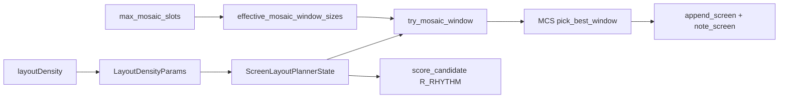

# Travelogue · Phase 21 产品需求文档（PRD · 拼图密度预算）

| 属性 | 内容 |
|------|------|
| **产品代号** | Travelogue |
| **文档版本** | v0.21.0-PHASE21 |
| **状态** | **Approved · 已实施** |
| **Phase 21 代号** | 「拼图密度预算」— 少而精的多槽拼图，避免版面杂乱 |
| **前置条件** | Phase 15 MCS 稳定；Phase 16 LTE 模板注册；`layout_engine=screens` |
| **关联文档** | [PRD-FINE-CRAFT-LAYOUT-DENSITY.md](./PRD-FINE-CRAFT-LAYOUT-DENSITY.md)、[PRD-PHASE15-photo-mosaic-evolution.md](./PRD-PHASE15-photo-mosaic-evolution.md)、[PRD-PHASE16-layout-template-engine.md](./PRD-PHASE16-layout-template-engine.md)、`travelogue/curation/screen_layout_state.py`、`travelogue/curation/mosaic/hook.py` |
| **实施清单** | [IMPLEMENTATION-PHASE21.md](./IMPLEMENTATION-PHASE21.md) |
| **更新日期** | 2026-06-11 |

> **定位**
>
> - 4–9 槽拼图模板越多，单屏信息密度越高，注意力越分散，杂志感越弱。
> - Phase 15 引入 MCS 后，系统会**从大到小贪心**尝试窗宽（9→8→…→4），易堆叠高密度屏。
> - Phase 21 在**不关闭拼图能力**的前提下，用**章级/卷级配额 + 选版顺序 + 槽位硬顶**控制拼图「出现次数与节奏」，让 4–5 槽 hero 型拼图成为主力，6/8/9 槽仅 burst 场景偶发。

---

## 1. 背景与问题

### 1.1 现状摘要

| 机制 | 现状 | 缺口 |
|------|------|------|
| MCS 窗宽 | 默认 `[3,4,5,6,8,9]`，**大到小**尝试 | 4–6 槽 hero 型难优先；8/9 易过量 |
| 九宫配额 | `nine_grid_limits_for_trip` 仅管 9 槽 | 4–8 槽无统一预算 |
| 连续禁令 | 禁连 9/3/6 同类 | 4/5/8 槽 mosaic 可连续出现 |
| `max_mosaic_slots` | config 已有，**未接线** | 单屏槽位无硬顶 |
| 版面密度 | `hero_first` 跳过 MCS hook | `balanced` 默认仍偏密 |

### 1.2 用户可感知问题

| ID | 问题 | 用户体感 |
|----|------|----------|
| **P21-P-01** | 一章内多槽拼图过密 | 「像相册网格，不像杂志」 |
| **P21-P-02** | 连续两屏都是拼图 | 「眼睛找不到落脚点」 |
| **P21-P-03** | 8/9 宫与 5 槽 mosaic 争抢 | 「大图没机会呼吸」 |
| **P21-P-04** | 算法不可解释 | 「为什么全是小图拼盘？」 |

---

## 2. 目标与非目标

### 2.1 目标

| ID | 目标 | 验收口径 |
|----|------|----------|
| **G-P21-01** | 卷级 **dense collage（≥4 槽）** 出现次数有上限 | 100 张相册 dense 屏 ≤ 5（balanced） |
| **G-P21-02** | **禁止相邻** dense collage 屏 | 任意两连屏 slot≥4 为 0 |
| **G-P21-03** | MCS **优先 5→4→6** 窗宽 | hook 日志 window 尝试顺序可观测 |
| **G-P21-04** | 单屏槽位 **硬顶 6**（可配置） | `max_mosaic_slots=6` 时 8/9 不进 MCS |
| **G-P21-05** | 与 `layoutDensity` 共存 | hero_first 更严；collage_first 略放宽 |
| **G-P21-06** | 可配置、可回滚 | `mosaic.density_budget.enabled=false` 恢复 P15 行为 |

### 2.2 非目标

- 不删除已有 8/9 槽模板（仅降曝光、归档新 7/8 槽）。
- 不做用户手动指定「本章最多 N 个拼图」UI（P2）。
- 不改变 render/CSS 几何。
- 不替代 Phase 20 UC 用例选版（正交；P21 管**频次**，P20 管**匹配**）。

---

## 3. 已拍板决策（2026-06-11）

| 项 | 决策 |
|----|------|
| **主力槽位带** | **4 / 5 / 6**；默认 MCS 仅启用 `[4,5,6]` |
| **7 槽** | **不实现** |
| **8 槽** | 保留模板；默认 **不进 MCS**；竖图 2×4 仍走 legacy defer 路径 |
| **9 槽** | 保留；走 **九宫配额** + 计入 dense 总预算 |
| **单屏硬顶** | `layout.template_engine.max_mosaic_slots` 默认 **6** |
| **相邻规则** | 任意 **slot≥4** 的 content 屏 **不可连续** |
| **选版顺序（balanced）** | MCS 窗宽尝试顺序：**5 → 4 → 6**（再 3/8/9 若启用） |
| **hero_first** | 维持跳过 MCS hook；dense 配额 ×0.35 |
| **collage_first** | dense 配额 ×1.15；窗宽顺序仍走 collage pack 逻辑 |

---

## 4. 术语

| 术语 | 定义 |
|------|------|
| **Dense collage** | 单屏 **≥4 个照片槽** 的 content 屏（含 mosaic-5/6、landscape-4/6/9、portrait-grid-8 等） |
| **Dense budget** | 全卷（trip）允许出现的 dense collage **最大屏数** |
| **MCS 窗宽** | hook 一次消费的连续资产数（4/5/6…） |
| **Hero 型拼图** | 带 `main` 角色槽的 mosaic pattern（如 mosaic-5-main-*） |

---

## 5. 功能规格

### 5.1 卷级 dense collage 配额

函数：`dense_collage_limits_for_trip(total_photos) -> (0, max)`（无 min 配额）

| 布局 eligible 照片数 | balanced `max` |
|---------------------|----------------|
| ≤50 | 1 |
| 51–100 | 3 |
| 101–200 | 5 |
| >200 | 7 |

**密度调整**（`LayoutDensityParams.adjust_dense_collage_limits`）：

| `layoutDensity` | `max` |
|-----------------|-------|
| `balanced` | 不变 |
| `hero_first` | `max(0, floor(max × 0.35))` |
| `collage_first` | `min(ceil(max × 1.15), total_photos // 4)` |

状态字段（`ScreenLayoutPlannerState`）：

- `dense_collage_max: int`
- `dense_collage_used: int`
- `last_was_dense_collage: bool`

### 5.2 规划期硬约束

在 `can_emit_pattern` / MCS hook 中：

1. 若 pattern 为 dense 且 `dense_collage_used >= dense_collage_max` → **拒绝**。
2. 若 pattern 为 dense 且 `last_was_dense_collage` → **拒绝**（相邻禁令）。
3. MCS 尝试窗宽 `size≥4` 前，若 `!can_use_dense_collage_window(size)` → **跳过该窗宽**。
4. 9 槽仍叠加现有 `nine_used / nine_max` 与 consecutive nine 禁令。

### 5.3 MCS 窗宽与配置

**默认**（`config.yaml.example`）：

```yaml
layout:
  template_engine:
    max_mosaic_slots: 6

mosaic:
  enabled_window_sizes: [4, 5, 6]
  density_budget:
    enabled: true
    min_slots: 4          # ≥ 此槽位数计入 dense
    window_order: [5, 4, 6]  # balanced 尝试顺序
```

**接线**：

- `effective_mosaic_window_sizes()` 过滤 `size > max_mosaic_slots`。
- `mosaic_pattern_disabled()` 当 `slot_count > max_mosaic_slots` 返回 true。

### 5.4 Scorer 软惩罚（辅）

| 键 | 条件 | 默认 weight |
|----|------|-------------|
| `flat_six_grid` | 已有 | 0.35 |
| `flat_nine_grid` | 9 槽全同质朝向 | 0.45 |
| `dense_without_hero` | 5/6 槽无 main 角色 | 0.25 |

软惩罚不替代硬配额；硬约束优先。

### 5.5 可观测性

`trip.curation.layoutDensityMeta` 或 mosaic log 增量：

```json
{
  "denseCollageQuota": { "max": 3, "used": 2, "baseMax": 3 },
  "mosaicWindowOrder": [5, 4, 6]
}
```

---

## 6. 与现有子系统关系



| 子系统 | P21 影响 |
|--------|----------|
| 九宫格 | 仍用 `nine_min/max`；9 槽亦计 dense |
| portrait-grid-8 | 8∉默认 MCS；legacy defer 不变 |
| hero_first | 仍 skip MCS；dense max 压低 |
| LTE `max_per_chapter` | 保留；与 dense budget **取更严** |

---

## 7. 验收标准（AC）

| ID | 场景 | 通过条件 |
|----|------|----------|
| **AC-P21-01** | 100 张 · balanced · golden mixed | dense 屏 ≤5；无相邻 dense |
| **AC-P21-02** | `max_mosaic_slots=6` | 无 8/9 槽 MCS 输出 |
| **AC-P21-03** | hook 日志 | balanced 窗宽尝试序列为 5,4,6（在 enabled 集合内） |
| **AC-P21-04** | hero_first | dense max ≤ floor(balanced×0.35) |
| **AC-P21-05** | `density_budget.enabled=false` | 与 P15 默认窗宽/顺序等价（回归） |
| **AC-P21-06** | `pytest tests/test_mosaic_density_budget.py` | 全绿 |

---

## 8. 风险与回滚

| 风险 | 缓解 |
|------|------|
| 拼图过少、版面过「散」 | 调高 `dense_collage_max` 表或 collage_first |
| 与 P20 UC 冲突 | P21 仅 hook 层频次；UC 仍在 scorer 层 |
| 测试 golden 漂移 | 先跑 eval；必要时更新 golden 并记录 |

回滚：`mosaic.density_budget.enabled: false` + `enabled_window_sizes: [3,4,5,6,8,9]` + `max_mosaic_slots: 9`。

---

## 9. 版本历史

| 版本 | 日期 | 说明 |
|------|------|------|
| v0.21.0 | 2026-06-11 | 初版：dense 配额、窗宽顺序、max_mosaic_slots 接线 |
