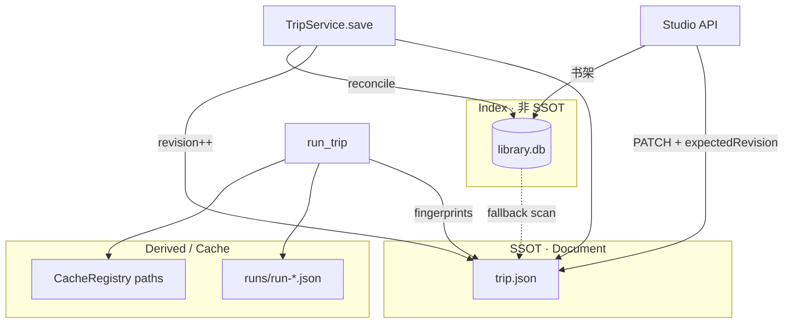

# Travelogue · Phase 22 产品需求文档（PRD · 存储平台纪律）

| 属性 | 内容 |
|------|------|
| **产品代号** | Travelogue |
| **文档版本** | v0.22.1-PHASE22 |
| **状态** | **Approved · 评审闭合 · 待 Kickoff** |
| **验收** | [ACCEPTANCE-PHASE22.md](./ACCEPTANCE-PHASE22.md) |
| **Phase 22 代号** | 「存储平台纪律」— 强化 file-as-DB，不引入业务主库 |
| **前置条件** | Phase 21 已合入 `master`；`trip.json` v0.2 + schema 稳定；Studio 可完成导入→curate→render |
| **关联文档** | [ARCHITECTURE-OVERVIEW.md](./ARCHITECTURE-OVERVIEW.md)、[DATA-MODEL.md](./DATA-MODEL.md)、[ADR-001](./adr/001-delivery-and-media.md)、[ADR-006](./adr/006-media-engines-integration.md)、[ROADMAP-PHASE18-BOOK-QUALITY.md](./ROADMAP-PHASE18-BOOK-QUALITY.md)、[游记备忘录.md](../游记备忘录.md) §4.3 |
| **实施清单** | [IMPLEMENTATION-PHASE22.md](./IMPLEMENTATION-PHASE22.md) |
| **架构决策** | [ADR-008](./adr/008-trip-storage-boundaries.md)（本 Phase 产出） |
| **更新日期** | 2026-06-11 |

> **定位**
>
> Travelogue 当前 **无关系型业务主库**；`trip.json` + 文件系统即 SSOT。Phase 18–21 聚焦成书质量与排版，Phase 22 聚焦 **数据持久化纪律**——在 **不引入 PostgreSQL / 不拆表规范化** 的前提下，解决 trip 膨胀、写冲突、全链重跑、多相册索引、缓存治理与 P2 托管预埋。
>
> **战略原则（已共识）**
>
> 1. **现在**：强化 file-as-DB，不替换 SSOT。  
> 2. **中期**：SQLite **仅作 library 索引**，不承担业务事务。  
> 3. **长期（P2+）**：对象存储 trip 快照 + RDB 管元数据/权限；`trip.json` 保留为交换格式。

---

## 1. 背景与问题

### 1.1 现状摘要

| 层级 | 现状 | 缺口 |
|------|------|------|
| **SSOT** | `trips/{id}/trip.json`；`TripService` 原子写 | 无 revision 乐观锁；Studio 多 tab 可互相覆盖 |
| **文档边界** | ADR-006 遥测分离；P17 决策 log 摘要化 | 无统一「可写/不可写」清单；debug 字段易回流 trip |
| **缓存** | `.cluster-cache/`、`cache/`、`.cache/narrate/`、`.geocode-cache.json` | 无失效契约表；删 trip 易留 orphan |
| **Pipeline** | `run_trip()` 全阶段串行 | 改一字/一图常触发全链重跑 |
| **观测** | `runs/` 分散 json/jsonl；telemetry 在 `~/.travelogue/` | 无单次 run 统一 trace id |
| **Studio 首页** | 扫 `trips/` 目录 | 相册多时无排序/过滤索引 |
| **Schema** | `version: "0.2"` + jsonschema | 无一等公民迁移脚本与 fixture 矩阵 |
| **云端** | 备忘录规划 SQLite→R2/S3 | 未预埋 document/blob 分离约定 |

### 1.2 问题陈述（P22-P-*）

| ID | 问题 | 影响 |
|----|------|------|
| **P22-P-01** | trip.json 体积不可控 | load/save 变慢；diff 困难；分享 zip 变大 |
| **P22-P-02** | 并发写无版本语义 | Studio PATCH 与 CLI pipeline 可能静默覆盖 |
| **P22-P-03** | 缓存失效分散 | 重 ingest 后聚类/审美结果 stale；难排查 |
| **P22-P-04** | pipeline 无增量 | 20 分钟旅程变 40 分钟；LLM/CLIP 重复消耗 |
| **P22-P-05** | 多 trip 管理无索引 | Studio 书架排序/状态过滤 O(n) 扫目录 |
| **P22-P-06** | run 不可追溯 | dogfood 失败难关联「哪次 curate、哪版 config」 |
| **P22-P-07** | schema 升级无流程 | P2 托管前技术债集中爆发 |

### 1.3 为何是 Phase 22（而非「上数据库」）

| 选项 | 结论 |
|------|------|
| 现在引入 PostgreSQL 作主库 | **拒绝** — ROI 低；与「本地优先、单用户、文档 SSOT」心智冲突 |
| 现在把 chapters/screens 拆表 | **拒绝** — 重写 curate/render 边界；Phase 18 质量主线被分散 |
| 强化 file-as-DB + 索引层 | **采纳** — 匹配 P0–P1；为 P2 托管留接口 |

---

## 2. 目标与非目标

### 2.1 目标

| ID | 目标 | 验收口径 |
|----|------|----------|
| **G-P22-01** | **trip.json 写入边界**成文且可 lint | ADR-008 合并；CI 或脚本拦截违规字段写入 |
| **G-P22-02** | **revision 乐观锁** | Studio PATCH 冲突返回 409；CLI 可选 `--expect-revision` |
| **G-P22-03** | **缓存契约表**落地 | 文档 + `CacheRegistry`；删 trip 级联清理 |
| **G-P22-04** | **增量 pipeline**（MVP） | **P22-MVP**：render-only skip；**P22-Plus**：curate/narrate skip（invalidation 矩阵） |
| **G-P22-05** | **统一 run trace** | 每次 pipeline 写 `runs/run-{id}.json` 含阶段耗时与 fingerprint |
| **G-P22-06** | **Library 索引** | SQLite（默认）或 `_index.json` fallback；Studio 书架按 `updatedAt` 排序 |
| **G-P22-07** | **Schema 迁移框架** | `trip_migration.py` 可升级 v0.2→v0.3；golden fixture 不回归 |
| **G-P22-08** | **Document/Blob 分离约定** | ADR-008 附录；路径与 hash 命名规范（实现可 stub） |

### 2.2 非目标

- **不做** 云端 SaaS、多租户、用户账户系统。
- **不做** PostgreSQL / Supabase 业务主库。
- **不做** 把 `assets[]` / `chapters[]` 拆成关系表。
- **不做** CRDT / 多人在线协同编辑。
- **不做** CLIP embedding 向量数据库（仍用 `.cluster-cache/` npz）。
- **不替代** Phase 18 感知盲评 / 选片 / 模板主战场（P22 与之正交）。
- **不做** 完整 R2/S3 上传（仅约定与本地 stub API）。

---

## 3. 已拍板决策（2026-06-11 · 架构评审）

| 项 | 决策 |
|----|------|
| **SSOT** | 保持 `trip.json`；任何新持久化先问「能否不进 trip」 |
| **索引库** | 按 **workspace** 隔离：`{trips_dir}/.travelogue/library.db`（默认）；可配置 `storage.library_index.path` |
| **revision 字段** | `meta.revision` 整数；**仅用户/API 写** bump；pipeline 系统写 fingerprint **不 bump** |
| **冲突 HTTP 码** | Studio API：`409 Conflict` + `{ expected, actual }` |
| **增量 MVP 范围** | fingerprint 基于 **assets 集合 hash + config fingerprint + 阶段输出 hash** |
| **run trace 位置** | `trips/{id}/runs/run-{ulid}.json`（不进 trip.json） |
| **trip 体积预算** | 软告警 512 KiB；硬审查 2 MiB（CI smoke）；基线：`demo-2025-4` ≈ 420 KiB |
| **layoutDecisionLog** | P22-W1 迁出 trip → `runs/layout-decisions.jsonl`；读者 dual-read 一版 |
| **增量 MVP 范围** | P22-MVP 仅 **render skip**；curate/narrate skip 属 P22-Plus |
| **P2 预埋** | `trip.json` 仍为交换格式；云端存 **object snapshot + DB 指针** |

---

## 4. 术语

| 术语 | 定义 |
|------|------|
| **SSOT** | Single Source of Truth；本 Phase 指 `trip.json` |
| **Document** | 小体积、可 diff、可版本化的 JSON（trip.json、run trace、library 行） |
| **Blob** | 大体积二进制或可再生文件（source/、assets/、npz cache） |
| **Derived** | 可删可重建产物（index.html、longshot PNG、embed cache） |
| **Library Index** | trip 元数据索引；**非** SSOT |
| **Stage Fingerprint** | 某 pipeline 阶段输入/输出的稳定 hash，用于 dirty 判定 |
| **Optimistic Lock** | 写前校验 `meta.revision`；冲突则拒绝写 |
| **Cache Registry** | 代码侧缓存类型、路径、失效键、所有者的注册表 |

---

## 5. 功能规格

### 5.1 ADR-008 · trip.json 写入边界

**产出**：`docs/adr/008-trip-storage-boundaries.md`

#### 5.1.1 允许写入 trip.json（白名单类别）

| 类别 | 示例字段 | 所有者 |
|------|----------|--------|
| 用户意图 | `intent.*`、`userNotes` | Studio / intent API |
| 全书元信息 | `meta.*`（含 `revision`） | Studio / narrate |
| 媒体清单 | `assets[]`（元数据，非 blob） | ingest |
| 结构 | `chapters[]`、`coverAssetId` | curate |
| 管线状态 | `pipeline.*` | orchestrator |
| 隐私/导出 | `privacy`、`export`、`exportLayout` | Studio / export |
| 策展摘要 | `curation.orientationSummary`、`curation.clustering`（摘要） | curate / clustering |
| 布局摘要 | `curation.layoutDensityMeta`、layout decision **digest** | layout engine |

#### 5.1.2 禁止写入 trip.json（黑名单）

| 类别 | 应落盘位置 |
|------|------------|
| 全量 layout/mosaic decision log | `runs/layout-decisions.jsonl` |
| CLIP embedding / npz | `.cluster-cache/` |
| 审美 CV 信号 cache | `cache/phase_pa_aesthetic.json` |
| LLM raw response / prompt | `.cache/narrate/` |
| Studio 行为 telemetry | `~/.travelogue/telemetry/*.jsonl` |
| 单次 run 阶段耗时明细 | `runs/run-{id}.json` |
| Debug explain / candidate 全量 | `runs/` 或 `.cache/` |

#### 5.1.3 体积与 lint

- 新增 `scripts/lint_trip_json.py`（或 `travelogue validate --trip-size`）：
  - 统计 trip.json 字节数；
  - 扫描已知禁止顶层键（可配置 denylist）；
  - 超 512 KiB 警告，超 2 MiB 非零 exit（CI optional job）。
- **嵌套 denylist（P22-Plus）**：扫描 `curation._debug*` 等 depth-2 路径（optional job）。

#### 5.1.4 现有字段清退计划（评审 B1）

| 字段 / 行为 | 现状 | P22 目标 | 过渡 |
|-------------|------|----------|------|
| `curation.layoutDecisionLog[]` | `curate.py` 全量写入 trip | **禁止**；全量 → `runs/layout-decisions.jsonl` | W1：dual-write（trip 摘要 digest + jsonl 全量）；W2：读者改读 jsonl；W3：trip 内删除 |
| `curation.layoutDecisionLogDigest` | 无 | trip 内仅保留 sha256 前 16 位 + count | W1 新增 |
| `chapter_explain` / `peval` | 读 trip 内 log | 优先 `runs/layout-decisions.jsonl`，fallback trip | W2 |

**摘要格式（trip 内允许）**：

```json
{
  "curation": {
    "layoutDecisionLogDigest": "a1b2c3d4e5f67890",
    "layoutDecisionLogCount": 42
  }
}
```

**全量 jsonl 行**：append-only，每行 `{ "ts", "chapterId", "screenIndex", "decision", … }`。

---

### 5.2 Revision 乐观锁

#### 5.2.1 数据模型

```json
{
  "meta": {
    "revision": 42,
    "updatedAt": "2026-06-11T12:00:00Z"
  }
}
```

- 新建 trip：`revision: 0`；首次 save 后 ≥1。
- `TripService.save(trip, path, *, expected_revision: int | None = None)`：
  - 若 `expected_revision is not None` 且与磁盘不一致 → `TripRevisionConflictError`（code `E_TRIP_REVISION_CONFLICT`）。
- 成功写盘后：**仅当 `bump_revision=True`（默认）** 时 `meta.revision += 1`，更新 `updatedAt`。
- `TripService.save(..., bump_revision=False)`：pipeline 写 `stageFingerprints`、`pipeline.status` 等系统字段时使用。

#### 5.2.4 Revision bump 规则（评审 B4）

| 写入来源 | `bump_revision` | 说明 |
|----------|-----------------|------|
| Studio PATCH intent / tier / G1 | **true**（默认） | 用户编辑 |
| CLI 手改 trip 后 save | **true** | 与 Studio 一致 |
| `run_trip` 阶段完成写 fingerprint | **false** | 避免 pipeline 中 revision 飞涨 |
| `run_trip` curate/narrate 写 chapters/copy | **true** | 结构/文案变更视为用户可见版本 |
| migration / reconcile | **false** | 系统维护 |

**冲突场景**：Studio 持 `expectedRevision=5` 编辑时，后台 pipeline 若 bump revision → 用户下次 PATCH 得 409；**pipeline 默认在单次 run 结束时至多 bump 一次**（仅当 chapters/copy 变更）。

#### 5.2.5 Studio 409 冲突 UX（评审 S1）

| 步骤 | 行为 |
|------|------|
| 收到 409 | Toast：「相册已在其他地方更新，已为你刷新」 |
| 自动动作 | `GET /trip` 拉最新 revision + 合并当前表单未提交字段（仅 intent 表单） |
| 重试 | 用户点击「保存」时用新 revision 重 PATCH；**不**静默丢弃用户输入 |
| Pipeline 进行中 | 禁用并发 PATCH；按钮态「处理中…」 |
| 兼容期 | `studio.optimistic_lock: false` 时 warn 日志、不拒写（**一个 minor 版本**） |

#### 5.2.6 Studio 写接口矩阵（评审 S3）

以下接口 **必须** 经 `TripService.save(..., expected_revision=)`：

| 接口 / 动作 | bump_revision |
|-------------|---------------|
| `PATCH …/intent` | true |
| tier promote / demote | true |
| G1 structure confirm | true |
| 用户触发 re-curate / re-narrate（API） | true（触发前读 revision） |
| 后台 `run_studio_pipeline` 完成 | 按 §5.2.4 |

#### 5.2.2 Studio API

| 端点 | 行为 |
|------|------|
| `GET …/trip` | 响应含 `meta.revision` |
| `PATCH …/intent`（及同类写接口） | 请求可选 `expectedRevision`；冲突 → **409** |

响应体示例：

```json
{
  "code": "E_TRIP_REVISION_CONFLICT",
  "expected": 41,
  "actual": 43,
  "message": "trip was modified elsewhere; reload and retry"
}
```

#### 5.2.3 CLI

```bash
travelogue curate demo-2025-4 --expect-revision 41
```

pipeline 内部 save：默认 **不** 带 expect（单进程）；Studio 并发场景由 API 层强制。

---

### 5.3 缓存契约（Cache Registry）

**模块**：`travelogue/services/cache_registry.py`

| cache_id | 路径（相对 trip_dir） | 失效键 | 写入者 | 读者 | 删 trip 时 |
|----------|----------------------|--------|--------|------|------------|
| `cluster_embed` | `.cluster-cache/` | assetIds + vision fingerprint | clustering | clustering | 递归删除 |
| `aesthetic_signals` | `cache/phase_pa_aesthetic.json` | contentSig | ingest/cull | cull/curate | 删除 |
| `narrate_llm` | `.cache/narrate/` | field hash + model | narrate | narrate | 递归删除 |
| `geocode` | `../.geocode-cache.json`（trips 级） | lat/lon 网格 | ingest | ingest | **不**随单 trip 删 |

**API**：

- `CacheRegistry.invalidate(trip_dir, cache_id, reason)` — 记录到 run trace。
- `CacheRegistry.purge_trip(trip_dir)` — 删 trip 目录前调用（Studio delete trip）。
- `CacheRegistry.describe()` — 文档自动生成源。

**ingest 增量规则（MVP）**：assets 集合变化 → invalidate `cluster_embed` + `aesthetic_signals`；narrate cache 按字段 dirty 失效。

---

### 5.4 增量 Pipeline（Stage Fingerprints）

**模块**：`travelogue/services/pipeline_fingerprint.py`、`travelogue/runtime.py`（或 `run_trip` 入口）

#### 5.4.1 阶段与 fingerprint 输入

与 `travelogue/orchestrator/run.py` 对齐：**ingest → curate → narrate → render → export**（clustering 在 ingest/curate 内，不单独成 stage）。

| 阶段 | fingerprint 输入（稳定排序后 hash） |
|------|-------------------------------------|
| **ingest** | source 文件 stat sig + ingest config fingerprint + assetIds |
| **curate** | assets fingerprint + clustering manifest + curate/layout/mosaic config + intent 结构字段 + **templateRegistryVersion** |
| **narrate** | chapters 结构 hash + copy 相关 intent + llm model id |
| **render** | trip 渲染相关子树 hash + templateId + exportLayout + export.reading |
| **export** | render 输出 hash + privacy/export 选项 |

存储：`pipeline.stageFingerprints`（**摘要**，仅 hash 字符串）：

```json
{
  "pipeline": {
    "stageFingerprints": {
      "ingest": "sha256:…",
      "curate": "sha256:…",
      "render": "sha256:…"
    },
    "lastCompletedRun": "01J…"
  }
}
```

#### 5.4.2 跳过规则

**P22-MVP（必交付）** — 仅 **render**（及 export，若 until=exported）skip：

- 条件：`render` 输入 fingerprint 与 `pipeline.stageFingerprints.render` 一致，且 `until` 不需要更上游阶段。
- 典型：仅改 `export.reading` 或 template CSS 未变、trip 渲染子树未变 → skip render 前的 ingest/curate/narrate（若 `from_stage` 允许）。

**P22-Plus（延期可接受）** — curate / narrate skip：依赖 §5.4.4 invalidation 矩阵。

通用规则：

- CLI：`travelogue run … --incremental`（默认 **on**；`--full` 强制全链）。
- skip 时 run trace 条目 `"skipped": true, "reason": "fingerprint_match"`。
- **安全默认**：`--force` / fingerprint 缺失 / config fingerprint 变更 → 全跑。

#### 5.4.3 不在 MVP 的范围

- 字段级 narrate（仍按阶段 skip 整段 narrate）。
- 分布式/worker 队列。

#### 5.4.4 Stage invalidation 矩阵（评审 B3）

「事件 → 必须重跑的 stage（含下游）」：

| 变更事件 | ingest | curate | narrate | render | export |
|----------|:------:|:------:|:-------:|:------:|:------:|
| source 增删改 | ✓ | ✓ | ✓ | ✓ | ✓ |
| assets 元数据（ingest） | ✓ | ✓ | ○ | ✓ | ○ |
| intent.layoutDensity / featured | ○ | ✓ | ○ | ✓ | ○ |
| intent copy 字段 | ○ | ○ | ✓ | ✓ | ○ |
| chapters 结构（curate 输出） | ○ | — | ✓ | ✓ | ○ |
| templateRegistryVersion 变 | ○ | ✓ | ○ | ✓ | ○ |
| export.reading / exportLayout | ○ | ○ | ○ | ✓ | ✓ |
| privacy / export 确认 | ○ | ○ | ○ | ○ | ✓ |

图例：✓ = 必须 invalidate；○ = 视 fingerprint 比对；— = 该 stage 即产生变更。

**下游传播**：任一 stage 被标记 dirty → 其 **之后** 所有 stage 视为 dirty（除非 `--from-stage` 显式指定）。

#### 5.4.5 CLI 参数优先级（评审 B6）

高优先级在上；冲突时取第一条生效：

| 优先级 | 参数 | 效果 |
|--------|------|------|
| 1 | `--force` | 全链重跑；忽略 fingerprint |
| 2 | `--full` | 等同 incremental off |
| 3 | `--regenerate` | narrate 强制重跑；render 及下游 dirty |
| 4 | `from_stage` | 从指定 stage 起执行；上游 skip |
| 5 | `--incremental`（默认 on） | fingerprint 跳过 clean stage |
| 6 | `skip_locked` | 仅影响 pipeline 状态闸，不改变 fingerprint |

---

### 5.5 统一 Run Trace

**路径**：`trips/{id}/runs/run-{ulid}.json`

```json
{
  "runId": "01JABCDEF…",
  "tripId": "demo-2025-4",
  "startedAt": "2026-06-11T12:00:00Z",
  "finishedAt": "2026-06-11T12:03:42Z",
  "configFingerprint": "cfg:…",
  "gitCommit": "bca099b",
  "stages": [
    {
      "name": "ingest",
      "status": "skipped",
      "durationMs": 0,
      "fingerprintIn": "…",
      "fingerprintOut": "…"
    },
    {
      "name": "curate",
      "status": "ok",
      "durationMs": 84200,
      "cacheEvents": [{ "cacheId": "cluster_embed", "action": "reuse" }]
    }
  ],
  "errors": []
}
```

- `pipeline.lastCompletedRun` 指向最新成功 runId。
- **不进 trip.json 的**：全量 stage 日志仍只在 run 文件；trip 仅保留指针与 fingerprint 摘要。

---

### 5.6 Library Index（SQLite）

**默认路径**：`{trips_dir}/.travelogue/library.db`（与 workspace 绑定；**非**全局 `~/.travelogue` 单库）

#### 5.6.0 Workspace 隔离（评审 B5）

| 概念 | 说明 |
|------|------|
| **workspace_root** | 解析后的 `trips_dir`（如 `C:/Projects/travelogue/trips`） |
| **主键** | `(workspace_root, trip_id)` |
| **多工作区** | 不同 `config.yaml` / `--trips-dir` → 独立 db 文件或同文件不同 workspace 分区 |
| **迁移** | 旧版 `~/.travelogue/library.db` 只读废弃；首次 reconcile 从 trips 重建 |

#### 5.6.1 表结构（MVP）

```sql
CREATE TABLE trips (
  workspace_root TEXT NOT NULL,
  trip_id TEXT NOT NULL,
  trip_json_path TEXT NOT NULL,
  title TEXT,
  places TEXT,              -- JSON array 字符串
  pipeline_status TEXT,
  cover_asset_id TEXT,
  asset_count INTEGER,
  revision INTEGER,
  created_at TEXT,
  updated_at TEXT,
  last_run_id TEXT,
  PRIMARY KEY (workspace_root, trip_id)
);
CREATE INDEX idx_trips_updated ON trips(workspace_root, updated_at DESC);
CREATE INDEX idx_trips_status ON trips(workspace_root, pipeline_status);
```

#### 5.6.2 更新时机

- pipeline 成功结束；
- Studio PATCH intent / 改标题；
- `travelogue trip new`；
- Studio 启动时 **reconcile**（扫 `trips_dir`，修复 index 漂移）。

#### 5.6.3 Fallback

- `storage.library_index.backend: sqlite | json`；
- `json` 模式写 `trips/_library/index.json`（数组），供无 SQLite 环境使用。

#### 5.6.4 Studio 集成

- 书架 API 优先读 index；条目缺失时 fallback 扫目录并 backfill。
- **index 非 SSOT**：以 trip.json 为准；冲突时 reconcile 以 trip.json 覆盖 index 行。
- **reconcile 异步（评审 N4）**：Studio 启动时后台线程 reconcile；首屏可用上次 index，完成后刷新。

---

### 5.7 Schema 迁移框架

**模块**：扩展 `travelogue/curation/trip_migration.py`

- 注册表：`MIGRATIONS: list[(from_version, to_version, fn)]`
- CLI：`travelogue trip migrate <id> [--dry-run]`
- 规则：
  - 迁移 **幂等**；
  - 迁移前写 `runs/migrate-{ulid}.json` 备份路径；
  - v0.2 → v0.3（P22 占位）：仅增 `meta.revision` 默认值，无破坏性变更。

**测试**：`tests/test_trip_migration.py` + 现有 golden fixtures 全绿。

---

### 5.8 Document / Blob 分离约定（P2 预埋）

**ADR-008 附录**，本 Phase **文档 + 类型 stub**：

| 层 | 本地路径 | 云端（P2+） |
|----|----------|-------------|
| Document | `trip.json` | Object `trips/{id}/snapshots/{rev}.json` |
| Blob | `source/`、`assets/` | S3/R2 `assets/{hash}` |
| Derived | `index.html`、`*.png` | CDN 或按需生成 |

- 可选：`assets[].contentHash`（ingest 写入，P22 可 stub 为 path+size hash）。
- **不实现** 上传 SDK。

---

## 6. 配置

`config.yaml.example` 增量段：

```yaml
storage:
  library_index:
    enabled: true
    backend: sqlite          # sqlite | json
    path: auto               # auto → {trips_dir}/.travelogue/library.db
  trip_json:
    warn_bytes: 524288       # 512 KiB
    max_bytes: 2097152       # 2 MiB · CI lint 用

pipeline:
  incremental:
    enabled: true            # CLI 默认增量；--full 覆盖
    mvp_render_only: true    # P22-MVP：仅 render skip；false 启用 Plus curate/narrate skip

studio:
  optimistic_lock: true      # false = 兼容期 warn-only
```

---

## 7. 与现有子系统关系



| 子系统 | P22 影响 |
|--------|----------|
| Phase 18 盲评 | 正交；run trace 可挂载 blind_review_id |
| Phase 21 layout | `layoutDensityMeta` 仍为摘要；全量 log 进 runs/ |
| clustering / vision | 走 CacheRegistry；invalidate 规则明确 |
| telemetry | 仍不进 trip（延续 ADR-006） |
| validate | 可选 trip 体积 lint |

---

## 8. 验收标准（AC）

| ID | 场景 | 通过条件 |
|----|------|----------|
| **AC-P22-01** | ADR-008 | 合并 master；denylist 与 CacheRegistry 表一致 |
| **AC-P22-02** | revision 冲突 | 两 PATCH 并发模拟；后者 409；trip 无静默丢字段 |
| **AC-P22-03** | 增量 render（MVP） | curate 不变、仅 export.reading 变；`--incremental` 跳过 render 前阶段并只 render |
| **AC-P22-04** | 增量 render skip | curate/narrate fingerprint 不变；`from_stage=render` + incremental → 无 ingest/curate |
| **AC-P22-05** | run trace | 一次 pipeline 产生 `runs/run-*.json`；含 stage 耗时 |
| **AC-P22-06** | library index | 新建 trip 出现在 index（workspace 键）；按 updated_at 排序 |
| **AC-P22-07** | cache purge | `purge_trip` 删除 `.cluster-cache` 与 `cache/`；geocode 保留 |
| **AC-P22-08** | trip size lint | golden trip < 512 KiB；注入 fake debug 顶层键 lint 失败 |
| **AC-P22-09** | layoutDecisionLog 迁出 | dual-write 后 trip 无全量 log；jsonl 可读；digest 在 trip |
| **AC-P22-10** | migration | v0.2 fixture migrate dry-run；golden 测试全绿 |
| **AC-P22-11** | dogfood 耗时（S2） | 改单条 caption 后 incremental run **较全链 ≥40% 省时**（demo-2025-4 抽测） |
| **AC-P22-12** | incremental 负向 | 改 `layout.template_engine` 后 fingerprint 变；**不得** skip curate（Plus）或 skip render（MVP 仅 render 路径） |
| **AC-P22-13** | pytest | revision / incremental / library / cache / migration 测试全绿 |
| **AC-P22-14** | export strip（N1） | zip 导出不含 `runs/`、`.cache/`（若 export 模块已参与） |

---

## 9. 里程碑

### 9.1 P22-MVP（必交付 · 约 3 周）

| 周次 | 代号 | 交付 |
|------|------|------|
| **W0** | P22-Kickoff | PRD v0.22.1 / ADR-008 Accepted；分支 `phase22/storage-platform` |
| **W1** | P22-W1 | ADR-008 + layoutDecisionLog 迁出 + lint + CacheRegistry |
| **W2** | P22-W2 | revision 乐观锁 + Studio 409 UX + bump 规则 |
| **W3** | P22-W3 | run trace + **render-only incremental** + fingerprint |

**MVP 出口：** AC-P22-01～02、05、07～09、11、13。

### 9.2 P22-Plus（可并行或顺延 · 约 2 周）

| 周次 | 代号 | 交付 |
|------|------|------|
| **W4** | P22-W4 | library SQLite + 异步 reconcile + migration stub |
| **W5** | P22-W5 | curate/narrate incremental（invalidation 矩阵）+ export strip + hardening |

**Plus 出口：** AC-P22-03～04、06、10、12、14 全绿。

---

## 10. 风险与回滚

| 风险 | 缓解 |
|------|------|
| incremental 跳过导致 stale 渲染 | `--full` 默认可见；run trace 记录 skip；Studio「强制全量重跑」按钮 |
| revision 破坏旧客户端 | revision 可选；缺省 0；旧 Studio 不传 expectedRevision 仍可写（deprecated 窗口 1 版本） |
| SQLite 锁/损坏 | WAL 模式；损坏时 fallback 扫目录；index 可重建 |
| library 与 trip 漂移 | 启动 reconcile；以 trip.json 为准 |
| P22 范围膨胀 | 严格非目标；P2 上传只做 ADR 附录 |

**回滚**：

- `pipeline.incremental.enabled: false`
- `storage.library_index.enabled: false`
- revision 校验 Studio 侧关闭 feature flag `studio.optimistic_lock: false`

---

## 11. 后续 Phase 指引（P23+ · 不在 P22 实施）

| Phase | 方向 | 触发条件 |
|-------|------|----------|
| **P23** | **最佳时刻**（全册单屏 + EXIF 脚注）— 见 [PRD-PHASE23-peak-moment.md](./PRD-PHASE23-peak-moment.md) | 产品讨论闭合 · 待 Kickoff |
| **P24** | 实验记录 DB（pairwise 盲评结果、cohort） | Phase 18 WS-0 启动 |
| **P25** | 对象存储 adapter + trip snapshot 上传 | 第一次私密链接托管 POC |
| **P26** | 用户账户 + PostgreSQL 元数据 | 内测 10–30 人需在线权限 |
| **—** | 关系型拆表 | **除非** 明确做多租户 CMS，否则不做 |

---

## 12. 版本历史

| 版本 | 日期 | 说明 |
|------|------|------|
| v0.22.1 | 2026-06-11 | 评审闭合：layoutDecisionLog 清退、invalidation 矩阵、revision bump、workspace index、MVP/Plus 分期 |
| v0.22.0 | 2026-06-11 | 初版：存储平台纪律 · file-as-DB 强化 · library 索引 · 增量 pipeline |
