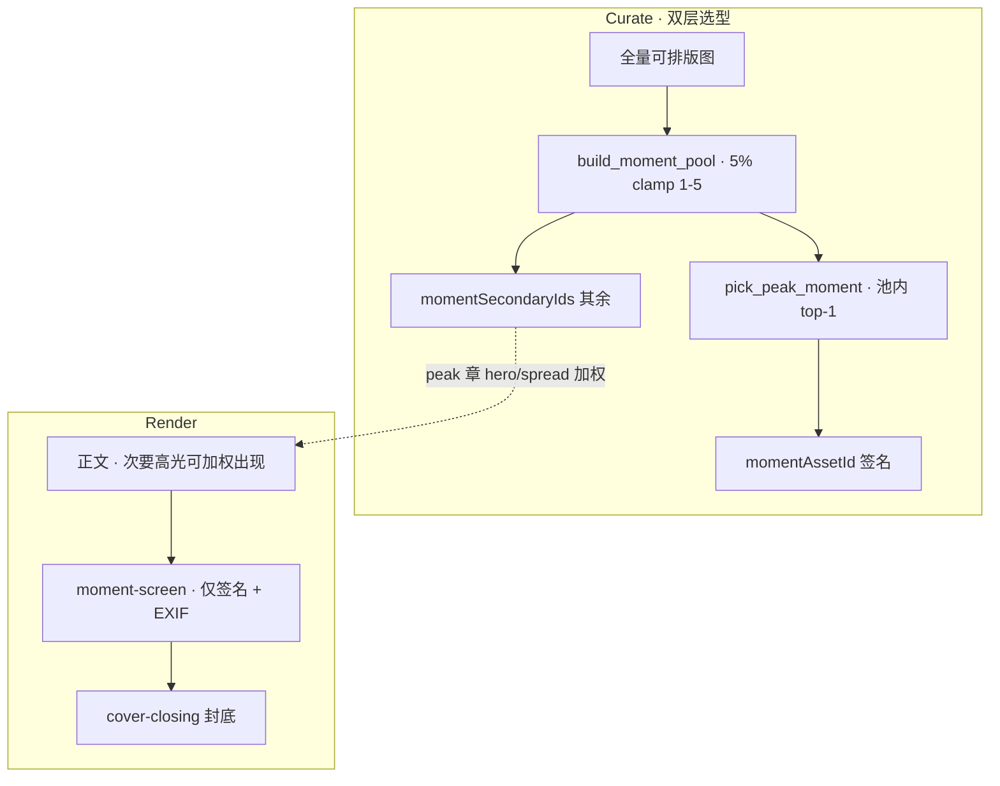

# Travelogue · Phase 23 产品需求文档（PRD · 最佳时刻）

| 属性 | 内容 |
|------|------|
| **产品代号** | Travelogue |
| **文档版本** | v0.23.2-PHASE23 |
| **状态** | **Approved · v0.23.2 修订 · 待 Kickoff** |
| **评审纪要** | [phase23-peak-moment-prd-review-2026-06-14.md](./acceptance-records/phase23-peak-moment-prd-review-2026-06-14.md) |
| **Phase 23 代号** | 「最佳时刻」— 5% 高光池 + 全册唯一签名屏 + EXIF 脚注 |
| **验收** | [ACCEPTANCE-PHASE23.md](./ACCEPTANCE-PHASE23.md) |
| **前置条件** | Phase 22 已合入或并行不冲突；`coverAssetId` / `resolve_closing_asset_id` 稳定；BSP 阅读面拆分（`studio_preview` / `reader_immersive`）可用；curate → render 主链可跑通 |
| **关联文档** | [cover-selection-plan.md](./cover-selection-plan.md)、[PRD-页面优化.md](./PRD-页面优化.md) §4.5、[PRD-WEBSITE-COMPETITIVE-RESEARCH.md](./PRD-WEBSITE-COMPETITIVE-RESEARCH.md) §2 盲点 A、[DATA-MODEL.md](./DATA-MODEL.md)、[MEDIA-PIPELINE.md](./MEDIA-PIPELINE.md)、[RENDER-CONTRACT.md](./RENDER-CONTRACT.md) |
| **实施清单** | [IMPLEMENTATION-PHASE23.md](./IMPLEMENTATION-PHASE23.md)（评审通过后撰写） |
| **更新日期** | 2026-06-14 |

> **定位**
>
> Travelogue 已有 **封面**（邀请进门）、**章首 hero**（章节入口）、**封底**（告别收束）三类特殊图位，但缺少「这趟旅程就是这一张」的**全书唯一定格**。Phase 23 采用 **双层模型**：
>
> 1. **高光池 `momentPoolIds`**：可排版图总量的 **5%**（`clamp` 在 1–5 张），解决大册「只挑 1 张太窄」的选型问题。  
> 2. **签名时刻 `momentAssetId`**：从池中取 `peak_moment_score` top-1，全册 **仅 1 屏** `moment-screen`，下沿 **1 行 EXIF**——落实「EXIF + 装订」差异化，且不破坏沉浸阅读。  
> 3. **池内其余 `momentSecondaryIds`**：不单独成屏、**不挂 EXIF**；在高潮章优先用于 hero / spread 加权，融入正文节奏。
>
> **与 P22 §11 原「实验记录 DB」关系**：P22 附录中的 P23 占位项 **改由本文档承接**；pairwise 盲评 cohort DB 顺延至 **P24**（不阻塞 P23）。

---

## 1. 背景与问题

### 1.1 现状摘要

| 图位 | 模块 | 选图目标 | 文字层 |
|------|------|----------|--------|
| **封面** | `pick_cover_asset_id` · `effective_cover_score` | 缩略图/邀请感；mobile 竖、web 横；**与拍摄时间解耦** | 标题 + hook + meta |
| **章首 hero** | `_pick_chapter_hero` · `effective_hero_score` | 每章横图入口；分布全书 | 章 lead / foreword |
| **封底** | `resolve_closing_asset_id` | 低饱和、黄昏标签；**偏未用过素材**；避开封面 | epilogue + 统计 + THE END |
| **正文屏** | screen planner / LTE | 叙事流、拼图排版 | 无 EXIF |

缺口：

- 无 **trip 级**「决定性瞬间」图位
- EXIF 仅在 ingest 内部用于 `takenAt` / GPS；**未向读者展示**相机参数
- 营销 PRD F-06「EXIF 标牌」与成书 HTML **未打通**
- `assets[]` 尚无结构化 `exif` 子对象（仅 `dateSource` / `place` / `geo`）

### 1.2 问题陈述（P23-P-*）

| ID | 问题 | 影响 |
|----|------|------|
| **P23-P-01** | 全书无单一「名场面」锚点 | 长卷读完缺一张「就是这张」的记忆点 |
| **P23-P-02** | EXIF 与装订产物割裂 | 摄影受众专业感不足；竞品空白点未落地 |
| **P23-P-03** | 封面/封底/hero 职责易混 | 若复用 `cover_score` 或 `closing_score` 选「最佳时刻」，会与首尾撞车 |
| **P23-P-04** | 小册素材少时三角竞争 | ≤15 张时封面、时刻、封底可能争同一批好图 |
| **P23-P-05** | 部分素材无完整 EXIF | 手机截图、社交保存图缺机型/光圈；空行破坏版式 |
| **P23-P-06** | 大册仅从全量盲选 1 张 | 100+ 张时 top-1 易漏并列精彩；统计上不够稳 |

### 1.3 核心判断

- **展示层**：全册 **1 屏** + 下沿 1 行 EXIF——比每屏 EXIF 或每屏艺术边框更符合 BSP 沉浸北极星。
- **选型层**：先用 **5% 高光池**（上限 5 张）收窄候选，再从中定签名时刻——比全册单点盲选更合理。
- **反对**池内每张都做成 moment 屏或都挂 EXIF（会与章首 hero、featured-grid 打架）。
- **反对**在整理阶段统一裁切比例（见 Phase 16 §4.4）；签名屏用 **原生比例 + viewport-fit / cover 策略**。
- 选图必须用 **独立评分 `peak_moment_score`**，不能复用封面或封底逻辑。

---

## 2. 目标与非目标

### 2.1 目标

| ID | 目标 | 验收口径 |
|----|------|----------|
| **G-P23-01** | **全册唯一签名屏** | 每 trip 至多 1 屏 `moment-screen`；`momentAssetId` = 池内 top-1 |
| **G-P23-02** | **5% 高光池** | `momentPoolIds` 长度 = `clamp(round(n×5%), 1, 5)`；`momentAssetId ∈ pool` |
| **G-P23-03** | **独立峰值选型** | `build_moment_pool()` + `pick_peak_moment()` 与 cover/closing/hero 正交 |
| **G-P23-04** | **1 行 EXIF 脚注** | **仅** `momentAssetId` 对应屏；Reader 沉浸模式仅此屏显示 |
| **G-P23-05** | **三图位语义分离** | 盲评可区分封面（邀请）/ 签名时刻（峰值）/ 封底（收束） |
| **G-P23-06** | **ingest 扩展相机 EXIF** | `assets[].exif` 结构化字段；无则优雅降级 |
| **G-P23-07** | **Studio 可换图** | 自池内展示 `momentCandidates` top-3 + `momentExplain` |
| **G-P23-08** | **池内次要高光融入正文** | `momentSecondaryIds` 在 peak 章 hero/spread 加权；无独立 block |
| **G-P23-09** | **配置开关** | `curate.moment.enabled`；小册默认 off |

### 2.2 非目标

- **不做** 高光池内每张都渲染为 `moment-screen`（仅 **1** 屏签名时刻）
- **不做** 池内次要张自动挂 EXIF（`momentSecondaryIds` 无脚注）
- **不做** 每张正文屏常驻 EXIF（营销站长图 hover 仍走 F-06，另线）
- **不做** 每屏艺术边框（folio frame 非 P23 范围）
- **不做** 在 ingest 阶段统一裁切为标准横/竖版
- **不做** 用户手动框选「最佳时刻」作为主路径（Studio 换图为 Tier 2）
- **不做** 视频/asset 音频作为最佳时刻（P23 仅 `type: image`）
- **不替代** 封面选型 PRD（`cover-selection-plan` 范围不变）
- **不替代** Phase 18 全局叙事优化；P23 消费现有 `arc_segment` / `highlight_windows` 若可用，无则降级

---

## 3. 已拍板决策（2026-06-14 · 产品讨论）

| 项 | 决策 |
|----|------|
| **双层模型** | **高光池**（5% clamp 1–5）+ **签名时刻**（池内 top-1）+ **次要高光**（池内其余 → 正文加权） |
| **池大小公式** | `pool_size = clamp(round(layout_eligible_images × pool_ratio), pool_min, pool_max)`；默认 **ratio=0.05 · min=1 · max=5** |
| **签名屏数量** | 全册 **1** 屏 `moment-screen`；`momentAssetId = momentPoolIds[0]`（按分排序后） |
| **EXIF 展示** | **仅** `momentAssetId` 对应屏；1 行；`clamp(11px, 1.2vw, 13px)`；`--folio-ink` 38% 透明度 |
| **字体** | `JetBrains Mono` 或项目 mono 栈（与营销 F-06 一致） |
| **插入位置** | 默认 `before_closing`：末章正文之后、`cover-closing` 之前；可配置 `arc_peak`（高潮章后） |
| **滚动位置** | 目标全书 **60%–75%**（`before_closing` 自然满足） |
| **与封面** | `momentAssetId` **不得**等于 `coverAssetId` 或 `coverByLayout.*` |
| **与封底** | **优先不得**等于 `closingAssetId`；素材 &lt;20 张时可降级并写 `moment.collision: closing` warning |
| **小册** | 可排版 ≤15 张且 `auto_disable_small_trip: true`（默认）→ **不写 pool、不插 moment 屏** |
| **池与 featured-grid** | `momentPoolIds` 与 `featured-grid` 资产集合 **允许部分重叠**；同一 ID 不得重复占 featured-grid **主槽** 与 moment 签名屏 |
| **阅读面** | `reader_immersive` **保留** EXIF 行；其余屏仍无 EXIF |
| **分享 ZIP** |  raster 仍可按 `strip_exif` 剥离；HTML 内联脚注读 `trip.json` 元数据 |
| **OQ-P23-01** | 首版 **仅** `before_closing`；`arc_peak` 顺延 P23.1 / P18 联动 |
| **OQ-P23-02** | longshot **不含** moment 屏 |
| **OQ-P23-03** | 脚注 **不含** 摄影师署名（署名走 `meta` / 封面） |
| **OQ-P23-04** | **允许**竖图 moment · `screen-portrait-1` 舞台 |
| **角标文案** | 默认中文「决定性瞬间」；英文 locale 用 `Moment` |
| **快门格式** | `1/500`（无 `s` 后缀，对齐 DxO 风格） |
| **脚注衬底** | `--moment-exif-bg` 纸色 6% 衬底，保证 WCAG 3:1 |
| **16–19 张小册** | 仍渲染 moment，但 `min_score` 提升至 **0.45** |
| **hero 撞车** | moment top-1 = 任一章首 hero → ×0.85 并记入 `momentExplain` |
| **盲评门禁** | **M1** 签名时刻 ≥50%（5 册）→ **M2** ≥60%（+3 册 hold-out）；另 **池覆盖率** M2：用户心中 top-5 ∩ pool ≥3 |
| **OQ-P23-05** | 5% 多屏 vs 单张 → **双层模型**（池选型 + 1 屏展示） |

---

## 4. 术语

| 术语 | 定义 |
|------|------|
| **高光池 / Moment Pool** | `momentPoolIds`；可排版图 **5%**（clamp 1–5）的高分候选集合 |
| **签名时刻 / Signature Moment** | `momentAssetId`；池内 `peak_moment_score` top-1；全册唯一 EXIF 屏 |
| **次要高光 / Secondary Moments** | `momentSecondaryIds`；池内除签名外其余 ID；融入正文，无独立屏 |
| **moment-screen** | 渲染块 `data-block="moment-screen"`；**仅**签名时刻 1 屏 |
| **peak_moment_score** | 池内（或全池构建前）独立打分；与 cover/closing/hero 正交 |
| **EXIF 脚注** | 单行地名·时段·机型·曝光五元组；**仅**签名屏 |
| **三图位** | Cover · Signature Moment · Closing |

### 4.1 池大小示例

| 可排版图 N | round(N×5%) | clamp(·,1,5) |
|------------|-------------|--------------|
| 15 | 1 | **跳过**（小册禁用） |
| 40 | 2 | 2 |
| 80 | 4 | 4 |
| 100 | 5 | 5 |
| 200 | 10 | **5**（上限截断） |

---

## 5. 三图位职责对照（必须遵守）

| 维度 | 封面 Cover | 签名时刻 Signature | 封底 Closing |
|------|------------|-------------------|--------------|
| **叙事功能** | 邀请进门 | 全书高光**定格**（池中最佳一张） | 告别收束 |
| **数量** | 1（+ layout 变体） | **展示 1** · 池内备选 1–5 | 1 |
| **时间语义** | 与拍摄序解耦 | 叙事弧 **峰值** | 偏末段、余韵 |
| **选图偏好** | 竖版邀请 / 画质 | 池：高潮+锚点+名场面；签名：池内 top-1 | 低饱和、黄昏、偏未用 |
| **文字层** | 标题 + hook | **1 行 EXIF**（仅签名屏） | epilogue + stats |
| **版式** | `cover-hero` | `moment-screen` ×1 | `closing-hero` + panel |



---

## 6. 数据模型

### 6.1 Trip 级字段（`trip.json`）

| 字段 | 类型 | 写入方 | 说明 |
|------|------|--------|------|
| `curation.momentPoolIds` | string[]? | curate | 高光池；长度 `clamp(round(n×ratio), min, max)`；默认最多 5 |
| `momentAssetId` | string? | curate | **签名时刻** = 池内 `peak_moment_score` top-1；∈ `momentPoolIds` |
| `curation.momentSecondaryIds` | string[]? | curate | 池内除签名外其余 ID；用于正文加权，**无独立屏** |
| `curation.momentPoolSize` | number? | curate | 本次池目标大小（审计用） |
| `curation.momentCandidates` | string[]? | curate | 池内按分降序 top-3（Studio 换签名用） |
| `curation.momentExplain` | object[]? | curate | **签名时刻**因子解释 |
| `curation.momentPosition` | enum? | curate | `before_closing` \| `arc_peak`；默认 `before_closing` |
| `curation.momentChapterIndex` | number? | curate | `arc_peak` 时插入章序（1-based） |
| `curation.momentCollision` | string? | curate | `closing` \| `cover` 降级警告 |

**约束**：

- `momentAssetId` ∈ `momentPoolIds`（当两者均存在时）
- `momentSecondaryIds` = `momentPoolIds` \ `{momentAssetId}`
- `momentAssetId` 与 `coverAssetId` / `coverByLayout.*` **互斥**

### 6.2 `curate.moment` 配置（`config.yaml` 默认 · 可镜像至 `trip.export.moment`）

```yaml
curate:
  moment:
    enabled: true
    pool_ratio: 0.05           # 可排版图总量的 5%
    pool_min: 1
    pool_max: 5
    show_exif: true            # 仅签名屏
    position: before_closing
    auto_disable_small_trip: true
    small_trip_max_assets: 15
```

### 6.3 Asset 级 `exif` 子对象（ingest 扩展 · P23-W1）

| 字段 | 类型 | 来源 | 说明 |
|------|------|------|------|
| `exif.make` | string? | EXIF Make | 厂商 |
| `exif.model` | string? | EXIF Model | 机型 |
| `exif.lens` | string? | LensModel / 合成 | 镜头 |
| `exif.focalLengthMm` | number? | FocalLength | 焦段 mm |
| `exif.aperture` | number? | FNumber | f 值 |
| `exif.shutter` | string? | ExposureTime | 如 `1/500` |
| `exif.iso` | number? | ISOSpeedRatings | ISO |
| `exif.altitudeM` | number? | GPSAltitude | 海拔（有则写） |
| `exif.completeness` | enum | 派生 | `full` \| `partial` \| `none` |

**兼容**：无 `exif` 时脚注回退 `place.city` + `takenAt` 推导时段；**禁止**留空占位行。

### 6.4 Schema 版本

- 建议 `trip.json` patch → **v0.2.3**（optional 字段，不破坏旧 trip）
- `validate_trip` L1：`momentAssetId` 存在时必须引用有效 `assets[].id`

---

- `validate_trip` L1：`momentAssetId` 存在时必须引用有效 `assets[].id` 且 ∈ `momentPoolIds`

---

## 7. 选型算法 · 双层模型

### 7.0 流程总览

```text
1. build_moment_pool()     → momentPoolIds[]     （全量打分 → top-K，K=clamp(round(n×5%),1,5)）
2. pick_peak_moment(pool)  → momentAssetId       （池内 peak_moment_score top-1）
3. derive_secondaries()    → momentSecondaryIds  （pool \ {signature}）
4. apply_secondary_boost() → screen planner 加权  （peak 章 hero / spread，P23-W3）
```

### 7.1 池构建 · `build_moment_pool()`

**输入候选**（与 §7.2 相同的全量池）：

1. `layoutEligible == true` 且 `type == image`
2. **排除** `mediaClass ∈ {screenshot, thumbnail, reupload}`
3. **硬排除** `coverAssetId`、`coverByLayout.*`
4. 对全量候选计算 `peak_moment_score`，降序取 top-K

**池大小**：

```python
K = clamp(round(layout_eligible_count * pool_ratio), pool_min, pool_max)
# 默认 pool_ratio=0.05, pool_min=1, pool_max=5
```

**featured 子池**（与封面规则对齐）：

- 若 featured 子池大小 ≥ `pool_min`，先在 featured 内取满 K；不足再从 material 补齐
- **不回退**「featured 太差换 material 封面」逻辑；moment 池尊重用户精选意图

### 7.2 签名时刻 · `pick_peak_moment(pool)`

在 `momentPoolIds` 内重算/确认分数，取 top-1 为 `momentAssetId`。

**打分因子**（加权和 · 首版启发式）：

| 因子 | 符号 | 权重（默认） | 说明 |
|------|------|--------------|------|
| 叙事弧位置 | `f_arc_peak` | **0.30** | 章 `arc_segment == peak` 或 P17 `highlight_windows` 命中 |
| 记忆锚点 | `f_anchor` | **0.25** | `intent.memoryAnchors` / 章 `memoryAnchors` 标签匹配 |
| 审美综合 | `f_aesthetic` | **0.20** | `purpose_overall(asset, "moment")` 新 preset |
| 正文名场面 | `f_on_screen` | **0.15** | 已在 `screens[]` 出现且非孤张 breath |
| 精选加权 | `f_featured` | **0.10** | `userTier == featured` ×1.35 |
| 清晰度 | `f_sharp` | tie-break | 相对 trip 中位数 |
| hero 去重 | `f_hero_dup` | ×0.85 | top-1 与任一章首 hero 相同则降权 |

**明确不纳入**：

- 封面 `layout_fit` 竖版 base（避免选成第二张封面）
- 封底低饱和 / 黄昏偏好（避免选成第二张封底）
- 纯 `takenAt` 时间序（避免变成「最后一张」）

### 7.3 次要高光 · `momentSecondaryIds` 与正文加权

| 规则 | 说明 |
|------|------|
| **定义** | `momentSecondaryIds = momentPoolIds` 去掉 `momentAssetId` |
| **展示** | **不**新增 `moment-screen`；**不**挂 EXIF |
| **加权场景** | `arc_segment == peak` 章的 `_pick_chapter_hero`：`preferred_id` 优先从 secondary 中选 |
| **加权场景** | `layout_scoring` 对已在 secondary 的资产 +`moment_secondary_boost`（默认 **0.12**） |
| **去重** | secondary 不得同时占同一章 **两个** hero 槽；spread 最多 **1** 张 secondary / 章 |
| **与 featured-grid** | featured-grid 仍用竖图池；secondary 仅提高 **peak 章横图 hero** 命中率 |

> P23-W1 可先 **只落盘** `momentSecondaryIds`；W3 接入 screen planner 加权。无 planner 钩子时 secondary 仅作 Studio 只读展示。

### 7.4 与封底解耦

封底逻辑（现有）：

```text
closing: prefer UNUSED assets, low saturation, evening tags
moment:  prefer ON-SCREEN peak, high aesthetic, anchor hit, arc peak
```

选型顺序（curate 末段）：

1. `sync_trip_covers()` → `coverAssetId`
2. `build_moment_pool()` → `momentPoolIds`
3. `pick_peak_moment(pool)` → `momentAssetId`
4. `derive_secondaries()` → `momentSecondaryIds`
5. `resolve_closing_asset_id(exclude_ids={momentAssetId})` → `closingAssetId`

### 7.5 小册与碰撞

| 条件 | 行为 |
|------|------|
| 可排版图片 ≤ `small_trip_max_assets` 且 `auto_disable_small_trip` | 不写 `momentPoolIds` / `momentAssetId`；不渲染 moment 屏 |
| 可排版图片 16–19 张 | 建池并渲染签名屏，但 `min_score` 使用 `small_trip_elevated_min_score`（默认 **0.45**） |
| 无候选分 &gt; 阈值 | 跳过；`curation.momentSkipped: "no_candidate"` |
| 仅与 closing 冲突 | 允许降级；`momentCollision: closing` |
| 与 cover 冲突 | **禁止**；顺延下一候选 |

### 7.6 输出示例

```json
{
  "momentAssetId": "asset-042",
  "curation": {
    "momentPoolIds": ["asset-042", "asset-017", "asset-088", "asset-031", "asset-055"],
    "momentPoolSize": 5,
    "momentSecondaryIds": ["asset-017", "asset-088", "asset-031", "asset-055"],
    "momentCandidates": ["asset-042", "asset-017", "asset-088"],
    "momentPosition": "before_closing",
    "momentExplain": [
      {"factor": "arc_peak", "weight": 0.30, "detail": "ch-03 peak"},
      {"factor": "anchor", "weight": 0.25, "detail": "日落"},
      {"factor": "on_screen", "weight": 0.15, "detail": "screen-12 hero slot"}
    ]
  }
}
```

---

## 8. 渲染与版式

### 8.1 模板契约

| 项 | 规格 |
|----|------|
| **partial** | `templates/visual-journal/partials/moment-screen.hbs` |
| **data-block** | `moment-screen` |
| **插入点** | `journal.hbs`：末章 `screens` 列表之后；`cover-closing` 之前 |
| **版式类** | `layout-screen layout-screen--moment layout-screen--viewport-fit`（横图默认） |
| **fit** | 风景 `cover`；人物 `contain` + blur-fill（复用 `portrait_fit_for_asset`） |
| **标签** | 左上角默认「决定性瞬间」（`--folio-ink` 42%，不挡主体） |
| **竖图** | `layout-screen--portrait` + viewport-fit；复用 `portrait_fit_for_asset` |

### 8.2 EXIF 脚注行（`moment-exif-line`）

**格式**（有则拼接，`.` 分隔）：

```text
{place} · {season_or_month} · {daypart} · {model} · {focal}mm f/{aperture} {shutter} ISO{iso}
```

示例：

```text
仙本那 · 2024.03 · 黄昏 · Fujifilm X-H2 · 35mm f/2.8 1/500 ISO200
```

| 规则 | 说明 |
|------|------|
| 最大宽度 | 100% 槽宽；`text-overflow: ellipsis`；`white-space: nowrap` |
| 位置 | 图下方 `padding-top: clamp(6px, 0.8vh, 10px)`；**不在图内 overlay** |
| 对比度 | 正文色 38% + `--moment-exif-bg` 纸色 6% 衬底；不低于 WCAG 3:1 |
| 快门 | `1/500` 格式（无 `s` 后缀） |
| 缺失字段 | 跳过该段；至少需 **2 个有效段** 才渲染脚注行，否则仅显示 `place` 或隐藏行 |
| 机型 | Apple / 主流 Android 做 model 规范化；`completeness: none` 时**禁止**伪造 |

### 8.3 阅读面（BSP 对齐）

| profile | moment 屏 | EXIF 行 |
|---------|-----------|---------|
| `studio_preview` | 显示 | 显示 |
| `reader_immersive` | 显示 | **显示**（全书唯一例外） |
| `performance` / longshot | 可省略 moment 屏 | 省略 |

### 8.4 动效预算

- 继承 BSP §4.4：Reader cinematic 位移 ≤8px、scale ≤1.02
- moment 屏 **禁止** breath scrub 抬升越过屏缝

---

## 9. Ingest · EXIF 扩展（P23-W1）

### 9.1 读取范围

在 `load_image_normalized` 之后、写 `assets[]` 之前，从 **原始文件** EXIF 读取：

- Make / Model / LensModel / FocalLength / FNumber / ExposureTime / ISOSpeedRatings / GPSAltitude

### 9.2 存储与隐私

- 写入 `assets[].exif`；**不**写入 `source/*.jpg`（仍 `save_jpeg_without_exif`）
- `export.packager` 的 `strip_exif` **不影响** HTML 脚注（读 trip 元数据）

### 9.3 时段推导

由 `takenAt` + `place` 派生展示用 `daypart` / `season`（复用 narrative 既有启发式，无则省略）

---

## 10. Studio 与 API

### 10.1 预览

- 工具栏「阅读视图」切换时 moment 屏行为与正文一致
- 策展抽屉（Tier 2）：展示 **高光池** `momentPoolIds` 条带 + 签名标记 + `momentExplain`
- 用户换签名 → PATCH `momentAssetId`（**必须** ∈ `momentPoolIds`）；校验不得等于 `coverAssetId`

### 10.2 API（可选 · P23-W2）

| 方法 | 路径 | 说明 |
|------|------|------|
| PATCH | `/api/trips/{id}` | 字段 `momentAssetId` |
| GET | `/api/trips/{id}/curation/moment` | 返回 `momentPoolIds`、candidates、secondary、explain |

### 10.3 成功页 / 零编辑路径

- 默认 **不增加** 用户操作；curate 自动写入
- 成功页 chips 可选展示「最佳时刻已选」· 仅 debug/profile 开启时

---

## 11. 配置（`config.yaml`）

```yaml
curate:
  moment:
    enabled: true
    pool_ratio: 0.05
    pool_min: 1
    pool_max: 5
    secondary_boost: 0.12      # layout_scoring / hero preferred 加权
    scoring:
      weights:
        arc_peak: 0.30
        anchor: 0.25
        aesthetic: 0.20
        on_screen: 0.15
        featured: 0.10
      min_score: 0.35
      small_trip_elevated_min_score: 0.45
    auto_disable_small_trip: true
    small_trip_max_assets: 15
    position: before_closing

aesthetic:
  presets:
    moment:
      composition: 0.28
      subjectClarity: 0.28
      lighting: 0.22
      exposure: 0.12
      color: 0.10

ingest:
  exif_camera: true
```

---

## 12. 验收标准摘要

> 完整用例见 [ACCEPTANCE-PHASE23.md](./ACCEPTANCE-PHASE23.md)

| ID | 描述 | Tier |
|----|------|------|
| **AC-P23-01** | 全册仅 1 屏 `moment-screen`（签名时刻） | 0 |
| **AC-P23-02** | `momentAssetId` ≠ `coverAssetId` 且 ∈ `momentPoolIds` | 0 |
| **AC-P23-23** | `len(momentPoolIds)` = clamp(round(n×5%),1,5)（≥16 张册） | 0 |
| **AC-P23-24** | 正文屏无第二张 `moment-screen`；secondary 无 EXIF | 0 |
| **AC-P23-25** | 盲评 M2 池覆盖率：用户 top-5 ∩ pool ≥3 | 1 |
| **AC-P23-03** | EXIF 脚注 1 行、在图下、mono、不 overlay | 0 |
| **AC-P23-04** | `reader_immersive` 可见脚注；正文其他屏无 EXIF | 0 |
| **AC-P23-05** | 仙本那/demo 册 moment 与 cover/closing 三张互异（≥20 张） | 0 |
| **AC-P23-06** | ≤15 张小册默认无 moment 屏 | 1 |
| **AC-P23-07** | 无 EXIF 时优雅降级（无空行） | 1 |
| **AC-P23-08** | Studio 换 moment 图生效并重渲染 | 2 |
| **AC-P23-09** | 盲评 M2：moment 像「决定性瞬间」≥60%（+3 册 hold-out） | 1 |
| **AC-P23-10** | 盲评 M1：≥50%（5 册基线） | 1 |
| **AC-P23-21** | 脚注区 WCAG 3:1 对比度抽检 | 1 |

---

## 13. 实施分期

| Sprint | 范围 | 交付 |
|--------|------|------|
| **P23-W1** | ingest `exif` + `build_moment_pool` + `pick_peak_moment` + curate 落盘 | pool + 签名字段 |
| **P23-W2** | `moment-screen.hbs`（仅签名）+ `assemble.py` + CSS | 读者可见 |
| **P23-W3** | closing exclude + secondary hero 加权 + 小册规则 + 单测 | 双层闭环 |
| **P23-W4** | Studio 池条带 + 盲评脚本（含池覆盖率） | 可运营调参 |

**预估**：2–3 周（1 名全职；与 P22 增量 pipeline 可并行）

---

## 14. 风险与回滚

| 风险 | 缓解 |
|------|------|
| 选图不准 | 5% 池 + 盲评签名 + **池覆盖率**；`min_score` 过低则跳过 |
| 大册池截断 5 张 | `pool_max=5` 有意限制；靠 secondary 分散到正文 |
| 池与 hero/grid 重叠 | secondary 加权有 per-chapter 上限 |
| EXIF 大面积缺失 | `completeness` + 回退地名/时间；脚注段数门槛 |
| 与封底抢图 | 软排除 + `momentCollision` 可观测 |
| trip.json 膨胀 | `momentExplain` 限 4 因子；与 `coverExplain` 同量级 |
| 破坏沉浸 | 仅此一屏；可 `export.moment.enabled: false` 一键关 |

**回滚**：

- `curate.moment.enabled: false`
- `ingest.exif_camera: false`（脚注降级为地名+时间）

---

## 15. 依赖与接口

| 依赖 | 用途 | 无依赖时降级 |
|------|------|--------------|
| `coverAssetId` | 硬排除 | — |
| `resolve_closing_asset_id` | 软排除 | 仅硬排除 cover |
| `arc_segments_for_trip` / P17 highlight | `f_arc_peak` | 用 aesthetic + on_screen |
| `aesthetic` preset `moment` | `f_aesthetic` | sharpness + composition 启发式 |
| `intent.memoryAnchors` | `f_anchor` | 权重重分配到其他因子 |
| BSP reading profiles | EXIF 可见性 | 全局显示脚注 |

---

## 16. 开放问题（已闭合 · 2026-06-14 评审会）

| ID | 决议 |
|----|------|
| **OQ-P23-01** | 首版 **仅** `before_closing`；`arc_peak` 顺延 |
| **OQ-P23-02** | longshot **不含** moment 屏 |
| **OQ-P23-03** | 脚注 **不含** 摄影师署名 |
| **OQ-P23-04** | **允许**竖图 moment |
| **OQ-P23-05** | 5% 多屏 vs 单张 → **双层模型**（池选型 + 1 屏 EXIF） |

---

## 17. 版本历史

| 版本 | 日期 | 说明 |
|------|------|------|
| v0.23.2 | 2026-06-14 | 双层模型：`momentPoolIds` 5% clamp 1–5 + 签名屏 + `momentSecondaryIds` 正文加权 |
| v0.23.1 | 2026-06-14 | 评审闭合：OQ 拍板 · hero 去重 · closing exclude · M1/M2 盲评 · 脚注衬底 |
| v0.23.0 | 2026-06-14 | 初版：最佳时刻全册单屏 + EXIF 脚注 + 三图位分离 + peak_moment_score |
