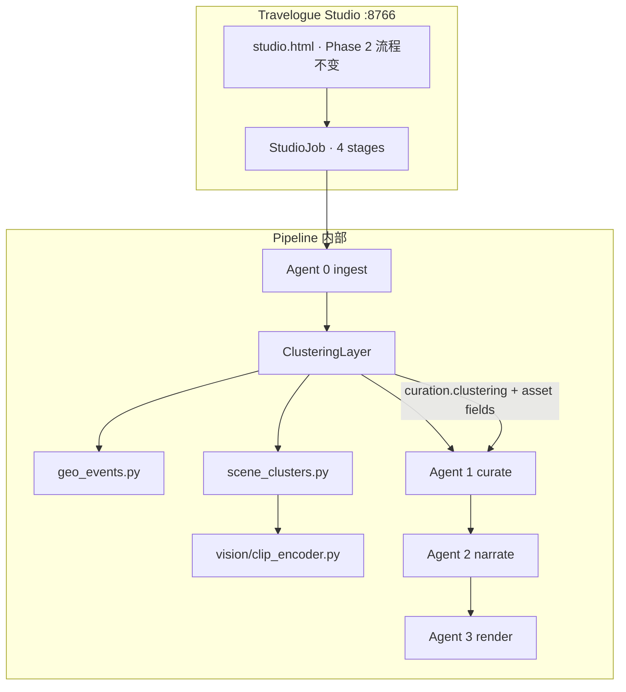
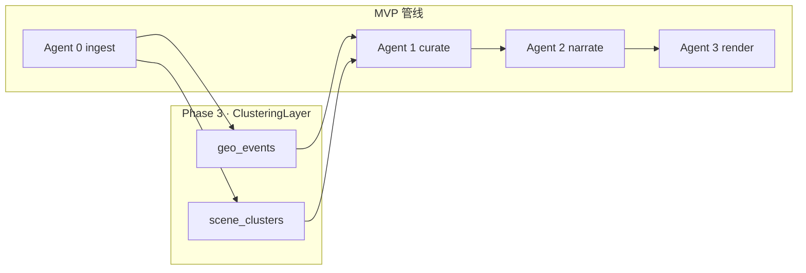
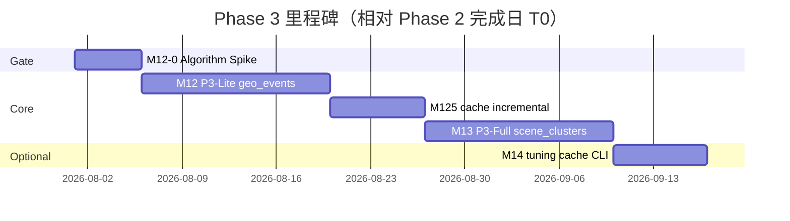

# Travelogue · Phase 3 产品需求文档（PRD）

| 属性 | 内容 |
|------|------|
| **产品代号** | Travelogue |
| **文档版本** | v0.3.3-PHASE3 |
| **状态** | **Kickoff-ready** · v0.3.3（项目审核修订：M12 范围切割、NR-P3-01 等价、config API、闸门澄清） |
| **Phase 3 代号** | 「Curate 聚类」— 原生 geo/time + scene 算法 |
| **前置条件** | [PRD-MVP.md](./PRD-MVP.md) 管线就绪；**Phase 2 完成闸门**（§13.0）通过后启动 M12 |
| **交付形态** | **用户旅程与 Phase 2 相同**（选文件夹 → pipeline → preview → 长图）；聚类在 **pipeline 内部** 增强 ingest/curate，**无**独立洞察工作台、**无** Docker 引擎栈 |
| **关联文档** | [DATA-MODEL.md](./DATA-MODEL.md)、[AGENT-ARCHITECTURE.md](./AGENT-ARCHITECTURE.md)、[PRD-PHASE2.md](./PRD-PHASE2.md)、[PRD-STUDIO-HOMEPAGE.md](./PRD-STUDIO-HOMEPAGE.md)（首页 IA · §19 与本文 §6.4 对齐）、[PRD-LAYOUT.md](./PRD-LAYOUT.md)、[智能排版V2.md](./智能排版V2.md)（Layer 1.5 · P1 **合并里程碑**）、[ERROR-CODES.md](./ERROR-CODES.md)、[adr/007-native-clustering.md](./adr/007-native-clustering.md)（**Accepted v0.2** · 替代 ADR-006） |
| **更新日期** | 2026-05-28 |

> **命名说明**：本文 **Phase 3** 指产品第三阶段（Curate 聚类引擎）。[SHARING.md](./SHARING.md) 中的 **P3 小程序鉴权分享** 为独立轨道，**不在** 本 Phase 范围，后续称 **Phase 4 · 私密分享**。
>
> **战略变更（v0.3.0）**：不再集成 [Recasa](https://github.com/yonie/recasa) / [PhotoMapAI](https://github.com/lstein/PhotoMapAI) 外部引擎；仅 **借鉴算法思路**（MIT），在 `travelogue/` 内实现轻量聚类层。**「素材洞察工作台 / 用户精选 / preview 回流 reingest」** 移出 roadmap（Future · 另独立 PRD 若需要）。

---

## 1. 背景与问题陈述

### 1.1 Phase 1–2 已解决什么

| 阶段 | 能力 | 用户价值 |
|------|------|----------|
| **MVP** | ingest → curate（按日/段）→ narrate → render | 技术闭环：文件夹 → 杂志风 HTML |
| **Phase 2** | Studio 工作台 + 服务端长图 + 非开发者入口 | 选文件夹 → 预览 → 微信长图 |

当前 **curate（Agent 1）** 主要依赖 **EXIF 日期切段**（`time_segments.py`）与 **规则排版**，对下列场景能力有限（见 [老图.md](./老图.md)、[智能排版V2.md](./智能排版V2.md)）：

- 同一日历日内 **多地移动**（上午城市 A、下午城市 B）仍被合成一段
- **场景混杂**（美食/寺庙/人像/夜景）段内乱序，组屏缺少主题 run
- 无 GPS 时只能按日/城市名粗切，**停留点（stay）** 感弱

### 1.2 Phase 3 要解决的断裂点

| 断裂 | 现状（Phase 2） | Phase 3 目标 |
|------|-----------------|--------------|
| **断裂 A · 行程段** | `segment_gap_days=14` + 城市变化切段；**无 GPS 细粒度 stay** | **geo event**：时间窗 + GPS 跳变 → 更准的 `curation.segments` |
| **断裂 B · 主题 run** | 启发式 tags + 人脸；**无场景簇** | **scene cluster**：CLIP（可选）→ `sceneClusterId`，驱动 bucket/screen **subject_run** |

**本 Phase 不解决（移出范围）**：

- 用户 **批量精选 80 张** 的工作台（原 v0.2「断裂 C」）
- 地图 Hero Trail / 语义搜索 UI（原外部引擎能力）
- 独立 **insights** Job 与 selection manifest

### 1.3 为何原生实现（而非集成外部引擎）

| 考量 | 决策 |
|------|------|
| **产品路径** | 聚类应 ** invisible 增强 curate**，不增加 Docker/setup 墙，不破坏 G-P2-01 |
| **算法可移植性** | Recasa Event 检测为 **规则算法**（~400 LOC 级）；PhotoMap 核心为 **CLIP embed + 聚类** — 均可在 trip 级实现 |
| **与排版路线统一** | [智能排版V2.md](./智能排版V2.md) Layer 1.5 已规划 CLIP `subjectClass`；P3 **共用** `travelogue/vision/`，避免双线重复 |
| **维护** | 无 HTTP 双进程、无容器路径映射、无上游 API 漂移 |

**借鉴声明（非依赖）**：

- **Geo event 思路** 参考 Recasa `event_detector`（时间窗 4h、GPS 跳变、合并 stay）— MIT，实现为 `geo_events.py`
- **Scene cluster 思路** 参考 PhotoMapAI（CLIP → 降维/聚类）— MIT，实现为 `scene_clusters.py`

### 1.4 Phase 3 产品定位

> **在 Phase 2 主路径不变的前提下**，于 ingest 末 / curate 初注入 **geo/time 段 + scene 簇** 信号，使 **分组、桶规划、屏序、组屏** 更贴近真实旅程与场景局部性。

- **不替换** Studio 主流程、**不修改** MVP 冻结的模板渲染契约
- **不新增** 用户可见的「洞察屏」；可选在 pipeline `stageHint` 增加一行「分析场景…」
- **默认策略（v0.3.1）**：`clustering.enabled: auto`（有 GPS 时跑 P3-Lite）；`vision.enabled: false`（P3-Full opt-in 或 `auto` 满足阈值时开启，见 §7.2）
- **Studio 交互（v0.3.2）**：详见 **§6.4**（进度 hint、高级折叠、慢提示；**无** 新页面）

### 1.5 与 Phase 2 时间承诺

Phase 2：**~3 分钟 pipeline → 看到游记**（G-P2-01 端到端 ≤20 分钟含人工编辑）。

Phase 3 增量耗时（150–400 张 · **模型已缓存**）：

| 档位 | 增量步骤 | GPU 目标 | CPU 目标 |
|------|----------|----------|----------|
| **P3-Lite** | geo_events only | ≤ 30s | ≤ 60s |
| **P3-Full** | + CLIP embed + cluster | ≤ 3 分钟 | ≤ 8 分钟 |

**端到端**：仍须满足 **G-P2-01**；P3-Full CPU 路径 soft 上限 **+8 分钟**（400 张 · **模型已缓存**），超出时在 `stageHint` 标注「首次分析较慢」。

**首次 CLIP 模型下载**（~400MB–1.5GB）**不计入** G-P2-01 / G-P3-C05；`stageHint` 单独展示「正在准备场景分析组件…」，用户可继续等待或关闭 vision（§7.2）。

---

## 2. 目标与非目标

### 2.1 产品目标

| ID | 目标 | 衡量方式 |
|----|------|----------|
| **G-P3-C01** | 有 GPS 的 trip，geo event 与 golden 人工标注 **一致率 ≥70%** | 3 套 fixture trip · pytest + 抽检 |
| **G-P3-C02** | 启用 scene cluster 后，**subject_run_score** 优于 Phase 2 baseline | [智能排版V2.md](./智能排版V2.md) I-G2 · 黄金样本 |
| **G-P3-C03** | **time_inversion_rate** 不劣于 Phase 2 | I-G1 · pytest |
| **G-P3-C04** | `clustering.enabled=false` 或 `vision.enabled=false` 时，curate 与 Phase 2 **documented equivalent**（NR-P3-01） | 双跑 diff 测试 |
| **G-P3-C05** | 400 张 CPU · P3-Full 聚类 **≤8 分钟**（ingest 内或 curate 前一步） | 计时记录 |
| **G-P3-C06** | 照片 **不出本机**；CLIP 本地推理，无出站上传 | 隐私审查清单 |
| **G-P3-C07** | curate 章结构 **可消费** `curation.clustering.segments` hints | §8.1 · trip.json schema |
| **G-P3-C08** | 相同 trip 目录 + 相同 config + 相同代码版本 → `curation.clustering` 与 curate 章序 **可复现**（deterministic） | 双跑 hash 对比 · CLIP 固定 seed |
| **G-P3-C09** | P3-Full 启用时，`aspect_pattern_match_rate`、`burst_integrity_violations` **不劣于** Phase 2 | 黄金样本 · 负向 guard |

### 2.2 非目标（Phase 3 明确不做）

- 集成 Recasa / PhotoMapAI **Docker / HTTP / CLI**
- **素材洞察工作台**、用户勾选精选集、selection manifest、preview 回流 reingest
- `travelogue engines up`、`setup-engines.ps1`、`docker-compose.engines.yml`
- 地图 SDK / Hero Trail 嵌入（Future）
- 全库相册索引、file watcher、跨 trip 人脸 ID 全局聚类
- 云端同步、多用户协作、账号体系
- 自动 LLM 写整篇游记（仍属 Agent 2）
- 微信小程序 / 托管分享（Phase 4）
- 视频 **scene 聚类**（Phase 3 仅 **照片** 参与 CLIP；视频仍走 ingest 展示逻辑）
- Studio **追加照片 / 增量 reingest UI**（Phase 3 仅 CLI/config；用户需 **全量重新导入** 新文件夹）
- 预览页 **「重新分析」「分段地图」「场景簇列表」** 等聚类控件

**Future · 另立项（不在 v0.3 roadmap）**：「精选工作台」产品 — 可复用本 Phase 的 cluster 结果，但不阻塞 P3 交付。

---

## 3. 目标用户与场景

### 3.1 Persona

**Persona A · 普通旅行者（主用户）**

- 选文件夹 → 等几分钟 → 看到 **章节更像「几天在哪」、段内不太跳戏** 的游记
- **无需** 理解聚类、**无需** 额外点击

**Persona B · 进阶创作者 / 维护者**

- 可通过 `config.yaml` 关闭 vision 或切换 `segmentCurateMode: date_fallback` 做 A/B
- 阅读 `decision_log.json` 理解分段/分簇依据

### 3.2 核心 User Stories

| ID | 作为… | 我想要… | 以便… |
|----|--------|---------|--------|
| **US-P3-C01** | 旅行者 | 选文件夹后 **自动** 得到更合理的行程段分章 | 游记读起来有「段」感，无需手动分文件夹 |
| **US-P3-C02** | 旅行者 | 同一段内 **美食/风景/人像** 不要频繁互插 | 组屏更顺、长图更好看 |
| **US-P3-C03** | 旅行者 | 无 GPS 或聚类失败时 **仍能** 正常生成游记 | 不被算法阻塞 |
| **US-P3-C04** | 维护者 | 用配置 **关闭** scene cluster 或整段 clustering | 低配机 / 回归对比 |
| **US-P3-C05** | 维护者 | 聚类决策写入 **decision_log** | 调参、验收、离线分析 |
| **US-P3-C06** | 维护者 / QA | CLI **一键** clustering off 双跑并与 Phase 2 baseline diff | NR-P3-01 回归（§12.1） |

### 3.3 耗时预期（用户无感 · pipeline 内）

与 §1.5 一致；Studio **仍显示 4 段** progress（ingest → curate → narrate → render）。聚类耗时 **并入 ingest**，`stageHint` 与分级慢提示见 **§6.4.2 / §6.4.4**。

---

## 4. 解决方案总览

### 4.1 架构：pipeline 内原生聚类



### 4.2 模块职责

| 模块 | 负责 | 不负责 |
|------|------|--------|
| **geo_events** | GPS+时间 stay/event → `curation.clustering.segments[]` | 地图 UI、全库索引 |
| **scene_clusters** | trip 级 CLIP embed + 聚类 → `asset.sceneClusterId` 等 | 语义搜索、相册 CRUD |
| **vision** | 模型加载、缓存、optional extra | 独立 Web 服务 |
| **curate** | 消费 segments + cluster 做章/桶/屏规划 | 重跑 CLIP |
| **ingest** | EXIF、pHash、sharpness（已有） | 替换 curate |

### 4.3 两档交付

| 档位 | 内容 | 依赖 | 里程碑 |
|------|------|------|--------|
| **P3-Lite** | `geo_events` + curate §8.1 | 无新模型 | **M12** |
| **P3-Full** | + `scene_clusters` + layout 消费 | `pip install -e ".[vision]"` 可选 | **M13**（与智能排版 V2 P1 合并） |

### 4.4 降级链（P0）

```text
clustering.enabled=false     → Phase 2 行为（NR-P3-01）

clustering.enabled=auto
  → layoutEligible 资产中 GPS 有效占比 ≥ autoGpsMinRatio（默认 40%）→ 跑 geo_events（P3-Lite）
  → 否则 skip geo；curate 走 time_segments / group_assets_by_day（与 Phase 2 相同输入）

clustering.enabled=true      → 强制尝试 geo_events；无 GPS 仍 fallback time_segments

vision.enabled=false         → 不跑 CLIP；P3-Lite only（geo + heuristic tags）

vision.enabled=auto
  → layoutEligible 照片 ≥ autoMinPhotos（80）且占比 ≥ autoMinEligibleRatio（60%）→ P3-Full
  → 否则 skip scene_clusters

vision.enabled=true          → 强制 P3-Full（失败则降级 heuristic）

geo 无 GPS / geo_events 失败  → fallback 现有 time_segments / group_assets_by_day
scene cluster 失败/超时      → 跳过 cluster；heuristic subjectClass only
vision extra 未安装          → 自动 P3-Lite；不报错阻断
```

### 4.5 M12-0 · 算法 Spike（编码前必完成）

| 产出 | 内容 |
|------|------|
| `docs/spikes/clustering-algorithm-matrix.md` | geo_events 参数表、cluster eps/min_samples、与 golden 对比 |
| `tests/fixtures/clustering/` | 3 套 trip golden：`segments.json`、`clusters.json`、人工标注说明 |
| `docs/IMPLEMENTATION-PHASE3.md` | 模块签名、伪代码、与 curate/layout 接入点 |
| 结论 | Go → PRD 升 **v1.0 RFD**；No-Go → 仅 ship P3-Lite 或推迟 P3-Full |

**Spike 必验清单**

| ID | 验证项 | 通过标准 |
|----|--------|----------|
| **SP-C01** | geo_events vs golden（有 GPS trip） | 段边界 **一致率 ≥70%** 或 matrix **§3.5 可接受偏差** 产品签字 |
| **SP-C02** | cluster 参数敏感性（150–400 张） | 簇数 5–40；无 mega-cluster（>50% 图） |
| **SP-C03** | curate 章数 cap | 任意 event 数 → 合并后 **3–5 章** |
| **SP-C04** | layout 回归 | mao / maomi / linzhi 黄金样本 **NR-P3-01** + I-G1 不劣化 |
| **SP-C05** | 双跑确定性 | 同 fixture 两次 clustering → segments/clusters **一致**（G-P3-C08） |

### 4.6 分段权威链（P0 · 架构必遵）

存在 **三套** 分段逻辑，必须按下列 **权威顺序** 消费，避免「章按 geo 切、meta 按 14 天段」两套叙事：

```text
clustering.enabled=false
  → 完全 Phase 2（group_assets_by_day / time_segments）

clustering.enabled 且 GPS 覆盖率 ≥ clustering.autoGpsMinRatio（默认 40%）
  → geo_events 产出 curation.clustering.segments[]（**章 hints 主输入**）
  → time_segments 仅用于：无 GPS 资产归类、meta.places 摘要、多访旅行外层标签

clustering.enabled 但 GPS 不足 / geo_events 空
  → time_segments（与 Phase 2 相同）
  → segmentMode = date_fallback

segmentCurateMode: date_fallback
  → 强制忽略 geo segments，与 Phase 2 完全一致
```

**章 cap（3–5）** 始终最后施加于 **已选定的 segment 源** 之上（§8.1），不反向改变 geo/time 原始边界记录。

### 4.7 语义信号分工 · `sceneClusterId` vs `subjectClass`（P0）

| 信号 | 粒度 | 用途 | M12/M13 |
|------|------|------|---------|
| **`sceneClusterId`** | 无标签簇 ID | 段内 **run_aware** 屏序、组屏局部聚合 | **M13 必做**（P3-Full） |
| **`subjectClass`** | 可解释枚举 | 评分权重、章 pattern（智能排版 V2） | **M13 可选**；默认可继续 heuristic |
| **`subjectConfidence`** | [0,1] | 评分调权 | 同上 |

**单次 CLIP forward（M13 硬约束）**：当 vision 开启时，**同一 forward** 产出 embedding（→ cluster）+ 可选 subjectClass logits；**禁止** 为 cluster 与 subjectClass 各跑一遍 CLIP（G-P3-C05 预算）。

---

## 5. 功能范围

### 5.1 In Scope

| 模块 | 功能点 | 优先级 |
|------|--------|--------|
| **M12-0 Spike** | 算法矩阵 + golden fixtures（§4.5） | **P0 · 编码前** |
| **geo_events** | 时间窗 + GPS 跳变 + stay 合并 + 段命名 | **P0 · M12** |
| **curate 消费 segments** | §8.1 合并/cap/fallback | **P0 · M12** |
| **config + feature flag** | `clustering.*`、`vision.*` | **P0 · M12** |
| **NR-P3-01 回归** | clustering off = Phase 2 | **P0 · M12** |
| **scene_clusters** | CLIP embed + DBSCAN（或 HDBSCAN）on embeddings | **P1 · M13** |
| **layout 消费 cluster** | `subject_run`、组屏权重（对齐智能排版 V2 §6） | **P1 · M13** |
| **vision optional extra** | `[vision]` in pyproject；未安装 graceful degrade | **P0 · M12** |
| **trip 级缓存** | `trips/{tripId}/.cluster-cache/` embeddings npz | **P1 · M13** |
| **decision_log 扩展** | 记录 segment/cluster/merge 决策 | **P0 · M12** |
| **增量 ingest 缓存策略** | §5.3.5 F-CLU-CACHE-* | **P1 · M12.5**（M12 仅 CACHE-05 + 全量重算 fallback） |
| **stageHint** | ingest 阶段可选中文 hint | **P0 · M12/M13**（§6.4） |
| **Studio 高级折叠** | 行程/场景分析三态开关 | **P0 · M12/M13**（§6.4.3） |

### 5.2 Out of Scope

见 §2.2；v0.2.x 全部 **F-ENG-***、**F-INS-***、**F-STU-P3-***（洞察 UI）、engines API、setup-engines、preview 回流、遥测 jsonl 等 **均已废止**。

### 5.3 功能需求明细

#### 5.3.1 地理行程段 · F-CLU-GEO-*

| 需求 ID | 描述 | 验收标准 |
|---------|------|----------|
| **F-CLU-GEO-01** | 对 ingest 后 assets（有 `takenAt`）按 **可配置时间窗**（默认 4h）切分 | 单段内最大时间 gap ≤ 窗 |
| **F-CLU-GEO-02** | 有 GPS 时按 **跳变阈值**（默认 ~5km）子切分 | SP-C01 |
| **F-CLU-GEO-03** | 相邻 stay **合并**（默认 36h + ~50km 内） | 避免半天一段过碎 |
| **F-CLU-GEO-04** | 输出 `curation.clustering.segments[]` | schema §9.2 |
| **F-CLU-GEO-05** | 无 GPS / 无日期 → fallback `time_segments` | NR-P3-01 等价 |
| **F-CLU-GEO-06** | 段封面候选：sharpness + 人脸位置启发式（借鉴 Recasa cover pick） | coverCandidates 加权 |

**默认参数（可 YAML 覆盖）**：

```yaml
clustering:
  geo:
    eventTimeGapHours: 4
    minPhotosPerEvent: 3
    locationProximityKm: 5.5
    mergeTimeGapHours: 36
    mergeLocationKm: 55
    maxEventDays: 4
```

#### 5.3.2 场景簇 · F-CLU-SCE-*

| 需求 ID | 描述 | 验收标准 |
|---------|------|----------|
| **F-CLU-SCE-01** | trip 内照片 CLIP embedding（ViT-B/32 或 ONNX 等价） | 仅照片；跳过 video |
| **F-CLU-SCE-02** | embedding 上 **DBSCAN**（eps/min_samples 可配；UMAP 仅 debug 可选） | SP-C02 |
| **F-CLU-SCE-03** | 写入 `asset.sceneClusterId`、`asset.clusterSource=clip` | DATA-MODEL 同步 |
| **F-CLU-SCE-04** | 簇代表图（medoid）供 cover / hero 加权 | §8.1 step 7 |
| **F-CLU-SCE-05** | 首次运行 lazy 下载模型；后续读 trip cache | G-P3-C05 |
| **F-CLU-SCE-06** | 失败/超时 → 跳过；`clusterSource=heuristic` | 不阻断 pipeline |
| **F-CLU-SCE-07** | embedding 与 subjectClass（若启用）**单次 forward** | G-P3-C05；§4.7 |

#### 5.3.3 Curate / Layout 消费 · F-CLU-CUR-*

| 需求 ID | 描述 | 验收标准 |
|---------|------|----------|
| **F-CLU-CUR-01** | `segmentCurateMode: event_first` 时优先 segments（§8.1） | G-P3-C07 |
| **F-CLU-CUR-02** | `sceneClusterMode: run_aware` 时段内按 cluster 成 run | G-P3-C02 |
| **F-CLU-CUR-03** | `date_fallback` / clustering off → Phase 2 逻辑 | NR-P3-01 |
| **F-CLU-CUR-04** | `decision_log` 记录 segment/cluster/merge/fallback 决策 | US-P3-C05 · **M12** |
| **F-CLU-CUR-05** | **排版约束优先级**：`burstGroupId` 完整性 **>** cluster run **>** 纯时间序（§8.1） | G-P3-C09 |

#### 5.3.4 Studio 前端 · F-CLU-STU-*

| 需求 ID | 描述 | 验收标准 |
|---------|------|----------|
| **F-CLU-STU-01** | **无** 新页面/新 route；Job stage 仍为 4 段 | Phase 2 UI 回归 · UX-P3-01 |
| **F-CLU-STU-02** | D′ 区折叠 **「高级 · 分析选项」**：`clustering.enabled`、`vision.enabled` 三态（auto/on/off） | 默认 **auto / false** · §6.4.3 · UX-P3-03 |
| **F-CLU-STU-03** | ingest `stageHint` 一行括号文案；**不** 增加 `stageCount` | §6.4.2 · UX-P3-02 |
| **F-CLU-STU-04** | Importing **分级慢提示**（30s / 3min / 8min） | §6.4.4 · UX-P3-05/06 |
| **F-CLU-STU-05** | 高级选项变更 **写入 `config.yaml`**（全局持久）；首页折叠 **回显当前值** | §6.4.3 · UX-P3-03 |
| **F-CLU-STU-06** | 预览页 **无** 聚类新控件；价值仅通过成稿章/组屏体现 | §6.4.5 · UX-P3-07 |
| **F-CLU-STU-07** | 聚类降级 **无** 阻断模态；可选非阻塞 Toast | §6.4.6 · UX-P3-04 |
| **F-CLU-STU-08** | `#studio-shell-slot-p3` / `#import-primary-slot-p3` **保持空** | PRD-STUDIO-HOMEPAGE §19 |
| **F-CLU-STU-09** | demo / 样例 trip 应经 P3 pipeline 生成（内容运营） | §6.4.7 |
| **F-CLU-STU-10** | 预览「为什么这样分章」折叠说明 | **P2 · M14** · §6.4.8 |

#### 5.3.5 增量 ingest 与缓存 · F-CLU-CACHE-*

| 需求 ID | 描述 | 里程碑 | 验收标准 |
|---------|------|--------|----------|
| **F-CLU-CACHE-01** | 相册 mtime 或 asset 数变化 → 按 §7.4 失效 cache | **M12.5** | 自动化 |
| **F-CLU-CACHE-02** | 增量 ingest、新增 asset **<10%** → 仅对新 asset embed；**DBSCAN 全 trip 重跑** | **M12.5** | IMPLEMENTATION |
| **F-CLU-CACHE-03** | 变化 **≥30%** 或 `forceRecluster=true` → 删 cache，全量重算 | **M12.5** | CLI 可选 |
| **F-CLU-CACHE-04** | `structure_locked` 后追加素材 → **不**自动改章边界 | **M14 / CLI** | **Phase 3 无 Studio UI**；IMPLEMENTATION 文档 + stub |
| **F-CLU-CACHE-05** | 损坏 npz → `E_CLUSTER_CACHE_CORRUPT` 自动重算 | **M12** | ERROR-CODES |

**M12 简化（OQ-P3-08 · 已决）**：M12 首版对 embed 变化 **一律全量 recluster**（删 `.cluster-cache` 或跳过重算 geo-only）；**不阻塞** M12 出口。增量策略 M12.5 接入。

---

## 6. 用户旅程与主流程

### 6.1 唯一主路径（与 Phase 2 相同）

```
[开始]
  → 启动 Studio
  → 选择照片文件夹
  → 1/4～4/4 pipeline（ingest 内含聚类 → curate → narrate → render）
  → preview + 长图导出
[结束]
```

**用户无额外步骤**；聚类失败自动降级，不弹阻塞对话框。

### 6.2 与 Phase 2 对照

| 步骤 | Phase 2 | Phase 3 |
|------|---------|---------|
| 选文件夹 | 立刻 pipeline | **同** |
| 分章依据 | EXIF 日/段 | **+ geo events hints**（可 fallback） |
| 段内序 | 时间 + 启发式 | **+ scene cluster run**（vision on 时） |
| 长图/分享 | 不变 | 不变 |

### 6.3 关键原则

1. **默认 invisible**：价值体现在成稿结构，不在独立分析 UI。  
2. **Fail-open**：任一聚类子步骤失败 → 降级，不 blocking。  
3. **可关闭**：`clustering.enabled=false` 完整回归 Phase 2。  
4. **不破坏 NR-P2-01**：pytest 与 Phase 2 套件保持绿。  
5. **质量 invisible，等待可感知**（v0.3.2）：不增第 5 stage；用 `stageHint` + 慢提示交代长耗时；文案用人话（§6.4.9）。

### 6.4 Studio 前端与交互规格（P0）

权威首页 IA：[PRD-STUDIO-HOMEPAGE.md](./PRD-STUDIO-HOMEPAGE.md)。Phase 3 **不改变** 首页六态状态机、Hero、FirstSuccess 跳转；仅扩展 **Importing** 态与 **D′ 高级折叠**。

#### 6.4.1 页面触点范围

| 页面 | P3 改 IA？ | 触点 |
|------|-----------|------|
| **首页 `/`** | **否** | Importing 进度区 · D′「高级 · 分析选项」折叠 |
| **预览 + toolbar** | **否** | **无** 聚类控件（M12–M13）；M14 可选折叠说明 |
| **长图捕获面** | **否** | — |
| **新页面** | **禁止** | 洞察屏 · 地图 · 精选工作台 · 顶栏引擎灯 |

**Aha 时刻不变**：[PRD-STUDIO-HOMEPAGE.md](./PRD-STUDIO-HOMEPAGE.md) §6.11 FirstSuccess → preview；聚类价值用户应在 **滑动长图/读章标题** 时感知，而非分析 UI。

#### 6.4.2 进度文案 · stage 与 stageHint

**硬约束**：`stageCount` 恒为 **4**；聚类耗时 **并入 ingest**，不新增 stage 枚举。

**主文案**（与 Phase 2 [PRD-STUDIO-HOMEPAGE.md](./PRD-STUDIO-HOMEPAGE.md) §8.3 一致）：

| `job.stage` | 主文案 |
|-------------|--------|
| ingest | 正在准备你的照片… |
| curate | 正在智能排版… |
| narrate | 正在撰写游记文字… |
| render | 正在生成游记预览… |

**展示格式**（现有 `studio.js` · `stageText`）：

```text
{stageIndex}/{stageCount} {主文案}（{stageHint}）
```

`stageHint` **可选**、**单行**、置于括号内；curate/narrate/render 通常 **无** clustering hint。

**ingest · stageHint 映射**（后端 `StudioJob.stageHint` 写入）：

| 条件 | stageHint 示例 |
|------|----------------|
| 默认（无聚类 / 未进入 clustering） | `约 N 分钟`（Phase 2 按张数分档，见 PRD-PHASE2 §7.3） |
| P3-Lite · geo 运行中 | `正在识别行程…` |
| P3-Full · CLIP+cluster 运行中 | `正在分析场景与行程…` |
| 首次 CLIP 模型下载 | `正在准备场景分析组件（仅首次）…` |
| cache 损坏重算 | `正在重新分析照片…` |

**禁止 hint 用词**：聚类、GPS 覆盖率、CLIP、DBSCAN、P3-Lite/Full、clusterId（§6.4.9）。

#### 6.4.3 高级 · 分析选项（D′ 区折叠）

**位置**：首页 D′ 区，与「照片准备引导」同级折叠块；**默认收起**。标题：**高级 · 分析选项**。

| 控件标签 | 配置键 | 选项 | 出厂默认 | 说明文案（控件旁） |
|----------|--------|------|----------|-------------------|
| **行程识别** | `clustering.enabled` | 自动 / 开 / 关 | **自动** | 有位置信息的照片会自动按行程分段 |
| **场景分析** | `vision.enabled` | 自动 / 开 / 关 | **关** | 大相册可让同场景照片排在一起；较慢，首次需下载组件 |

**交互决议（v0.3.2 · 已决）**：

- 变更 **立即写入** 用户 `config.yaml`（**全局持久**），非仅当次 session。  
- 折叠块 **打开时回显** 当前 config 值。  
- 「自动」旁标注 `(推荐)`；**不** 出厂默认全开。  
- **无** 独立顶栏设置页、无全局「性能模式」页（M12 scope）。  
- API：**§9.5** `GET/PATCH /__travelogue/config`；见 IMPLEMENTATION-PHASE3 M12-7b。

#### 6.4.4 Importing · 分级慢提示

在现有 `SLOW_JOB_MS=30s` 基础上扩展（**仅 Importing · ingest 阶段**）：

| 阈值 | 文案 | 里程碑 |
|------|------|--------|
| **T+30s** | 比预期久一些，请耐心等待… | Phase 2 已有 · 保持 |
| **T+3min** | 照片较多，正在仔细分析行程与场景，首次可能较慢 | **M13** · P3-Full 路径 |
| **T+8min** | 仍可继续等待，或在「高级 · 分析选项」中关闭场景分析以加快速度 | **M13** · 仅 `vision` 实际生效时 |

**已决**：T+8min **不提供**「一键关 vision 并重跑」按钮（避免 cancel+重跑复杂度）；仅文案引导至 §6.4.3。P3-Lite 路径 **不展示** T+3min/T+8min 场景分析专属文案。

#### 6.4.5 预览页 · 价值传递（无新控件）

| 项 | 规则 |
|----|------|
| **不做** | 重新分析、分段地图、场景簇列表、章边界拖拽、聚类状态 badge |
| **价值载体** | 章 title（地点+日期 span）、段内组屏 run、3–5 章节奏 |
| **toolbar** | 分工不变：改字 · 长图 · 导出；见 PRD-STUDIO-HOMEPAGE §4.2 |
| **reingest** | Phase 3 **无** preview 回流 reingest；换图需回首页 **重新选文件夹** 全量导入 |

#### 6.4.6 降级与错误 · 前端表现

与 §11 对齐；**默认无模态**：

| 场景 | UI |
|------|-----|
| 无 GPS | **无提示** |
| vision 未安装 / 超时 / 跳过 | **无阻断**；ingest hint 可已结束，不另弹窗 |
| 用户关闭场景分析后 | 下次 import 按 config 跳过 CLIP |
| 可选 | 非阻塞 Toast：「已按日期排版完成」（vision 超时降级 · **P2**） |
| 全流程 Job failed | 沿用 Phase 2 Failed modal + 路径回显 |

**禁止**：红色「聚类失败」banner、引擎状态灯、阻塞式「安装 vision」向导。

#### 6.4.7 空态 / 回访 / 样例

- Hero、样例画廊、游记卡片 **IA 不变**。  
- **样例/demo trip** 须经 P3 pipeline 生成，避免与用户真实 import 效果落差（内容运营 · 非阻塞 M12）。  
- 卡片 subtitle 可继续用日期；`meta.places`  enriched 由后端完成，**不要求** 卡片 UI 改版。

#### 6.4.8 预览 · 分段说明（M14 · P2 · 可选）

折叠于预览页 footer 或「？」：**为什么这样分章？**

- 展示 **人话摘要**（如「本次按 4 段行程排版；1 段缺少位置信息，已按日期合并」）。  
- 数据：`curation.clustering.segments` + `decision_log` 摘要；**不展示** clusterId / 内部 ID。  
- **默认隐藏**；不对普通用户强推。

#### 6.4.9 文案规范（中文 · Studio）

| 使用 | 禁止使用 |
|------|----------|
| 行程、分段、场景、排版 | 聚类、GPS 覆盖率、CLIP、DBSCAN |
| 正在识别行程… | 正在运行 geo_events… |
| 场景分析（较慢） | 启用 P3-Full |
| 已按日期排版 | segmentMode=date_fallback |

Tone：与 Phase 2 杂志感一致 — 温暖、简短、非教程。

#### 6.4.10 线框与实现引用

- 线框：[wireframes/studio-homepage-wireframe.html](./wireframes/studio-homepage-wireframe.html) Importing 态增补 **hint 变体**（P3-Lite / P3-Full / 首次下载）· **M13 设计交付**  
- 实现：`templates/studio/studio.js`（`stageText` · `showSlowHint`）· `studio.html` D′ 折叠 · `studio.css`

#### 6.4.11 UI 里程碑拆分

| 里程碑 | UI 交付 |
|--------|---------|
| **M12** | ingest hint（行程识别）· 高级折叠「行程识别」三态 · config 读写 · T+30s 慢提示 |
| **M13** | hint（场景分析 / 首次下载）· 「场景分析」三态 · T+3min/T+8min 慢提示 · 线框 hint 变体 |
| **M14** | 「为什么这样分章」折叠 · cache 清理入口 · 可选 vision 降级 Toast |

---

## 7. 技术规格

### 7.1 新增 Python 模块（建议）

```
travelogue/
├── curation/
│   ├── time_segments.py       # 保留 · fallback
│   ├── geo_events.py          # 新 · P3-Lite
│   └── scene_clusters.py      # 新 · P3-Full
├── vision/                    # 新 · 与智能排版 V2 共用
│   ├── clip_encoder.py
│   └── cache.py
├── media/ingest.py            # 改 · 末段调用 clustering（或 hook）
└── curation/curate.py         # 改 · 消费 clustering 输出
```

### 7.2 配置（`config.yaml`）

```yaml
clustering:
  enabled: auto                    # true | false | auto
  autoGpsMinRatio: 0.40          # auto：GPS 有效资产占比 ≥ 此值才跑 geo_events
  segmentCurateMode: event_first   # event_first | date_fallback
  sceneClusterMode: run_aware      # run_aware | off
  geo:
    eventTimeGapHours: 4
    minPhotosPerEvent: 3
    locationProximityKm: 5.5
    mergeTimeGapHours: 36
    mergeLocationKm: 55
    maxEventDays: 4
  scene:
    clusterEps: 0.07
    clusterMinSamples: 10
    timeoutSec: 480
  deterministic: true              # CLIP/聚类固定 seed；CI 必开

vision:
  enabled: false                   # 默认 false；true | auto
  autoMinPhotos: 80                # auto：layoutEligible 照片 ≥ 此值才开 CLIP
  autoMinEligibleRatio: 0.60
  provider: clip                   # clip | heuristic | none
  model: ViT-B/32
  cacheDir: null                   # 默认 trips/{id}/.cluster-cache/
```

**默认策略（v0.3.1 · 已决）**

| 键 | 出厂默认 | 理由 |
|----|----------|------|
| `clustering.enabled` | **`auto`** | 无 GPS 相册（如 mao 微信另存）不白等 geo |
| `vision.enabled` | **`false`** | 避免无收益 8min CPU；用户/Studio 高级设置可开 |
| `vision.auto` 阈值 | 80 张 + 60% layoutEligible | 大册自动开启 P3-Full |

**AppConfig** 在 `config.py` 增加 `ClusteringConfig`（与 `VisionConfig` 对齐智能排版 V2）。

### 7.3 执行时机与进程模型（OQ-P3-01 · v0.3.1 修订）

**逻辑时机**：ingest 完成 asset 列表后、curate 之前，跑 `ClusteringLayer.run(trip, assets)`。

**进程模型（P0）**

| 步骤 | 运行位置 | 说明 |
|------|----------|------|
| ingest 媒体 | **import subprocess**（现有） | EXIF、pHash、sharpness |
| geo_events | import subprocess **末段** | 轻量 · P3-Lite |
| CLIP embed + cluster | **同 subprocess**（M12）；M13 若内存压力大可拆 **cluster 子步骤** 仍属同一 subprocess | 不与 Studio 父进程共享 PyTorch |
| curate | 同 pipeline | 读 `trip.json` 已写入 clustering |

- 不新增 Studio Job stage 枚举  
- **不新增** insights / engines / selection 类 HTTP API（v0.2 废止项）  
- **允许** §9.5 **config 读写**端点（Studio 高级折叠 · 仅此 2 个增量 API）  
- **G-P3-C05 计时**：从 import subprocess 启动 clustering 至写入 trip.json 完成（**不含**首次模型下载）

**确定性（G-P3-C08）**：`clustering.deterministic=true` 时 — 固定 random seed；CPU 路径；禁用 non-deterministic CUDA op。

### 7.4 缓存与增量 ingest

| 项 | 位置 | 失效 / 刷新 |
|----|------|-------------|
| CLIP embeddings | `trips/{tripId}/.cluster-cache/embeddings.npz` | 见 F-CLU-CACHE-* |
| geo segments | `trip.json` · `curation.clustering` | 随 trip 版本；reingest 重算 |

**增量策略（F-CLU-CACHE-02/03 · M12.5 起）**

| 条件 | 行为 |
|------|------|
| 新增 asset **<10%** | 增量 embed 新图；**全 trip DBSCAN 重跑** |
| 变化 **≥30%** 或 force | 删 cache，全量重算 |
| **M12 首版** | 任意 reingest → **全量**重算（等同 CACHE-03） |
| `structure_locked` 后追加 | Phase 3 **不支持 Studio 追加**；后端规则见 F-CLU-CACHE-04 · M14/CLI |

### 7.5 最小资源（P3-Full · vision on）

| 项 | 最低 | 推荐 |
|----|------|------|
| **内存** | 8 GB | 16 GB |
| **磁盘（空闲）** | 2 GB | 5 GB（含模型 ~400MB–1.5GB） |
| **GPU** | 无（CPU 可跑） | NVIDIA 8GB+ 加速索引 |
| **Docker** | **不需要** | — |

---

## 8. 与 Agent 架构的关系



- **不新增 Agent 编号**；ClusteringLayer 是 Agent 0 与 Agent 1 之间的 **内部增强**  
- **G0 闸口不变**：ingest 完成即可 curate；无 selection commit 前置条件

### 8.1 curate 消费 `curation.clustering` 的规则（P0 · M12）

**原则**：clustering 提供 **hints**，不突破 MVP **3–5 章**硬约束；`segmentCurateMode` 可关。

#### 优先级（`event_first` 模式）

```
1. 读取 curation.clustering.segments[]（geo events）
2. 合并相邻「小 Event」（photo_count < 15 且 time_gap < 4h）→ segment
3. 若 segment 数 > 5：按 photo_count 降序合并最小相邻对，直到 ≤5
4. 若 segment 数 < 3：按 date_fallback 从 EXIF 日切分补足
5. 每章绑定 segment 内 assetIds（与 ingest assets 交集）
6. 章 title：segment.name || location || 日期 span（可被 G1 覆盖）
7. coverCandidates：每 segment medoid + clusters 代表图加权
8. sceneClusterMode=run_aware：段内屏序优先 cluster run（智能排版 V2 §6）
   └─ **约束优先级（G-P3-C09）**：burstGroupId 完整性 > cluster run > 纯时间序
```

**排版约束优先级（P0 · G-P3-C09）**

| 优先级 | 约束 | 说明 |
|--------|------|------|
| **1（最高）** | `burstGroupId` 完整性 | 连拍组 **不可拆屏**、不可跨 run 乱序 |
| **2** | `shotGroupId` run（SSG） | 同 `shotGroupId` 尽量相邻成 run；见 [PRD-SMART-SHOT-GROUPING-V1](./PRD-SMART-SHOT-GROUPING-V1.md) D-SSG-03（`look` 优先于 `scene` 分镜赋值） |
| **3** | cluster run（`run_aware`） | 同 `sceneClusterId` 尽量相邻成 run |
| **4（最低）** | 纯 `takenAt` 时间序 | run_aware off 或 cluster 噪声时的 fallback |

**与现有 curate 冲突时**

| 情况 | 行为 |
|------|------|
| 8+ geo events | 合并 → **≤5 segments** → **≤5 chapters** |
| 无 GPS（segments 空） | **整段 fallback** 到 `time_segments` / `group_assets_by_day` |
| `segmentCurateMode: date_fallback` | **忽略** segments，与 Phase 2 完全一致 |
| `clustering.enabled: false` | curate **不读** clustering |

**伪代码**（IMPLEMENTATION-PHASE3.md 展开）：

```python
def build_buckets_from_clustering(trip, assets, cfg):
    if not cfg.clustering.enabled or cfg.clustering.segmentCurateMode == "date_fallback":
        return group_assets_by_day(assets)
    segments = trip.get("curation", {}).get("clustering", {}).get("segments", [])
    if not segments:
        return group_assets_by_segments(assets)  # 现有 time_segments
    segments = merge_small_events(segments)
    segments = cap_segments(segments, max_chapters=5, min_chapters=3)
    buckets = segments_to_buckets(segments, assets)
    if cfg.clustering.sceneClusterMode == "run_aware":
        buckets = apply_cluster_runs_within_buckets(buckets, assets)
    return buckets
```

### 8.2 Agent 2（narrate）与 clustering 边界（P0）

| 项 | 规则 |
|----|------|
| **输入** | narrate **只读** curate 已产出的章/桶/屏结构；**不**重跑 geo/CLIP |
| **可消费字段** | 章 `title` hints、segment `name`/`location`、可选 `clusters[].label`（若 M13 生成） |
| **禁止** | 用 clustering 结果 **改写** 章边界、asset 归属或屏序 |
| **文案** | LLM prompt 可引用「第 N 段 · {location}」；**不**暴露 `sceneClusterId` 等内部 ID |
| **降级** | clustering off 或 `date_fallback` 时，narrate 行为与 Phase 2 **完全一致** |

ClusteringLayer 是 **curate 前** 的信号增强；narrate/render 契约 **不变**（MVP 冻结）。

---

## 9. 数据模型

### 9.1 Asset 扩展（ingest / clustering 写入）

与 [智能排版V2.md](./智能排版V2.md) §Layer 1.5 对齐：

```json
{
  "eventId": "evt-03",
  "sceneClusterId": 12,
  "subjectClass": "landscape",
  "subjectConfidence": 0.82,
  "clusterSource": "clip"
}
```

| 字段 | 说明 |
|------|------|
| `eventId` | 关联 `curation.clustering.segments[].id` |
| `sceneClusterId` | `-1` 表示噪声/outlier；**仅** 驱动段内 run/组屏，**不** 替代章边界 |
| `subjectClass` | 可解释主题枚举（landscape/food/portrait…）；来自 **单次 CLIP forward** 或 heuristic；供 **layout 评分** 与章 pattern，**不** 单独驱动屏序 |
| `subjectConfidence` | [0,1]；低置信度时 layout 降权 subjectClass |
| `clusterSource` | `clip` \| `heuristic` \| `none` |

### 9.2 `trip.json` · `curation.clustering`

| 字段 | 类型 | 说明 |
|------|------|------|
| `curation.clustering.version` | string | `"1"` |
| `curation.clustering.segmentMode` | string | `geo_event` \| `date_fallback` |
| `curation.clustering.segments[]` | array | `{ id, name, startDate, endDate, location, assetIds[] }` |
| `curation.clustering.clusters[]` | array | `{ id, label, assetIds[], medoidAssetId? }` |
| `curation.clustering.visionModel` | string? | 如 `ViT-B/32`（optional） |

**Schema 兼容性（P0）**

- `curation.clustering` 为 **optional**；Phase 2 `validate_trip` **L1 忽略未知 optional 子树**  
- **NR-P3-03**：Phase 3 trip 在 clustering off 的 Studio 中可编辑、export-longshot  
- **Phase 4 分享**：strip `visionModel`；保留 `segments`/`clusters` 摘要若产品需要

### 9.3 Studio Job

**不变**：仍为 4 stage（ingest / curate / narrate / render）。  
**不新增** `insights` stage、`insightsSubsteps`、selection API。

### 9.4 废止字段与 migrate-on-load（v0.2 → v0.3）

以下字段 **不再写入**；读 trip 时 **忽略**（兼容旧 trip）：

- `curation.insights.*`  
- `engineRecasa` / `enginePhotoMap`  
- `~/.travelogue/telemetry/insights-events.jsonl`

**migrate-on-load 策略（P1 · Studio serve）**

| 旧字段 | 行为 |
|--------|------|
| `curation.insights` | 加载时 **strip**；不迁移为 `curation.clustering`（语义不同） |
| `engineRecasa` / `enginePhotoMap` | 忽略；不展示引擎状态灯 |
| 无 `curation.clustering` 的 Phase 2 trip | 正常编辑；下次 reingest 按当前 config 写入 clustering |

**不** 提供批量迁移脚本（v0.3 scope）；用户 reingest 即得新 schema。

### 9.5 Studio API（Phase 3 增量 · v0.3.3）

仅下列端点为本 Phase **新增**；其余 `__travelogue/*` 保持 Phase 2。

| 方法 | 路径 | 请求/响应 | 用途 |
|------|------|-----------|------|
| `GET` | `/__travelogue/config` | 返回 `clustering.enabled`、`vision.enabled` 等 **可暴露子树** | 高级折叠回显（§6.4.3） |
| `PATCH` | `/__travelogue/config` | body：`{ "clustering": { "enabled": "auto" }, "vision": { "enabled": false } }` | 写入用户 `config.yaml` |

**约束**：不暴露 API key、路径、LLM secret；PATCH 仅允许白名单键（`clustering.enabled`、`vision.enabled` 及 PRD §7.2 同级 enum）。错误码见 ERROR-CODES。

### 9.6 `decision_log.json`（M12 · trip 级）

路径：`trips/{tripId}/decision_log.json`（或 `curation/decision_log.json` — IMPLEMENTATION 定稿一处）。

| 字段 | 类型 | 说明 |
|------|------|------|
| `version` | string | `"1"` |
| `pipelineRunId` | string? | 与 Job / ingest run 关联 |
| `entries[]` | array | 按时间序决策记录 |

**`entries[]` 项（M12 最小集）**

| 字段 | 说明 |
|------|------|
| `ts` | ISO8601 |
| `kind` | `segment_source` \| `merge_events` \| `cap_chapters` \| `fallback` \| `cluster_skip` |
| `detail` | 人话或结构化摘要（如 `segmentMode: date_fallback`） |
| `inputSummary` | 可选 · 如 `eventCount: 8 → chapterCount: 4` |

M13 可扩展 `cluster_assign` 等；**不**写入 embedding 向量。

---

## 10. 隐私与安全

| 项 | 要求 |
|----|------|
| 原片 | Travelogue **只读** 用户目录；聚类不复制原片 |
| GPS | 用于 **段命名与 curate**；游记 export 仍遵循 MVP 剥离策略 |
| 网络 | CLIP 模型 **首次** 下载；之后可离线；无照片出站 |
| 日志 | 不记录完整路径可配置打码 |
| 缓存 | `trips/{id}/.cluster-cache/` 可删；不占 `%LOCALAPPDATA%` 全库索引 |

---

## 11. 错误处理（中文 · Phase 3）

| 码 | 用户文案 | 行为 | Studio UI（§6.4.6） |
|----|----------|------|---------------------|
| `E_CLUSTER_VISION_MISSING` | （无弹窗）场景分析不可用，已按日期排版。 | 降级 P3-Lite | **无模态** |
| `E_CLUSTER_VISION_TIMEOUT` | 场景分析耗时较长，已跳过主题分组。 | 跳过 scene；继续 | **无模态**；可选 Toast P2 |
| `E_CLUSTER_GEO_EMPTY` | （无弹窗）照片缺少位置信息，已按日期分段。 | fallback time_segments | **无模态** |
| `E_CLUSTER_CACHE_CORRUPT` | 正在重新分析照片… | 删 cache 重算 | ingest **stageHint** |

维护于 [ERROR-CODES.md](./ERROR-CODES.md) Phase 3 附录（M12 同步）。

---

## 12. 验收标准

完整用例见 **[ACCEPTANCE-PHASE3.md](./ACCEPTANCE-PHASE3.md)** v0.3.3。PRD 级闸门：

| ID | 标准 | 验证 |
|----|------|------|
| **AC-P3-C01** | 3 套有 GPS golden：geo segments **一致率 ≥70%** | G-P3-C01 |
| **AC-P3-C02** | P3-Full：`subject_run_score` > Phase 2 baseline | G-P3-C02 · 黄金样本 |
| **AC-P3-C03** | `time_inversion_rate` ≤ Phase 2 baseline | G-P3-C03 |
| **AC-P3-C04** | `clustering.enabled=false` 双跑 **equivalent** | NR-P3-01 |
| **AC-P3-C05** | 400 张 CPU P3-Full **≤8 分钟**（模型已缓存） | G-P3-C05 |
| **AC-P3-C06** | 无 GPS trip：正常成稿 + fallback 标记 | 自动化 |
| **AC-P3-C07** | curate 输出 **3–5 章**；event 数 >5 时合并 | SP-C03 |
| **AC-P3-C08** | 同 fixture 双跑：`curation.clustering` hash **一致** | G-P3-C08 · SP-C05 |
| **AC-P3-C09** | P3-Full：`burst_integrity_violations=0`；`aspect_pattern_match_rate` ≥ Phase 2 | G-P3-C09 |
| **NR-P3-01** | clustering/vision off = Phase 2 行为 | pytest |
| **NR-P3-02** | 全量 pytest **0 失败** | 每 PR |
| **NR-P3-03** | Phase 3 trip 在 clustering off 模式 **可编辑/长图** | serve 回归 |

**Phase 3 v1.0 完成**：AC-P3-C01～C09 + NR-P3-01/02/03 + **UX-P3-01～07** + **M12-0 Spike Go** + **M12 + M13 Done**；M14 可选增强。

### 12.1 NR-P3-01 · documented equivalent（v0.3.3 · P0）

**目的**：`clustering.enabled=false` **且** `vision.enabled=false`（或 Phase 3 代码路径 skip ClusteringLayer）时，curate/layout 输出与 **Phase 2 baseline tag** 可比等价。

**比较前提**

| 项 | 规则 |
|----|------|
| Fixture | 同一 `tests/fixtures/` trip 目录 |
| Config | P3 跑：`clustering.enabled=false`；baseline：Phase 2 默认或 documented baseline config |
| 代码 | 同一 commit；baseline 可为 `git checkout phase2-baseline -- curate` 或 CI 存盘 golden |

**必须一致（diff 为空或 documented ignore）**

| artifact | 字段/结构 |
|----------|-----------|
| 章结构 | `chapters[].id`、`chapters[].assetIds`（集合相等、顺序可比） |
| 屏序 | `screens[].assetIds`  per chapter |
| 布局关键 metric | `time_inversion_rate` 不劣化；`burst_integrity_violations` 不变 |

**允许差异（ignore list）**

| 字段 | 原因 |
|------|------|
| `curation.clustering` | 整棵 optional 子树可为空或 absent |
| `asset.eventId` / `sceneClusterId` / `clusterSource` | clustering off 不写入 |
| `decision_log.json` | 可无或仅含 `cluster_skip` |
| 章 `title` 文案 | narrate stub 非本 NR 范围；结构 ID 一致即可 |

**验证命令（IMPLEMENTATION 定稿）**

```bash
pytest tests/test_clustering_regression.py -q   # NR-P3-01
# 或 CLI：travelogue diff-curate --baseline phase2 --trip fixtures/mao
```

**US-P3-C06**：维护者可通过上述命令在 PR 前自检。

---

## 13. 里程碑与排期

### 13.0 Phase 3 启动闸门

| # | 闸门 | 签字 |
|---|------|------|
| G1 | Phase 2 **M8b + M9 + M10 Done** | 技术负责人 · Kickoff 书面确认 |
| G2 | **AC-P2-01b**（UI 长图闭环）通过 | 产品 · Kickoff 书面确认 |
| G3 | **NR-P2-01** 全量 pytest 绿 | CI / 技术负责人 |
| G4 | **M12-0 Spike** 完成（§4.5）· SP-C01/03/04/05 **Go** | 产品 + 技术 · matrix 签字 |

> **Kickoff 规则（v0.3.3）**：**G4 未 Go → 禁止 M12 功能编码**（仅允许 Spike 分支）。G1–G3 未确认 → 仅做 Spike 预研。  
> **废止**：v0.2 的 G5（洞察入口 5 人可用性测试）。

### 13.1 里程碑表（建议 Phase 2 完成后 **5–6 周**）

| 里程碑 | 周期 | 交付物 | 验收 |
|--------|------|--------|------|
| **M12-0 · 算法 Spike** | W0 | matrix + fixtures + Go/No-Go | SP-C01～**05** |
| **M12 · P3-Lite** | W1–2 | §13.3 **P0** 包 | AC-P3-C01/C04/C06/C07/**C08** + UX-P3-01～03 |
| **M12.5 · cache 增量（可选缓冲）** | W2–3 | F-CLU-CACHE-01～03 · 可与 M13 并行 | AL-P3-07 |
| **M13 · P3-Full** | W3–5 | scene_clusters、vision、layout、**AC-P3-C09** | AC-P3-C02/C03/C05/**C09** + UX-P3-04～07 + **I-G2 报告** |
| **M14 · 增强（可选）** | W6 | §6.4.8、CACHE-04 CLI、调参 | UX-P3-08～10 |



任务拆解见 **[IMPLEMENTATION-PHASE3.md](./IMPLEMENTATION-PHASE3.md)** v0.3.3。

### 13.2 M12 Exit Criteria

| # | 验收项 | 验证 |
|---|--------|------|
| E1 | M12-0 Spike Go（SP-C01～**05**） | matrix 签字 |
| E2 | `geo_events` golden 测试绿 | pytest |
| E3 | §8.1 curate 接入 + 3–5 章 cap | **AC-P3-C07** |
| E3b | §8.1 **burst 优先级**规则单测（连拍不拆） | F-CLU-CUR-05 · **非** AC-P3-C09 全量 |
| E4 | `clustering.enabled=false` NR-P3-01（§12.1） | pytest |
| E5 | `decision_log` 记录 segment/merge/fallback（§9.6） | F-CLU-CUR-04 |
| E6 | F-CLU-CACHE-**05** 损坏 cache 重算 | pytest |
| E7 | IMPLEMENTATION-PHASE3.md review 通过 | 文档 |
| E8 | Studio UX §6.4：hint + 高级折叠 + config API | UX-P3-01～03 |

> **不在 M12 出口**：AC-P3-C09 全量 layout guard、F-CLU-CACHE-01～03 增量策略 → **M12.5 / M13**。

### 13.3 M12 范围切割（Kickoff · v0.3.3）

| 优先级 | M12 **必达（P0）** | 推迟 |
|--------|-------------------|------|
| **P0** | `geo_events`、`§8.1` curate、config、`NR-P3-01` | — |
| **P0** | `decision_log`（§9.6）、`AC-P3-C08` 确定性 | — |
| **P0** | Studio §6.4：stageHint（行程）、高级折叠、**§9.5 config API** | — |
| **P0** | F-CLU-CACHE-**05**；M12 其余 reingest **全量**重算 | CACHE-01～03 → **M12.5** |
| **P1** | F-CLU-GEO-06 cover 加权 | 可 M12 末或 M13 |
| **—** | F-CLU-CACHE-04 pendingAssets | **M14 / CLI 文档**；无 Studio UI |
| **—** | AC-P3-C09、I-G2 全量、`scene_clusters` | **M13** |

**对外承诺**：M12 交付 **P3-Lite 可 ship**；P3-Full 以 M13 为目标，**视 Spike + I-G2 脚本** 而定。

### 13.4 PRD 升 v1.0 RFD 条件

| # | 条件 |
|---|------|
| R1 | M12-0 matrix **Go** 签字 |
| R2 | 本文 v0.3.3 + ACCEPTANCE v0.3.3 + IMPLEMENTATION review |
| R3 | §15 OQ-P3-03（CLIP 选型）**关闭**（可在 M12-0 末） |
| R4 | 批准栏（§文末）产品 + 技术双签 |

---

## 14. 风险、缓解与 Plan B

| 风险 | 影响 | 缓解 | Plan B |
|------|------|------|--------|
| CLIP 首次慢 / CPU 8min+ | 用户等待 | lazy download；stageHint；GPU 可选 | `vision.enabled=false` · P3-Lite only |
| geo 无 GPS 占比高 | 价值感知弱 | 诚实 fallback；heuristic 城市切段 | 等同 Phase 2 |
| 簇参数不适配 | 组屏反而乱 | SP-C02 + 黄金样本；config 可调 | `sceneClusterMode: off` |
| 与智能排版 V2 重复建设 | 浪费 | **M13 合并 milestone** | 单一 `vision/` 模块 |
| Phase 3 破坏 Phase 2 | 回归失败 | NR-P3-01；feature flag | `clustering.enabled=false` 默认 ship 前验证 |
| 章数冲突 | 版式异常 | §8.1 merge/cap | `date_fallback` |
| **非确定性 CLIP/DBSCAN** | 双跑 diff 失败 · CI  flaky | `clustering.deterministic=true`；固定 seed；CPU 路径 | AC-P3-C08 阻塞 M13 merge |
| **burst vs cluster 冲突** | 连拍被拆屏 | §8.1 优先级 · F-CLU-CUR-05 | `sceneClusterMode: off` |
| **增量 cache  stale** | 错簇/漏 embed | F-CLU-CACHE-* · mtime 失效 | force recluster CLI |
| **M12 范围溢出** | 2 周不够 | §13.3 切割 | M12.5 吸收 cache |
| **geo 70% 未达标** | AC-P3-C01 失败 | matrix §3.5 偏差签字 | 调参或 `date_fallback` ship |
| **auto 误判** | 小册白等 / 大册未开 CLIP | 阈值可配 · stageHint | 用户手动 override（§6.4.3） |

---

## 15. 开放问题

| ID | 问题 | v0.3.3 决议 |
|----|------|-------------|
| **OQ-P3-01** | 聚类执行时机 | **ingest 后、curate 前 · 同 subprocess**（§7.3） |
| **OQ-P3-02** | UMAP 是否必须 | **否**；生产路径 embedding 上直接 DBSCAN；UMAP 仅 debug/可视化 |
| **OQ-P3-03** | ONNX vs PyTorch CLIP | **M12-0 结束前必须关闭**；阻塞 M13 第一周编码 |
| **OQ-P3-04** | 默认 config | **`clustering.enabled: auto`**；**`vision.enabled: false`**（§4.4） |
| **OQ-P3-05** | 精选工作台 Future | **不在 v0.3 roadmap** |
| **OQ-P3-06** | decision_log 里程碑 | **M12 P0**（§9.6） |
| **OQ-P3-07** | 确定性要求 | **M12 起** `deterministic=true`；SP-C05 |
| **OQ-P3-08** | F-CLU-CACHE 增量是否 M12 必达 | **否** → **M12.5**；M12 全量重算 fallback（§5.3.5） |
| **OQ-P3-09** | Studio config API vs 无 API | **允许 §9.5 两端点**；禁止 insights/engines API（§7.3） |
| **OQ-P3-10** | NR-P3-01 等价定义 | **§12.1** + ACCEPTANCE 附录 |

---

## 16. 附录

### 16.1 术语表

| 术语 | 定义 |
|------|------|
| **Curate 聚类** | Phase 3 pipeline 内 geo/time + scene 算法层 |
| **geo event / stay** | 时间+GPS 聚合的行程段 |
| **scene cluster** | CLIP embedding 聚类得到的主题簇 |
| **P3-Lite** | 仅 geo_events，无 CLIP |
| **P3-Full** | geo_events + scene_clusters |
| **ClusteringLayer** | ingest 与 curate 之间的内部模块 |

### 16.2 依赖（pin 建议）

| 依赖 | 建议 |
|------|------|
| Python | **≥ 3.11** |
| CLIP / open-clip | Spike 定稿；optional `[vision]` extra |
| scikit-learn | DBSCAN（已有 transitive via 项目） |
| Docker | **不需要** |

**算法参考（attribution）**：

- Recasa event detection — [yonie/recasa](https://github.com/yonie/recasa) MIT  
- PhotoMapAI clustering — [lstein/PhotoMapAI](https://github.com/lstein/PhotoMapAI) MIT  

### 16.3 文档交付清单

| 文档 | 状态 |
|------|------|
| PRD-PHASE3.md | 本文 **v0.3.3 Kickoff** |
| PRD-STUDIO-HOMEPAGE.md | §19 与本文 §6.4 交叉引用 |
| adr/007-native-clustering.md | **Accepted v0.2**（替代 ADR-006） |
| adr/006-media-engines-integration.md | **Superseded** |
| IMPLEMENTATION-PHASE3.md | **v0.3.3** |
| ACCEPTANCE-PHASE3.md | **v0.3.3** |
| docs/spikes/clustering-algorithm-matrix.md | **v0.2**（待 M12-0 实测签字） |
| ERROR-CODES.md §Phase 3 | **v0.4.0** 已同步 |
| DATA-MODEL.md · clustering 字段 | **v0.2.2** 已同步 |
| 智能排版V2.md · P1 里程碑 | M13 与 P3-Full 对齐 |

### 16.4 修订记录

| 版本 | 日期 | 变更 |
|------|------|------|
| v0.1.0–v0.2.4 | 2026-05-27 | 双引擎素材洞察方案（Recasa×PhotoMapAI）— 见 git history |
| **v0.3.0** | **2026-05-28** | **战略 pivot**：原生 Curate 聚类；废止洞察工作台/engines/Docker；合并智能排版 V2 P1；ADR-007 替代 ADR-006 |
| **v0.3.1** | **2026-05-28** | **架构补强**：§4.6 分段权威链、§4.7 信号分工、§4.4 auto 降级、§8.1 burst 优先级、§8.2 narrate 边界、F-CLU-CACHE、decision_log 升 M12、G-P3-C08/C09、默认 config auto/false |
| **v0.3.2** | **2026-05-28** | **Studio 前端与交互**：§6.4 全规格、F-CLU-STU-01～10 |
| **v0.3.3** | **2026-05-28** | **Kickoff 审核修订**：§12.1 NR-P3-01、§9.5 config API、§13.3 M12 切割、M12.5 cache、E3/C09 分离、§9.6 decision_log、闸门签字 |

---

## 17. 测试策略

| 层级 | 范围 | 策略 |
|------|------|------|
| **单元** | `geo_events`、`scene_clusters`、`merge_small_events` | 纯函数；golden segments |
| **集成** | ingest → clustering → curate | 3 套 fixture trip；无 Docker |
| **确定性** | 同 fixture 双跑 | `curation.clustering` JSON hash；**M12 必跑**（AC-P3-C08） |
| **负向 guard** | burst + aspect pattern | P3-Full vs Phase 2 baseline（AC-P3-C09） |
| **布局回归** | mao / maomi / linzhi | I-G1/I-G2 metrics；NR-P3-01 |
| **性能** | 400 张 CPU | G-P3-C05 计时；optional CI nightly |
| **回归** | NR-P3-01/03 | Phase 2 套件 + clustering off |
| **缓存** | 增量 ingest 10%/30% 边界 | F-CLU-CACHE-02/03 自动化 |

**CI 默认**：不下载 CLIP 权重；vision 测试 **mock embedding** 或 marker `@pytest.mark.vision` optional job。

**CI nightly（optional）**：真 CLIP + 400 张 bench；`deterministic=true` 双跑 hash。

**Golden**：`tests/fixtures/clustering/` 含 `segments.json`、`clusters.json`、期望章数、**双跑 hash 基准**。

---

**批准栏（占位）**

| 角色 | 姓名 | 日期 | 签批 |
|------|------|------|------|
| 产品负责人 | | | |
| 技术负责人 | | | |
| 项目发起人 | | | |
