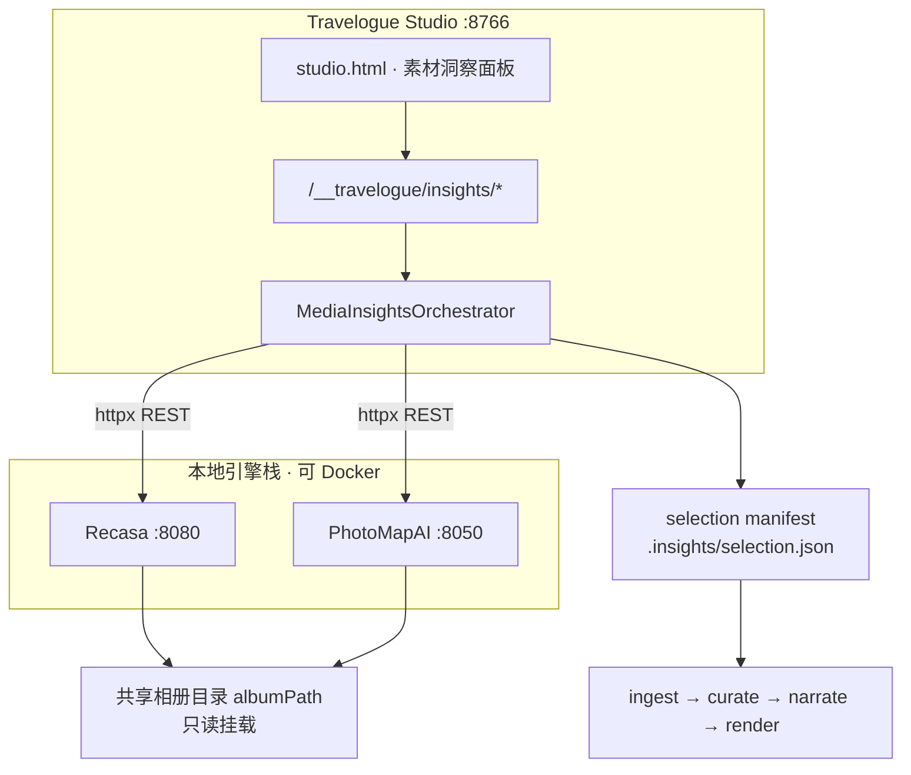
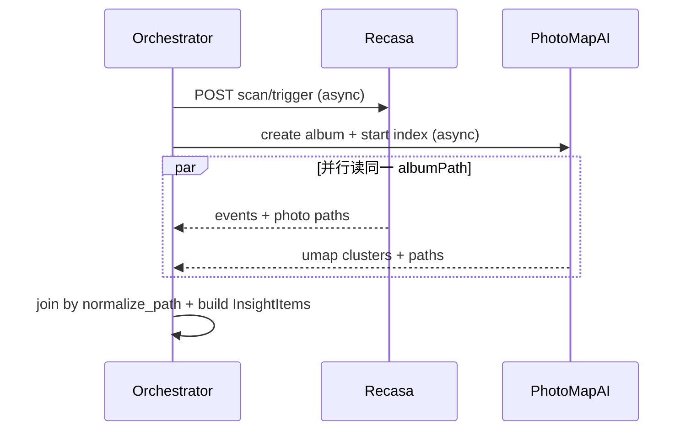
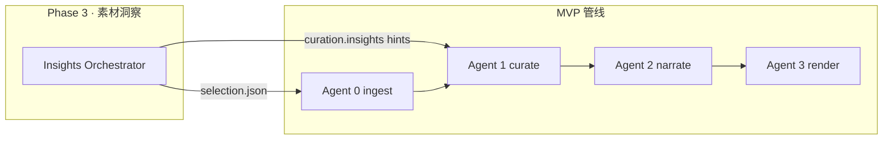
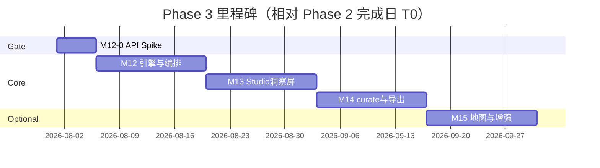

# Travelogue · Phase 3 产品需求文档（PRD）

| 属性 | 内容 |
|------|------|
| **产品代号** | Travelogue |
| **文档版本** | v0.2.1-PHASE3 |
| **状态** | Draft · v0.2.1 Spike 就绪（M12-0 完成后可升 v1.0 RFD） |
| **Phase 3 代号** | 「素材洞察」— Recasa × PhotoMapAI 双引擎协同 |
| **前置条件** | [PRD-MVP.md](./PRD-MVP.md) 管线就绪；**Phase 2 完成闸门**（§13.0）通过后启动 M12 |
| **交付形态** | Studio 内可选 **「素材洞察」** 步骤：旅行原片按 **行程段（Recasa）** 与 **场景主题（PhotoMapAI）** 分组预览 → 用户确认精选集 → 进入既有 ingest / curate / render 管线 |
| **关联文档** | [DATA-MODEL.md](./DATA-MODEL.md)、[AGENT-ARCHITECTURE.md](./AGENT-ARCHITECTURE.md)、[PRD-PHASE2.md](./PRD-PHASE2.md)、[SHARING.md](./SHARING.md)、[ERROR-CODES.md](./ERROR-CODES.md)、[adr/006-media-engines-integration.md](./adr/006-media-engines-integration.md)（v0.2 Accepted） |
| **更新日期** | 2026-05-27 |

> **命名说明**：本文 **Phase 3** 指产品第三阶段（素材洞察引擎）。[SHARING.md](./SHARING.md) 中的 **P3 小程序鉴权分享** 为独立轨道，**不在** 本 Phase 范围，后续可称 **Phase 4 · 私密分享**。

---

## 1. 背景与问题陈述

### 1.1 Phase 1–2 已解决什么

| 阶段 | 能力 | 用户价值 |
|------|------|----------|
| **MVP** | ingest → curate（按日/段）→ narrate → render | 技术闭环：文件夹 → 杂志风 HTML |
| **Phase 2** | Studio 工作台 + 服务端长图 + 非开发者入口 | 选文件夹 → 预览 → 微信长图 |

当前 **curate（Agent 1）** 主要依赖 **EXIF 日期分段 + 规则排版**，对「同一地点混拍多种场景」「连拍重复」「无 GPS 的混册」处理能力有限（见 [老图.md](./老图.md)、ingest 内 pHash 去重）。

### 1.2 Phase 3 要解决的断裂点

用户导入一次旅行文件夹（常见 **100–800 张**）时，存在 **素材认知断裂**：

| 断裂 | 现状（Phase 2） | 用户感受 |
|------|-----------------|----------|
| **断裂 A · 行程感** | curate 按「日/段」分章，但 **看不到地图路线与事件边界** | 「这趟旅行分几段、哪天在哪」要靠自己回忆 |
| **断裂 B · 主题感** | 无 **场景聚类**（美食/寺庙/人像/夜景混在一起） | 难以快速筛「只要精华 80 张进游记」 |
| **断裂 C · 精选门槛** | Studio 软提示「>100 张建议精选」，但 **无工具帮精选** | 要么全导入（慢、游记冗长），要么手动删（费时） |
| **断裂 D · 重复与离群** | ingest 有 pHash；**无地图/事件级去重视图** | 连拍、同角度堆叠不易批量处理 |

### 1.3 为何引入 Recasa + PhotoMapAI（而非自研）

| 引擎 | 擅长 | Travelogue 不重复造轮子 |
|------|------|-------------------------|
| **[Recasa](https://github.com/yonie/recasa)** | Events（时间+GPS）、Timeline、Map、Hero Trail、人脸、重复检测 | 行程段划分、地理叙事 |
| **[PhotoMapAI](https://github.com/lstein/PhotoMapAI)** | CLIP 语义地图、主题聚类、文本/以图搜图 | 场景主题分组、精选辅助 |

**集成原则（已拍板）**：Travelogue **Python 编排层** + 两引擎 **独立进程/容器** + **共享只读照片目录** + **HTTP API 协同**；**不**合并代码库、**不** fork 为 monolith。

### 1.4 Phase 3 产品定位

> **在「生成游记」之前，增加一层「看懂这次旅行」的素材洞察工作台**：Recasa 回答 **何时何地**，PhotoMapAI 回答 **拍了什么主题**；用户确认精选集后，再走 Phase 2 已验证的 **ingest → curate → 长图** 主路径。

Phase 3 **不替换** Studio、**不修改** MVP 冻结的模板渲染契约；仅在 pipeline **上游** 增加可选阶段 **「insights」**，并向下游 curate 提供 **结构化 hints**。

---

## 2. 目标与非目标

### 2.1 产品目标

| ID | 目标 | 衡量方式 |
|----|------|----------|
| **G-P3-01** | 用户能在 Studio 内 **≤10 分钟** 理解一次旅行的 **行程段 + 主题簇** 概览 | 1 次真实旅行（150–400 张）实测 |
| **G-P3-02** | 用户能基于洞察 **勾选精选集**（目标 **50–120 张**）再生成游记 | 精选后 trip 素材数落在推荐区间 |
| **G-P3-03** | **洞察主路径零命令行**（选文件夹 → 洞察 → 生成）；引擎为 **一次性/setup 向导** 配置，非每次操作 | AC-P3-03 |
| **G-P3-08** | **一次性引擎配置** ≤15 分钟（含 Docker/模型下载指引），之后仅 Studio 内「启动分析服务」 | setup-engines 实测 |
| **G-P3-04** | 洞察结果 **可导出 CSV/JSON 清单**（路径 + event + theme 标签） | AC-P3-05 |
| **G-P3-05** | 关闭洞察时，Studio 行为与 Phase 2 **完全一致**（NR-P3-01） | 回归测试 |
| **G-P3-06** | 照片 **默认不出本机**；Recasa/PhotoMapAI 均本地处理 | 隐私审查清单 |
| **G-P3-07** | curate 章结构 **可消费** insights hints（段标题/封面建议） | trip.json `curation.insights` 字段 |

### 2.2 非目标（Phase 3 明确不做）

- 替换 Recasa / PhotoMapAI 原生 UI 为唯一入口（允许 **高级用户** 跳转外链，非主路径）
- 将两引擎 **源码合并** 进 `travelogue/` 主包
- 云端同步、多用户协作、账号体系
- 实时地图 SDK 嵌入游记 HTML（Map 仅在 **洞察面板** 展示）
- 自动 LLM 写整篇游记（仍属 Agent 2；insights 仅提供 **结构 hints**）
- 微信小程序 / 托管分享（见 SHARING 路径 B · Phase 4）
- 视频素材的主题聚类（Phase 3 **仅照片**；视频仍走 MVP ingest 规则）
- 要求用户 **每次旅行** 手动配置 Docker / pip / 端口（改为 **一次性 setup + Studio 内按钮**；见 §4.4、§7.6）

---

## 3. 目标用户与场景

### 3.1 Persona（延续 Phase 2，新增洞察诉求）

**Persona A · 普通旅行者（主用户）**

- 一次旅行 **200+ 张** 手机照，想发微信群长图但 **不想全塞进去**
- 需要「系统帮我先看一遍」，自己 **点选** 要的故事线

**Persona B · 进阶创作者**

- 愿意看 **Event 边界 + 语义地图**，微调后再 lock 结构
- 需要导出 **CSV** 做归档或二次处理

**Persona C · 维护者/开发者**

- 需要 Docker Compose **引擎健康检查**、日志、可关闭 insights 的 feature flag

### 3.2 核心 User Stories

| ID | 作为… | 我想要… | 以便… |
|----|--------|---------|--------|
| **US-P3-01** | 旅行者 | 选文件夹后先看到 **行程 Events 列表**（日期、地点、张数） | 知道这趟旅行分几段 |
| **US-P3-02** | 旅行者 | 在地图上 **回放路线**（Recasa Hero Trail 或等价嵌入） | 回忆动线 |
| **US-P3-03** | 旅行者 | 在每个 Event 或整趟旅行上看到 **主题簇**（PhotoMapAI 语义地图缩略） | 按「吃饭/风景」批量勾选 |
| **US-P3-04** | 旅行者 | **勾选/反选** 照片集合并显示「已选 N 张」 | 控制游记体量 |
| **US-P3-05** | 旅行者 | 点「生成游记」只对 **精选集** 跑 ingest→curate | 不必手动建子文件夹 |
| **US-P3-06** | 旅行者 | 洞察失败时 **跳过洞察** 仍可按 Phase 2 全流程 | 不被引擎阻塞 |
| **US-P3-07** | 进阶用户 | 导出 **insights 清单**（CSV/JSON） | 离线备份或外部工具 |
| **US-P3-08** | 进阶用户 | 在设置里 **关闭素材洞察**（默认开启策略可配置） | 小相册（≤50 张）快速路径 |
| **US-P3-09** | 旅行者 | 看到 **重复图组** 提示并一键「每组留 1 张」 | 减少连拍垃圾 |
| **US-P3-11** | 旅行者 | 一键 **「采用推荐精选（约 80 张）」** | 不用从 400 张里手动反选 |
| **US-P3-12** | 旅行者 | 首次使用时 **安装向导** 配置分析服务（非 PowerShell 手敲） | 不违背 Phase 2 零命令行 |

### 3.3 场景时间窗与耗时预期

与 MVP/Phase 2 一致：**旅行结束后 24–72 小时**。

#### 3.3.1 洞察阶段耗时（150 张 · 引擎已就绪 · 模型已缓存）

| 步骤 | 并行? | GPU 目标 | CPU 目标 | 说明 |
|------|-------|----------|----------|------|
| Recasa 扫描 + Events | 与下行 **并行** | ≤ 3 分钟 | ≤ 5 分钟 | Orchestrator 见 §4.3 |
| PhotoMapAI 索引 + UMAP | 与上行 **并行** | ≤ 5 分钟 | ≤ 12 分钟 | 400 张 CPU 上限 **20 分钟**（soft warn） |
| **墙钟合计（并行）** | — | ≤ **8 分钟** | ≤ **15 分钟** | 非两阶段相加 |
| 用户浏览 + 微调精选 | — | 5–15 分钟 | 人工 | |
| 后续 Phase 2 pipeline | — | 沿用 Phase 2 | | |

#### 3.3.2 首次运行附加耗时（一次性）

| 项 | 大小/耗时 | 何时发生 |
|----|-----------|----------|
| Docker Desktop 安装 | ~2GB 安装包；用户自行完成 | **setup-engines** 检测到缺失时指引 |
| CLIP / OpenCLIP 权重 | **~400MB–1.5GB**（视 encoder） | **`engines up` 预下载**，非首次 insights 才下 |
| Recasa 首次扫描索引 | 含在上表 | 同相册二次 **24h 缓存** 跳过 |
| PhotoMapAI 首次 UMAP | 含在上表 | 索引 `.npz` 可复用 |

**产品承诺**：对用户展示的 stageHint 区分 **`首次分析`**（含模型下载子阶段）与 **`后续分析`** 两档文案（`templates/studio/insights_stages.yaml`）。

---

## 4. 解决方案总览

### 4.1 架构：编排层 + 双引擎



### 4.2 职责边界

| 组件 | 负责 | 不负责 |
|------|------|--------|
| **Recasa** | Events、Timeline、Map、Duplicates、People（可选） | 场景语义聚类、游记渲染 |
| **PhotoMapAI** | CLIP 索引、UMAP 簇、语义搜索 | 行程 Event 算法、隐私 GPS 剥离策略 |
| **Travelogue 编排层** | 引擎生命周期、路径对齐、精选 manifest、Studio UI、导出清单、向 curate 写 hints | 重实现 CLIP/Event 算法 |
| **Phase 2 pipeline** | 精选集 ingest 之后一切 | 洞察 UI |

### 4.3 集成模式与 Orchestrator 调度（M12 决策 · 见 ADR-006）

**主模式 · API 编排（P0）**

- Recasa：`GET /api/events`、`GET /api/events/{id}/photos`、扫描 `POST /api/scan/trigger`
- PhotoMapAI：`GET /umap_data/{album_key}`、相册 CRUD、`index_images` CLI 触发（封装为 orchestrator 调用）
- 关联键：**规范化绝对路径** `file_path`（策略见 §7.5）

**调度策略（P0 · 已决）**



1. **Recasa 与 PhotoMapAI 索引并行**（独立只读目录，无写冲突）。  
2. **`engines up` 阶段** 触发 PhotoMapAI **模型预下载 / warmup**（空 album 或 `demo_images`），避免 insights Job 卡在下载。  
3. join 阶段：任一路径失败 → **部分结果** + 中文说明，不 block 另一引擎数据。  
4. commit 前：**路径对账**（selected 路径 vs 磁盘 walk）；丢失 >0 → `E_INS_PATH_MISMATCH` 阻断 commit。

**M12-0 · API Spike（M12 编码前必完成）**

| 产出 | 内容 |
|------|------|
| `docs/spikes/engines-api-matrix.md` | pin 版本下 **实测** 端点、请求/响应样例、鉴权 |
| `tests/fixtures/engines/` | Recasa events JSON、PhotoMapAI umap JSON **golden** |
| **Spike 必验项** | 见下表 |
| `docs/IMPLEMENTATION-PHASE3.md` | **M12-0 期间产出**：Orchestrator / 路径对账 / 智能预选 **接口签名 + 伪代码** |
| 结论 | Go → PRD 升 **v1.0 RFD**；No-Go → 档位 B 或推迟 Phase 3 |

**M12-0 Spike 必验清单**

| ID | 验证项 | 通过标准 |
|----|--------|----------|
| SP-01 | Recasa **父目录挂载 + 扫描子路径**（§7.4 方案 A） | `POST /api/scan/trigger` 后子目录 Events 正确；**不**因换 trip 而 compose down |
| SP-02 | 方案 B 备选：`${PHOTOS_ROOT}` + `${SCAN_SUBPATH}` 动态 `.env` | 若 A 不可行，文档化 B 为默认 |
| SP-03 | Recasa **缩略图 API** 是否存在 | 有 → 代理 URL；无 → 记录 Pillow 降级（§5.3.5） |
| SP-04 | PhotoMapAI **容器 GPU**（WSL2 + NVIDIA Container Toolkit） | 有 GPU 时索引加速可测；无则 CPU 路径 documented |
| SP-05 | PhotoMap 官方/自建 **Dockerfile Go/No-Go** | 决定档位 A 是否双容器或 Recasa 容器 + host PhotoMap |
| SP-06 | API 稳定性 | 适配层 + pin tag；否则 Plan B |

**辅模式 · 目录桥接（P1）**

- 按 Event 硬链接到 `trips/_insights/{jobId}/events/{eventId}/` 供 PhotoMapAI 分 Album 索引

**明确不做 · 库内 import**

- 不在 `travelogue` 进程内 `import recasa.*` / `import photomap.*` 跑双 FastAPI

### 4.4 引擎部署档位（保护 Phase 2 零命令线体验）

| 档位 | 组成 | 用户操作 | 适用 |
|------|------|----------|------|
| **A · 推荐（Full Stack）** | **单文件** `docker-compose.engines.yml`：Recasa + PhotoMapAI **双容器** | 首次：`scripts/setup-engines.ps1`；日常：Studio **「启动分析服务」** | 默认文档路径 |
| **B · Lite** | 仅 Recasa 容器；PhotoMapAI **跳过** | 同左 | 低内存 / 无 GPU；仅 Events，无主题簇 |
| **C · 开发者** | Host `pip install photomapai` + Docker Recasa | `travelogue engines up --profile dev` | 维护者调试 |

**OQ-P3-01 决议（v0.2）**：产品默认推 **档位 A**；ADR-006 同步修订。档位 B 为 Plan B，不是主路径。

**Studio 内引擎 UX（P0）**

- 首次开启 insights：若 engines 未就绪 → **安装向导**（检测 Docker / 磁盘 / 内存 → 调用 setup 或打开文档）  
- 引擎运行中：状态灯 **Recasa ✓ · PhotoMap ✓**  
- **不要求** 用户记忆 8080/8050 或 docker compose 命令

---

## 5. 功能范围

### 5.1 In Scope（Phase 3 必做）

| 模块 | 功能点 | 优先级 |
|------|--------|--------|
| **M12-0 Spike** | API 矩阵 + golden fixtures（§4.3） | **P0 · 编码前** |
| **setup-engines** | 两阶段：`setup-engines.ps1 -DetectOnly` + `-Install`；见 §7.4.1 | **P0 · M12 独立验收** |
| **引擎栈** | `docker-compose.engines.yml`（**Recasa + PhotoMapAI 双容器**）+ 健康检查 | **P0 · M12** |
| **Orchestrator** | 并行 scan/index、join、路径对账 | **P0 · M12** |
| **智能预选** | 推荐集 ~80 张 +「只选推荐」 | **P1 · M13** |
| **Studio 洞察 Job** | stage **`insights`** | **P0 · M13** |
| **洞察 UI** | 见 §5.4 UX 规格 | **P0 · M13** |
| **精选导入** | 仅 `selection.json` 内路径进入 ingest | **P0 · M13** |
| **跳过/降级** | 引擎不可用 → 中文提示 + 「跳过洞察，直接生成」 | **P0 · M13** |
| **导出清单** | CSV + JSON（path, eventId, eventName, clusterId, selected） | **P1 · M14** |
| **curate hints** | `trip.json` · `curation.insights` 写入段标签与推荐封面路径 | **P1 · M14** |
| **重复组辅助** | 读取 Recasa duplicates API（若有）或 ingest pHash 组，UI「每组留最佳」 | **P1 · M14** |
| **CLI** | `travelogue engines {up|down|status}`、`travelogue insights run --folder PATH` | **P1 · M14** |
| **Map 嵌入** | Recasa Event 地图 iframe/静态快照（二选一，见 OQ-P3-03） | **P2 · M15** |

### 5.2 Out of Scope

见 §2.2；另：**在 PhotoMapAI 内编辑 Album 配置** 不作为主流程（Travelogue 代创建 Album）。

### 5.3 功能需求明细

#### 5.3.1 引擎生命周期 · F-ENG-*

| 需求 ID | 描述 | 验收标准 |
|---------|------|----------|
| **F-ENG-01** | `travelogue engines up` 启动 **compose 双容器** | `engines status` → recasa + photomap **ok** |
| **F-ENG-02** | `setup-engines.ps1` **两阶段**：`-DetectOnly`（只读报告）与 `-Install`（拉镜像/启动/warmup） | 用户先看报告再确认安装 |
| **F-ENG-02b** | Detect 覆盖：Docker、**WSL2 后端**、磁盘/内存、端口 8080/8050、**GPU/NVIDIA Container Toolkit** | 无 GPU → 报告标注 CPU 模式 |
| **F-ENG-06** | `engines up` 触发 **模型预下载 / warmup** | 首次 insights 不卡在 CLIP 下载 |
| **F-ENG-07** | Studio **「启动分析服务」** + 状态灯（用户不见端口号） | US-P3-12 |
| **F-ENG-08** | **安装向导**（M12）：engines 未 setup 且用户首次点洞察 → 检测摘要 → 引导 setup / 文档 → 确认 | F-ENG-02 + Studio modal；**M12 验收** |
| **F-ENG-03** | 引擎未就绪时 Studio 洞察页显示 **等待/重试**，不崩溃 | AC-P3-04 |
| **F-ENG-04** | 所有引擎 HTTP 仅绑定 **127.0.0.1** | 安全审查 |
| **F-ENG-05** | `.env.engines` 模板：`RECASA_PORT=8080`、`PHOTOMAP_PORT=8050` | 文档 WORKSHOP 附录 |

#### 5.3.2 洞察编排 · F-INS-*

| 需求 ID | 描述 | 验收标准 |
|---------|------|----------|
| **F-INS-01** | 对 `albumPath` 触发 Recasa scan（若未索引） | Events 数量 ≥ 1（有 GPS+时间时） |
| **F-INS-02** | 为整趟旅行创建 PhotoMapAI album `travelogue-{jobId}` | 索引完成可拉 umap_data |
| **F-INS-03** | **按 Event 子集** 可选拉 cluster（P1：整趟一张地图；P1.5：每 Event 再索引） | OQ-P3-02 |
| **F-INS-04** | 合并 Recasa photo 列表与 PhotoMapAI cluster 标签 → **统一 InsightItem** | 见 §9.1 |
| **F-INS-05** | 默认展示 **推荐精选**（`recommended=true`，目标 **60–100 张**）；全量路径在「高级」 | 非默认全选 400 张 |
| **F-INS-11** | **智能预选**：Event 代表图 + cluster medoid + dedupe 后凑 ~`targetPickCount`（默认 80，可配置 60–120） | US-P3-11；一键「只选推荐」 |
| **F-INS-12** | commit 前 **路径对账**：`selection` 中每条 path 必须 resolve 且存在于 albumPath | 丢失 → `E_INS_PATH_MISMATCH` |
| **F-INS-06** | 「每组留 1 张」：重复组内保留 **sharpness 最高**（复用 ingest 指标或 EXIF 时间居中） | US-P3-09 |
| **F-INS-07** | 精选数 **>250** 硬拦（对齐 MVP 上限）；**>120** soft warning | 与 Phase 2 一致 |
| **F-INS-08** | 生成游记前写入 `trips/_insights/{jobId}/selection.json` | ingest 只读该列表 |
| **F-INS-09** | insights Job 可 **cancel**（对齐 Phase 2 Job 模型） | IMPLEMENTATION-PHASE3 |
| **F-INS-10** | 洞察缓存：同 `albumPath` canonical + mtime **24h**；损坏 → `E_INS_CACHE_CORRUPT` 自动 force refresh | 见 §11 |

#### 5.3.3 Studio UI · F-STU-P3-*

| 需求 ID | 描述 | 验收标准 |
|---------|------|----------|
| **F-STU-P3-01** | `--pick-folder` 流程插入 **insights 屏**（可配置跳过） | 见 §6.1 |
| **F-STU-P3-02** | 左栏 **Events**；右栏 **主题簇**（选中 Event 过滤或全局） | US-P3-01/03 |
| **F-STU-P3-03** | 底部 **已选 N 张 · 生成游记** CTA | US-P3-05 |
| **F-STU-P3-04** | **跳过洞察** 链接（小字，不默认高亮） | US-P3-06 |
| **F-STU-P3-05** | stage 进度增加 **`insights`**：`0/5 正在分析行程与场景…` | stageHint YAML |
| **F-STU-P3-06** | 引擎错误中文映射（见 §11） | ERROR-CODES 附录 |
| **F-STU-P3-07** | 设置项：**默认开启洞察**（相册 ≤50 张自动跳过，OQ-P3-04） | G-P3-05 回归 |

#### 5.3.4 下游 curate · F-CUR-P3-*

| 需求 ID | 描述 | 验收标准 |
|---------|------|----------|
| **F-CUR-P3-01** | ingest 完成后 `trip.json` 写入 `curation.insights` | schema 见 §9.2 |
| **F-CUR-P3-02** | curate 读取 `insights.segments[]`：**优先按 Event 分段** 而非纯日历日（可配置 fallback） | 段数与 Events 大致对齐 |
| **F-CUR-P3-03** | 章标题 hints：Recasa `event.name` 或 `location` + 日期 span | 用户可在 G1 改 |
| **F-CUR-P3-04** | 封面 hints：代表图 path 进入 `coverCandidates` 加权 | 非强制 |

#### 5.3.5 洞察屏 UX 规格 · F-UX-P3-*

| 项 | 规格 |
|----|------|
| **布局** | 桌面：**左栏 Events 28% · 右栏主题簇 72%**；`<1024px`：**上下堆叠**（Events 折叠手风琴置顶） |
| **缩略图** | 网格 **120×120 CSS px**，`object-fit: cover` |
| **缩略来源（降级链）** | ① Recasa thumb API → Travelogue **代理转发**；② 无 API → **Pillow** 本地生成 → 缓存 `trips/_insights/{jobId}/thumbs/`（M12-0 SP-03 定稿） |
| **列表性能** | **分页** 50 + **懒加载**；禁止一次 400 DOM |
| **主题簇** | 簇标题 + 代表图 + 簇内计数；点簇 **筛选**右栏网格（可叠加 Event 过滤） |
| **推荐标记** | 推荐项 **星标**；顶栏「已选 N · 推荐 M · 只选推荐 · 全选 · 全不选」 |
| **底栏** | 固定：**跳过洞察**（次按钮）· **生成游记**（主按钮，N&lt;4 或 N&gt;250 disabled） |
| **stage 文案** | `templates/studio/insights_stages.yaml`（`parallelGroup` 供 **stageHint 文案**，非双进度条） |

#### 5.3.6 insights 子阶段 · 前端展示策略（P1 · 已决）

**单一主进度条**（与 Phase 2 `stageIndex/stageCount` 一致），**不做** Recasa/PhotoMap 双 progress bar。

| 层 | 行为 |
|----|------|
| **Job 级** | `stage=insights`，`stageIndex=0`，`stageCount=5` |
| **轮询** | `GET /__travelogue/insights/status/{jobId}` 返回 `insightsSubsteps` |
| **UI 主文案** | `正在分析行程与场景…（约 3–8 分钟）` |
| **UI 副文案 stageHint** | 动态拼接，例：`Recasa ✓ · 场景分析中…` 或 `行程分析中 · PhotoMap ✓` |

**`insightsSubsteps` 字段（JSON）**

```json
{
  "recasa": "pending|running|done|failed|skipped",
  "photomap": "pending|running|done|failed|skipped",
  "join": "pending|running|done|failed"
}
```

前端 **仅** 用 substeps 渲染 hint 行；失败 substep 在 hint 中标注，不增加 stageIndex。

**insights_stages.yaml 示例字段**：`stageKey`、`label`、`hintFirstRun`、`hintSubsequent`、`parallelGroup`。

## 6. 用户旅程与主流程

### 6.1 Phase 3 端到端（默认开启洞察）

```
[开始]
  → 启动 Studio（Phase 2 入口不变）
  → 选择照片文件夹
  → （后台）engines 健康检查；必要时 engines up
  → 0/5 素材洞察：Recasa 扫描 → Events
  → 0/5 素材洞察：PhotoMapAI 索引 → 主题簇
  → 洞察屏：浏览 Events / 地图 / 主题簇
  → 勾选精选（或「每组留 1 张」）
  → 1/5 导入精选 → 2/5 排版 → 3/5 文案 → 4/5 渲染
  → 预览 → 保存长图 → 微信
[结束]
```

### 6.2 小相册 fast path（≤50 张）

```
选文件夹 → 检测到 ≤50 张 → 跳过 insights（可设置里强制开启）
→ 直接进入 Phase 2 四段 pipeline
```

### 6.3 与 Phase 2 旅程对照

| 步骤 | Phase 2 | Phase 3 |
|------|---------|---------|
| 选文件夹 | 立刻 pipeline | 可选 **insights 屏** |
| 分章依据 | EXIF 日/段 | **+ Event hints** |
| 精选 | 用户手动删图（preview 后） | **洞察屏预精选** |
| 长图/分享 | 不变 | 不变 |

### 6.4 关键交互原则

1. **洞察可跳过**：任何引擎失败不得 blocking 主路径（US-P3-06）。  
2. **默认 local-only**：引擎栈文档明确无出站上传。  
3. **人类在环**：洞察是 **提案**，不是自动删原片；原文件夹 **只读**。  
4. **复用 Job 模型**：insights 与 ingest 等同属 `StudioJob`，字段对齐 Phase 2（§9.3）。  
5. **不破坏 NR-P2-01**：关闭 insights 时 pytest 与 Phase 2 行为一致。

---

## 7. 技术规格

### 7.1 新增 Python 模块（建议）

```
travelogue/
├── services/
│   ├── recasa_client.py       # httpx 封装
│   ├── photomap_client.py
│   └── media_insights.py      # MediaInsightsOrchestrator
├── web/
│   ├── studio_insights.py     # /__travelogue/insights/*
│   └── studio_insights_jobs.py
├── engines/
│   ├── compose.py             # docker compose 调用
│   └── health.py
└── cli_engines.py             # engines 子命令
```

### 7.2 端口与配置

| 服务 | 默认端口 | 配置项 |
|------|----------|--------|
| Travelogue Studio | 8766 | 不变 |
| Recasa | 8080 | `TRAVELOGUE_RECASA_URL` |
| PhotoMapAI | 8050 | `TRAVELOGUE_PHOTOMAP_URL` |

`AppConfig` 新增（`config.py`）：

```yaml
insights:
  enabled: true
  skipBelowPhotos: 50
  recasaUrl: http://127.0.0.1:8080
  photomapUrl: http://127.0.0.1:8050
  cacheTtlHours: 24
  segmentCurateMode: event_first  # event_first | date_fallback
```

### 7.3 Studio API（新增）

| 方法 | 路径 | 说明 |
|------|------|------|
| POST | `/__travelogue/insights/start` | body: `{ albumPath, forceRefresh? }` → jobId |
| GET | `/__travelogue/insights/status/{jobId}` | stage + **`insightsSubsteps`** + events/clusters 摘要 |
| GET | `/__travelogue/insights/items/{jobId}` | 分页 InsightItem 列表 |
| PATCH | `/__travelogue/insights/selection/{jobId}` | 更新勾选 |
| POST | `/__travelogue/insights/selection/{jobId}/dedupe-burst` | 每组留 1 张 |
| POST | `/__travelogue/insights/commit/{jobId}` | 锁定 selection → 启动 ingest pipeline |
| GET | `/__travelogue/insights/export/{jobId}.csv` | 导出 |
| GET | `/__travelogue/engines/status` | recasa / photomap 健康 |

### 7.4 Docker Compose（引擎栈 · 档位 A）

#### 7.4.1 卷挂载：动态 albumPath（P0 · M12-0 定稿）

**问题**：每次旅行文件夹不同，静态 compose 绑定单一路径会导致换文件夹需 `compose down && up`。

| 方案 | 机制 | 默认 |
|------|------|------|
| **A · 父目录挂载（推荐）** | compose 挂载 **`PHOTOS_ROOT`**（如 `D:\Photos`）→ `/photos:ro`；Orchestrator 调用 Recasa scan 时传入 **`scanSubpath`**（相对 PHOTOS_ROOT，如 `Japan-2025`） | **M12-0 SP-01 验证通过后采用** |
| **B · 动态 .env** | `engines up --photos-root PATH` 写入 `.env.engines` 的 `PHOTOS_ROOT`；compose `volumes: ${PHOTOS_ROOT}:/photos:ro` | A 不可行时的 fallback |
| **C · 按 Job 重挂载（拒绝）** | 每次 insights 改 compose 卷 | 运维复杂，**不采用** |

**Travelogue 配置**

```yaml
engines:
  photosRoot: D:\Photos          # 用户设置或 wizard 写入
  # albumPath 必须为 photosRoot 下子目录（或等于 photosRoot）
```

**insights/start 校验**：`normalize_path(albumPath)` 必须是 `normalize_path(photosRoot)` 的子路径；否则 `E_INS_PATH_OUTSIDE_ROOT`。

PhotoMapAI Album 的 `image_paths` 仍指向 **完整 albumPath**（host 路径）；容器需 **额外 bind** 同一 `PHOTOS_ROOT` 或仅 bind albumPath（Spike 定）。

#### 7.4.2 服务定义

| 服务 | 镜像/构建 | 端口 | 卷 |
|------|-----------|------|-----|
| **recasa** | pin `recasa:1.4.x` | 8080 | `${PHOTOS_ROOT}:/photos:ro`、`recasa_data` |
| **photomap** | pin / 自建 Dockerfile | 8050 | `${PHOTOS_ROOT}:/photos:ro`（只读）；索引 **`PHOTOMAP_INDEX_DIR`** → 命名卷或 `%LOCALAPPDATA%/travelogue/photomap-index` |

`travelogue engines up [--photos-root PATH]` = 写 `.env.engines` + `docker compose up -d` + 健康轮询 + warmup。

#### 7.4.3 GPU 与 CPU 降级（P0）

| 项 | 说明 |
|----|------|
| **GPU 条件** | Windows：**Docker Desktop WSL2 后端** + **NVIDIA 驱动** + **NVIDIA Container Toolkit**（WSL 内） |
| **setup Detect** | 无 GPU / 无 Toolkit → 报告 **「将使用 CPU 分析（较慢）」**；不阻断 Install |
| **compose 片段** | Spike 验证后写入 `docker-compose.engines.yml`：`deploy.resources.reservations.devices`（Linux/WSL2）；无 GPU 时 **omit** 该段 |
| **产品文案** | §7.6 区分「推荐 GPU」与「最低 CPU 可跑」 |

**档位 B（Lite）**：`docker compose --profile lite` 仅 Recasa。

#### 7.4.4 setup-engines.ps1 交付范围（M12 独立验收）

| 阶段 | 命令 | 行为 |
|------|------|------|
| **Detect** | `setup-engines.ps1 -DetectOnly` | 只读：Docker/WSL2/内存/磁盘/端口/GPU/PHOTOS_ROOT 是否配置；输出 **中文报告 + 建议档位** |
| **Install** | `setup-engines.ps1 -Install [-PhotosRoot PATH]` | 拉镜像、写 `.env.engines`、compose up、warmup、输出 `engines status` |
| **Studio** | 安装向导调用 Detect → 用户确认 → Install | F-ENG-08 |

**AC-M12-SETUP**：非技术用户在书面指引下，从 **无 Docker** 到 **`engines status` 全绿**（或明确 Lite 档位）≤30 分钟（不含 Docker Desktop 下载）。

### 7.5 路径规范化（最高风险 · P0）

**存储 canonical 形式（内部一律使用）**

```python
def normalize_path(path: str | Path, *, base: Path | None = None) -> str:
    """Resolve 绝对路径 → normpath → normcase（Windows 大小写不敏感比较）"""
```

| 规则 | 说明 |
|------|------|
| **内部存储** | `str(Path(path).resolve())` 后再 `os.path.normcase` |
| **比较** | 仅比较 canonical 字符串；**禁止**裸字符串 `==` |
| **UNC** | `\\server\share\...` resolve 后参与比较 |
| **尾部 `\`** | resolve 消除 |
| **引擎回传** | `recasa_client` / `photomap_client` **出口统一** normalize |
| **ingest 输入** | `selection.json` 只写 canonical |
| **对账** | commit 时 walk(albumPath) 建 Set(canonical)；差集 → 报错 |

**测试要求（M12 exit）**

| 套件 | 覆盖 |
|------|------|
| `tests/test_insights_paths.py` | UNC、混合大小写、`/` vs `\`、尾部斜杠、短路径 8.3 |
| `tests/test_recasa_client_paths.py` | client 归一化 + mock 响应 |
| `tests/test_photomap_client_paths.py` | 同上 |
| `tests/test_insights_join_integration.py` | 两引擎 fixture 路径格式故意不一致 → join 成功 |

**Plan B 降级**：对账失败率 >5% 时，**禁止** commit，UI 提示「路径异常，请跳过洞察或联系支持」；不自动 basename 匹配（避免 silent 错图）。

### 7.6 最小资源需求（用户预期管理）

| 项 | 最低 | 推荐 | 说明 |
|----|------|------|------|
| **内存** | 8 GB | 16 GB | 双容器 + Studio；8GB 推档位 B |
| **磁盘（空闲）** | 10 GB | 20 GB | Docker 镜像 ~3GB + 模型 ~1.5GB + 索引缓存 |
| **GPU** | 无（CPU 可跑） | NVIDIA 8GB+ **且** WSL2 + Container Toolkit | 无 GPU 时 PhotoMap **CPU 索引**；hint 文案标注 |
| **Docker** | Desktop 4.x + **WSL2 后端** | 同左 | Hyper-V 后端 **不支持** GPU passthrough |
| **网络（首次）** | 需下载模型/镜像 | — | 之后可离线洞察 |

setup-engines.ps1 **低于最低** 时：警告并建议档位 B 或跳过 insights。

---

## 8. 与 Agent 架构的关系



- **Agent 0 之前**：insights（可选）  
- **Agent 1 增强**：读取 `curation.insights`，不新增 Agent 编号  
- **G0 闸口**：扩展为「导入完成 **且** （跳过 insights 或 已 commit selection）」

### 8.1 curate 消费 `curation.insights` 的规则（P1 · M14）

**原则**：insights 提供 **hints**，不突破 MVP **3–5 章**硬约束；`segmentCurateMode` 可关。

#### 优先级（`event_first` 模式）

```
1. 读取 curation.insights.segments[]（Recasa Events）
2. 合并相邻「小 Event」（photo_count < 15 且 time_gap < 4h）→ segment
3. 若 segment 数 > 5：按 photo_count 降序合并最小相邻对，直到 ≤5
4. 若 segment 数 < 3：按 date_fallback 从 EXIF 日切分补足
5. 每章绑定 segment 内 photoPaths（与 ingest assets 交集）
6. 章 title：segment.name || location || 日期 span（可被 G1 覆盖）
7. coverCandidates：每 segment medoid + insights.themes 代表图加权
```

**与现有 curate 冲突时**

| 情况 | 行为 |
|------|------|
| Recasa 8 Events | 合并 → **≤5 segments** → 映射为 **≤5 chapters** |
| 无 GPS（segments 空） | **整段 fallback** 到现有 `group_assets_by_day` |
| `segmentCurateMode: date_fallback` | **忽略** segments，与 Phase 2 完全一致 |
| insights.skipped=true | curate **不读** insights |

**伪代码**（IMPLEMENTATION-PHASE3.md 展开）：

```python
def build_buckets_from_insights(trip, assets, mode):
    if mode != "event_first" or trip.get("curation", {}).get("insights", {}).get("skipped"):
        return group_assets_by_day(assets)  # 现有逻辑
    segments = merge_small_events(trip["curation"]["insights"]["segments"])
    segments = cap_segments(segments, max_chapters=5, min_chapters=3)
    return segments_to_buckets(segments, assets)
```

---

## 9. 数据模型

### 9.1 InsightItem（Job 内存 + JSON 缓存，非 trip.json 必填）

```json
{
  "path": "D:\\Photos\\Japan\\IMG_001.jpg",
  "eventId": 3,
  "eventName": "京都 · 4月2日",
  "clusterId": 12,
  "clusterLabel": "theme_12",
  "selected": true,
  "recommended": true,
  "duplicateGroupId": "dup-a1",
  "sharpness": 142.5,
  "thumbUrl": "/__travelogue/insights/thumb/..."
}
```

### 9.2 `trip.json` 扩展 · `curation.insights`（v0.2.3+）

| 字段 | 类型 | 说明 |
|------|------|------|
| `curation.insights.version` | string | `"1"` |
| `curation.insights.engineRecasa` | string | Recasa 版本/commit |
| `curation.insights.enginePhotoMap` | string | PhotoMapAI 版本 |
| `curation.insights.albumPath` | string | 原始文件夹 |
| `curation.insights.selectedCount` | number | 精选张数 |
| `curation.insights.segments[]` | array | `{ eventId, name, startDate, endDate, location, photoPaths[] }` |
| `curation.insights.themes[]` | array | `{ clusterId, label, photoPaths[] }` |
| `curation.insights.skipped` | boolean | 用户是否跳过洞察 |
| `curation.insights.recommendedCount` | number | 智能预选张数 |

**Schema 兼容性（P0）**

- `curation.insights` 为 **optional**；Phase 2 `validate_trip` **L1 必须忽略未知 optional 子树**（或 schema 显式 optional）  
- **NR-P3-03**：Phase 3 产出的 `trip.json` 在 **insights 关闭** 的 Phase 2 Studio 中可打开、编辑、export-longshot  
- 回滚 Phase 3 代码时：旧 trip 含 `curation.insights` **不影响** render/curate（当 `segmentCurateMode=date_fallback`）

### 9.3 Studio Job 扩展

Phase 2 Job 字段保留；`stage` 枚举增加：

| stage | index | 文案示例 |
|-------|-------|----------|
| **insights** | 0 | 0/5 正在分析行程与场景（约 3–8 分钟）… |
| ingest | 1 | 1/5 正在导入精选… |
| curate | 2 | 2/5 正在排版… |
| narrate | 3 | 3/5 正在生成文案… |
| render | 4 | 4/5 正在渲染… |

`stageCount` 默认 **5**（开启 insights）或 **4**（跳过）。

---

## 10. 隐私与安全

| 项 | 要求 |
|----|------|
| 原片 | Recasa/PhotoMapAI/Travelogue 均 **只读** 用户目录 |
| GPS | 洞察屏 **可显示** 精确位置；**游记 export** 仍遵循 MVP 剥离策略（不变） |
| 网络 | 引擎绑定 127.0.0.1；Document 禁止公网暴露 8080/8050 |
| 日志 | 不记录 API Key；路径可打码 `.../Japan/**` |
| 缓存 | `trips/_insights/` 可删；文档说明清理方式 |

---

## 11. 错误处理（中文 · Phase 3 附录）

| 码 | 用户文案 |
|----|----------|
| `E_INS_ENGINES_DOWN` | 素材分析服务未启动。请运行「启动分析服务」或跳过洞察直接生成。 |
| `E_INS_RECASA_TIMEOUT` | 行程分析超时。请检查照片数量或稍后重试，也可跳过洞察。 |
| `E_INS_PHOTOMAP_INDEX` | 场景分析失败。仍可跳过洞察，按日期自动排版。 |
| `E_INS_NO_EVENTS` | 照片缺少时间与位置信息，无法划分行程段。已改为按场景分组。 |
| `E_INS_SELECTION_EMPTY` | 请至少选择 4 张照片。 |
| `E_INS_SELECTION_TOO_MANY` | 已选超过 250 张，请减少后再生成。 |
| `E_INS_PATH_MISMATCH` | 部分照片路径无法匹配，无法安全导入。请跳过洞察重试，或检查相册是否被移动。 |
| `E_INS_CACHE_CORRUPT` | 洞察缓存异常，正在重新分析…（**自动** force refresh，用户无感） |
| `E_INS_PATH_OUTSIDE_ROOT` | 所选文件夹不在照片根目录内。请在设置中调整照片根目录，或移动相册。 |

维护于 [ERROR-CODES.md](./ERROR-CODES.md) Phase 3 附录（M13 同步）。

---

## 12. 验收标准

完整用例见 **[ACCEPTANCE-PHASE3.md](./ACCEPTANCE-PHASE3.md)**（待写）。PRD 级闸门：

| ID | 标准 | 验证 |
|----|------|------|
| **AC-P3-01** | 150–400 张真实旅行：洞察屏见 **≥2 Events**（有 GPS 时）与 **≥3 主题簇** | 人工 + 截图 |
| **AC-P3-02** | **一键「只选推荐」** 或手动勾选 **60–120 张** → 游记 + 长图 | 含 Phase 2 AC-P2-01b |
| **AC-P3-03** | 受测者 **无 CLI** 完成洞察 + 生成 | Studio only |
| **AC-P3-04** | 停止 Recasa 容器 → **跳过洞察** 仍可生成 | 降级 |
| **AC-P3-05** | 导出 CSV **列齐全** 且路径可打开 | 自动化部分 |
| **AC-P3-06** | `curation.insights` 写入且 validate_trip **L1 通过** | schema |
| **NR-P3-01** | insights **关闭** 时与 Phase 2 **行为一致** | pytest 套件 |
| **NR-P3-02** | 全量 pytest **0 失败** | 每 PR |
| **NR-P3-03** | Phase 3 生成的 trip 在 Phase 2 模式 **可编辑/长图** | validate + serve 回归 |

**Phase 3 完成**：AC-P3-01～06 + NR-P3-01/02/03 + **M12-0** + M12～M14 Done。

---

## 13. 里程碑与排期

### 13.0 Phase 3 启动闸门（M12 前置）

**全部 ☑ 后** 方可启动 M12 编码：

| # | 闸门 |
|---|------|
| G1 | Phase 2 **M8b + M9 + M10 Done** |
| G2 | **AC-P2-01b**（UI 长图闭环）通过 |
| G3 | **NR-P2-01** 全量 pytest 绿 |
| G4 | **M12-0 Spike** 完成（§4.3） |

> Gantt 日期 **相对 Phase 2 完成日 +偏移**，非固定日历。Phase 2 延期则 Phase 3 整体顺延。

### 13.1 里程碑表（建议 Phase 2 完成后 6–8 周）

| 里程碑 | 周期 | 交付物 | 验收 |
|--------|------|--------|------|
| **M12-0 · API Spike** | W0 | `engines-api-matrix.md` + fixtures + pin 版本 | 端点实测签字 |
| **M12 · 引擎栈 + Orchestrator** | W1–2 | compose、setup-engines、clients、parallel join | **M12 exit**（§13.2） |
| **M13 · Studio 洞察屏** | W3–4 | insights UI（§5.4）、智能预选、commit 对账 | AC-P3-01、03、04 |
| **M14 · curate 消费 + 导出** | W5–6 | §8.1、schema optional、CSV、NR-P3-03 | AC-P3-02、05、06 |
| **M15 · 体验增强** | W7–8 | Map 嵌入、每 Event 子索引 | 可选 |



> 图中日期为 **示例**；以 §13.0 闸门满足日为 T0 重排。

任务拆解见 **[IMPLEMENTATION-PHASE3.md](./IMPLEMENTATION-PHASE3.md)**（**M12-0 期间产出**，非 M12 编码后补）。

### 13.2 M12 Exit Criteria（显式闸门）

**全部 ☑** 方可进入 M13：

| # | 验收项 | 验证 |
|---|--------|------|
| E1 | **M12-0 Spike** Go（§4.3 清单 SP-01～06） | `engines-api-matrix.md` 签字 |
| E2 | `setup-engines.ps1 -DetectOnly` + `-Install` 在 **Win11 干净机** 可跑通 | AC-M12-SETUP |
| E3 | **双容器**（或 Spike 批准的 hybrid）`engines status` 全 **ok** | 自动化 smoke |
| E4 | **父目录挂载 + 子路径 scan** 换文件夹 **无需** compose down | 手动 / 集成测试 |
| E5 | Orchestrator **并行 join** golden fixture 成功 | `test_insights_join_integration` |
| E6 | §7.5 **路径** 四套测试绿 | pytest |
| E7 | **IMPLEMENTATION-PHASE3.md** 含 orchestrator / 对账 / smart_pick 签名 | 文档 review |

---

## 14. 风险、缓解与 Plan B

| 风险 | 影响 | 缓解 | Plan B |
|------|------|------|--------|
| **运维复杂度**（Docker+模型） | Phase 2 零命令线倒退 | **档位 A 单 compose** + setup-engines + Studio 向导；§7.6 预期 | 档位 B Lite；跳过 insights |
| **上游引擎停更 / Breaking API** | Phase 3 失效 | pin 镜像 tag；client 适配层；M12-0 Spike | 跳过 insights；必要时 **vendor API fixtures** 维持测试 |
| Recasa/PhotoMapAI API 变更 | 集成脆 | golden fixtures + 集成测试 | 跳过 insights |
| 首次索引超时 | 用户流失 | 并行；模型预下载；首次/后续 hint 分档 | Lite 仅 Recasa |
| **路径不一致** | **静默丢图** | §7.5 canonical + commit 对账 + M12 exit 测试 | **阻断 commit**（不用 basename 静默匹配） |
| Windows Docker 资源 | OOM | 16GB 推荐；8GB 推 Lite | 跳过 insights |
| PhotoMapAI 索引污染相册 | 用户困惑 | 索引到 `%LOCALAPPDATA%` | — |
| curate Event 章数冲突 | 版式异常 | §8.1 合并/ cap | date_fallback |
| Phase 3 破坏 Phase 2 | 回归失败 | NR-P3-01/03 | insights 默认 off 直到 engines ready |

---

## 15. 开放问题

| ID | 问题 | 决议（v0.2） |
|----|------|--------------|
| **OQ-P3-01** | PhotoMapAI 部署 | **档位 A：双容器 compose**（默认）；档位 C 仅开发者 |
| **OQ-P3-02** | 索引粒度 | M13 整趟一 Album；M15 每 Event 子 Album |
| **OQ-P3-03** | 地图 UI | M15 iframe；M13 Event 卡片 + 文字地点 |
| **OQ-P3-04** | 默认开启 insights | **>50 张开启**；≤50 跳过；**engines 未 setup 时不弹 insights** |
| **OQ-P3-05** | Recasa Ollama Tags | Phase 3 不依赖 |
| **OQ-P3-06** | 上传流 | `_uploads/` → 临时只读目录再挂 Recasa |
| **OQ-P3-07** | insights 默认 feature flag | **engines ready 前默认 off**；setup 完成后 Studio 提示开启 |

---

## 16. 附录

### 16.1 术语表

| 术语 | 定义 |
|------|------|
| **素材洞察** | Phase 3 在 ingest 前的分析与精选阶段 |
| **Event** | Recasa 按时间+GPS 聚合的行程段 |
| **主题簇** | PhotoMapAI UMAP/DBSCAN 语义聚类 |
| **selection manifest** | `.insights/selection.json`，ingest 输入边界 |
| **引擎栈** | Recasa + PhotoMapAI 本地服务组合 |

### 16.2 外部依赖版本（pin 建议）

| 依赖 | 建议 |
|------|------|
| Recasa | git tag / Docker image **≥ 1.4.0** |
| PhotoMapAI | **photomapai ≥ 1.0.6** |
| Python | **≥ 3.11**（与 Recasa 对齐） |
| Docker Desktop | Windows 用户引擎栈前提 |

### 16.3 文档交付清单（Phase 3 启动前）

| 文档 | 状态 |
|------|------|
| PRD-PHASE3.md | 本文 v0.2.1 |
| adr/006-media-engines-integration.md | **v0.2 Accepted** |
| IMPLEMENTATION-PHASE3.md | **M12-0 期间产出**（M12 编码输入） |
| ACCEPTANCE-PHASE3.md | 待写（M13 前） |
| docs/spikes/engines-api-matrix.md | M12-0 待写 |
| ERROR-CODES.md §Phase 3 | 待写 |
| WORKSHOP.md §引擎栈 | 待写 |

### 16.4 修订记录

| 版本 | 日期 | 变更 |
|------|------|------|
| v0.1.0 | 2026-05-27 | 初稿 |
| v0.2.0 | 2026-05-27 | 评审修订：双容器 compose、setup-engines、并行调度、路径策略、UX/智能预选、curate 规则、测试策略、M12-0 Spike、NR-P3-03 |
| v0.2.1 | 2026-05-27 | 第三轮：PHOTOS_ROOT 动态挂载、GPU/WSL2 降级、F-ENG-08、insights 单一进度条+substeps、缩略图降级链、E_INS_CACHE_CORRUPT、M12 exit、IMPLEMENTATION M12-0 产出 |
| v0.2.1 | 2026-05-27 | 动态 PHOTOS_ROOT 挂载、GPU/setup 两阶段、F-ENG-08、insights substeps UI、缩略图降级链、E_INS_CACHE_CORRUPT、M12 exit、IMPLEMENTATION M12-0 产出 |

---

## 17. 测试策略

| 层级 | 范围 | 策略 |
|------|------|------|
| **单元** | `normalize_path`、merge_events、smart_pick | 纯函数；**无引擎** |
| **Client 契约** | `recasa_client` / `photomap_client` | **httpx MockTransport** + golden JSON（`tests/fixtures/engines/`） |
| **集成** | Orchestrator join | 本地 `docker compose -f docker-compose.engines.test.yml`；CI **optional** job（`pytest -m engines`） |
| **E2E** | Studio insights 屏 | Playwright：mock engines API **或** nightly 真引擎 |
| **回归** | NR-P3-01/03 | Phase 2 套件 + Phase 3 trip fixture 在 insights=off 下 serve/export |
| **路径** | M12 exit | §7.5 四套测试全绿 |

**CI 默认**：不启动 Docker（避免 flaky）；`engines` marker 仅 maintainer / nightly。  
**Golden**：`InsightItem`、`selection.json`、`curation.insights` 各 1 份 fixture。

---

**批准栏（占位）**

| 角色 | 姓名 | 日期 | 签批 |
|------|------|------|------|
| 产品负责人 | | | |
| 技术负责人 | | | |
| 项目发起人 | | | |
