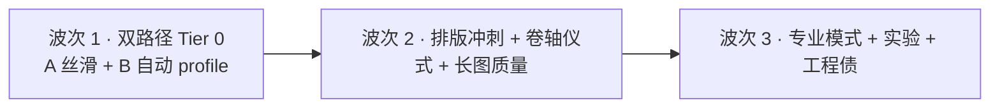

# Travelogue · Phase 5 产品需求文档（PRD）

| 属性 | 内容 |
|------|------|
| **产品代号** | Travelogue |
| **文档版本** | v0.5.4-PHASE5 |
| **状态** | Draft · **双交付路径**（长图 A + 卷轴 B）· 排版引擎为共同地基 |
| **Phase 5 代号** | 「整体优化」— **一键出稿** · **双路径交付** · 默认管线 · 卷轴产品化 |
| **前置条件** | [PRD-PHASE2.md](./PRD-PHASE2.md) M8–M10 可用；[PRD-PHASE3.md](./PRD-PHASE3.md) M12+ 已合入；[PRD-PHASE4.md](./PRD-PHASE4.md) M15–M19 **代码主线已收口**（人工验收/P-EVAL 可并行于 Phase 5） |
| **交付形态** | 同一 `trip.json` / 排版引擎 → **路径 A** 竖版长图 PNG（群聊快享）+ **路径 B** 电子艺术卷轴 HTML（沉浸阅读 · 小程序 web-view）；加强共同地基与分路径打磨 |
| **关联文档** | … · **[SHARING.md](./SHARING.md)**（路径 A/B 双轨）· **[API-MINIAPP.md](./API-MINIAPP.md)**（路径 B 云端）· **[PRD-EXPERIENCE.md](./PRD-EXPERIENCE.md)**（breath/screenplay） |
| **更新日期** | 2026-05-30 |
| **审查来源** | 全项目优化审查报告 v1 · 首席 UX 80% 主路径 · **双路径交付战略 v2**（2026-05-30）· §9–§11 · **v0.5.4 核对补遗** |

> **命名说明**
>
> - 本文 **产品 Phase 5** = 在 [SHARING.md](./SHARING.md) **路径 A/B** 框架下做深做透；**不是**新造分享形态。
> - [SHARING.md](./SHARING.md) **分享轨道 Phase 4**（小程序鉴权 HTML）= **路径 B 的云端最后一公里**；Phase 5 先 **本地卷轴产品化**，API 见 Tier 4。
> - Phase 4 编辑能力收成 **专业模式**；CLIP/plan/锚点等 **默认路径不依赖**。

---

## 1. 背景与问题陈述

### 1.4 北极星：80% 用户主路径（首席 UX · 2026-05-30）

**现实观察**：约 **80%** 真实用户流程为：

```
选文件夹 → 等待 → （可选）扫一眼预览 → 导出长图 → 发微信 → 结束
```

他们不会逐章改文案、不会手动 ★ 标精选、不会填 plan/锚点/G1。产品价值是 **「指定文件夹 → 拿到可分享成品」**，不是 **「在 Studio 里编杂志」**。

|  persona | 占比（估） | 行为 | Phase 5 策略 |
|----------|------------|------|--------------|
| **分享者** | ~80% | 导入 → 验货 → 长图 → 微信 | **Tier 0** 全部资源 |
| **编辑者** | ~20% | 改文案 / G1 / 锚点 / plan | **Tier 2** 保留 · 收入「更多编辑…」 |

**产品隐喻修订（v0.5.4 · 双路径并存）**：

| 旧叙事（Phase 4） | 新叙事（Phase 5） |
|-------------------|-------------------|
| 「在编一本有名字的杂志」 | **「文件夹 → 两个成品」**（长图 + 卷轴） |
| 智能 = 可配置 intent / G1 | **智能 = 默认排版就好 · 动效自动匹配** |
| 预览 = 编辑工作台 | **预览 = 验货（A）或沉浸读卷轴（B）** |
| 成功页 = 打开预览 | **成功页 = 双 CTA：主长图 · 次卷轴/预览** |

**唯一值得主动教的准备动作**：相册内 **`精选/` + `素材/`** 双文件夹（附录 A）——比填感受/plan 更自然。


**点击预算（含系统选目录 · 80% 路径）**：

| 步骤 | 目标次数 |
|------|----------|
| 打开 → 制作杂志 → 选文件夹 | ≤3 |
| 填杂志名/感受 | **0–1**（可全跳过） |
| 成功页 → 长图 | **1**（主 CTA） |
| 预览 | **0–1**（可选验货） |

---

### 1.5 双交付路径（产品真实结构 · v0.5.3）

> **修正（v0.5.2→v0.5.3）**：长图 **不是** 唯一交付物；与 [SHARING.md](./SHARING.md) 路径 A/B 对齐。

```
用户照片文件夹
    │
    ├─→ 路径 A · 竖版长图 PNG ──→ 微信群直发（高频 · 快 · 广 · 轻）
    │
    └─→ 路径 B · 电子艺术卷轴 HTML ──→ 小程序 web-view / 本地预览（护城河 · 慢 · 深 · 沉浸）
              ↑ breath · Lenis · screenplay · journal-screens
```

| 维度 | **路径 A · 长图** | **路径 B · 卷轴** |
|------|-------------------|-------------------|
| **交付物** | `{title}-longshot.png`（或按章 PNG） | `index.html` + assets（share 态） |
| **场景** | 群聊「发一下」· 30 秒扫完 | 私密分享 · 5 分钟沉浸读完 |
| **定位** | 九宫格升级版 · **一眼好看** | 电子杂志 · **翻开放不下** |
| **Phase 5 策略** | 快、准、能发（L1/L2 · 可选浓缩屏数） | **零配置惊艳** · 动效/章节/封底产品化 |
| **共同地基** | 同一 `trip.json` → 同一 curate → **分路径导出**（A filter · B 全量） | 同上 |

**路径差异化规格（产品 v2 · 必达）**：

| 维度 | 路径 A · 长图 | 路径 B · 卷轴 |
|------|---------------|---------------|
| **屏数策略** | 精选浓缩 · **≤10–15 屏**（P5-D1） | 完整叙事 · 保留值得保留的照片 |
| **动效** | 无（静态 PNG） | breath / Lenis / 可选 screenplay |
| **头尾边界** | 封面 + 封底明确（P5-L5） | cover-hero + epilogue（P5-S3/S4） |

**已实现卷轴资产（代码基线 · 不需重造）**：

| 组件 | 能力 |
|------|------|
| `breath.js` + `breath-lenis.js` + `breath-gsap.js` | soft / flow / cinematic / gallery 四级动效 |
| `screenplay.js` | 全屏逐屏放映 · hash 深链 · 书签 |
| `journal-screens.css` | 16:9 舞台 · 1col/2col/3x2/2x2/mosaic-5/portrait-2x4 等网格 |
| `scroll-nav.js` | 滚动导航 |
| `breath.css` | cubic-bezier(0.22, 1, 0.36, 1) 缓动 |

Phase 5 任务 = **产品化默认配置**，不是从零实现上述模块。

**用户喜爱度重排（产品 v2）**：

|  rank | 能力 | 路径 |
|------|------|------|
| 1 | **一键出稿**（Pipeline 自动化） | 入口 · 两路径共享 |
| 2 | **电子艺术卷轴**（breath/screenplay） | **路径 B · 杀手体验** |
| 3 | **长图直发** | 路径 A · 高频刚需 |
| 4 | **智能分章 + 章标题** | 两路径共同叙事骨架 |

**竞争力一句话**：不在功能多，而在 **出来的东西美** — 长图美到愿发群，卷轴美到愿看完。

---
### 1.1 Phase 1–4 已交付什么

| 阶段 | 能力 | 状态（2026-05-30） |
|------|------|-------------------|
| **MVP** | ingest → curate → narrate → render | 管线完整，CLI/工坊可用 |
| **Phase 2** | Studio + 服务端长图 + 非开发者入口 | 代码 ☑；**AC-P2 人工验收大量 ☐** |
| **Phase 3** | geo/scene 聚类增强 curate | 代码与自动化验收较好；Recasa 对标 defer |
| **Phase 4** | 编辑意图 · import sheet · preview drawer · plan · hints | 代码 ☑；**P-EVAL / HP / 部分 A11Y 手测 ☐** |

### 1.2 Phase 5 要解决的断裂点

| 断裂 | 现状 | Phase 5 目标 |
|------|------|--------------|
| **断裂 I · 主路径不够丝滑** | Loading 白屏、409 文案吓人、preview 仍用原生对话框、旧 trip 封面 404 | 非开发者 **无扩展干扰下** 可一次走通「选夹 → 导入 → 预览 → 长图」 |
| **断裂 J · 智能写了但未开闸** | `layout.scoring.enabled: false` 默认 legacy；指标脚本与生产默认预算不一致 | **可控实验开闸** + golden 基线 + 指标闭环后再考虑改默认 |
| **断裂 K · 智能不可见** | `layoutDecisionLog` 仅 trip.json 内部；用户只见摘要不见「为何这样排」 | 结构 drawer **可解释** top 理由与降级原因 |
| **断裂 L · 验收双轨未闭环** | MVP `ACCEPTANCE.md` 与 Phase 2–4 验收表并存；CLI-SPEC 滞后 | **单一发布闸门** + 文档与代码同步 |
| **断裂 N · 交付物非中心** | 成功页主 CTA「打开预览」+ 5s auto-open；长图在 preview 二级入口 | **成功页主 CTA = 生成长图**；预览降为验货 |
| **断裂 O · 编辑台喧宾夺主** | preview toolbar 暴露 drawer/G1/锚点，80% 用户以为还要配置 | **极简顶栏** + 「更多编辑…」专业模式 |
| **断裂 Q · 卷轴工程化未产品化** | breath/profile 是工程师配置；用户不知 profile | **按照片数自动 profile** · 零配置惊艳（§4.14） |
| **断裂 R · 双路径同一浓缩度** | longshot 与 web 共用全量 screens | **分路径 curate 策略**（A 精选浓缩 · B 完整叙事） |

### 1.3 战略定位

> **Phase 5 = 把「一键出稿」之后的两个交付物都做到美。**  
> **排版引擎**是全局杠杆（乘法关系）；**卷轴阅读体验**是差异化护城河；**长图**是日常高频出口。

**五条原则**（Phase 5 · v0.5.3）：

1. **双路径、一地基**：curate 质量同时提升 A 与 B。
2. **路径分策略**：A 求快与精选浓缩；B 求完整叙事与动效。
3. **默认即惊艳**：profile/CLIP/plan **自动或隐藏**，用户零配置。
4. **交付物优先**：卷轴产品化 ≈ 长图可靠性（见 §3.3 Tier）。
5. **可测量才可合并**：排版冲刺 10 相册 · 卷轴「哇」定性 · 长图微信可读。

**资源投入优先级（战略 v2 · 权威排序）**：

| 优先级 | 模块 | 路径 | P5 ID |
|--------|------|------|-------|
| **P0 · 第一** | 排版引擎（Curation Engine） | A + B 乘法杠杆 | P5-C2/C3 · P5-QS-01 · P5-R1 |
| **P0 · 第二** | 卷轴阅读体验产品化 | B 护城河 | P5-S1–S7 · G-P5-09 |
| **P0 · 第三** | 长图输出质量与可靠性 | A 高频出口 | P5-L* · P5-T2 · P5-L5 |
| **P1 · 第四** | 小程序集成 | B 最后一公里 | P5-MP-* · Tier 4 |

---

## 2. 目标与非目标

### 2.1 产品目标

| ID | 目标 | 衡量方式 |
|----|------|----------|
| **G-P5-01** | 非开发者 **零编辑** 主路径丝滑 | **UX-P5-80-01**（§5.4）：选夹→长图→微信 **≤15 分钟** · 手测签字 |
| **G-P5-02** | 导入/长图失败可理解、可恢复 | `E_STUDIO_*` 用户化；409 不误导 |
| **G-P5-07** | **默认管线**产出稳定、封面/章序可分享 | 双文件夹 + 小相册 + C2 封面 · AC-P4-02 |
| **G-P5-08** | **长图即商品**：清晰 · ≤20MB · 进度可见 | L1/L2/L3 · AC-P2-02 微信可读 |
| **G-P5-03** | 智能排版实验开闸不劣于 legacy | golden + IG1/IG2；**Tier 2** |
| **G-P5-04** | 专业用户能看懂分章理由 | 结构 drawer explain · **Tier 2** |
| **G-P5-05** | 附录 A / P-EVAL 闭环 | user_tier + phase4-intent · **Tier 2 验证** |
| **G-P5-06** | 工程可持续 | e2e **零编辑** smoke · CLI-SPEC |
| **G-P5-09** | **路径 B 卷轴**零配置惊艳 | 首屏停留 >3s · 滚动完成率 >70% · 「哇」定性 ≥3/5 · （Tier 4 后）分享意愿 telemetry |
| **G-P5-10** | **排版冲刺**：10 相册调优版胜 ≥8/10 | P5-QS-01 记录 |

### 2.1b 用户分层与非目标（交互）

| 能力 | 80% 分享者 | 20% 编辑者 | Phase 5 UI |
|------|------------|------------|------------|
| 双文件夹精选 | ✅ 唯一推荐准备 | ✅ | sheet 示意图 · success chips |
| 杂志名 | 可跳过 | 常用 | 默认文件夹名 |
| userNotes / plan / 锚点 | ❌ 不用 | ✅ | sheet 可选 · **不强调** |
| G1 结构确认 | ❌ 默认自动 | 少数开启 | 高级选项 · 默认 off |
| ★ 标精选 | ❌ | 少数 | 收入「更多编辑…」 |
| 保存长图 | ✅ **终点** | ✅ | **成功页主 CTA** |
| 打开卷轴预览 | 可选 · 验货 B | 常用 | **成功页次 CTA**（P5-2.7） |

### 2.2 已拍板决策（D1–D6 · 2026-05-30）

| ID | 决策 | 结论 | 说明 |
|----|------|------|------|
| **D1** | 波次优先级 | **同意**：波次 1（丝滑主路径）优先于排版开闸 | 体验闸门未过则难评估 scoring |
| **D2** | 智能排版开闸方式 | **同意**：Studio「智能排版（实验）」开关，**不直接改全局默认** | 映射 `layout.scoring.enabled`；风险可控 |
| **D3** | P-EVAL 与权重 | **同意**：P-EVAL 盲评作为 intent/peak 权重调优 **前置条件** | 见 §7.6、§8.1 |
| **D4** | pick-folder 后 autoStart | **暂缓**：手测 AC-P4-HP-02 后再定 | 默认维持 `autoStart: false` 直至验收数据支持 |
| **D5** | Recasa 对标 | **暂缓**：波次 3 二选一 — 补 1 次对标签字 **或** ADR 明确放弃 | 见模块 6.4 |
| **D6** | Playwright Studio UI E2E | **同意**：波次 3、**非 P0**；可 nightly | 不阻塞波次 1/2 |
| **D7** | 审查报告 C1 权重修复 | **同意（修正实现路径）**：`scoring.enabled=true` 且 config 权重全零时 **回退 `PHASE3B_WEIGHTS`**，而非仅改 dataclass 默认值 | 保留 legacy 等价单测；见 §9.2 |
| **D8** | T2/S5 呼吸屏 | **部分同意（v0.5.4 修正）**：**A 面**长图 DOM 插入（P5-T2）· **B 面**卷轴 curate 插入（P5-S5）；Web scroll 动效已有 `breath.js` | 见 §9.2 |
| **D9** | M3 微信 JS-SDK | **暂缓**：路径 A 本地保存指引；路径 B 小程序走 **Tier 4** · 非 Phase 5 全量 | 见 §2.3 · §4.15 |
| **D10** | 审查报告批次 vs 波次 | **同意合并**：§3.2 · **Tier 0 优先于审查第一批 C1** | 见 §3.3 |
| **D11** | 80% 主路径 KPI | **同意**：发布闸门以 **UX-P5-80-01** 为零编辑计时主 KPI | 取代「全字段 20min」为唯一口径 |
| **D12** | 成功页 CTA 层级 | **同意**：**主 CTA = 生成长图**（P5-2.5）；预览/自动打开降为次 | 首次可保留 optional 预览 |
| **D13** | 预览 toolbar IA | **同意**：常驻 **返回 · 保存长图 · 在文件夹中显示**；编辑/G1/锚点 →「更多编辑…」 | P5-3.7 |
| **D14** | 默认管线 vs 实验开关 | **同意**：C2/C3 提升 **默认 pipeline**（legacy 路径）；scoring 实验仍 D2 | 80% 不碰开关也受益 |
| **D15** | 双路径战略 | **同意**：长图非唯一交付；对齐 [SHARING.md](./SHARING.md) A/B | §1.5 |
| **D16** | 卷轴 vs 长图优先级 | **同意**：卷轴 = 差异化核心（Tier 0/1）；长图 = 高频可靠（Tier 0） | §3.3 |
| **D17** | 分路径 curate | **同意（Phase 5 规划）**：A「精选浓缩」· B「完整叙事」· 共享地基 | P5-D1 |
| **D18** | profile 自动决策 | **同意**：按照片数 soft/flow/cinematic；**不暴露 UI** | P5-S1 |
| **D19** | 横向收敛 | **同意**：CLIP/plan/锚点/profile UI/ZIP/voice 默认不投入；**不删代码** | §2.1c |
| **D20** | 双 curate 实现形态 | **拍板（倾向）**：**curate 一次 → 分路径 filter**（longshot 截断/精选屏）；非双 pass · 共享 `trip.json` | P5-D1 |
| **D21** | share 态 vs edit 态 | **同意**：小程序 web-view = **share 态**（无 toolbar/无编辑 chrome）；Studio 预览 = edit 态 | P5-S7 |
| **D22** | screenplay 放映模式 | **同意**：卷轴加分项 · **Tier 1 · 不阻塞发布** | P5-S8 |

### 2.1c 功能价值分层（收敛 · 不删代码）

| 功能 | Phase 5 策略 | 理由 |
|------|--------------|------|
| **CLIP 场景聚类** | 默认关 · 高级选项保留 | geo 已覆盖多数；PyTorch 体积/首载负担 |
| **plan.txt / 记忆锚点** | 专业模式深处 | 触发苛刻 · 80% 不用 |
| **阅读 profile UI** | **隐藏 · 自动决策** | 机制有价值 · 用户不应选 |
| **ZIP 自托管** | 维持 · 不投入 | 卷轴 B 覆盖远程阅读方向 |
| **voice-bar** | 维持 · 不投入 | 卷轴场景不用 |
| **Intent telemetry** | 仅内部 · 服务 profile/peak 自动决策 | 无用户面 · 非零价值 |
| **breath/screenplay** | **全力产品化** | 路径 B 护城河 |

### 2.3 非目标（Phase 5 明确不做）

- 小程序 **云端 API 全量实现**（见 **Tier 4** · [API-MINIAPP.md](./API-MINIAPP.md)）— Phase 5 仅本地卷轴 + 规范预埋
- 小程序内 **原生重写** Visual Journal UI
- 新 Agent 阶段 · 账号体系 · 协作
- PRD V2 **3c**：全局 beam · 人物聚类 · 离线 ML 调权
- **删除** CLIP/plan/锚点/ZIP 代码（仅收敛默认路径与 UI 暴露）

## 3. 执行波次（总路线图）



| 波次 | 主题 | 完成标志 |
|------|------|----------|
| **波次 1** | **路径 A 80% 丝滑** + **路径 B 默认可用**（S1/S6/S7）+ 成功页双 CTA | **UX-P5-80-01** + P5-S6 定性通过 |
| **波次 2** | **排版冲刺**（QS-01/C2/C3）+ **卷轴仪式**（S2–S4）+ **长图 L*** + 双 curate（D1） | 8/10 相册胜 · 长图微信可读 |
| **波次 3** | 专业模式 · scoring 实验 · E2E · 文档债 · Tier 4 预埋 | Tier 2/3 项关闭 |

### 3.2 实施批次（审查报告 × 波次映射）

> 若与 **§3.3 Tier** 冲突，以 **Tier 0 > Tier 1 > Tier 2** 为准。

| 批次 | 对应波次 | 审查 ID / P5 ID | 说明 |
|------|----------|-----------------|------|
| **第一批 · 立竿见影** | 波次 1–2 | **P5-2.5/2.7** · P5-S1/S6/S7 · P5-QS-01 · P5-I2 · P5-1.1 · P5-3.7 · P5-L4 · P5-10.1 · P5-C2 · P5-C3 · P5-L1/L2/L3 | **双路径 Tier 0** |
| **第二批 · 稳步提升** | 波次 2 | P5-D1 · P5-S2/S3/S4 · P5-C1 · P5-I1 · P5-T2/S5 · P5-L5 · P5-H2 · P5-1.5 · P5-5.2 · P5-3.1 | 差异化 + 默认质量 |
| **第三批 · 深度打磨** | 波次 3 | P5-R1 · P5-S8 · P5-C4 · P5-P2 · P5-3.4 · P5-7.5 · P5-8.1 · P5-I4 · P5-MP-1/2 · 其余 Tier 2/3 | 实验 & 工程 |

### 3.3 优先级 Tier（双路径 · 权威排序）

| Tier | 含义 | P5 ID（摘要） |
|------|------|----------------|
| **Tier 0** | 两路径地基 + A 可靠 + B 默认可用 | P5-C2/C3 · P5-QS-01 · P5-S1/S6/S7 · P5-2.5/2.7 · P5-L* · P5-I* · P5-3.7 · P5-D1 |
| **Tier 1** | 卷轴仪式感 + 长图边界 | P5-S2/S3/S4/S5 · P5-S8 · P5-T2/T3 · P5-L5 · P5-H2 |
| **Tier 2** | 排版实验 · 专业编辑 · P-EVAL | P5-C1 · P5-R1 · P5-7.x · drawer |
| **Tier 3** | 维护 · I4 · P2 编辑预览 | 见 §4 |
| **Tier 4** | 小程序云端最后一公里 | P5-MP-* · 依赖产品节奏 |

**默认管线说明（D14）**：Tier 0 的 C2/C3 作用于 **`scoring.enabled=false` 的 legacy 路径**（封面算法、degradation）；C1 作用于 beam 实验路径 + 未来默认开闸。

### 3.4 建议执行顺序（Phase 5 编码 · 参考）

| 阶段 | 聚焦 | 关键 ID |
|------|------|---------|
| **Week 1–2 · 地基** | 排版默认 + A 路径 UX + B 自动 profile | P5-C2/C3 · P5-QS-01 · P5-S1/S7 · P5-2.5/2.7 · P5-3.7 |
| **Week 3–4 · 差异化** | 卷轴仪式 + 长图质量 + 双 curate 设计评审 | P5-S2/S3/S4 · P5-L1/L2/L5 · P5-D1 |
| **并行 · Tier 4 预埋** | API 字段对齐 · 本地 web-view 手测清单 | P5-MP-1/2 |

---

## 4. 模块优化规格

每项格式：**ID · 模块 · 动作 · 优先级 · 验收**

### 4.1 模块 1 · Studio 首页与导入

| ID | 动作 | P | 验收 |
|----|------|---|------|
| **P5-1.1** | `Loading` 态保留 masthead + 轻骨架，避免 Hero 全隐藏 | P0 | 刷新 ≤1s 内可见加载反馈 |
| **P5-1.2** | 路径导入展示真实文件夹名；可选首张抽样缩略图 | P1 | AC-P4-HP-02 手测 |
| **P5-1.3** | （D4 暂缓）评估 pick 后 `autoStart` | P1 | 待 D4 解除暂缓 |
| **P5-1.4** | `E_STUDIO_JOB_BUSY` →「排队中」toast，可选自动重试 | P1 | 连点不出现「导入失败」 |
| **P5-1.5** | sheet 内精选/素材 **示意图**（强化现有 hint） | P1 | UX-P4-01 ≥4/5 |
| **P5-1.6** | 合并重复 `#album-upload` id（= **P5-A3**） | P2 | HTML 唯一性 |
| **P5-1.7** | 样张 modal 焦点陷阱 | P2 | Tab 不逃逸 |
| **P5-H1** | 顶栏「?」常驻帮助 · 可重播 coach marks | P1 | 回访用户可重新发现功能 |
| **P5-H2** | 空态样张区：SVG 占位 → 真实 demo 长图裁剪缩略图 | P1 | 首屏可见「成品效果」 |
| **P5-H3** | Returning 卡片：`updatedAt` 相对时间 + 封面缩略图（404 fallback） | P1 | 与 P5-2.4 联动 |
| **P5-H4** | Returning CTA 旁推荐上次导入路径（「继续使用 …？」） | P2 | 减少一次选路径 |

**主文件**：`templates/studio/studio.html`、`studio.js`、`studio.css`

---

### 4.1b 模块 1b · 导入管线进度（Import Pipeline）

| ID | 动作 | P | 验收 |
|----|------|---|------|
| **P5-I1** | ingest 子进度：`已处理 N/M 张` 经 Queue → 前端 stage 文案 | P1 | Importing 阶段内持续反馈 |
| **P5-I2** | 导入开始时正向时间预估（`studio_stages.yaml` duration hint 聚合） | P1 | 首屏见「预计 2–5 分钟」 |
| **P5-I3** | 浏览器上传：选夹后预估大小；超限引导改用 OS 文件夹选择器 | P1 | 200MB 限制可理解 |
| **P5-I4** | ingest 断点续传（已处理 asset 缓存 · 重启跳过） | P2 | 大相册崩溃后可续；**波次 3** |

**主文件**：`travelogue/web/studio_subprocess.py`、`studio_pipeline.py`、`templates/studio/studio.js`

---

### 4.2 模块 2 · 成功页 → 预览 / 长图 / 卷轴（双路径交付枢纽）

| ID | 动作 | Tier | P | 验收 |
|----|------|------|---|------|
| **P5-2.5** | （D12）成功页 **主 CTA「生成长图」**（路径 A）· **次 CTA「打开卷轴预览」**（路径 B 验货；可合并「打开预览验货」文案）· 取消 5s 自动跳预览 | **0** | P0 | 双 CTA 可见 · 零编辑用户可只点长图 |
| **P5-2.7** | 成功页 chips 旁 **路径提示**：「群聊发长图 · 沉浸读卷轴」；卷轴 CTA 跳转 entry/share URL（非 edit toolbar） | **0** | P1 | 用户理解两路径差异 |
| **P5-2.6** | 长图完成后 success/reveal：**「在文件夹中显示」** + 微信发送指引（复制 AC-P2-02 要点） | **0** | P0 | 用户找到 PNG 并发微信 |
| **P5-2.1** | 双文件夹成功页截图归档 | **0** | P0 | AC-P4-02 ☑ |
| **P5-2.2** | 若用户选预览：entry URL 就绪后再跳转 | 1 | P1 | AC-P4-03 |
| **P5-2.3** | 回访成功/ stale：**「更新长图」** 文案优先于「继续编辑」 | 1 | P1 | Returning 心智对齐 |
| **P5-2.4** | `_pick_preview` + `preview.jpg` 消除 404 | 1 | P1 | H3 封面可用 |

**主文件**：`templates/studio/studio.html`、`studio.js`、`travelogue/web/studio_routes.py`（longshot Job）

---

### 4.3 模块 3 · 预览 Toolbar（验货 + 专业模式）

> **IA 原则（D13）**：80% 用户仅见 **极简顶栏**；Phase 4 编辑能力 **不删除**，收入「更多编辑…」。

| ID | 动作 | Tier | P | 验收 |
|----|------|------|---|------|
| **P5-3.7** | （D13）toolbar **极简默认**：返回 · **保存长图**（gold）· 在文件夹中显示；⋯ →「更多编辑…」含 drawer/G1/锚点/感受 | **0** | P0 | 首屏无「还要配置什么」焦虑 |
| **P5-3.1** | preview 全面改用 `studio-modal.js` | 1 | P0 | 长图确认无原生 alert |
| **P5-3.2** | longshot 409 → toast + 重试 | 1 | P1 | 并发不卡死 |
| **P5-P1** | ★ optimistic update | 1 | P1 | **Tier 2 高频** · 专业用户 |
| **P5-P5** | Chrome 注入鲁棒性 | 1 | P1 | 注入失败有 fallback |
| **P5-3.5** | stale + `?focus=longshot` 高亮保存 | 1 | P2 | 回访更新长图 |
| **P5-3.3** | G1 banner（仅 `structure_draft` + 高级开关 on） | 2 | P1 | 不打扰默认用户 |
| **P5-3.4** | 锚点 → 一键 narrate | 2 | P1 | 专业模式内 |
| **P5-3.6** | drawer 焦点陷阱 | 2 | P2 | A11Y |
| **P5-P2** | 编辑实时预览 | 3 | P2 | 波次 3 |
| **P5-P3/P4** | 折叠记忆 / 快捷键 | 2–3 | P2 | 专业用户 |

**主文件**：`templates/studio/preview-toolbar.js`、`.css`、`travelogue/web/studio_chrome.py`

---

### 4.4 模块 4 · 长图导出与分享（**产品交付物 · Tier 0**）

| ID | 动作 | Tier | P | 验收 |
|----|------|------|---|------|
| **P5-4.1** | **UX-P5-80-01** 零编辑路径计时（见 §5.4） | **0** | P0 | ≤15min · 含长图 |
| **P5-L1** | Studio 默认 scale/宽度策略：清晰优先 · **弃 390 默认** → 428/430 或 scale=2（iPhone 15 Pro Max 可读） | **0** | P0 | AC-P2-02 |
| **P5-L2** | 体积 ≤20MB · 超限自动分段 + 人话 | **0** | P0 | 微信可发 |
| **P5-L3** | longshot 细粒度 stage | **0** | P0 | 「第 2/5 段」可见 |
| **P5-L4** | Studio 启动 lazy warm Playwright | **0** | P1 | 首次长图少等 2–5s |
| **P5-L5** | 长图 **封面/封底边界**：开头 cover 屏 + 结尾 epilogue/品牌 footer · 避免「突然开始/结束」 | 1 | P1 | 与 P5-S3/S4 叙事对称 |
| **P5-4.2** | `phase2_longshot_stability.py` 定期跑 | 1 | P1 | LS-P2-01 |
| **P5-4.3** | = P5-L3（Job UI 消费 stageHint） | **0** | P1 | — |
| **P5-4.4** | 成功页/长图完成 footnote 微信可读 | 1 | P2 | — |

**主文件**：`travelogue/export/longshot.py`、`templates/studio/preview-toolbar.js`、`travelogue/web/serve.py`

---

### 4.5 模块 5 · Ingest 与双文件夹（附录 A）

| ID | 动作 | P | 验收 |
|----|------|---|------|
| **P5-5.1** | `pytest tests/test_user_tier*.py` + 真实双文件夹签字 | P0 | AC-P4-05 ☑ |
| **P5-5.2** | 超 250 张时 success 说明「优先保留精选」 | P1 | 用户理解截断 |
| **P5-5.3** | ingest 低清/日期警告摘 1 行进 success chips | P2 | 减少「为何少张」疑惑 |
| **P5-5.4** | HEIC 依赖与失败 toast 文档化 | P2 | 非 JPG 用户有提示 |

**主文件**：`travelogue/media/user_tier.py`、`travelogue/media/ingest_report.py`

---

### 4.6 模块 6 · 聚类与行程分段（Phase 3 打磨）

| ID | 动作 | P | 验收 |
|----|------|---|------|
| **P5-6.1** | 聚类降级与 success chips / `user_notice` 文案一致 | P1 | 用户知「按日期排」非失败 |
| **P5-6.2** | Importing hint 区分「首次下载 CLIP」与「分析中」 | P1 | 长等待不被当 bug |
| **P5-6.5** | （D19）**CLIP 默认关**：config/Studio 高级选项保留 · 默认 geo 聚类 | P1 | 80% 无 PyTorch 首载 |
| **P5-6.3** | geocode 缓存 + 隐私说明（不新接 API） | P2 | 有 GPS 相册可对比 |
| **P5-6.4** | （D5）Recasa 对标 or ADR 放弃 | P2 | IMPLEMENTATION-PHASE3 defer 清零 |

**主文件**：`travelogue/curation/clustering.py`、`templates/studio/studio.js`

---

### 4.7 模块 7 · 智能排版与策展

> **D14**：C2/C3 提升 **legacy 默认路径**（80% 用户不碰实验开关）；C1/7.x 服务实验与 Tier 2。

| ID | 动作 | Tier | P | 验收 |
|----|------|------|---|------|
| **P5-C2** | 封面：**人像降权** + **色彩饱和度偏好** + **构图三分法**评分 · **legacy** | **0** | P0 | 群分享封面 · 路径 A/B 共用 |
| **P5-C3** | 小相册 degradation · 少分章 | **0** | P0 | ≤15 张体验 |
| **P5-C1** | beam 权重回退 PHASE3B（D7） | 2 | P0 | 实验路径 |
| **P5-7.1** | golden + metrics baseline | 2 | P0 | §9.3 五套 |
| **P5-7.2** | tone/arc 指标写入 trip | 2 | P0 | diff_curate |
| **P5-7.3** | 搜索预算文档化 | 2 | P0 | config 一致 |
| **P5-7.4** | Studio 实验开关 | 2 | P1 | 内测 A/B |
| **P5-7.5** | 结构 drawer explain | 2 | P1 | 专业用户 |
| **P5-7.6** | P-EVAL 后调权 | 2 | P0 | 不阻塞 Tier 0 |
| **P5-7.7** | sceneCluster → scoring | 2 | P1 | IG2 |
| **P5-C4** | 布局缩略图 | 3 | P2 | G1 |
| **P5-7.8** | 搜索效率 | 3 | P2 | timeout |
| **P5-7.9** | g1_edit_distance | 3 | P2 | feedback |
| **P5-R1** | **节奏感**评分维度：连续同 layout 降分 · hero/grid 交替加分 | 2 | P1 | 新维度 · 需 golden 验证 |
| **P5-QS-01** | **排版质量冲刺**：10 组真实相册 · 全零 vs 调优权重 A/B · 记录 8/10 胜 | **0** | P0 | G-P5-10 |
| **P5-D1** | **分路径 curate 策略**（D20）：curate **一次** → longshot **filter** 精选浓缩（≤10–15 屏 · hero+grid 交替）· web **全量** screens | **0** | P1 | `trip.json` 一份 · export 分岔 |

**主文件**：`travelogue/curation/layout_*.py`、`curate.py`、`curate_scoring.py`、`degradation.py`、`scripts/diff_curate.py`

**明确不做（本轮）**：跨屏全局 beam、人物聚类、新 genre 模式。

---

### 4.8 模块 8 · 叙事与 Intent（Phase 4 打磨）

| ID | 动作 | Tier | P | 验收 |
|----|------|------|---|------|
| **P5-8.1** | P-EVAL 盲评 | 2 | P1 | Tier 2 · 并行 |
| **P5-8.2** | **UX-P5-80-01** 零编辑计时（主 KPI） | **0** | P0 | ≤15min |
| **P5-8.2b** | 全字段 20min（G-P2-01） | 2 | P1 | 专业路径参考 |
| **P5-8.3** | 无 LLM stub 质量底线 + 禁用词回归 | 1 | P1 | AC-P2-05 |
| **P5-8.4** | `runs/studio-intent.json` 使用率汇总 | 2 | P2 | 内部分析 |

**主文件**：`docs/acceptance-records/phase4-intent.json`、`travelogue/services/narrative_brief.py`

---

### 4.9 模块 9 · 渲染与阅读体验

| ID | 动作 | P | 验收 |
|----|------|---|------|
| **P5-9.1** | 3 个真实 trip：`test_dom_regression` + validate | P1 | 无结构回归 |
| **P5-9.2** | 明确 Studio 主路径 web 面；mobile smoke | P2 | 文档 + 1 用例 |
| **P5-9.3** | `breath.js` 尊重 `prefers-reduced-motion` | P2 | 预览 reduce 无动画 |
| **P5-9.4** | 发版前 diff `golden.html` 关键块 | P2 | 视觉漂移可发现 |
| **P5-T1** | 中英文混排：`tabular-nums` · letter-spacing 微调 | P1 | `journal.css` |
| **P5-T2** | **长图面（路径 A）**每 4–5 屏自动插入呼吸/文字/色块屏（D8 · B 面见 P5-S5） | P1 | 微信长图节奏 |
| **P5-T3** | 封面标题位置：亮度感知自动选 居中/左下/右下 | P2 | 避免遮挡主体 |
| **P5-T4** | ~~Web 章间 scroll 渐变~~ → **合并入 P5-S2**；本条关闭 | — | 避免与 S2 重复 |
| **P5-T5** | 人物标签图 Web 端 `object-fit: contain` + 背景填充 | P2 | 人脸不被裁 |

**主文件**：`templates/visual-journal/*`、`tests/test_dom_regression.py`

---

### 4.10 模块 10 · 可靠性、错误与恢复

| ID | 动作 | P | 验收 |
|----|------|---|------|
| **P5-10.1** | 前端映射 `E_STUDIO_*` 全集（对照 ERROR-CODES.md） | P1 | 失败页无 raw code |
| **P5-10.2** | Job busy 自助文档：卡死则重启 Studio | P1 | 409 可自助 |
| **P5-10.3** | 成功/失败 sessionStorage 清理 edge case 单测 | P2 | 刷新无 phantom resume |
| **P5-10.4** | `e2e_studio_smoke.ps1`：**零编辑**路径 album→import→**longshot**→validate | **0** | P1 | 不测 drawer 编辑 |

**主文件**：`templates/studio/studio.js`、`travelogue/web/studio_errors.py`

---

### 4.11 模块 11 · 无障碍与性能

| ID | 动作 | P | 验收 |
|----|------|---|------|
| **P5-11.1** | `@media (prefers-reduced-motion: reduce)` 关 bar transition、orb、shimmer | P0 | AC-P4-A11Y-03 ☑ |
| **P5-11.2** | A11Y 单测扩（CSS 静态 + 可选 axe） | P2 | CI 可跑 |
| **P5-11.3** | 回访 Hero `` 评估 | P2 | LCP 改善可测 |
| **P5-11.4** | studio.js 拆 chunk（有测量后） | P3 | 非阻塞 |

**主文件**：`templates/studio/studio.css`、`tests/test_studio_a11y_p4.py`

---

### 4.12 模块 12 · 验收体系与文档债

| ID | 动作 | P | 验收 |
|----|------|---|------|
| **P5-12.1** | Phase 4 HP 手测包逐项签字归档 | P0 | HP-01～06 ☑ |
| **P5-12.2** | 合并 MVP `ACCEPTANCE.md` 与 Phase 2+ 验收 | P1 | 单轨验收入口 |
| **P5-12.3** | 同步 `CLI-SPEC.md`（studio / export-longshot 已实现） | P1 | 文档与代码一致 |
| **P5-12.4** | 每波次更新 IMPLEMENTATION-PHASE5 | P2 | ☑ 初稿已建 · 随 M20 更新 |
| **P5-A1** | `studio.js` ES modules 按状态拆分 | P3 | 波次 3 · 维护性 |
| **P5-A2** | UI 文案集中 `i18n/zh-CN.js`（单语即可） | P1 | 审计与修改效率 |
| **P5-A3** | = **P5-1.6** 重复 ID 修复 | P2 | — |
| **P5-A4** | 提取 `studio-api.js` 共享 postJson/patchJson | P1 | DRY |

---

### 4.13 模块 13 · 移动端与微信分享

| ID | 动作 | P | 验收 |
|----|------|---|------|
| **P5-M1** | 长图末尾可选品牌 footer「由 Travelogue 制作」（与 **按章页码水印 F-LNG-13** 区分） | P1 | config 开关 |
| **P5-M2** | 移动端预览：双指缩放 · 左右滑切章 | P2 | 波次 3 |
| **P5-M3** | （D9 暂缓）微信内置浏览器 UA → 保存指引文案；**不做** JS-SDK | — | 非 Phase 5 目标 |

**主文件**：`travelogue/export/longshot.py`、`templates/visual-journal/journal.css`

---

### 4.14 模块 14 · 路径 B · 电子艺术卷轴（**差异化核心**）

> **D16/D18**：卷轴是护城河；profile **自动决策**，用户零配置。

| ID | 动作 | Tier | P | 验收 |
|----|------|------|---|------|
| **P5-S1** | 按照片数自动 profile：`<20` soft · `20–50` flow · `>50` cinematic；**移除/隐藏 profile 选择 UI** | **0** | P0 | render 注入正确 breath bundle |
| **P5-S2** | 章节过渡：**全出血章节分隔屏**（大字标题 + 背景色），替代简单 `chapter-header` | 1 | P0 | 章切换有仪式感 |
| **P5-S3** | 封面进场：cover-hero **更激进** breath 动效（「翻开杂志」） | 1 | P1 | 首屏停留定性 >3s |
| **P5-S4** | 封底 epilogue：「X 天 · X 个地方 · X 张照片」总结屏 | 1 | P1 | 滚动到底有结束感 |
| **P5-S5** | 卷轴 Web 呼吸屏（**路径 B**）：curate 每 4–5 屏自动插入留白/文字屏（A 面见 P5-T2） | 1 | P1 | 叙事节奏 · 非图片堆叠 |
| **P5-S6** | 定性验收：3–5 陌生人打开卷轴 · 记录第一反应 | **0** | P0 | G-P5-09 |
| **P5-S7** | （D21）**share 态渲染**：web-view / 分享 URL 无 Studio toolbar · 无编辑 chrome；与 preview edit 态分离 | **0** | P0 | 小程序就绪 · 本地 serve 可验 |
| **P5-S8** | （D22）**screenplay 全屏放映**：保留 hash 深链 · **Tier 1 加分 · 不阻塞发布** | 1 | P2 | 可选入口 · 非必测闸门 |
| **P5-S9** | **cinematic 性能预算**：>50 张 · 中端 Android web-view FPS 手测 · 必要时 hero 屏级 GSAP 降级 | 1 | P1 | 无肉眼卡顿 |

**主文件**：`templates/visual-journal/breath*.js`、`screenplay.js`、`journal-screens.css`、`scroll-nav.js`、`travelogue/render/*.py`

**自动 profile 规则（D18）**：

| 照片数 | profile | 行为 |
|--------|---------|------|
| < 20 | soft | 轻柔浮现 · 低开销 |
| 20–50 | flow | Lenis 平滑惯性滚动 |
| > 50 | cinematic | 重点屏 GSAP · 减少全屏动效开销 · 见 P5-S9 |

**gallery profile（未纳入自动规则）**：demo 样张 · 全 landscape 相册等 · 后续启发式扩展（§11.3）。

---

### 4.15 模块 15 · 小程序集成（**Tier 4 · 路径 B 最后一公里**）

> Phase 5 **不实现**全量云端 API；仅规范预埋与本地 serve 验卷轴。

| ID | 动作 | Tier | P | 验收 |
|----|------|------|---|------|
| **P5-MP-1** | [API-MINIAPP.md](./API-MINIAPP.md) 与 share 态 HTML 字段对齐审查 | 4 | P2 | 无 schema 冲突 |
| **P5-MP-2** | 本地 `serve` + web-view 模拟清单（手测步骤） | 4 | P2 | 文档化 |
| **P5-MP-3** | 鉴权 HTML 托管 API 实现 | 4 | — | 依赖产品节奏 · 非 Phase 5 |

**主文件**：`docs/API-MINIAPP.md`、`travelogue/web/serve.py`

---

## 5. 用户旅程与体验标准

### 5.1 主路径 · 80% 分享者（路径 A · 权威）

> v0.5.3：**80% 仍走路径 A**；路径 B 为差异化与 Tier 0/1 并行打磨。

```
start-studio.bat / python -m travelogue studio
  → 制作杂志 → 选文件夹（可选跳过杂志名/感受）
  → Importing（I2 预估 + I1 子进度 · 不可 reopen）
  → 成功页 chips（精选 N 张 · M 段行程 · 书名）
  → 【主 CTA】生成长图（P5-2.5）
  → 【次 CTA · 可选】打开卷轴预览（P5-2.7 · 路径 B）
  → 在文件夹中显示 PNG → 发微信
  → （可选）预览验货 3–10 秒
```

**通过标准**：**UX-P5-80-01** + G-P5-07 + G-P5-08 + AC-P4-02。

### 5.2 回访路径 · 80%

```
首页大卡「更新长图」/ stale 徽章（P5-2.3）
  → 一键 longshot 或进预览点保存长图
  → 在文件夹中显示
```

### 5.3 专业路径 · ~20% 编辑者

```
成功页次 CTA「打开预览」
  → 预览 ⋯「更多编辑…」：感受 · 锚点 · G1 · ★ 精选
  → 应用排版 / narrate
  → 保存长图
```

Phase 4 能力 **全部保留**；不在 §6 发布闸门阻塞 Tier 0。

### 5.4 验收用例 UX-P5-80-01（零编辑主 KPI · 路径 A）

| 项 | 规格 |
|----|------|
| **Persona** | 非开发者 · 无 LLM Key 可 stub |
| **准备** | 50–100 张相册 · 含 `精选/`+`素材/` 子文件夹（推荐） |
| **禁止操作** | 不填感受/plan/锚点 · 不进 drawer · 不 ★ · 不改文案 |
| **允许操作** | 选夹 · 跳过默认名 · 成功页 **生成长图** · 可选 ≤10s 预览 |
| **计时** | 双击 bat → PNG 在资源管理器中可见 · **≤ 15 分钟** |
| **通过** | PNG 微信可读（AC-P2-02）· success chips 含精选数（AC-P4-02） |
| **记录** | `docs/acceptance-records/phase5-zero-edit.json`（待建） |

### 5.5 智能排版实验路径（Tier 2 · 内测）

```
高级选项 → 智能排版（实验）
  → A/B 同相册 · 结构 drawer explain
  → golden / diff_curate
```

### 5.6 路径 B · 卷轴沉浸路径（定性 · G-P5-09）

```
导入完成 → （可选）成功页次 CTA「打开卷轴预览」/ 本地 serve URL
  → 竖屏 web-view / 浏览器
  → 封面 breath 进场（P5-S3）
  → Lenis 滚动 · 章节分隔屏（P5-S2）
  → 可选 screenplay 全屏放映
  → epilogue 封底（P5-S4）
```

**通过标准**：3–5 人未见产品者 · 打开反应「哇」· 封面停留 >3s · 手测滚动完成率 >70% · （小程序上线后）分享意愿可采集。

### 5.7 卷轴美感度量体系（G-P5-09 · 定性 + 未来定量）

| 指标 | 目标 | Phase 5 手段 |
|------|------|--------------|
| **首屏停留** | >3s 才开始滚动 | P5-S3 封面进场 · 手测 |
| **滚动完成率** | >70% 滚到底 | P5-S2/S5 节奏 · 手测 |
| **分享意愿** | 用户主动转发链接 | Tier 4 小程序上线后 telemetry · 现阶段定性 |
| **「哇」反应** | 3–5 人中 ≥3 人 | **P5-S6** · `phase5-scroll-qualitative.json`（待建） |

### 5.8 验收用例 UX-P5-SCROLL-01（卷轴定性 · 路径 B）

| 项 | 规格 |
|----|------|
| **Persona** | 3–5 名未见过产品的朋友/同事 |
| **准备** | 50–100 张真实相册 trip · share 态 URL（P5-S7） |
| **禁止** | 讲解 profile/breath 术语 · 不让用户选配置 |
| **观察** | 打开 5s 内第一反应 · 是否主动滚完 · 是否想转发 |
| **通过** | ≥3/5 「哇/高级/像杂志」· 滚动完成率手测 ≥70% |
| **记录** | `docs/acceptance-records/phase5-scroll-qualitative.json`（待建） |

---

## 6. 发布闸门（Phase 5 Done 定义）

Phase 5 **不替代** Phase 2–4 全部 AC，但发布前须满足：

| 类别 | 必达项 |
|------|--------|
| **80% 主路径 A（Tier 0）** | **UX-P5-80-01** · P5-2.5/2.6/2.7 · G-P5-07/08 · P5-C2/C3 · L1–L4 · P5-3.7 |
| **卷轴路径 B（Tier 0/1）** | P5-S1/S6/S7 · P5-QS-01 · **UX-P5-SCROLL-01** · G-P5-09（S2–S4/S8 Tier 1 不阻塞 A 发布） |
| **体验** | AC-P4-HP-01～06 · AC-P4-A11Y-03 · AC-P4-02/05 |
| **长图** | AC-P2-02 · LS-P2-01 |
| **工程** | P5-10.4 零编辑 e2e · P5-12.3 |
| **Tier 2（不阻塞发布）** | P-EVAL · P5-7.4 · G-P5-03/04 · 全字段 20min |
| **决策** | D4/D5 解除暂缓或 ADR |

**配套文档（Phase 5 启动后创建）**：

- `IMPLEMENTATION-PHASE5.md` — 任务拆解与进度（对应 §4 各 P5-x.x ID · 含 §3.4 执行顺序）
- `ACCEPTANCE-PHASE5.md` — 验收用例与签字表（含 **UX-P5-80-01** + **UX-P5-SCROLL-01**）
- `docs/acceptance-records/phase5-zero-edit.json` — 路径 A 计时记录（待建）
- `docs/acceptance-records/phase5-scroll-qualitative.json` — 路径 B 定性记录（待建）

---

## 7. 风险与依赖

| 风险 | 缓解 |
|------|------|
| 浏览器扩展干扰 modal（409/覆盖流） | 验收说明要求无痕或关扩展；文档 WORKSHOP 补充 |
| scoring 开闸引入回归 | D2 实验开关 + golden 门禁 |
| P-EVAL 样本不足 | 固定 3 相册 + 记录 commit/config |
| Playwright E2E  flaky | D6 放波次 3 nightly，不阻塞发布 |
| 文档双轨 ☐ 混乱 | P5-12.2 单轨合并 |
| cinematic 在中端 Android web-view 卡顿 | P5-S9 性能预算 · hero 屏级降级 |
| share/edit 态混淆导致小程序带 toolbar | P5-S7 渲染分叉 · serve 参数或模板 flag |
| 双 curate filter 与 web 全量不一致 | D20 单 trip.json · longshot 仅 export 层 filter |

**依赖**：Phase 4 代码基线；Python 3.11+；Chrome/Edge 90+；可选 Playwright（长图/E2E）。

---

## 8. 附录

### 8.1 优先级图例

| 符号 | 含义 |
|------|------|
| **Tier 0** | 80% 路径 A + 卷轴默认可用 + 排版地基 · 发布必达 |
| **Tier 1** | 卷轴仪式感 + 长图边界 |
| **Tier 2** | 20% 专业用户 / 排版实验 · **不阻塞 Tier 0 发布** |
| **Tier 3** | 维护性 · 可延后 |
| **Tier 4** | 小程序云端 · 依赖产品节奏 |
| **P0–P3** | 工程排期粒度（可与 Tier 交叉） |

### 8.2 与 Phase 4 未签字项的关系

| Phase 4 待办 | Phase 5 映射 |
|--------------|--------------|
| AC-P4-HP-01～06 | P5-12.1、§5.1 |
| AC-P4-A11Y-03 | P5-11.1 |
| AC-P4-02 / AC-P4-05 | P5-2.1 / P5-5.1 |
| UX-P4-03 20min | **UX-P5-80-01**（§5.4）为主 · P5-8.2b 为辅 |
| G-P4-07 P-EVAL | P5-7.6 / P5-8.1 |

### 8.3 变更记录

| 版本 | 日期 | 说明 |
|------|------|------|
| v0.5.4-PHASE5 | 2026-05-30 | **核对补遗**：§5 结构修复 · D8/D20–D22 · P5-2.7/L5/S7–S9 · share 态 · 四档投入优先级 · §3.4 执行顺序 · UX-P5-SCROLL-01 · 卷轴度量 §5.7 · C2 三分法 · P5-D1 filter 拍板 · T4→S2 合并 |
| v0.5.3-PHASE5 | 2026-05-30 | **双路径交付**：§1.5 · D15–D19 · G-P5-09/10 · §4.14 卷轴 · §4.15 小程序 · P5-S*/R1/D1/QS-01 · Tier 重排 |
| v0.5.2-PHASE5 | 2026-05-30 | **80% 主路径**：§1.4 · D11–D14 · Tier 0–3 · P5-2.5/2.6/3.7 · UX-P5-80-01 · 成功页长图主 CTA · toolbar 专业模式 |
| v0.5.1-PHASE5 | 2026-05-30 | 吸纳《全项目优化审查报告》：H/I/C/P/T/L/M/A · D7–D10 · §9 |
| v0.5.0-PHASE5 | 2026-05-30 | 初稿：D1–D6 · 十二模块 + 三波次 |

---

## 10. 首席 UX 分析吸纳（80% 主路径 · 2026-05-30）

> 本节记录「文件夹→长图→微信」视角下的 **加强 / 改善 / 提升** 结论，并已写入 §1.4、§2、§3.3、§4–§6。  
> **v0.5.4**：路径 B 卷轴见 **§11**、§5.6–§5.8、§4.14；两路径 **并行 Tier 0**。

### 10.1 应加强的能力（= Tier 0 资源）

| 域 | 加强点 | P5 ID |
|----|--------|-------|
| **默认管线** | 封面 C2（含三分法）· 小相册 C3 · 排版冲刺 QS-01 | P5-C2/C3 · P5-QS-01 |
| **路径 A · 长图** | 清晰 L1 · 体积 L2 · 进度 L3 · 预热 L4 · 呼吸 T2 · 封底 L5 | P5-L* · P5-T2 · P5-L5 |
| **路径 B · 卷轴** | 自动 profile S1 · share 态 S7 · 定性 S6 | P5-S1/S6/S7 |
| **等待信任** | 总时长 I2 · 张数 I1 · 错误人话 10.1 | P5-I* · 10.1 |
| **成功页漏斗** | 双 CTA 长图+卷轴 · reveal 文件夹 · 微信指引 | **P5-2.5/2.6/2.7** |

### 10.2 应改善的交互

| 交互 | 现状问题 | 目标 | P5 ID |
|------|----------|------|-------|
| 成功页 | 主 CTA 打开预览 + auto-open | **双 CTA：长图主 · 卷轴/预览次** | P5-2.5/2.7 |
| Preview toolbar | drawer/G1/锚点首屏暴露 | 极简 +「更多编辑…」 | P5-3.7 |
| Returning | 「继续编辑」 | **「更新长图」** 优先 | P5-2.3 |
| 高级选项 | 像必填配置 | 文案「一般无需修改」 | P5-1.5 旁注 |
| Importing | 阶段跳跃 | I1/I2 细粒度 + 预估 | P5-I1/I2 |

### 10.3 应提升的体验（情绪）

| 维度 | 提升方向 | P5 ID |
|------|----------|-------|
| 第一印象 | 真实 demo 长图 H2 · Loading 1.1 | P5-H2 · 1.1 |
| 等待 | 不焦虑 | P5-I1/I2 |
| 成品 | 能发微信 | P5-L* · T2 |
| 信任 | 精选摘要 · 照片未动 | P5-2.1 · foot 文案 |
| 失败 | 409/busy 人话 | P5-1.4 · 10.1 |

### 10.4 刻意弱化的 Phase 4 暴露（非删除）

| 能力 | Phase 5 处理 |
|------|--------------|
| plan.txt / 锚点 / G1 | sheet 可选 · toolbar「更多编辑…」 |
| ★ 标精选 | 专业模式；80% 用 **精选文件夹** |
| P-EVAL / 结构 explain | Tier 2 验证 · 不阻塞发布 |
| 预览 auto-open 5s | 取消或改为可选（D12） |

### 10.5 与审查报告优先级 reconcile（更新）

v0.5.1 将 C1 列审查第一批首位；v0.5.2 按 **80% 路径** 调整；**v0.5.4** 按 **双路径** 调整为：

1. **Tier 0**：P5-QS-01/C2/C3 · P5-2.5/2.7 · P5-S1/S6/S7 · 长图 L* · 等待 I* · toolbar 3.7  
2. **Tier 1**：P5-S2–S5 · P5-L5 · H2 · modal 统一 · 双文件夹教学 1.5  
3. **Tier 2**：C1 beam · P5-R1 · P-EVAL · drawer 深编辑 · C4 可视化

---

## 9. 全项目优化审查报告 · 吸纳结论（2026-05-30）

> 来源：项目方审查报告（九大类 H/I/C/P/T/L/M/A + 三批次优先级）。  
> 下表 **采纳** = 已写入 §4 对应 P5 ID；**部分采纳** = 修正范围或实现路径；**已有** = 代码/文档已部分实现；**暂缓** = D4/D5/D9 或波次 3。

### 9.1 逐项裁决

| 审查 ID | 标题 | 裁决 | 映射 P5 ID | 备注 |
|---------|------|------|------------|------|
| **H1** | 常驻帮助重播 coach | ✅ 采纳 | P5-H1 | 低复杂度 · 第二批 |
| **H2** | 空态真实 demo 长图缩略 | ✅ 采纳 | P5-H2 | 可复用 `trips/` demo 或 `export-longshot` 产物 |
| **H3** | Returning 卡片信息增强 | ✅ 采纳 | P5-H3 | API 已有 `updatedAt`/`previewRelPath` |
| **H4** | 最近路径智能推荐 | ✅ 采纳 | P5-H4 | 与 `recentPaths` localStorage 联动 |
| **I1** | 阶段内进度细化 | ✅ 采纳 | P5-I1 | 需 subprocess Queue 协议扩展 |
| **I2** | 开始时时间预估 | ✅ 采纳 | P5-I2 | 与慢提示互补 |
| **I3** | 浏览器上传大小柔和处理 | ✅ 采纳 | P5-I3 | |
| **I4** | ingest 断点续传 | ✅ 采纳（波次 3） | P5-I4 | 高复杂度 · 非 P0 |
| **C1** | 调优默认权重 | ⚠️ **部分采纳** | **P5-C1** | 见 §9.2；**非**直接改 dataclass 默认 0 |
| **C2** | 封面选择增强 | ✅ 采纳 | P5-C2 | v0.5.4 含三分法 · 人像 · 饱和度 |
| **C3** | 小相册专门策略 | ✅ 采纳 | P5-C3 | 扩展 `degradation.py` |
| **C4** | 布局模式可视化 | ✅ 采纳（波次 3） | P5-C4 | 与 P5-7.5 互补 |
| **P1** | 精选标星 optimistic | ✅ 采纳 | P5-P1 | 第一批 |
| **P2** | 编辑实时预览 | ✅ 采纳（波次 3） | P5-P2 | 高复杂度 |
| **P3** | 工具栏折叠记忆 | ✅ 采纳 | P5-P3 | |
| **P4** | 快捷键 | ✅ 采纳 | P5-P4 | 第二批末/波次 3 |
| **P5** | Chrome 注入鲁棒性 | ✅ 采纳 | P5-P5 | `studio_chrome.py` |
| **T1** | 中英文混排 | ✅ 采纳 | P5-T1 | |
| **T2** | 呼吸屏插入 | ⚠️ **部分采纳** | **P5-T2 + P5-S5** | D8 v0.5.4：A 长图面 + B 卷轴面 |
| **T3** | 封面标题位置 | ✅ 采纳 | P5-T3 | |
| **T4** | 章节过渡动画 | ⚠️ **合并** | **P5-S2** | 原 T4 关闭 · 全出血章节分隔屏 |
| **T5** | 人物图 contain | ✅ 采纳 | P5-T5 | |
| **L1** | 长图宽度自适应 | ✅ 采纳 | P5-L1 | 390/428/430 |
| **L2** | 长图文件大小优化 | ✅ 采纳 | P5-L2 | |
| **L3** | 长图导出进度 | ✅ 采纳 | P5-L3 | |
| **L4** | Playwright 预热 | ⚠️ **部分采纳** | **P5-L4** | browser **单例已有**（ADR-005）；补 Studio 启动 warm |
| **M1** | 长图底部水印 | ⚠️ **部分采纳** | **P5-M1** | **按章页码水印已实现**；本条为 **品牌 footer** |
| **M2** | 移动端手势 | ✅ 采纳（波次 3） | P5-M2 | |
| **M3** | 微信 JS-SDK | ❌ **暂缓** | — | D9 · 非本地优先 |
| **A1** | JS 模块拆分 | ✅ 采纳（波次 3） | P5-A1 | P3 |
| **A2** | 文案集中管理 | ✅ 采纳 | P5-A2 | |
| **A3** | 重复 ID | ✅ 采纳 | P5-A3 = P5-1.6 | 第一批 |
| **A4** | API 统一封装 | ✅ 采纳 | P5-A4 | |

### 9.2 关键技术校正（审查报告 vs 代码现状）

**C1 · 权重全零**

- 审查结论 **成立**：`ScoringWeights` dataclass 默认全 `0.0`；`config.yaml.example` 的 `layout.scoring.weights` 亦全零；`curate.py` 通过 `from_dict(layout_cfg.scoring.weights)` 读取，**不会自动使用** 代码内 `PHASE3_WEIGHTS` / `PHASE3B_WEIGHTS` 预设。
- **但**：默认 `scoring.enabled: false` 时走 **legacy planner**，与 beam 权重无关；问题在 **实验开闸后**。
- **Phase 5 实现（D7）**：当 `enabled=true` 且权重和 ≤ ε 时，回退 `PHASE3B_WEIGHTS`（有 dominantTone 时）或 `PHASE3_WEIGHTS`；**不**修改 dataclass 默认 0（避免破坏 aspect-only legacy 等价测试）。

**T2 · 呼吸屏（v0.5.4 修正）**

- Web 卷轴已有 [PRD-EXPERIENCE](./PRD-EXPERIENCE.md) · `breath.js`（soft/flow/gallery/cinematic）。
- **路径 A**：**长图 DOM**（`index-longshot.html`）插入空白/文字/色块屏 → **P5-T2**。
- **路径 B**：curate 层为 web 全量 screens 插入呼吸屏 → **P5-S5**。
- 二者 **不重复造** scroll 动效引擎。

**T4 · 章节过渡**

- 原「Web scroll 渐变」关闭；统一为 **P5-S2** 全出血章节分隔屏（与战略 v2 一致）。

**L4 · Playwright 预热**

- [adr/005-longshot-server-side.md](./adr/005-longshot-server-side.md) 已实现 **browser 单例**（懒启动 · 60s idle close）。
- 缺口：Studio **进程启动时** optional warm，缩短**首次**长图 2–5s 冷启动。

**M1 · 水印**

- **F-LNG-13 按章页码水印**（`apply_chapter_watermark`）已 ☑（IMPLEMENTATION-PHASE2）。
- 审查项 = 末尾 **品牌 footer** + 可选开关，不重复实现页码逻辑。

### 9.3 审查报告未覆盖 · 专家补充（仍保留）

| P5 ID | 补充项 | 理由 |
|-------|--------|------|
| P5-1.1 | Loading 不白屏 | 审查未单独列 · 实测最大首屏痛点 |
| P5-11.1 | A11Y-03 reduced-motion | Phase 4 验收 ☐ |
| P5-7.1～7.3 | Golden + 指标闭环 | 开闸前置 · D2/D3 |
| P5-8.1～8.2 | P-EVAL + 20min 成稿 | 发布闸门 |
| P5-10.1 / P5-10.4 | 错误码用户化 · e2e smoke | 工程绳子 |
| P5-3.1 | preview modal 统一 | 与 P1 optimistic 同属预览丝滑 |
| P5-2.7/S7 | 成功页卷轴 CTA · share 态 | v0.5.4 双路径 · 小程序预埋 |
| P5-L5 | 长图封面/封底边界 | 战略 v2 路径 A 头尾 |
| P5-S9 | cinematic 性能预算 | 卷轴 >50 张 web-view |
| P5-D1 | 分路径 filter | D20 拍板 |

### 9.4 优先级 reconcile（审查第一批 vs 80% 主路径）

v0.5.1 按 D1/D10 将 C1 后置。v0.5.2 **80% 路径** 进一步明确；**v0.5.4 双路径**：

- **Tier 0 先于 C1（beam）**：C2/C3 + QS-01 在 **legacy 默认路径** 立即生效
- **P5-2.5/2.7 成功页双 CTA** 为 Phase 5 **最高可见** 交付项（A 主 · B 次）
- **P5-S1/S7** 使路径 B 零配置可验
- 完整 Tier 见 **§3.3**

---

## 11. 双路径交付战略 · 吸纳结论（v2 · 2026-05-30）

> 来源：项目方「长图非唯一交付物」战略修正。下表记录 **接受 / 部分接受 / 补充** 裁决，并已写入 §1.5、§2、§4.14、§3.3。

### 11.1 完全接受

| 主张 | 落盘 |
|------|------|
| 双路径 A/B · 共享排版引擎 | §1.5 · D15 |
| 卷轴 = 杀手体验 / 护城河 | D16 · §4.14 · G-P5-09 |
| 长图 = 高频刚需 · 快准能发 | §1.4 保留 · P5-L* |
| 一键出稿 + 智能分章 = 共同入口/骨架 | §1.5 喜爱度表 |
| 排版引擎 = 全局杠杆（乘法关系） | P5-QS-01 · P5-C2/C3 · P5-R1 |
| profile 自动决策 · 不暴露 UI | D18 · P5-S1 |
| 横向收敛 CLIP/plan/锚点/ZIP/voice/telemetry | D19 · §2.1c |
| 卷轴产品化：章节分隔 · 封面进场 · epilogue | P5-S2/S3/S4 |
| 排版质量冲刺 10 相册 | G-P5-10 · P5-QS-01 |
| 卷轴「哇」定性度量 | G-P5-09 · P5-S6 |

### 11.2 部分接受（实现路径修正）

| 主张 | 修正 |
|------|------|
| **C1 激活默认权重** | **D7 已拍板**：`enabled=true` 且权重全零时 **回退 PHASE3B**；legacy 路径靠 C2/C3，不依赖 beam |
| **节奏感维度** | **接受方向** · 作为 **P5-R1 新维度**（Tier 2），非「改几行默认权重」 |
| **双 curate 策略** | **D20 拍板**：curate 一次 → longshot **filter**（≤10–15 屏）· web 全量 | P5-D1 |
| **呼吸屏** | **A/B 分面**：长图 P5-T2 · 卷轴 P5-S5（D8 v0.5.4 修正） |
| **小程序 Tier 4** | API 草稿保留 · Phase 5 本地 serve 验卷轴 · 云端随产品节奏 |
| **长图封面/封底** | 路径 A 头尾边界 · P5-L5 | Tier 1 |
| **卷轴性能** | cinematic >50 张 · P5-S9 中端 Android 手测 | Tier 1 |

### 11.3 补充建议（v0.5.4 已落盘为 P5 ID）

| 补充 | P5 ID / 章节 |
|------|----------------|
| **80% 仍走路径 A** | §5.1 · UX-P5-80-01 不变 |
| **成功页双 CTA** | P5-2.5（主长图）· P5-2.7（次卷轴 + 路径提示） |
| **share 态 vs edit 态** | D21 · **P5-S7** |
| **screenplay 不阻塞发布** | D22 · **P5-S8** Tier 1 |
| **CLIP 默认关** | D19 · **P5-6.5** |
| **gallery profile 延后** | §4.14 自动 profile 表脚注 |
| **封面三分法** | **P5-C2** 规格行 |
| **卷轴度量体系** | §5.7 · UX-P5-SCROLL-01 |
| **四档投入优先级** | §1.3 资源投入表 |
| **已实现卷轴代码基线** | §1.5 资产表 |
| **IMPLEMENTATION / ACCEPTANCE** | §6 配套文档清单（待建） |

### 11.4 暂不同意 / 延后

| 主张 | 理由 |
|------|------|
| **Intent telemetry 完全无价值** | 对 profile/peak 自动决策有内部价值 · 维持不暴露用户 |
| **P5-EVAL 不阻塞发布** | 仍 Tier 2 · 与 D3 一致；卷轴 qualitative 与排版 sprint 为 Tier 0 补充闸门 |
| **删除 ZIP/voice 代码** | D19：收敛暴露即可 |

### 11.5 v0.5.3→v0.5.4 核对补遗清单

| 遗漏项（v0.5.3） | v0.5.4 落点 |
|------------------|-------------|
| §5 缺 `## 5.` 标题 · 嵌在 §4 下 | 结构修复 |
| D8 / §9.2 T2 仍写「仅长图面」 | D8 · §9.2 · P5-T2 + P5-S5 |
| D9 写「无小程序轨道」与 Tier 4 矛盾 | D9 修正 |
| 四档资源投入优先级未单列 | §1.3 表 |
| 已实现 breath/screenplay 代码基线未文档化 | §1.5 资产表 |
| P5-C2 缺三分法 | C2 规格行 |
| 长图封面/封底边界无 ID | **P5-L5** |
| P5-D1 缺 filter 拍板 | **D20** · P5-D1 规格 |
| share 态 / edit 态无 ID | **D21** · **P5-S7** |
| screenplay 阻塞关系未明 | **D22** · **P5-S8** |
| cinematic 性能预算 | **P5-S9** · §7 风险 |
| 成功页次 CTA 卷轴文案 | **P5-2.7** |
| 卷轴度量（含分享意愿） | §5.7 · UX-P5-SCROLL-01 |
| §3 波次 / §3.2 批次未含 S* | §3 · §3.2 更新 |
| §10 仅 80% 路径 | §10.1 双路径 |
| T4 与 S2 重复 | P5-T4 关闭 → S2 |
| CLIP 默认关无工程 ID | **P5-6.5** |
| §3.4 执行顺序 | 新增 |
