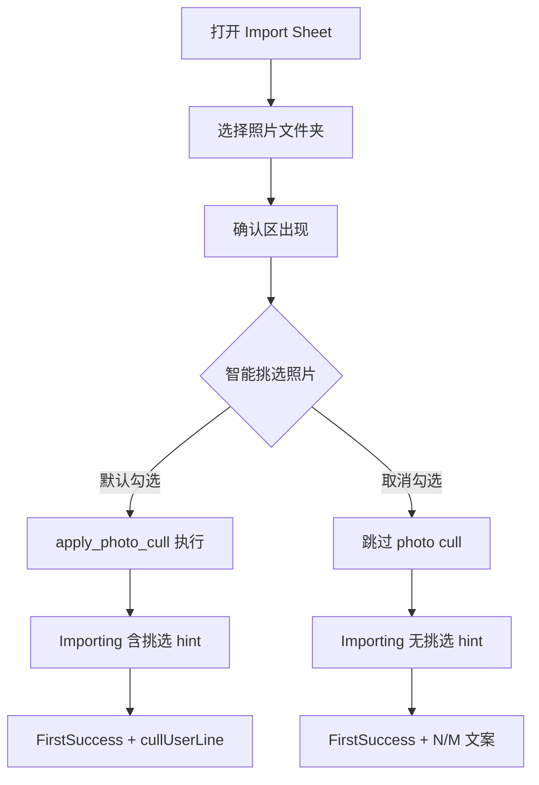

# Travelogue · 智能挑选照片用户开关 产品需求文档（PRD）

| 属性 | 内容 |
|------|------|
| **产品代号** | Travelogue |
| **功能名称** | 智能挑选照片用户开关（Photo Cull User Toggle） |
| **文档版本** | v0.2 |
| **状态** | **Approved**（2026-06-19 跨职能评审有条件通过） |
| **功能代号** | P9-F1 |
| **实施清单** | [IMPLEMENTATION-P9-F1.md](./IMPLEMENTATION-P9-F1.md) |
| **前置条件** | [PRD-PHASE9.md](./PRD-PHASE9.md) W1 已落地；[PRD-PHASE14.md](./PRD-PHASE14.md) 双模式 Import Sheet 已落地；Studio 首页 v2 为默认入口 |
| **关联文档** | [PRD-PHASE9-D-studio-ux.md](./PRD-PHASE9-D-studio-ux.md)、[PRD-PHASE9-B-pipeline-integration.md](./PRD-PHASE9-B-pipeline-integration.md)、[PRD-PHASE9-C-data-model.md](./PRD-PHASE9-C-data-model.md)、[PRD-PHASE4.md](./PRD-PHASE4.md)、[PRD-STUDIO-HOMEPAGE-v2.md](./PRD-STUDIO-HOMEPAGE-v2.md)、[PRD-EXPERIENCE-附录A-精选上传.md](./PRD-EXPERIENCE-附录A-精选上传.md) |
| **线框参考** | 本文 §5.2–§5.3；实现锚点 [studio-home-v2.html](../templates/studio/studio-home-v2.html) Import Sheet |
| **更新日期** | 2026-06-19 |

> **定位**
>
> - Phase 9 默认 **静默执行** photo cull（UX-P9-01），对未预筛选的大多数用户有效。
> - 少数用户已在文件夹内完成人工精选，不希望系统二次剔除。
> - 本功能在 **创建游记起点**（Import Sheet）提供显式开关：**默认允许智能挑选**；关闭后跳过 Phase 9 cull，不做智能质量挑选。
> - **不新增** 被筛照片浏览/恢复 UI（延续 D-P9-04 / UX-P9-02）。

---

## 1. 背景与问题

### 1.1 现状

| 环节 | 行为 |
|------|------|
| ingest `_finalize` | 全 trip 执行 `apply_photo_cull`（Pass 1–4） |
| 全局配置 | `config.yaml` · `cull.enabled`（默认 `true`） |
| 用户感知 | Importing 子 hint「正在挑选照片…」；FirstSuccess 第二行 `cullUserLine`（「经挑选 M 张进入排版」） |
| 用户控制 | **无**；无法在导入前声明「我已自行筛选」 |

### 1.2 用户痛点

| Persona | 占比（估） | 痛点 |
|---------|------------|------|
| 普通分享者 | ~85% | 文件夹杂乱，需要系统自动减噪 — **应默认开启** |
| 预筛选编辑者 | ~15% | 已导出精选集或子文件夹，二次 cull 可能丢图、摘要文案误导 |

典型抱怨：

- 「我文件夹里就 30 张精选，为什么还说经挑选 27 张？」
- 「有些我觉得很好的连拍被系统丢掉了，又找不到入口恢复。」

### 1.3 目标

1. 在 Import Sheet **选完文件夹后、开始制作前** 提供可发现的开关。
2. **默认勾选**（允许智能挑选），保障大多数用户路径不变。
3. 关闭后 **跳过 Phase 9 photo cull** 及 re-curate 时的 cull 刷新。
4. 选择写入 `trip.intent`，可审计、可复现、旧 trip 兼容。
5. 成功态文案 **诚实区分** 导入张数 N 与进入排版张数 M。

### 1.4 非目标

| 非目标 | 说明 |
|--------|------|
| 被筛照片 Gallery / 恢复 | 延续 Phase 9 MVP；见 D-P9-04 |
| 预览页 / 书架二次修改该开关 | v1 仅导入时设定；改 intent 走既有 PATCH API（二期） |
| 替换全局 `cull.enabled` 管理员总闸 | 运维仍可用 config 全局关闭 |
| 调整 cull 算法参数（阈值、保留率） | 属 config / 算法 PRD 范畴 |
| CLI `travelogue ingest` 交互改造 | Phase 2；Studio 为主交付面 |
| v1 跳过低清门 | 已迁出 → [P9-F3 全部保留](./PRD-KEEP-ALL-PHOTOS-V1.md)（`keep_all` 档跳过低分闸） |

---

## 2. 已拍板决策（冻结）

| 决策 ID | 决策项 | 结论 |
|---------|--------|------|
| **D-F1-01** | 字段名 | `intent.photoCullEnabled`（boolean） |
| **D-F1-02** | 默认值 | `true`（允许智能挑选 / 执行 cull） |
| **D-F1-03** | 关闭时跳过范围 | **仅** Phase 9 `apply_photo_cull` + `maybe_refresh_cull` |
| **D-F1-04** | 低清门 `apply_layout_eligibility_marks` | **v1 仍执行**（见 §4.2 选项 A） |
| **D-F1-05** | ingest dedupe（burst / phash / MD5） | **仍执行**（物理去重，非质量挑选） |
| **D-F1-06** | `max_photos` 扫描上限 | **仍执行**（性能硬约束） |
| **D-F1-07** | 生效优先级 | `effective = config.cull.enabled AND intent.photoCullEnabled` |
| **D-F1-08** | UI 控件 | Checkbox（默认勾选），非 Toggle Switch |
| **D-F1-09** | 放置位置 | Import Sheet 确认区，**两种导入模式共用** |
| **D-F1-10** | 用户偏好记忆 | **仅 `sessionStorage` 草稿**；每次新会话打开 Sheet **默认勾选**（评审 R5 · 方案甲） |
| **D-F1-11** | Job stage 数 | **不增加** stage（延续 UX-P9-04） |
| **D-F1-12** | 成功态数字口径 | 区分 **N**（导入/扫描）与 **M**（`layoutEligible` 进入排版） |
| **D-F1-13** | `cullSummary` 禁用原因 | `userDisabled`（用户关）与 `configDisabled`（全局关）**分字段** |

---

## 3. 设计原则

| ID | 原则 | 说明 |
|----|------|------|
| **P-F1-01** | 默认保守（对系统） | 默认开启 cull，保护大多数用户成稿质量 |
| **P-F1-02** | 显式 opt-out | 关闭需用户主动取消勾选，降低误关概率 |
| **P-F1-03** | 意图单写 | 经 `apply_intent()` 写入，与 `layoutDensity` 同级 |
| **P-F1-04** | 管线不 fork | 不复制 AppConfig；在 cull 入口读 trip intent |
| **P-F1-05** | 文案诚实 | 不写「保留全部进入排版」而隐瞒低清/dedupe；用 N/M 双数字 |
| **P-F1-06** | 向后兼容 | 缺省字段视为 `true`，旧 trip 行为不变 |
| **P-F1-07** | 会话内记忆、会话外重置 | 避免误关一次后长期伤害 85% 主路径 |

---

## 4. 范围边界：「跳过智能挑选」的精确定义

### 4.1 管线环节对照表

| 环节 | 模块 | `photoCullEnabled=false` | 归类 |
|------|------|---------------------------|------|
| MD5 / burst / pHash 去重 | `media/ingest.py` | **仍执行** | ingest 基础能力 |
| `max_photos` 解码候选上限 | ingest scan | **仍执行** | 性能硬约束 |
| Phase 9 photo cull Pass 1–4 | `curation/photo_cull.py` | **跳过** | 用户诉求核心 |
| re-curate cull 刷新 | `algorithm_profile.maybe_refresh_cull` | **跳过** | 与 intent 一致 |
| 低清 `layoutEligible` 标记 | `asset_quality.apply_layout_eligibility_marks` | **仍执行（v1）** | 排版可用性 |
| aesthetic ML warm（ingest） | `ingest._finalize` | **仍执行** | 与 cull 路径解耦 |
| clustering / curate / 排版 | 下游 | **正常** | 输入池变大 |

### 4.2 低清门产品选项（v1 采用 A）

| 选项 | 行为 | 优点 | 缺点 |
|------|------|------|------|
| **A（v1 采用）** | 仅跳过 photo cull | 语义清晰；极低清图不进排版 | M 可能小于 N |
| B（二期可选） | 连低清门一并跳过 | 真正保留全部 ingest 照片 | 版式质量风险 |

### 4.3 有效 cull 判定公式

```text
effective_photo_cull =
  config.cull.enabled == true
  AND trip.intent.photoCullEnabled != false   // 缺省 true
```

管理员将 `cull.enabled: false` 时，无论用户开关如何，均不执行 cull（全局总闸优先）。

### 4.4 增量 ingest

向**已有 trip** 追加照片时：

- 以 trip 上**既有** `intent.photoCullEnabled` 为准（不随本次 request 缺省覆盖）。
- 仅当本次 import 请求**显式携带** `photoCullEnabled` 时，经 `apply_intent` 更新 intent。
- `_finalize_ingest_assets` 对全 trip assets 执行 finalize 时，统一读当前 trip intent。

---

## 5. 信息架构与交互规格

### 5.1 用户旅程



### 5.2 Import Sheet 线框（确认区扩展）

```text
制作我的游记（Sheet）
├─ [选择本次旅行的照片文件夹]
└─ 确认区（选文件夹后出现）
   ├─ 已选：D:\Photos\Kyoto（58 张）
   ├─ 模式 Tab：快速分享 | 精细制作
   ├─ ☑ 智能挑选照片（推荐）              ← 默认单行；说明可展开
   │     [?] 展开说明（默认收起）
   ├─ （取消勾选时 · aria-live 区域）
   │     不做智能挑选，58 张照片将参与排版
   │     相同文件仍会自动去重，与智能挑选无关
   ├─ [快速分享面板] / [精细制作表单]
   └─ [开始制作]
```

### 5.3 控件规格

| 项 | 规格 |
|----|------|
| 元素 ID | `#v2-photo-cull-enabled`（checkbox）、`#v2-photo-cull-hint`（说明）、`#v2-photo-cull-optout`（取消勾选副文案 · `aria-live="polite"`） |
| 类型 | `<input type="checkbox">` + `<label>`；说明区默认 **单行**，`[?]` 或 `<details>` 展开长说明 |
| 默认状态 | **checked**（`photoCullEnabled: true`） |
| 新会话 | 无 session 草稿时 **始终 checked**（D-F1-10） |
| 显示时机 | `#v2-sheet-confirm` 可见后常显；两模式 Tab **共用** |
| 模式切换 | 不重置 checkbox |
| 照片数 N | `album-preview` · `photoCount`；未知时副文案省略数字 |
| 触控目标 | checkbox + label 可点区域高度 ≥ 44px |
| 可访问性 | `aria-describedby` → 说明；取消勾选时 `aria-live` 播报副文案；classic/dawn 主题对比度达标 |
| focus 顺序 | 文件夹确认 → 模式 Tab → **本开关** → 主按钮 |

### 5.4 文案规范

| 场景 | 文案 |
|------|------|
| 标签（勾选） | 智能挑选照片（推荐） |
| 说明（展开） | 自动去掉过于模糊、重复连拍和截图类照片。若文件夹里已是你的精选集，可取消勾选。 |
| dedupe 提示（取消勾选时） | 相同文件仍会自动去重，与智能挑选无关。 |
| 副文案（取消勾选且有 N） | 不做智能挑选，{N} 张照片将参与排版 |
| 与「精选文件夹」区分 | 精选夹 → 封面优先与 `userTier=featured`；本开关 → 全库是否做 **智能质量挑选** |

**禁止**：使用「保留全部 N 张进入排版」而隐瞒 M<N 的情况。

### 5.5 偏好记忆

| 存储 | Key | 行为 |
|------|-----|------|
| 当次草稿 | `sessionStorage` · Import draft（`IMPORT_DRAFT_KEY`） | 同会话关 Sheet 再开恢复勾选状态 |
| 跨会话 | **不使用 localStorage** | 新会话 / 清缓存后 **默认勾选** |
| 读取优先级 | `draft.photoCullEnabled` → **`true`** | — |

### 5.6 Importing 进度文案

| 条件 | stageHint |
|------|-----------|
| cull 开启 | `正在导入并挑选照片（已处理 45/120 张）` 或 `正在挑选照片…` |
| cull 关闭 | `已处理 45/120 张`（**不出现**「挑选」） |

实现：`format_ingest_progress_hint(..., cull_enabled=effective)`；跳过 `cull_stage_hint`。

### 5.7 FirstSuccess 完成态

**数字定义**：

- **N** = `photoCount` / 导入扫描张数（主标题「照片 N 张」）
- **M** = `cullSummary.finalLayoutEligibleCount` 或 `layoutEligibleCount`（进入排版池）

| `photoCullEnabled` | 主标题（`#v2-success-msg`） | 次要说明（`#v2-success-details`） |
|--------------------|----------------------------|-----------------------------------|
| `true`（默认） | `《标题》已生成 · 照片 N 张` | `cullUserLine`：经挑选 M 张进入排版（+ 模板/密度行） |
| `false` 且 M=N | 同上 | `不做智能挑选 · M 张进入排版` |
| `false` 且 M<N | 同上 | `不做智能挑选 · 导入 N 张 · M 张进入排版` + **必做**弱提示：`部分极低清晰度照片未进入排版` |

**禁止**：`photoCullEnabled=false` 时出现「经挑选」字样。

**可选（P2）**：N>200 且 cull 关时，非阻断弱提示「照片较多，生成可能较慢」。

数据来源：Job `result.photoCullEnabled`、`result.layoutEligibleCount`（或等价字段），FirstSuccess **不二次请求 trip**。

---

## 6. 数据模型与 API 契约

### 6.1 `trip.intent` 扩展

```json
{
  "intent": {
    "version": "1",
    "photoCullEnabled": true
  }
}
```

| 属性 | 类型 | 必填 | 默认 | 说明 |
|------|------|------|------|------|
| `photoCullEnabled` | boolean | 否 | `true` | `false` = 用户显式关闭智能挑选 |

### 6.2 Import 请求（Studio API）

| 字段 | 类型 | 默认 | 说明 |
|------|------|------|------|
| `photoCullEnabled` | boolean | `true` | 未传 / 空 / 非法 → `true` |

multipart：`true` / `false` / `1` / `0`。

**全入口覆盖**：文件夹 import、upload 小文件夹、dev harness import 均需携带或默认 true。

### 6.3 worker_payload 透传

`import_handlers.py` → `studio_subprocess.py` → `run_studio_pipeline`：

```json
{ "photoCullEnabled": false }
```

### 6.4 `apply_intent` 扩展

```python
apply_intent(trip, photo_cull_enabled=True | False | None)
```

- `True` / `False` → 写入 `intent.photoCullEnabled`
- 未传 → 不修改 intent 已有值

### 6.5 `cullSummary` 形态

**用户关闭**：

```json
{
  "enabled": false,
  "userDisabled": true,
  "configDisabled": false,
  "scanned": 58,
  "layoutEligibleCount": 58,
  "finalLayoutEligibleCount": 55
}
```

**全局 config 关闭**：

```json
{
  "enabled": false,
  "userDisabled": false,
  "configDisabled": true,
  "layoutEligibleCount": 58
}
```

- 用户关闭：不写 `cullUserLine` / `excludedByCullAssetIds`；cull 不修改 `layoutEligible`
- telemetry 必须用 `userDisabled` vs `configDisabled` 区分原因

### 6.6 Job result / stats

| 字段 | 说明 |
|------|------|
| `photoCullEnabled` | **必回传**；FirstSuccess 分支依据 |
| `layoutEligibleCount` | 进入排版 M（low-res 后 final 优先） |
| `photoCount` | 导入 N（既有） |
| `cullUserLine` | cull 开时有人话行；关时 `""` |
| `cullWarn` | 按既有 maxPhotos 规则 |

`StudioPipelineResult` / `studio_subprocess` job result 需扩展。

### 6.7 Telemetry

**`runs/studio-intent.json`**：

```json
{
  "photoCullEnabled": true,
  "layoutEligibleFinal": 55,
  "photoCount": 58
}
```

**Analytics · `import_photo_cull_pref`**（必发）：

| 字段 | 类型 |
|------|------|
| `enabled` | boolean |
| `mode` | `quick_share` \| `fine_craft` |
| `photo_count` | number |
| `layout_eligible_final` | number |
| `cull_user_line_present` | boolean |
| `pref_source` | `draft` \| `default` |

上线后 2 周观测：`enabled=false` 占比；若 >25% 复核文案与位置。

---

## 7. 技术方案

### 7.1 管线顺序

```text
scan → dedupe → build assets
  → apply_photo_cull        ← effective_photo_cull
  → apply_layout_eligibility_marks
  → persist → clustering → curate
       └─ maybe_refresh_cull ← effective_photo_cull
```

### 7.2 核心 helper

```python
def photo_cull_enabled_for_trip(trip: dict, *, app_cfg: AppConfig | None = None) -> bool:
    cfg = app_cfg or get_config()
    if not cfg.cull.enabled:
        return False
    intent = trip.get("intent") or {}
    return bool(intent.get("photoCullEnabled", True))
```

### 7.3 改造文件清单

| 层级 | 文件 |
|------|------|
| Schema | `schemas/trip.schema.json` |
| Intent | `travelogue/services/trip.py` |
| Cull | `travelogue/curation/photo_cull.py` |
| Cull refresh | `travelogue/curation/algorithm_profile.py` |
| Ingest | `travelogue/media/ingest.py` |
| Pipeline | `travelogue/web/studio_pipeline.py` |
| API | `travelogue/web/studio_handlers/import_handlers.py` |
| Subprocess | `travelogue/web/studio_subprocess.py` |
| Telemetry | `travelogue/web/studio_intent_telemetry.py` |
| HTML/CSS/JS | `studio-home-v2.html` · `studio-home-v2.css` · `import-sheet.js` · `import-run.js` · `first-success.js` |

### 7.4 与 Phase 9 关系

| 既有 ID | 关系 |
|---------|------|
| UX-P9-01 | 保留静默；开关为导入前一次性 opt-out |
| UX-P9-02 / D-P9-04 | 保留；无被筛图 UI |
| UX-P9-03 | cull 关时用 N/M 摘要替代 cullUserLine |
| **UX-P9-07（新增）** | 用户可在导入前关闭智能挑选（P9-F1） |
| D-P9-14 | 仅 cull 执行时 fail-open |
| D-P9-10 | 仅 `effective_photo_cull=true` 时全 trip re-cull |

---

## 8. 风险与对策

| 风险 | 对策 |
|------|------|
| 关闭后照片过多 | `max_photos`；可选「照片较多」弱提示 |
| 用户误关开关 | 默认勾选；仅 session 记忆；说明默认收起 |
| N/M 文案误解 | 双数字 + 低清必做弱提示 |
| dedupe 与「全部保留」混淆 | 取消勾选时展示 dedupe 一句 |
| re-curate 误重剔 | `should_recull_on_curate` 读 intent |
| 390px 窄屏溢出 | AC-F1-07 |

---

## 9. 验收标准（AC）

| ID | 场景 | 期望 |
|----|------|------|
| **AC-F1-01** | 默认勾选 → 开始制作 | `intent.photoCullEnabled=true`；有 `cullUserLine`；Importing 可出现「挑选」 |
| **AC-F1-02** | 取消勾选 → 开始制作 | `intent=false`；无 `cullUserLine`；无「挑选」hint；非低清 `layoutEligible=true` |
| **AC-F1-03** | 关闭后 re-curate | 不触发 `maybe_refresh_cull` |
| **AC-F1-04** | 旧 trip 无字段 | 等同默认开启 |
| **AC-F1-05** | `config.cull.enabled=false` | 均不 cull；`configDisabled=true` |
| **AC-F1-06** | 新会话打开 Sheet | **默认勾选**（无 session 草稿时） |
| **AC-F1-06b** | 同会话关 Sheet 再开 | session 草稿恢复上次勾选 |
| **AC-F1-07** | 390px 视口 | checkbox 区不横向溢出 |
| **AC-F1-08** | 快速/精细切换 | checkbox 保持；提交正确 |
| **AC-F1-09** | FirstSuccess cull 关 | 无「经挑选」；展示 N/M 规则 |
| **AC-F1-10** | `studio-intent.json` | 含 `photoCullEnabled` |
| **AC-F1-11** | schema | `validate_trip` 通过 |
| **AC-F1-12** | cull 关 + 低清资产 | 低清仍可能 `layoutEligible=false`；M<N 时弱提示必现 |
| **AC-F1-13** | `should_recull_on_curate` | `photoCullEnabled=false` → 不 recull |
| **AC-F1-14** | multipart 缺字段 | 解析为 `true` |
| **AC-F1-15** | Job result | 含 `photoCullEnabled`、`layoutEligibleCount` |
| **AC-F1-16** | a11y | 取消勾选后 `aria-live` 副文案可被读屏感知 |
| **AC-F1-17** | dev harness import | 字段不丢、默认 true |

### 9.1 测试落点

| 类型 | 文件 |
|------|------|
| 单测 | `tests/test_photo_cull_policy.py` |
| Intent | `tests/test_studio_intent.py` |
| API | `tests/test_studio_handlers_import_export.py` |
| E2E | `tests/test_studio_phase9_cull_playwright.py` |
| 冒烟 | `tests/test_studio_home_v2.py` |

---

## 10. 分期交付

### 10.1 Phase 1 · MVP（2–3 人日）

见 [IMPLEMENTATION-P9-F1.md](./IMPLEMENTATION-P9-F1.md)。

### 10.2 Phase 2 · 可选

- 跳过低清门（选项 B）
- 预览 intent PATCH
- CLI `--no-photo-cull`
- localStorage 跨会话记忆（若数据证明需要）

---

## 11. 评审修订摘要（v0.1 → v0.2）

| ID | 修订 |
|----|------|
| R1 | FirstSuccess N/M 双数字口径 |
| R2 | M<N 低清弱提示 **MVP 必做** |
| R3 | dedupe 预期文案 |
| R4 | Job result 回传 `photoCullEnabled` |
| R5 | D-F1-10 改为仅 sessionStorage（方案甲） |
| S1 | 说明默认收起 / 可展开 |
| S2 | §4.4 增量 ingest |
| S3 | `userDisabled` vs `configDisabled` |
| S4–S8 | AC-F1-12～17、analytics 字段、a11y |

**评审结论**：有条件通过 → **Approved v0.2**。

---

## 12. 文档索引更新（实现后）✅

| 文档 | 动作 | 状态 |
|------|------|------|
| [PRD-PHASE9.md](./PRD-PHASE9.md) | §2 增加 P9-F1 | ✅ 2026-06-19 |
| [PRD-PHASE9-D-studio-ux.md](./PRD-PHASE9-D-studio-ux.md) | UX-P9-07 | ✅ |
| [PRD-PHASE9-C-data-model.md](./PRD-PHASE9-C-data-model.md) | intent + cullSummary | ✅ |
| [PRD-PHASE14.md](./PRD-PHASE14.md) | §5.1 checkbox 行 | ✅ |
| [ACCEPTANCE-PHASE9.md](./ACCEPTANCE-PHASE9.md) | AC-F1-* §8 | ✅ |
| [IMPLEMENTATION-PHASE9.md](./IMPLEMENTATION-PHASE9.md) | 勾选 P9-F1 | ✅ |

---

## 13. 修订记录

| 版本 | 日期 | 说明 |
|------|------|------|
| v0.1 | 2026-06-19 | 初稿 |
| v0.2 | 2026-06-19 | 跨职能评审修订：N/M 文案、session 记忆、Job 回传、AC 扩展、Approved |
