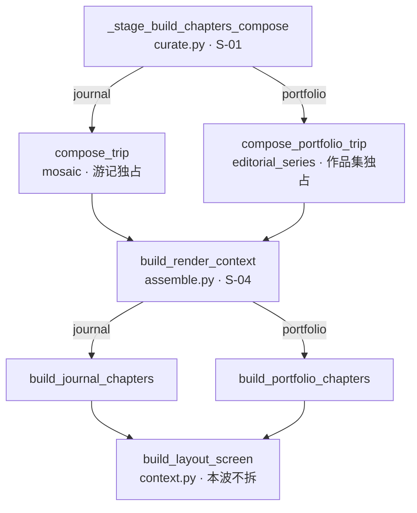

# Travelogue · 可读主链 V1（PRD）

| 属性 | 内容 |
|------|------|
| **产品代号** | Travelogue |
| **文档版本** | **v0.2.1**（W0 地图与门禁已落 · 2026-08-29） |
| **状态** | **有条件通过（Conditional Go）** · 七席 BLK 已回写 · **W0 已落** · W1 待排期（须 W0 在主干；BLK-RCL-02/03/04/10 已回写） |
| **DOC-STATUS** | active |
| **评审** | [七席纪要 2026-08-22](./acceptance-records/rcl-readable-core-line-v1-review-2026-08-22.md)（v0.1.0 · 7/7 Conditional Go · BLK-RCL-01～10） |
| **特性代号** | **RCL**（Readable Core Line · 可读主链） |
| **文档类型** | 工程可读性合同（**零用户可见行为变更**） |
| **触发来源** | 2026-08-22 开发负责人对照现网：代码「可审计」但「不可阅读」——合同/票号/DPI 边界清楚，`curate → compose → assemble → chapters` 主链无法一屏读完 |
| **上游合同** | [PRD-DUAL-PIPELINE-ISOLATION-V1.md](./PRD-DUAL-PIPELINE-ISOLATION-V1.md)（**DPI** · 不重开）· [dual-pipeline-ownership.md](./dual-pipeline-ownership.md) · [TECH-ARCHITECTURE.md](./TECH-ARCHITECTURE.md) |
| **不废止** | DPI 窄缝 S-01～S-12、身份字段、分发点、CSS 分族、`trip.studio.edition` 语义一律不改 |
| **不改** | 用户可见行为 · 排版结果 · 导出字节（字段级 `render_fingerprint`）· 算法阈值 · mosaic / planner 核 · JS 全量迁 TS · **`trip.schema.json`（BLK-RCL-01）** |
| **实施** | 本文 **§11 为源**（本波不另开 IMPLEMENTATION，除非七席要求拆出） |
| **验收** | 本文 **§12 为源** |
| **更新日期** | 2026-08-22 |

> **一句话目标**：让 `curate → compose → assemble → chapters` 这条主链，**不查票号、不翻 Phase 文档，也能读懂在干什么**；靠的是拆核、显式类型、活路径地图，而不是重写算法或清全部注释。
>
> **工程铁律**
>
> 1. **零行为变更。** 本波是纯阅读成本波。出门门是形状断言 + `render_fingerprint` 字段级 + 既有 `pipeline_isolation`。像素 / 整页字节 diff 不进 `test-pr`。
> 2. **拆核，不拆壳。** 只拆三个编排函数；不复制 `curate.py`、不重写 mosaic / `screen_planner`、不把 CSS 再拆第三份。
> 3. **不新开窄缝。** 身份 `if` 不得出现在 DPI 登记表之外。`assemble.py` 仍是**唯一**渲染分发；`curate.py` 的 compose 分叉仍是 S-01。提取出去的是**阶段函数**，不是第二扇身份门。
> 4. **门禁先行。** W0 一行业务编排都不拆，先把「主链又变厚 / 活路径说不清」变成红灯。
> 5. **类型只钉热路径。** 不 typed 全集 `trip.json`。先让每天都在 `.get` 的字段替读者说话。
> 6. **新注释先写意图。** 票号可以留在句尾；禁止再写超过 15 行、只引 PRD 小节的横幅。旧注释不批量改写。
> 7. **不做方言清洗。** LTE / MCS / DPI / PFM 等缩写保留；本波只要求**主链函数名说人话**。

---

## 0. 读者指南

| 章节 | 澄清什么 |
|------|----------|
| §0 | 术语、与 DPI 的边界、禁用项、**v0.2.0 实施勘误** |
| §1 | 现状实测（2026-08-22 实跑，非估计） |
| §2 | 目标 / 非目标 |
| §3 | 已拍板决策 D-RCL-01～14 |
| §4 | 主链地图：三个编排核 + 允许提取的阶段 |
| §5 | W1 · 拆核合同（函数级落点） |
| §6 | W2 · 热路径类型 |
| §7 | W3 · 前端活路径与 CSS 目录 |
| §8 | 注释与文档纪律 |
| §9 | 门禁（棘轮 + 既有隔离门） |
| §10 | 会被改红的测试与文档 |
| §11 | 任务表与里程碑 |
| §12 | 验收 AC-RCL-01～20 |
| §13 | 风险 · 开放问题 · 不做的代价 |

### 0.1 术语

| 术语 | 定义 |
|------|------|
| **主链（core line）** | 一次出册必经的编排路径：`curate._stage_build_chapters_compose` → `compose_trip` / `compose_portfolio_trip` → `assemble.build_render_context` → `build_journal_chapters` / `build_portfolio_chapters` |
| **编排核（orchestrator）** | 主链上只负责「按阶段调用」的函数。读它应能看出顺序，不应看到封面印章字符怎么切 |
| **阶段函数（stage fn）** | 从编排核提出去的具名步骤（封面 / 文案护栏 / 章体循环 / folio extras）。**不**承担身份分发 |
| **热路径字段** | 主链每天都读的 `trip` 子集：`studio.edition`、`meta.titleArt`、`chapters[].screens[].slots`、`coverAssetId` |
| **活路径（live path）** | 现行 Studio / 读者面真正会 import 的 JS/CSS 入口。不是「目录里有这个文件」 |
| **棘轮（ratchet）** | 只拦三个编排核重新变厚，以及活路径清单漏登记。不扫全仓库函数行数 |
| **票号方言** | `D-CAL-26` / `T-M4-01` / `BE-SFI-01` / `IE-DPI-09` 这类验收锚点。对审计有用，对阅读昂贵 |

### 0.2 与 DPI 的边界（不重开）

| 事项 | 归属 |
|------|------|
| 身份字段、窄缝表、CSS 分族、`assemble.py` 唯一 `is_portfolio_trip` | **DPI** · 本波只遵守 |
| 把 `build_render_context` 拆成阶段函数 | **RCL** · 分发 `if` 必须仍留在 `assemble.py` |
| 把 `_stage_build_chapters_compose` 拆成阶段函数 | **RCL** · compose 分叉 `if` 必须仍留在 `curate.py`（S-01） |
| `journal_chapters` / `portfolio_chapters` 已经分家 | **DPI W2 已完成** · RCL 只拆**游记** builder 内部阶段，不把作品集逻辑搬回来 |
| mosaic / `editorial_series` / LTE 编译器 | **不动** |
| `journal-screens.css` / `portfolio-pages.css` 再拆文件 | **不做**（DPI 刚分完族） |

### 0.3 实施勘误（v0.2.0 · 七席 2026-08-22）

对照现网回写。七席已拍的方向（拆核不拆壳、阶段零身份、门禁先行、不改 schema）**不重开**。本表改的是「按 v0.1.0 原文开工会当天红、或门会空转」的落点。后文以本表为准。

| ID | v0.1.0 原文 | 现网事实 | v0.2.0 合同 |
|----|-------------|---------|-------------|
| **IE-RCL-01** | AC-RCL-20 / D-RCL-07：热路径字段 ⊆ `trip.schema.json`；第一批含 `titleArt` | `meta.additionalProperties=false` 且全 schema **无** `titleArt`（CAL 运行时在写） | TypedDict：**schema 已列键必须 ⊆ schema**；`titleArt` 标 `runtime`（CAL D-CAL-09），允许进 `TripHot`。**禁止本波改 schema** |
| **IE-RCL-02** | `build_render_context` ≤ 120 | `TripRenderContext` ~80 键，组装面就会顶破；DPI 刚否决同类空数字 | 上限 **≤160**；允许 `return TripRenderContext(**bundle)`；结构判据优先 |
| **IE-RCL-03** | 注释门「只扫 git 新增」 | CI 无 merge-base 定义，会空转 | 允许清单：阶段模块 + `trip_hot.py`（文件未存在则跳过） |
| **IE-RCL-04** | 活路径根「或现网真实入口」 | 首页入口已钉 `studio-home-v2.html` → `homepage-v2/bootstrap.js` | 闭包根只准两个常量：`preview-toolbar.js` + `homepage-v2/bootstrap.js` |
| **IE-RCL-05** | AC-RCL-19 作出门硬门 | 主观 90 秒走读，不能进 CI | **降为 SHD-RCL-03**，写入 W3 收口纪要 |
| **IE-RCL-06** | 新 `journal_*` 自动受 DPI 隔离门保护 | import-linter 源列表只有 `journal_chapters` | W1 **同一提交**把 `journal_folio` / `journal_screens` 加进 `source_modules` |
| **IE-RCL-07** | §10 未提 god-module | `curate.py` 基线 1986、现 2014 | W1 提取 PR **下调** `csc-w2b-god-module-ratchet-baseline.json`（只降） |
| **IE-RCL-08** | CSS 目录未钉相对 marker 的位置 | overlays / generated 会被 sync 换掉 | 目录必须在文件最顶、第一个 marker **之前**；sync 后仍在 |
| **IE-RCL-09** | 无「何时必须做」 | 纯工程波会被永久 backlog | **G-RCL-01**：下一支改三核的**功能** PR 合并前，W0 必须在主干 |
| **IE-RCL-10** | AC-RCL-10/11 易被读成「CSS 目录也管指纹」 | 指纹只摘要 trip 载荷 | 拆核约束指纹；W3 目录只允许 `test_asset_version` 一次 bump |

**W0 开工清单（本版）**：DO-RCL-01 / 02 / 03、BE-RCL-01 / 02 / 03 / 04。注释门按允许清单实现。活路径根写死双入口。文首写上 **G-RCL-01**。**不进 W0**：建阶段空壳、拆函数、改 schema。

### 0.4 禁用项

| 禁止 | 理由 |
|------|------|
| 新增 `is_portfolio` / `is_portfolio_trip` 于窄缝表外 | 违反 DPI |
| 把身份分发从 `assemble.py` 再拆到 `cover_*.py` / 阶段函数 | 制造第二扇门 |
| 复制 `curate.py` 成 journal/portfolio 两份 | DPI 铁律 4；策展仍共享 |
| 重写 `screen_planner.py` / mosaic search / `load_config` | 回归成本高于阅读收益 |
| 全量 TypeScript、清全部票号注释、typed 全集 `trip.json` | 本波明确不做 |
| 删除 `preview-toolbar-v3-*.js` | **它们是活的**（见 §1.4），不是死代码 |
| 把 `TECH-ARCHITECTURE.md` 整篇重写为新架构论文 | 只刷新过期段落（§3 / §4 / 逻辑图） |

---

## 1. 现状实测盘点（2026-08-22 实跑，非估计）

### 1.1 已经可读、不要重做

| 层 | 现状 | 证据 |
|----|------|------|
| 身份 | `edition.py` 短、意图清楚 | `travelogue/config/edition.py` |
| 导出分发 | `dispatch.py` 按平台选 Writer | `travelogue/export/dispatch.py` |
| 章 builder 分家 | 游记 / 作品集各一文件；`chapters.py` 仅 re-export | DPI W2 · `journal_chapters.py` / `portfolio_chapters.py` |
| 前端 dock 分发 | 挂载 + `journalDockLogic` / `portfolioDockLogic` | DPI W3 · `preview-toolbar/dock.js` |
| 模板上下文增量类型 | `context_types.py` 已有 TypedDict | 渲染**输出**有类型；**输入 `trip`** 仍是 `dict` |
| 所有权地图 | 窄缝有名字、有 lint | `docs/dual-pipeline-ownership.md` |

**结论：边界可读，主链编排不可读。** 本 PRD 只打主链。

### 1.2 三个编排核（本波唯一拆点）

| 函数 | 行数 | 文件 | 为什么读不动 |
|------|------|------|-------------|
| `_stage_build_chapters_compose` | **616** | `travelogue/curation/curate.py:1039`（文件共 2014 行） | 桶对齐、时间异常剥离、打分权重、意图高峰、S-01 分叉、章物化挤在一个函数里 |
| `build_render_context` | **536** | `travelogue/render/assemble.py:100`（文件共 635 行） | 封面 / 文案护栏 / 书法贴纸 / 封底 / 阅读 payload / 章分发 / folio extras 全在同一函数 |
| `build_journal_chapters` | **467** | `travelogue/render/journal_chapters.py:35`（文件共 501 行） | folio 计划、高光 solo、长图过滤、屏循环、4mix/row fit、章头与 extras 顺序靠往下翻 |

对照：全包 **668** 个 `.py`；**203** 个函数 ≥ 80 行、**60** 个 ≥ 150 行。本波**不**用全局行数门扫它们。

### 1.3 明确不拆（避免范围膨胀）

| 函数 / 文件 | 行数 | 为什么留下 |
|-------------|------|-----------|
| `screen_planner.py` | 2016 | 算法核；文件头还指向旧 `docs/web端模板.prd`，只允许 W0 **改文件头指向**，不拆算法 |
| `moment_scoring.py` | 1529 | 评分核，不在主链编排 |
| `render/context.py` · `build_layout_screen` | 1427 / 355 | 槽位上下文建造；W2 只让它**消费**热路径类型，不拆函数 |
| `config/loader.py` · `load_config` | 515 | 配置装载，另开主题 |
| `export_handlers.handle_longshot` | 417 | 导出 HTTP，另开主题 |
| `journal-screens.css` | ~160 KB / ~3636 行 | DPI 刚按族分完；本波只加**文件头目录**，不拆文件 |

### 1.4 前端活路径（纠正「v3 是死代码」的误判）

现行预览工具条入口是薄壳：

```5:13:templates/studio/preview-toolbar.js
import { initToolbarV3 } from "./preview-toolbar/init-v3.js";
import {
  registerBootstrapBridge,
  bootstrapPreviewToolbarWhenReady,
} from "./preview-toolbar/bootstrap.js";

registerBootstrapBridge({ initToolbarV3: initToolbarV3 });
bootstrapPreviewToolbarWhenReady();
```

`init-v3.js` **正在 import** `preview-toolbar-v3-task-dock.js` 与 `preview-toolbar-v3-sheet.js`。这两份不是遗物，是活路径上的实现文件。

| 文件 | 角色 | 本波动作 |
|------|------|---------|
| `templates/studio/preview-toolbar.js` | **现行入口** | 文首标注 LIVE |
| `preview-toolbar/init-v3.js` + `bootstrap.js` | 装配 | 文首标注 LIVE |
| `preview-toolbar-v3-sheet.js` / `preview-toolbar-v3-task-dock.js` | 被 init-v3 加载的实现 | 文首标注 LIVE · 写清「文件名含 v3 ≠ 废弃」 |
| `preview-toolbar/dock.js` · `features.js` · `longshot.js` | 预览壳主逻辑 | LIVE；`longshot.js` ~132 KB，**本波不拆** |
| `templates/visual-journal/longshot.js` | **读者面**截图脚本，不是 Studio dock | 文首标注 READER · 禁止与 Studio 那份合并 |
| `templates/studio/legacy-freeze/studio.classic.js` | classic 冻结 | 文首标注 FROZEN |
| `homepage-v2/**` | 首页现行 | LIVE · 本波不改逻辑 |

可读性伤害来自「文件名像考古、实际在跑」，不是来自没删干净。

### 1.5 类型与注释的真实形状

- `TripRenderContext` 等输出 TypedDict 已存在，且大量 `total=False`。
- 输入侧仍是 `trip: dict` + `assets: dict[str, dict]` + `.get("meta")` 向下挖（例：`render/context.py:43-46`）。
- `assemble.py` 文件头到 `_resolve_title_art_src` 的文档字符串连续引用 `§6.2` / `D-CAL-26` / `D-SFI-13` / `PRD-COVER-CALLIGRAPHY-TITLE-V1 §7`——审计友好，新人读函数签名前先读完半页历史。
- `TECH-ARCHITECTURE.md` §3 仍写「UI 壳延后」，§4 目录停在 CLI 时代，与 Studio / 双管线现网不符。它是 `docs/README.md` 现行导读第 2 项，**会系统性地带偏新人**。

---

## 2. 目标 / 非目标

### 2.1 目标

1. 三个编排核变成「一屏能读完的调用顺序」。
2. 主链热路径字段有显式 TypedDict；新代码用属性/TypedDict，不再发明第三种 `.get` 写法。
3. 前端 / CSS **活路径一张表**，文件头一眼能看出 LIVE / READER / FROZEN。
4. 新人从 `TECH-ARCHITECTURE.md` 进仓库时，看到的是 2026-08 的骨架，而不是 2026-07 的「UI 延后」。
5. 以上全部被机器门钉住，避免下一波功能把编排核再次堆回 500 行。

### 2.2 非目标

- 任何用户可见文案、版式、导出 CTA、封面风格行为变化。
- 算法质量（MSA / MEGC / MTSO / LSE）与阈值。
- 全仓库函数行数治理。
- `trip.schema.json` 大改（本波只**对齐**已有 schema 字段到 Python 类型，不新增持久化字段）。
- 前端迁 TypeScript、CSS Modules、组件框架。
- 文档库大搬家（CSC 归档列车继续按原计划，不并进本波）。

### 2.3 成功长什么样（给评审席）

一个没读过封面书法 PRD 的人，打开 `build_render_context`，能在 **90 秒内**说出：先解析表面 → 做封面 → 过分享文案护栏 → 分发章 builder → 挂 folio extras。细节函数名能点进去，不必先会 `D-CAL-26`。

---

## 3. 已拍板决策

| ID | 决策 | 说明 |
|----|------|------|
| **D-RCL-01** | **零行为。** CI 硬门 = 形状 + `render_fingerprint` 字段级 + `pipeline_isolation` + 本波棘轮。截图 / 整页字节不挡 merge | 与 D-DPI-01 同构 |
| **D-RCL-02** | **只拆三个编排核**（§1.2）。其它 ≥150 行函数列入「已知债」，不进本波 AC | 防范围爆炸 |
| **D-RCL-03** | 编排核目标：**调用 + 守卫 + 组装返回值**。上限见 §5.4（assemble **≤160**，BLK-RCL-04）。超限且细节仍留在核内 = W1 没做完 | 结构优先于行数 |
| **D-RCL-04** | 阶段函数**禁止**出现身份 `if`。身份只留 S-01（`curate.py`）与 S-04（`assemble.py`） | 遵守 DPI |
| **D-RCL-05** | 新文件必须能通过 `lint_dual_pipeline_ownership.py --explain`；共享阶段放 `render/` 或 `curation/` 的中性模块，不放 `mosaic/` / `editorial_series/` | 所有权先于搬家 |
| **D-RCL-06** | **先复制阶段再删细节**，禁止在原函数里「边读边重写」。每核一次提交 | 等价于 DPI「先复制两份再删假分支」 |
| **D-RCL-07** | 热路径是读侧契约。**schema 已列键 ⊆ schema**；schema 未列但运行时存在、且有具名合同的字段本波仅允许 `meta.titleArt`（CAL D-CAL-09，标 `runtime`）。**禁止本波改 `trip.schema.json`** | BLK-RCL-01 |
| **D-RCL-08** | 热路径第一批只钉四组：`studio`（含 `edition`）· `meta.titleArt` · `chapters[]` 骨架 · `screens[].slots` 骨架 | 见 §6 |
| **D-RCL-09** | `total=False` 允许；**必存在字段必须在文档字符串里写「调用方保证」**，禁止静默新增必填导致旧 trip 运行时炸 | 兼容历史 trip |
| **D-RCL-10** | 活路径清单是权威；文件头状态枚举只有 `LIVE` / `READER` / `FROZEN` / `GENERATED`。文件名含 `v3` **不**表示废弃 | 纠正 §1.4 |
| **D-RCL-11** | 新注释：**第一句写意图**，票号放句尾括号。允许清单内模块文档字符串 > 15 行禁止合入（W0 棘轮；文件未存在则跳过） | BLK-RCL-05 · 不扫 git 新增 |
| **D-RCL-12** | `TECH-ARCHITECTURE.md` 在 W0 刷新 §3 选型、§4 目录、逻辑图「UI 延后」三处；其余历史章节可留，但文首必须标明「现行入口以 DPI + 本仓库目录为准」 | 导读第 2 项不再说谎 |
| **D-RCL-13** | **一个里程碑最多一次** `test_asset_version` bump，附一行原因（沿用 BLK-DPI-05） | 本波若零模板字节变化则零 bump |
| **D-RCL-14** | 本波不设用户面文案、不改 Studio IA。若拆核时发现行为分叉，**停下来修提取**，不准用 `if export_mode` 打补丁消 diff | 发现 diff 即提取失败 |
| **D-RCL-15** | **G-RCL-01**：下一支以产品功能为目的、且改 `assemble.py` / `journal_chapters.py` / `_stage_build_chapters_compose` 的 PR，合并前 W0 必须已在主干。W1–W3 可延后，延后须在本文状态行记日期 | BLK-RCL-06 |

---

## 4. 主链地图

### 4.1 现行调用（不要改顺序）



### 4.2 拆完之后仍应长这样

- S-01 / S-04 **位置不变、次数不增**。
- 编排核变薄；方框里的字变成阶段函数名。
- `build_portfolio_chapters` 已经短（~110 行）——**W1 不拆它**。只保证游记拆核时不把作品集细节吸回去。

### 4.3 新文件落点（预注册，W1 才建）

| 新模块 | 所有者 | 装什么 | 不得装什么 |
|--------|--------|--------|-----------|
| `travelogue/curation/compose_stages.py` | **shared** | 剥异常、打分权重、章物化（S-01 **前后**的纯步骤） | `is_portfolio_trip` 分支 |
| `travelogue/render/assemble_cover.py` | **shared** | 封面主图 / 副图 / 印章 / archive strip / 书法贴纸定位 | 身份 `if` |
| `travelogue/render/assemble_copy.py` | **shared** | hook / epilogue 分享护栏与封面显示判定 | 身份 `if`（作品集清空文案仍由 `assemble.py` 在分发前做） |
| `travelogue/render/journal_folio.py` | **journal** | foreword / trip-index / featured-grid | `page-*` / `editorial_series` |
| `travelogue/render/journal_screens.py` | **journal** | 单章屏循环（tone / mobile expand / 4mix / row fit / `build_layout_screen`） | 身份 `if` |
| `travelogue/types/trip_hot.py` | **shared** | 热路径 TypedDict | 渲染输出类型（那些留 `context_types.py`） |

W0 **不建空壳**（沿用 IE-DPI-04 教训）：模块与第一批调用同一提交出现。

---

## 5. W1 · 拆核合同

### 5.1 `build_render_context`（S-04 所在）

目标调用顺序（函数名可微调，**阶段不可少、不可乱序**）：

1. `resolve_surface_context`（已有）
2. `build_cover_opening_bundle` → `assemble_cover.py`
3. `apply_share_face_copy` → `assemble_copy.py`（**内部不读 edition**；是否跳过由 `assemble.py` 在调用前决定）
4. `resolve_reading_payload`（已有）
5. **唯一身份 `if`**：`build_journal_chapters` / `build_portfolio_chapters`
6. `attach_folio_extras`（从 journal bundle 取字段；作品集走现有空 extras）
7. 组装 `TripRenderContext` 返回

`_resolve_title_art_src` / `_title_art_pct` **整段搬家**到 `assemble_cover.py`，不在 `assemble.py` 留第二份。

作品集清空 hook/epilogue 的判断**必须**留在步骤 3 之前的 `assemble.py`，不得下沉到 `assemble_copy.py`（D-RCL-04）。

### 5.2 `build_journal_chapters`

目标调用顺序：

1. `prepare_journal_chapter_inputs`（aspects / featured / moment label / year）
2. `resolve_journal_folio_plan` → `journal_folio.py`
3. `apply_journal_moment_and_longshot`（高光 solo + 长图过滤；已有模块只是换调用处）
4. `build_journal_chapter_list` → 循环里调 `journal_screens.build_chapter_screens`
5. `build_journal_folio_extras` → 返回 `ChaptersRenderBundle`

禁止把 `apply_editorial_*` 抄进作品集文件；作品集已有自己的循环。

### 5.3 `_stage_build_chapters_compose`（S-01 所在）

目标调用顺序：

1. `align_non_empty_buckets` → `compose_stages.py`
2. `peel_time_outliers` → `compose_stages.py`
3. `resolve_compose_scoring`（weights + intent peak）→ `compose_stages.py`
4. **唯一身份 `if`**：`compose_portfolio_trip` / `compose_trip`（现网 1361–1378 行语义原样留下）
5. `materialize_composed_chapters` → `compose_stages.py`
6. 返回 `_ChaptersComposeResult`

兼容别名墙（`_cap_book_buckets = cap_book_buckets` 等）**本波不删**——那是测试契约，另开主题。只允许把别名集中到文件底部并加一行「测试兼容，勿在新代码引用」。

### 5.4 长度上限（机器可量）

量的是 **AST `end_lineno - lineno + 1`**（含文档字符串）。W0 把三函数现值写入 `docs/acceptance-records/rcl-orchestrator-baseline.json`。

| 函数 | 现值 | W1 出门上限 | 棘轮 |
|------|------|------------|------|
| `build_render_context` | 536 | **≤ 160**（BLK-RCL-04；允许 `return TripRenderContext(**bundle)`） | 只允许再降、不许回升 |
| `build_journal_chapters` | 467 | **≤ 140** | 同上 |
| `_stage_build_chapters_compose` | 616 | **≤ 160** | 同上（含 S-01 分叉，略宽） |

**结构判据（优先于行数）**：编排核正文只含阶段调用 + 守卫 + 组装返回。封面印章切分 / 屏循环 / 剥异常细节不得留在核内。禁止为过门再拆空文件。

阶段函数单份建议 ≤ 120，**不作全仓库硬门**。若某阶段仍 > 200，W1 出门记录原因，不挡 merge，但不得留在编排核里。

### 5.5 提取纪律

1. 先把原函数体搬到阶段模块，编排核只留调用。
2. 跑 §9.1 回归；**字段级指纹必须零 diff**。
3. 再在阶段模块内整理命名 / 删重复局部变量。
4. 每核独立提交，标题带 `RCL W1` + 函数名。

---

## 6. W2 · 热路径类型

### 6.1 模块

新建 `travelogue/types/trip_hot.py`：

| TypedDict | 必写清的键（调用方保证） | 常见可选键 |
|-----------|--------------------------|-----------|
| `StudioBlock` | — | `edition`, `portfolio` |
| `TitleArtPosition` | — | `x`, `y`（0~1） |
| `TitleArtMeta` | —（**runtime** · CAL D-CAL-09 · **不在** `trip.schema.json`） | `enabled`, `stale`, `assetPath`, `openingStyleId`, `coverAssetId`, `position` |
| `TripMetaHot` | — | `title`, `hook`, `titleArt`（runtime）, `coverSecondaryAssetId`（∈ schema）, `edited` |
| `SlotRecord` | `assetId`（空槽允许缺，用 `total=False`） | `role`, `fit` |
| `ScreenRecord` | `patternId` 或等价模板 id（缺则跳过该屏，与现网一致） | `slots`, `tone` |
| `ChapterRecord` | `id` | `index`, `title`, `lead`, `screens`, `patternId`, `curation` |
| `TripHot` | `tripId` 可缺（预览草稿） | `studio`, `meta`, `coverAssetId`, `chapters`, `assets`, `epilogue` |

不在本波建模：`assets[]` 全量、cull 分数、pipeline 状态机、审美字段。

### 6.2 谁必须改签名

| 函数 | 改法 |
|------|------|
| `is_portfolio_trip` / `read_trip_edition` | 参数保持 `Mapping[str, Any]`（已兼容）；内部改走 `StudioBlock` 读取助手 |
| `build_render_context` | `trip: TripHot \| dict`（运行时仍是 dict，注解给读者看） |
| `build_journal_chapters` / `build_portfolio_chapters` | 同上 |
| `build_layout_screen` | 第一个参数注解为 `ScreenRecord \| dict` |
| `_resolve_title_art_src`（搬家后） | `titleArt` 走 `TitleArtMeta` |

**禁止**为了类型通过而 `cast` 吞掉 `isinstance` 守卫。历史 trip 缺字段必须继续走现网默认。

### 6.3 不做的类型工作

- 不把 `TripRenderContext` 从 TypedDict 改成 dataclass（模板层仍要 dict）。
- 不引入 pydantic 运行时校验（schema 已有 `services/validate.py`）。
- 不在 W2 给 668 个文件补注解。

---

## 7. W3 · 前端活路径与 CSS 目录

### 7.1 权威清单

新建 `docs/frontend-live-path.md`，表至少含：入口文件、状态（`LIVE` / `READER` / `FROZEN` / `GENERATED`）、被谁 import、禁止事项。

机器门：`scripts/lint_frontend_live_path.py`

1. 读清单。
2. 闭包根**只准**这两个常量：`templates/studio/preview-toolbar.js`、`templates/studio/homepage-v2/bootstrap.js`（`studio-home-v2.html` 现行入口）。禁止第三根、禁止「或现网真实入口」。
3. 闭包里出现清单未登记文件 → 红。
4. 清单标 `FROZEN` 却被 LIVE 入口 import → 红。
5. W0 先交清单 + lint；W3 补文件头。

### 7.2 文件头模板（W3 打在活路径文件上，不必一天打完全仓库）

```js
/**
 * LIVE · Studio preview toolbar entry.
 * Loaded by: journal.hbs / present shell（写真实引用）。
 * Not: templates/visual-journal/longshot.js（读者面截图）。
 */
```

W3 必打范围（AC-RCL-16）：

- `preview-toolbar.js`
- `homepage-v2/bootstrap.js`
- `preview-toolbar/init-v3.js`
- `preview-toolbar/bootstrap.js`
- `preview-toolbar/dock.js`
- `preview-toolbar-v3-sheet.js`
- `preview-toolbar-v3-task-dock.js`
- `templates/visual-journal/longshot.js`
- `templates/visual-journal/journal.css`
- `templates/visual-journal/journal-screens.css`
- `templates/visual-journal/portfolio-pages.css`

### 7.3 CSS：目录，不拆文件

三份大 CSS 文件**最顶**增加 **10 行以内** 的区段目录，且必须在第一个 `@lte-generated` / overlays marker **之前**。`export --sync-journal` / `--sync-portfolio` 之后目录仍在（BLK-RCL-07）。行号允许近似，W3 落地时按当时文件更新：

| 文件 | 目录至少列出 |
|------|-------------|
| `journal-screens.css` | 舞台变量 · `@lte-generated` · 手写覆盖 · 禁止 `page-*`（指向 DPI） |
| `portfolio-pages.css` | 16:9 舞台 · `@lte-generated` · 禁止 `screen-*` |
| `journal.css` | 变量 / 壳 / `@import` 族文件 · **共享、不分家**（OQ-DPI-01） |

禁止本波把 `journal-screens.css` 再拆成第三份产物。手写新规则仍走 overlays / 族文件，沿用 DPI 前缀门。

### 7.4 明确不拆的 JS

`preview-toolbar/longshot.js`（~132 KB）与 `features.js`（~78 KB）**本波不拆函数**。只打文件头 + 活路径登记。拆它们需要独立 PRD（导出面板可读性），不得偷运进 RCL。

---

## 8. 注释与文档纪律

### 8.1 新代码

| 允许 | 禁止 |
|------|------|
| `# 换封面后旧贴纸定位按旧照片算（D-CAL-26）` | 先堆 20 行 PRD 摘录再写一行代码 |
| 函数文档字符串 1～8 行，讲输入/输出/失败 | 在文档字符串里复述整段验收史 |
| 指向 `docs/...` 的**一条**链接 | 同一处同时堆 4 个票号 + 3 个小节号 |

### 8.2 旧注释

不批量改写。W1 搬家时，**原注释跟随代码走**；只删「已搬家后重复的那一份」。

### 8.3 架构文档

W0 必须做（D-RCL-12）：

1. `TECH-ARCHITECTURE.md` 文首加「现行以 Studio + DPI 为准，下文历史段落勿当目录」。
2. §3 技术选型：补 Studio 网页工作台（`python -m travelogue studio`），删除「UI 壳延后」作为现状描述。
3. §4 目录树：补 `web/`、`layout_engine/`、`cover_engine/`、`templates/studio/`、双 CSS 族。
4. 逻辑图：CLI 仍在，但 UI 层改为 Studio，不再画「Skill 可选」当唯一 UI。

不在本波重写 §17 吞吐、§18 契约全文；只在 §18 加一行指针到 DPI + RCL。

### 8.4 主链速查（W0 新建）

短地图已落 [readable-core-line.md](./readable-core-line.md)（对标 `dual-pipeline-ownership.md`）。含主链 mermaid、三核阶段表、改主链前命令，以及 **L3–L7 未立项列车**（不得从本波偷运）。W1 改调用顺序必须同提交改该页 mermaid（AC-RCL-15）。

`.cursor/rules` **不**新增第二份长规则；在现有 `dual-pipeline.mdc` 末尾加 5 行指针到本文即可（W0）。

---

## 9. 门禁

### 9.1 每个里程碑必绿（已有）

```powershell
python -m pytest -m pipeline_isolation -q
python scripts/lint_dual_pipeline_ownership.py
python -m pytest tests/unit/render/test_dual_pipeline_shape.py tests/unit/layout_engine/test_pfm_render_fingerprint.py -q
```

作品集夹具纪律不变：克隆 `trip.render_golden.json` 再注入 `edition` 合法；禁止作品集测试读 `phase16-dogfood`。

### 9.2 本波新增

| 门 | 脚本 | 何时 |
|----|------|------|
| 编排核长度棘轮 | `scripts/lint_rcl_orchestrators.py` | W0 基线（现值放行）· W1 起按 §5.4 上限 fail |
| 活路径闭包 | `scripts/lint_frontend_live_path.py` | W0 清单 + lint · 根写死双入口 · W3 文件头抽查 |
| 注释预算 | 附属 `lint_rcl_orchestrators.py` 或 `scripts/lint_rcl_comment_budget.py` | W0 棘轮：只扫**允许清单**（阶段模块 + `trip_hot.py`）；文件未存在则跳过。**不**扫 git 新增、不扫旧 `assemble.py` |

**不新增**重复 pytest job。W0 把两条 lint 接进现有 `lint` job，仿 DPI W0。

### 9.3 反向验证（必须留记录）

| 动作 | 必须 |
|------|------|
| 把 `build_render_context` 再堆回 200 行 | W1 之后长度门 **必红** |
| 在 `assemble_cover.py` 加 `is_portfolio_trip` | 所有权 lint **必红** |
| LIVE 入口新增 import 却不改清单 | 活路径 lint **必红** |

---

## 10. 会被改红的测试与文档

### 10.1 测试

| 文件 | 为什么可能红 | 处置 |
|------|-------------|------|
| `tests/unit/render/*` 直接 import `build_chapters_render_context` | 仍应走 `chapters.py` re-export | 保持稳定名；不要逼测试改 import，除非测的是新阶段函数 |
| `tests/unit/render/test_dual_pipeline_shape.py` | 拆核若漏节点 | **必须保持绿**；红 = 提取失败 |
| `tests/unit/layout_engine/test_pfm_render_fingerprint.py` | 字段级指纹 | **必须零 diff** |
| `tests/unit/trip/test_asset_version.py` | 仅当模板字节变 | W3 打 CSS 目录注释会 bump **一次**；W1/W2 若只动 `.py` 则不应 bump |
| `tests/unit/curation/test_*.py` 调 `_stage_build_chapters_compose` | 私有阶段仍在 `curate.py` | 保持函数名；内部搬家对测试透明 |
| `scripts/lint_csc_god_module_ratchet.py` | `curate.py` 现 2014 > 基线 1986 | W1 提取同一 PR **下调**基线（只降，BLK-RCL-03） |
| `pyproject.toml` import-linter journal 契约 | 源列表只有 `journal_chapters` | W1 与新文件同一提交扩 `journal_folio` / `journal_screens` |
| `tests/js/dual-pipeline-panel.test.mjs` | W3 只改文件头则零逻辑 diff | 必须绿 |

新增测试（本波）：

| 文件 | 内容 |
|------|------|
| `tests/unit/lint/test_rcl_orchestrators.py` | 基线存在、上限、反例 |
| `tests/unit/lint/test_frontend_live_path.py` | 清单解析 + 闭包 |
| `tests/unit/types/test_trip_hot.py` | 缺字段不炸；`edition` 缺省 journal；`titleArt` 守卫与现网 `_resolve_title_art_src` 同构 |

### 10.2 文档

| 文档 | 回写 |
|------|------|
| 本文 | 合同源 |
| `docs/readable-core-line.md` | W0 短地图 |
| `docs/frontend-live-path.md` | W0 清单 |
| `docs/TECH-ARCHITECTURE.md` | W0 §3/§4/图 |
| `docs/dual-pipeline-ownership.md` | W1 后补一行：阶段模块不占窄缝 |
| `.cursor/rules/dual-pipeline.mdc` | W0 五行星指针 |
| `docs/DOC-STATUS.md` | 本波登记（已随 v0.1.0 起草） |
| `docs/README.md` 现行导读 | **评审通过后再加第 2b 项**「工程主链：RCL」；Draft 阶段不加，避免未评审合同挤进新人必读 |

---

## 11. 任务表与里程碑

### 11.1 任务

| ID | 任务 | 落点 | 估时(d) | 里程碑 |
|----|------|------|--------|--------|
| **DO-RCL-01** | 写 `docs/readable-core-line.md`（§4 地图） | `docs/` | 0.3 | **W0** |
| **DO-RCL-02** | 刷新 `TECH-ARCHITECTURE.md` §3/§4/逻辑图 + 文首现行声明 | `docs/TECH-ARCHITECTURE.md` | 0.4 | **W0** |
| **DO-RCL-03** | `dual-pipeline.mdc` 末尾加 RCL 指针（≤ 5 行） | `.cursor/rules/` | 0.1 | **W0** |
| **BE-RCL-01** | `lint_rcl_orchestrators.py` + 现值基线 JSON（三函数） | `scripts/`、`docs/acceptance-records/rcl-orchestrator-baseline.json` | 0.5 | **W0** |
| **BE-RCL-02** | `lint_frontend_live_path.py` + `docs/frontend-live-path.md` 初版（只登记、不改 JS） | `scripts/`、`docs/` | 0.5 | **W0** |
| **BE-RCL-03** | CI `lint` job 接上两条脚本 | `.github/workflows/ci.yml` | 0.2 | **W0** |
| **BE-RCL-04** | 单测：棘轮 + 活路径 + 反例 | `tests/unit/lint/` | 0.4 | **W0** |
| **BE-RCL-05** | 拆 `build_render_context`（§5.1） | `assemble.py`、`assemble_cover.py`、`assemble_copy.py` | 1.4 | **W1** |
| **BE-RCL-06** | 拆 `build_journal_chapters`（§5.2） | `journal_chapters.py`、`journal_folio.py`、`journal_screens.py` | 1.2 | **W1** |
| **BE-RCL-07** | 拆 `_stage_build_chapters_compose`（§5.3） | `curate.py`、`compose_stages.py` | 1.4 | **W1** |
| **BE-RCL-08** | 所有权：`--explain` 新文件；阶段模块零身份 `if`；S-01/S-04 次数不增；**import-linter `source_modules` 扩 journal_folio / journal_screens（同提交）**；**下调 curate.py god-module 基线** | `pyproject.toml`、`csc-w2b-god-module-ratchet-baseline.json` | 0.4 | **W1** |
| **BE-RCL-09** | 更新编排核基线到 §5.4 上限；CI 改 fail-on-over | 基线 JSON | 0.2 | **W1** |
| **BE-RCL-10** | `types/trip_hot.py` + `test_trip_hot.py` | `travelogue/types/` | 0.8 | **W2** |
| **BE-RCL-11** | 主链签名改注（§6.2）；保留 runtime `dict` 守卫 | `edition.py`、`assemble*.py`、`*_chapters.py`、`context.py` | 1.2 | **W2** |
| **BE-RCL-12** | `screen_planner.py` 文件头改指向现行 LTE/DPI 文档（零逻辑） | `layout_engine/planner/screen_planner.py` | 0.1 | **W2** |
| **FE-RCL-01** | §7.2 十个文件打状态头 | `templates/` | 0.4 | **W3** |
| **FE-RCL-02** | 三份大 CSS 文件头目录（≤10 行） | `journal.css` / `journal-screens.css` / `portfolio-pages.css` | 0.3 | **W3** |
| **BE-RCL-13** | 活路径清单与闭包对齐文件头；`test_asset_version` **至多一次** bump | `docs/frontend-live-path.md`、金样 | 0.4 | **W3** |
| **DO-RCL-04** | `dual-pipeline-ownership.md` 补阶段模块「不占窄缝」；本文状态改评审结论 | `docs/` | 0.3 | **W3** |

合计 ≈ **11.4 d**。按里程碑： **W0 ≈ 2.4 d** · **W1 ≈ 4.5 d** · **W2 ≈ 2.1 d** · **W3 ≈ 1.4 d**。

> W0 必须能单独合入且当天绿。W1 三核串行（先 assemble，再 journal_chapters，再 curate），禁止三核同一提交，以便指纹回退。

### 11.2 里程碑

| 里程碑 | 内容 | 出门硬门 |
|--------|------|---------|
| **W0 · 地图与门禁** | DO-RCL-01～03、BE-RCL-01～04 | 两条新 lint 绿 · 基线覆盖三函数现值 · 活路径闭包根为双入口常量 · 注释门按允许清单 · `pipeline_isolation` 绿 · **零**编排逻辑搬家 · `TECH-ARCHITECTURE.md` 不再写「UI 延后」当现状 · 文首可见 **G-RCL-01** |
| **W1 · 拆核** | BE-RCL-05～09 | 三核长度 ≤ §5.4 · S-01/S-04 仍各一处身份 `if` · 形状 + 指纹字段级零 diff · 新阶段模块 `--explain` 为 shared 或 journal · 所有权 lint 无新增越界 |
| **W2 · 热路径类型** | BE-RCL-10～12 | `trip_hot` 单测绿 · 主链注解落地 · 运行时缺字段行为与拆核前一致 · 指纹仍零 diff |
| **W3 · 活路径可见** | FE-RCL-01～02、BE-RCL-13、DO-RCL-04 | 十个文件头 + 三份 CSS 目录 · 活路径门绿 · JS 测试绿 · 金样至多一次 bump |

**W0 可与功能波并行**（只加门与文档）。**W1 不可与读者面功能波并行改同一三个文件。** W1→W3 顺序不可交换。

### 11.3 放行

| 里程碑 | 放行条件 |
|--------|----------|
| **W0** | 七席已拍 · **BLK-RCL-05 / 06 / 09 已回写（本版）** → **现即可按 §0.3 开工清单开工** |
| **W1** | BLK-RCL-02 / 03 / 04 / 10 已回写（本版）且 W0 已合入。三核串行 |
| **W2** | W1 出门门全绿 · BLK-RCL-01 已回写（本版） |
| **W3** | W2 已合入 · BLK-RCL-07 / 08 已回写（本版） |

---

## 12. 验收

### 12.1 门禁类

| ID | 验收 |
|----|------|
| **AC-RCL-01** | `python scripts/lint_rcl_orchestrators.py` 绿；W0 基线含三函数现值 + owner |
| **AC-RCL-02** | W1 之后三函数 AST 行数 ≤ §5.4；人为把 `build_render_context` 加回 200 行空语句 → **必红** |
| **AC-RCL-03** | `python scripts/lint_frontend_live_path.py` 绿；LIVE 闭包 ⊆ 清单 |
| **AC-RCL-04** | 在 `assemble_cover.py` 或 `compose_stages.py` 人为加 `is_portfolio_trip` → 所有权 lint **必红** |
| **AC-RCL-05** | `python -m pytest -m pipeline_isolation -q` 在每个里程碑全绿 |
| **AC-RCL-06** | `lint_dual_pipeline_ownership.py` 绿；窄缝数不增（仍 ≤ 14，现 12） |
| **AC-RCL-07** | 允许清单内模块文档字符串 ≤ 15 行；文件未存在则跳过；不扫旧 `assemble.py` 横幅 |

### 12.2 等价类（零行为）

| ID | 验收 |
|----|------|
| **AC-RCL-08** | 游记 golden：web / 长图形状断言与拆核前一致 |
| **AC-RCL-09** | 作品集：golden + 注入 `edition=portfolio` 的形状断言与拆核前一致（IE-DPI-05 同构） |
| **AC-RCL-10** | 游记 `render_fingerprint` 字段级不变（**只约束 trip 载荷**；CSS 文件头不在此条） |
| **AC-RCL-11** | 作品集 `render_fingerprint` 字段级不变（同上） |
| **AC-RCL-12** | `assemble.py` **仅一处** `is_portfolio_trip`；`curate.py` compose 分叉仍在 `_stage_build_chapters_compose`（或它的直接调用点，但**不得**下沉到 `compose_stages.py`） |
| **AC-RCL-13** | `journal_chapters.py` / `journal_folio.py` / `journal_screens.py` 源码不出现 `portfolio` / `editorial_series` / `page-` |

### 12.3 可读性类（本波真正要买到的东西）

| ID | 验收 | 怎么证 |
|----|------|--------|
| **AC-RCL-14** | `build_render_context` 正文能在一屏内读完阶段调用（无封面印章/日期切分细节） | 代码审 + 行数门 |
| **AC-RCL-15** | `docs/readable-core-line.md` 的 mermaid 与代码调用顺序一致 | 审文档；W1 改顺序必须同提交改文档 |
| **AC-RCL-16** | §7.2 名单（含 `homepage-v2/bootstrap.js`）文首有状态枚举 | grep `LIVE` / `READER` / `FROZEN` / `GENERATED` |
| **AC-RCL-17** | 三份大 CSS **最顶、第一个 marker 之前**有目录；`export --sync-journal` / `--sync-portfolio` 后目录仍在；**未**新增第三份族文件 | sync 后 grep 目录锚点 + DPI 前缀审计 |
| **AC-RCL-18** | `TECH-ARCHITECTURE.md` 文首声明现行入口；§3 出现 Studio；§4 出现 `layout_engine` 与双 CSS | 审文档 |
| **AC-RCL-19** | **已降级 SHD-RCL-03**（不挡 merge） | W3 收口纪要附 90 秒走读 |
| **AC-RCL-20** | `studio.edition` / `chapters` 骨架 / `coverSecondaryAssetId` ⊆ schema；`titleArt` 标 runtime + 缺字段不炸；**不**要求 `titleArt ∈ schema` | `test_trip_hot.py` |

**AC-RCL-08～13 无记录不得宣称 W1 完成。** 记录落 `docs/acceptance-records/rcl-readable-core-line-v1-w1-closeout-YYYY-MM-DD.md`，含命令与指纹 diff 输出。

---

## 13. 风险与开放问题

### 13.1 风险

| ID | 风险 | 缓解 |
|----|------|------|
| **R-RCL-01** | 拆核时漏搬局部变量，封面/章序静默变化 | D-RCL-06 先搬家再整理；AC-RCL-08～11；发现 diff 即回退该核提交 |
| **R-RCL-02** | 阶段函数里偷偷加身份 `if`，「更好读」但破坏 DPI | AC-RCL-04 / 12 / 13；`--explain` 新文件 |
| **R-RCL-03** | 类型注解逼人改 runtime，旧 trip 缺字段崩溃 | D-RCL-09；禁止去 `isinstance`；`test_trip_hot.py` |
| **R-RCL-04** | 活路径清单与真实 HTML 入口不一致，门空转 | 闭包从真实 JS 入口走，不从愿望清单走；首页入口写死在脚本常量里 |
| **R-RCL-05** | 评审认为「11 人天无用户收益」被砍 | W0 仅 2.4 d 且可与功能波并行；不做的代价见 §13.3 |
| **R-RCL-06** | W1 与读者面功能同时改 `assemble.py` 冲突 | §11.2：W1 期间锁定三核文件的功能 PR |
| **R-RCL-07** | CSS 文件头目录触发 `test_asset_version` 金样噪音 | D-RCL-13：W3 一次 bump；W1/W2 不动模板字节 |
| **R-RCL-08** | 把 `longshot.js` 误列入本波拆核 | §7.4 写死不做；范围蔓延即停 |

### 13.2 开放问题（**七席已裁决 · 全部关闭**）

| ID | 问题 | 会议裁决 |
|----|------|----------|
| **OQ-RCL-01** | `build_layout_screen`（355 行）要不要顺手拆？ | **不拆**（一致）。附录 A 已知债 |
| **OQ-RCL-02** | 兼容别名墙本波删不删？ | **不删**（一致）。只允许移到文件底 + 警告 |
| **OQ-RCL-03** | 是否对全仓库启用函数行数门？ | **否**（一致）。只棘轮三核 |
| **OQ-RCL-04** | `TripHot` 要不要变成 dataclass？ | **不要**（一致） |
| **OQ-RCL-05** | 七席是否必须开？ | **本场已开。** W0 回写后可合；W1 须本纪要提取相关 BLK 已落（v0.2.0 已落）且 W0 已合入 |
| **OQ-RCL-06** | `docs/README.md` 现行导读是否立刻加 RCL？ | **W0 合入后再加 2b**（一致）。Draft / 未合入不加 |

### 13.3 不做的代价（已发生，非预测）

| 已发生 | 位置 | 说明 |
|--------|------|------|
| 编排核无法一屏读完 | `assemble.py:100` 起 536 行 | DPI 刚把身份 `if` 收成一处，但封面/文案/分发仍堆在同一函数——下一波功能只会继续往里塞 |
| 新人被过期架构图带偏 | `TECH-ARCHITECTURE.md:28-85` | 现行导读第 2 项仍写 UI 延后；实际主入口是 Studio |
| 「v3」文件名被误判为死代码 | `preview-toolbar.js` → `init-v3.js` | 没有活路径清单时，清理 PR 会误删正在跑的 sheet/dock |
| 票号横幅挡住函数意图 | `assemble.py:18-59` | 要改贴纸定位必须先读完半页验收史 |

这四处都已经在消耗评审与 agent 上下文。RCL 买的是**以后每次改主链少付的阅读税**，不是用户面功能。

---

## 14. 一页速查（实施时贴墙）

**主链：** `curate 构图阶段 → compose_* → assemble → journal/portfolio chapters → context.build_layout_screen`

**本波只拆：** 前三个编排核里的**游记/共享阶段**。不拆 planner、不拆 mosaic、不拆 `longshot.js`。

**身份 `if` 只准在：** `curate.py`（S-01）· `assemble.py`（S-04）。阶段模块零身份。

**出门：** `pipeline_isolation` + 所有权 lint + 指纹字段级 + 三核行数棘轮 + 活路径闭包（双入口常量）。

**排期：** G-RCL-01 — 下一支改三核的功能 PR 合并前，W0 必须在主干。

**发现行为 diff：** 回退该核提交，不准打补丁 `if`。

**W0 开工清单：** DO-RCL-01 / 02 / 03、BE-RCL-01 / 02 / 03 / 04。不建空壳模块，不拆函数。

---

## 附录 A · 已知债（明示不做）

| 债 | 约行数 | 建议后继 |
|----|--------|---------|
| `screen_planner.py` 整文件 | 2016 | 独立「planner 叙事」PRD；先改文件头（本波 W2 仅此） |
| `build_layout_screen` | 355 | 跟模板上下文波 |
| `load_config` | 515 | 配置分层波 |
| `handle_longshot` | 417 | 导出 handler 波 |
| `preview-toolbar/longshot.js` | ~132 KB | 导出面板可读性 PRD |
| `curate.py` 兼容别名墙 | — | 测试导入治理波 |
| 全仓库 203 个 ≥80 行函数 | — | 不设全局门 |

---

## 附录 B · W0 基线文件形状

权威文件：`docs/acceptance-records/rcl-orchestrator-baseline.json`（2026-08-29 实量：538 / 467 / 616 + `owner`）。W1 起 `cap_after_w1` 生效。
