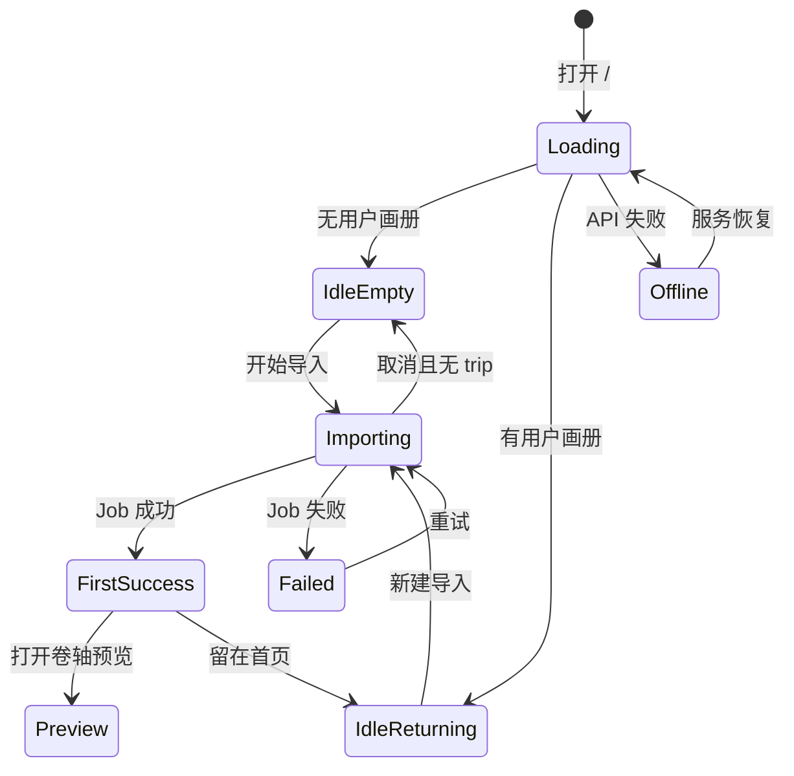

# Travelogue Studio · 首页现状规格（反向 PRD ·  redesign 派单）

| 属性 | 内容 |
|------|------|
| **产品代号** | Travelogue Studio |
| **文档版本** | **v1.0.0-AS-IS** |
| **文档性质** | **现状反向梳理** — 描述当前已上线首页的功能、信息架构与交互，供外部设计团队重做视觉与布局 |
| **页面路由** | `GET http://127.0.0.1:8766/`（默认 v2 Bento 首页） |
| **实现入口** | `templates/studio/studio-home-v2.html` · `studio-home-v2.css` · `templates/studio/homepage-v2/*.js` |
| **历史 PRD（实现依据，非本文）** | [PRD-STUDIO-HOMEPAGE-v2.md](./PRD-STUDIO-HOMEPAGE-v2.md) · [M21-ROUTING.md](./studio-homepage-v2/M21-ROUTING.md) |
| **线框参考（旧稿）** | [wireframes/studio-homepage-output-first-v1.6.html](./wireframes/studio-homepage-output-first-v1.6.html) |
| **示例素材包** | `templates/studio/assets/demo-showcase/`（京都·雨后） |
| **目标读者** | 外部 UI/UX 设计团队、品牌设计、前端对接人 |
| **更新日期** | 2026-06-15 |

---

## 0. 给设计团队的导读

### 0.1 本文档是什么

本文档从**当前代码与页面**反向整理出 Studio 首页的完整产品规格，**不是**新功能需求清单。设计团队可以：

- 自由重做视觉语言、排版、动效、品牌气质；
- 调整组件层级与空间关系（在 §4 功能约束内）；
- 提出新的信息架构方案（需与产品方确认 §3 核心任务是否仍被满足）。

**必须保留**的是 §4「功能约束」与 §5「页面状态机」所描述的用户能力与流程闭环，而非现有像素级布局。

### 0.2 产品一句话

> **Travelogue Studio** — 本地桌面杂志工坊：用户选择一次旅行的照片文件夹，系统自动分章、配文、排版，生成 **大屏卷轴（16:9 HTML 游记）** 与 **微信长图（9:16 PNG）** 两种交付物。

### 0.3 首页在产品中的角色

| 页面 | 路由 | 职责 |
|------|------|------|
| **首页 / 工作台** | `/` | 价值传达、双交付验货、选图导入、进度等待、继续编辑 |
| **预览页** | `/{tripId}/index.html` | 改字、调整结构、生成长图、导出 |
| **长图捕获面** | `/{tripId}/index-longshot.html` | 无 UI；仅供截图引擎使用 |

首页**不负责**：正文编辑、长图导出、微信发送、账号登录。这些在预览页或后续链路完成。

### 0.4 运行环境与平台边界

| 维度 | 现状 |
|------|------|
| **访问方式** | 本机浏览器打开 `http://127.0.0.1:8766`（Studio 本地 daemon） |
| **支持端** | Web 桌面（窗口 ≥1024px）· iPad 横屏（768–1023px landscape） |
| **不支持** | 手机浏览器完整工坊 · iPad 竖屏 · 过窄窗口（&lt;768px）→ 显示「不支持」提示页 |
| **账号** | 无；打开即「已在本机进入 Studio」 |
| **数据** | 照片在用户磁盘；Studio 只读本地文件夹；画册元数据存 `trips/` |

### 0.5 设计派单交付物建议

| # | 交付物 | 说明 |
|---|--------|------|
| 1 | **全态线框** | Loading · 空态 · 回访 · Importing · FirstSuccess · Failed · Offline · Unsupported |
| 2 | **Bento 首屏高保真** | 含 16:9 carousel · 9:16 手机框 · 工作台 bench · 双 Tab |
| 3 | **Import Sheet** | 快速分享 / 精细制作 双模式全流程 |
| 4 | **书架区** | 卡片网格 · resume 条 · 菜单操作 |
| 5 | **Design Tokens** | 色板（含 10 套主题方向或统一新体系）· 字体 · 圆角 · 阴影 · 间距 |
| 6 | **示例作品素材** | 与 Bento 预览同源的 scroll 半页 + longshot + background（见 [DEMO-ASSETS-BRIEF](./studio-homepage-v2/DEMO-ASSETS-BRIEF.md)） |
| 7 | **组件规格** | 按钮层级 · 徽章 · 表单 · 弹层 · Toast |
| 8 | **响应式** | ≥1024 · iPad 横屏；竖屏/手机仅 Unsupported 页 |

---

## 1. 产品定位与文案体系（现状）

### 1.1 核心 Slogan 与 Lead

| 元素 | 现行文案 |
|------|----------|
| **Eyebrow** | TRAVELOGUE · 智能游记画册 |
| **H1** | 每一个瞬间，*都值得再次相遇*（「都值得再次相遇」为手写体强调） |
| **Lead** | 选一次旅行的照片，**自动分章 · 配文 · 排版**，生成大屏卷轴 + 微信长图。 |
| **主 CTA** | 开始制作我的游记 → |
| **信任 meta** | 照片留在本机 · 无需注册 · 下一步选择本次旅行的照片文件夹 |

> **用词策略**：产品内用「自动」；Eyebrow 含「智能游记画册」；**禁止**在首屏主位置突出「AI 自动生成」大字。

### 1.2 能力标签（首屏三枚 pill）

- 自动分章成文
- 自动配文选封面
- 本地处理 · 免注册

### 1.3 双交付用户语言

| 交付物 | Bento 内标签 | 比例 | 用途说明 |
|--------|-------------|------|----------|
| **大屏卷轴** | （carousel 区，无独立 label） | 16:9 | 沉浸阅读 · spread 双页预览 |
| **微信长图** | 微信长图 · 竖屏预览 | 9:16 | 发微信 · 手机框样张预览 |

Carousel 底部 hint：`← 横滑 · 一屏一页 · 到头停止 →`  
长图区 hint：`←→ 切换 · 一屏一章`

### 1.4 示例作品标注

- 徽章文案：**示例作品**
- 默认示例 trip：**京都 · 雨后**（86 张 · 3 章）
- 用户自己的画册 Tab 徽章：**我的画册**（切换至「最近一本」时）

---

## 2. 目标用户与核心场景

| Persona | 场景 | 首页关键触点 |
|---------|------|-------------|
| **A · 首次旅行者** | 第一次打开 Studio，不懂产品 | Bento 示例预览 → 理解双交付 → 点主 CTA → Import Sheet → 选文件夹 |
| **B · 回访编辑者** | 之前做过画册，回来继续 | Bento 下方书架 · bench「继续上次」·「最近一本」Tab |
| **C · 好奇试用者** | 先看示例再决定要不要做 | 示例 Tab carousel / 长图滑动 · 不 import 示例 |
| **D · 审美敏感者** | 在意成稿气质 | spread 预览质量 · 编辑背景 · 10 套配色主题 |

### 2.1 首页必须回答的三个问题

1. **这是什么？** — 旅行照片 → 杂志风画册 → 卷轴 + 长图  
2. **我下一步做什么？** — 开始制作 / 继续上次 / 看示例  
3. **还要等多久？** — Importing 四阶段进度 + 「可离开稍后回来」

---

## 3. 信息架构 · 页面结构

### 3.1 整体布局（Bento 网格 · 现状）

同一 URL `/`，无路由跳转；通过状态切换显示不同层。

```
┌──────────────────────────────────────────────────────────────┐
│  [离线横幅]（条件显示）                                        │
├──────────────────────────────────────────────────────────────┤
│  Slogan 区（Eyebrow + Tags + H1 + Lead）                      │
├───────────────────────────────┬──────────────────────────────┤
│  16:9 大屏卷轴 Carousel        │  9:16 微信长图                │
│  （spread · 箭头 · dots）      │  （手机壳 · 内滚 strip）       │
├───────────────────────────────┤                              │
│  工作台 Bench（132px 高）      │  （右列通高）                 │
│  样本信息 · 主 CTA · 快捷区    │                              │
└───────────────────────────────┴──────────────────────────────┘
│  [书架区]（有用户画册时，Bento 下方，需滚动）                    │
└──────────────────────────────────────────────────────────────┘

叠加层（按需）：
  · Import Sheet（bottom sheet）
  · Importing 进度
  · FirstSuccess / Import Failed 对话框
  · Lightbox（代码保留，Bento 内入口已移除）
  · Unsupported 视口提示（替换整页）
```

**Grid 参数（现状 CSS）**：主区域 `1fr 172px` 双列 · gap 10px · 左列三行（headline / carousel / bench）。

### 3.2 工作台 Bench 结构（现状）

Bench 分为四块：

| 区域 | 内容 |
|------|------|
| **左侧 · 样本信息** | 示例/用户 trip 缩略图 + 标题 + meta（张数·章数·更新时间） |
| **左侧 · 最近列表** | 最多展示若干本最近画册（快捷切换，有用户 trip 时显示） |
| **中部 · 主操作** | 主 CTA 按钮 + 信任 meta 一行 |
| **右侧 · 快捷区** | 四组 side panel（见下表） |

**快捷区四组：**

| 组 | 控件 | 行为 |
|----|------|------|
| **预览来源** | Tab：示例作品 / 最近一本 | 切换 Bento carousel + 长图 + 背景数据源 |
| **快捷操作** | 继续上次 · 查看最近 | 跳转最近编辑的 preview · 滚动至书架区 |
| **配色** | 下拉 10 套主题 | 切换 CSS 变量主题（仅首页 chrome，不影响成稿） |
| **分析** | 高级选项 popover | 行程识别 / 场景分析 / G1 结构确认 / 智能排版实验开关 |

### 3.3 10 套首页配色主题（现状）

| value | 显示名 |
|-------|--------|
| `sky` | 清新浅蓝（**默认**） |
| `classic` | 经典深色 |
| `dawn` | 暖阳珊瑚 |
| `mint` | 森系薄荷 |
| `navy` | 夜航蓝调 |
| `olive` | 深林橄榄 |
| `fjord` | 北欧雾蓝 |
| `sage` | 雾炭鼠尾草 |
| `taupe` | 板岩暖灰 |
| `grove` | 午夜桉树 |

主题通过 `data-v2-theme` 切换整套 CSS 变量（背景、主色、边框、蒙版等）。

---

## 4. 功能约束（ redesign 时必须保留的能力）

以下为用户可感知能力，**不可在 redesign 中删除**（可改呈现方式）：

| ID | 能力 | 说明 |
|----|------|------|
| **F-01** | 双交付预览 | 16:9 spread carousel + 9:16 长图 strip，数据同源 |
| **F-02** | 示例 / 用户 Tab 切换 | 示例永不被 import；用户 Tab 读最近非 demo 画册 |
| **F-03** | 主 CTA → Import Sheet | 路径选择仅在 Sheet 内，不在首屏暴露 |
| **F-04** | pick-folder 导入 | Windows 本机文件夹选择器（主路径） |
| **F-05** | 双模式导入 | 快速分享（minimal）/ 精细制作（full intent） |
| **F-06** | 备选导入 | 小文件夹上传（≤200MB）· 路径粘贴 |
| **F-07** | Importing 进度 | 四阶段中文 · 可取消 · 刷新可续 poll |
| **F-08** | FirstSuccess | 首次成功 overlay · 倒计时打开预览 · 留首页 |
| **F-09** | Import Failed | 错误说明 · 重试 · 留首页 |
| **F-10** | 书架回访 | Bento 下方网格 · resume · 新建 · 分页加载 |
| **F-11** | 书架卡片操作 | 继续编辑 · 更新长图 · 删除（确认）· 更多菜单 |
| **F-12** | 算法过期提示 | 用户 Tab 下 stale 条 · 一键重新排版 |
| **F-13** | 高级分析选项 | 导入前可配 clustering / vision / G1 / layout scoring |
| **F-14** |  unsupported 视口 | 手机 / 竖屏 / 过窄 → 专用提示页 |
| **F-15** | 离线检测 | health 失败 → 顶部横幅 |
| **F-16** | 无障碍基础 | Skip link · dialog focus trap · Esc 关闭 · 键盘 carousel |

---

## 5. 页面状态机



| 状态 | 用户可见 |
|------|----------|
| **Loading** | 全页 skeleton；**不**渲染 Bento/书架（防闪屏） |
| **IdleEmpty** | 仅 Bento 首屏 |
| **IdleReturning** | Bento + 下方书架（同屏，书架需滚动） |
| **Importing** | Bento  blur/静帧背景 + 进度 overlay |
| **FirstSuccess** | 半透明 scrim + 成功 panel（保留背景壳层） |
| **Failed** | 失败 panel + 重试 |
| **Offline** | 顶栏「服务已停止，请重新启动 Studio」 |
| **UnsupportedViewport** | 替换整页，仅提示文案 |

**sessionStorage 续跑**：存在 `activeJobId` 时，刷新后直接进 Importing，不闪 Idle。

---

## 6. 模块规格详述

### 6.1 Slogan 区 · Layout D（现行默认）

- **Layout 模式**：`data-headline-layout="d"` — Eyebrow + Tags 顶行，H1 独占一行，Lead 在下方
- **H1 字体**：Display serif（Georgia / 宋体类）+ 手写体「荷塘月色」子集（`HetangYuese`）强调 em 部分
- **Lead 字体**：部分关键词加粗；lead 可选用 script 风格 class

**视觉层（Bento 背后）：**

- 全幅背景图（示例/用户 trip 的 background.webp）
- Ken Burns 缓慢缩放（`prefers-reduced-motion` 时静态）
- grain 颗粒 · vignette 暗角 · veil 浅色蒙版（保证文字可读）

### 6.2 16:9 Carousel（大屏卷轴）

| 项 | 规格 |
|----|------|
| **内容** | manifest `pages[]`：封面 + N 章 + 尾声（示例为 5 屏） |
| **Spread** | 每次显示约 50% 宽的一页；横滑每次 1 页 |
| **边界** | **到头 clamp，不循环**；末页可左对齐 + 右侧留白（杂志 bleed） |
| **导航** | 左右箭头 · dots（`aria-current`）· 键盘 ←/→ |
| **Stale 条** | 用户 Tab + 算法过期时：提示文案 +「重新排版」按钮 |
| **Lightbox** | PRD 原设计有；**现行 Bento 内点击放大入口已移除**（模块代码仍保留） |

### 6.3 9:16 手机框（微信长图预览）

| 项 | 规格 |
|----|------|
| **外壳** | 仿手机壳（ notch + 圆角边框） |
| **内容** | 长图按章切分的 strip carousel（非整图滚动） |
| **交互** | 左右箭头 · dots · 内滚 |
| **尺寸** | 随右列可用空间动态计算高度（520–980px 区间） |
| **说明** | 这是**样张预览**，不是真实小程序 UI |

### 6.4 Import Sheet（导入面板）

**触发**：主 CTA · 书架「+ 新建」· bench 快捷（间接）

**结构**：

```
┌─ Sheet ─────────────────────────────┐
│  制作我的游记画册              [×]   │
│  步骤 1/2 · 选择照片                 │
│  [选择本次旅行的照片文件夹]  （主按钮）│
│  hint：精选/素材子文件夹说明          │
│                                      │
│  ── 选文件夹后显示 confirm 区 ──      │
│  已选路径…                           │
│  Tab: [快速分享] [精细制作]           │
│                                      │
│  快速分享：hint + [开始制作]          │
│  精细制作：名称/地点/日期/notes/      │
│            旅途见闻/plan 文件/        │
│            精选&素材文件夹/           │
│            版面密度/模板选择          │
│                                      │
│  ▶ 文件夹怎么选？                    │
│  ▶ 其他导入方式（上传/粘贴路径）      │
│  每个文件夹会生成一本新的画册…        │
└──────────────────────────────────────┘
```

**快速分享模式字段**：无额外必填；选文件夹即可开始。

**精细制作模式字段**：

| 字段 | 必填 | 说明 |
|------|------|------|
| 游记名称 | 否 | max 20，预填文件夹名 |
| 主要地点 | 否 | max 40 |
| 开始/结束日期 | 否 | date picker |
| 写给编辑的一句话 | 否 | max 200，带 3 个快捷 chip |
| 旅途见闻与感悟 | 否 | max 500 |
| 行程计划文件 | 否 | txt/md，max 32KB |
| 精选文件夹名 | 否 | 如「精选」 |
| 素材文件夹名 | 否 | 如「素材」 |
| 版面密度 | 否 | 智能平衡 / 大图为主 / 拼图为主 |
| 模板 | 否 | 智能匹配 / 视觉游记手动 |

**Sheet 行为约束**：

- `role="dialog"` · focus trap · Esc 关闭 · 关闭后焦点归还 CTA
- 打开时 Bento + 书架设 `inert`
- pick-folder 成功后进入 confirm，不自动关闭 Sheet（用户选模式后再开始）
- Import 进行中 Sheet 应关闭并进入 Importing

### 6.5 Importing 进度

| 项 | 内容 |
|----|------|
| **阶段文案** | 扫描照片 → 分章聚类 → 生成文案 → 排版输出（四阶段中文） |
| **来源展示** | 文件夹名 / 路径 |
| **信任** | 预计耗时 · **可离开稍后回来** |
| **取消** | 确认 Modal · 取消后无半成品 trip |
| **冷启动** | 关 tab 再开：demo 封面静帧 + veil 背景（无 Ken Burns） |
| **动态 title** | 浏览器 tab 标题随进度变化 |

### 6.6 FirstSuccess（首次成功）

| 元素 | 内容 |
|------|------|
| Eyebrow | ✓ 生成完成 |
| 消息 | 你的第一篇游记已生成（可含分章/密度反馈） |
| 倒计时 | N 秒后打开卷轴预览…（可配置关闭自动跳转） |
| 主按钮 | 打开卷轴预览 → |
| 次按钮 | 保存长图（quick_share 模式时出现） |
|  tertiary | 留在首页 |

背景 = Import 前的 Bento 壳层；若已有书架则同屏保留。

### 6.7 Import Failed

| 元素 | 内容 |
|------|------|
| 标题 | 导入失败 |
| 消息 | 按错误码 humanize（如照片过多、路径无效等） |
| 操作 | 重试 · 留在首页 |

### 6.8 书架区（回访）

**显示条件**：存在至少一本非 demo 用户画册。

| 元素 | 说明 |
|------|------|
| **标题** | 你的游记画册 |
| **Resume 条** | 最近一本大卡片 · 一键继续编辑 |
| **网格** | 封面 + 标题 + 副信息（模板来源 · 张数 · 相对时间 · stale 徽章） |
| **Stale 徽章** | 「长图待更新」「算法待更新」 |
| **新建卡** | + 选择文件夹新建 |
| **分页** | total &gt; 20 时分页加载更多 |
| **卡片菜单 ⋯** | 继续编辑 · 更新长图 · 删除 |

**卡片点击**：进入 `/{tripId}/index.html` preview。

### 6.9 Unsupported 视口页

| 场景 | 标题要点 | 说明要点 |
|------|----------|----------|
| 手机 | 请在电脑浏览器打开 Studio | 手机阅读/分享请用微信小程序 |
| iPad 竖屏 | 请旋转至横屏 | — |
| 桌面过窄 | 请拉宽窗口至 1024px 以上 | — |

Brand 行：`TRAVELOGUE · STUDIO`

### 6.10 高级选项 Popover

Import 进行中锁定不可改。

| 选项 | 默认值 | 说明 |
|------|--------|------|
| 行程识别 | 自动（推荐） | GPS 照片按行程分段 |
| 场景分析 | 关 | 大相册合并同场景（慢） |
| 结构确认（G1） | 自动继续 | 开启则导入后先确认章节 |
| 智能排版 | 经典 | 实验 beam 评分模式 |

---

## 7. 用户主路径（流程图）

### 7.1 首次用户 · 快速分享

```
打开 / → Loading → IdleEmpty（Bento 示例）
  → 浏览 carousel / 长图（可选）
  → 点击「开始制作我的游记」
  → Import Sheet → 选择照片文件夹
  → 选「快速分享」→ 开始制作
  → Importing（四阶段）
  → FirstSuccess → 打开卷轴预览 / 保存长图 / 留首页
```

### 7.2 回访用户

```
打开 / → Loading → IdleReturning（Bento + 书架）
  → bench「继续上次」或书架 resume → preview
  或
  → 切换「最近一本」Tab 验货 → 主 CTA 新建
```

### 7.3 精细制作路径

```
Import Sheet → 精细制作 Tab
  → 填写名称/地点/notes/plan/密度/模板…
  → 开始制作（专业）
  → Importing → FirstSuccess（卷轴为主 CTA）
```

---

## 8. 视觉与品牌现状（供 redesign 参考）

### 8.1 气质关键词（现行实现）

编辑室 + showroom · 杂志感 · 本地工坊 · 摄影叙事 · 浅色默认（可切深色 classic 等）

### 8.2 字体

| 用途 | 字体 |
|------|------|
| Display / H1 | Georgia, 宋体类 serif |
| 手写强调 | HetangYuese（荷塘月色手写体，子集 woff2） |
| UI | 系统 sans（PingFang SC / Microsoft YaHei 等） |

### 8.3 默认色板（sky 主题 · CSS 变量摘录）

| Token | 默认值 | 用途 |
|-------|--------|------|
| `--v2-primary` | `#0077b6` | 主 CTA · 链接 |
| `--v2-gold` | `#0077b6` | 强调（sky 主题下与 primary 同色） |
| `--v2-paper` | `#eaf8fb` | 页面底色 |
| `--v2-forest` | `#023e8a` | 深色强调 |
| `--v2-demo-flag-bg` | `#dff7fb` | 示例徽章底 |
| `--v2-phone-shell` | `#2b3645`–`#1f2937` | 手机框外壳 |

> classic 主题为暖色深色编辑室风格（cream/gold/forest）；共 10 套完整 token 见 `studio-home-v2.css`。

### 8.4 动效

| 动效 | 条件 |
|------|------|
| Ken Burns 背景 | 默认开；reduced-motion 关 |
| grain / vignette | 装饰层 |
| 卡片删除 leaving | 200ms |
| Sheet 滑入 | bottom sheet |
| skeleton pulse | Loading |

### 8.5 性能预算（现行目标）

| 指标 | 目标 |
|------|------|
| LCP | ≤ 2.5s（loopback） |
| 首屏背景 | ≤ 180KB WebP |
| demo-showcase 总包 | ≤ 800KB |

---

## 9. 组件清单（工程 ID 对照）

| 组件 | DOM / 模块 | 设计需覆盖 |
|------|-----------|-----------|
| BentoEmptyLayout | `#v2-bento-grid` | 网格 · 背景 · Slogan |
| ScrollCarousel | `#v2-carousel` | spread · 箭头 · dots · stale 条 |
| PhoneLongshotPreview | `#v2-phone` | 手机壳 · strip |
| WorkbenchBar | `.v2-bench` | CTA · tabs · 主题 · 高级 |
| DemoFlag | `.v2-demo-flag` | 示例徽章 |
| AutoTags | `.v2-auto-tag` | 能力 pill |
| ImportSheet | `#v2-import-sheet` | 双模式表单 |
| WebShelf | `#v2-shelf` | 网格 · resume · 菜单 |
| ImportProgressOverlay | `#v2-importing` | 进度 |
| FirstSuccess | `#v2-first-success` | 成功 dialog |
| ImportFailed | `#v2-failure` | 失败 dialog |
| UnsupportedViewport | `#v2-unsupported` | 不支持页 |
| LoadingSkeleton | `#v2-loading` | 骨架 |
| OfflineBanner | `#v2-offline` | 离线条 |
| OutputLightbox | `#v2-lightbox` | 放大（入口待定） |
| Toast | `#v2-toast-container` | 全局提示 |

---

## 10. 与预览页的分工

| 能力 | 首页 | 预览 toolbar |
|------|------|--------------|
| 选图 / 导入 | ✓ | — |
| 改标题 / hook / 图注 | — | ✓ |
| 章节结构确认（G1） | 仅开关 | ✓ 执行 |
| 保存长图 | FirstSuccess 快捷入口 | ✓ 主责 |
| 封面 preview.jpg | 列表/Bento 缩略图 | reveal |
| 导出 zip | — | 高级菜单 |
| 返回工作台 | — | ← 返回 |

**原则**：首页只做到「进入预览」；分享闭环在预览页完成。

---

## 11. 已知现状与 redesign 讨论点

以下为反向梳理时发现的产品/体验债，**可供 redesign 一并考虑**，但不强制：

| # | 现状 | redesign 机会 |
|---|------|--------------|
| 1 | Lightbox 放大入口已从 Bento 移除 | 是否恢复「验货放大」？如何触发？ |
| 2 | 10 套主题偏工程试验性质 | 是否收敛为 1–2 套品牌色 + 暗色？ |
| 3 | Bench 右侧四组 side panel 信息密度高 | 是否收进「设置」或分层 progressive disclosure |
| 4 | Eyebrow 写「智能」、正文写「自动」 | 统一对外话术 |
| 5 | H1 情感向 vs 功能向 Lead 并存 | 确定 redesign 主叙事轴 |
| 6 | 示例素材仍有 PLACEHOLDER 标记 | 设计需交付正式京都切图包 |
| 7 | 书架在 Bento 下方需滚动 | 回访用户是否需更显著的 resume |
| 8 | Import Sheet 精细模式字段多 | 是否 wizard 分步或折叠 |
| 9 | 顶栏已移除（v2.0.6） | 是否需要品牌栏 / 帮助 / 版本信息 |
| 10 | 手机端完全拒绝 | 是否预留「扫码继续」等桥接 |

---

## 12. 设计验收建议（redesign 完成后）

| ID | 验收项 |
|----|--------|
| AC-RD-01 | 5/5 被试 10s 内能复述「卷轴 + 长图」双交付 |
| AC-RD-02 | 5/5 被试 10s 内找到并开始导入的主操作 |
| AC-RD-03 | 示例与用户内容可明确区分 |
| AC-RD-04 | 全状态（§5）有对应设计稿，无遗漏 |
| AC-RD-05 | Import Sheet 双模式字段与 §6.4 对齐 |
| AC-RD-06 | ≥1024 与 iPad 横屏布局可用；不支持端有专用页 |
| AC-RD-07 | 叠字区域 WCAG AA 4.5:1 或等效暗蒙版 |
| AC-RD-08 | 主 CTA / destructive / secondary 层级清晰 |
| AC-RD-09 | 与 preview 页视觉语言可衔接（不要求完全一致） |
| AC-RD-10 | demo-showcase 素材与 Bento 预览同源 |

---

## 13. 附录

### 13.1 关键文件索引

| 类型 | 路径 |
|------|------|
| HTML | `templates/studio/studio-home-v2.html` |
| CSS | `templates/studio/studio-home-v2.css` |
| JS 入口 | `templates/studio/homepage-v2/bootstrap.js` |
| 示例 manifest | `templates/studio/assets/demo-showcase/manifest.example.json` |
| 路由门控 | `travelogue/web/studio_homepage_gate.py` |

### 13.2 本地预览方式

```powershell
cd C:\Users\xiafe\Projects\travelogue
pip install -e ".[dev]"
python -m travelogue studio
# 浏览器打开 http://127.0.0.1:8766/
```

开发面板：`?dev=1` 或 `data-studio-dev=1` — 含 classic 切换等调试入口。

### 13.3 相关 PRD（勿与本稿混淆）

| 文档 | 关系 |
|------|------|
| [PRD-STUDIO-HOMEPAGE-v2.md](./PRD-STUDIO-HOMEPAGE-v2.md) | 原实现需求；部分细节已被代码演进覆盖 |
| [PRD-WEBSITE-MARKETING.md](./PRD-WEBSITE-MARKETING.md) | 对外官网，**不是** Studio 首页 |
| [DEMO-ASSETS-BRIEF.md](./studio-homepage-v2/DEMO-ASSETS-BRIEF.md) | 示例素材切图派单 |
| [DATA-CONTRACT.md](./studio-homepage-v2/DATA-CONTRACT.md) | API 与 manifest 契约 |

### 13.4 版本历史

| 版本 | 说明 |
|------|------|
| **v1.0.0** | 初版：基于 2026-06-15 代码反向梳理，含 v2.0.5+ 演进（双 Tab · 双导入模式 · 10 主题 · Layout D · bench 快捷区 · stale 条 · 长图 strip） |

---

*本文档由产品方从实现反向生成，如有与线上行为不一致，以 `templates/studio/studio-home-v2.html` 及 `homepage-v2/` 模块为准。*
