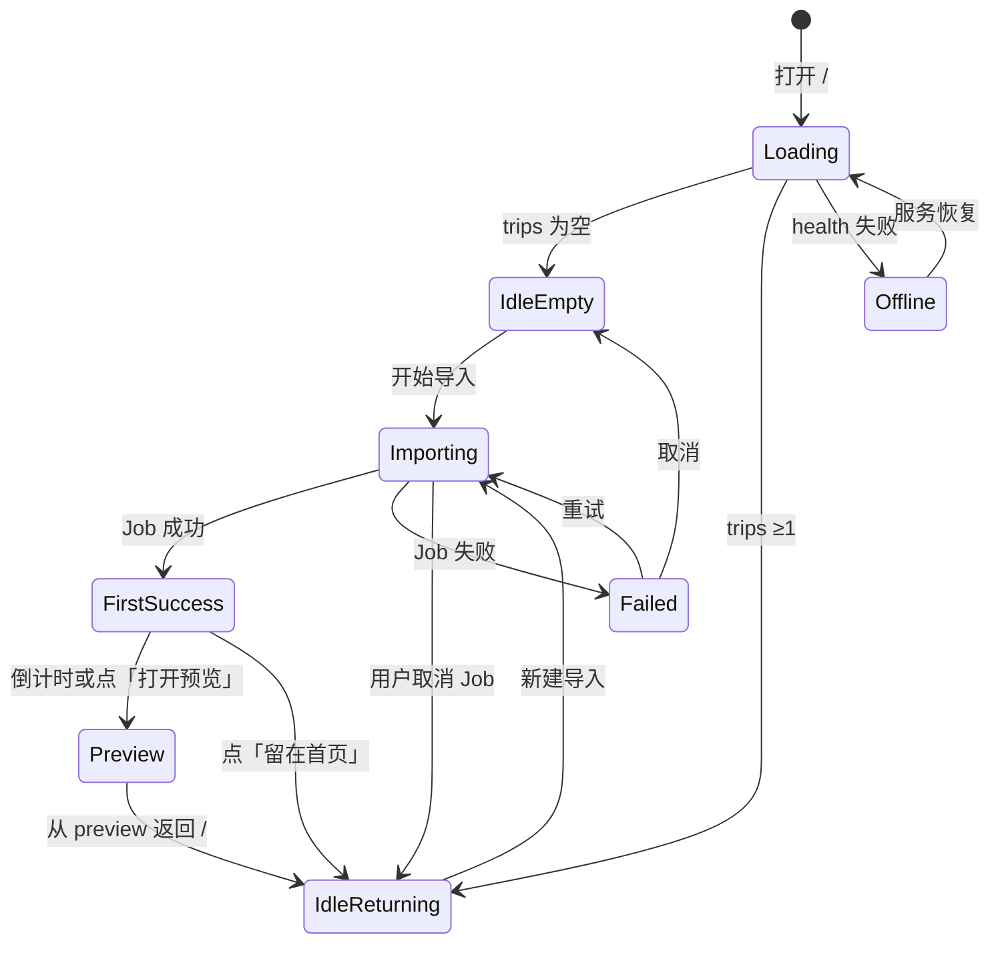
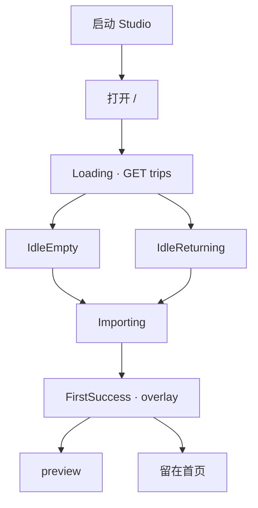

# Travelogue Studio · 首页（工作台）产品需求文档

| 属性 | 内容 |
|------|------|
| **产品代号** | Travelogue Studio |
| **文档版本** | v1.4.0-HOMEPAGE |
| **状态** | **Implemented · v3 影像优先**（代码已落地，PRD 反向同步 2026-05-28） |
| **页面路由** | `GET /` → `templates/studio/studio.html`（Phase 4 起 `data-studio-v="4"`） |
| **权威线框** | [wireframes/studio-homepage-photo-first-v3.html](./wireframes/studio-homepage-photo-first-v3.html) |
| **前置条件** | [PRD-PHASE2.md](./PRD-PHASE2.md) M8–M10 已交付；`travelogue studio` 单端口 8766 |
| **关联文档** | [PRD-PHASE2.md](./PRD-PHASE2.md) · [PRD-PHASE3.md](./PRD-PHASE3.md) · **[PRD-PHASE4.md](./PRD-PHASE4.md) §6（极易用 + 导入 panel）** · [IMPLEMENTATION-PHASE2.md](./IMPLEMENTATION-PHASE2.md) · [ACCEPTANCE-PHASE2.md](./ACCEPTANCE-PHASE2.md) · [adr/004](./adr/004-studio-hub-server.md) · [SHARING.md](./SHARING.md) |
| **负责人** | 首席产品经理 |
| **更新日期** | 2026-05-28 |

---

## 1. 文档范围与术语

### 1.1 「进入应用」≠ 账号登录

Phase 2 **无用户账号体系**（见 PRD-PHASE2 §2.2）。本文所称 **「进入应用后的第一眼」** 指：

| 入口 | 用户动作 | 第一眼 URL |
|------|----------|------------|
| 双击 `scripts/start-studio.bat` | 启动本地服务 | `http://127.0.0.1:8766/` |
| 运行 `TravelogueStudio.exe`（M11） | 同上 | 同上 |
| CLI `python -m travelogue studio` | 开发者 / 高级用户 | 同上 |

**伪登录态**：浏览器打开即视为「已在本机进入 Studio」；数据存于本地 `trips/`，无云端同步。

> **Phase 3 预留**：账号、素材洞察、引擎状态灯等扩展见 **§19**；不改变首页「选图 → 预览 → 长图」主路径。

### 1.2 首页在产品中的角色

首页 = **Studio 工作台（Hub）**，不是游记正文页。

| 页面 | 路由 | 职责 |
|------|------|------|
| **首页 / 工作台** | `/` | 价值传达、选图导入、进度等待、继续编辑 |
| **预览页** | `/{tripId}/index.html` + preview-toolbar | 改字、生成长图、导出 |
| **长图捕获面** | `/{tripId}/index-longshot.html` | **无 UI 注入**；仅供 Playwright 截图 |

首页回答三个问题：

1. **这是什么？** — 旅行照片 → 杂志风长图 → 发微信  
2. **我下一步做什么？** — 选照片 / 试示例 / 继续上次  
3. **还要等多久？** — 导入进度与预估时间  

### 1.3 与 Phase 3 的关系

[PRD-PHASE3.md](./PRD-PHASE3.md) v0.3.3 Kickoff 将 **Curate 聚类** 作为 pipeline 内部增强，**不改变** Studio 首页主路径（选文件夹 → 预览 → 长图）。Studio 可见变化见 PRD **§6.4**（Importing hint · D′ 高级折叠）。

| 阶段 | 用户可见变化 | 首页影响 |
|------|--------------|----------|
| **Phase 2 · 首页** | 首次 import → preview | §6.11 首次成功过渡 |
| **Phase 3 · 聚类** | 成稿章/组屏质量提升（无新页面） | **无** 新增 CTA / 顶栏 slot |

Phase 2 首页的 **首次成功过渡（§6.11）** 仍是核心 Aha：**用户第一次看到自己生成的游记**。

### 1.4 实现基线（v3 影像优先 · 2026-05-28）

**实现文件**：`templates/studio/studio.html` · `studio.css` · `studio.js` · `studio-toast.js` · `studio-modal.js`

| 维度 | v1.3 PRD 原稿 | **v3 已落地** |
|------|---------------|---------------|
| Hero 情感标题 | 让每一段旅程，都值得被杂志记录 | **你的照片 / 是一本还没装帧的杂志** |
| 回访态 Hero | B⁻ 压缩无全幅图 | **B★ hybrid**：左文案 + 右 **3 张近期卡**（C 并入 Hero） |
| 回访主 CTA | 选择照片文件夹 | **+ 新建游记**（primary）+ **选择文件夹**（ghost） |
| 路径导入 | D′ 折叠 | **Hero 内常驻路径栏**：`浏览…` + 输入 + **开始** |
| 样例区 E | carousel / 真实 pipeline 图 | **3 张 inline SVG 长图样张** + 点击模态 + CTA「用我的照片做一篇」 |
| 首次成功 | Toast 后自动跳转 preview | **Success overlay**：**5s 倒计时** + **留在首页** / **打开预览** |
| 导入恢复 | — | `sessionStorage` 恢复 active Job + pending body |
| 取消导入 | — | 保留路径/来源上下文 + 「重新开始」提示 |
| 路径记忆 | — | `localStorage.recentPaths` → `<datalist>` 最近 5 条 |
| pick-folder | M12b 建议新增 | **已交付**（见 §7.3） |
| 浏览器上传 | 次级「较慢」 | **小文件夹试用（≤200MB）**；**禁止** pick-folder 失败时静默降级到上传 |
| Offline 检测 | `GET /health` | **未单独实现**；前端降级为 **`GET /trips` 轮询**（§21） |

**导入优先级（冻结 · 2026-05-28）**：

1. **本机选文件夹** — `POST /__travelogue/pick-folder`（主 CTA / 浏览…）
2. **路径 JSON** — 粘贴或浏览填入后点 **开始** → `{ albumPath }`（**不上传 · 无 200MB 限制**）
3. **示例相册** — `useDemoAlbum`
4. **浏览器上传** — `webkitdirectory` multipart（仅极小文件夹；超约 200MB 易失败）

---

## 2. 背景与问题

### 2.1 现状（M12 · v3 已交付）

当前 `studio.html` 已具备：v3 全幅 Hero、hybrid 回访态、常驻路径栏 + 本机选文件夹、SVG 长图样张模态、示例相册、≤200MB 浏览器上传（明示备选）、Job 进度 + sessionStorage 恢复、取消保留上下文、Success 倒计时、失败重试、trip 列表 + stale 徽章、Toast / Modal、Offline banner（trips 轮询）。

### 2.2 交互断裂（本 PRD 要解决的）

| ID | 断裂 | 用户感受 | 首页应补什么 |
|----|------|----------|--------------|
| **HP-GAP-01** | 三种导入方式平铺，无优先级 | 「我该用哪个？」 | 主路径卡片 + 次级折叠 |
| **HP-GAP-02** | 回访用户与首次用户同一布局 | 老用户只想「继续编辑」 | **回访态**置顶「最近编辑」 |
| **HP-GAP-03** | trip 列表信息密度低 | 不知道长图是否过期 | 卡片含封面缩略图 + 状态徽章 |
| **HP-GAP-04** | ~~原生选文件夹未暴露~~ | ~~只能粘贴路径~~ | **已解决 · v3**：`POST /__travelogue/pick-folder` + Hero **浏览…** + 路径栏 |
| **HP-GAP-05** | 系统 confirm 弹窗 | 不像一个产品 | 首页内 Modal 组件 |
| **HP-GAP-06** | 样例图为占位 | 价值感不足 | 真实输出样例 + 制作标准（§6.6） |
| **HP-GAP-07** | 首次生成无过渡反馈 | 「完成了吗？」 | §6.11 首次成功过渡 |
| **HP-GAP-08** | `/trips` 加载空白 | 「页面坏了？」 | Loading 态 + 骨架屏（§5、§6.12） |
| **HP-GAP-09** | 轻量操作无反馈 | 复制 IP 无确认 | StudioToast（§7.5） |
| **HP-GAP-10** | 用户无「照片文件夹」心智 | 不知道选哪个 | §6.13.1 照片准备引导 |
| **HP-GAP-11** | 多次导入关系不明 | Day2 会覆盖吗 | §6.13.2 新建预期 |
| **HP-GAP-12** | stale 徽章与 CTA 不一致 | 点了继续编辑还要自己找长图 | §6.4 更新长图 CTA |
| **HP-GAP-13** | 试用后无转化引导 | 示例看完就停 | §6.13.3 试用回流 |
| **HP-GAP-14** | 首页像工具不像作品 | 摄影用户无感 | §6.3 · §6.6 杂志 Hero + 画廊 |
| **HP-GAP-15** | Intent 藏 hidden，用户不知可起名 | 像批量工具 | [PRD-PHASE4](./PRD-PHASE4.md) §6.3 导入 panel |
| **HP-GAP-16** | 路径栏常驻，非开发者怯于粘贴 | 主视觉像命令行 | Phase 4 · 路径收「更多方式」 |
| **HP-GAP-17** | 选文件夹后还要点「开始」 | 多一步 | Phase 4 · pick 后自动 import |
| **HP-GAP-18** | 回访「继续编辑」不够醒目 | 找上次 trip 慢 | Phase 4 · 最近大卡 |
| **HP-GAP-19** | 精选双夹无语义 | 不懂如何准备照片 | Phase 4 §6.4 图示 |
| **HP-GAP-20** | 首次不知点哪 | 10 秒找不到主操作 | Phase 4 · 主 CTA + coach mark |

### 2.3 产品目标

| ID | 目标 | 衡量 |
|----|------|------|
| **G-HP-01** | 首次进入 **10 秒内** 理解产品并找到主操作 | 5 人可用性测试 |
| **G-HP-02** | 回访用户 **5 秒内** 打开最近 trip | 点击「继续编辑」≤ 2 次 |
| **G-HP-03** | 非开发者 **不看到** 路径输入框作为主视觉（exe 场景） | AC-P2-03 |
| **G-HP-04** | 导入等待时 **不焦虑** | stageHint + 取消 + 慢速提示 |
| **G-HP-05** | 与预览 toolbar 形成 **一条旅程** | 首页 CTA 文案与 toolbar 一致 |
| **G-HP-06** | 首次成功生成后 **7 天内再次打开** Studio | 本地 `firstPreviewDone` + 二次 `GET /` 会话 |
| **G-HP-07** | 摄影 / 发烧友 **10 秒内** 感受到「理解美」 | 5 人走查；首屏全幅 Hero + 画廊可见 |

---

## 3. 目标用户与第一眼场景

### 3.1 Persona

**A · 首次旅行者（主）**  
旅行后 1–3 天，Windows 笔记本，照片在 `D:\Photos\xxx`，不会命令行。

**B · 回访编辑者**  
上周做过一篇，今天想改字或重新生成长图。

**C · 好奇试用者**  
尚无照片，想先看效果再决定。

**D · 摄影 / 发烧友（视觉敏感）**  
在意输出审美与界面气质；对 stock 图、系统 UI 字体敏感；希望首页「像作品而非工具」。

### 3.2 第一眼 User Stories

| ID | 作为… | 第一眼我想… | 以便… |
|----|--------|-------------|--------|
| **US-HP-01** | 首次用户 | 看到「输出长什么样」 | 判断值不值得做 |
| **US-HP-02** | 首次用户 | 一个主按钮开始 | 不用读三种导入说明 |
| **US-HP-03** | 回访用户 | 看到上次那篇置顶 | 直接继续 |
| **US-HP-04** | 所有用户 | 知道照片不会上传云端 | 安心选文件夹 |
| **US-HP-05** | 等待中用户 | 看到「导入→排版→渲染」进度 | 知道还要几分钟 |
| **US-HP-06** | 失败用户 | 看到中文原因 + 重试 | 不面对错误码 |
| **US-HP-07** | 首次成功用户 | 生成完成时有明确反馈 | 知道即将看到预览 |
| **US-HP-08** | 从预览返回用户 | 看到「最近编辑」并知道点哪 | 第二次打开不迷路 |
| **US-HP-09** | 不擅长电脑的用户 | 知道照片该放哪、怎么选文件夹 | 不被「文件夹」术语卡住 |
| **US-HP-10** | 多次导入用户 | 知道再导入会**新建**游记而非覆盖 | 安心分 Day1/Day2 导入 |
| **US-HP-11** | 试用示例后用户 | 被引导用自己的照片做一篇 | 从演示转化为真实使用 |
| **US-HP-12** | 摄影爱好者 | 第一眼感受到「这个工具理解美」 | 愿意继续选照片 |

### 3.5 视觉气质方向（摄影 / 发烧友）

**基调**：Kinfolk 的克制留白 + Unsplash 的全幅摄影冲击 — **不是** VSCO 式全深色，保持 Studio 现有浅色编辑台可读性。

| 参考 | 借鉴 | 不照搬 |
|------|------|--------|
| Unsplash | Hero 全幅图 + 操作浮于图上 | 搜索框主导 |
| Kinfolk | 留白、Light 字重、letter-spacing | 纯 serif 全书 |
| Apple Photos Memories | 情感化标题 + 真实照片 | 自动视频 |
| Notion 首页 | 空态 = 灵感 + 渐进复杂度 | SaaS 仪表盘 |

**核心原则（冻结）**：首页应 **像产品输出的作品**，而不只是管理作品的工具。

### 3.6 视觉升级优先级

| 优先级 | 项 | 投入 | 章节 |
|--------|-----|------|------|
| **P0** | 杂志式 Hero（全幅真实输出裁切 + 蒙版 + CTA 内嵌） | 中 | §6.3 |
| **P0** | 多样例画廊（**M12 横滑 carousel**） | 中 | §6.6 · §8.2 |
| **P0** | Hero Light 字重 + letter-spacing（零 Web Font） | 低 | §6.14.2 |
| **P1** | 纸张纹理背景 | 低 | §6.14.3 |
| **P1** | 空态 **瀑布流灵感墙（M12b）** | 中 | §6.6 |
| **P1** | 卡片 / CTA 微交互 | 低 | §6.14.4 |
| **P2** | Display Web Font（可选） | 中 | §6.14.2 · M13 |
| **P2** | preview 主色提取占位 | 高 | §6.4 · M13 |
| **P2** | 进度条渐变 + 光点 | 低 | §6.8 |

---

## 3.3 模拟用户旅程与认知断点

基于 Persona 走查（小王 / 老用户 / 好奇试用者），首页 **操作流通畅**，最大缺口在 **认知支架**，而非信息架构。

| Persona | 场景摘要 | 通畅点 | 断点 |
|---------|----------|--------|------|
| **A · 小王** | 京都 200+ 张，照片在手机/OneDrive/分散子文件夹 | 试用示例 → 看到输出；进度条知道在处理 | ① 什么叫「文件夹」② 多个子文件夹选哪个 ③ 再导入 Day2 会覆盖还是新建 |
| **B · 老用户** | 改字后需重新发长图 | C 区置顶、一眼找到 | 「长图待更新」与「继续编辑」行动暗示不一致 |
| **C · 试用者** | 无照片，点示例 | 示例相册可用 | 回到首页与首次空态相同，缺下一步引导 |

**结论**：在 **文案与引导层** 补充认知支架（§6.13），不改变「首页 → 预览 → toolbar 生成长图」分工。

### 3.4 认知支架优先级

| 优先级 | 支架 | 用户价值 | 章节 |
|--------|------|----------|------|
| **P0** | 照片准备引导 | 消除「文件夹」门槛 | §6.13.1 |
| **P0** | 多次导入预期（新建 vs 覆盖） | 避免误操作焦虑 | §6.13.2 |
| **P1** | Stage 用户友好文案 | 等待时不困惑 | §8.2 |
| **P1** | stale 卡片 CTA 对齐 | 行动与徽章一致 | §6.4 |
| **P1** | 样例图期望管理 | 避免效果落差 | §6.6 |
| **P2** | 试用后回流引导 | 演示 → 真实转化 | §6.13.3 |
| **P2** | 删除游记预留位 | 导错可补救感 | §6.4 · M13 |
| **P2** | 动态时间估算 | 等待焦虑管理 | §6.5 · §6.8 |
| **P2** | 页脚 checklist 简化 | 不提前引入「章」 | §6.10 |

---

## 4. 信息架构

### 4.1 首页区块优先级（分态）

**空态（IdleEmpty）**：`A → B★（含路径栏 + 次级链）→ E★ → I`

> **v3 IA（已落地）**：B★ 内嵌 **选择照片文件夹** 主 CTA + **常驻路径栏**（浏览… / 粘贴 / 开始）+ 次级文字链（示例 · ≤200MB 上传 · 帮助）。E★ 为 **SVG 长图样张网格**（非 carousel）。

**回访态（IdleReturning）**：`A → B★ hybrid → F → I`

> **v3**：B★ = 左「+ 新建游记」+ 右 **3 张近期卡**（原 C 区并入 Hero）；路径栏仍常驻；下方 **全部游记** 网格。

```
空态 IdleEmpty                 回访态 IdleReturning（v3）
─────────────────              ─────────────────────────
A  顶栏（叠于 Hero）            A  顶栏
B★ Hero + 主 CTA               B★ hybrid Hero
   + 路径栏（浏览/粘贴/开始）       左：+ 新建游记 / 选择文件夹
   + 次级链（示例/上传/帮助）       右：最近 3 卡
E★ SVG 长图样张（3 张 + 模态）   F  全部游记网格
I  页脚                         I  页脚
```

| 区块 | 职责 |
|------|------|
| **A** | 字标 · 绿点 **本地运行中** · 地址复制 → Toast |
| **B★ · 空态** | 全幅 Hero 背景 · 情感标题 · **选择照片文件夹** · 路径栏 · 次级链 |
| **B★ · 回访 hybrid** | 「再做一篇？」· **+ 新建游记**（主）· 选择文件夹（次）· 右栏 3 近期卡 |
| **路径栏** | `浏览…` → pick-folder 填路径 · 粘贴 · **开始** → JSON `albumPath` |
| **E★** | 3 主题 SVG 长图样张 · 点击模态 · 「用我的照片做一篇」 |
| **F** | 全部游记卡片网格 · stale 徽章 · 「新建游记」加号卡 |

### 4.2 与预览页的分工

| 能力 | 首页 | 预览 toolbar |
|------|------|--------------|
| 选图 / 导入 | ✓ 主责 | — |
| 改标题 / hook / 图注 | — | ✓ 主责 |
| 保存长图 | — | ✓ 主责 |
| 封面 preview.jpg | 列表缩略图 | 路径 + reveal |
| 导出 zip | — | 高级菜单 |
| 返回 | — | ← 返回工作台 |

**原则**：首页只做到「进入预览」；**分享闭环在预览页完成**。

---

## 5. 页面状态机

首页有 **六种** 主状态（同一 URL，无路由跳转）：



| 状态 | 条件 | 界面变化 |
|------|------|----------|
| **Loading** | 首次 `GET /trips` 进行中 | Hero 立即显示；C/D/F 骨架屏（§6.12） |
| **IdleEmpty** | `trips` 为空 | 无 C/F；D 置顶；E 置底 |
| **IdleReturning** | `trips.length ≥ 1` | C 置顶；可选首次回访 highlight（§6.11） |
| **Importing** | active Job | 进度 UI；禁用 D；动态 `<title>` |
| **FirstSuccess** | Job succeeded | Success overlay · **5s 倒计时** · 留在首页 / 打开预览（§6.11） |
| **Importing 恢复** | 刷新时 sessionStorage 有 activeJobId | 自动续 poll status · 恢复 pending body |
| **Failed** | Job failed | 失败面板；`<title>` 含「导入失败」 |
| **Offline** | `GET /health` 失败 | 全页 banner；禁用导入（§21） |

---

## 6. 完整界面设计

### 6.1 布局规格

| 项 | 规格 |
|----|------|
| 内容宽（移动/平板） | `720px` |
| 内容宽（桌面 >1024px） | `1200px`（卡片网格区）；表单区 `640px` |
| 外边距 | 水平 `24px`（移动 `16px`） |
| 卡片圆角 | `12px` |
| 主色 | `--color-accent: #3d6b5a` |
| 背景 | `--color-bg: #f4f7f5` |
| 字体 | Segoe UI / PingFang SC / Microsoft YaHei |
| **CSS 变量化** | 所有颜色、圆角、阴影使用 custom properties；**Phase 2 不做暗色模式**，但变量命名便于 Phase 3 扩展 |
| **Favicon** | `templates/studio/assets/favicon.ico`（16×16 + 32×32）；相机/字标简化形 |
| **`<title>` 动态** | 默认 `Travelogue Studio`；Importing → `正在生成… · Travelogue Studio`；Failed → `导入失败 · Travelogue Studio` |

#### 响应式断点

| 断点 | 布局 |
|------|------|
| **360–640px** | 单列；padding `16px`；次路径卡片纵向堆叠 |
| **641–720px** | 单列标准（主设计稿） |
| **721–1024px** | D 区次路径可 2 列并排；Hero 填满容器 |
| **1025–1440px** | 内容 `max-width: 1200px` 居中；**Hero 全幅**（`100vw`，内容 `1200px`）；画廊可见 4–5 卡 |
| **>1440px** | 内容 `max-width: 1200px` 居中；**Hero 全幅**（最大 `1400px`）；两侧留白增加 |

> **桌面适配原则**（v1.4 新增）：Hero 全幅呈现杂志冲击感；内容区 1200px 保证画廊/trip 卡片有足够横向空间；表单/页脚等文本密集区缩回 `640px` 内以保可读性。

### 6.2 区块 A · 顶栏（M12 · P1）

| 元素 | 文案 / 行为 |
|------|-------------|
| 左 | **Travelogue Studio**（字标，点击刷新 `/`） |
| 右 | 绿点 + **本地运行中** · `127.0.0.1:8766`（点击复制 → Toast「已复制」） |
| 右 · 预留 | `#studio-shell-slot-p3` 空容器（Phase 3 引擎状态灯，§19） |

### 6.3 区块 B · Hero（双形态）

#### B★ · 杂志 Hero（空态 IdleEmpty · P0）

**布局**：全幅 **真实产品输出** 摄影裁切（非 stock）+ 暗角 / 底部渐变蒙版；白字叠于图上。

| 元素 | 规格 |
|------|------|
| **背景图** | `templates/studio/assets/hero/` 下 2–3 张 WebP；从 golden trip 长图裁切；`sessionStorage` 或日期 hash 轮换 |
| **蒙版** | `linear-gradient(180deg, rgba(0,0,0,.15) 0%, rgba(0,0,0,.55) 100%)` + 可选 vignette |
| **Eyebrow** | 空态：`从一个文件夹开始` · 回访：`最近编辑` |
| **H1（情感）** | **你的照片 / 是一本<em>还没装帧</em>的杂志**（v3 已落地） |
| **副标题** | 选一次旅行的照片文件夹，2–5 分钟自动排版成**竖版长图** · 照片留在本机，不上传云端 |
| **主 CTA** | **选择照片文件夹**（空态 Hero 内嵌；**已决 · 2026-05-27**） |
| **CTA 辅文** | 打开本机文件夹 · 照片**不会上传** · JPG/PNG/WebP/HEIC · 建议 50–100 张 |
| **路径栏（v3）** | Hero 底部常驻：`浏览…` · 输入 · **开始** · hint「无 200MB 限制」 |
| **背景图** | golden trip 摄影裁切 + preload；`studio-hero__image` |

**D′ 区不再重复主 CTA** — 仅次级入口 + §6.13 认知支架。

#### B★ · hybrid Hero（回访态 IdleReturning · v3）

| 元素 | 规格 |
|------|------|
| 左栏 | Eyebrow **最近编辑** · H1 **再做一篇？** · 副标一行 |
| **主 CTA** | **+ 新建游记**（primary · 等同 pick-folder + autoStart） |
| 次 CTA | **选择文件夹**（ghost · pick-folder + autoStart） |
| 右栏 | **最近 3 张**竖版卡（封面 · 标题 · stale 徽章）· 点击进 preview |
| 路径栏 | 与空态相同 · 常驻 Hero 底部 |

#### B⁻ · 压缩 Hero（v1.3 原稿 · 已由 hybrid 取代）

~~Eyebrow + 一行功能标题 20px · 无全幅图~~ — **v3 回访态保留全幅 Hero + hybrid 布局**。

#### 文案双层策略（冻结）

| 层 | 用途 | 示例 |
|----|------|------|
| 情感 H1 | 你的照片是一本还没装帧的杂志 | — |
| 功能副标 | 2–5 分钟竖版长图 · 照片留在本机 | — |
| 主 CTA（空态） | **选择照片文件夹** | ingest、上传至服务器 |
| 主 CTA（回访） | **+ 新建游记** | — |

### 6.4 区块 C · 最近编辑（回访态 → v3 并入 Hero hybrid）

**v3 实现**：最近 **3 条** trip 渲染于 **B★ 右栏** `#studio-hero-recent-list`，不再单独占 C 区全宽列表。

**卡片规格** — 竖版封面卡（cover 在上）

| 字段 | 展示规则 |
|------|----------|
| 封面 | `previewRelPath` · lazy · `onerror` 纸张色占位 |
| 标题 | ellipsis |
| stale | 徽章 **长图待更新** · 点击带 `?focus=longshot` |
| 示例 | demo trip → 徽章 **示例** |

**F 区「全部游记」**：完整网格 · 前 8 张 `eager` · 末尾 **新建游记** 加号卡 · stale 主路径同 §6.4 原 stale CTA 规则。

### 6.5 区块 D · 次级操作 / 路径栏（v3）

**空态 + 回访态**：路径栏 **Hero 内常驻**（非折叠）。次级入口为 Hero 下方 **文字链** `#studio-hero-secondary`：

| 入口 | 行为 |
|------|------|
| **试用示例** | `useDemoAlbum` |
| **小文件夹试用（≤200MB）** | `webkitdirectory` multipart · **仅极小文件夹** |
| **选文件夹** | 触发 pick-folder（同主 CTA） |
| **帮助** | `<details>` 折叠 · 照片准备 bullet（§6.13.1 精简版） |

**hint**：`浏览 = 本机选文件夹（不上传）· 粘贴路径亦可 · 无 200MB 限制`

**冻结**：主 CTA / 浏览… **不得**在 pick-folder 失败时静默降级到浏览器上传。

### 6.6 区块 E · 样例与灵感画廊

#### E★ · 长图样张（空态 · v3 已落地）

**标题**：`别人做出来的长图，是这个样子`

| 项 | 规格 |
|----|------|
| **数量** | **3 张**主题样张（京都 / 冰岛 / 林芝） |
| **形态** | **inline SVG** 模拟竖版长图（非真实 pipeline 图 · 非 carousel） |
| **交互** | 点击 → 全屏模态滚动查看 · CTA **用我的照片做一篇** → 触发 pick-folder |
| **期望** | 副标：`点开看完整长图 · 这是我们承诺给你的产出` |

> **与 v1.3 差异**：M12 carousel / M12b 瀑布流 **未按原 PRD 实现**；v3 用 SVG 样张保证零素材依赖与即时加载。后续可替换为真实 golden trip 截图。

#### E⁻ · 回访态样例

**v3**：回访态 **不展示** E 区样例轮播；用户焦点在 hybrid Hero + F 全部游记。

#### 素材标准（单张 fallback）

9:16 · ≤500KB · 角标 **示例效果（约 80 张照片）**

### 6.7 区块 F · 我的游记

**显示条件**：`trips.length >= 2` · 卡片规则同 §6.4 · 「查看更多」+20

### 6.8 区块 G · 导入进度（Importing）

**用户 stage 文案**：见 **§8.2**（如 `2/4 正在智能排版…（约 1 分钟）`）

**multipart**：上传条（蓝）+ pipeline 条 · CLI 仅 pipeline 条

**进度条视觉（P2）**：accent 渐变填充 + 末端微光点 · 尊重 `prefers-reduced-motion`

**`<title>`**：`正在生成… · Travelogue Studio`

### 6.9 区块 H · 失败态（Failed）

**路径回显（P0）**：`D:\Photos\Kyoto2025（3 张照片）` 灰字于错误上方

Modal · 重试 — 同 v1.1

### 6.10 区块 I · 页脚

折叠 + **了解如何发微信 ▸** 展开 3 步 checklist（**简化，无「章」概念**）：

1. 预览页点「保存长图」得 PNG  
2. 微信拖入或手机相册发送  
3. 多张长图按文件名编号顺序发送  

### 6.11 首次成功过渡（FirstSuccess · Aha Moment）

**触发**：用户 **生涯首次** import Job `succeeded`（`localStorage.travelogue.studio.firstPreviewDone` 未设置）。

| 步骤 | UI | 时长 |
|------|-----|------|
| 1 | 进度条满格 → 切 **Success overlay**（`#studio-success`） | 即时 |
| 2 | 文案：首次 **你的第一篇游记已生成** · 非首次 **生成完成** | — |
| 3 | 主按钮 **打开预览** · 次按钮 **留在首页** | — |
| 4 | **5s 倒计时** 后自动 `location.href = previewUrl`（可被「留在首页」取消） | 5s |
| 5 | 写入 `firstPreviewDone=1` | 跳转前 |

**v3 变更**：不再依赖 Toast 作为唯一成功反馈；Toast 仍用于复制 IP、选文件夹提示等轻量场景。

**从 preview 返回 `/` 后（首次）**：

| 条件 | UI |
|------|-----|
| `firstPreviewDone=1` 且 `firstReturnHighlight` 未设置 | C 区 **highlight 动效** + tooltip「你的游记在这里，点击继续编辑」 |
| 用户点击 C 或 5s 后 | 清除 highlight；写 `firstReturnHighlight=1` |

**与 preview toolbar 协同（可选 M12b）**：preview 首次打开时，编辑提示条文案可改为「试试改标题，然后点保存长图」— 由 preview-toolbar 读同一 `localStorage` 键。

### 6.12 加载态与骨架屏（Loading）

| 区域 | Loading 行为 |
|------|--------------|
| **Hero（B）** | 静态 HTML，**不等待** API |
| **C / F** | 2–3 个 `.studio__skeleton-card`（72×128 缩略块 + 两行灰条 shimmer） |
| **D** | 主按钮形 skeleton 或 spinner +「加载中…」 |
| **E** | 样例图 blur-up / 渐变占位（不阻塞） |
| **超时** | `/trips` **>3s** 未返回 → Toast「加载较慢，请稍候」；**>10s** → 显示重试链接 |

**缩略图加载中**：卡片内 shimmer；加载完成后 fade-in（150ms）。

### 6.13 认知支架（文案层 · 不改变 IA）

#### 6.13.1 照片准备引导（P0）

**位置**：D 区主 CTA 下方，**折叠**「不知道选哪个文件夹？」  
**默认**：收起；用户点击 ▸ 展开下列 bullet：

- 把**同一次旅行**的照片放到一个文件夹里（50–100 张最佳）
- 若分散在「Day1 / Day2」等子文件夹：先**合并**到一个文件夹，或**分两次导入**（每次一篇**新**游记）
- 支持 JPG / PNG / WebP / HEIC；照片**不会被移动或修改**
- **手机照片**需先传到电脑（复制到「图片」或用数据线导入）

**非功能**：纯文案，不调 API。  
**覆盖**：空态 + 回访态 D 区均展示（回访态在「每个文件夹会生成一篇新的游记」下方）。

#### 6.13.2 多次导入预期（P0）

| 触点 | 文案 |
|------|------|
| 回访态 D 标题旁 | 每个文件夹会生成一篇**新的**游记，不会覆盖已有游记 |
| 选文件夹后 Toast | 将新建一篇游记 · 已选择 N 张 |
| 覆盖场景 | 仅 **同一 tripId / 示例相册** 再次导入时走 Modal「覆盖」（E_DEMO_EXISTS） |

**Persona A · Day1/Day2**：两次导入 = 两篇独立 trip，首页 F 区均可见。

#### 6.13.3 试用后回流引导（P2）

**条件**：C 区存在且**仅**示例 trip，或 `localStorage.demoTried` 且尚无用户 trip。

**UI**：示例卡片下方：  
`试试用自己的照片做一篇 →`（anchor `#studio-import-primary`）

**示例卡片**：徽章 **示例**，与真实游记视觉区分。

### 6.14 视觉设计语言（摄影 / 发烧友）

#### 6.14.1 气质

首页 = **编辑台 + 作品集封面**。工具性控件（路径、进度）保持清晰；展示性区域（Hero、画廊）追求杂志感。

#### 6.14.2 字体

| 角色 | M12（零加载） | M13 可选 |
|------|---------------|----------|
| Display / H1 | 系统 UI **Light（300）** · `letter-spacing: 0.04em` · `line-height: 1.5` · **30px** | `@font-face` 衬线或霞鹜文楷 **仅 Hero ~20 字** · `font-display: swap` |
| Eyebrow | `letter-spacing: 0.2em` · uppercase | 同左 |
| Body / UI | Segoe UI / PingFang SC · 14–15px | 不变 |

#### 6.14.3 色彩与质感

| Token | 值 | 用途 |
|-------|-----|------|
| `--color-accent` | `#3d6b5a` | 主色 · CTA |
| `--color-accent-warm` | `#c4956a` | 暖金 · 徽章 / ★ 精选 |
| `--color-bg` | `#f4f7f5` + **纸张 noise SVG**（inline） | 页面底 |
| CTA 渐变 | `#3d6b5a → #4a7d6a` | 主按钮深度 |
| 缩略图占位 | 默认灰渐变 · **P2** 从 `preview.jpg` 提取主色 CSS var | trip 卡片 |

#### 6.14.4 微交互（P1）

| 元素 | 行为 | 无障碍 |
|------|------|--------|
| Trip 卡片 hover | `translateY(-4px)` + shadow · thumb `scale(1.05)` | 无 hover 设备仍可点 |
| 样例 reveal | IntersectionObserver 淡入上移 | `prefers-reduced-motion: reduce` → 直接显示 |
| 主 CTA | 极 subtle shadow **breathing** 3s | reduced-motion 关闭 animation |
| 画廊 swipe | touch + 箭头 | keyboard 左右键可选 |

---

## 7. 组件与交互规格

### 7.1 组件清单

| 组件 ID | 名称 | 文件 |
|---------|------|------|
| **CMP-HP-01** | `StudioHero` | `studio.html` |
| **CMP-HP-02** | `RecentTripCard` | `studio-trip-card.js` |
| **CMP-HP-03** | `ImportPrimary` | `studio.html` + `studio.js` |
| **CMP-HP-04** | `ImportProgress` | `#studio-progress` |
| **CMP-HP-05** | `TripList` | `#studio-trips` |
| **CMP-HP-06** | `SampleOutput` | `.studio__sample` |
| **CMP-HP-07** | `StudioModal` | `studio-modal.js` |
| **CMP-HP-08** | `StudioShell` | `studio-shell.css` |
| **CMP-HP-09** | `StudioToast` | `studio-toast.js` |
| **CMP-HP-10** | `StudioSkeleton` | `studio.css` |
| **CMP-HP-11** | `FirstSuccessTransition` | `studio.js` |
| **CMP-HP-12** | `OfflineBanner` | `studio.js` |
| **CMP-HP-13** | `PhotoPrepGuide` | `studio.html` · 折叠引导 |
| **CMP-HP-14** | `TripCardMenu` | M13 · 删除等 · 占位 |
| **CMP-HP-15** | `MagazineHero` | `studio-hero.css` · 空态全幅 |
| **CMP-HP-16** | `SampleGallery` | `studio-gallery.js` · carousel / masonry |

### 7.2 Modal 规格（CMP-HP-07）

| 场景 | 标题 | 主按钮 | 次按钮 |
|------|------|--------|--------|
| 覆盖游记 | 该游记已存在 | 覆盖并重新导入 | 取消 |
| 取消导入 | 确定取消？ | 确定取消 | 继续等待 |

### 7.3 原生选文件夹（CMP-HP-03 · 已交付 2026-05-28）

**前端入口**：

| 控件 | `autoStart` | 行为 |
|------|-------------|------|
| `#studio-pick-folder` | true | 选完即 `startImport` |
| `#studio-new-trip-cta` | true | 同上 |
| `#studio-browse-folder` | false | 选完填入 `#album-path` · Toast「点击开始导入」 |
| `#studio-pick-folder-returning` 等 | true/false | 同上 |

**API**：`POST /__travelogue/pick-folder` · body `{}` · 仅 **loopback** · 仅 **Windows**

**响应**：

| 情况 | JSON |
|------|------|
| 用户选中 | `{ ok: true, albumPath: "D:\\..." }` |
| 取消 | `{ ok: true, cancelled: true }` |
| 非 Win / 非本机 | 4xx + `message` |

**后端实现（子进程 · 可靠）**：

```
HTTP handler
  → folder_picker_service.request_folder()
  → subprocess: python -m travelogue.desktop.pick_folder_worker
  → pick_folder()：IFileOpenDialog → tkinter fallback
  → stdout JSON { path | null }
```

- **全局锁**：同一时刻仅一个选文件夹对话框（防重复点击堆叠）
- **禁止** `CREATE_NO_WINDOW`（对话框须可见）
- **禁止** HTTP 工作线程 / daemon tk 线程直接弹窗（已知卡死根因）

**前端防卡死**：

- `_pickInFlight` 锁 · 进行中禁用所有 pick/b browse 按钮
- Toast「正在打开…」`duration: 0` · **finally** 清除
- 失败 → `focusPathImport` 提示粘贴路径

**降级**：路径栏粘贴 + **开始**（JSON `albumPath`）— **主路径同等优先级**，非「失败才用」

### 7.4 键盘与无障碍

Enter 提交 · Esc 关闭 Modal · 进度区 `aria-live="polite"` · Toast `role="status"`

### 7.5 Toast 规格（CMP-HP-09）

| 项 | 规格 |
|----|------|
| 位置 | **底部居中**，距底 `24px` |
| 时长 | **3s** 自动消失；FirstSuccess 可达 **5s** |
| 堆叠 | 最多 **2 条**；新 Toast 顶掉最旧 |
| 样式 | 深底 `#1a2f28` · 白字 · 圆角 8px · 非阻断 |
| 动画 | slide-up + fade |

| 场景 | 文案 |
|------|------|
| 复制 IP | 已复制 |
| 打开选文件夹中 | 正在打开文件夹选择器…（进行中 sticky · 结束清除） |
| 重复点击 browse | 文件夹选择器已打开，请在其窗口中操作 |
| browse 成功未 autoStart | 已选择文件夹，点击「开始」导入 |
| 首次生成成功 | Success overlay（§6.11）· 非 Toast 主反馈 |
| `/trips` 慢 | 加载较慢，请稍候 |

**不纳入 M12**：版本更新 / 新功能通知（留 Phase 3 顶栏 slot）。

### 7.6 原生选文件夹 / 键盘

（同 v1.0 §7.3、§7.4）

---

## 8. 文案规范

| 位置 | 文案 | 禁止 |
|------|------|------|
| 主 CTA | **选择照片文件夹** | ingest、上传至服务器 |
| 情感 H1 | 让每一段旅程，都值得被杂志记录 | — |

### 8.1 主 CTA（已关闭 A/B）

**冻结（产品已决 2026-05-27）**：全站主 CTA 统一 **「选择照片文件夹」**，含杂志 Hero 内嵌按钮。

**理由**：Persona A（小王）需明确「文件夹」动作；Persona D 的视觉气质由 Hero 摄影与画廊承担，不靠改写 CTA。

~~备选「选择照片，开始创作」「选照片，做游记」~~ — 不再做 A/B。

| 位置 | 文案 | 禁止 |
|------|------|------|
| 样例角标 | 示例效果（约 80 张照片） | mockup |
| 首次成功 Toast | 你的第一篇游记已生成，正在打开预览… | Success |
| Stage 1/4 | 正在准备你的照片… | ingest |
| stale 主按钮 | 更新长图 | — |
| 多次导入 | 每个文件夹会生成一篇新的游记 | — |

### 8.2 M12 画廊形态

| 项 | v1.3 决定 | **v3 实现（2026-05-28）** |
|----|-----------|---------------------------|
| **形态** | M12 carousel · M12b 瀑布流 | **3 张 inline SVG 长图样张** + 模态 |
| **理由（v3）** | — | 零素材依赖 · 即时加载 · 模态展示完整长图结构 |
| **后续** | 可替换为 `templates/studio/assets/gallery/` 真实 pipeline 截图 | M12b carousel 仍可作为增强项 |

### 8.3 Stage 用户文案映射

| `job.stage` | UI 文案 |
|-------------|---------|
| ingest | 正在准备你的照片… |
| curate | 正在智能排版… |
| narrate | 正在撰写游记文字… |
| render | 正在生成游记预览… |

显示：`{i}/{total} {文案}（{stageHint}）`

**Phase 3 · ingest stageHint 变体**（聚类并入 ingest · 仍 4 stage）：见 [PRD-PHASE3.md](./PRD-PHASE3.md) §6.4.2。分级慢提示见 §6.4.4。

---

## 9. 数据与 API 依赖

### 9.1 已有 API

| 方法 | 路径 | 用途 |
|------|------|------|
| `GET` | `/__travelogue/trips` | C / F |
| `POST` | `/__travelogue/import` | 导入 |
| `GET` | `/__travelogue/status` | Job 轮询 |
| `POST` | `/__travelogue/cancel` | 取消 |
| `POST` | `/__travelogue/reveal` | 打开文件夹 |
| `POST` | `/__travelogue/pick-folder` | **v3 已交付** · Windows 本机选文件夹（子进程 IFileDialog） |

### 9.2 待新增 / 部分落地

| 方法 | 路径 | 用途 | 状态 |
|------|------|------|------|
| `GET` | `/__travelogue/health` | Offline 专用探测 | **未实现** · 前端降级 `/trips` |
| `GET` | `/__travelogue/trips?offset=&limit=` | 「查看更多」分页 | 可选 |
| `GET` | `/__travelogue/config` | Phase 3 高级折叠 | Phase 3 |
| `PATCH` | `/__travelogue/config` | Phase 3 写入 | Phase 3 |

> ~~原 M12b「建议新增 pick-folder」~~ → 已移至 §9.1。

### 9.3 localStorage 键

| 键 | 用途 |
|----|------|
| `travelogue.studio.firstPreviewDone` | 首次成功 Aha |
| `travelogue.studio.firstReturnHighlight` | 首次返回 highlight 已展示 |
| `travelogue.studio.demoTried` | 试用示例标记 |
| `travelogue.studio.recentPaths` | 路径栏最近 **5** 条（JSON 数组 → datalist） |
| `travelogue.studio.lastCancelled` | 取消导入上下文 |
| `travelogue.studio.editHint.dismissed` | 预览编辑提示（已有） |

**sessionStorage（v3 · 导入恢复）**：

| 键 | 用途 |
|----|------|
| `travelogue.studio.activeJobId` | 刷新后续 poll 的 Job ID |
| `travelogue.studio.activePending` | 待恢复 import body（含 `albumPath`） |
| `travelogue.studio.importThumbs` | 浏览器上传缩略图 URL（可选） |

---

## 10. 用户旅程（首页段）



---

## 11. 与现有实现差异（Gap List · 2026-05-28 复核）

| 项 | 优先级 | v3 状态 |
|----|--------|---------|
| 首次成功过渡 §6.11 | **P0** | ✅ Success overlay + 5s 倒计时 |
| Loading 骨架屏 | **P0** | ⚠️ 部分（Hero 立即可见；无独立 skeleton 组件） |
| StudioToast | **P0** | ✅ |
| 最近编辑 + 缩略图 | **P0** | ✅ hybrid Hero 3 卡 + F 网格 |
| pick-folder §7.3 | **P0** | ✅ 子进程方案 |
| 路径栏 + 浏览 | **P0** | ✅ 常驻 + 无 200MB 限制 |
| **认知支架 §6.13** | **P0** | ✅ 帮助 details 精简版 |
| **杂志 Hero §6.3** | **P0** | ✅ v3 文案 |
| **SVG 样张 §6.6** | **P0** | ✅（非 carousel） |
| Stage 用户文案 §8.3 | **P1** | ✅ |
| stale 徽章 | **P1** | ✅ |
| health 专用端点 | **P1** | ❌ 仍用 `/trips` 降级 |
| 样例 carousel / 瀑布流 | **P1** | ❌ 改为 SVG 样张 |
| 顶栏 + favicon | **P1** | ✅ |
| 分页「查看更多」 | **P2** | ⚠️ UI 占位 |
| BroadcastChannel 多标签 | **P2** | ❌ |
| trip 删除 · Display Web Font | **M13** | ❌ |

---

## 12. 分期交付

| 里程碑 | 范围 | 状态 |
|--------|------|------|
| **M12 · v1** | §6.13 · §8.3 · Modal · Toast · Hero · **SVG 样张** · Success 倒计时 | **已交付（v3）** |
| **M12 · pick-folder** | §7.3 子进程 IFileDialog · 路径栏 · 防卡死 | **已交付 2026-05-28** |
| **M12b** | health · **carousel 瀑布流** · 纸张纹理 · 微交互 | **部分** / 样张形态变更 |
| **M13** | trip 删除 · Display Web Font · 主色占位 · 主色提取 | 待排 |
| **M15-HP · Phase 4** | 导入 panel · 自动 import · 路径折叠 · 回访大卡 · coach | 见 [PRD-PHASE4](./PRD-PHASE4.md) §6 · **待交付** |
| **M16 · P10-Layout** | Studio wide/compact 双形态 · 导入 panel 加宽 · viewport 三档 | 见 [PRD-STUDIO-DUAL-LAYOUT](./PRD-STUDIO-DUAL-LAYOUT.md) · **已交付 2026-05-31** |

---

## 13. 验收标准

| ID | Then |
|----|------|
| **AC-HP-01** | 空态 10s 内见主 CTA |
| **AC-HP-02** | 回访首屏见 **最近 3 卡**（hybrid Hero 右栏）+ **+ 新建游记** |
| **AC-HP-03** | exe 场景主路径为 pick-folder；路径栏为**同等合法**入口（非「失败才用」） |
| **AC-HP-04** | 取消 Job 可重导 |
| **AC-HP-05** | 覆盖用 Modal |
| **AC-HP-06** | 失败中文 + 重试 |
| **AC-HP-07** | stale 徽章 |
| **AC-HP-08** | 预览返回列表更新 |
| **AC-HP-09** | 首次成功见 **Success overlay** · 5s 倒计时 · 可留首页 |
| **AC-HP-10** | 首次从 preview 返回见 C 区 highlight / tooltip |
| **AC-HP-11** | `/trips` 请求中 C/D 显示 skeleton，Hero 立即可见 |
| **AC-HP-12** | 复制 IP 出现 Toast |
| **AC-HP-13** | Studio 进程停掉后见 Offline banner |
| **AC-HP-14** | preview.jpg 损坏显示占位，页面不崩 |
| **AC-HP-15** | Hero 内 **帮助** details 可展开照片准备 bullet |
| **AC-HP-16** | 回访 hybrid Hero 可见 **+ 新建游记** 与路径栏 |
| **AC-HP-17** | stale 卡片主按钮为「更新长图」 |
| **AC-HP-18** | 进度显示用户文案（非 ingest/curate 英文） |
| **AC-HP-19** | 试用后示例卡 + 转化引导 |
| **AC-HP-20** | 空态首屏见全幅 Hero + 内嵌主 CTA，无需滚动 |
| **AC-HP-21** | Hero 背景为真实输出裁切，非 stock |
| **AC-HP-22** | 空态 E 区 **≥3 张 SVG 样张** 可点击模态浏览 |
| **AC-HP-24** | 点 **浏览…** 弹出 Windows 文件夹对话框 · 不卡死 · 不堆叠 Toast |
| **AC-HP-25** | 路径 JSON 导入 **无 200MB 限制** · pick-folder 失败不静默走上传 |
| **AC-HP-23** | `prefers-reduced-motion` 下无 breathing / reveal 动画 |
| **AC-HP-26** | 主 CTA「制作我的杂志」打开导入 panel（Phase 4） | ☐ |
| **AC-HP-27** | panel 内选文件夹后 **自动开始**导入，无需点「开始」 | ☐ |
| **AC-HP-28** | 路径粘贴仅在 panel「更多方式」内 | ☐ |
| **AC-HP-29** | 回访最近 trip **继续编辑** 一键进预览（含 peak 深链） | ☐ |

---

## 14. 非目标

- 首页 iframe 预览 · 首页生成长图 · 账号登录
- macOS 首发 · 拖拽导入 · **暗色模式（Phase 2）**
- 版本更新推送 UI（Phase 3）

---

## 15. 线框图（回访态）

（同 v1.0 §15，略）

---

## 16. 线框图（空态 · 已修正 D 在 E 前）

```
┌────────────────────────────────────────────────────────────┐
│  TRAVELOGUE · 旅行游记工坊                                  │
│  把旅行照片变成一篇杂志风长图，直接发微信                    │
│  ✦ 自动分章  ✦ 无需注册  ✦ 约3分钟看到预览                  │
├────────────────────────────────────────────────────────────┤
│  开始制作                          ← D 区紧接 Hero           │
│  ┌──────────────────────────────────────────────────────┐  │
│  │  📁  选择照片文件夹                          [ 推荐 ] │  │
│  └──────────────────────────────────────────────────────┘  │
│  [ 试用示例相册 ]    [ 从浏览器上传（较慢） ]                │
├────────────────────────────────────────────────────────────┤
│  ┌──────────────────────────────────────────────────────┐  │
│  │  [ 样例长图 · lazy + blur-up ]   示例效果预览         │  │  ← E 置底
│  └──────────────────────────────────────────────────────┘  │
└────────────────────────────────────────────────────────────┘
```

---

## 17. 实施指引

| 角色 | 动作 |
|------|------|
| 设计 | v3 线框见 [photo-first-v3](./wireframes/studio-homepage-photo-first-v3.html) |
| 前端 | `studio.js` v3 状态机 · pick-folder 防卡死 · sessionStorage 恢复 |
| 后端 | `pick_folder_worker` 子进程 · `POST /__travelogue/pick-folder` |
| 内容 | SVG 样张可后续替换为 golden trip 真实截图 |

---

## 18. 页面性能指标

本地应用（127.0.0.1）用户对空白更敏感；指标用于 M12 回归，**非阻塞发布**。

| 指标 | 目标 | 测量 |
|------|------|------|
| **FCP** | ≤ **300ms** | Lighthouse / Performance API；静态 Hero 内联关键 CSS |
| **`/trips` P95** | ≤ **200ms** | 空 trips ≤50ms；20 trips ≤200ms |
| **Hero 图 LCP** | ≤ **180KB** WebP · FCP 仍 ≤300ms | 预载 1 张 · 轮换 lazy 其余 |
| **缩略图** | 可视区优先 | `loading="lazy"` + IntersectionObserver 可选 |
| **JS 体积** | `studio*.js` 合计 ≤ **50KB** gzip | 不引入框架 |

---

## 19. Phase 3 首页说明（v0.3.2 · 无 IA 扩展）

Phase 3 **Curate 聚类** 在 pipeline 内部运行。**不改变** 首页六态状态机、Hero、FirstSuccess、预览分工。

**权威交互规格**：[PRD-PHASE3.md](./PRD-PHASE3.md) **§6.4**（stageHint · 高级折叠 · 慢提示 · 预览无控件）。

| 项 | 决议 |
|----|------|
| `#studio-shell-slot-p3` | **保留空 slot**（HTML comment）供 **Phase 4+**（账号/云 trip）；**不** 用于引擎灯 |
| `#import-primary-slot-p3` | **不实现**「先精选再生成」 |
| **Importing** | 仍 4 stage；聚类并入 ingest · `stageHint` 见 PRD §6.4.2 |
| **D′ 折叠** | 新增 **「高级 · 分析选项」**（行程识别 / 场景分析三态 · 默认收起） |
| **慢提示** | T+30s / T+3min / T+8min · PRD §6.4.4 |
| **预览** | **无** 聚类控件；Aha 仍为 §6.11 FirstSuccess |
| **追加照片** | Phase 3 **不支持** Studio 增量追加；换图需首页 **重新选文件夹** |
| 线框 | [wireframes/studio-homepage-photo-first-v3.html](./wireframes/studio-homepage-photo-first-v3.html) · **PRD v1.4 对齐** |

**原则**：M12 首页 HTML **不增加** Phase 3 业务页面；聚类价值体现在 **preview 成稿质量**。

---

## 20. 边界场景与降级（§21 详表）

见 **§21**。

---

## 21. 边界场景与降级策略

| 场景 | 行为 |
|------|------|
| **Studio 进程崩溃** | 每 **30s** `GET /trips`（health 未实现）；失败 → **OfflineBanner** + 禁用导入 |
| **用户手动删除 `trips/`** | `/trips` → `[]`；降级 **IdleEmpty**；不抛 uncaught error |
| **`/trips` 500 / 网络错误** | Toast + 重试按钮；3 次失败后 Offline 态 |
| **preview.jpg 损坏 / 0 字节** | `` → 色块 + 相机 icon 占位 |
| **标题过长** | CSS ellipsis + `title` tooltip |
| **>20 篇游记** | 「查看更多」每次 +20 |
| **同一浏览器多标签** | **P2**：`BroadcastChannel('travelogue.studio')` 在 import 完成 / trip 变更时广播 → 其他 tab `loadTrips()`。**M12 不阻塞**，可接受手动刷新 |
| **health 端点不存在（旧版后端）** | 前端降级：以 **`GET /trips`** 轮询推断 Offline（**当前实现**） |

---

## 22. 版本历史

| 版本 | 日期 | 说明 |
|------|------|------|
| v1.0-HOMEPAGE | 2026-05-27 | 首版：IA、状态机、线框、AC-HP-01～08 |
| v1.1-HOMEPAGE | 2026-05-27 | FirstSuccess · Loading · Toast · 边界 · Phase3 预留 |
| v1.2-HOMEPAGE | 2026-05-27 | Persona 走查 · 认知支架 · stale CTA |
| v1.3-HOMEPAGE | 2026-05-27 | 杂志 Hero · 灵感画廊 · §6.14 |
| v1.3.1 | 2026-05-27 | **已决**：CTA 冻结「选择照片文件夹」· M12=gallery carousel · M12b=masonry |
| v1.3.2 | 2026-05-28 | §19 · Phase 3 改为 pipeline 内聚类，取消洞察/引擎首页 slot |
| v1.3.3 | 2026-05-28 | §19 对齐 PRD-PHASE3 v0.3.2 §6.4 |
| **v1.4.0** | **2026-05-28** | **反向同步 v3 实现**：§1.4 基线 · hybrid Hero · 常驻路径栏 · pick-folder 子进程 · SVG 样张 · Success 倒计时 · sessionStorage 恢复 · Gap/AC/M12 状态更新 |
