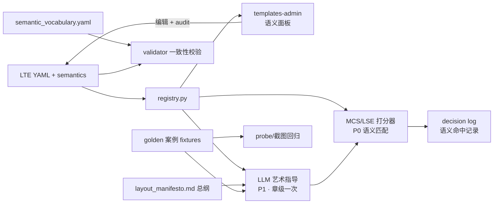

# Travelogue · 模板语义层 PRD（Template Semantic Layer · TSL）

| 属性 | 内容 |
|------|------|
| **产品代号** | Travelogue |
| **文档版本** | v0.1.0 |
| **状态** | Draft · 待评审 |
| **特性代号** | TSL（Template Semantic Layer，模板语义层） |
| **文档类型** | LTE 语义扩展 + 打分器语义匹配 + LLM 艺术指导 + 后台管理（前后端）PRD |
| **前置条件** | Phase 16 LTE 稳定；Phase 13 模板治理控制台（`/templates-admin`）已上线；MCS / LSE 可用 |
| **关联文档** | [DESIGN-PHASE16-layout-template-engine.md](./DESIGN-PHASE16-layout-template-engine.md)、[GUIDE-PHASE16-layout-template-engine.md](./GUIDE-PHASE16-layout-template-engine.md)、[DESIGN-PHASE17-layout-strategy-engine.md](./DESIGN-PHASE17-layout-strategy-engine.md)、[LAYOUT-SCORING.md](./LAYOUT-SCORING.md)、[PRD-screen-editorial-2land.md](./PRD-screen-editorial-2land.md)、[RENDER-CONTRACT.md](./RENDER-CONTRACT.md) |
| **更新日期** | 2026-07-04 |

> **定位**
>
> - 为每一个 LTE 屏模板补齐一份**机器与人都能消费的"使用契约"**：适用场景、适用照片、何时不用、与近邻模板的区别、golden 案例。
> - 语义信息分三层：**硬约束**（已有，结构化，确定性校验）→ **软偏好**（受控词表标签，打分器消费）→ **自然语言说明**（LLM 艺术指导与人类维护者消费）。
> - 在既有 **`/templates-admin` 治理控制台**上扩展"语义说明"管理界面：查看、编辑、修订审计、一致性校验、golden 案例绑定。
> - 铁律：**硬约束永远由确定性代码强制执行；自然语言说明只影响候选之间的取舍，不能突破几何护栏。**

---

## 1. 背景与问题

### 1.1 现状

LTE 模板（`travelogue/layout_templates/templates/*.yaml`）目前已有的"语义"信息：

| 字段 | 示例 | 消费方 | 问题 |
|------|------|--------|------|
| `description` | "四图横竖棋盘：TL/BR 横图…" | 仅人类（读 YAML 时） | 自由文本，无结构，算法不消费 |
| `displayName` | `editorial · 4mix · chess-2L2P` | templates-admin 列表 | 仅命名 |
| `scoring.tags` | `[editorial, mixed-4, chess, airy]` | 几乎未被打分器用于语义匹配 | 无受控词表，各模板随意命名 |
| `scoring.base_weight` / `rhythm` | `0.88` / `max_per_chapter: 1` | MCS / LSE | 有效但只表达"用多少"，不表达"何时用" |

挑选算法（MCS `curation/mosaic/scorer.py` + LSE `layout_engine/strategies/default.yaml`）目前的匹配信号以**几何**为主：窗宽、横竖比、人脸裁切、主槽画质。**"这组照片的内容/情绪适合哪个版式"这一层完全缺失**。

### 1.2 用户可感知问题

| ID | 问题 | 体感 |
|----|------|------|
| **TSL-P-01** | 美食连拍被排进 hero 大图屏，风景大片被塞进九宫格 | 「版式和内容不搭」 |
| **TSL-P-02** | 相似模板（如 `mosaic-5-2p3l-equal` vs `mosaic-5-2portrait-3land-balanced`）选用理由不可解释 | 「为什么选这个？换那个不是更好？」 |
| **TSL-P-03** | 新模板上线后没人知道该何时被选中，只能调 `base_weight` 碰运气 | 模板曝光失衡（exposure debt） |
| **TSL-P-04** | 模板 YAML 改了几何，`description` 没人改，文档说谎 | 维护者/AI 被误导 |
| **TSL-P-05** | 未来引入 LLM 做章级排版决策时，没有可供 prompt 的模板知识库 | LLM 只能瞎猜 |

### 1.3 与现有体系的关系

| 子系统 | 关系 |
|--------|------|
| **LTE（Phase 16）** | 本 PRD 在 `layout_template.schema.json` 中新增 `semantics` 顶级字段；`validator.py` 增加语义一致性校验 |
| **MCS / scorer** | P0 起打分器读取语义标签做内容-版式匹配加减分 |
| **LSE（Phase 17）** | 策略包可声明语义权重；语义匹配作为 LSE 的一个 scoring dimension |
| **Phase 13 治理控制台** | `/templates-admin` 新增"语义说明"编辑面板；复用 `admin_store` 的 revision/audit/rollback 机制 |
| **narrate / LLM** | P1 引入"章级艺术指导"（Art Director）可选 LLM 决策，消费语义说明与全局总纲 |
| **decision log** | `mosaicDecisionLog` / `layoutDecisionLog` 记录语义命中项，实现可解释 |

---

## 2. 目标与非目标

### 2.1 目标

| ID | 目标 | 验收口径 |
|----|------|----------|
| **G-TSL-01** | 每个 GA 模板具备完整 `semantics` 区块（适用/不适用/近邻对照/标签） | validator 校验 + admission 清单 |
| **G-TSL-02** | 软偏好标签使用**受控词表**，词表集中定义、可扩展 | `semantic_vocabulary.yaml` + schema enum 校验 |
| **G-TSL-03** | 打分器消费语义标签：内容标签（food/person/scenery 等）与模板 `suitedContent` 匹配产生加减分 | 单测 + fixture 回归，权重可配 |
| **G-TSL-04** | 每个 GA 模板 ≥1 个 golden 案例（照片组特征 + 渲染截图），供回归与 few-shot | fixture 目录 + admission 检查 |
| **G-TSL-05** | `/templates-admin` 可查看、编辑、审计语义说明，编辑走 revision 乐观锁 + audit log | 前端 E2E + API 测试 |
| **G-TSL-06** | 语义说明与结构化字段的一致性由 CI 守护（图数/横竖比声明不一致即 fail） | `cli validate` 扩展 + pre-commit |
| **G-TSL-07** | decision log 记录每屏选用时命中的语义条目，Studio 可展示"为什么选它" | decision log schema 扩展 |
| **G-TSL-08** | （P1）章级 LLM 艺术指导：一章一次调用，读章摘要 + 模板语义卡，输出版式家族偏好与节奏建议，交由确定性求解器执行 | 可开关；关闭时行为与 P0 一致 |
| **G-TSL-09** | 全局"版式总纲"（rhythm grammar / 搭配原则）作为独立可管理文档，与单模板说明分离 | `layout_manifesto.md` + admin 只读展示（P0）/ 可编辑（P1） |

### 2.2 非目标

- **不**把硬约束（photoCount / mix / slot 几何）迁移为自然语言——它们保持结构化并由确定性代码校验。
- **不**做逐屏 LLM 挑选模板（成本/延迟/确定性不可接受，见 §5.3 分工）。
- **不**在本 PRD 内新增或修改任何模板的几何定义。
- **不**做面向终端用户（游记作者）的模板挑选 UI；管理界面仅面向 admin/curator 角色。
- **不**做多语言语义说明（首期仅中文，字段预留 `locale`）。
- P0 **不**引入向量检索/embedding 匹配（P2 可选演进）。

---

## 3. 总体方案

### 3.1 三层语义模型

```text
┌─────────────────────────────────────────────────────────────┐
│ 第 1 层 · 硬约束（已有，不变）                                │
│   photoCount / mix / slots.rect / mainSlotPolicy / gaps      │
│   消费方：validator · MCS 硬过滤 · geometry 校验              │
│   形态：结构化字段 · 确定性代码强制                            │
├─────────────────────────────────────────────────────────────┤
│ 第 2 层 · 软偏好（本 PRD 新增 semantics.* 结构化部分）         │
│   suitedContent / avoidContent / mood / position / pairing   │
│   消费方：MCS/LSE 打分器 · templates-admin 筛选               │
│   形态：受控词表标签 · 打分加减分（可被更高优先级信号覆盖）      │
├─────────────────────────────────────────────────────────────┤
│ 第 3 层 · 自然语言说明（本 PRD 新增 semantics.usage）          │
│   适用场景 / 何时不用 / 与近邻模板的区别 / 设计意图             │
│   消费方：P1 LLM 艺术指导 prompt · 人类维护者 · admin UI       │
│   形态：Markdown 短文 + golden 案例引用                       │
└─────────────────────────────────────────────────────────────┘
```

### 3.2 消费链路



### 3.3 关键设计决策（评审前默认值）

| 项 | 决策 | 理由 |
|----|------|------|
| 语义存储位置 | **与模板同一 YAML 文件**内的 `semantics` 区块 | 避免平行文档漂移（TSL-P-04）；CI 可同文件校验 |
| 词表存储 | `travelogue/layout_templates/semantic_vocabulary.yaml` 单文件 | 集中治理，schema 引用 |
| admin 编辑落盘 | 直接写回模板 YAML + `version` 不变 + audit 记录（语义修订**不**触发几何 version++） | 语义与几何生命周期解耦 |
| 修订并发控制 | 复用 `admin_store` revision 乐观锁（`If-Match`） | 与 Phase 13 一致 |
| LLM 角色 | 章级艺术指导（一次/章），**不做**逐屏排字工 | 成本、确定性、可回归 |
| 语义打分权重 | 进入 LSE 策略包（`strategies/*.yaml`），默认保守（低权重起步） | 可灰度、可 A/B |
| golden 案例 | `tests/_golden/semantics/{templateId}/` + YAML 内引用 | 复用现有 golden 目录约定 |

---

## 4. 术语

| 术语 | 定义 |
|------|------|
| **TSL** | Template Semantic Layer，模板语义层 |
| **语义卡（Semantic Card）** | 单个模板 `semantics` 区块渲染出的完整"使用契约"视图（admin UI / LLM prompt 单元） |
| **受控词表** | `semantic_vocabulary.yaml` 中集中定义的合法标签集合，分维度（content / mood / position / density） |
| **近邻对照（siblings）** | 与本模板窗宽/构图相近、易混淆的模板列表及"区别一句话" |
| **golden 案例** | 一组真实照片特征（宽高比、标签、时间跨度）+ 该模板填充后的基准截图 |
| **版式总纲（Manifesto）** | 跨模板的全局搭配原则：节奏文法、文字预算、多样性要求 |
| **艺术指导（Art Director / AD）** | P1 可选 LLM 决策层：章级一次调用，输出版式家族偏好，不直接产出 screens |
| **语义命中（semantic hits）** | 某屏选用某模板时，实际生效的语义加减分条目集合，写入 decision log |

---

## 5. 数据模型规格

### 5.1 LTE YAML `semantics` 扩展字段（权威定义）

在 `layout_template.schema.json` 新增顶级可选字段 `semantics`（GA 模板 admission 时要求必填）：

```yaml
# 示例：screen-mosaic-5-main-hero-plus-4.yaml 追加
semantics:
  schemaVersion: 1
  locale: zh-CN

  # ── 第 2 层 · 软偏好（受控词表，打分器消费）──
  suitedContent: [scenery, architecture, street]   # 内容维度，词表 content.*
  avoidContent: [document, screenshot]             # 命中则减分（非硬禁）
  mood: [grand, dense]                             # 情绪维度，词表 mood.*
  chapterPosition: [body]                          # open | body | peak | close
  density: dense                                   # airy | balanced | dense
  pairing:
    goodAfter: [airy, editorial]                   # 前一屏为这些 density/family 时加分（呼吸节奏）
    badAfter: [dense-grid]                         # 前一屏同为密格时减分
  heroDemand: strong                               # none | weak | strong：窗口内需要明确 hero 吗

  # ── 第 3 层 · 自然语言说明（LLM / 人类消费）──
  usage:
    summary: >
      主图引领的 6 图密度屏：一张明确的 hero 横图占 2×2，其余 5 张
      作为细节铺陈。适合"一个主场景 + 一串环境细节"的叙事时刻。
    whenToUse: |
      - 窗口内存在 hero 分显著领先的横图（heroDemand=strong）
      - 章节中段需要一次信息密度高峰
      - 同场景连拍较多、单独成屏会稀释节奏时
    whenNotToUse: |
      - 窗口内图片质量均匀、无明确主次（会显得主槽名不副实）
      - 章内已出现过 dense 密度屏且未经过呼吸屏缓冲
      - 全景/竖图为主的窗口（mix 硬约束本就不满足，此条用于提醒维护者）
    siblings:
      - id: screen-mosaic-6-main-hero-plus-5
        difference: 同为 hero 引领，但本模板底行三图更平，适合细节等权；6-main 变体右列更强调纵向对比。
      - id: screen-landscape-6
        difference: landscape-6 是无主次等分网格；当窗口没有明确 hero 时应降级选它。
    designIntent: >
      模拟杂志"主打图 + 花絮带"版式；底行三图刻意等宽，
      避免与右列双图形成第二视觉焦点。

  # ── golden 案例引用 ──
  goldenCases:
    - id: hero-plus-4-lakeside
      fixture: tests/_golden/semantics/screen-mosaic-5-main-hero-plus-4/lakeside/
      note: 湖景 hero + 岸边细节 5 张；hero 分差 0.31，选用理想。

  # ── 修订元数据（admin 写入，只读展示）──
  revision:
    lastEditedBy: admin
    lastEditedAt: "2026-07-04T10:00:00+08:00"
```

**字段规格表**：

| 字段 | 类型 | 必填（GA） | 校验 |
|------|------|-----------|------|
| `semantics.schemaVersion` | int | 是 | 当前恒 1 |
| `suitedContent` / `avoidContent` | string[] | 是 / 否 | ∈ 词表 `content.*`；两列表不得相交 |
| `mood` | string[] | 否 | ∈ 词表 `mood.*` |
| `chapterPosition` | string[] | 是 | ⊆ {open, body, peak, close} |
| `density` | enum | 是 | airy \| balanced \| dense；与槽数启发式一致性告警（≥5 槽却标 airy → warn） |
| `pairing.goodAfter/badAfter` | string[] | 否 | ∈ 词表 `density.*` ∪ family 名 |
| `heroDemand` | enum | 是 | none \| weak \| strong；有 `mainSlotPolicy` 却标 none → error |
| `usage.summary` | string ≤120 字 | 是 | 非空 |
| `usage.whenToUse` / `whenNotToUse` | markdown ≤500 字 | 是 | 非空；GA 要求 whenNotToUse ≥2 条 |
| `usage.siblings[]` | {id, difference} | 是（有近邻时） | id 必须存在于 registry；difference ≤80 字 |
| `usage.designIntent` | string ≤200 字 | 否 | — |
| `goldenCases[]` | {id, fixture, note} | GA ≥1 | fixture 路径存在性校验 |
| `revision.*` | object | 否 | admin API 写入，手改 YAML 时可缺省 |

### 5.2 受控词表 `semantic_vocabulary.yaml`

新文件：`travelogue/layout_templates/semantic_vocabulary.yaml`

```yaml
schemaVersion: 1
dimensions:
  content:
    # 与 ingest tags（travelogue/media 打标）对齐的映射写在 ingestTagMap
    - id: scenery        # 风景
      ingestTagMap: [landscape, mountain, sea, sky, lake]
    - id: person         # 人物/合影
      ingestTagMap: [person, face, group]
    - id: food           # 美食
      ingestTagMap: [food, drink]
    - id: architecture   # 建筑
      ingestTagMap: [building, architecture, temple]
    - id: street         # 街拍/市井
      ingestTagMap: [street, market, sign]
    - id: detail         # 静物细节
      ingestTagMap: [object, closeup]
    - id: document       # 票据/截图（通常应避免）
      ingestTagMap: [screenshot, document]
  mood:
    - id: grand          # 宏大
    - id: intimate       # 亲密/小景
    - id: playful        # 轻快
    - id: quiet          # 静谧
    - id: dense          # 信息密集
  density:
    - id: airy
    - id: balanced
    - id: dense
  position:
    - id: open
    - id: body
    - id: peak
    - id: close
```

规则：

- 模板 YAML 中出现词表外标签 → `cli validate` **error**。
- 词表新增条目 → 普通 PR；删除/改名 → 必须先跑迁移脚本扫描全部模板引用。
- `ingestTagMap` 是语义匹配的桥：照片 ingest tags → 词表 content 维度 → 模板 suited/avoid 匹配。

### 5.3 全局版式总纲 `layout_manifesto.md`

新文件：`travelogue/layout_templates/layout_manifesto.md`。内容分节固定（供 prompt 组装与 admin 展示）：

| 节 | 内容 | 消费方 |
|----|------|--------|
| `## 节奏原则` | 大图与密格交替、每章 dense 屏配额、呼吸屏建议位置 | AD prompt · 人类 |
| `## 文字预算` | 章标题 + 每章 ≤2 句、photos-only 行为 | AD prompt |
| `## 多样性要求` | 每篇 trip 版式家族覆盖度目标、禁止全篇同族 | AD prompt · 打分器（P1 结构化镜像） |
| `## 家族速查` | 各版式家族一句话定位（自动从 registry 生成，禁止手写漂移） | AD prompt · admin |

P0 总纲为静态文件 + admin 只读展示；P1 支持 admin 编辑（同 audit 机制）。

### 5.4 golden 案例 fixture 结构

```text
tests/_golden/semantics/{templateId}/{caseId}/
├── case.yaml          # 照片特征清单（不含原图）：aspectKind、tags、takenAt 跨度、hero 分差
├── photos/            # 可选：小尺寸样例图（≤1200px，已脱敏）
└── baseline.png       # 该模板填充后的基准截图（probe_screenshot 产出）
```

`case.yaml` 示例：

```yaml
caseId: lakeside
templateId: screen-mosaic-5-main-hero-plus-4
window:
  - { aspectKind: landscape, tags: [scenery, lake], heroScore: 0.87 }
  - { aspectKind: landscape, tags: [scenery], heroScore: 0.56 }
  - { aspectKind: landscape, tags: [person], heroScore: 0.51 }
  - { aspectKind: landscape, tags: [detail], heroScore: 0.44 }
  - { aspectKind: landscape, tags: [street], heroScore: 0.48 }
  - { aspectKind: landscape, tags: [scenery], heroScore: 0.52 }
expected:
  selected: true
  mainSlotAssetIndex: 0
note: hero 分差显著，主槽归属明确。
```

用途：① probe 回归（截图 diff）；② 打分器单测 fixture（expected.selected）；③ AD few-shot 示例。

---

## 6. 算法消费规格

### 6.1 P0 · 打分器语义匹配（确定性）

**位置**：`curation/mosaic/scorer.py` 新增语义项；权重进 LSE 策略包 `layout_engine/strategies/default.yaml`。

匹配流程（对每个窗口候选模板）：

1. 窗口内每张照片的 ingest tags → 经词表 `ingestTagMap` 归一为 content 标签集合 `W`。
2. `suitedMatch = |W ∩ suitedContent| / |W|`，`avoidMatch = |W ∩ avoidContent| / |W|`。
3. 语义分 `S_sem = w_suited × suitedMatch − w_avoid × avoidMatch + S_position + S_pairing + S_hero`：
   - `S_position`：候选模板 `chapterPosition` 包含当前章位（open/body/peak/close）→ 小幅加分；不含 → 小幅减分（非硬禁）。
   - `S_pairing`：前一屏 density/family 命中 `goodAfter` → 加分；命中 `badAfter` → 减分。
   - `S_hero`：`heroDemand=strong` 且窗口 hero 分差 < 阈值 → 减分（呼应 whenNotToUse 第一条）。
4. `S_sem` 以 `semantic_weight`（默认 **0.15**，保守起步）计入总分；**任何情况下不推翻硬约束过滤**。

**策略包配置**：

```yaml
# layout_engine/strategies/default.yaml 追加
semantics:
  enabled: true
  weight: 0.15
  suited_weight: 1.0
  avoid_weight: 1.4        # 「不适合」比「适合」更重
  position_bonus: 0.05
  pairing_bonus: 0.08
  hero_gap_threshold: 0.15
```

**decision log 扩展**（`mosaicDecisionLog` 条目）：

```json
{
  "screenId": "ch-02-sc-03",
  "patternId": "screen-mosaic-5-main-hero-plus-4",
  "semanticHits": {
    "suited": ["scenery"],
    "avoided": [],
    "position": "body:+0.05",
    "pairing": "goodAfter:editorial:+0.08",
    "heroGap": 0.31,
    "semScore": 0.121
  }
}
```

### 6.2 P1 · 章级 LLM 艺术指导（可选，flag 控制）

**开关**：`config.yaml` → `layout.art_director.enabled`（默认 false）。

**调用契约**（每章一次）：

| 项 | 内容 |
|----|------|
| **输入** | ① 章摘要：照片数、横竖分布、content 标签直方图、时间跨度、hero 候选、章位；② 候选模板语义卡（仅该章窗宽可行的模板，含 usage 全文 + siblings）；③ 版式总纲全文；④ 每模板 ≤1 个 golden 案例摘要 |
| **输出**（结构化 JSON） | `familyPreference`（版式家族排序及权重乘子 0.5–1.5）、`peakWindowHint`（建议 hero 屏位置）、`rhythmNote`（自由文本，仅入 log）、`avoidPatterns`（本章建议回避的 patternId 列表） |
| **执行方式** | 输出转为该章的**临时打分偏置**注入 MCS/beam，确定性求解器照常执行 |
| **护栏** | 输出中不存在于 registry 的 patternId → 忽略并 warn；权重乘子截断到 [0.5, 1.5]；LLM 调用失败/超时 → 静默降级为 P0 行为 |
| **可观测** | `layoutDecisionLog.artDirector` 记录完整输入摘要 hash、输出、耗时；Studio 可展示 |

**明确不做**：LLM 不产出 screens、不指定单屏 assetId 分配、不逐屏调用。

### 6.3 一致性守护（CI / validator / admission）

`travelogue/layout_templates/validator.py` 与 `cli.py validate` 扩展：

| 检查 | 级别 | 规则 |
|------|------|------|
| V-SEM-01 | error | 标签必须在词表内 |
| V-SEM-02 | error | `suitedContent ∩ avoidContent = ∅` |
| V-SEM-03 | error | `siblings[].id` 必须存在于 registry |
| V-SEM-04 | error | `goldenCases[].fixture` 路径必须存在 |
| V-SEM-05 | error | `heroDemand=none` 但存在 `mainSlotPolicy` |
| V-SEM-06 | warn | `usage.summary` 中声明的图数与 `photoCount` 不一致（正则抽取"N 图/N 张"） |
| V-SEM-07 | warn | ≥5 槽但 `density=airy` |
| V-SEM-08 | error（GA admission） | GA 模板缺 `semantics` 必填字段或 golden 案例 |

`admission.py` GA 清单追加：

- [ ] `semantics` 必填字段齐全且 validate 通过
- [ ] ≥1 golden 案例 + baseline 截图
- [ ] `whenNotToUse` ≥2 条
- [ ] 有近邻模板时 `siblings` 非空

---

## 7. 后端功能规格（Studio Admin API）

### 7.1 总则

- 全部挂载在既有 `studio_routes.py` 路由表 + `template_admin_handlers.py`（或新建 `semantic_handlers.py`），鉴权复用 `_auth`：**读 = viewer，写 = curator，词表/总纲写 = admin**。
- 并发控制复用 `admin_store` revision（`If-Match` / `X-Registry-Revision`），冲突返回 409 `E_TEMPLATE_REVISION_CONFLICT`。
- 所有写操作进 audit log（复用 `list_audit` 存储），action 前缀 `semantics.*`。

### 7.2 API 列表

| # | 方法 · 路径 | 功能 | 角色 |
|---|-------------|------|------|
| A1 | `GET /api/templates-admin/semantics` | 全量语义概览：每模板完备度（missing 字段清单）、词表版本、总纲摘要 | viewer |
| A2 | `GET /api/templates-admin/semantics/{templateId}` | 单模板语义卡全文 + revision + 校验结果 | viewer |
| A3 | `PATCH /api/templates-admin/semantics/{templateId}` | 局部更新 `semantics` 字段；服务端跑 V-SEM 校验，error 拒绝、warn 放行并回传 | curator |
| A4 | `GET /api/templates-admin/semantics/{templateId}/history` | 该模板语义修订历史（audit 过滤） | viewer |
| A5 | `POST /api/templates-admin/semantics/{templateId}/rollback` | 回滚到指定语义修订 | admin |
| A6 | `GET /api/templates-admin/semantics/vocabulary` | 词表全文 + 使用统计（每标签被几个模板引用） | viewer |
| A7 | `PATCH /api/templates-admin/semantics/vocabulary` | 词表增改（删除需先通过引用扫描，有引用则 409） | admin |
| A8 | `GET /api/templates-admin/semantics/manifesto` | 版式总纲全文（P0 只读来源于文件） | viewer |
| A9 | `PUT /api/templates-admin/semantics/manifesto` | 总纲更新（P1） | admin |
| A10 | `GET /api/templates-admin/semantics/{templateId}/golden` | golden 案例列表 + baseline 缩略图 | viewer |
| A11 | `POST /api/templates-admin/semantics/{templateId}/golden` | 从现有 trip 选窗口生成 golden 案例（写 case.yaml + 触发 probe 截图） | curator |
| A12 | `POST /api/templates-admin/semantics/validate` | 对提交中的语义草稿做 dry-run 校验（编辑器实时用） | viewer |
| A13 | `GET /api/templates-admin/semantics/coverage` | 语义命中统计：近 N 次排版中各模板 semanticHits 聚合（读 decision log） | viewer |

**A3 请求示例**：

```http
PATCH /api/templates-admin/semantics/screen-mosaic-5-main-hero-plus-4
If-Match: "42"
Content-Type: application/json

{
  "usage": { "whenNotToUse": "…" },
  "suitedContent": ["scenery", "architecture", "street"]
}
```

**A3 响应（warn 放行示例）**：

```json
{
  "ok": true,
  "revision": 43,
  "validation": {
    "errors": [],
    "warnings": [{ "code": "V-SEM-07", "message": "6 槽模板 density 建议 dense" }]
  }
}
```

### 7.3 落盘与缓存

| 项 | 行为 |
|----|------|
| 写回目标 | 模板 YAML 文件的 `semantics` 区块（保持其余区块字节不变，使用 round-trip YAML 库或区块级替换） |
| registry 缓存 | 写成功后失效 `registry.cache.json` 并热重载 |
| 几何 `version` | **不**递增（语义修订独立；`revision.lastEditedAt` 更新） |
| 备份 | 写前快照进 `.version_history/`（复用现有目录约定，文件名带 `semantics` 标记） |

### 7.4 后端任务分解

| 任务 | 模块 | 阶段 |
|------|------|------|
| B1 · `layout_template.schema.json` 增加 `semantics` 定义 | `layout_templates/` | P0 |
| B2 · `semantic_vocabulary.yaml` + 加载/校验模块 `semantic_vocab.py` | `layout_templates/` | P0 |
| B3 · `validator.py` V-SEM-01…08 + `cli validate` 接线 | `layout_templates/` | P0 |
| B4 · `registry.py` 暴露 `semantics` 到 `admin_snapshot` / MCS adapter | `layout_templates/` · `mosaic/lte_adapter.py` | P0 |
| B5 · scorer 语义项 + 策略包字段 + 单测 | `mosaic/scorer.py` · `layout_engine/` | P0 |
| B6 · decision log `semanticHits` 写入 | `mosaic/compose.py` | P0 |
| B7 · API A1–A5、A12（语义 CRUD + 校验） | `web/studio_handlers/semantic_handlers.py` | P0 |
| B8 · API A6–A8、A10（词表/总纲/golden 只读） | 同上 | P0 |
| B9 · API A11（golden 生成 + probe 截图任务） | 同上 + `probe_screenshot.py` | P1 |
| B10 · API A9、A13（总纲编辑 / 命中统计） | 同上 | P1 |
| B11 · 艺术指导模块 `layout_engine/art_director.py`（prompt 组装、调用、护栏、降级） | `layout_engine/` | P1 |
| B12 · admission GA 清单扩展 | `admission.py` | P0 |
| B13 · 存量 28 个模板的 `semantics` 初稿批量补齐（脚本生成骨架 + 人工润色） | `scripts/` | P0 |

---

## 8. 前端功能规格（templates-admin 扩展）

### 8.1 信息架构

在既有 `/templates-admin`（`templates/studio/templates-admin.html`）增加顶层 Tab：

```text
[ 模板列表 ] [ 语义说明 ]* [ 词表 ]* [ 版式总纲 ]* [ 审计 ] [ 看板 ]
                 ↑新增        ↑新增      ↑新增
```

同时在原"模板列表"每行追加**语义完备度徽标**（✅ 完整 / ⚠ 缺 N 项 / ✖ 无），点击跳转语义说明 Tab 对应模板。

### 8.2 界面 1 · 语义说明 Tab（核心）

**布局**（桌面 ≥1200px，左右分栏）：

```text
┌────────────┬──────────────────────────────────────────────┐
│ 模板导航列   │  语义卡编辑区                                  │
│            │  ┌────────────────────────────────────────┐  │
│ 🔍 搜索     │  │ 头部：displayName · status · 完备度     │  │
│ ▾ 按家族分组 │  │       几何缩略图（slots rect 示意 SVG）  │  │
│  mosaic-5  │  ├────────────────────────────────────────┤  │
│  ● hero+4  │  │ §软偏好（标签选择器，仅词表内可选）        │  │
│  ○ 2p3l    │  │   适用内容 [scenery ×][architecture ×]+ │  │
│  portrait  │  │   避免内容 [document ×]+                │  │
│  editorial │  │   情绪/密度/章位/pairing/heroDemand      │  │
│  …         │  ├────────────────────────────────────────┤  │
│            │  │ §使用说明（markdown 编辑器 + 实时预览）    │  │
│ 完备度过滤   │  │   summary / whenToUse / whenNotToUse    │  │
│ ☐ 只看缺失  │  │   designIntent                          │  │
│            │  ├────────────────────────────────────────┤  │
│            │  │ §近邻对照（siblings 表格，id 下拉选择）    │  │
│            │  ├────────────────────────────────────────┤  │
│            │  │ §golden 案例（卡片：截图 + case 摘要）    │  │
│            │  │   [+ 从 trip 生成案例]（P1）             │  │
│            │  ├────────────────────────────────────────┤  │
│            │  │ 校验结果条：0 error · 1 warning ▾        │  │
│            │  │ [查看修订历史] [回滚]   [放弃] [保存]     │  │
│            │  └────────────────────────────────────────┘  │
└────────────┴──────────────────────────────────────────────┘
```

**交互要点**：

| 项 | 行为 |
|----|------|
| 实时校验 | 编辑防抖 800ms 调 A12 dry-run；error 阻断保存按钮，warning 黄色提示可保存 |
| 标签选择器 | 仅可从词表选择；输入不存在的标签时提示"去词表 Tab 申请新增"（不允许就地造词） |
| 保存 | `PATCH` A3 携带 `If-Match`；409 时弹"他人已修改"对比框（本地版 vs 服务器版） |
| 修订历史 | 抽屉展示 A4 结果：时间、操作者、字段级 diff（复用 `handle_templates_admin_version_diff` 的 diff 组件风格） |
| 几何缩略图 | 由 slots rect 前端渲染 SVG，帮助编辑者对照几何写说明（只读） |
| siblings 联动 | 选择 sibling id 后展示对方 summary，便于写"区别一句话"；保存时校验互引提示（A 写了 B，B 未写 A → 温和提示） |
| 权限 | viewer 全部只读（编辑控件 disabled + 提示）；curator 可编辑语义；admin 才见回滚按钮 |

### 8.3 界面 2 · 词表 Tab

| 区块 | 内容 |
|------|------|
| 维度分组表格 | content / mood / density / position 四组；每行：id、中文名、`ingestTagMap`、被引用模板数 |
| 新增标签 | admin 弹窗表单（id、维度、ingestTagMap）；提交走 A7 |
| 删除保护 | 被引用数 >0 时删除按钮禁用，展示引用模板列表链接 |
| 使用统计 | 每标签 hover 展示：近 30 天排版中该标签命中次数（A13 数据，P1） |

### 8.4 界面 3 · 版式总纲 Tab

- P0：渲染 `layout_manifesto.md`（A8），只读；"家族速查"节标注"自动生成"。
- P1：admin 可编辑（markdown 编辑器 + 预览 + audit），保存走 A9。

### 8.5 界面 4 · 可解释性（既有页面增强）

| 位置 | 增强 |
|------|------|
| templates-admin 看板 | 新卡片"语义完备度"：GA 模板完整率、缺失 Top 列表 |
| 决策日志页（`handle_templates_admin_decisions`） | 每条决策展开显示 `semanticHits`：命中标签、加减分明细、（P1）艺术指导偏好摘要 |
| Studio 游记预览工具条（P2，非本期） | 单屏"为什么是这个版式"气泡 |

### 8.6 前端任务分解

| 任务 | 交付物 | 阶段 |
|------|--------|------|
| F1 · Tab 骨架 + 模板导航列 + 完备度徽标 | `templates-admin.html`（或拆分 `semantics-admin.js`） | P0 |
| F2 · 软偏好标签选择器（词表驱动） | 同上 | P0 |
| F3 · usage markdown 编辑器 + 预览 + 实时 dry-run 校验 | 同上 | P0 |
| F4 · siblings 编辑表格 + 互引提示 | 同上 | P0 |
| F5 · 保存/冲突/修订历史/回滚流 | 同上 | P0 |
| F6 · 词表 Tab（只读 + admin 增改） | 同上 | P0 |
| F7 · 总纲 Tab 只读渲染 | 同上 | P0 |
| F8 · golden 案例卡片展示 | 同上 | P0 |
| F9 · golden "从 trip 生成"向导（选 trip → 选窗口 → 预览 → 提交 A11） | 同上 | P1 |
| F10 · 决策日志 semanticHits 展示 + 看板完备度卡片 | 同上 | P1 |
| F11 · 总纲编辑器 | 同上 | P1 |

---

## 9. 验收标准

| ID | 级别 | 描述 |
|----|------|------|
| **AC-TSL-01** | P0 | `cli validate` 对含非法标签/缺失必填/断链 sibling 的模板返回非零退出码 |
| **AC-TSL-02** | P0 | 全部 GA 模板 `semantics` 完整，validate 0 error |
| **AC-TSL-03** | P0 | 语义打分开启后，food 连拍窗口在 grid 类与 hero 类候选间优先选中 suitedContent 含 food 的模板（fixture 回归） |
| **AC-TSL-04** | P0 | `semantics.enabled=false` 时排版输出与基线逐字节一致（回归保障） |
| **AC-TSL-05** | P0 | admin 编辑语义 → 保存 → YAML 落盘、registry 热重载、audit 有记录、几何 version 不变 |
| **AC-TSL-06** | P0 | 并发编辑冲突返回 409，前端展示对比框 |
| **AC-TSL-07** | P0 | viewer 角色对全部写接口收到 403 |
| **AC-TSL-08** | P0 | decision log 每屏含 `semanticHits`，字段完整 |
| **AC-TSL-09** | P1 | 艺术指导开启：每章恰 1 次 LLM 调用；失败静默降级；输出越界值被截断并 warn |
| **AC-TSL-10** | P1 | golden 生成向导产出 case.yaml + baseline.png，且新案例进入 probe 回归集 |
| **AC-TSL-11** | P1 | 词表删除被引用标签被 409 拒绝 |
| **AC-TSL-12** | P2 | 语义命中统计页数据与 decision log 抽样一致 |

---

## 10. 实施路线

| 阶段 | 周期建议 | 交付 | 涉及任务 |
|------|----------|------|----------|
| **W0 · 数据与校验** | 1 周 | schema + 词表 + validator + 28 模板语义骨架脚本 | B1–B4、B12、B13 |
| **W1 · 算法消费** | 1 周 | scorer 语义项 + 策略包 + decision log + fixture 回归 | B5、B6 |
| **W1 · 后端 API** | 与上并行 | A1–A8、A10、A12 | B7、B8 |
| **W2 · 前端管理台** | 1.5 周 | 语义 Tab + 词表 Tab + 总纲只读 + golden 展示 | F1–F8 |
| **W3 · 内容补齐** | 持续 | GA 模板语义人工润色 + golden 案例 ≥1/模板 | 编辑工作 |
| **W4 · P1 增强** | 评审后排期 | 艺术指导 + golden 向导 + 命中统计 + 总纲编辑 | B9–B11、F9–F11 |

**灰度策略**：语义打分 `weight` 从 0.15 起步 → 观察 `web-screens-ab-checklist.md` 口径的对比 → 逐步上调；艺术指导先在 dogfood trips 开启。

---

## 11. 风险与缓解

| 风险 | 影响 | 缓解 |
|------|------|------|
| 语义说明与几何再度漂移 | 文档说谎、AD 被误导 | 同文件存储 + V-SEM-06 一致性校验 + 几何 PR 模板强制勾选"已核对 semantics" |
| 词表维度增长失控 | 标签泛滥、匹配噪声 | 新增走 admin 审批；每维度设软上限（content ≤15）并在词表 Tab 提示 |
| 语义打分与几何打分互相打架 | 排版回退 | 语义权重独立可关（AC-TSL-04 保证零影响回退路径）；beam 指标监控 `layoutMetrics` |
| YAML round-trip 写回破坏注释/格式 | git diff 噪声、评审困难 | 采用 ruamel.yaml 保留式写回；写回后跑 validate + git diff 行数护栏（>语义区块行数 → 拒绝落盘） |
| LLM 艺术指导输出不稳定 | 章间风格抖动 | 结构化输出 + 截断护栏 + 失败降级；同一 trip 重排使用缓存决策（输入 hash 命中则复用） |
| 28 个存量模板补齐工作量大 | 上线拖期 | B13 脚本从几何自动生成骨架（density/heroDemand/图数可推导），人工只写 usage 三段 |
| 管理台单文件 `templates-admin.html` 持续膨胀（现 47KB） | 维护困难 | 语义面板拆分为独立 JS/CSS 资源，经 `static_handlers` 挂载 |

---

## 12. 开放问题（评审待定）

| # | 问题 | 选项 |
|---|------|------|
| Q1 | `semantics` 编辑是否需要 review 流（草稿→审核→生效）？ | A 直接生效+audit（推荐 P0）· B 复用 `handle_templates_admin_review` 双人审 |
| Q2 | 词表 `ingestTagMap` 与 ingest 打标模块的对齐由谁守护？ | 建议：ingest tags 枚举导出为常量，词表校验引用 |
| Q3 | 艺术指导使用的 LLM 供应商/模型与 narrate 是否共用配置？ | 建议共用 `config.llm.*` 增加 `artDirector` profile |
| Q4 | golden 案例照片是否允许入库（隐私）？ | 建议默认仅存特征 `case.yaml` + baseline 截图，样例原图可选 |
| Q5 | 语义完备度是否阻断 experimental → beta 晋升（现仅 GA 强制）？ | 建议 beta 起要求 summary + 软偏好，GA 要求全量 |
| Q6 | `chapterPosition` 与现有 `arc_patterns`（五幕）如何映射 peak？ | W1 与 curation 侧对齐字典 |

---

## 13. 附录

### 13.1 语义卡 → LLM prompt 组装示例（P1）

```text
[系统] 你是旅行摄影杂志的艺术指导。以下是版式总纲：
{layout_manifesto.md 全文}

[用户] 本章概况：
- 照片 23 张：横 14 / 竖 8 / 全景 1；内容分布 scenery 52% · person 22% · food 17% · street 9%
- 章位：body（第 3/5 章）；hero 候选分差 0.28；时间跨度 1 天
可用模板语义卡（12 张，已按硬约束过滤）：
--- screen-mosaic-5-main-hero-plus-4 ---
{semantics.usage 全文 + suited/avoid/mood/density + golden 案例摘要}
--- …
请输出 JSON：familyPreference / peakWindowHint / avoidPatterns / rhythmNote。
```

### 13.2 完备度计算口径（admin 徽标）

```text
必填集（GA）= { suitedContent, chapterPosition, density, heroDemand,
               usage.summary, usage.whenToUse, usage.whenNotToUse(≥2条),
               siblings(有近邻时), goldenCases(≥1) }
完备度 = 已填 / 必填集大小；✅=100% · ⚠=部分 · ✖=0
```

### 13.3 修订记录

| 版本 | 日期 | 说明 |
|------|------|------|
| v0.1.0 | 2026-07-04 | 初稿：三层语义模型、词表、打分消费、AD、后端 API、管理台前端、验收与路线 |
