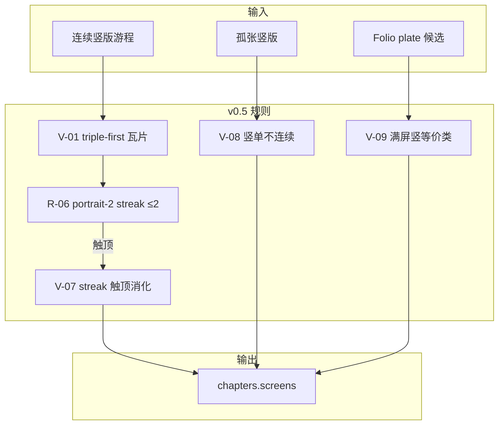

# Travelogue · 排版规则优化产品需求文档（PRD）

| 属性 | 内容 |
|------|------|
| **产品代号** | Travelogue |
| **文档版本** | v0.3 |
| **状态** | Draft · 已并入讨论会第一、二批候选 · 待产品拍板 §11 开放项 |
| **功能代号** | 排版规则优化 v0.5（竖版节奏 + 连续禁令收紧） |
| **前置条件** | `layoutEngine=screens`；[LAYOUT-PLANNER.md](./LAYOUT-PLANNER.md) v0.4.x 已落地；day-scope 规划（`screen_plan_scope=day`）为默认 |
| **关联文档** | [WORKSHOP-排版规则优化讨论会.md](./WORKSHOP-排版规则优化讨论会.md)、[LAYOUT-PLANNER.md](./LAYOUT-PLANNER.md)、[PRD-PHASE17-layout-strategy-engine.md](./PRD-PHASE17-layout-strategy-engine.md)、[PRD-EXPERIENCE-附录C-Folio版式.md](./PRD-EXPERIENCE-附录C-Folio版式.md)、[PRD-PHASE16-layout-template-engine.md](./PRD-PHASE16-layout-template-engine.md) |
| **实现入口（规划）** | `travelogue/curation/screen_layout_state.py`、`screen_planner.py`、`screen_planner_stages.py`、`screen_planner_attach.py`、`layout_engine/strategies/default.yaml` |
| **验收样本** | `trips/demo-2025-2`（2025东澳岛2 · 122 张 · 竖版/人物连拍为主） |
| **更新日期** | 2026-06-10 |

> **定位**
>
> - 在 **不推翻 pair-first 竖版组屏主原则** 的前提下，补充 **竖版双列连续上限** 与 **单竖连续禁令** 的可执行规则，解决「开篇双竖墙」「单竖落单过多」等观感问题。
> - 规则在 **curate 规划阶段** 硬约束生效；**不**依赖 render/folio 层遮丑。
> - 与 LSE 策略包 `rhythm.consecutive_bans` 对齐，补齐当前「策略有声明、引擎未接线」缺口。

---

## 1. 背景与问题

### 1.1 触发场景

用户对游记 [demo-2025-2](http://127.0.0.1:8766/demo-2025-2/index.html)（`trips/demo-2025-2`）的排版提出两点改进诉求：

1. **两张竖版并排（`screen-portrait-2`）不能连续出现 3 次**，最多允许 **2 次**连续。
2. **单张竖版（`screen-portrait-1`）不能连续出现 2 次**；现有 pair-first 原则在部分场景下未达预期。

### 1.2 demo-2025-2 定量结论（2026-06-10 审计）

| 维度 | 数值 |
|------|------|
| 照片 | 122 张（竖 54 / 横 61 / 全景 6 / 方 1） |
| 内容屏 | 49 屏（另有呼吸留白、folio plate） |
| 引擎 | `screens`（本 trip LSE **未启用**） |
| `screen-portrait-2` | 13 次（几乎均为 `person-pair`） |
| `screen-portrait-1` | 4–5 次 |

**规则（1）违规 — 明确存在：**

- **ch-01 段 A**（屏 #3–#7）：4 连 `portrait-2`（asset-005–012，22:02–22:04 人物连拍）
- **ch-01 段 B**（屏 #12–#16）：4 连 `portrait-2`（asset-018–027，22:32–22:53 人物连拍）
- 呼吸屏（#5、#15）存在，但 **不改变 content pattern streak**

**规则（2）违规 — 数据层存在、页面层被 folio 部分掩盖：**

- `trip.json`：`#41 portrait-1 (asset-001)` → `#42 portrait-1 (asset-003)` 连续
- `index.html`：`#41 screen-plate` → `#42 portrait-1`（pattern 不连续，但 **视觉均为满屏竖图**）

**pair-first 在本 trip 的真实行为：**

- 在 **连续竖版游程内** 有效（ch-01 两段 8 张均成对）
- 在 **游程外 / 跨章 / folio / force flush** 路径仍产生孤张单竖

### 1.3 工程缺口（根因）

| 缺口 | 说明 |
|------|------|
| 无 `portrait-2` streak 上限 | `screen-portrait-2` 归类为 `LayoutKind=other`，不受连续禁令约束 |
| `force=True` 过多 | `_drain_portrait_run_pair_first`、边界 flush 绕过 `can_emit_pattern` |
| LSE `consecutive_bans` 未接线 | `default.yaml` 有声明，`ScreenLayoutPlannerState` 仍硬编码 |
| folio plate 与节奏 state 脱节 | 规划为 `portrait-1`，渲染为 `screen-plate`，streak 计数不一致 |
| carry deferred 污染 state | 未落章的单竖在 plan 阶段已 `note_screen` |

---

## 2. 目标与非目标

### 2.1 目标

| ID | 目标 |
|----|------|
| **G-01** | 全 trip 阅读序：`screen-portrait-2` **连续 ≤2 屏** |
| **G-02** | 全 trip 阅读序：**满屏竖单**（见 §4.1 V-09）**连续 ≤1 屏**（等价于禁止连续两单竖） |
| **G-03** | 竖版 **triple-first**：优先三列；双列仅余 2 兜底；单列仅余 1 |
| **G-04** | 规则在 **screens planner** 生效，不依赖 LSE 开关（LSE 启用时策略包可配置） |
| **G-05** | 以 demo-2025-2 为 golden 回归样本 |
| **G-06** | 全 trip 阅读序：**同朝向（全竖版）屏连续 ≤ 阈值**，超出强制插入横版/全景换气（见 §4.2 R-08） |
| **G-07** | **所有节奏阈值可配置**（streak 上限、朝向上限、carry hops、回插限距等走策略包，不硬编码，来源 WS-PM-02） |

### 2.2 非目标

| 非目标 | 说明 |
|--------|------|
| 重写 MCS / mosaic 模板族 | 本 PRD 不涉及 mosaic-5/6 几何变更 |
| 改变 mobile / legacy 路径 | 仅 **web screens 引擎** |
| 恢复 pair-first 为默认主策略 | 已改为 triple-first；双列仅余 2 兜底 |
| 用 beam 打分「软惩罚」替代硬约束 | demo-2025-2 未开 LSE，soft penalty 无效 |
| 本阶段调整呼吸屏策略 | 呼吸屏数量/位置另文（Phase 18 等） |

---

## 3. 规则体系总览

规则分四组：**竖版组屏（V）**、**节奏连续（R）**、**横版/拼图（H/M，保留）**、**特殊资产（S）**。



---

## 4. 规则明细

### 4.1 竖版组屏（V 系列）

| ID | 规则 | 状态 |
|----|------|------|
| **V-01** | 连续标准竖版游程瓦片（**triple-first**；双列仅余 2 兜底）：`2→[2]`、`3→[3]`、`4→[3,1]`、`5→[3,2]`、`6→[3,3]`、`7→[3,3,1]`、`8→[3,3,2]`…（纯竖版游程内；有横版可插时见 V-07①/R-08） | **修订**（由 `_tile_portrait_run` 统一裁决；R-06 仍作双列连续安全网） |
| **V-02** | 全竖版窗口不走 `portrait-4/6/9` 密集宫格 | **保留** |
| **V-03** | 人物竖版：`person-pair` / `person-triple`；不单列成屏（余片除外） | **保留** |
| **V-04** | 孤张竖版优先 `screen-portrait-1-landscape-2`（1P+2L，时间邻近） | **保留** |
| **V-05** | day-scope：Eligible 单竖 carry ≤3 天桶；trip 末 `_flush_portrait_carry_tail` | **保留** |
| **V-06** | **`screen-portrait-2` 同一 content 阅读序最多连续 2 屏** | **新增** |
| **V-07** | streak 触顶时竖版余量消化顺序：① 插入已缓冲横/方 ② `portrait-3`（恰 3 张）③ pending 待下一非竖版后再 pair ④ 最后 `portrait-1` | **新增** |
| **V-08** | **`screen-portrait-1` / `screen-tall-1` 禁止连续 2 屏**（trip 级阅读序） | **收紧** |
| **V-09** | **满屏竖版等价类**共享竖单 streak：`screen-portrait-1`、`screen-tall-1`、`screen-plate`（sole slot 为 portrait） | **新增** |
| **V-10** | **pending 回插限距 + 不跨时间断点**：V-07 ③ 暂存的竖版回插时，与原位置间隔 ≤ `pending_reinsert_max_screens`，且不得跨越明显时间断点（如跨天桶边界） | **新增**（来源 WS-ALG-03 / WS-VIS-03） |

### 4.2 节奏 / 连续禁令（R 系列）

| ID | 规则 | 状态 |
|----|------|------|
| **R-01** | 禁止连续 `*-9` | 保留 |
| **R-02** | 禁止连续横版/宫格 `*-3`（`LayoutKind=triple`）；**竖版三列豁免**（`screen-portrait-3` / `-editorial` → `portrait_triple`，允许连续） | **收窄** |
| **R-03** | 禁止连续 `*-6` | 保留 |
| **R-04** | 禁止 `*-3` 与 `*-6` 相邻 | 保留 |
| **R-05** | 禁止连续 `portrait_single` | 保留（与 V-08 合并执行） |
| **R-06** | 禁止连续 **`portrait_pair` >2 屏**（`screen-portrait-2` 及 `layoutHint: person-pair`） | **新增** |
| **R-07** | **呼吸屏 / 章分隔 / decor-line 不计入 streak，也不打断 streak** | **明确** |
| **R-08** | **同朝向（全竖版）屏连续 ≤6**：连续「全竖版屏」（`portrait-1/2/3` 及竖版等价类）累计达上限后，**强制插入横版/全景/混排换气**，再继续竖版 | **新增**（来源 WS-LAY-02 / WS-OQ-01） |
| **R-09** | **章尾收束（软优先）**：章节最后一屏**尽量避免**弱兜底 `screen-portrait-1`；与全覆盖/carry 冲突时让位（非硬禁令） | **新增**（来源 WS-LAY-04） |

> **R-07 说明：** 呼吸屏缓解滚动疲劳，但不替代版式多样性；streak 仅统计 **content screen** 的 pattern（及 V-09 等价类）。
>
> **R-08 说明：** R-06 仅约束单一 pattern 连续；R-08 是**更高层的「朝向 streak」**，用于拦截 `portrait-2 → portrait-3 → portrait-2` 这类「每个 pattern 都合规、整体仍是竖版墙」的序列（demo-2025-2 ch-01 核心痛点）。阈值（默认 6）走策略包，见 §9。
>
> **R-09 说明：** 章尾孤张本就难处理，故定位为**软优先**——规划时优先用 pair / carry / 横版收束章尾，仅在确无替代时才允许章尾单竖兜底，不计入硬禁令验收。

### 4.3 横版 / 拼图（H/M · 本阶段保留不变）

| ID | 规则 |
|----|------|
| **H-01** | 九宫配额按 trip 总量 tier（见 LAYOUT-PLANNER §5） |
| **H-02** | 横版连拍优先 4/6/9（非纯竖版窗口） |
| **M-01** | LTE 模板可通过 `layout.template_engine.overrides.disable` 紧急关停 |
| **M-02** | streak 触顶时 **优先插入已有 `landscape-1` / mosaic 窗口**，不新增 mosaic 模板 |

### 4.4 特殊资产（S 系列）

| ID | 规则 | 状态 |
|----|------|------|
| **S-01** | featured / 章节 hero 不参与 carry | 保留 |
| **S-02** | folio plate 资产：若计入 V-09 会导致竖单 streak 违规，规划时应 **优先与邻近竖版成对** 或 **换 plate 候选** | **新增** |
| **S-03** | collage → full-frame，不参与竖版配对 | 保留 |

---

## 5. 冲突优先级

当 pair-first 与 streak 上限冲突时，按以下顺序裁决（来源 WS-ALG-02：建议在代码层固化为可测的裁决函数）：

```
1. 硬禁令（R-05 / R-06 / R-08 / V-08 / V-09） → 不可违反
2. 资产全覆盖（每张图必须落屏）                → 不可丢图
3. triple-first（V-01）                        → 在 1、2 满足前提下优先三列；双列仅余 2
4. 节奏多样性（V-06 / V-07 / V-10 / R-09 软优先） → 通过换 pattern / pending 实现
5. force flush                                 → 仅 trip 末 / carry 用尽 / 无可行替代
```

> **R-09（章尾软优先）** 位于第 4 档：当与第 1、2 档冲突时让位，不阻断规划。

**`force=True` 修订：**

- **允许** bypass：仅 V-08 在条件 (5) 下（trip 末尾确无配对对象）
- **禁止** bypass：R-06（`portrait-2` streak 上限）

---

## 6. 对 demo-2025-2 的预期效果

| 现状 | 修订后目标 |
|------|------------|
| ch-01 #3–#7：4 连 portrait-2 | 最多 2 连；例：`#3-4 p2 → landscape/mosaic → #6-7 p2` |
| ch-01 #12–#16：4 连 portrait-2 | 同上 |
| ch-01 整段竖版墙（含 p2/p3 混合） | **R-08 触发换气**：连续全竖版 ≤6 屏后强制插横版/全景 |
| trip #41–#42 连续 portrait-1 | 消除；asset-001/003 成对或 plate 替换 |
| #23、#38、#47 等合法孤张 | 允许保留；全篇竖单 streak 仍不连续 |
| 章尾若为孤张 portrait-1 | R-09 软优先：尽量收束，无替代时仍兜底 |
| 呼吸屏 #5、#15 | 保留；不计入 streak、不打断 streak |

---

## 7. 验收标准（AC）

| AC ID | 条件 | 验证方式 |
|-------|------|----------|
| **AC-RHY-01** | 全 trip content screens：`max_streak(screen-portrait-2) ≤ 2` | 单元 + demo-2025-2 脚本 |
| **AC-RHY-02** | 无相邻满屏竖等价类（V-09） | 单元 + demo-2025-2 |
| **AC-RHY-03** | demo-2025-2 ch-01 前 20 屏无「4 连双竖」 | golden + 人工浏览 |
| **AC-RHY-04** | `force=True` 不得使 R-06 违规 | `test_screen_layout_planner.py` 扩展 |
| **AC-RHY-05** | deferred carry 单竖 **落章前不 note_screen** | `test_portrait_carry_forward.py` 扩展 |
| **AC-RHY-06** | 同 trip + 同 config 重跑 curate → screens 确定性一致 | 现有 determinism 测试链 |
| **AC-RHY-07** | post-check validator 统计 streak 违规并写 telemetry（灰度先 log 后 enforce） | `layout_constraints.py` + telemetry（来源 WS-ALG-05 / WS-PM-03） |
| **AC-RHY-08** | V-10：pending 回插不跨时间断点、间隔 ≤ 阈值 | 单元（来源 WS-ALG-03 / WS-VIS-03） |
| **AC-RHY-09** | 全 trip content screens：**全竖版屏连续 ≤ 阈值（默认 6）** | 单元 + demo-2025-2（来源 WS-LAY-02） |
| **AC-RHY-10** | R-09（软）：章尾单竖率 **不升高**（与基线对比，非硬阈值） | demo-2025-2 + 多 trip 对比（来源 WS-LAY-04） |

---

## 8. 实现分层

| 层 | 模块 | 改动要点 |
|----|------|----------|
| **State** | `screen_layout_state.py` | 增 `last_pattern_id`、`pattern_streak`、**`portrait_orientation_streak`（R-08）**；增 `portrait_pair`、`full_bleed_portrait` kind；**统一 `consecutive_policy` 抽象**（按 kind / pattern / 朝向三粒度，来源 WS-ALG-01） |
| **Planner** | `screen_planner._flush_portrait_pending` | emit portrait-2 前检查 R-06；**朝向 streak 达上限触发 R-08 换气**；触顶走 V-07；pending 回插遵守 V-10（来源 WS-ALG-03） |
| **Stages** | `screen_planner_stages._drain_portrait_run_pair_first` | 去掉 blanket `force=True`；长竖版游程按 R-08 分段插横版 |
| **Attach** | `screen_planner_attach.py` | deferred 未落章不 `note_screen`（来源 WS-ALG-04）；carry 不跨时间断点（V-10）；章尾收束遵守 R-09 软优先；与 V-08 协同 |
| **Folio** | folio 规划 | S-02：plate 候选与竖单 streak 联动 |
| **Render** | `render/context.py` + 模板 | **plate 等价类 data 标记**：满屏竖图 plate 输出可审计标识（来源 WS-FE-01），支撑 V-09 审计 |
| **LSE** | `default.yaml` + `rhythm.py` | 接线 `consecutive_bans`；增 R-06 配置 |
| **校验** | `layout_constraints.py` | post-check：portrait-2 streak、竖单等价类、V-10；违规写 telemetry（灰度先 log 后 enforce，来源 WS-ALG-05 / WS-PM-03） |
| **文档** | `LAYOUT-PLANNER.md` | 升 **v0.5**，写入 V-06–V-09、R-06、R-07、S-02 |

---

## 9. LSE 策略包配置草案

```yaml
# travelogue/layout_engine/strategies/default.yaml · rhythm 段补充
rhythm:
  consecutive_bans:
    - { kinds: [nine, nine], blocked: true }
    - { kinds: [triple, six], blocked: true }
    - { kinds: [six, triple], blocked: true }
    - { kinds: [portrait_single, portrait_single], blocked: true }
    - { pattern: screen-portrait-2, max_streak: 2 }   # R-06
  portrait_orientation_max_streak: 6                    # R-08 全竖版屏连续上限（来源 WS-LAY-02）
  chapter_end_avoid_weak_single: true                  # R-09 章尾软优先（来源 WS-LAY-04）
  full_bleed_portrait_patterns:                        # V-09
    - screen-portrait-1
    - screen-tall-1
    - screen-plate
  portrait_carry_max_hops: 3
  pending_reinsert_max_screens: 3                       # V-10（来源 WS-ALG-03）
  pending_reinsert_cross_daybucket: false              # V-10（来源 WS-VIS-03）
  post_check_mode: log                                  # log | enforce（灰度，来源 WS-ALG-05 / WS-PM-03）
```

> **阈值可配置（G-07 / WS-PM-02）**：上述所有数值均为策略包字段，运营可调；`portrait_orientation_max_streak` 等阈值在不同版面密度下可设不同值（见 §11 OQ-05）。

> **来源说明**：`consecutive_bans` 抽象、`pending_reinsert_*`、`post_check_mode` 为讨论会第一批候选（WS-ALG-01/03/05、WS-VIS-03、WS-PM-03）落地配置，详见 [WORKSHOP-排版规则优化讨论会.md](./WORKSHOP-排版规则优化讨论会.md) §4。

---

## 10. 实施分期

| 阶段 | 范围 | 风险 | 验收 |
|------|------|------|------|
| **P0** ✅ | R-06 + V-06 + V-07（②triple/④single 消化）；`_tile_portrait_run` 统一裁决；force 不豁免 R-06；post-check 检测函数 | 低 | **已验**：demo-2025-2 `portrait-2` max streak=2、`audit_rhythm_violations`=0、ch-01 两段 4 连双竖消除（2026-06-10） |
| **P1** | V-08 收紧 + carry/state 同步 | 中 | demo-2025-2 #41–#42 |
| **P2** | V-09/S-02：plate 与竖单 streak + folio 选人 | 中 | demo-2025-2 ch-04 开篇 |
| **P3** | LSE 接线 + LAYOUT-PLANNER v0.5 + golden 扩展 | 低 | demo-2025、linzhi |

**建议交付顺序：P0 → P1 → 肉眼验收 → P2（需产品确认 plate 优先级）→ P3。**

---

## 11. 开放决策（待拍板）

> 已合并讨论会 WS-OQ-01～05 及第二批中需产品定义的候选（WS-PM-01 / WS-UX-02）。

| # | 问题 | 选项 | 建议 |
|---|------|------|------|
| **OQ-01** | R-07：呼吸屏是否打断 portrait-2 streak？ | A. 不打断（本 PRD） / B. 打断则 streak 重置 | **A** |
| **OQ-02** | V-09：folio plate 是否与 portrait-1 共用竖单 streak？ | A. 共用 / B. plate 豁免 | **A**（避免 plate+single 视觉双单） |
| **OQ-03** | 8 张人物连拍触顶后偏好 | A. `2+2+landscape+2+2` / B. `2+3+2+1` | **A**（节奏更好） |
| **OQ-04** | R-08 全竖版连续阈值 | A. ≤6（本 PRD 默认） / B. ≤4（更激进） | **A**（WS-OQ-01） |
| **OQ-05** | 节奏阈值是否随版面密度变化（WS-PM-01） | A. 三档统一 / B. collage_first 放宽 | **B**（WS-OQ-02） |
| **OQ-06** | 是否引入「章首 N 屏不连续同类」（WS-UX-02） | A. 引入（需定义 N，建议 3） / B. 暂不，靠 R-06/R-08 覆盖 | **B**（先观察 R-08 效果） |
| **OQ-07** | 「大图锚点」节奏（WS-UX-04） | A. 强制 / B. 仅 telemetry 观测 | **B**（WS-OQ-03） |
| **OQ-08** | 连拍择优（WS-VIS-01） | A. 本轮做（耦合 cull/scoring） / B. 单独立项 | **B**（WS-OQ-04） |
| **OQ-09** | 上线方式 | A. 直接 enforce / B. 先 log 一个灰度周期再 enforce | **B**（WS-OQ-05，对应 `post_check_mode`） |

---

## 12. 修订记录

| 版本 | 日期 | 说明 |
|------|------|------|
| v0.1 | 2026-06-10 | 初稿：基于 demo-2025-2 审计与用户两条排版诉求整理 |
| v0.2 | 2026-06-10 | 并入跨职能讨论会第一批候选：V-10（pending 回插限距）、AC-RHY-07/08、`consecutive_policy` 抽象（WS-ALG-01）、优先级裁决固化（WS-ALG-02）、plate 等价类标注（WS-FE-01）、post-check 灰度（WS-ALG-05/WS-PM-03）；新增 LSE 配置项与来源标注 |
| v0.3 | 2026-06-10 | 并入讨论会第二批候选：**R-08 同朝向连续上限 ≤6**（WS-LAY-02，竖版墙核心补洞）、**R-09 章尾软优先**（WS-LAY-04）、**G-06/G-07 目标**（含阈值可配置 WS-PM-02）；新增 AC-RHY-09/10、`portrait_orientation_max_streak` 等配置；§11 合并 WS-OQ-01~05 与 WS-PM-01/WS-UX-02（OQ-04~09） |
