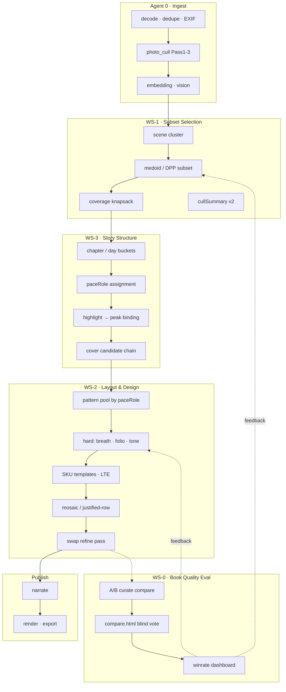

# Phase 18 · 成书质量工程路线图（Book Quality Program）

| 属性 | 内容 |
|------|------|
| **代号** | Phase 18 · BQP（Book Quality Program） |
| **文档类型** | 项目级路线图 · CTO / 首席算法负责人制定 |
| **版本** | v1.0 |
| **日期** | 2026-06-08 |
| **状态** | **已采纳 · 待 Phase 18 Kickoff** |
| **战略结论** | 成书观感是**全流程系统性问题**；单点调 LSE/求解器无法达成目标 |
| **前置文档** | [观感提升路线图.md](./观感提升路线图.md) · [观感提升-业内调研.md](./观感提升-业内调研.md) · [P17-LSE-处置建议.md](./P17-LSE-处置建议.md) |
| **架构基线** | [ARCHITECTURE-OVERVIEW.md](./ARCHITECTURE-OVERVIEW.md) · [业务流程说明.md](./业务流程说明.md) |

---

## 1. 项目章程

### 1.1 使命

将 Travelogue 从「**能排版的技术 demo**」提升为「**用户愿意分享、像成品杂志的游记**」，通过对 **ingest → 选片 → 结构 → 版式 → 渲染 → 评估** 全链路的协同重构，建立以 **感知质量（perceived quality）** 为唯一北极星的数据闭环。

### 1.2 战略判断（已共识）

| 判断 | 含义 |
|------|------|
| LSE 上量不是主路径 | Dogfood 已证伪；P17 冻结路线 A（见处置建议） |
| 瓶颈在上游与版式 | 选片 subset、设计师页型、硬编辑约束 > 匈牙利/soft weight |
| 无裁判则无迭代 | 必须先建 layout pairwise 盲评，再改算法 |
| 允许重构 | 新增 `subset planner`、`pace planner`、模板 SKU 层；可拆分 curate 阶段 |

### 1.3 非目标（本 Program 不做）

- 不做云端 SaaS、不做多租户。
- 不追求 Cassowary / 全 trip 全局 ILP 作为 MVP。
- 不把 LSE capability 作为产品卖点或默认生产路径。
- 不用「golden proxy 涨 0.02」作为发布门禁。

### 1.4 组织原则

```text
一条北极星：盲评 pairwise 胜率（整本成稿）
四个 Workstream：WS-0 裁判 · WS-1 选片 · WS-2 版式 · WS-3 结构
一个集成节奏：每 6 周一个 Integration Gate（IG）
```

---

## 2. 北极星与分层指标

### 2.1 北极星（Primary）

| 指标 | 定义 | 目标（Program 结束） |
|------|------|----------------------|
| **Layout Blind Win Rate** | 8 本代表 trip 上，新版本 vs P16 baseline 的 pairwise 盲评胜率 | **≥ 65%**（≥3 评审 × 每本 1 票） |
| **Share Intent Proxy** | 内部评审「是否愿意发给朋友」≥ 4/5 的比例 | **≥ 70%** |

### 2.2 分层指标（Secondary · 辅助诊断）

| 层级 | 指标 | 用途 |
|------|------|------|
| 选片 | Subset coverage score（人/场景/日覆盖） | P1 回归 |
| 选片 | 进排版资产数 / 原始资产数 | 控制信息密度 |
| 结构 | paceRole 分布熵、highlight 章首命中率 | P3 回归 |
| 版式 | `layoutRepeatStreak`、breath 违规率 | P2 硬约束 |
| 版式 | 设计师页型占比 | 模板 SKU 渗透 |
| 性能 | curate P95 相对 baseline | ≤ +15%（IG-3 前） |
| 稳定 | structure_draft 成功率 | ≥ 99.5% |

### 2.3 代表 trip 集（Golden Dogfood · 固定 8 本 + BSP 专项 1 本）

| 类型 | tripId（现有） | 考验点 |
|------|----------------|--------|
| 竖图单张为主 | `demo-2025`、`demo-80301df45c` | full-frame 单调 |
| 横竖混排 | `demo-1506104ebf`、`demo-5a7c161a12` | mosaic / breath |
| 大集活动 | `demo-2019` | 密度与重复 |
| Studio 精修 | `linzhi`、`chuanzang-studio` | 人工预期高 · linzhi 兼 T3 ultra-wide |
| 小集精选 | `demo-151e7b488c` | 少图故事 |
| 云南自驾 | `demo-ef0cef1d1d` | 混合场景 |
| **BSP · 精选海岛（Surface）** | **`demo-d66fe642a9`** | **full-frame 密集 · breath-pause · 3:2 视口 Dogfood** |

**规则**：任何 IG 合并必须在此 **8 本**上跑 A/B + 更新 `.cache/book-quality/` 报告。  
**BSP 附加规则**（见 [PRD-页面优化.md](./PRD-页面优化.md)）：IG 硬门禁前 `demo-d66fe642a9` 须过 AC-BSP-01/02 双视口截图。

---

## 3. 目标架构：Book Quality Stack

### 3.1 现状 vs 目标（管线级）

```text
【现状 · 简化】
ingest → cull(质量门) → cluster → plan_screens(贪心+beam+mosaic) → render
                              ↑ LSE soft weight（默认关，开了也几乎不变）

【目标 · Phase 18 结束态】
ingest → cull(质量门) → embed/cluster
       → subset_planner(质量×多样性×coverage)     ← 新增 · WS-1
       → story_planner(章+paceRole+highlight)     ← 新增 · WS-3
       → layout_planner(硬约束+SKU 页型+mosaic)   ← 重构 · WS-2
       → layout_refine(swap pass · 可选)          ← 新增 · WS-3
       → narrate → render
       ↑ 全程 telemetry
       ↓ book_quality_eval(pairwise blind)        ← 新增 · WS-0
```

### 3.2 目标架构图



### 3.3 数据契约扩展（`trip.json` / `curation`）

| 字段（拟新增） | 写入阶段 | 用途 |
|----------------|----------|------|
| `curation.subsetPlan` | subset_planner | 保留/剔除原因、medoid、coverage |
| `curation.storyPlan` | story_planner | paceRole、highlight 绑定、cover 链 |
| `curation.layoutPlanVersion` | 已有，升 `2.0` | 标记 BQP 成稿 |
| `curation.bookQuality` | eval harness | 最近一次 blind run id、winrate |

Schema 变更走 **minor bump** + `trip.schema.json` + 迁移脚本（IG-1 交付）。

---

## 4. Workstream 分工

| WS | 名称 | 负责人角色 | 核心模块 | Phase |
|----|------|------------|----------|-------|
| **WS-0** | 成书质量裁判 | 算法 + 设计 | eval scripts、compare UI、acceptance | 18.0–18.4 |
| **WS-1** | 智能选片 | 首席算法 | `photo_cull` 扩展、`subset_planner`（新） | 18.1–18.2 |
| **WS-2** | 版式与设计系统 | 算法 + 设计 | LTE、`screen_planner`、`mosaic/search`、CSS | 18.2–18.3 |
| **WS-3** | 叙事结构 | 算法 | `story_planner`（新）、`highlight_windows` 重构 | 18.2–18.3 |
| **WS-4** | 集成与 Studio | 全栈 | `curate.py` 编排、`studio_pipeline`、文档 | 18.0–18.4 |
| **WS-5** | LSE 维护（低优先级） | 算法 | P17 冻结；仅 IG-4 条件触发 | 18.4 可选 |

---

## 5. 分阶段路线图（18.0 → 18.4）

总时长：**约 28–32 周**（7–8 个月，可并行压缩至 6 个月）。

```text
2026-Q3          2026-Q4              2027-Q1
|--18.0--|--18.1----|--18.2----|--18.3----|--18.4--|
  裁判基线   选片v1    版式硬约束   结构+swap   集成发布
```

---

### Phase 18.0 · 裁判与基线（Week 1–4）

**目标**：没有尺子前先造尺子；固化 P16 baseline 与 8 本 trip 打分板。

| 交付项 | 说明 | 模块/路径 |
|--------|------|-----------|
| **BQ-001** | `scripts/book_quality_blind_review.py`：init 模板、汇总胜率 | 新脚本 |
| **BQ-002** | `compare.html` 增加投票 UI + JSON 导出 | 扩展 preview_ablate |
| **BQ-003** | `.cache/book-quality/baseline/` 8 本 HTML + manifest | 一次性生成 |
| **BQ-004** | `docs/acceptance-records/book-quality-baseline.json` | 验收记录 |
| **BQ-005** | CI smoke：`book_quality_compare_smoke`（2 本 fixture） | tests |

**算法/技术**：无新模型；流程与 [phase6_cover_blind_review.py](../scripts/phase6_cover_blind_review.py) 对齐。

**Gate IG-0**：

- [ ] 8 本 baseline 并排包可 HTTP 打开
- [ ] ≥3 人完成首轮 blind，写入 baseline winrate（预期 ~50%，作零假设）
- [ ] 团队书面确认：**后续 PR 必须附 blind 结果或豁免说明**

---

### Phase 18.1 · 选片 v1：Subset Planner（Week 5–10）

**目标**：进排版的是「该出现的代表片」，总量 **−30%** 起。

| 交付项 | 说明 | 模块/路径 |
|--------|------|-----------|
| **BQ-101** | 新包 `travelogue/curation/subset_planner.py` | 新模块 |
| **BQ-102** | `plan_asset_subset(trip, cfg)`：cluster medoid + quality floor | 核心 API |
| **BQ-103** | Coverage 贪心：day × {person, landscape, food} 下限 | 同上 |
| **BQ-104** | DPP 可选路径：复用 `mosaic/diversity.py` 内核上移到 asset |  refactor |
| **BQ-105** | `curate.py` 插入点：`clustering` 后、`plan_screens` 前 | 编排 |
| **BQ-106** | `curation.subsetPlan` 写入 + Studio 只读展示 | schema + UI 可选 |
| **BQ-107** | `config.yaml` · `curation.subset` 开关与参数 | config |

**算法选型**：

| 组件 | 方案 | 备选 |
|------|------|------|
| 组内代表 | Embedding medoid + sharpness/aesthetic 门槛 | DPP k-subset |
| 全局覆盖 | 贪心 knapsack（coverage 约束） | 小规模 ILP（OR-Tools） |
| 质量分 | 现有 `photo_cull` + 可选 NIMA tie-break | 校准后的 aesthetic head |

**重构**：

- `layout_eligible_assets()` 尊重 subset 结果（新 flag `subsetSelected` 或沿用 `layoutEligible`）。
- Pass 2 增加 **representativeness** 项（与 路线图 §5.3 一致）。

**Gate IG-1**（相对 baseline）：

- [ ] 8 本中 **≥5 本** blind winrate **≥ 55%**
- [ ] 「故事更清楚」维度 **≥ 60%** 评审偏好新版本
- [ ] 进排版资产 **−25% ~ −40%**（中位数）
- [ ] curate P95 增幅 **≤ +10%**

---

### Phase 18.2 · 版式硬约束 + 设计师 SKU（Week 11–18）

**目标**：hint 变约束；引入 **3 个设计师页型**；消除 silent fallback。

| 交付项 | 说明 | 模块/路径 |
|--------|------|-----------|
| **BQ-201** | `mosaic/search`：**禁止** unfiltered fallback；记录 reject reason | 重构 |
| **BQ-202** | `screen_planner_stages`：dense≥3 → 强制 `breath-pause` | 硬约束 |
| **BQ-203** | Folio：相邻 hero + tone ΔE → 仅允许 spread SKU | 硬约束 |
| **BQ-204** | LTE 新增 3 SKU：`asymmetric-hero`、`spread-folio`、`breath-hero` | templates + CSS |
| **BQ-205** | `paceRole` → pattern 池映射（与 18.3 联调，可先 stub） | layout |
| **BQ-206** | 参考 [kore/photobook](https://github.com/kore/photobook)：`docs/DESIGN-PHASE18-page-skus.md` | 设计文档 |
| **BQ-207** | Tone 单链：合并 beam / mosaic look-back 为 `tone_continuity.py` | 重构 |

**算法/技术**：

| 引入 | 用途 |
|------|------|
| Flickr **justified-layout** 算法（MIT） | 新 pattern `screen-justified-row`，服务竖图 trip |
| GridWiggle 式 **多策略 + reject** | mosaic 候选生成评估台（dev only） |

**Gate IG-2**：

- [ ] 8 本中 **≥6 本** blind winrate **≥ 58%**
- [ ] 「杂志感/呼吸感」维度 **≥ 65%** 偏好新版本
- [ ] breath 违规率 **= 0**（硬约束）
- [ ] 设计师 SKU 占比 **≥ 15%** screens（混排 trip）

---

### Phase 18.3 · 叙事结构 + 局部 refine（Week 19–26）

**目标**：高光/节拍进入**结构**；打破纯贪心。

| 交付项 | 说明 | 模块/路径 |
|--------|------|-----------|
| **BQ-301** | 新包 `travelogue/curation/story_planner.py` | 新模块 |
| **BQ-302** | `paceRole`：opener / build / peak / breath / closer | story |
| **BQ-303** | `highlight_windows` **重构**：输出 → 章 peak + `preferred_hero_id` | 移出 mosaic boost |
| **BQ-304** | Cover chain：5 候选 + rubric + 接 cover blind review | 扩展 phase6 |
| **BQ-305** | `layout_refine.py`：相邻 3–5 屏 swap pass | 新模块 |
| **BQ-306** | Swap 目标：轻量 ranker（CLIP + pairwise adapter）或 blind 采样 | 可选 ML |
| **BQ-307** | `curation.storyPlan` schema + decision log | 数据契约 |

**算法选型**：

| 组件 | MVP | 增强 |
|------|-----|------|
| 章 pace | 规则：位置 + 密度 + highlight | 学习自 story graph（论文） |
| Swap pass | 枚举 swap × proxy ranker | 接 WS-0 人评 fine-tune |
| Highlight | 滑动窗 + 结构绑定 | 事件分割模型（长期） |

**Gate IG-3**：

- [ ] 8 本 **≥7 本** blind winrate **≥ 60%**
- [ ] 北极星 **≥ 62%** 整体胜率
- [ ] highlight 章首命中率 **≥ 80%**（人工 audit 20 章）

---

### Phase 18.4 · 集成、性能与发布（Week 27–32）

**目标**：生产默认开启 BQP 路径；文档、回滚、Studio 可观测。

| 交付项 | 说明 |
|--------|------|
| **BQ-401** | `config.yaml` · `book_quality.enabled: true` 为默认（可 kill switch） |
| **BQ-402** | `IMPLEMENTATION-PHASE18.md` + `ACCEPTANCE-PHASE18.md` |
| **BQ-403** | Studio：curate 后展示 subset/story 摘要卡片 |
| **BQ-404** | Runbook：回滚到 P16 path（subset off + legacy layout） |
| **BQ-405** | 性能：embed 缓存、subset 并行、curate profiling 报告 |
| **BQ-406** | **LSE 复评（可选）**：仅当 IG-3 已达标，跑 [P17 复评门槛](./P17-LSE-处置建议.md#5-复评门槛) |

**Gate IG-4（Program 完成）**：

- [ ] 北极星 **Layout Blind Win Rate ≥ 65%**
- [ ] Share Intent **≥ 70%**
- [ ] curate P95 **≤ +15%** vs 2026-06 P16 baseline
- [ ] 零 P0 回归（structure_draft 成功率、render 成功率）

---

## 6. 模块级改造清单

| 管线阶段 | 现状模块 | Phase 18 动作 | WS |
|----------|----------|---------------|-----|
| **Ingest** | `media/ingest.py` | 保持；确保 embed 在 cull 后可用 | WS-4 |
| **Cull** | `photo_cull.py` | Pass2 +representativeness；与 subset 分工清晰 | WS-1 |
| **Cluster** | `clustering/` | 输出 cluster 供 subset；cache 复用 | WS-1 |
| **Subset** | — | **新建** `subset_planner.py` | WS-1 |
| **Story** | 章划分在 curate | **新建** `story_planner.py`；highlight 结构绑定 | WS-3 |
| **Layout** | `screen_planner*`、`mosaic/` | 硬约束、SKU、justified-row；tone 单链 | WS-2 |
| **Refine** | — | **新建** `layout_refine.py` swap pass | WS-3 |
| **LSE** | `layout_engine/` | **冻结**；IG-4 条件复评 | WS-5 |
| **Narrate** | `services/narrate` | 章标题与 paceRole 一致性检查 | WS-4 |
| **Render** | `render/` | 新 SKU CSS；folio 渲染与 spread 对齐 | WS-2 |
| **Eval** | 分散 scripts | **统一** `book_quality_*` + acceptance JSON | WS-0 |
| **Studio** | `studio_pipeline.py` | 阶段 telemetry；subset/story 可视化 | WS-4 |
| **Config** | `config/` | `book_quality`、`curation.subset`、`story` 块 | WS-4 |

---

## 7. 技术引入与算法清单

| 技术 | 类型 | 引入 Phase | 许可 | 风险 |
|------|------|------------|------|------|
| **DPP / MMR subset** | 算法 | 18.1 | 自有 | 低；已有 mosaic 实现 |
| **Medoid / coverage knapsack** | 算法 | 18.1 | — | 低 |
| **NIMA（idealo）** | 可选质量 tie-break | 18.1 | Apache-2.0 | 中；需 trip 校准 |
| **Flickr justified-layout** | 布局 | 18.2 | MIT | 低 |
| **OR-Tools CP-SAT** | 可选 small ILP | 18.2+ | Apache-2.0 | 中；依赖体积 |
| **Pairwise ranker（CLIP adapter）** | ML | 18.3 | 视模型 | 中；不替代人评 |
| **GridWiggle 式 reject 台** | 工程 | 18.2 dev | 参考 | 低 |
| **LLM** | 叙事/章名 | 已有 | — | 不用于选片 MVP |

**明确不引入（Program 内）**：

- 端到端 Gemini 逐张 layout（不可盲评、不可解释）。
- Cassowary 全页约束求解器（ROI 不足）。
- 无校准的 aesthetic 模型作为唯一选片依据。

---

## 8. 重构原则与迁移

### 8.1 编排重构（`curate.py`）

```python
# 目标伪代码 · Phase 18 结束态
run_clustering_layer(...)
plan_asset_subset(...)      # BQ-101
build_story_plan(...)       # BQ-301
plan_screens_for_trip(...)  # 现有，读 storyPlan + 硬约束
run_layout_refine(...)      # BQ-305
write_curation_artifacts(...)
```

- 每个阶段 **可独立 kill switch**（`config.book_quality.stages.*`）。
- 失败 **fail-open 策略分层**：subset 失败 → 回退全量 eligible；layout 硬约束无解 → 记录 error + 回退 P16 path（带 telemetry）。

### 8.2 兼容与回滚

| 开关 | 效果 |
|------|------|
| `book_quality.enabled: false` | 完全 P16 路径 |
| `book_quality.subset.enabled: false` | 跳过 subset，其余 BQP 可开 |
| `book_quality.layout.hard_constraints: false` | 软约束 / legacy fallback |

### 8.3 测试策略

| 层级 | 内容 |
|------|------|
| Unit | medoid、coverage、breath 违规检测、swap 合法性 |
| Integration | 8 本 trip curate 不抛错 + schema 合法 |
| Regression | `book_quality_compare` diff + proxy 不劣化 |
| Human | 每 IG 盲评 |
| **Surface（BSP）** | 成书连续性 · 屏重量 · 分隔干净 · 分享意愿（[PRD-页面优化.md](./PRD-页面优化.md) §7.2） |

**Surface 盲评维度**（8+1 本 · 与 Layout Blind 并行）：

| 维度 | 通过线 |
|------|--------|
| 成书连续性 | ≥ 4/5 |
| 屏重量 | ≥ 4/5 |
| 分隔干净 | 0 blocker |
| 分享意愿 | ≥ 4/5 |

仙本那 `demo-d66fe642a9` 为 BSP 专项第 9 本；自动化门禁见 `tests/test_bsp_surface_playwright.py`。

---

## 9. 治理与节奏

### 9.1 Integration Gate 日历（建议）

| Gate | 目标周 | 日期（约） | 必须通过 |
|------|--------|------------|----------|
| IG-0 | W4 | 2026-07 | 盲评 harness |
| IG-1 | W10 | 2026-08 | 选片 v1 · 55% win |
| IG-2 | W18 | 2026-10 | 版式硬约束 · 58% win |
| IG-3 | W26 | 2026-12 | 结构+swap · 62% win |
| IG-4 | W32 | 2027-02 | 65% win · 发布 |

### 9.2 双周仪式

- **BQ Sync（30min）**：各 WS 进度、blocker、8 本 trip 最新 winrate。
- **Blind Review Batch（每 IG 前）**：集中 3 人 × 8 本 × 30min。

### 9.3 PR 规范

- 标签：`bq/`、`ws-0`…`ws-3`。
- 描述必填：**哪本 trip 盲评提升/持平/下降**。
- 仅 proxy 改善而无 blind → **不得合并**（除非 docs/test only）。

---

## 10. 风险与依赖

| 风险 | 影响 | 缓解 |
|------|------|------|
| 盲评样本少、方差大 | 误判回归 | 固定 8 本 + ≥3 人；争议 trip 加评 |
| Subset 过狠 → 故事缺失 | 用户负面 | coverage 硬约束 + 精选文件夹豁免 |
| 硬约束无解增多 | curate 失败 | reject log + 分级 fallback + IG 监控 |
| 设计师 SKU 不足 | 观感上限 | Phase 18.2 仅 3 SKU，18.4 后迭代至 8 |
| 性能回退 | Studio 超时 | embed cache、subset 并行、IG 性能 budget |
| 与 P17 LSE 范围混淆 | 资源分散 | WS-5 明确冻结；文档互链 |

---

## 11. 资源估算（负责人视角）

| 角色 | 投入 | 主要职责 |
|------|------|----------|
| 首席算法 | 50% × 8mo | WS-1/2/3 方案、subset/story/refine |
| 后端 | 1 FTE × 6mo | curate 编排、schema、config、测试 |
| 设计 | 0.3 FTE × 3mo | 3 SKU 页型、CSS token |
| 全栈/Studio | 0.5 FTE × 4mo | telemetry UI、compare 投票 |
| QA/Dogfood | 0.2 FTE 持续 | 盲评组织、8 本维护 |

**可并行压缩**：18.1 与 18.2 部分 overlap（硬约束与 subset 不同模块）；最早 **6 个月** 可达 IG-4 若加 0.5 后端。

---

## 12. 文档与交付物地图

| 文档 | Phase | 说明 |
|------|-------|------|
| [观感提升路线图.md](./观感提升路线图.md) | 战略 | P0–P4 优先级（已有） |
| [观感提升-业内调研.md](./观感提升-业内调研.md) | 调研 | 开源与对标（已有） |
| **本文档** | 执行 | Phase 18 全 Program |
| `PRD-PHASE18-book-quality.md` | 18.0 Kickoff | 待写 · 产品 PRD |
| `DESIGN-PHASE18-page-skus.md` | 18.2 | 待写 · 设计师页型 |
| `IMPLEMENTATION-PHASE18.md` | 18.4 | 待写 · 实现清单 |
| `ACCEPTANCE-PHASE18.md` | 18.4 | 待写 · AC 表 |
| `docs/acceptance-records/book-quality-*.json` | 各 IG | 盲评/raw 数据 |

---

## 13. 首席算法负责人 · 执行序（前 90 天）

```text
Day 1–14    IG-0  盲评 harness + 8 本 baseline 板
Day 15–30   BQ-101 spike：medoid subset 在 川藏线 单 trip 盲评
Day 31–45   并入 curate；coverage 规则；IG-1 预演
Day 46–60   breath 硬约束 POC；消灭 unfiltered fallback
Day 61–75   设计师 SKU #1 asymmetric-hero 联调
Day 76–90   IG-1 正式评审；启动 story_planner 设计
```

**第一刀**：`subset_planner` 在 `demo-1506104ebf` 上 prove winrate —— 业内与 dogfood 均指向 **选片 ROI 最大**。

---

## 14. 修订记录

| 版本 | 日期 | 说明 |
|------|------|------|
| v1.0 | 2026-06-08 | CTO/首席算法 · Phase 18 BQP 全 Program 路线图 |
