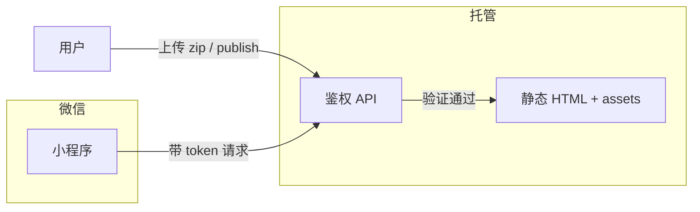

# Travelogue · 分享策略（双轨）

| 属性 | 内容 |
|------|------|
| **文档版本** | v0.1 |
| **状态** | 已拍板（产品方向） |
| **关联** | `PRD-MVP.md` §5.4、`F-EXP-07`、`TEMPLATE-visual-journal.md` §13.5、[API-MINIAPP.md](./API-MINIAPP.md) |
| **更新日期** | 2026-05-19 |

---

## 1. 核心结论

用户有 **两种截然不同的分享意图**，产品用两条路径分别满足，**不要混用隐私假设**。

| 路径 | 交付物 | 典型场景 | 隐私假设 |
|------|--------|----------|----------|
| **A · 长图直发** | 单张竖版 PNG（9:16 杂志风） | 发到 **微信群**、朋友圈九宫格替代 | 用户 **接受** 照片出现在群内；**不**走身份验证 |
| **B · 完整游记** | HTML 游记（`index.html` + 资源） | **小程序** 打开、仅受邀者可看 | **敏感**；访问需 **身份验证**；导出剥离精确 GPS |

> **P0 必须交付 A**（保存长图）。**B 的托管与小程序鉴权** 属 P2，MVP 阶段可先本地 zip + 文档约定。

---

## 2. 路径 A：保存长图（P0）

### 2.1 用户故事

作为旅行者，我想把整篇游记导出成 **一张竖图**，直接发到微信群里，让群友一眼看完旅程，**不必** 点开链接或解压 zip。

### 2.2 产品行为

| 项 | 规格 |
|----|------|
| 入口 | 游记页右下角 **「保存长图」**；金样例 `golden.html` 顶栏同款 |
| 版式 | 与 Visual Journal 金样例一致：`data-layout=mobile`，宽 **390px**，9:16 卡片 |
| 技术 | `longshot.js` + vendored `html2canvas`；横滑章纵向展开 |
| 默认 | **draft / share 渲染均开启**；`export.longShot: false` 可关闭 |
| zip | 默认 **包含** longshot bundle（约 +200KB） |

### 2.3 隐私与免责（产品立场）

- 长图由 **用户主动生成并自行发送**；产品 **不** 对微信群传播做访问控制。  
- 不在长图流程中强制 `privacy.confirmedAt`（与 zip/HTML 导出区分）。  
- UI 可在首次保存时长图提示：「将保存到本机，发送到哪里由你决定」。  
- 若用户需要 **受控访问**，应走路径 B，而非长图。

### 2.4 验收

见 `ACCEPTANCE.md` **AC-07**、**F-EXP-07**（P0 闸门）。

---

## 3. 路径 B：小程序 + HTML（P2 方向 · MVP 预埋）

### 3.1 用户故事

作为旅行者，我想把 **完整交互游记**（语音、横滑、多章）分享给少数亲友，且 **不希望** 被陌生人或爬虫看到。

### 3.2 目标架构（非 MVP 实现范围）



| 组件 | 说明 |
|------|------|
| **HTML 包** | `index.html` + `journal.css` + `assets/`；**默认不含** 或 **可关闭** 长图 FAB（减少公开页攻击面） |
| **鉴权** | 小程序登录 → 服务端签发短期 token → 带 token 访问 HTML/CDN |
| **隐私** | 导出前 `privacy.confirmedAt`；展示图剥离精确 EXIF；可选人脸提醒 |
| **金样例对照** | `golden-share.html` = 无预览壳、无长图脚本的 **分享态 HTML 参考** |

### 3.3 MVP 阶段替代

- 本地 `travelogue export --confirm-privacy` 生成 zip，用户自行托管。  
- 文档说明静态托管；**小程序鉴权留 P2**（见 `PRD-MVP.md` 里程碑 W9+）。

---

## 4. 与 `preview.jpg` 的关系

| 产物 | 用途 |
|------|------|
| `preview.jpg` | 单封面 9:16，引流「点开全文」 |
| **长图 PNG** | 整篇竖版，**群内读完**，无需点开 |
| **HTML 游记** | 完整体验 + 语音；路径 B |

三者可同时存在，服务不同传播漏斗。

---

## 5. 数据模型

```json
"export": {
  "longShot": true
},
"privacy": {
  "level": "private",
  "stripExifOnExport": true,
  "confirmedAt": null
}
```

| 字段 | 长图路径 A | HTML 路径 B |
|------|------------|-------------|
| `export.longShot` | 默认 `true` | share 包可设为 `false` |
| `privacy.confirmedAt` | 不强制 | export 前 **必填** |

---

## 6. 版本记录

| 版本 | 日期 | 说明 |
|------|------|------|
| v0.1 | 2026-05-19 | 双轨策略：微信群长图 P0；小程序鉴权 HTML P2 |
