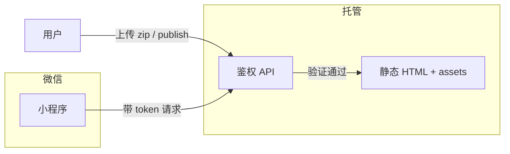

# Travelogue · 分享策略（双轨）

| 属性 | 内容 |
|------|------|
| **文档版本** | v0.4.0 |
| **状态** | 已拍板（产品方向） |
| **关联** | `PRD-MVP.md` §5.4、`PRD-PHASE2.md` §8、`PRD-LONGSHOT-2.0.md`、`F-EXP-07`、`F-LNG-*`、`TEMPLATE-visual-journal.md` §13.5、[API-MINIAPP.md](./API-MINIAPP.md) |
| **更新日期** | 2026-07-09 |

---

## 1. 核心结论

用户有 **两种截然不同的分享意图**，产品用两条路径分别满足，**不要混用隐私假设**。

| 路径 | 交付物 | 典型场景 | 隐私假设 |
|------|--------|----------|----------|
| **A · 长图直发** | 单张竖版 PNG（9:16 杂志风） | 发到 **微信群**、朋友圈九宫格替代 | 用户 **接受** 照片出现在群内；**不**走身份验证 |
| **B · 完整游记** | HTML 游记（`index.html` + 资源） | **小程序** 打开、仅受邀者可看 | **敏感**；访问需 **身份验证**；导出剥离精确 GPS |

> **P0 必须交付 A**（保存长图）。**Phase 2 主路径** 为服务端 `export-longshot`（Playwright）；客户端 html2canvas 保留为预览/降级。**B 的托管与小程序鉴权** 属 P3。

---

## 2. 路径 A：保存长图（P0 · Phase 2 升级）

### 2.1 用户故事

作为旅行者，我想把整篇游记导出成 **一张竖图**，直接发到微信群里，让群友一眼看完旅程，**不必** 点开链接或解压 zip。

### 2.2 产品行为

| 项 | 规格 |
|----|------|
| **主入口（Phase 2）** | Studio「保存长图」或 `travelogue export-longshot` |
| **技术（Phase 2 主路径）** | Playwright 加载 `index-longshot.html` → `TravelogueLongshot.captureMainToBlob` → PNG 文件 |
| **分段（服务端）** | 输出高度 **≤5000px** → 单 PNG；**>5000px** 或单章 **>60** media-card → 按章 `{title}-ch{nn}.png` |
| **分段（客户端）** | 仍遵循 `longshot.js`：**>45** 张禁用整篇，提示按章导出（F-EXP-07） |
| **降级入口** | 游记页 / `index-longshot.html` → 客户端 html2canvas（F-EXP-07） |
| 版式 | 专用长图面：`data-layout=longshot`；宽 **390px** × scale |
| **默认 scale** | CLI **`1`**；Studio UI **`2`（推荐）** — 见 ADR-005 D4 |
| 微信引流 | 可先发已有 **`preview.jpg`**（9:16 封面）；长图专用 thumb **P2 backlog** |
| 运行 | 须 **http://** 服务（Hub / serve）；非 `file://` |
| 默认 | draft 渲染开启 longshot sidecar；`export.longShot: false` 可关闭 |
| zip | longshot bundle 仍可打包进 zip；**产品 UI 不默认引导 zip** |

详见 [adr/005-longshot-server-side.md](./adr/005-longshot-server-side.md)。

### 2.3 隐私与免责（产品立场）

- 长图由 **用户主动生成并自行发送**；产品 **不** 对微信群传播做访问控制。  
- 不在长图流程中强制 `privacy.confirmedAt`（与 zip/HTML 导出区分）。  
- UI 可在首次保存时长图提示：「将保存到本机，发送到哪里由你决定」。  
- 若用户需要 **受控访问**，应走路径 B，而非长图。

### 2.4 验收

见 [ACCEPTANCE-PHASE2.md](./ACCEPTANCE-PHASE2.md) **AC-P2-02**（主路径）、[ACCEPTANCE.md](./ACCEPTANCE.md) **AC-07**（客户端回归）、**F-LNG-*** / **F-EXP-07**。

### 2.5 平台化导出（Longshot 2.0）

在同一长图渲染面之上，按 **分享平台** 切分与后处理（见 [PRD-LONGSHOT-2.0.md](./PRD-LONGSHOT-2.0.md) · [adr/016-longshot-platform-export.md](./adr/016-longshot-platform-export.md)）。

| 平台 | `platform` | 产物 | 说明 |
|------|------------|------|------|
| **微信群**（默认） | `wechat_chat` / 省略 | `{title}-longshot.png` 或 `{title}-ch{nn}.png` | Longshot 1.x；允许 P1 兼容截图 |
| **朋友圈** | `wechat_moments` | `{title}-moments-{nn}.png` | **content_balanced**：整卷长图切成 ≤9 段（可变高）；切点仅落在照片边界；少图可 1 段；页脚 `i/n`；**禁止 P1** |
| **小红书** | `xiaohongshu` | `{title}-xhs-{nn}.png` | 3:4 → **1080×1440**；默认 letterbox；张数 auto 或 1–18 |
| **Instagram** | `instagram` | `{title}-ins-{nn}.png` | 4:5 → **1080×1350**；CLI/API only |
| **微博** | `weibo` | `{title}-weibo-{nn}.png` | 3:4 → **1080×1440**；CLI/API only |
| **抖音封面** | `douyin_cover` | `{title}-douyin-cover.png` | 9:16 → **1080×1920**；单文件；CLI/API only |
| **自定义** | `custom` | `{title}-custom-{nn}.png` | CLI `--width`/`--height`；默认 1080×1440 |

**Studio**：预览页导出 Popover 仅开放灰度列表（朋友圈 / 小红书）；**无** Ins/微博/抖音菜单。书架「保存长图」仍为微信群 1.x。

**CLI 示例：**

```powershell
python -m travelogue export-longshot trips\demo-album
python -m travelogue export-longshot trips\demo-album --platform wechat_moments --scale 2
python -m travelogue export-longshot trips\demo-album --platform xiaohongshu --slide-count 6 --pad-mode letterbox
python -m travelogue export-longshot trips\demo-album --platform instagram --slide-count 4
python -m travelogue export-longshot trips\demo-album --platform douyin_cover
python -m travelogue export-longshot trips\demo-album --platform custom --width 720 --height 960 --slide-count 3
```

**配置**（`config.yaml` · `studio.longshot2`）：

| 键 | 默认 | 作用 |
|----|------|------|
| `enabled` | `true` | 关则隐藏平台 UI，API 忽略 platform |
| `platforms` | `[wechat_moments, xiaohongshu]`（开发） | 开放列表 |
| `smart_crop.enabled` | `false` | 小红书实验裁切 |

验收：[ACCEPTANCE-LONGSHOT-2.0.md](./ACCEPTANCE-LONGSHOT-2.0.md)。

---

## 3. 路径 B：小程序 + HTML（P2 方向 · MVP 预埋）

### 3.1 用户故事

作为旅行者，我想把 **完整交互游记**（语音、横滑、多章）分享给少数亲友，且 **不希望** 被陌生人或爬虫看到。

### 3.2 目标架构（非 MVP 实现范围）



| 组件 | 说明 |
|------|------|
| **HTML 包** | `index.html` + `journal.css` + `assets/`；**默认不含** 或 **可关闭** 长图 FAB（减少公开页攻击面） |
| **鉴权** | 小程序登录 → 服务端签发短期 token → 带 token 访问 HTML/CDN |
| **隐私** | 导出前 `privacy.confirmedAt`；展示图剥离精确 EXIF；可选人脸提醒 |
| **金样例对照** | `golden-share.html` = 无预览壳、无长图脚本的 **分享态 HTML 参考** |

### 3.3 MVP 阶段替代

- 本地 `travelogue export --confirm-privacy` 生成 zip，用户自行托管。  
- 文档说明静态托管；**小程序鉴权留 P2**（见 `PRD-MVP.md` 里程碑 W9+）。

---

## 4. 与 `preview.jpg` 的关系

| 产物 | 用途 |
|------|------|
| `preview.jpg` | 单封面 9:16，引流「点开全文」 |
| **长图 PNG** | 整篇竖版，**群内读完**，无需点开 |
| **HTML 游记** | 完整体验 + 语音；路径 B |

三者可同时存在，服务不同传播漏斗。

---

## 5. 数据模型

```json
"export": {
  "longShot": true
},
"privacy": {
  "level": "private",
  "stripExifOnExport": true,
  "confirmedAt": null
}
```

| 字段 | 长图路径 A | HTML 路径 B |
|------|------------|-------------|
| `export.longShot` | 默认 `true` | share 包可设为 `false` |
| `privacy.confirmedAt` | 不强制 | export 前 **必填** |

---

## 6. 版本记录

| 版本 | 日期 | 说明 |
|------|------|------|
| v0.1 | 2026-05-19 | 双轨策略：微信群长图 P0；小程序鉴权 HTML P2 |
| v0.2 | 2026-05-22 | 长图专用面 `index-longshot.html`、按章导出、serve 要求、zip 含 sidecar |
| v0.3 | 2026-05-27 | scale 双默认；preview.jpg 引流说明 |
| v0.3.1 | 2026-05-27 | 分段双轨：服务端高度/张数兜底 vs 客户端 >45 张 |
| v0.4.0 | 2026-07-09 | §2.5 Longshot 2.0 平台化导出（朋友圈 / 小红书） |
