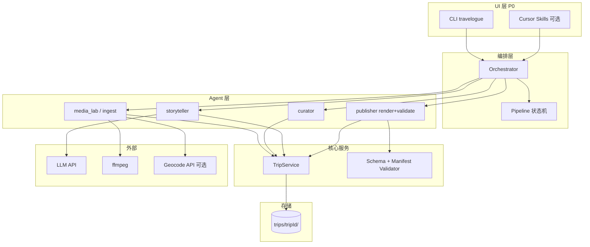

# Travelogue · 技术架构（MVP）

| 属性 | 内容 |
|------|------|
| **文档版本** | v0.1 |
| **阶段** | P0 本地工坊 |
| **关联** | `CHARTER.md`、`AGENT-ARCHITECTURE.md`、`DATA-MODEL.md` |
| **更新日期** | 2026-05-22 |

---

## 1. 架构目标

| 目标 | 手段 |
|------|------|
| 版式稳定 | 模板 + manifest；Agent 只改 JSON |
| 可测试 | ingest/curate/render 可单测；schema 校验 |
| 可恢复 | `trip.json` + 文件系统即状态 |
| 低耦合 | Agent 经 Orchestrator 调用，不互调 |
| 本地优先 | 无服务端；可选外部 LLM/地理 API |

---

## 2. 逻辑架构



---

## 3. 技术选型（P0 默认）

| 层次 | 选型 | 理由 |
|------|------|------|
| 语言 | **Python 3.11+** | EXIF、图像、CLI 生态成熟 |
| 编排 CLI | `typer` 或 `click` | 子命令清晰 |
| JSON Schema | `jsonschema` | 对齐 `trip.schema.json` |
| 模板渲染 | **Handlebars**（pybars3 或 Node 子进程） | 逻辑与表现分离 |
| 图像 | Pillow + pillow-heif | HEIC 支持 |
| 视频 | ffmpeg CLI | 裁切循环片段 |
| 配置 | `config.yaml` + 环境变量覆盖 | 本地 Key 不入库 |
| UI 壳 | **延后**（Tauri / Web） | P0 先 CLI |

---

## 4. 仓库目录（当前实现）

> 早期设计中的 `agents/`、`runner.py` 已落地为 `curation/`、`media/`、`services/narrate.py`、`llm/`、`render/`。Agent 2 支持 **DeepSeek / 百炼 DashScope** 或 **rule-stub** fallback；ffmpeg 尚未接入 Python。

```
travelogue/
├── docs/
├── schemas/
├── templates/visual-journal/   # journal.hbs + journal.css + manifest.json
├── travelogue/                 # Python 包
│   ├── cli.py
│   ├── config.py
│   ├── curation/               # curate, bucket_planning, chapter_titles, screen_planner, …
│   ├── media/                  # Agent 0（ingest, image_ops, …）
│   ├── services/               # validate, narrate, llm_narrate, layout, manifest_limits
│   ├── llm/                    # OpenAI-compatible client (deepseek, dashscope)
│   ├── render/                 # Agent 3（pybars3 → journal.hbs）
│   ├── export/
│   ├── orchestrator/
│   └── demo/
├── scripts/
├── tests/
├── trips/                      # 运行时（.gitignore）
├── config.yaml.example
└── pyproject.toml
```

---

## 5. 模块职责

### 5.1 TripService

- 创建 trip 目录与初始 `trip.json`  
- 原子写入（写临时文件再 rename）  
- 列出 `trips/`、加载、更新 `updatedAt`  

### 5.2 Orchestrator

- 解析 CLI：`travelogue trip new|ingest|curate|narrate|render|export|status`  
- 检查 `pipeline.status` 是否允许调用目标 Agent  
- 记录 `pipeline.runs[]`  
- 失败时保留上一稳定状态  

### 5.3 Agent 0 · media_lab

- 输入：`source/` 路径或 batch  
- 输出：更新 `assets[]`、`pipeline.status → ingest_ready`  
- 依赖：Pillow、ffmpeg、可选 geocoder  

### 5.4 Agent 1 · curator

- 输入：`ingest_ready` 的 trip  
- 输出：`chapters[]`、`coverCandidates`、`structure_draft`  
- 无 LLM 路径必须可运行  

### 5.5 Agent 2 · storyteller

- 输入：`structure_locked`  
- 输出：`meta`、章/卡文案、`copy_draft`  
- 依赖：LLM；输出经 Validator  

### 5.6 Agent 3 · publisher

- **validate**：schema + manifest 规则  
- **render**：`trip.json` + `journal.hbs` → `index.html`  
- **export**：zip、`preview.jpg`、EXIF 剥离副本  

---

## 6. 数据流

```
本地文件夹
  → [A0] source/ + assets/ + assets meta in trip.json
  → [G1 用户] structure_locked
  → [A2] 文案 fields
  → [G2 用户] copy_locked
  → [A3] index.html + journal.css
  → [G3 用户] privacy.confirmedAt
  → [A3] zip + preview.jpg → exported
```

---

## 7. 校验双层

| 层 | 工具 | 内容 |
|----|------|------|
| L1 结构 | `jsonschema` | `schemas/trip.schema.json` |
| L2 业务 | `validate.py` | manifest limits、pattern 序列、视频不在封面章 |

Agent 2 失败：L1/L2 错误列表 → 自动重试 prompt（≤2 次）。

---

## 8. 渲染器设计

- **输入**：`trip.json`、`templateId`、`assets/`  
- **模板**：由 `golden.html` 抽块为 `journal.hbs`；CSS 复制为 `journal.css`  
- **输出**：`index.html` 内相对路径；`<html data-layout="...">`  
- **图片**：优先 ``（见 `ADAPTIVE-LAYOUT.md`）  
- **禁止**：运行时拼接无约束 HTML 字符串作为终稿  

---

## 9. 配置

`config.yaml`（见 `config.yaml.example`）：

| 键 | 说明 |
|----|------|
| `trips_dir` | 默认 `./trips` |
| `llm.provider` | openai / anthropic / … |
| `llm.model` | 可配置 |
| `llm.api_key_env` | 环境变量名 |
| `ffmpeg.path` | 可执行路径 |
| `geocode.enabled` | 默认 false |

**安全**：`config.yaml` 加入 `.gitignore`；仓库只保留 `.example`。

---

## 10. 外部依赖

| 依赖 | 必需 | 用途 |
|------|------|------|
| Python 3.11+ | ✅ | 主运行时 |
| ffmpeg | ✅（含视频时） | 视频循环 |
| LLM API | ✅（叙事阶段） | Agent 2 |
| Node.js | 可选 | 若 Handlebars 用 Node 子进程 |
| 地理 API | ❌ | 城市反查 |

---

## 11. 日志与可观测

- 每 trip：`trips/{id}/runs/run-{ts}.json`（可选详细日志）  
- CLI 标准输出：阶段名、耗时、警告（无 EXIF 等）  
- 不记录 API Key、不记录精确 GPS 到日志  

---

## 12. 与 PRD 模块映射

| PRD 模块 | 技术模块 |
|----------|----------|
| F-ING-* | Agent 0 |
| F-CUR-* | Agent 1 |
| F-NAR-* | Agent 2 |
| F-VID-* | Agent 0（ffmpeg） |
| F-EXP-* | Agent 3 |
| F-TRIP-* | TripService + Orchestrator |

---

## 13. 非功能

| 类别 | 实现要点 |
|------|----------|
| 性能 | ingest 并行缩图；渲染 <5s（30 图） |
| 兼容 | 输出 HTML 测 Chrome / Safari / 微信 |
| 可维护 | 模板版本与 `trip.version` 解耦记录 |
| 测试 | schema 样例 fixture；golden HTML 快照对比（可选） |

---

## 14. 开放技术项（P0 内决策）

| ID | 问题 | 默认 |
|----|------|------|
| TQ-01 | Handlebars 用 Python 还是 Node | Python pybars3，不行再 Node |
| TQ-02 | ASR 供应商 | MVP 可粘贴 transcript |
| TQ-03 | 预览 server | `python -m http.server` 文档化 |

---

## 15. 版本历史

| 版本 | 日期 | 说明 |
|------|------|------|
| v0.1 | 2026-05-19 | P0 技术架构初稿 |
| v0.2 | 2026-05-30 | Phase 6：场景聚类默认策略与自适应事件分段 |

---

## 16. Phase 6 · 聚类与分段默认策略（M24）

> 关联 PRD：[PRD-PHASE6.md](./PRD-PHASE6.md) §6.1 §6.2 · 配置：`config.yaml` → `curation.scene` / `curation.geo`

### 16.1 场景聚类（Scene Clustering）

| 项 | 默认 | 回退 |
|----|------|------|
| 算法 | **HDBSCAN**（`sklearn.cluster.HDBSCAN`） | `curation.scene.algorithm: dbscan` |
| 输出 | `sceneClusterId` + `sceneClusterConfidence`（membership probability） | DBSCAN 模式下 confidence 省略 |
| 噪声 | label `-1` 表示 outlier | 同左 |
| 元数据 | `trip.curation.clustering.sceneAlgorithm` | 记录实际算法 |

**回退触发条件（运维/灰度）**：

1. 配置显式设为 `dbscan`（一键回滚至 P5 行为）。
2. HDBSCAN 依赖不可用或运行时异常 → 代码层 fallback 到 DBSCAN（同 eps/min_samples）。
3. 灰度验收未达 AC-P6-02（噪声率未下降）→ 按 rollout 计划切回 DBSCAN。

**参数**：沿用 `scene.eps`、`scene.min_samples`；HDBSCAN 使用 `min_cluster_size=min_samples`。

### 16.2 地理事件分段（Geo Event Segmentation）

| 项 | 默认 | 回退 |
|----|------|------|
| 间隔模式 | **`auto`**（自适应 gap） | `curation.geo.eventGapMode: fixed` |
| 固定阈值 | `eventTimeGapHours`（默认 4h） | fixed 模式或 auto fail-open |
| 元数据 | `trip.curation.clustering.eventSegmentation` | 含 `gapMode`、`thresholdHours` |

**自适应算法（`auto`）**：

- 对相邻照片时间间隔分布取 p75–p90 区间作为候选阈值（「膝盖点」）。
- 结果 clamp 到 `[0.5h, 24h]`，并 respect `min_photos_per_event`。
- **fail-open**：样本不足、间隔全零或计算异常 → 回退 `eventTimeGapHours` 固定值，并在 meta 中标记 `gapMode=fixed`。

### 16.3 Heuristic 向量（无 CLIP 路径）

| 特征 | P5 | P6 |
|------|----|----|
| tone | hash 离散桶 | H/S 连续值（`colorsys.rgb_to_hls`） |
| subject | hash 离散桶 | 有序 subject index |

用于 embedding 缺失时的 scene clustering；详见 `travelogue/vision/clip_encoder.py`。

### 16.4 观测与验收脚本

| 脚本 | 用途 |
|------|------|
| `scripts/phase6_metrics_baseline.py` | KPI 汇总与 AC 阈值检查 |
| `scripts/phase6_event_boundary_eval.py` | 事件边界 F1 对比 |
| `docs/acceptance-records/phase6-quality-eval.json` | 质量评测记录 |

### 16.5 回滚

```bash
python scripts/phase6_apply_p5_rollback.py --dry-run
python scripts/phase6_apply_p5_rollback.py
```
