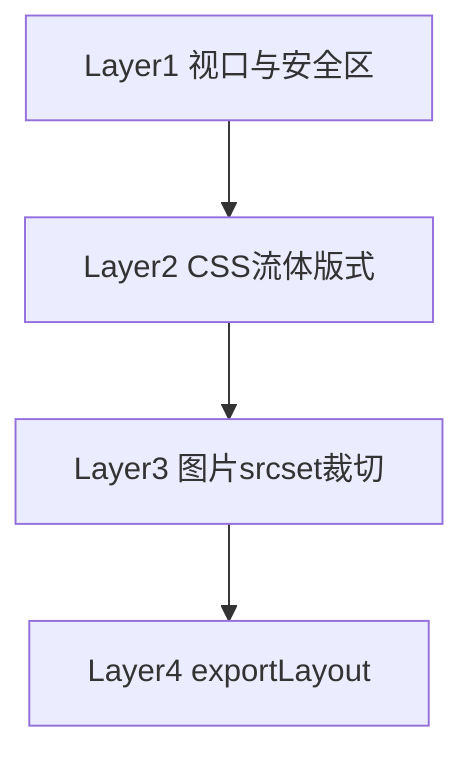

# 模板 PRD · Visual Journal（视觉游记）

| 属性 | 内容 |
|------|------|
| **模板 ID** | `visual-journal` |
| **版本** | v0.2.1 |
| **状态** | 已拍板（待 ingest/渲染器对接） |
| **替代/演进** | 自 `editorial-light` 线框演进；定位「有声视觉相册」 |
| **金样例** | `templates/visual-journal/golden.html` + `golden.css` |
| **机器规则** | `templates/visual-journal/manifest.json` |
| **关联文档** | `docs/PRD-MVP.md`、`docs/AGENT-ARCHITECTURE.md`、`docs/ADAPTIVE-LAYOUT.md`、`游记备忘录.md` |
| **更新日期** | 2026-05-19 |

---

## 1. 模板定位

### 1.1 一句话

> **带章节的有声相册**：以照片与短视频为主，语音与极短文字为辅；图/视频尽可能充满版面；在手机（9:16）与 Web（16:9）下均可自适应或按导出意图锁定形态。

### 1.2 设计原则

| 原则 | 说明 |
|------|------|
| **视觉优先** | 图/视频占屏主导（目标 70%+）；文字为标注层 |
| **短文案** | 不追求长篇；`chapter-lead` 可空 |
| **语音一等公民** | 语音挂 asset；上传、播放、转写、可编辑 |
| **章节叙事** | 3–5 幕放映节奏，非攻略列表 |
| **双形态充满** | 手机 **9:16** 竖幅满宽；Web **16:9** 横图出血 |
| **终端自适应** | 比例盒 + 流体 CSS + 多档图片 + 可选导出裁切（见 §8） |
| **稳定版式** | Agent 只写 `trip.json`；禁止 LLM 直出 HTML |
| **渐进增强** | 无 JS 可读；`<audio>` + `<details>`；金样例含布局预览脚本 |

### 1.3 已拍板决策（原开放问题）

| 项 | 决定 | 说明 |
|----|------|------|
| Web/手机断点 | **768px（48rem）** | `<768` 手机形态；`≥768` Web 形态 |
| 手机视觉 | **深色底 + overlay 标题** | 标题叠图下缘渐变条；Web 浅色 + 标题在图下 |
| 无语音是否强制 caption | **否** | 可仅图/视频 + 可选 title |
| 分享版长转写 | **默认折叠** | `<details>`，不隐藏 |
| `media-row` | **启用** | 手机上下两张 9:16；Web 并排 16:9 |
| 主色 | **`#3d6b5a`（Web）/ `#7cb89a`（手机深色底）** | 见 `golden.css` |
| 模板 ID | **`visual-journal` 定稿** | — |

### 1.4 非目标（本模板不做）

- 千字级章导语、文学引语独立块  
- 攻略表格式密度（交通/票价列表）  
- 自动播放背景音乐、复杂动效、视差滚动  
- 精确 GPS 地图嵌入（v0.3 再议）  
- 为每种设备型号单独维护一套 HTML  

---

## 2. 页面信息架构

```
┌────────────────────────────────────────┐
│ cover-hero     9:16 或 16:9 满版封面    │
├────────────────────────────────────────┤
│ trip-meta      日期 · 地点 · 天数       │
│ hook-line      可选一行（可空）          │
├────────────────────────────────────────┤
│ chapter × 3–5                          │
│   chapter-header                       │
│   chapter-lead（可空，≤80 字）         │
│   media-card / media-row / scroll      │
│     ├ 图 | 视频（--fill --bleed）      │
│     ├ overlay 标题（手机）或 body（Web）│
│     └ voice-bar → transcript（折叠）    │
│   divider-place（跨天/跨地，少用）      │
├────────────────────────────────────────┤
│ epilogue       ≤80 字（可空）          │
│ footer-cta     生成信息                  │
└────────────────────────────────────────┘
```

---

## 3. 块（Block）规格

### 3.1 块清单

| 块 ID | 必填 | 说明 |
|-------|------|------|
| `cover-hero` | ✅ | 比例盒封面；主标题；副标题可选 |
| `trip-meta` | ✅ | 时间、地点、天数等 |
| `hook-line` | ❌ | ≤56 字 |
| `chapter-header` | ✅/章 | 序号 + 章标题 ≤12 字 |
| `chapter-lead` | ❌ | ≤80 字，**允许为空** |
| `media-card` | ✅/章≥1 | 核心；见 §3.2 |
| `media-row` | ❌ | 2 图；手机纵排 / Web 横排 |
| `media-scroll` | ❌ | 3–5 图横滑；组级 voice 可选 |
| `divider-place` | ❌ | 跨天/跨地 |
| `epilogue` | ❌ | ≤80 字 |
| `footer-cta` | ✅ | 版权与生成信息 |
| `longshot-toolbar` | ❌ | **P0** 浮动「保存长图」；默认开启，微信群直发场景 |

**相对 editorial-light 退役**：`chapter-intro`（长导语）、`quote-pull`（并入 voice 转写）、`figure-trio` 等（由 fill/scroll 承担）。

### 3.2 `media-card`（核心）

**数据字段**

| 字段 | 类型 | 约束 | 来源 |
|------|------|------|------|
| `assetId` | string | 关联 `assets[]` | 系统 |
| `mediaType` | `image \| video` | — | 系统 |
| `title` | string? | ≤14 字 | ai / user |
| `caption` | string? | ≤60 字 | asr 精简 / ai / user |
| `voice` | object? | 见下表 | user |
| `layout` | enum | `fill`（默认）\| `inset` | 规则 |

**voice 对象**

| 字段 | 约束 |
|------|------|
| `audioFile` | 相对路径 m4a/aac/mp3 |
| `durationSec` | 5–180，推荐 10–45 |
| `transcript` | ASR 全文；默认折叠 |
| `transcriptPreview` | ≤40 字 |
| `source` | `user` |
| `showTranscript` | 默认 true；share 导出可 false |

**渲染器必加 CSS 类**

| 类名 | 何时加 |
|------|--------|
| `media-card--bleed` | 主图、封面级：左右贴边 |
| `media-card--fill` | 所有主视觉：`aspect-ratio` + cover |
| `media-card--overlay` | 手机形态或 `exportLayout=mobile`：标题在图内 |
| `media-card--video` | 短视频：角标「轻触开声」 |
| `media-card--portrait` | 源图为竖拍时可选，仍铺满宽度 |

**块级规则**

- 视频保留原声时，**不**同卡叠 `voice`。  
- 无语音：`caption` 可空。  
- 有语音：展示 `voice-bar`；`caption` 为转写精简，非全文。  

### 3.3 DOM 与可编辑约定

- 根：`data-block="{id}"`；媒体：`data-asset-id`。  
- 可编辑：`data-editable="title|caption|transcript"`。  
- 语义：`<article>` → `<section.chapter>` → `<figure.media-card>`。  
- 图片推荐：`` 替代纯背景（见 §8.3）。

---

## 4. 章节 Pattern

| patternId | 标签 | 适用 | 序列 |
|-----------|------|------|------|
| `open` | 开篇 | 抵达 | `header` → [`lead`] → `media-card×2`（fill+bleed） |
| `gallery` | 图集 | 多图 | `header` → [`lead`] → `media-scroll` |
| `moment` | 高光 | 视频/语音 | `header` → `media-card(video\|image)` → `media-card`+voice |
| `close` | 收尾 | 末章 | `header` → `media-card×1–2` |

**策展规则**

1. 第 1 章 `open`；末章 `close`。  
2. 有短视频 → `moment`。  
3. 单日 ≥6 图 → `gallery`。  
4. trip 含语音素材时，至少 1 章 `moment` 且含 voice。  

---

## 5. 字数与数量限制（limits）

与 `manifest.json` 一致：

```json
{
  "tripTitleMaxChars": 20,
  "tripSubtitleMaxChars": 32,
  "hookMaxChars": 56,
  "chapterTitleMaxChars": 12,
  "chapterLeadMaxChars": 80,
  "mediaTitleMaxChars": 14,
  "captionMaxChars": 60,
  "transcriptPreviewMaxChars": 40,
  "epilogueMaxChars": 80,
  "minChapters": 3,
  "maxChapters": 5,
  "maxPhotosPerTrip": 50,
  "maxVideosPerTrip": 3,
  "maxVoicePerTrip": 15,
  "maxVoicePerChapter": 5,
  "maxVideosPerChapter": 1,
  "maxMediaCardsPerChapter": 8
}
```

全页可见文字建议 **≤600 字**（含标题与 caption）。

---

## 6. 叙事与文案规则（narrativeRules）

### 6.1 章标题

地点 / 动作 / 情绪优先；避免纯 Day1/Day2。

### 6.2 AI 文案

| 字段 | 输出要求 |
|------|----------|
| `title` | ≤14 字，名词短语 |
| `caption` | ASR 精简优先，≤60 字 |
| `chapter-lead` | ≤80 字，可空 |
| `hook` | ≤56 字 |

**禁用词**：综上所述、值得一提的是、美不胜收、令人难忘。

### 6.3 语音管线

1. ASR → `transcript`（存全量）。  
2. LLM → `caption` / `title`（非全文上屏）。  
3. 用户修改 → `edited: true`，自动流程不覆盖。  

---

## 7. 双形态版式（手机 9:16 · Web 16:9）

### 7.1 策略

**一套 HTML + 一套 CSS**（`journal.css` / `golden.css`），不维护两套页面。

| 形态 | 触发条件 | 封面/主图比例 | 文字位置 | 页面气质 |
|------|----------|---------------|----------|----------|
| **mobile** | 宽 &lt; **768px** 或 `data-layout="mobile"` | **9:16** 满宽 | **overlay** 叠图下缘 | 深色底 |
| **web** | 宽 ≥ **768px** 或 `data-layout="web"` | **16:9** 出血封顶 | **图下** body 区 | 浅色纸感 |

断点实现：`@media (min-width: 48rem)`（与 `manifest.page.breakpointWeb` 一致）。

### 7.2 导出时 HTML 约定

```html
<!DOCTYPE html>
<html lang="zh-CN" data-layout="auto">
<head>
  <meta charset="UTF-8" />
  <meta name="viewport" content="width=device-width, initial-scale=1, viewport-fit=cover" />
  <link rel="stylesheet" href="journal.css" />
</head>
```

| `data-layout` | 含义 |
|---------------|------|
| 省略或 `auto` | 随视口宽度在 mobile/web 间切换 |
| `mobile` | 强制 9:16 + overlay（朋友圈竖版链接） |
| `web` | 强制 16:9 + 图下标题（桌面收藏） |

### 7.3 充满版面要点

- 章节间距：手机 **2–4px**（连续放映）；Web **8px**。  
- 窄屏出血：`width: 100vw` + `margin-left: calc(50% - 50vw)`。  
- 超宽屏（≥1440px）：`--bleed-width: 1400px` 居中，避免 4K 拉成带。  
- 高度上限：`max-height: min(92dvh, 100vw×16/9)` 等，防止矮宽屏撑爆。  

### 7.4 金样例

路径：`templates/visual-journal/golden.html`。顶栏可切换「手机 9:16 / Web 16:9」；默认随窗口宽度（768px）切换。

---

## 8. 终端自适应（跨设备保障）

> 详述见 **`docs/ADAPTIVE-LAYOUT.md`**；本节为 PRD 摘要，渲染与 ingest 必须共同满足。

### 8.1 核心结论

设备分辨率千差万别，**不能按单一机型像素设计**。分工如下：

| 层级 | 负责方 | 职责 |
|------|--------|------|
| **布局自适应** | HTML/CSS | 比例、断点、上限、安全区 |
| **像素自适应** | ingest | 多档 WebP、`srcset`、可选 9:16/16:9 裁切 |
| **意图自适应** | 导出配置 | `exportLayout` 锁定竖版或横版 |

**9:16 / 16:9 是构图意图**，不是某台手机的物理分辨率。

### 8.2 四层架构（实现优先级）



| 层 | MVP | 要点 |
|----|-----|------|
| **L1** | 必做 | `viewport-fit=cover`；`safe-area-inset`；`dvh/svh`；`overflow-x: hidden` |
| **L2** | 必做 | `aspect-ratio`；`clamp()` 字号；`48rem` 断点；`data-layout`（**已实现于 golden.css v0.2.1**） |
| **L3** | 强烈建议 | w800/w1600/w2400；`srcset` + `sizes="100vw"`；可选 `-m.webp` / `-w.webp` |
| **L4** | 建议 | `trip.exportLayout`：`auto` \| `mobile` \| `web` |

### 8.3 图片资源规范（ingest → 渲染）

**每 asset 默认输出**

| 文件 | 宽度 |
|------|------|
| `{id}-w800.webp` | 800 |
| `{id}-w1600.webp` | 1600 |
| `{id}-w2400.webp` | 2400（可选） |

**HTML 示例（渲染器输出）**

```html

```

**可选构图裁切（exportLayout 非 auto 时）**

| 后缀 | 比例 | 用于 |
|------|------|------|
| `{id}-m.webp` | 9:16 center | `exportLayout: mobile` |
| `{id}-w.webp` | 16:9 center | `exportLayout: web` |

可用 `<picture>` 或按 `data-layout` 选 `src`。裁切中心点可来自 `assets[].focalPoint: { x, y }`（0–1）。

### 8.4 各终端预期行为

| 场景 | 约略宽度 | 预期 |
|------|----------|------|
| 小屏手机 | 320–360 | 9:16 满宽；无横滚；安全区留白 |
| iPhone | 390–430 | 同上 |
| iPad 竖屏 | 768 | **默认 Web 16:9**；要竖版则 `data-layout=mobile` |
| 笔记本 | 1280+ | 16:9；版心约 1100px |
| 4K | 3840 | 出血封顶 1400px 居中 |
| 微信内置浏览器 | — | 与系统 WebView 一致；必测封面与 `<audio>` |

### 8.5 形态 vs 自适应（易混）

| 概念 | 说明 |
|------|------|
| **自适应（auto）** | 同一 HTML，用户用窄屏见 9:16、宽屏见 16:9 |
| **锁定（mobile/web）** | 导出写死 `data-layout` + 对应裁切图，与访问设备无关 |

分享朋友圈链接 → 建议 `exportLayout: mobile`；桌面长期收藏 → `auto` 或 `web`。

---

## 9. 视觉规范（tokens）

| Token / 变量 | 手机（默认） | Web（≥48rem） |
|--------------|-------------|---------------|
| 背景 | `#0a0a0a` | `#f7f5f2` |
| 正文色 | `#f5f3f0` | `#1c1b1a` |
| 强调色 | `#7cb89a` | `#3d6b5a` |
| `--ratio-cover/media` | `9/16` | `16/9` |
| `--bleed-width` | `100vw` | `min(1400px, 100vw)` |
| `--page-width` | `100%` | `min(1100px, 96vw)` |

字体：标题衬线栈 + 正文系统无衬线；标题 `clamp(1.75rem, 5vw + 0.5rem, 3rem)`。

---

## 10. 数据模型（trip.json）

### 10.1 顶层

```json
{
  "version": "0.2",
  "templateId": "visual-journal",
  "exportLayout": "auto",
  "tripId": "kyoto-2025-04",
  "meta": {
    "title": "雨后京都",
    "subtitle": "五天，两个人",
    "hook": "鸭川边那阵吹干雨衣的风。",
    "dateStart": "2025-04-02",
    "dateEnd": "2025-04-06",
    "places": ["京都"],
    "tone": "relaxed"
  },
  "coverAssetId": "asset-001",
  "assets": [],
  "chapters": [],
  "epilogue": "",
  "privacy": {
    "stripExifOnExport": true,
    "confirmedAt": null
  }
}
```

| 字段 | 说明 |
|------|------|
| `exportLayout` | `auto` \| `mobile` \| `web`；见 §8.5 |
| `templateId` | 固定 `visual-journal` |

### 10.2 asset

```json
{
  "id": "asset-001",
  "type": "image",
  "sourceFile": "source/IMG_001.heic",
  "displayFile": "assets/asset-001-w1600.webp",
  "srcset": [
    { "file": "assets/asset-001-w800.webp", "width": 800 },
    { "file": "assets/asset-001-w1600.webp", "width": 1600 }
  ],
  "cropMobile": "assets/asset-001-m.webp",
  "cropWeb": "assets/asset-001-w.webp",
  "focalPoint": { "x": 0.5, "y": 0.45 },
  "width": 4032,
  "height": 3024,
  "takenAt": "2025-04-02T15:30:00+09:00",
  "place": { "city": "京都", "country": "JP" }
}
```

### 10.3 chapter / items

与 v0.2 草案相同：`patternId`、`items[]`（`media-card` \| `media-row` \| `media-scroll`）。渲染时根据 `exportLayout` 与断点决定 `--overlay` 与 `src` 选用。

---

## 11. 渲染与导出

### 11.1 输入输出

| 输入 | 输出 |
|------|------|
| `trip.json` + `assets/` + `templateId` | `index.html`、`journal.css`、资源目录 |

### 11.2 渲染器职责清单

1. 读取 `exportLayout` → 设置 `<html data-layout>`。  
2. 主图输出 `media-card--bleed media-card--fill`；手机加 `--overlay`。  
3. 图片优先 ``；视频 `poster` + `<video>` 或封面静帧。  
4. 写入 `viewport-fit=cover` 与 `alt`。  
5. `share` 模式：剥离 `data-editable`；折叠转写；剥离 EXIF。  

### 11.3 导出模式

| 模式 | 行为 |
|------|------|
| `draft` | 保留编辑钩子；可选展开转写 |
| `share` | 去钩子；转写折叠；剥离 EXIF |

### 11.4 性能目标

| 指标 | 目标 |
|------|------|
| 封面 LCP | 首图 ≤500KB（w800 或 w1600） |
| zip 体积 | 30 图 + 5 语音 ≤25MB（可配置） |
| 慢网 | `srcset` 应落到 800w |

---

## 12. 交互（产品层）

| 能力 | MVP | 说明 |
|------|-----|------|
| 为图/视频录制或上传语音 | ✅ | 绑 assetId |
| 语音转写 | ✅ | transcript |
| AI 生成 title/caption | ✅ | 单字段可重生成 |
| 手动改字 | ✅ | `edited` |
| 选择 exportLayout | ✅ | auto / mobile / web |
| 章级语音 | ❌ v0.3 | — |
| 视频原声 + 旁白 | ❌ | 二选一 |

---

## 13. 验收标准（模板层）

| # | 标准 |
|---|------|
| T-01 | `golden.html` 图/视频主导；可见字 <600 |
| T-02 | ≥3 条 `voice-bar` 可播 |
| T-03 | 转写折叠不撑版 |
| T-04 | 含 open / gallery / moment / close |
| T-05 | 375px 无横滚；48rem 以上切 Web |
| T-06 | 无 JS 可读（音频除外） |
| T-07 | 块带 `data-block`；媒体带 `data-asset-id` |
| T-08 | 窄屏 9:16 满宽；宽屏 16:9 出血 |
| T-09 | 手机 overlay；Web 图下标题 |
| T-10 | 320px / 393px / 768px / 1920px 四类宽度目测无崩版 |
| T-11 | 顶栏切换 `data-layout` 后比例符合 9:16 或 16:9 |
| T-12 | 封面与底栏不挡刘海 / Home 条（安全区） |

**真机清单**：见 `ADAPTIVE-LAYOUT.md` §6。

---

## 14. 与 editorial-light 差异

| 项 | editorial-light | visual-journal |
|----|-----------------|----------------|
| 定位 | 杂志散文 | 有声视觉相册 |
| 比例 | 偏 4:3 杂志 | **9:16 / 16:9 双形态** |
| 章导语 | ≤280 字 | ≤80 字可空 |
| 核心块 | figure-* | **media-card + voice** |
| 自适应 | 版心 720px | **流体 + srcset + exportLayout** |

---

## 13.5 保存长图（longshot · P0）

> 产品需求：`PRD-MVP.md` §6.7.1 · `SHARING.md` · 用户故事 US-07b

| 项 | 规格 |
|----|------|
| 入口 | 右下角 FAB「保存长图」；`golden.html` 顶栏同逻辑（`data-longshot-trigger`） |
| 输出 | PNG，`{meta.title}-长图.png`，画布宽 390px，`data-layout=mobile` |
| 脚本 | `longshot.js` + vendored `html2canvas`；**draft/share/zip 默认含** |
| 数据开关 | `trip.export.longShot`；默认 `true`；`false` 关闭 |
| 分享语义 | 长图 → 微信群（用户自担隐私）；完整 HTML → 小程序鉴权（P2，见 `SHARING.md`） |
| 横滑 | 截图态 `.media-scroll__track` 纵向展开，尽量收录全部图片 |
| 限制 | 需 http(s)；视频为 poster；超长 trip 注意内存 |

**已实现**：`partials/longshot-toolbar.hbs`、`longshot.css`、`render.engine.copy_longshot_bundle()`。

---

## 15. 待实现（非开放争议）

| ID | 项 | 负责模块 |
|----|-----|----------|
| IMP-01 | `trip.schema.json` 含 exportLayout、srcset、focalPoint | schema |
| IMP-02 | Handlebars 输出 srcset / picture | render |
| IMP-03 | ingest 多档 WebP + 可选 -m/-w 裁切 | ingest |
| IMP-04 | 导出时根据 exportLayout 写 data-layout | export |
| IMP-05 | 微信 / iOS / 4K 真机回归 | QA |
| IMP-06 | `trip.schema.json` 正式字段 `export.longShot` | schema |

---

## 16. 版本记录

| 版本 | 日期 | 说明 |
|------|------|------|
| **v0.2.2** | 2026-05-19 | §13.5 保存长图（longshot bundle、FAB、横滑展开） |
| **v0.2.1** | 2026-05-19 | 断点改 768px；自适应四层写入 PRD；安全区/dvh/超宽封顶；exportLayout/srcset 字段；开放问题收口 |
| v0.2.0-draft | 2026-05-19 | 9:16/16:9 双形态；fill/bleed/overlay |
| v0.1.0-draft | 2026-05-19 | 初稿；有声相册定位；金样例 |

---

**状态**：模板 PRD 与 `manifest.json`、`golden.css` v0.2.1、`ADAPTIVE-LAYOUT.md` 对齐。下一步：冻结 `trip.schema.json` 并实现渲染器。
