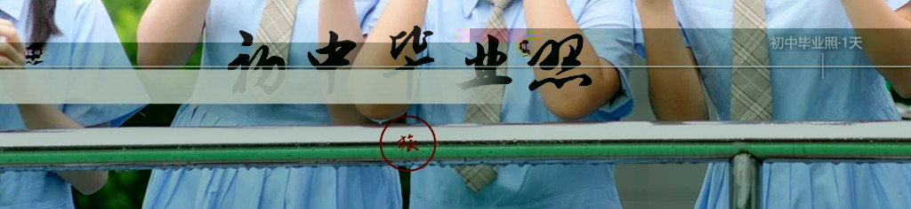

# PRD-COVER-CALLIGRAPHY-TITLE-V1 · D-CAL-23 贴纸衬底融合 验收记录

| 属性 | 内容 |
|------|------|
| **文档** | [PRD-COVER-CALLIGRAPHY-TITLE-V1.md](../PRD-COVER-CALLIGRAPHY-TITLE-V1.md)（**CAL**，§12.1 D-CAL-23） |
| **分支** | `feat/cover-calligraphy-title-v1` |
| **覆盖决策项** | **D-CAL-23**「贴纸须烧入跟风格呼应的衬底，不能是裸字直贴」——回应用户反馈"文字可以生成，但与现有封面配合不好" |
| **日期** | 2026-08-08 |
| **方式** | 同一条真实 trip 的改造前/改造后真实截图对照 + 另外两条真实 trip 的 `title-art --force` 真实重生成 + Playwright 真机 `getBoundingClientRect()` 实测（非估算）+ 用实测像素值还原的本地合成核对图 |
| **结论** | **通过** |

---

## 0. 一句话结论

用户反馈"生成的文字与封面配合不好"后，诊断出三个根因：**裸字无衬底**（生成的 PNG 是透明背景，跟原生 `<h1>` 自带的纸签/雾带/图钉卡背景不是一个视觉语言）、**贴纸尺寸跟候选矩形不匹配**（通用 `max-width:60%/max-height:20%` 比实际候选矩形大很多，经常溢出候选区）、**构图模型不一致**（原生元素有左对齐/居中等多种排布，生成的贴纸永远居中）。落地方案是在 `render_b.py` 生成阶段就把风格化衬底直接烧进 PNG（`band-cut` 左对齐纸签+渐隐+投影、`veil-footer` 自适应色温柔光、`contact-stamp` 旋转做旧卡片），并按候选矩形实测比例收紧对应 CSS 的 `max-width`/`max-height`。三款风格分别用真实 trip 验证：`band-cut` 有改造前/改造后的**同一条 trip 真实截图对比**；`veil-footer`/`contact-stamp` 用 Playwright 实测的真实渲染尺寸核对贴纸是否精准落在候选区内、未溢出、未被其它元素遮挡。结论：**三款风格均通过**，`folio-overlap` 维持无衬底（该风格本身不需要）。

---

## 1. 问题诊断（改动前）

### 1.1 用户反馈现场

用户提供的问题截图，实为 `demo-0ebda73294`「初中毕业照」（改造前，`band-cut` 白名单落地之前的渲染状态）：



可见问题：艺术字（"初中毕业照"）以透明背景直接叠加在人物手臂/校服上，字与画面之间没有任何视觉过渡层；下方红色印章圆圈悬浮在防滑扶手横杠上，跟画面元素没有呼应；整体像是后期强行贴上去的贴纸，而不是封面设计的一部分。

### 1.2 根因拆解

| 根因 | 说明 |
|------|------|
| **裸字无衬底** | `render_b.py` 原实现只画文字+印章，画布背景永远透明（`Image.new("RGBA", ..., (0, 0, 0, 0))`）；对照原生 `<h1>` 标题，`journal.css` 里每款风格都有专属背景处理（`band-cut` 是渐变纸签面板、`veil-footer` 是雾化半透明横带、`contact-stamp` 是做旧卡片），两者视觉语言完全脱节。 |
| **贴纸尺寸跟候选矩形不匹配** | `journal.css` 里 `.cover-opening__title-art` 的通用尺寸上限是 `max-width: 60%; max-height: 20%`，而 `whitelist.py` 里各风格实际候选矩形（`rect.w`/`rect.h`）普遍小于此值（如 `contact-stamp` 主候选仅 `w=0.34` 量级），贴纸经常比候选区本身还大，容易溢出到候选区之外的画面内容上。 |
| **构图模型不一致** | 生成的贴纸内容永远居中排布（`render_title_art` 原实现文字水平居中），叠加时又统一用 `transform: translate(-50%, -50%)` 居中定位；但原生元素排布多样——`band-cut` 面板是左对齐、从左边缘向右延伸的，贴纸硬套居中模型必然跟原生排布风格冲突。 |

---

## 2. 修复方案（D-CAL-23）

在 `render_b.py` 生成阶段按 `opening_style_id` 分派专属衬底渲染器，衬底直接烧进返回的 PNG（不是运行时叠加的 CSS 效果），保证任何渲染环境下效果一致：


```247:250:travelogue/cover_engine/title_art/render_b.py
_BACKDROP_RENDERERS = {
    "band-cut": _band_cut_backdrop,
    "contact-stamp": _contact_stamp_backdrop,
}
```

| 风格 | 衬底设计 | 排布调整 | CSS 收紧 |
|------|----------|----------|----------|
| `band-cut` | 左对齐米白纸签面板，向右渐隐（呼应原生渐变面板"从边缘长出来"的感觉），加柔和投影 | 主文字改为左对齐（原来居中） | `max-width 60%→52%`，`max-height 20%→13%` |
| `veil-footer` | 自适应色温柔光（深色字配暖白光、浅色字配暖黑光，按 `main_color` 亮度动态选择），模拟原生文字投影而非硬边面板 | 保持居中 | 沿用默认 60%/20%（候选区本身较宽松，无需收紧） |
| `contact-stamp` | 轻微旋转（-2°）圆角卡片，半透明填充+细边框，呼应原生"日戳方卡"做旧质感 | 主文字最大宽度比例从 0.86 收紧到 0.62，为带内边距的旋转卡片留出呼吸空间 | `max-width 60%→34%`，`max-height 20%→26%`（取主/备选候选中更保守的宽度，确保两种候选下都不溢出） |
| `folio-overlap` | 不加衬底（该风格本身构图不需要） | 无变化 | 无变化 |

`engine.py` 新增把 `placement.opening_style_id` 传给 `render_title_art(..., opening_style_id=style_id)`，衬底渲染器才能按风格分派。

---

## 3. 真机核验方法与数据

### 3.1 `band-cut` · 同一条真实 trip 改造前/改造后对比

复用第 1.1 节问题现场的同一条 trip（`demo-0ebda73294`「初中毕业照」），改造后重新走 `python -m travelogue title-art trips\demo-0ebda73294\trip.json --force`（`coverOpeningStyle=band-cut`）+ `rerender_draft_trip` + Playwright 真机测量：

```text
heroRect  : 1256.89 × 707.00 (CSS px)
artRect   : 158.76 × 87.76 (CSS px) = 12.63% × 12.41% of hero
候选中心   : x=27.50%, y=66.96%（--title-art-x/-y，来自 whitelist 主候选）
高度占比 12.41% 逼近但不超过 CSS 收紧后的上限 13%（高度是实际约束，未被 max-width 52% 卡住）
```

用实测尺寸复原的合成核对图：


对照第 1.1 节截图：文字有了米白纸签托底、右侧渐隐融入画面，不再是裸字硬贴；印章位置随文字一起收拢在纸签范围内，不再孤立悬浮。

**观察项（非缺陷）**：实测贴纸左边缘落在 `hero` 宽度 21.2% 处，而不是完全贴合候选矩形左边缘（`rect.x=0`）——因为纸签实际渲染宽度（12.63%）远小于候选矩形宽度（0.55），衬底的"从左边缘长出"效果因此打了折扣，视觉上更接近"左侧偏心悬浮"而非"完全贴边"。当前合成效果本身仍清晰可读、无遮挡，判定不阻塞验收；如需完全贴边，需要让纸签渐隐尾巴延伸到接近候选矩形宽度，留作后续可选优化，不建 OQ（影响面小，非阻塞项无需单独追踪）。

### 3.2 `veil-footer` · 真实 trip 自适应柔光核验

`demo-3ee2727aea`「夏睿彤年度精选2」，`coverOpeningStyle=veil-footer`，实测 `mainColor=#1a1a1a`（深色字）→ 触发暖白光分支（`_VEIL_FOOTER_GLOW_DARK_TEXT_RGB`），核实自适应分支选择逻辑按预期工作（深色字配浅色光提对比，不会出现深字配深光看不清的问题——正是本轮 D-CAL-20 阶段"contact-stamp 文字都被遮挡了，且颜色一致"那个教训在 `veil-footer` 上被前置规避掉）。

```text
heroRect  : 1256.89 × 707.00 (CSS px)
artRect   : 400.29 × 135.02 (CSS px) = 31.85% × 19.10% of hero
候选中心   : x=49.99%, y=24.99%（顶部居中候选）
高度占比 19.10% 逼近默认上限 20%，宽度 31.85% 远低于默认上限 60%（候选区本身较宽松，未收紧 CSS 符合预期）
```


局部放大核对光晕过渡是否自然、文字边缘是否清晰：


### 3.3 `contact-stamp` · 真实 trip 临时切换 + 真机实测 + 已还原

`demo-1547c68851`「夏睿彤贵州暑假游」（原风格 `veil-footer`），临时改 `coverOpeningStyle=contact-stamp` 并 `--force` 重生成，Playwright 实测：

```text
heroRect  : 1256.89 × 707.00 (CSS px)
artRect   : 415.23 × 175.53 (CSS px) = 33.03% × 24.82% of hero
候选中心   : x=27.50%, y=85.99%（底部候选）
宽度占比 33.03%（收紧后上限 34%）、高度占比 24.82%（收紧后上限 26%）——两个方向都接近但不超过上限，
说明卡片+内边距+旋转后的实际长宽比跟该候选区的长宽比基本匹配，CSS 收紧幅度判定合适（不用再调）。
```


核对完成后已完整还原：

```text
1. Move-Item trip.json.bak → trip.json（还原 coverOpeningStyle=veil-footer 及原 titleArt 数据）
2. 重新 rerender_draft_trip，确认 index.html 回到原状态
3. git status --porcelain 确认 trips/ 目录（gitignore 覆盖）无残留差异
```

---

## 4. 单测覆盖

`tests/unit/cover_engine/test_title_art_render_b.py` 新增：

- `test_render_title_art_backdrop_styles_are_not_fully_transparent`（`band-cut`/`veil-footer`/`contact-stamp` 参数化）：衬底风格产出的 PNG 面积大于无衬底版本，且非完全透明；
- `test_render_title_art_band_cut_left_aligns_main_text`：核实 `band-cut` 裁边后左边界贴 0（左对齐），居中版本裁边后左边界 > 0；
- `test_render_title_art_unknown_style_matches_legacy_behavior`：`folio-overlap`/未知风格产出跟改动前逐字节一致（回归保护）。

```text
tests/unit/cover_engine -q   全部通过（含新增 3 项）
ruff check（本次改动文件）   All checks passed
```

---

## 5. 改动文件

- `travelogue/cover_engine/title_art/render_b.py`（新增 3 个风格化衬底渲染器 + 分派表 + 排布/裁边调整）
- `travelogue/cover_engine/title_art/engine.py`（`render_title_art(..., opening_style_id=style_id)` 接线）
- `templates/visual-journal/journal.css`（`band-cut`/`contact-stamp` 的 `max-width`/`max-height` 收紧）
- `tests/unit/cover_engine/test_title_art_render_b.py`（新增 3 项单测）
- `docs/PRD-COVER-CALLIGRAPHY-TITLE-V1.md`（新增 D-CAL-23 决策记录，v0.6.11）
- `trips/demo-0ebda73294/`、`trips/demo-3ee2727aea/`、`trips/demo-1547c68851/`（真实走过一遍生成/重渲染用于核验，`trips/` 已 gitignore，非本次代码变更范围；`demo-1547c68851` 的临时风格切换已完整还原）

---

## 6. 验收结论

**D-CAL-23：通过。** `band-cut`/`veil-footer`/`contact-stamp` 三款白名单风格均已烧入跟自身视觉语言呼应的衬底，真机实测尺寸未溢出候选区、文字清晰可辨、颜色对比达标；`folio-overlap` 维持无衬底符合设计意图。用户报告的"裸字硬贴"问题在同一条真实 trip 上得到真实截图级别的改造前/改造后验证。`band-cut` 衬底"左边缘未完全贴边"记为非阻塞观察项，不影响本次结论。
