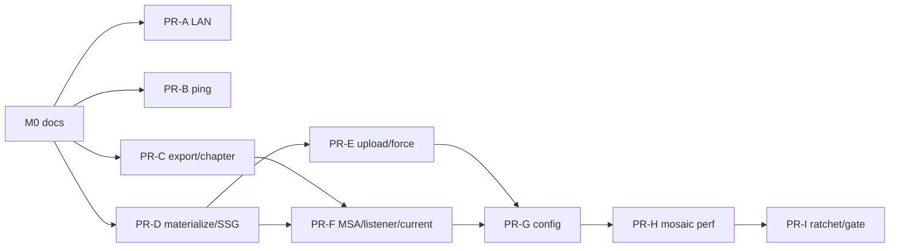

# IMPLEMENTATION · 周审计代码质量修复包 V1（CQA）

| 属性 | 内容 |
|------|------|
| **文档版本** | **v0.1.0** |
| **对应 PRD** | [PRD-CODE-QUALITY-AUDIT-FIXPACK-V1.md](./PRD-CODE-QUALITY-AUDIT-FIXPACK-V1.md) **v0.2** |
| **验收** | [ACCEPTANCE-CODE-QUALITY-AUDIT-FIXPACK-V1.md](./ACCEPTANCE-CODE-QUALITY-AUDIT-FIXPACK-V1.md) |
| **评审** | [acceptance-records/code-quality-audit-fixpack-v1-review-2026-07-23.md](../../../acceptance-records/code-quality-audit-fixpack-v1-review-2026-07-23.md) · Conditional Go |
| **邻接实施** | [IMPLEMENTATION-QUALITY-FIXPACK-V1.md](./IMPLEMENTATION-QUALITY-FIXPACK-V1.md)（current schema）· [IMPLEMENTATION-PREVIEW-DELETE-GUARD-V1.md](../../../IMPLEMENTATION-PREVIEW-DELETE-GUARD-V1.md)（on-demand join）· [IMPLEMENTATION-NO-AI-SURFACE-V1.md](../../../IMPLEMENTATION-NO-AI-SURFACE-V1.md) |
| **DOC-STATUS** | **closed** |
| **状态** | **Closed · M1～M3 任务卡已勾完** |
| **更新日期** | 2026-07-23 |

> **定位**：把 CQA PRD v0.2 / 七席 BLK 展开为可执行任务卡与 PR 切片。  
> **铁律**：禁止单 PR 塞满 Fix all；M1 合码前 BLK-CQA-07（本文 + ACCEPTANCE）必须存在——**本文件关闭该挡门**。  
> **估时（粗）**：M1 ≈ 3.5～5 人日 · M2 ≈ 2.5～3.5 人日 · M3 ≈ 1～1.5 人日。

---

## 0. 实施层锁定（I-CQA-* · 开工不得再摇摆）

继承 PRD D-CQA-01～17 与七席 BLK-CQA-01～10。以下为实施拍板：

| ID | 议题 | **实施锁定** |
|----|------|--------------|
| **I-CQA-01** | LAN bootstrap 交互 | 启动器 / CLI 在 `--allow-lan` 时打印一次性 URL：`http://<lan-ip>:<port>/?studio_token=<token>`（或既有 query 键）。首页检测到有效 query token → 兑换 **HttpOnly** 会话 Cookie（名可新建 `studio-session`，或升级现有 cookie 属性）→ **302/替换历史清除 query**。未兑换前 HTML **不**内嵌完整 token。COPY-CQA-04：未授权页短文案「此网络需授权后才能使用 Studio」+「请使用电脑上显示的启动链接打开」。 |
| **I-CQA-02** | Cookie 标志 | 会话 Cookie：`HttpOnly; Path=/; SameSite=Lax`；**`Secure` 当且仅当请求为 HTTPS**。禁止在 HTTP LAN 上设置 Secure。 |
| **I-CQA-03** | loopback 矩阵 | `is_loopback_host(host) and not allow_lan`：保持今日「本地信任放行」。`allow_lan=True`（无论 bind 地址）：走 LAN 会话规则。测试夹具必须能强制 `allow_lan=True`。 |
| **I-CQA-04** | `llm_ping` DI | 在 `travelogue/llm/client.py`（或 resolve 邻域）增加可选参数：`secrets: UserLlmSecrets \| None = None` 与/或显式 `api_key`/`base_url`/`model`；**禁止**再赋值 `us.read_user_llm_secrets`。handler 只构造本地对象传入。过渡进程锁若需要：模块级 `threading.Lock`，注释 `CQA expires≤M2`，M3 删除。 |
| **I-CQA-05** | Job 终态 | `drawers.confirmStructure` / `regenerateStructure`：`return pollJobUntilDone(jobId).then(...)`（从 `job-poll.js` 引入）。删除「202 后 return undefined」路径。chapter-panel 只 await 该 Promise。 |
| **I-CQA-06** | busy ⊇ on-demand | **优先方案**：`JobStore.is_trip_busy` / `begin_trip_delete` 调用 `derivatives.is_on_demand_alive(trip_dir)`（新增薄 API，读 `_on_demand_threads`）。**备选**：force/delete 入口先 `stop_or_join_on_demand` 再 busy 检查——若用备选，AC-10b 必须以 join 可证为准。禁止只文档承诺。 |
| **I-CQA-07** | 物化单飞 | `materialize_on_demand`：若 prior alive → **合并** `need_set` 到 in-flight 集合（或登记 pending 由现线程吞并），**不** `join(0.05)` 后盲起。persist：抽 `_atomic_write_trip_json`（tmp+`os.replace`），on-demand 与其它写共享。 |
| **I-CQA-08** | force 清盘 | 复用 PDG：`is_protected_demo_trip` → 403；`begin_trip_delete` 失败 → 409；成功则 `stop_or_join_on_demand` → tombstone/rename 或受控清盘 → `end_trip_delete` → 再跑导入。**禁止** `studio_pipeline` 内裸 `shutil.rmtree(trip_dir)` 作为 HTTP force 主路径。 |
| **I-CQA-09** | 上传命名 | 忽略 payload `filename`/`relPath` 作落盘名；只用 `default_longshot_output_name(...)`（或等价）。拒扩展名不在 `{png,jpg,jpeg}`；魔数校验；拒目标名 ∈ 保留集。 |
| **I-CQA-10** | current 乱序 | 改 `maybe_write_longshot_current_after_upload`：**删除** `if seg_i != seg_n: return None` 作为齐套门；改为每次上传后用 `expected` 文件列表检查 `all(is_file)`，齐则 `write_longshot_current`（schema 不变）。 |
| **I-CQA-11** | MSA 删字段 | 删除 `msa_apply.py` 中 `trackOverrideByVariant` 赋值与 summary；测删除相关断言；`rg trackOverrideByVariant` = 0（除本 IMPLEMENTATION/PRD 历史提及外的代码路径）。 |
| **I-CQA-12** | 配置原子写 | `patch_config_file`：进程内锁 + 写 `path.with_suffix(.tmp)` + `os.replace`。CAS 不做 must。 |
| **I-CQA-13** | 导出 prefs | `maybeConfirmFullExportThen` 只读 `prefs.mode`；secondary 写 `mode: "chapter"`。`rg segmentMode` 在 `templates/studio` 业务路径清零（`longshot-client.js` 请求体字段若仍叫 segmentMode 且为 **API 线协议**，在 IMPLEMENTATION 注释保留并与 server 对齐——**prefs 存储层不得用 segmentMode**）。 |
| **I-CQA-14** | 棘轮基线 | 审计日行数写入 `docs/acceptance-records/cqa-god-module-ratchet-baseline.json`（或 scripts 旁 JSON）；超限 fail；上调须 acceptance-records 留痕。 |

---

## 1. PR 切片与退出

| PR | 里程碑 | 任务卡 | 退出 AC（最低） | 估时 |
|----|--------|--------|-----------------|------|
| **PR-A** | M1 会话 | T-01 | 01 · 02 | 1～1.5d |
| **PR-B** | M1 ping DI | T-02 | 03 · 04 | 0.75～1d |
| **PR-C** | M1 导出/分章契约 | T-03 · T-04 | 05～09 | 1～1.25d |
| **PR-D** | M1 物化+busy+SSG | T-05 · T-06 | 10 · 10b · 11 · 12 | 1～1.25d |
| **PR-E** | M2 上传+force | T-07 · T-08 | 13～16 | 1～1.5d |
| **PR-F** | M2 MSA+监听+current | T-09 · T-10 · T-11 | 17～19 | 0.75～1d |
| **PR-G** | M2 配置原子写 | T-12 | 21 | 0.5d |
| **PR-H** | M3 候选复用 | T-13 | 20 | 0.75d |
| **PR-I** | M3 棘轮+gate+回写 | T-14 · T-15 | 22 · 23 · DOC | 0.5～0.75d |

**合并规则**：

- PR-A ∥ PR-B ∥ PR-C 可并行；**PR-D 依赖** busy API 与 PDG join 不互破（可与 A/B/C 并行，但合入前跑 10b）。  
- PR-E 依赖 PR-D 的 busy⊇on-demand（否则 AC-16 假绿）。  
- PR-F current 乱序不依赖 E，可与 E 并行。  
- PR-I 最后；主干红禁叠主题。



---

## 2. 任务卡详述

### T-CQA-00 · M0 文档（本文件）

| 项 | 内容 |
|----|------|
| **动作** | ✅ ACCEPTANCE + IMPLEMENTATION 建档；PRD/评审 Kickoff 勾选 |
| **验收** | BLK-CQA-07 |
| **状态** | ✅ 2026-07-23 |

---

### T-CQA-01 · LAN 会话（PR-A · BLK-01/08）

| 项 | 内容 |
|----|------|
| **动作** | 按 I-CQA-01～03：LAN 下首页/静态不匿名发管理 token；bootstrap 兑换 HttpOnly 会话；清除 query；loopback 矩阵保留 |
| **路径** | `studio_auth.py` · `studio_dispatch.py` · `static_handlers.py` · `serve.py` · 首页模板 |
| **测试** | `tests/unit/web/test_cqa_lan_session.py`：强制 `allow_lan=True`；未认证无 token；兑换后 API 通；query 清除后不可裸用 |
| **文案** | COPY-CQA-04 |
| **验收** | AC-CQA-01 · 02 |
| **状态** | ✅ |

---

### T-CQA-02 · LLM ping DI（PR-B · BLK-02）

| 项 | 内容 |
|----|------|
| **动作** | I-CQA-04：扩展 `llm_ping`；改 `llm_settings_handlers.handle_llm_ping`；删猴子补丁与 ping 写 env；OSError → `E_STUDIO_CONFIG_WRITE`；COPY-CQA-03 |
| **路径** | `travelogue/llm/client.py` · `llm_settings_handlers.py` · FE `llm-settings.js`（若需读 `persisted`） |
| **测试** | 双线程不同 key/baseUrl；mock 写失败；`rg "read_user_llm_secrets\s*="` 在 web/llm 为 0 |
| **验收** | AC-CQA-03 · 04 |
| **状态** | ✅ |

---

### T-CQA-03 · 导出 prefs.mode + 面板关闭（PR-C）

| 项 | 内容 |
|----|------|
| **动作** | I-CQA-13：修 `maybeConfirmFullExportThen`；单一关闭路径 settle；确定单次 apply |
| **路径** | `templates/studio/preview-toolbar/longshot.js` · `longshot-export-panel.js` · 相关测 |
| **测试** | FE 逻辑测：full 确认 / secondary→chapter / Escape settle |
| **验收** | AC-CQA-05 · 06 · 07 |
| **状态** | ✅ |

---

### T-CQA-04 · 分章 Job 终态（PR-C · BLK-03）

| 项 | 内容 |
|----|------|
| **动作** | I-CQA-05：drawers 返回 `pollJobUntilDone`；chapter-panel await；COPY-CQA-01/02；进行中禁用 |
| **路径** | `drawers.js` · `chapter-panel.js` · `job-poll.js` |
| **测试** | 成功/失败/取消夹具；断言无提前「已保存」 |
| **验收** | AC-CQA-08 · 09 |
| **状态** | ✅ |

---

### T-CQA-05 · 物化单飞 + 原子写 + busy（PR-D · BLK-04）

| 项 | 内容 |
|----|------|
| **动作** | I-CQA-06/07：`is_on_demand_alive`；busy 扩展；单飞合并；`_atomic_write_trip_json`；失败可观测字段（最小：`pipeline.derivativesStatus=error` + 摘要） |
| **路径** | `derivatives.py` · `studio_jobs.py` · PDG 调用点复用 `stop_or_join_on_demand` |
| **测试** | 双 on-demand；busy true；原子写并发 |
| **验收** | AC-CQA-10 · 10b · 11 |
| **状态** | ✅ |
| **依赖** | 勿破坏 PDG I-PDG-06 join 预算语义 |

---

### T-CQA-06 · SSG 清场（PR-D）

| 项 | 内容 |
|----|------|
| **动作** | 成功分组写回前 `_clear_shot_group_fields(assets)`；再赋值 |
| **路径** | `curation/shot_grouping.py` |
| **测试** | 孤儿字段 + 视频 + 无簇 |
| **验收** | AC-CQA-12 |
| **状态** | ✅ |
| **回写** | SSG Acceptance 注记（结案 DOC-01） |

---

### T-CQA-07 · 长图上传白名单（PR-E · BLK-10）

| 项 | 内容 |
|----|------|
| **动作** | I-CQA-09：服务端固定名；魔数；保留名拒绝 |
| **路径** | `export_handlers.py` · `export/longshot.py` |
| **测试** | trip.json / index.html / evil.html / 坏魔数 |
| **验收** | AC-CQA-13 · 14 |
| **状态** | ✅ |

---

### T-CQA-08 · force 接入删除门（PR-E · BLK-05）

| 项 | 内容 |
|----|------|
| **动作** | I-CQA-08：demo 拒；busy（含 on-demand）409；tombstone/受控清盘后再导入；COPY-CQA-05 |
| **路径** | `import_handlers.py` · `studio_pipeline.py` · 复用 `studio_trip_delete` / PDG API |
| **测试** | demo · busy job · busy on-demand · 成功覆盖（临时 dir） |
| **验收** | AC-CQA-15 · 16 |
| **状态** | ✅ |
| **依赖** | PR-D busy 扩展已合 |

---

### T-CQA-09 · MSA 删 byVariant（PR-F · BLK-06）

| 项 | 内容 |
|----|------|
| **动作** | I-CQA-11 |
| **路径** | `msa_apply.py` · MSA 单测 |
| **验收** | AC-CQA-17 |
| **状态** | ✅ |
| **回写** | MSA Acceptance |

---

### T-CQA-10 · LLM 监听生命周期（PR-F）

| 项 | 内容 |
|----|------|
| **动作** | `init-v3.js`：监听绑 sheet；destroy 移除；重绘不累加 |
| **验收** | AC-CQA-18 |
| **状态** | ✅ |

---

### T-CQA-11 · 乱序分段 current（PR-F · BLK-09）

| 项 | 内容 |
|----|------|
| **动作** | I-CQA-10；**零分叉** QFX schema（ACCEPTANCE §2） |
| **路径** | `export/longshot.py` `maybe_write_longshot_current_after_upload` |
| **测试** | 先传段 N 再传 1..N-1 → 齐套后 current 更新 |
| **验收** | AC-CQA-19 |
| **状态** | ✅ |

---

### T-CQA-12 · 配置原子写（PR-G）

| 项 | 内容 |
|----|------|
| **动作** | I-CQA-12 |
| **路径** | `config/loader.py` |
| **验收** | AC-CQA-21 |
| **状态** | ✅ |

---

### T-CQA-13 · mosaic 候选/质量池（PR-H）

| 项 | 内容 |
|----|------|
| **动作** | 复用 `WindowCandidateResult`；`build_quality_pool` hoist 出 pattern 循环 |
| **路径** | `layout_engine/mosaic/hook.py` · `candidates.py` |
| **验收** | AC-CQA-20；既有 MTSO/MSA/LTN 单测不红 |
| **状态** | ✅ |

---

### T-CQA-14 · 棘轮（PR-I）

| 项 | 内容 |
|----|------|
| **动作** | I-CQA-14：基线 JSON + lint 脚本；超限 fail |
| **目标文件** | `travelogue/layout_engine/mosaic/hook.py` · `templates/studio/preview-toolbar/longshot.js` |
| **验收** | AC-CQA-22 |
| **状态** | ✅ |

---

### T-CQA-15 · 聚合 gate + 结案回写（PR-I）

| 项 | 内容 |
|----|------|
| **动作** | 新增 `scripts/code_quality_audit_fixpack_gate.py` 调用本包窄测+棘轮；CI PR required；回写 MSA/SSG/PDG/DLLM Acceptance；PRD → Closed |
| **验收** | AC-CQA-23 · DOC-01 · DOC-02 |
| **状态** | ✅ |

---

## 3. 摸底结论（开工已知 · 勿再探）

| 发现 | 含义 |
|------|------|
| `GET /` `auth=False` + 注入 `studio-token` | PR-A 主伤 |
| `llm_ping(provider=)` 无凭据形参 | 必改 client，非只改 handler |
| `is_trip_busy` 无 on-demand | PR-D 必扩，否则 force AC 假绿 |
| force → 裸 `rmtree` | PR-E 重接 PDG |
| `maybe_write…`：`seg_i != seg_n → return` | PR-F 乱序根因一行级 |
| `pollStudioJob` 无返回值；`pollJobUntilDone` 有终态 | PR-C 绑后者 |
| MSA PRD：单一 `trackOverride` | 删 byVariant，不接线 A |
| QFX current schema 已锁 | CQA 禁平行字段 |

---

## 4. 测试夹具约定（BLK-CQA-08）

| 场景 | 夹具要点 |
|------|----------|
| **LAN** | 单测构造 handler/`studio_request_authorized(..., allow_lan=True)`；**禁止**用默认 loopback 冒充 AC-01 |
| **并发 ping** | `threading.Thread` ×2，不同 `api_key`+`base_url`；断言发往端点的 Authorization/URL 不交叉（可用 mock transport 记录） |
| **on-demand** | `register_on_demand_thread_for_tests` 或可控 sleep 线程；断言单飞与 busy |
| **Job 终态** | mock `pollJobUntilDone` resolve/reject；chapter-panel 不提前 toast |
| **乱序分段** | 临时 trip_dir；先写段文件 `N` 再写 `1..N-1`；每次调用 `maybe_write…`；仅齐套后存在 current |
| **force+busy** | 注入 alive on-demand 后 POST force → 409；目录仍在 |

**M1 PR required 窄集（建议写入 ci.yml lint/unit job）**

```
tests/unit/web/test_cqa_lan_session.py
tests/unit/web/test_cqa_llm_ping_isolation.py
tests/unit/media/test_derivatives_ondemand_cqa.py
tests/unit/curation/test_shot_grouping_clear.py
# FE：既有 JS test runner 下 longshot prefs / job promise 测
```

禁止把全量 Playwright e2e 挂上 PR required。

---

## 5. 聚合 gate（M3 草签）

```text
python scripts/code_quality_audit_fixpack_gate.py
# 预期内部：
# 1) 上表窄 unit
# 2) lint：无 read_user_llm_secrets 赋值；无 trackOverrideByVariant 代码写入
# 3) lint_cqa_god_module_ratchet.py
# 4) （可选）targeted 非 required e2e 本地狗粮
```

---

## 6. 风险与回滚（实施向）

| 风险 | 缓解 | 回滚 |
|------|------|------|
| LAN 兑换弄坏本机打开 | I-CQA-03 矩阵单测 + 本机 dogfood | 仅 `allow_lan` 路径回退 |
| ping DI 漏调用点 | grep 门禁进 gate | 临时锁（标 expires） |
| force 接 PDG 过重 | 最小复用 begin/stop/rename；导入再写 | 保 demo/busy 拒，清盘可分步 |
| 原子写 Windows | 与 PDG rename 同系重试 | 保留 OSError 可观测，不回截断写 |

---

## 7. Kickoff 勾选（编码前）

- [x] PRD v0.2 + 七席 Conditional Go  
- [x] ACCEPTANCE v0.1.0  
- [x] IMPLEMENTATION v0.1.0（本文）  
- [x] D-CQA-08/09 锁 B  
- [ ] 开分支 `fix/cqa-m1-*`（建议先 PR-B 或 PR-C，LAN 并行 PR-A）  
- [ ] CI 窄 required 列表进 PR（随首个 M1 PR）  
- [ ] 编码中同步勾 ACCEPTANCE  

---

## 8. 版本记录

| 版本 | 日期 | 说明 |
|------|------|------|
| **v0.1.0** | 2026-07-23 | M0：I-CQA-01～14 · PR-A～I · 任务卡 T-00～15 · 夹具与 gate 草签 |
