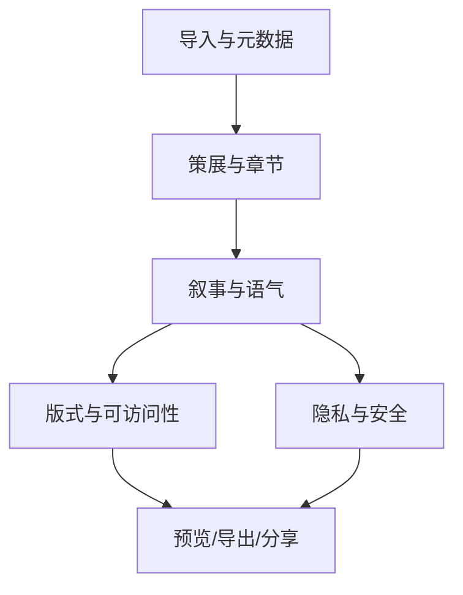
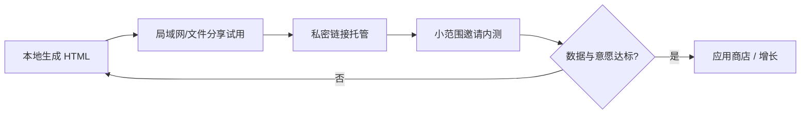

# 游记备忘录

> 本文档整理自产品调研与设计对话（C 端分享型「照片 + 可选短视频 → 单页 HTML 游记」）。  
> 关联工程资产目录：  
> - `templates/visual-journal/`（**当前主模板**：PRD、金样例、`manifest.json`）  
> - `templates/editorial-light/`（早期线框参考）

---

## 目录

1. [调研结论：现有智能体与 Skill](#1-调研结论现有智能体与-skill)
2. [产品方向：C 端分享与定位](#2-产品方向c-端分享与定位)
3. [深度建议：社交与互联网产品视角](#3-深度建议社交与互联网产品视角)
4. [独立开发者路径：本地优先、不急着上架](#4-独立开发者路径本地优先不急着上架)
5. [HTML 模板设计深度建议](#5-html-模板设计深度建议)
6. [第一版线框与块清单](#6-第一版线框与块清单)
7. [附录：安装命令与参考链接](#7-附录安装命令与参考链接)

---

## 1. 调研结论：现有智能体与 Skill

### 1.1 核心判断

**有**接近需求的能力，但 **「照片 + 短视频 → 单文件 HTML 游记」** 的现成方案很少：

- **照片 → HTML 图文游记**：较成熟（如 `photo-essay-skill`）
- **照片 + 短视频 → HTML**：专用 Agent/Skill 几乎没有；视频侧多为 Vlog SaaS，或 Vakantio 类博客 Agent
- **skills.sh / 本地已装 skills**：无专门「游记」包；`travel-planner`、`diary-note` 等易误判

### 1.2 最接近的开源 Skill（照片 → HTML）

#### [photo-essay-skill](https://github.com/Proofbound/photo-essay-skill)（首推）

| 维度 | 说明 |
|------|------|
| 输入 | 本地照片文件夹（JPEG / PNG / HEIC / WebP） |
| 能力 | 读 EXIF（GPS、时间）→ 压缩图 → 联网查地点背景 → 写杂志风散文 |
| 输出 | **单个自包含 HTML**（图片 base64 内嵌，可邮件/离线打开） |
| 视频 | **不支持** |
| 环境 | Claude Code / Claude Desktop；需 Python + Pillow（HEIC 用 pillow-heif） |

### 1.3 相关但方向不同的 Travel Skills

| Skill | 实际用途 |
|-------|----------|
| [travelmapify-skill](https://github.com/rudy2steiner/travelmapify-skill) | 行程/地点 → 交互式 HTML 路线地图，非照片游记 |
| [dustink66/agent-skills](https://github.com/dustink66/agent-skills) `trip-website-generator` | 由**旅行计划**生成多页 HTML 网站，不基于照片批量导入 |
| [ycyliu/travel-planner-skill](https://github.com/ycyliu/travel-planner-skill) | 攻略型 HTML 指南，偏行前规划 |
| [geekjourneyx/travel-guidebook](https://github.com/geekjourneyx/travel-guidebook) | 偏 PDF 路书，不是照片游记 |

### 1.4 skills.sh 检索结果（易误判）

关键词 `travel journal` / `travel diary` 相关结果：

- **行程规划**：`tatat/agents-playground@travel-planner`
- **虚拟旅行 RPG**：`ninehills/skills@travel`（`alma travel journal`，非真实照片游记）
- **通用日记**：`niracler/skill@diary-note`、`maragudk/skills@diary`
- **拼图/社媒卡片**：`photo-collage-maker`、`html-anything@deck-xhs-post`（可二次改造，非游记）

`travelogue` 关键词：**无匹配**。

### 1.5 SaaS / 产品（智能体或自动化）

#### 照片 → 故事 / 可分享页面

| 产品 | 照片 | 视频 | 输出形态 | 说明 |
|------|------|------|----------|------|
| [Photo Route Mapper](https://maketripmap.net/) | ✅ EXIF 路线 | ❌ | 在线分享页（地图 + AI 文案） | 免费约 3 张/条路线 |
| [Pathiary](https://pathiary.app/) | ✅ | 未强调 | App 内日记 + 地图 | iOS |
| [Keep Travel](https://apps.apple.com/us/app/keep-travel/id6759483940) | ✅ | 未强调 | PDF / 幻灯片视频 | 本地 + Gemini |

#### 照片 + 视频 → 博客（HTML 内容，需平台）

| 产品 | 照片 | 视频 | 输出 |
|------|------|------|------|
| [Vakantio Agentic Blogging](https://vakantio.de/en/agentic-blogging) | ✅ | ✅ | `@vakantio/cli` + [skill.md](https://vakantio.de/skill.md) 写 HTML 博文、上传媒体 | 需 Vakantio 账号，非本地单文件 HTML |

#### 偏 Vlog / 视频（不是 HTML 游记）

爱旅拍、海螺 AI、DreamFace、TravelFeed 等：短视频 / SEO 博客，非「一键导出离线 HTML 游记」。

#### 中文侧

- **kikō** 等：照片 + 笔记 → 实体相册/书，不是 HTML
- **迅捷 AI 写作** 等：文本游记生成，需自己配图

### 1.6 能力对照表

| 需求 | 现成程度 |
|------|----------|
| 上传照片 → HTML 游记 | ⭐⭐⭐ `photo-essay-skill`、MakeTripMap（在线） |
| 上传短视频 → HTML 游记 | ⭐ 基本需 Vakantio 或自研 Skill |
| 照片 + 视频一体 | ⭐⭐ Vakantio（博客）；无主流离线 HTML Skill |
| Cursor 可安装的游记 Skill | ⭐ 仅间接相关 |

### 1.7 DIY 技术向

Google 思路（照片 + EXIF + Maps + Vertex caption + LLM 写博客）可自行接静态 HTML 模板。

Cursor 可组合：`photo-essay-skill`、自写 Skill、[image-to-html](https://github.com/raksbisht/image-to-html)、[html-anything](https://github.com/nexu-io/html-anything)。

---

## 2. 产品方向：C 端分享与定位

### 2.1 核心判断

要做的不是「又一个 AI 写游记」，而是 **「旅行记忆的策展 + 可分享的叙事载体」**。

- 照片/短视频是素材
- HTML 单页是交付物
- 智能体价值：**排序、取舍、叙事、版式**，不是多写几百字

### 2.2 用户与场景

| 人群 | 真实动机 | 对 HTML 单页的期待 |
|------|----------|-------------------|
| 轻度分享者 | 朋友圈/小红书一发完事 | 好看、快、少编辑 |
| 纪念型用户 | 给家人/自己留存 | 完整、可离线、可打印 |
| 深度旅行者 | 想写成「作品」 | 章节感、地图、时间线 |
| 博主/创作者 | 引流、SEO、复用 | 可嵌入、可改、带品牌 |

**MVP 建议只服务**：旅行结束 **24–72 小时内** 想发一条高质量总结的人。

### 2.3 单页 HTML 两种定位（可后期扩展）

- **分享页（Share Card）**：一屏惊艳 + 下滑章节，偏社交传播
- **纪念册（Keepsake）**：长文 + 全图集，偏收藏与打印

### 2.4 一句话战略

> **把智能体做成「旅行记忆的编辑」，而不是「旅行内容的工厂」。**  
> 单页 HTML 是容器；社交上卖的是 **「值得转发的一页故事」**；技术上赢在 **策展 + 隐私默认正确 + 分享预览**。

### 2.5 竞品缝隙

不要和剪映/海螺拼视频，不要和小红书拼发现。

> **一次上传，得到一篇可收藏、可转发、像杂志一样的旅行页。**

---

## 3. 深度建议：社交与互联网产品视角

### 3.1 叙事结构比模型更重要

策展 pipeline（建议顺序）：

```
导入 → 去重/聚类(同一天/同一地点) → 选封面与章节锚点 → 时间线/地图骨架 → 配文 → 版式
```

**章节建议**（可自动推断，用户可拖改）：

- 封面（1 张强图 + 标题 + 日期范围）
- 抵达 / 高光 / 意外 / 食物 / 人 / 收尾
- 可选：「一张图一句话」模块（适合社交摘录）

避免 AI 流水账；规则示例：每章最多 N 张图、每图最多 1 段短 caption + 1 段章首导语。

### 3.2 「人味」来自输入

愿意多给非结构化信号，质量会跳一档：

- 语音 30 秒
- 三个心情标签（累/惊喜/踩雷）
- 同行人角色（独自/情侣/带娃）

### 3.3 传播设计

| 机制 | 做法 |
|------|------|
| Open Graph | 动态 `og:image`（封面拼图 + 标题） |
| 摘录卡 | 一键导出 9:16 / 1:1 故事图 |
| 深链 | `yoursite.com/t/abc123` |
| 二次传播 | 页尾「用同样版式做我的游记」 |

**注意**：纯本地 HTML 没有 OG；要传播需 **托管预览页** 或服务端生成缩略图。

### 3.4 隐私默认策略

- 默认 **私密链接**（unlisted），公开需二次确认
- EXIF GPS 默认用于排序，**发布前剥离精确坐标**（城市级或模糊点）
- 人脸：提供模糊/裁剪建议；儿童正脸需谨慎

### 3.5 媒体与单页 HTML 技术取舍

#### 照片

- HEIC / 连拍：导入转 WebP/JPEG
- 选图：清晰度、人脸、非重复启发式 + 用户星标
- 体积：优先 CDN + 懒加载；P0 用相对路径 `assets/`，避免 base64 全塞

#### 短视频（分层策略）

| 策略 | 体验 | 成本 |
|------|------|------|
| A. 封面 + 外链播放 | 轻 | 低 |
| B. 短 clip 3–8s 静音循环 | 像 Instagram 卡片 | 中 |
| C. 全片内嵌 | 像 vlog | 高 |

**MVP**：每章最多 1 条短视频，自动截 3–8s，默认静音循环 + 点击开声。不要做整段 vlog 塞进单页。

#### 离线 vs 在线

- **离线单文件/目录**：纪念、邮件；限制媒体数量
- **在线单页 + PWA**：分享、更新、OG

同一套 **内容模型（JSON）**，两种渲染器。

### 3.6 多阶段 Agent 工作流



每步可人工打断（HITL）：改章节顺序 → 只重跑 narrative + layout。

### 3.7 反 AI 味

3–4 种稳定风格包（文艺 / 轻松 / 纪实 / 给家人）：

- 禁止：「综上所述」「值得一提的是」
- 每段最多 1 个比喻；禁止虚构未出现地点/人物
- 有语音转写则必须嵌入 1–2 句原话

### 3.8 评估指标

| 指标 | 含义 |
|------|------|
| 首屏停留 | 封面是否够强 |
| 编辑率 | 用户改了多少字/图 |
| 分享率 | 生成链接 / 导出图 |
| 二次创作 | 7 天内是否做第二篇 |
| 投诉率 | 隐私、错误地点、胡编 |

### 3.9 商业模式（后期）

| 阶段 | 变现 |
|------|------|
| 早期 | 免费 1 篇/月；付费去水印、自定义域名、更多视频槽位 |
| 中期 | 博主 Pro：品牌色、多语言、嵌入官网 |
| B2B | 旅行社/民宿白标游记页 |

### 3.10 架构建议

**内容中台一份 JSON**：

```json
{
  "trip": { "title", "dates", "coverAssetId" },
  "chapters": [{ "title", "assets": [], "body", "geo" }],
  "theme": "editorial-light",
  "privacy": "unlisted"
}
```

- Agent 只负责产出/修改 JSON
- 渲染器负责 HTML/CSS
- 托管层负责转码、缩略图、OG 图、短链

### 3.11 MVP 范围（第一版只做）

1. 上传 ≤30 张照片 + 可选 ≤3 条短视频（≤15s）
2. 自动时间线 + 3–5 章
3. 1 种版式（杂志风单页 `editorial-light`）
4. 预览 → 导出 HTML 目录 **或** 私密分享链接
5. 一键生成 1 张 9:16 封面图（发朋友圈）

**第二版再做**：地图、多语言、评论、协作、打印订单。

### 3.12 风险清单

1. 版权与肖像
2. GPS 漂移 → 允许用户拖改章节地点
3. 儿童安全：含儿童正脸默认不公开
4. 存储成本：视频转码尽早限流
5. 平台依赖：自有域名 + PWA 往往比先做 App 更稳

### 3.13 Cursor Skill 落地形态

- Skill：**本地扫描文件夹 → `trip.json` + `index.html`**
- Web 服务（可选）：**上传 → `https://.../t/xxx`**
- 两者共用 schema

---

## 4. 独立开发者路径：本地优先、不急着上架

### 4.1 共识

先做 **C 端分享产品**，**本地开发完成、自己先试用**，再决定是否推向应用市场。

### 4.2 产品阶段划分



| 阶段 | 目标 | 完成标准 |
|------|------|----------|
| **P0 本地工坊** | 文件夹 → 单页 HTML | 3 次真实旅行各 1 篇，愿发给 1 位朋友 |
| **P1 分享实验** | 链接或发微信不尴尬 | 朋友 3 秒内看到封面 |
| **P2 私密托管** | 未列出链接 + OG | 自己愿发朋友圈 |
| **P3 邀请内测** | 10–30 人 | 有人 7 天内做第二篇 |
| **P4 市场化决策** | 上架/收费/side project | 见决策闸门 |

**现阶段只做到 P0–P1 就够。**

### 4.3 技术选型（单人可维护）

| 层 | 建议 |
|----|------|
| 本地入口 | Tauri 2 或 Vite + 选文件夹 |
| 后端 P1 起 | 单服务（转码、缩略图、OG） |
| 存储 | 本地 SQLite → 后期 R2/S3 |
| 转码 | ffmpeg（3–8s clip） |
| AI | 多模型可切换；策展 70% 规则 + 30% LLM |
| 渲染 | 静态 HTML 模板（Handlebars/Astro） |

**铁律**：内容用 JSON，展示用模板，智能体只改 JSON。

**刻意延后**：应用商店、微信登录、评论、复杂地图 SDK、多语言、付费、B2B。

### 4.4 P0 用户旅程

1. 选择文件夹（≤30 图 + 0–3 短视频）
2. 自动：EXIF → 去重/按天分组 → 提案 3–5 章
3. 你改：删图、调章序、选封面、选语气
4. 可选：30 秒语音或三行备注
5. 生成：`output/京都2025/index.html` + `assets/`（相对路径，非 base64 全塞）
6. 导出 zip 或浏览器预览 + **9:16 封面图**

### 4.5 本地目录约定

```
trips/
  kyoto-2025-04/
    source/          # 原始拷贝
    trip.json        # 唯一真相
    assets/          # 压缩图/clip
    index.html       # 渲染结果
    preview.jpg      # OG/朋友圈封面
```

### 4.6 自用验证信号

| 信号 | 说明 |
|------|------|
| 复用 | 3 个月内主动做 ≥3 篇 |
| 编辑时长 | 导入到满意 < 20 分钟 |
| 愿分享 | ≥2 篇愿发给非开发者朋友 |
| 朋友反馈 | 「我也想做一个」 |
| 二次打开 | 1 个月后还会打开 |

**决策闸门**：满足 4/5 → 投入 P2；只 1–2 → 改策展/版式；自己不愿用 → 不要上架。

### 4.7 本地阶段预埋（避免 P2 推倒重来）

1. `trip.json` 已有 `privacy` / `slug` / `publishedAt`
2. 资源相对路径 + 单独 `preview.jpg`
3. HTML `<head>` 预留 og:title / og:image / og:description

### 4.8 Agent 角色

后台流水线 + 可打断步骤，不是聊天为主：

```
导入 → [自动] 策展 → [你确认] 章节 → [自动] 文案 → [你改字] → [自动] 排版 → 预览
```

### 4.9 合规（自用也要做）

- 导入时副本进项目目录，不改相册原件
- 展示用图剥离 EXIF；`source` 仅本地
- 含他人正脸：发布前确认一步

### 4.10 建议 6–8 周节奏

| 周 | 交付 |
|----|------|
| 1–2 | 导入 + EXIF + `trip.json` |
| 3 | 策展（去重、分章、选封面） |
| 4 | HTML 模板 v1 + 预览 |
| 5 | 短视频裁切 + 嵌入 |
| 6 | 语音/备注进叙事 + 语气切换 |
| 7 | 导出 zip + 9:16 封面 |
| 8 | 一次真实旅行走完；列改进清单 |

### 4.11 何时才值得应用商店

- 已托管分享且朋友用链接（非 zip）
- 有重复上传需求
- 愿意处理审核、隐私政策、存储账单
- 移动端选相册体验明显优于电脑文件夹

很多产品 **长期 PWA + 微信打开链接** 即可，不必第一天做 iOS App。

### 4.12 定位一句话

> **本地旅行记忆的杂志编辑台；分享时是一页好看的链接，而不是又一个 AI 写作工具。**

---

## 5. HTML 模板设计深度建议

### 5.1 模板 = 数据结构 + 版式规则（双契约）

```
trip.json → 渲染器(模板) → index.html
```

模板文档 / `template.manifest.json` 规定：什么块、多少图、怎么排。Agent 生成前先校验 JSON，不符合则裁剪或拆章。

### 5.2 模板类型

C 端默认 **Share Page（杂志式单页）**，不是博客 article 或瀑布流相册。

**先做透 1 套主模板**（`editorial-light`），再 fork 变体。

### 5.3 固定叙事骨架（7 个逻辑区块）

```
Cover → Meta → Hook → Chapters → Map(可选) → Epilogue → Footer
```

- 首屏：全 bleed 封面 + 渐变遮罩 + 大标题；hook 不在封面遮罩内
- 章节：header → intro → 媒体组 → 可选章尾金句

### 5.4 白名单块（blocks）

不允许 Agent 写任意 HTML，只允许注册块（见第 6 节完整清单）。

Agent 为每章选 **pattern**（媒体组合模式），不逐张手写布局。

### 5.5 视觉系统要点

- 字体：标题衬线 + 正文一种；中文行高 ≥ 1.75
- 颜色：Design Token（`--bg`, `--text`, `--accent` 等）
- 间距：章节间距 64–96px，形成翻页感
- 照片：小圆角或 0；轻阴影或不用
- 封面 landscape 或 center-crop 竖图；`loading="lazy"` + `srcset` + `aspect-ratio`

### 5.6 短视频块 `video-loop`

- 独立 block，不与照片 grid 混用
- 9:16 或 4:5，max-height 70vh，`muted autoplay loop playsinline`
- 每章 ≤1，全页 ≤3，不得作封面，最早第 2 章

### 5.7 语义 HTML 与无障碍

- `<article>` + `<section>` + `<figure>` + 具体 `alt`
- `lang="zh-CN"`；利于 OG / JSON-LD

### 5.8 性能

- 相对路径 WebP；CSS < 30KB；**默认零 JS**
- 4G 首屏 2 秒内看到封面优先于动效
- `@media print` 隐藏视频、分页

### 5.9 主题扩展

```
templates/editorial-light/
  manifest.json
  tokens.css
  layout.css
  blocks/
```

换主题不换 JSON。

### 5.10 反模式

- 无限 Masonry
- 全屏 scroll 劫持（微信内置浏览器差）
- 依赖 CDN 字体/JS（离线 zip 会挂）
- 每篇布局随机
- base64 内嵌所有图
- 10 套半成品主题

### 5.11 参考气质（学结构不抄皮）

- 杂志专题页（Monocle / Cereal 风）
- Apple Photos Memory
- 高质量旅行 newsletter

---

## 6. 第一版线框与块清单

### 6.1 工程路径

```
C:\Users\xiafe\projects\travelogue\
  游记备忘录.md                    ← 本文件
  templates\editorial-light\
    wireframe.html               ← 浏览器预览线框
    wireframe.css
    BLOCKS.md                    ← 块规格详述
    manifest.json                ← limits / patterns / rules
    README.md
```

### 6.2 预览线框

```powershell
start "" "C:\Users\xiafe\projects\travelogue\templates\editorial-light\wireframe.html"
```

线框说明：

- 灰斜纹 = 媒体占位
- 黑标 = `data-block` 块 ID
- 橙标 = 本章 `pattern`
- 示例：**京都五日 · 4 章**

### 6.3 页面结构总览

```
┌─────────────────────────────────────┐
│ ① cover-hero          全屏封面      │
├─────────────────────────────────────┤
│ ② trip-meta           行程元信息    │
│ ③ hook-line           一句话钩子    │
│ ④ toc-jump            章节目录(可选)│
├─────────────────────────────────────┤
│ ⑤–⑭ 章节区 × 3–7                  │
├─────────────────────────────────────┤
│ ⑮ map-overview        路线概览(可选)│
│ ⑯ epilogue            收尾          │
│ ⑰ footer-cta          页脚          │
└─────────────────────────────────────┘
```

### 6.4 块清单（17 个）

| # | 块 ID | 角色 | 关键约束 |
|---|--------|------|----------|
| ① | `cover-hero` | 全屏封面 + 标题 | 1 图；title ≤24 字；禁止正文/视频 |
| ② | `trip-meta` | 日期·地点·天数·同行 | 封面下第一屏 |
| ③ | `hook-line` | 分享钩子 | ≤56 字，1 行 |
| ④ | `toc-jump` | 章节 chips | chapters ≥5 时显示 |
| ⑤ | `chapter-header` | 序号 + 标题 | title ≤16 字 |
| ⑥ | `chapter-intro` | 章导语 | ≤280 字；可选 mood |
| ⑦ | `figure-single` | 单图强调 | caption ≤40 字 |
| ⑧ | `figure-duo` | 双图 | 移动堆叠 / ≥640px 并排 |
| ⑨ | `figure-trio` | 1 大 2 小 | 每章最多 1 次 |
| ⑩ | `figure-scroll` | 横滑 3–5 图 | 全页最多 2 次 |
| ⑪ | `quote-pull` | 原话/金句 | ≤120 字；全页 0–3 |
| ⑫ | `video-loop` | 短视频 | 3–8s；非第 1 章；章≤1 全页≤3 |
| ⑬ | `divider-place` | 跨城/跨日分隔 | 勿滥用 |
| ⑭ | `timeline-bridge` | 同日章间连接 | 可选 |
| ⑮ | `map-overview` | 静态路线图 | 城市级，无精确住址 |
| ⑯ | `epilogue` | 全篇收尾 | 1–3 句 |
| ⑰ | `footer-cta` | 作者/日期/CTA | P0 仅版权行 |

### 6.5 章节 Pattern（4 种）

| Pattern ID | 适用 | Block 序列 |
|------------|------|------------|
| `opening-moment` | 开篇/抵达 | header → intro → single → duo |
| `highlight-clip` | 有短视频高光 | divider? → header → intro → video-loop → quote → single |
| `place-day` | 一地一日 | divider → header → intro → trio → scroll |
| `quiet-close` | 末章收尾 | header → intro → single → quote |

### 6.6 manifest 全局 limits（摘要）

```json
{
  "titleMaxChars": 24,
  "hookMaxChars": 56,
  "chapterTitleMaxChars": 16,
  "chapterIntroMaxChars": 280,
  "captionMaxChars": 40,
  "minChapters": 3,
  "maxChapters": 7,
  "maxAssetsPerChapter": 6,
  "maxVideosPerTrip": 3,
  "maxVideosPerChapter": 1
}
```

### 6.7 模板规则（Agent 硬约束摘要）

1. 首屏仅 cover-hero + trip-meta；hook 在 meta 下
2. 每章以 chapter-header 开头
3. 连续 figure-single 不得超过 2 个，第 3 个须换 pattern 或插入 quote/divider
4. video-loop 不得紧邻 cover，最早第 2 章
5. divider-place 仅用于跨城市或跨天

### 6.8 线框验收清单

- [ ] 打开 wireframe.html 可见全部 17 种块标签
- [ ] 首屏只有 hero + meta，hook 在 meta 下
- [ ] 至少 3 个 chapter pattern 示例
- [ ] 视频块不在第一章
- [ ] 打印时隐藏 video、toc、块标签

### 6.9 下一步工程化

1. 定稿 **`trip.json` v0.1**（与 `data-block` 一一对应）
2. 从线框 CSS 拆 `tokens.css` + 正式 `layout.css`（去掉 `.wf-*`）
3. 用真实旅行照片替换占位，验证节奏

---

## 7. 附录：安装命令与参考链接

### 7.1 skills.sh 搜索

```bash
npx skills find travel journal
npx skills find photo essay
npx skills find travel diary
```

### 7.2 相关安装示例

```bash
# 旅行网站（基于计划，非照片批处理）
npx skills add dustink66/agent-skills

# photo-essay-skill：从 GitHub 克隆，按仓库 README 安装到 Claude/Cursor skills 目录
# https://github.com/Proofbound/photo-essay-skill
```

### 7.3 参考链接汇总

| 名称 | URL |
|------|-----|
| photo-essay-skill | https://github.com/Proofbound/photo-essay-skill |
| travelmapify-skill | https://github.com/rudy2steiner/travelmapify-skill |
| dustink66/agent-skills | https://github.com/dustink66/agent-skills |
| Photo Route Mapper | https://maketripmap.net/ |
| Vakantio Agentic Blogging | https://vakantio.de/en/agentic-blogging |
| Vakantio skill.md | https://vakantio.de/skill.md |
| skills.sh | https://skills.sh/ |
| image-to-html | https://github.com/raksbisht/image-to-html |
| html-anything | https://github.com/nexu-io/html-anything |
| 照片变故事 Colab 思路 | https://www.explinks.com/blog/photo-storytelling-leveraging-generative-ai-and-google-apis-to-compose-posts-from-your-photo-cce8e30f4d57/ |

---

## 变更记录

| 日期 | 说明 |
|------|------|
| 2026-05-19 | 初版：汇总调研、产品建议、本地开发路径、模板设计、线框块清单 |

---

*文档结束*
